# BFS dual · Lernfeld 1 · LS 1.1 · Unternehmen erkunden, vergleichen und präsentieren

**Bildungsgang** · BFS dual, Profil Wirtschaft  
**Lernsituation** · 1.1 · Unternehmen erkunden, vergleichen und präsentieren (Paketkennung `BFSDUAL-LF01-LS01`)  
**Unterrichtlicher Bezug** · Handlungsorientierte Fallbearbeitung bei der Global Bike Deutschland GmbH  
**Zeitrahmen** · 6 Unterrichtsstunden à 45 Minuten, insgesamt 270 Minuten für einen gewählten Lernweg  
**Digitale Fassung** · [Orientierung öffnen](index.html) · [Unterlagen und Downloads](materialien.html)  
**Formgrundlage** · [BFSdual-Vorlage, Arbeitsstand vom 26. November 2026](https://github.com/macmaris83/Lernsituationen/blob/a1dd9b693df1a234bf3c7387198fcf5b5aab6afc/Fachbereiche/BFSdual/Vorlage_Lernsituation.md)

## Aufgabenzeiten

Für jeden der drei Wege gilt derselbe Zeitrahmen. Bei Durchführen zählt der Auftrag zum gewählten Lernpaket einmal.

| Station | Minuten je Lernweg |
| --- | ---: |
| Orientierung | 10 |
| Handlungssituation | 15 |
| Informieren | 15 |
| Fachbegriffscheck | 10 |
| Planen | 15 |
| Entscheiden | 10 |
| Durchführen | 145 |
| Bewerten | 40 |
| Reflektieren | 10 |
| **Gesamt** | **270** |

## Orientierung

[Digitale Fassung öffnen](index.html)

BFS dual · Lernfeld 1 · Lernsituation 1.1 · 6 Unterrichtsstunden

#### Den Auftrag überblicken

Beim Netzwerktreffen in Ostfriesland wird Jan Richter gefragt, was Global Bike regionalen Betrieben anbieten kann. Sie helfen ihm mit drei recherchierten Beispielen und einem auf die künftigen Gesprächspartner zugeschnittenen Profil. [Fallübersicht ansehen](#orientierung).

Jan Richter erhält ein Betriebsprofil mit einem Vergleich von Global Bike und drei realen Betrieben aus der Region. Je ein regionaler Betrieb steht für Industrie, Handel und Dienstleistung. Alle Wege enthalten Quellen, eine begründete Auswahl von zwei bis drei Aussagen für das Treffen und Stichpunkte zur Kurzvorstellung.

Du entscheidest, welche Aufgaben du selbstständig oder mit anderen bearbeitest. Für die Rückmeldung erhält jede Person ein fremdes Produkt.

10 Minuten

*Fachbuchverweis · Für diesen Auftrag ist keine Buchseite hinterlegt.*

Kompetenzprofil der Lernsituation

Die Gewichtung zeigt, wie häufig und wofür die Kompetenz in den Aufgaben gebraucht wird. 1 bedeutet „kurz in einer Aufgabe“, 6 „von der Vorbereitung bis zur Auswertung“.

| Kompetenz | Gewicht (1–6) | Was übe ich? |
| --- | --- | --- |
| F · Fachkompetenz | 6 / 6 | Ich kann Betriebe nach ihrer Haupttätigkeit einordnen, vergleichen und ein belegtes Betriebsprofil für Geschäftspartner erstellen. |
| P · Personalkompetenz | 4 / 6 | Ich kann meine Recherche planen und eine offene Angabe gezielt klären. |
| S · Sozialkompetenz | 4 / 6 | Ich kann die Sicht möglicher Geschäftspartner beim Profil und bei der Rückmeldung zu einer anderen Arbeit berücksichtigen. |
| M · Methodenkompetenz | 6 / 6 | Ich kann vier einheitliche Kriterien anwenden und eine Schlussfolgerung mit Quellen belegen. |
| D · Medienkompetenz | 5 / 6 | Ich kann Quellen prüfen und meine Ergebnisse lesbar als Tabelle, Plakat oder Gesprächsleitfaden gestalten. |

## Handlungssituation

[Digitale Fassung öffnen](handlungssituation.html)

 

Jan Richter vergleicht Fahrradproduktion, Fachhandel und Reparaturwerkstatt für ein regionales Netzwerktreffen.

Jan Richter leitet Verkauf und Marketing der Global Bike Deutschland GmbH. Mit Sarah Huber aus dem Marketing bereitet er ein regionales Netzwerktreffen vor. Global Bike möchte in Ostfriesland neue Geschäftskontakte knüpfen. Heidelberg und Hamburg bleiben die bestehenden Standorte.

Dem Team fehlt ein verlässlicher Überblick über die regionalen Betriebe, ihre Leistungen und die Einordnung von Global Bike. Die Teilnehmenden müssen rasch erkennen können, wo eine Zusammenarbeit sinnvoll sein könnte.

Recherchieren Sie drei regionale Betriebe mit unterschiedlichen wirtschaftlichen Schwerpunkten, vergleichen Sie sie mit Global Bike und erstellen Sie ein Betriebsprofil für Jan Richter. Entscheiden Sie, welche zwei bis drei Angaben er im Gespräch mit möglichen Geschäftspartnern hervorheben sollte.

#### Wer bereitet das Treffen vor, und welches Ziel verfolgen die Beteiligten?

- Jan Richter und Sarah Huber bereiten ein regionales Netzwerktreffen vor, um Geschäftskontakte in Ostfriesland zu knüpfen.
- Sarah Huber bereitet mit der Logistik einen Standortwechsel nach Ostfriesland vor.
- Jan Richter plant mit der Verwaltung eine interne Schulung zum Verkauf.

3 Minuten

#### Welche Information fehlt Jan Richter derzeit?

- Eine Liste der Mitarbeitenden an beiden Standorten fehlt.
- Ein verlässlicher Überblick über regionale Betriebe und ihre Leistungen fehlt.
- Die Preise der laufenden Aufträge sind unbekannt.

3 Minuten

#### Welche Rolle spielt Ostfriesland im Unterschied zu Hamburg und Heidelberg?

- Ostfriesland ist ein bestehender Standort. Hamburg ist nur ein Absatzmarkt.
- Ostfriesland soll Heidelberg als Standort sofort ersetzen.
- Ostfriesland ist eine Region für neue Geschäftskontakte. Hamburg und Heidelberg sind bestehende Standorte.

3 Minuten

#### Was soll Jan Richter als Ergebnis für seine Gesprächsvorbereitung erhalten?

- Ein Betriebsprofil mit Vergleich und Stichpunkten für das Netzwerktreffen.
- Eine verbindliche Bestellung bei einem ausgewählten Betrieb.
- Einen neuen Lieferplan für die Standorte Hamburg und Heidelberg.

2 Minuten

## Informieren

[Digitale Fassung öffnen](informieren.html)

Erschließe die Angaben und Unterlagen für deinen Auftrag.

8 Minuten

#### Global Bike und die Region einordnen

Erschließen Sie [M1 · Die Global Bike Deutschland GmbH](#m1) und [M2 · Betriebsarten](#m2). Trennen Sie Eigenprodukte, eingekaufte Handelswaren, Standorte und Absatzregion. Benennen Sie daran den Unterschied zwischen Branche und Betriebsart.

*Fachbuchverweis · Für diesen Auftrag ist keine Buchseite hinterlegt.*

7 Minuten

#### Quellen für den Vergleich finden

Sichten Sie [M3 · Recherche](#m3) und markieren Sie, wie Sie Aktualität, Urheberschaft und eine belegte Haupttätigkeit erkennen. Schlagen Sie unbekannte Begriffe im Glossar nach.

*Fachbuchverweis · Für diesen Auftrag ist keine Buchseite hinterlegt.*

[Begriffsblatt zum Nachschlagen](#glossar) · [Begriffe prüfen](#begriffstraining)

## Fachbegriffscheck

[Digitale Fassung öffnen](begriffstraining.html)

Wähle zu jedem Begriff die passende Erklärung. Du kannst den Check wiederholen.

10 Minuten

[Begriffsblatt öffnen](#glossar)

Karte `BFSDUAL-LF01-LS01-B01`

**1. Unternehmen**

- Ein Zusammenschluss gleichartiger Branchen
- Eine einzelne organisatorische Leistungseinheit
- Eine rechtlich selbstständige wirtschaftliche Einheit, die einen oder mehrere Betriebe umfassen kann.

Karte `BFSDUAL-LF01-LS01-B02`

**2. Betrieb**

- Eine organisierte Einheit, in der Güter hergestellt, Waren gehandelt oder Dienstleistungen erbracht werden.
- Eine Gruppe unabhängiger Unternehmen
- Eine Rechtsform eines Unternehmens

Karte `BFSDUAL-LF01-LS01-B03`

**3. Betriebsart**

- Die Anzahl der Beschäftigten
- Einteilung eines Betriebs danach, was er hauptsächlich macht.
- Die Rechtsform

Karte `BFSDUAL-LF01-LS01-B04`

**4. Industriebetrieb**

- Die Vermittlung fremder Dienstleistungen als Schwerpunkt
- Ein Betrieb, der Sachgüter industriell herstellt oder Rohstoffe gewinnt. Häufig werden Maschinen eingesetzt und größere Mengen hergestellt.
- Die Beratung gewerblicher Kunden als Schwerpunkt

Karte `BFSDUAL-LF01-LS01-B05`

**5. Handelsbetrieb**

- Die Durchführung von Reparaturen als Hauptleistung
- Die industrielle Verarbeitung von Rohstoffen
- Ein Betrieb, der Waren einkauft und überwiegend unverändert weiterverkauft.

Karte `BFSDUAL-LF01-LS01-B06`

**6. Dienstleistungsbetrieb**

- Die industrielle Herstellung von Bauteilen
- Den Warenbezug zum Weiterverkauf als Schwerpunkt
- Ein Betrieb, der hauptsächlich Leistungen für andere erbringt.

Karte `BFSDUAL-LF01-LS01-B07`

**7. Sachgut**

- Eine ausgeführte Beratung
- Ein körperlicher Gegenstand mit wirtschaftlichem Nutzen, zum Beispiel ein Fahrrad.
- Ein Recht zur Nutzung einer Marke

Karte `BFSDUAL-LF01-LS01-B08`

**8. Dienstleistung**

- Ein körperliches Material
- Eine Tätigkeit, die für andere erbracht wird, zum Beispiel eine Reparatur.
- Ein fertiges Sachgut

Karte `BFSDUAL-LF01-LS01-B09`

**9. Branche**

- Ein Gebiet, in dem Waren verkauft werden
- Ein Wirtschaftsbereich, in dem Unternehmen ähnliche Produkte oder Leistungen anbieten.
- Eine Gruppe von Beschäftigten einer Abteilung

Karte `BFSDUAL-LF01-LS01-B10`

**10. Standort**

- Ein Ort, an dem ein Unternehmen betriebliche Tätigkeiten ausführt.
- Das gesamte Gebiet, in dem Kunden gewonnen werden sollen
- Die Gesamtheit der Geschäftspartner

Karte `BFSDUAL-LF01-LS01-B11`

**11. Geschäftspartner**

- Eine Person oder Organisation, mit der ein Unternehmen geschäftlich zusammenarbeitet.
- Ausschließlich einen privaten Endkunden
- Ausschließlich einen Beschäftigten des eigenen Unternehmens

Karte `BFSDUAL-LF01-LS01-B12`

**12. Recherche**

- Die gezielte Suche nach Informationen.
- Die Gestaltung eines fertigen Plakats
- Die Bewertung einer Präsentation

Karte `BFSDUAL-LF01-LS01-B13`

**13. Informationsquelle**

- Ein Merkmal zum Vergleich von Unternehmen
- Der Ursprung oder das Medium, aus dem eine Information stammt.
- Das Ziel einer Untersuchung

Karte `BFSDUAL-LF01-LS01-B14`

**14. Vergleichskriterium**

- Ein Merkmal, anhand dessen mehrere Betriebe gegenübergestellt werden.
- Das fertige Ergebnis eines Vergleichs
- Die Reihenfolge der betrachteten Betriebe

Karte `BFSDUAL-LF01-LS01-B15`

**15. Betriebsprofil**

- Eine Liste sämtlicher Geschäftspartner
- Eine vollständige Sammlung betrieblicher Belege
- Eine übersichtliche Darstellung wichtiger Informationen über einen Betrieb.

Karte `BFSDUAL-LF01-LS01-B16`

**16. Zielgruppe**

- Alle Beschäftigten unabhängig vom Auftrag
- Die Personen oder Organisationen, an die sich eine Information oder ein Angebot richtet.
- Alle Betriebe gleicher Rechtsform

Karte `BFSDUAL-LF01-LS01-B17`

**17. Adressatengerechtigkeit**

- Informationen so auswählen und erklären, dass sie zu den Menschen passen, für die sie bestimmt sind.
- Für jede Zielgruppe dieselben Informationen verwenden
- Fachbegriffe unabhängig vom Vorwissen verwenden

## Planen

[Digitale Fassung öffnen](planen.html)

Entwirf deinen Arbeitsplan.

8 Minuten

#### Drei regionale Betriebe und Recherchewege planen

Skizzieren Sie, wie Sie einen industriell produzierenden Betrieb, einen Handelsbetrieb und einen Dienstleistungsbetrieb in Ostfriesland finden und deren Tätigkeiten überprüfen. [M3 · Recherche](#m3) enthält ein Quellenraster.

*Fachbuchverweis · Für diesen Auftrag ist keine Buchseite hinterlegt.*

7 Minuten

#### Vergleichskriterien festlegen

Notieren Sie mindestens vier gemeinsame Kriterien und begründen Sie ihre Eignung für Jan. Haupttätigkeit und Leistungsangebot gehören dazu. Planen Sie die Arbeitsschritte und nutzen Sie [M4 · Vergleich](#m4).

*Fachbuchverweis · Für diesen Auftrag ist keine Buchseite hinterlegt.*

## Entscheiden

[Digitale Fassung öffnen](entscheiden.html)

Wähle einen von drei gleichwertigen Arbeitswegen. Du kannst deine Wahl begründet ändern.

**Lernpaket wählen**

A · Betriebsvergleich · Ordnen Sie Belege nach Kriterien in einer Tabelle. · Ein Betriebssteckbrief und eine Vergleichstabelle eignen sich, wenn Sie Unterschiede Zeile für Zeile belegen möchten.

B · Unternehmensplakat · Gestalten Sie ein Plakat aus Quellen, Profil und Vergleich. · Ein gegliedertes Plakat macht die wichtigsten Aussagen für die Besucher auf einen Blick lesbar.

C · Unternehmensgespräch · Bereiten Sie mögliche Fragen und Antworten vor. · Ein Gesprächsleitfaden mit mindestens drei Frage-Antwort-Paaren und Vergleichsübersicht hilft Jan im direkten Austausch.

Jan Richter erhält ein Betriebsprofil mit einem Vergleich von Global Bike und drei realen Betrieben aus der Region. Je ein regionaler Betrieb steht für Industrie, Handel und Dienstleistung. Alle Wege enthalten Quellen, eine begründete Auswahl von zwei bis drei Aussagen für das Treffen und Stichpunkte zur Kurzvorstellung.

10 Minuten

#### Format und Zielgruppe begründen

Vergleichen Sie Betriebsvergleich, Unternehmensplakat und Unternehmensgespräch in den drei Wahlkarten. Halten Sie fest, mit welchem Medium Sie Jan Richter auf mögliche Geschäftspartner vorbereiten und warum eine erwogene Alternative weniger gut zu Ihrer Arbeitsweise passt.

*Fachbuchverweis · Für diesen Auftrag ist keine Buchseite hinterlegt.*

## Durchführen

[Digitale Fassung öffnen](durchfuehren.html)

Bearbeite den Auftrag im gewählten Format.

[Wähle in Entscheiden dein Lernpaket A, B oder C](#entscheiden), um die Aufträge zu öffnen.

Deine Wahl:  · [Wahl ändern](#entscheiden)

Jan Richter erhält ein Betriebsprofil mit einem Vergleich von Global Bike und drei realen Betrieben aus der Region. Je ein regionaler Betrieb steht für Industrie, Handel und Dienstleistung. Alle Wege enthalten Quellen, eine begründete Auswahl von zwei bis drei Aussagen für das Treffen und Stichpunkte zur Kurzvorstellung.

37 Minuten

#### Belege sammeln und vier Betriebe vergleichen

Recherchieren Sie Ihre drei Betriebe und ziehen Sie für Global Bike [M1 · Die Global Bike Deutschland GmbH](#m1) heran. Dokumentieren Sie Fundstellen und Abrufdaten, kennzeichnen Sie Unsicherheiten und prüfen Sie bei Widersprüchen eine weitere Quelle. Begründen Sie die vier Einordnungen und arbeiten Sie anhand von [M4 · Vergleich](#m4) eine Gemeinsamkeit und zwei Unterschiede heraus.

*Fachbuchverweis · Für diesen Auftrag ist keine Buchseite hinterlegt.*

72 Minuten

**Lernpaket A**

#### Vergleichstabelle und Betriebssteckbrief fertigstellen

Erstellen Sie mit [Arbeitsauftrag A](#weg-a) die Tabelle mit allen vier Betrieben sowie einen kurzen Betriebssteckbrief. Ergänzen Sie Quellen, begründete Empfehlung und Präsentationsstichpunkte.

*Fachbuchverweis · Für diesen Auftrag ist keine Buchseite hinterlegt.*

72 Minuten

**Lernpaket B**

#### Unternehmensplakat ausarbeiten

Nutzen Sie [Arbeitsauftrag B](#weg-b). Ordnen Sie Betriebsprofil, zentrale Vergleichsergebnisse und Empfehlung auf dem Plakat. Fügen Sie bei Bedarf eine ergänzende Vergleichsübersicht bei. Sichern Sie Quellen und Stichpunkte zur Vorstellung.

*Fachbuchverweis · Für diesen Auftrag ist keine Buchseite hinterlegt.*

72 Minuten

**Lernpaket C**

#### Gesprächsleitfaden und Vergleich vorbereiten

Nutzen Sie [Arbeitsauftrag C](#weg-c). Formulieren Sie mindestens drei mögliche Fragen mit belegten Antworten. Ergänzen Sie Betriebsprofil, Vergleichsübersicht und Präsentationsstichpunkte. Prüfen Sie, ob Jan die Karten beim Treffen verwenden kann.

*Fachbuchverweis · Für diesen Auftrag ist keine Buchseite hinterlegt.*

36 Minuten

#### Empfehlung für das Netzwerktreffen vorbereiten

Wählen Sie aus Ihren Belegen zwei bis drei Informationen, die einem möglichen Geschäftspartner eine Entscheidung erleichtern. Begründen Sie Ihre Auswahl und legen Sie mit [M5 · Betriebsprofil](#m5) die Reihenfolge der Kurzvorstellung fest. [Die fachliche Sicherung](#fachsicherung) unterstützt Sie beim Abgleich.

*Fachbuchverweis · Für diesen Auftrag ist keine Buchseite hinterlegt.*

Kriterien für das fertige Produkt

- Alle vier Betriebe sind nach ihrer belegten Haupttätigkeit eingeordnet. Bei Mischformen wird der Schwerpunkt begründet.
- Der Vergleich verwendet mindestens vier gemeinsame Kriterien, darunter Haupttätigkeit und Leistungsangebot. Eine Gemeinsamkeit und zwei Unterschiede werden aus den Angaben abgeleitet.
- Für die regionalen Betriebe sind Quellen, Fundstellen und Abrufdatum erkennbar. Unsichere Merkmale bleiben gekennzeichnet.
- Das Profil empfiehlt zwei bis drei belegte Aussagen über Global Bike und erklärt ihren Nutzen für mögliche Geschäftspartner. Die Stichpunkte können direkt beim Treffen genutzt werden.

## Bewerten

[Digitale Fassung öffnen](bewerten.html)

Peer-Check am Handlungsprodukt.

10 Minuten

#### Das Produkt für den Peer-Check bereitstellen

**Reiche** deine Arbeit in der Moodle-Aktivität „Peer-Feedback“ ein. Verwende neutrale Titel und Dateinamen. Entferne Namen aus Text und Dateieigenschaften. Bei einem gemeinsamen Produkt reicht jede Person eine Kopie im eigenen Konto ein. Ohne eingerichtete Aktivität verteilt die Lehrkraft codierte Arbeiten.

*Fachbuchverweis · Für diesen Auftrag ist keine Buchseite hinterlegt.*

20 Minuten

#### Ein fremdes Produkt prüfen

**Prüfe** die dir zugeteilte Arbeit mit den Kriterien unten. Benenne eine konkrete Fundstelle, eine fachlich gelungene Stelle und einen begründeten Verbesserungsvorschlag. Gib die Rückmeldung in Moodle oder mit dem [ausfüllbaren Peer-Bogen](#peer-check) ab. Dein Name ist für die empfangende Person sichtbar.

*Fachbuchverweis · Für diesen Auftrag ist keine Buchseite hinterlegt.*

10 Minuten

#### Die empfangene Rückmeldung nutzen

**Lies** das Feedback zu deinem Produkt. Verbessere die genannte Stelle oder begründe am Material, weshalb du deine Fassung beibehältst. Ergebnis ist die für die weitere Verwendung geprüfte Fassung.

*Fachbuchverweis · Für diesen Auftrag ist keine Buchseite hinterlegt.*

### Fachliche Prüfkriterien

- Alle vier Betriebe sind nach ihrer belegten Haupttätigkeit eingeordnet. Bei Mischformen wird der Schwerpunkt begründet.
- Der Vergleich verwendet mindestens vier gemeinsame Kriterien, darunter Haupttätigkeit und Leistungsangebot. Eine Gemeinsamkeit und zwei Unterschiede werden aus den Angaben abgeleitet.
- Für die regionalen Betriebe sind Quellen, Fundstellen und Abrufdatum erkennbar. Unsichere Merkmale bleiben gekennzeichnet.
- Das Profil empfiehlt zwei bis drei belegte Aussagen über Global Bike und erklärt ihren Nutzen für mögliche Geschäftspartner. Die Stichpunkte können direkt beim Treffen genutzt werden.

[Peer-Check öffnen oder drucken](#peer-check)

## Reflektieren

[Digitale Fassung öffnen](reflektieren.html)

Dein Feedback zum Unterricht.

10 Minuten

#### Feedback zur Lernsituation abgeben

**Fülle** die Aktivität „Feedback“ im Moodle-Kurs aus. Melde zurück, welches Material geholfen hat, wo ein Auftrag unklar war, wie Zeit und Wahlmöglichkeiten passten und was wir ändern sollten. Verwende alternativ den [ausfüllbaren Feedbackbogen](#feedback) und gib ihn wie vereinbart ab.

*Fachbuchverweis · Für diesen Auftrag ist keine Buchseite hinterlegt.*

[Feedbackbogen öffnen](#feedback)

## Materialien
| Kennung | Unterlage |
| --- | --- |
| FEEDBACK | [Feedback zur Lernsituation](#feedback) |
| FACHSICHERUNG | [Fachliche Sicherung](#fachsicherung) |
| FACHWOERTER | [Glossar der Boardfassung](#fachwoerter) |
| M1 | [M1 – Die Global Bike Deutschland GmbH](#m1) |
| M2 | [M2 – Betriebsarten unterscheiden](#m2) |
| M3 | [M3 – Betriebliche Informationen recherchieren](#m3) |
| M4 | [M4 – Betriebe systematisch vergleichen](#m4) |
| M5 | [M5 – Ein Betriebsprofil erstellen](#m5) |
| ORIENTIERUNG | [Übersicht zum Fall](#orientierung) |
| ÜBUNGEN | [Freiwillige Übungen](#uebungen) |
| WEG-A | [Lernpaket A · Betriebsvergleich](#weg-a) |
| WEG-B | [Lernpaket B · Unternehmensplakat](#weg-b) |
| WEG-C | [Lernpaket C · Unternehmensgespräch](#weg-c) |
| MATERIALIEN | [Materialübersicht und Quellen](#materialien) |
| PEER-CHECK | [Peer-Check · LS 1.1](#peer-check) |

## Feedback zur Lernsituation

[Digitale Fassung öffnen](feedback.html)

Wie lief die Arbeit an der Lernsituation „Unternehmen erkunden, vergleichen und präsentieren“? Beschreiben Sie Ihre Erfahrungen so konkret, dass die Lehrkraft den nächsten Durchgang daran anpassen kann.

Welches Material hat Ihnen an welcher Stelle geholfen?

Wo war ein Auftrag oder eine Darstellung unklar?

Wie passten Zeit und freie Wahl des Arbeitswegs zu Ihrem Vorgehen?

Was sollten wir beim nächsten Durchgang beibehalten oder ändern?

**Feedback abgeben.** Im Moodle-Kurs können Sie Ihre Antworten in die Aktivität „Feedback“ übertragen und dort abgeben. Alternativ drucken Sie den ausgefüllten Bogen ohne Namen aus und geben ihn der Lehrkraft an der vereinbarten Sammelstelle. Die Eingaben bleiben bis zum Verlassen dieser Seite im geöffneten Bogen. Für eine eigene Kopie laden Sie die Textdatei herunter.

## Fachliche Sicherung

[Digitale Fassung öffnen](material/fachsicherung.html)

BFS dual · Lernfeld 1 · LS 1.1

[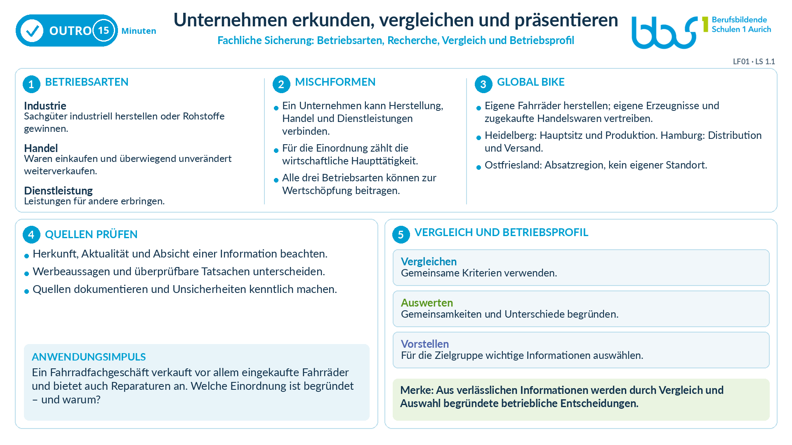](material/Intro_Outro/LF01_LS01_1_Outro.png) 

Fachliche Sicherung zu Betriebsarten, Global Bike, [Recherche](#recherche) und [Betriebsprofil](#betriebsprofil) 

- Industrie: industrielle Herstellung von Sachgütern oder Gewinnung von Rohstoffen. Handel: Einkauf und überwiegend unveränderter Weiterverkauf. [Dienstleistung](#dienstleistung): Leistung für andere.
- [Unternehmen](#unternehmen) können mehrere Tätigkeiten verbinden. Für die Einordnung zählt der wirtschaftliche Schwerpunkt; alle drei Betriebsarten können zur Wertschöpfung beitragen.
- Global Bike verbindet eigene Herstellung mit dem Vertrieb eigener Erzeugnisse und eingekaufter Handelswaren. Heidelberg ist Hauptsitz und Produktionsstandort, Hamburg Distributions- und Versandstandort. Ostfriesland ist Absatzregion, kein eigener [Standort](#standort).
- Informationen müssen zum Auftrag passen, nachvollziehbar und überprüft sein. Quellen und Unsicherheiten sind transparent zu machen.
- Ein Betriebsvergleich verwendet gemeinsame Kriterien und führt zu begründeten Erkenntnissen. Ein Profil enthält sachlich richtige, zielgruppenrelevante Informationen.

Anwendungsimpuls für die gemeinsame Sicherung: Ein Fahrradfachgeschäft verkauft vor allem eingekaufte Fahrräder und bietet zusätzlich Reparaturen an. Welche Einordnung ist anhand der Angaben begründet? Warum?

Merksatz: Aus verlässlichen Informationen werden durch Vergleich und Auswahl begründete betriebliche Entscheidungen.

[Material als bearbeitbare Markdown-Datei](material/fachsicherung.md)

## Glossar der Boardfassung

[Digitale Fassung öffnen](material/fachwoerter.html)

BFS dual · Lernfeld 1 · LS 1.1

★ Kernwortschatz des Fachbegriffschecks. Weitere Begriffe dienen der Vertiefung.

**Absatzregion** – Gebiet, in dem ein Unternehmen Produkte verkauft oder Kunden gewinnen möchte.

**Adressatengerechtigkeit ★** – Informationen so auswählen und erklären, dass sie zu den Menschen passen, für die sie bestimmt sind.

**Aktualität** – Eine Information ist aktuell, wenn sie noch zum heutigen Stand passt.

**Betrieb ★** – Eine organisierte Einheit, in der Güter hergestellt, Waren gehandelt oder Dienstleistungen erbracht werden.

**Betriebsart ★** – Einteilung eines Betriebs danach, was er hauptsächlich macht.

**Betriebsprofil ★** – Eine übersichtliche Darstellung wichtiger Informationen über einen Betrieb.

**Branche ★** – Ein Wirtschaftsbereich, in dem Unternehmen ähnliche Produkte oder Leistungen anbieten.

**Dienstleistung ★** – Eine Tätigkeit, die für andere erbracht wird, zum Beispiel eine Reparatur.

**Dienstleistungsbetrieb ★** – Ein Betrieb, der hauptsächlich Leistungen für andere erbringt.

**Fertigerzeugnis** – Ein Produkt, das ein Unternehmen selbst hergestellt hat und das zum Verkauf bereitsteht.

**Geschäftspartner ★** – Eine Person oder Organisation, mit der ein Unternehmen geschäftlich zusammenarbeitet.

**Handelsbetrieb ★** – Ein Betrieb, der Waren einkauft und überwiegend unverändert weiterverkauft.

**Handelsware** – Ein fertiges Produkt, das ein Unternehmen zum Weiterverkauf einkauft.

**Haupttätigkeit** – Die wirtschaftliche Tätigkeit, die den größten Beitrag zur Wertschöpfung leistet. Bei fehlenden Zahlen helfen Hinweise auf den Schwerpunkt.

**Industriebetrieb ★** – Ein Betrieb, der Sachgüter industriell herstellt oder Rohstoffe gewinnt. Häufig werden Maschinen eingesetzt und größere Mengen hergestellt.

**Informationsbedarf** – Die Informationen, die für eine bestimmte Aufgabe benötigt werden.

**Informationsquelle ★** – Der Ursprung oder das Medium, aus dem eine Information stammt.

**Kunde** – Eine Person oder Organisation, die Produkte oder Dienstleistungen kauft oder nachfragt.

**Kurzpräsentation** – Eine kurze, verständliche Vorstellung der wichtigsten Ergebnisse.

**Lieferant** – Eine Person oder Organisation, die einem Betrieb Waren, Materialien oder Leistungen liefert.

**Primärquelle** – Eine Quelle mit ursprünglichen Informationen, zum Beispiel die Produktbeschreibung eines Herstellers.

**Quellenangabe** – Eine Angabe, mit der andere die Herkunft einer Information nachvollziehen können.

**Recherche ★** – Die gezielte Suche nach Informationen.

**Relevanz** – Eine Information ist relevant, wenn sie für die Aufgabe oder Fragestellung wichtig ist.

**Sachgut ★** – Ein körperlicher Gegenstand mit wirtschaftlichem Nutzen, zum Beispiel ein Fahrrad.

**Schlussfolgerung** – Eine Aussage, die aus vorliegenden Informationen abgeleitet und begründet wird.

**Sekundärquelle** – Eine Quelle, die bereits vorhandene Informationen verarbeitet oder erklärt.

**Standort ★** – Ein Ort, an dem ein Unternehmen betriebliche Tätigkeiten ausführt.

**Unternehmen ★** – Eine rechtlich selbstständige wirtschaftliche Einheit, die einen oder mehrere Betriebe umfassen kann.

**Vergleichskriterium ★** – Ein Merkmal, anhand dessen mehrere Betriebe gegenübergestellt werden.

**Vorleistungen** – Waren und Dienstleistungen, die von anderen bezogen und bei der eigenen Leistungserstellung verbraucht werden.

**Wertschöpfung** – Der zusätzliche wirtschaftliche Wert, der bei der Leistungserstellung entsteht. Die Bruttowertschöpfung ist der Produktionswert abzüglich der Vorleistungen. Sie ist nicht dasselbe wie Gewinn.

**Wirtschaftssektoren** – Große Bereiche der Wirtschaft: Gewinnung von Naturprodukten und Rohstoffen, Verarbeitung und Herstellung sowie Handel und andere Dienstleistungen.

**Zielgruppe ★** – Die Personen oder Organisationen, an die sich eine Information oder ein Angebot richtet.

[Glossar als PDF](material/glossar.pdf)

[Material als bearbeitbare Markdown-Datei](material/fachwoerter.md)

## M1 – Die Global Bike Deutschland GmbH

[Digitale Fassung öffnen](material/m1.html)

BFS dual · Lernfeld 1 · LS 1.1

#### 1. Das Unternehmen im Überblick

Die Global Bike Deutschland GmbH wurde 2009 in Heidelberg gegründet und gehört zur Global Bike Group. Sie entwickelt, produziert und vertreibt Fahrräder und ausgewählte Fahrradkomponenten. Zubehörartikel werden auch von externen Lieferanten bezogen. Zu ihren Kunden gehören Groß- und Einzelhändler. Die Geschäftsleitung besteht aus Peter Schwarz und Hans-Werner Schoor. Global Bike ist das Modellunternehmen für diese betrieblichen Aufgaben.

#### 2. Was macht Global Bike?

 [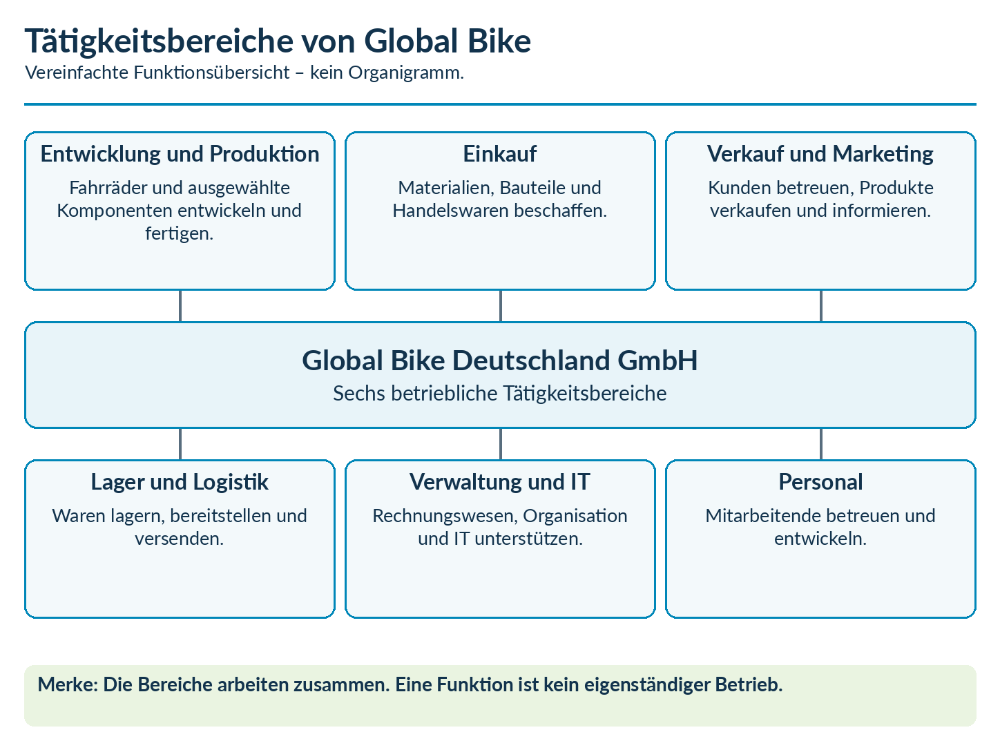](material/Materialmedien/M1_Global_Bike/LF01_LS01_1_M1_G01_Taetigkeitsbereiche_GlobalBike.png) 

Tätigkeitsbereiche von Global Bike. Vereinfachte Funktionsübersicht, kein Organigramm. 

Entwicklung und Produktion: Fahrräder und ausgewählte Komponenten entwickeln und fertigen; Bauteile werden beispielsweise montiert und Produkte geprüft.

Einkauf: Materialien, Bauteile und fertige Zubehörartikel beschaffen.

Verkauf und Marketing: Kunden betreuen, Produkte verkaufen und über das Sortiment informieren.

Lager und Logistik: Waren lagern, für Aufträge bereitstellen und versenden.

Verwaltung und IT: Betriebliche Abläufe organisieren, Rechnungswesen und IT unterstützen.

Personal: Mitarbeitende betreuen und deren Entwicklung unterstützen.

#### 3. Produkte und Leistungen

Global Bike bietet eigene Erzeugnisse und eingekaufte Handelswaren an. Fertigerzeugnisse sind hier selbst hergestellte, verkaufsfertige Produkte. Handelswaren sind fertig eingekaufte Produkte zum Weiterverkauf.

| Eigenprodukte (Auswahl) | Handelswaren (Auswahl) |
| --- | --- |
| Rennräder | Fahrradhelme |
| Mountainbikes | Wasserflaschen, Luftpumpen |
|  | Fahrrad-Zahlenschlösser, Reparatursets |

 [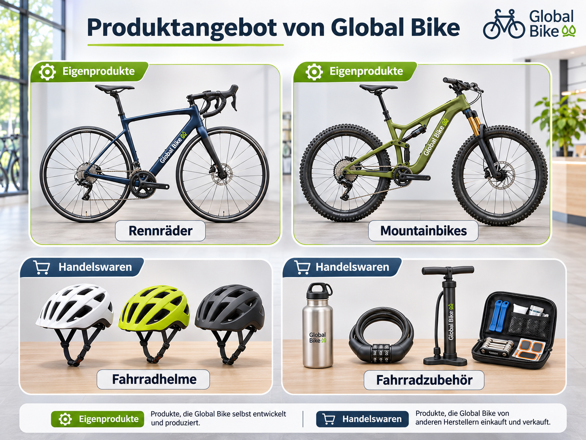](material/Materialmedien/M1_Global_Bike/LF01_LS01_1_M1_B01_Produktcollage_GlobalBike.png) 

Beispielhafte Produktgruppen, keine authentischen SAP-Produktabbildungen und kein vollständiger Katalog. 

#### 4. Standorte und Absatzregion

| Standort | Aufgaben |
| --- | --- |
| Heidelberg | Hauptsitz, Verwaltung, Produktion, Lager, Büros und Ladengeschäft |
| Hamburg | Lager für Norddeutschland, Distribution und Versand |

Ein [Standort](#standort) ist ein Ort, an dem betriebliche Tätigkeiten ausgeführt werden. Eine Absatzregion ist dagegen ein Gebiet, in dem ein [Unternehmen](#unternehmen) Produkte verkauft oder Kunden gewinnen möchte. Global Bike möchte in Ostfriesland Kundenbeziehungen entwickeln, ohne dort einen neuen Standort zu eröffnen. Warenbewegungen werden weiterhin über die bestehenden Standorte, insbesondere Hamburg, abgewickelt.

#### 5. Geschäftspartner

Lieferanten liefern Materialien, Bauteile und Handelswaren. Kunden kaufen die angebotenen Produkte. Dienstleister übernehmen beispielsweise Transportleistungen. Diese Gruppen können [Geschäftspartner](#geschaeftspartner) sein: Personen oder Organisationen, mit denen das Unternehmen geschäftlich zusammenarbeitet.

 [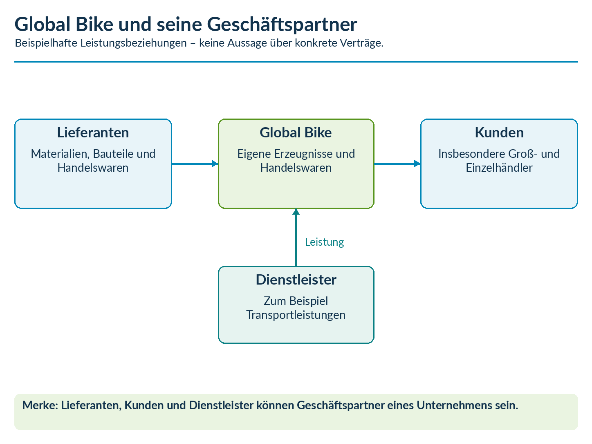](material/Materialmedien/M1_Global_Bike/LF01_LS01_1_M1_G02_GlobalBike_und_Geschaeftspartner.png) 

Beispielhafte Partnergruppen und Leistungsbeziehungen; keine Aussage über konkrete Verträge oder regionale Partner. Die Kundenstruktur umfasst insbesondere Groß- und Einzelhändler. 

#### 6. Vertiefung: Wie hängen die Tätigkeiten zusammen?

Die Produktion benötigt beschaffte Materialien. Fehlt ein wichtiges Bauteil, kann sich die Herstellung verzögern. Dadurch können zugesagte Liefertermine gefährdet werden. Der Verkauf benötigt daher Informationen über verfügbare Produkte; Lager und Logistik stellen Waren für Kundenaufträge bereit. Verwaltung, IT und Personal unterstützen diese Abläufe.

Vereinfachter Zusammenhang: Beschaffung → Produktion → Bereitstellung und Versand; Verkauf stimmt Kundenbedarf und Aufträge mit den beteiligten Bereichen ab. Das ist kein fest vorgeschriebener SAP-Prozess.

Der Verkauf eigener Erzeugnisse und der Weiterverkauf eingekaufter Waren unterscheiden sich. Ein Hersteller wird nicht allein deshalb zum [Handelsbetrieb](#handelsbetrieb), weil er seine Produkte verkauft. Entscheidend ist der wirtschaftliche Schwerpunkt ([M2](#m2)).

**Merke:** Ein Unternehmen kann verschiedene Tätigkeiten verbinden. Standort und Absatzregion sind nicht dasselbe.

#### Quellen M1 (interne Unterlagen; externe Fachgrundlagen, geprüft 26.11.2026)

- Global Bike Deutschland GmbH (1).pdf, Abschnitte 4–10; Organigramm der Global Bike Deutschland GmbH.pdf; Narrativer Rahmen für die Arbeit mit dem Modellunternehmen.pdf.
- Stammdaten Global Bike.xlsx, Fertigwaren Stammdaten und Handelswaren Stammdaten.
- Gabler Wirtschaftslexikon: [Fertigerzeugnis](https://wirtschaftslexikon.gabler.de/definition/fertigerzeugnis-33755), [Handelswaren](https://wirtschaftslexikon.gabler.de/definition/handelswaren-33567).
- Duden Wirtschaft / bpb: [Betriebswirtschaftslehre](https://www.bpb.de/kurz-knapp/lexika/lexikon-der-wirtschaft/18887/betriebswirtschaftslehre/).

[Material als bearbeitbare Markdown-Datei](material/m1.md)

## M2 – Betriebsarten unterscheiden

[Digitale Fassung öffnen](material/m2.html)

BFS dual · Lernfeld 1 · LS 1.1

#### 1. Betrieb und Unternehmen

Ein [Betrieb](#betrieb) ist eine organisierte Einheit, in der Güter hergestellt, Waren gehandelt oder Dienstleistungen erbracht werden. Ein [Unternehmen](#unternehmen) ist eine rechtlich selbstständige wirtschaftliche Einheit, die einen oder mehrere Betriebe umfassen kann. In der Alltagssprache werden beide Begriffe häufig gleichbedeutend verwendet. Eine [Betriebsart](#betriebsart) beschreibt in dieser Lernsituation den Schwerpunkt der wirtschaftlichen Tätigkeit.

Ein Fahrrad wird hergestellt, verkauft und möglicherweise später repariert. An diesen Tätigkeiten können unterschiedliche Betriebe beteiligt sein.

 [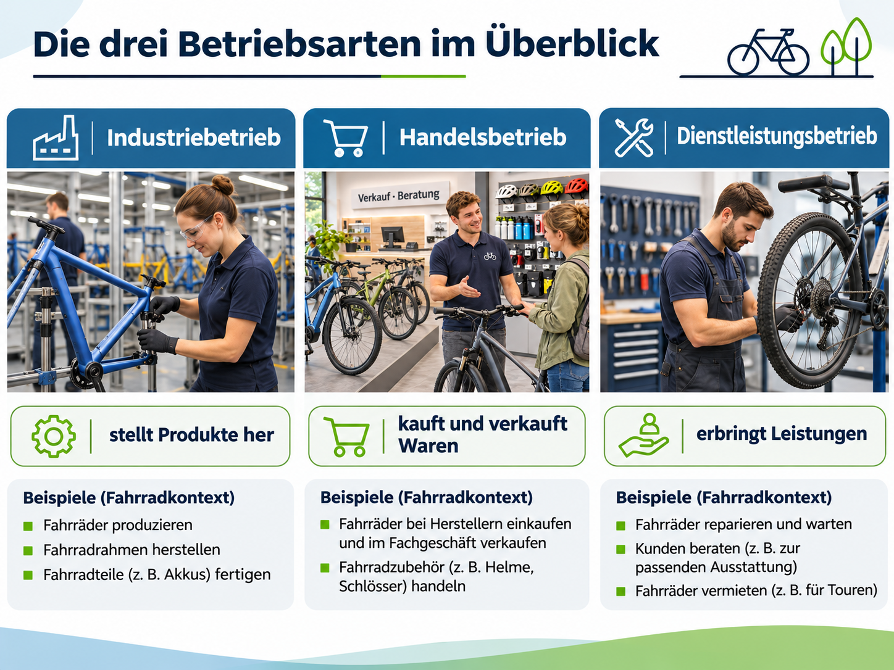](material/Materialmedien/M2_Betriebsarten/LF01_LS01_1_M2_G01_Drei_Betriebsarten_Ueberblick.png) 

Drei ausgewählte Betriebsarten am Beispiel der Fahrradbranche. Die wirtschaftliche Haupttätigkeit entscheidet über die begründete Einordnung. 

#### 2. Industriebetrieb

Ein [Industriebetrieb](#industriebetrieb) stellt Sachgüter industriell her oder gewinnt Rohstoffe. Typisch sind häufig Maschinen, Arbeitsteilung, standardisierte Abläufe und größere Produktionsmengen. Materialien werden verarbeitet, Bauteile montiert, Produkte geprüft und verkauft.

 [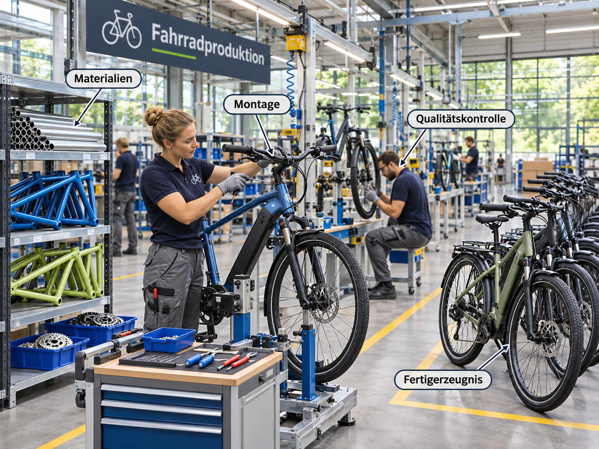](material/Materialmedien/M2_Betriebsarten/LF01_LS01_1_M2_B01_Industriebetrieb_Fahrradproduktion.png) 

Industrielle Fahrradproduktion: Materialien, Montage, Qualitätskontrolle, Fertigerzeugnis. Allgemeines Anschauungsbild. [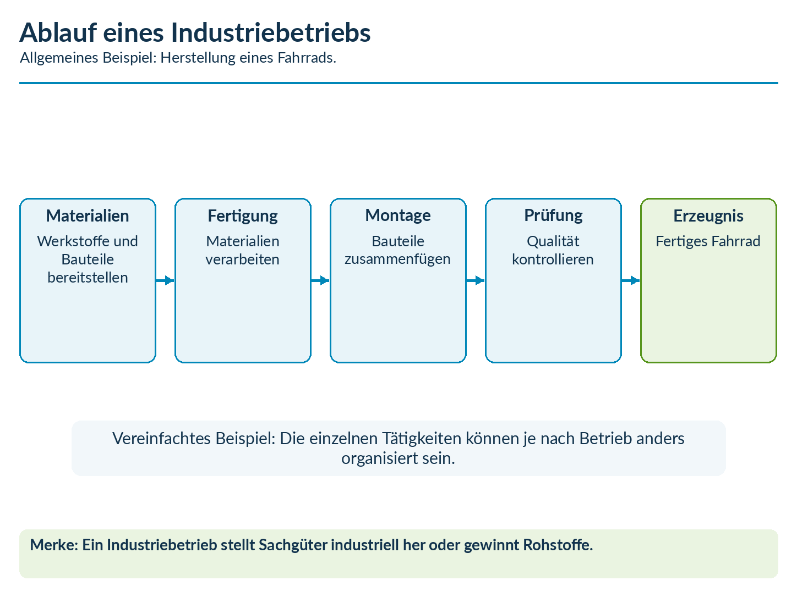](material/Materialmedien/M2_Betriebsarten/LF01_LS01_1_M2_G02_Ablauf_Industriebetrieb.png) 

Vereinfachter industrieller Herstellungsablauf. Die dargestellte Rahmenfertigung ist ein allgemeines Beispiel, kein Nachweis eines konkreten Global-Bike-Fertigungsverfahrens. 

Auch Handwerksbetriebe stellen Produkte her, häufig stärker auf einzelne Kundenaufträge bezogen. Produktionsmenge und Maschineneinsatz sind Hinweise, aber keine ausnahmslosen Abgrenzungsregeln.

**Merke:** Industrielle Herstellung oder Rohstoffgewinnung steht im Mittelpunkt.

#### 3. Handelsbetrieb

Ein [Handelsbetrieb](#handelsbetrieb) kauft Waren ein und verkauft sie überwiegend unverändert weiter. Er beschafft, lagert, präsentiert und verkauft Waren und berät häufig Kunden.

 [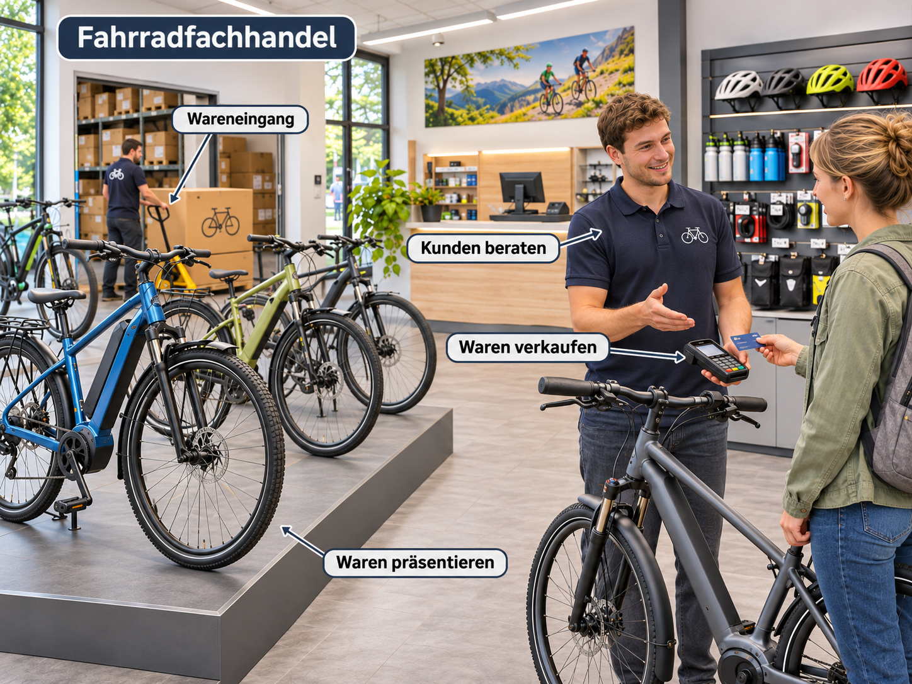](material/Materialmedien/M2_Betriebsarten/LF01_LS01_1_M2_B02_Handelsbetrieb_Fahrradfachhandel.png) 

Fahrradfachhandel: Wareneingang, Warenpräsentation, Kundenberatung und Verkauf. [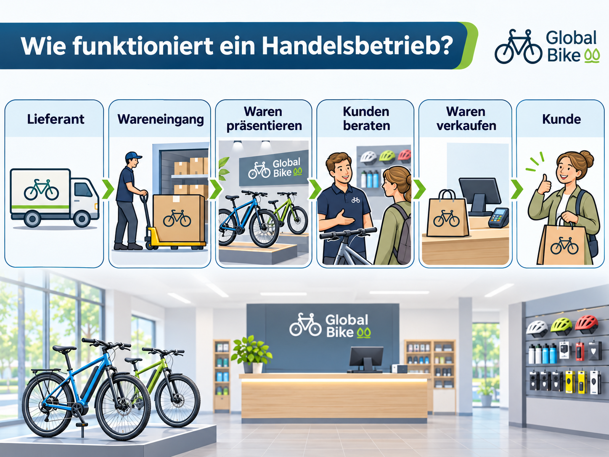](material/Materialmedien/M2_Betriebsarten/LF01_LS01_1_M2_G03_Ablauf_Handelsbetrieb.png) 

Allgemeines Beispiel aus der Fahrradbranche: Lieferant, Wareneingang, Präsentation, Beratung, Verkauf, Kunde. Das Logo dient der didaktischen Illustration; keine Einordnung von Global Bike als reiner Handelsbetrieb. 

Der Handel macht Waren für Kunden verfügbar. Er kann unterschiedliche Produkte zu einem Sortiment zusammenstellen und räumliche oder zeitliche Unterschiede zwischen Herstellung und Nachfrage ausgleichen. Beratung, Lieferung oder Montage können ergänzende Leistungen sein.

**Merke:** Der Einkauf und Weiterverkauf fertiger Waren steht im Mittelpunkt.

#### 4. Dienstleistungsbetrieb

Ein [Dienstleistungsbetrieb](#dienstleistungsbetrieb) erbringt hauptsächlich Leistungen für andere Menschen oder Unternehmen. Beispiele sind Reparatur, Beratung oder Transport. Es geht vor allem um eine Tätigkeit für den Kunden, nicht um die Herstellung eines neuen Sachguts.

 [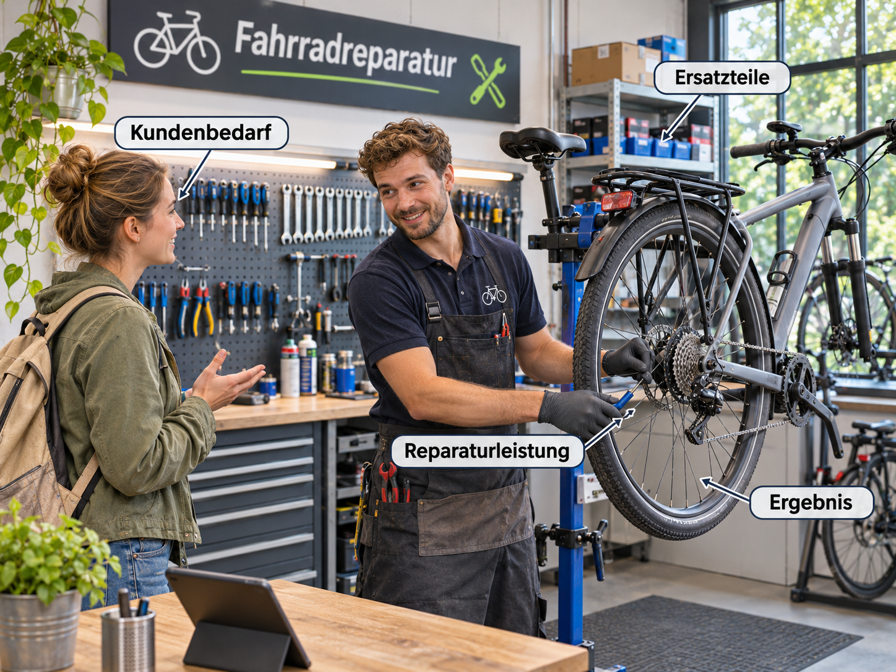](material/Materialmedien/M2_Betriebsarten/LF01_LS01_1_M2_B03_Dienstleistungsbetrieb_Fahrradreparatur.png) 

Fahrradreparatur: Kundenbedarf, Ersatzteile, Reparaturleistung und angestrebtes Ergebnis. Das Foto zeigt die laufende Reparatur, nicht den Nachweis eines fertigen Ergebnisses. [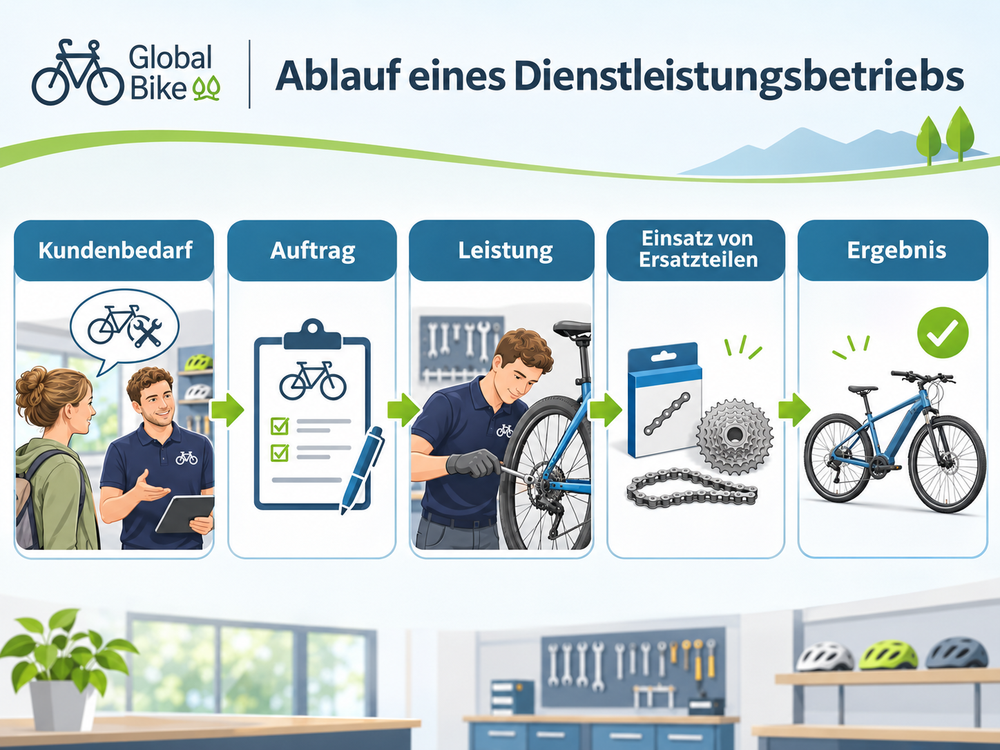](material/Materialmedien/M2_Betriebsarten/LF01_LS01_1_M2_G04_Ablauf_Dienstleistungsbetrieb.png) 

Allgemeines Beispiel eines Reparaturauftrags. Ersatzteile werden bei Bedarf im Rahmen der Leistung eingesetzt, nicht zwingend erst danach; kein belegter eigener Reparaturbetrieb von Global Bike. 

Bei einer Reparatur können Sachgüter wie Bremsbeläge oder Reifen eingesetzt werden. Dennoch steht die Reparaturleistung im Mittelpunkt.

**Merke:** Dienstleistungen erfüllen einen Bedarf durch eine Leistung für andere.

#### 5. Sachgüter und Dienstleistungen im Vergleich

Ein [Sachgut](#sachgut) ist ein körperlicher Gegenstand mit wirtschaftlichem Nutzen, etwa ein Fahrrad oder Helm. Eine [Dienstleistung](#dienstleistung) ist eine Tätigkeit für andere, zum Beispiel die Reparatur eines Fahrrads.

| Merkmal | Industriebetrieb | Handelsbetrieb | Dienstleistungsbetrieb |
| --- | --- | --- | --- |
| Haupttätigkeit | industriell herstellen / gewinnen | einkaufen und weiterverkaufen | Leistungen erbringen |
| Angebot | eigene Erzeugnisse | eingekaufte Waren | Leistungen |
| Beispiel | Fahrradproduktion | Fahrradfachhandel | Fahrradreparatur |
| Nutzen | Produkte entstehen | Produkte werden verfügbar | Kundenbedarf wird erfüllt |

#### 6. Mischformen und Haupttätigkeit

Ein Fahrradfachgeschäft kann Waren verkaufen und gleichzeitig eine Werkstatt betreiben. Ein Hersteller kann auch zugekaufte Artikel verkaufen. Die wirtschaftliche Haupttätigkeit ist in der amtlichen Wirtschaftsklassifikation die Tätigkeit mit dem größten Beitrag zur Wertschöpfung. Für unsere vereinfachte Einordnung helfen Angaben zu Leistungsangebot, Herstellungsverfahren und erkennbaren Arbeitsschwerpunkten. Umsatzanteile können Hinweise geben, sind aber nicht dasselbe wie Wertschöpfungsanteile. Wenn Zahlen fehlen, begründen Sie Ihre Einschätzung und kennzeichnen Unsicherheiten.

#### 7. Vertiefung: Wertschöpfung

Industrie, Handel und Dienstleistungen können zusätzlichen wirtschaftlichen Wert schaffen. Ein Hersteller verarbeitet Materialien; ein Händler macht ein Sortiment verfügbar; ein Reparaturbetrieb erbringt eine Leistung. Bruttowertschöpfung ist der Produktionswert abzüglich der Vorleistungen (bezogene und bei der Leistungserstellung verbrauchte Waren und Dienstleistungen). Sie ist nicht mit Gewinn gleichzusetzen.

Fiktives Rechenbeispiel zur Veranschaulichung, keine Global-Bike-Daten: Produktionswert 500 €, Vorleistungen 300 €, Bruttowertschöpfung 200 €. Eine Berechnung wird in der LS nicht verlangt.

#### 8. Branche und Betriebsart

Eine [Branche](#branche) beschreibt den Wirtschaftsbereich, in dem ähnliche Tätigkeiten oder Angebote vorkommen. Die Betriebsart beschreibt hier die Haupttätigkeit. Hersteller, Händler und Werkstatt können zur Fahrradbranche gehören, obwohl sie unterschiedliche Tätigkeiten übernehmen.

#### 9. Vertiefung: Wirtschaftssektoren

Die drei in dieser LS untersuchten Betriebsarten sind keine vollständige Einteilung aller Betriebe. In der Volkswirtschaftslehre gibt es eine weitere Betrachtung:

| Sektor | Beispiele |
| --- | --- |
| Primär | Landwirtschaft, Fischerei |
| Sekundär | verarbeitende Industrie, Bauwirtschaft |
| Tertiär | Handel, Transport, Beratung |

Handel zählt hier zum tertiären Sektor. Das widerspricht der betriebswirtschaftlichen Unterscheidung zwischen Handels- und Dienstleistungsbetrieben nicht, weil die Einteilungen unterschiedliche Zwecke haben. Je nach Sektorabgrenzung gibt es weitere Zuordnungen (z. B. Bergbau).

**Merke:** Für eine begründete Zuordnung zählt die wirtschaftliche Haupttätigkeit. Mischformen sind möglich. Fehlende Daten rechtfertigen keine unbelegten Behauptungen.

#### Quellen M2 (geprüft 26.11.2026)

- Duden Wirtschaft / bpb: [Betrieb](https://www.bpb.de/kurz-knapp/lexika/lexikon-der-wirtschaft/18861/betrieb/), [Unternehmen](https://www.bpb.de/kurz-knapp/lexika/lexikon-der-wirtschaft/20918/unternehmen/), [Industriebetrieb](https://www.bpb.de/kurz-knapp/lexika/lexikon-der-wirtschaft/19717/industriebetrieb/), [Dienstleistungsbetrieb](https://www.bpb.de/kurz-knapp/lexika/lexikon-der-wirtschaft/19049/dienstleistungsbetrieb/).
- Gabler Wirtschaftslexikon: [Handelsbetrieb](https://wirtschaftslexikon.gabler.de/definition/handelsbetrieb-32612), [Handel](https://wirtschaftslexikon.gabler.de/definition/handel-35491).
- Statistisches Bundesamt: [FAQ WZ 2025](https://www.destatis.de/DE/Methoden/Klassifikationen/FAQ/wz-2025-faq-cluster.html), [Bruttoinlandsprodukt und Wertschöpfung](https://www.destatis.de/DE/Themen/Wirtschaft/Volkswirtschaftliche-Gesamtrechnungen-Inlandsprodukt/Methoden/bip.html).
- bpb: [Wirtschaftssektoren](https://www.bpb.de/kurz-knapp/lexika/politiklexikon/296546/wirtschaftssektoren/).

[Material als bearbeitbare Markdown-Datei](material/m2.md)

## M3 – Betriebliche Informationen recherchieren

[Digitale Fassung öffnen](material/m3.html)

BFS dual · Lernfeld 1 · LS 1.1

#### 1. Was bedeutet Recherche?

[Recherche](#recherche) ist die gezielte Suche nach Informationen. Eine gute Recherche liefert nicht einfach möglichst viele Angaben. Sie liefert passende, überprüfbare Informationen für einen konkreten Auftrag. Der Informationsbedarf beschreibt, welche Angaben für die Aufgabe benötigt werden.

#### 2. Geeignete Informationsquellen

| Quelle | Typische Angaben |
| --- | --- |
| Unternehmenswebsite / Broschüre | Angebot, Tätigkeiten, Standorte, Geschichte |
| Impressum | Verantwortlicher Anbieter und Unternehmensangaben |
| Branchenverzeichnis | Betriebe in einer [Branche](#branche) oder Region |
| Zeitungsartikel | Ereignisse und Hintergrundinformationen |
| Unternehmensregister | Veröffentlichte Register- und Unternehmensinformationen |
| Interne Unterlagen | Informationen über das eigene [Unternehmen](#unternehmen); für Global Bike [M1](#m1) und Modellunterlagen |

Keine Quelle beantwortet jede Frage. Die Eignung hängt vom Informationsbedarf ab.

#### 3. Fünf Schritte einer Recherche

1. Informationsbedarf klären: Welche Angaben werden benötigt?
2. Informationen suchen: Gezielte Suchbegriffe kombinieren, etwa Tätigkeit und Region statt nur „Firmen“.
3. Informationen überprüfen: Herkunft, Aktualität und Belege prüfen.
4. Informationen auswählen: Was hilft beim konkreten Auftrag?
5. Informationen dokumentieren: Ergebnisse in eigenen Worten mit Quellenangabe festhalten.

#### 4. Quellencheck

| Kriterium | Leitfrage |
| --- | --- |
| Herkunft | Wer hat die Information veröffentlicht? |
| Aktualität | Ist die Angabe noch gültig? |
| Absicht | Soll informiert, geworben oder beeinflusst werden? |
| Überprüfbarkeit | Gibt es geeignete Belege oder weitere Quellen? |
| Relevanz | Hilft die Information beim Auftrag? |

Eine Unternehmenswebsite kann gut über das eigene Sortiment informieren. Aussagen wie „bester Anbieter der Region“ sind hingegen Selbstdarstellungen, solange unabhängige Belege fehlen. Eine Primärquelle liefert ursprüngliche Angaben, z. B. eine Produktbeschreibung des Herstellers. Eine Sekundärquelle verarbeitet vorhandene Angaben, z. B. ein Bericht darüber. Keine der beiden ist automatisch zuverlässig oder objektiv.

#### 5. Angaben dokumentieren

Eine Quellenangabe macht die Herkunft einer Information nachvollziehbar. Für Internetquellen sind Herausgeber, Seitentitel, URL und Abrufdatum ausreichend; soweit vorhanden, auch das Veröffentlichungsdatum. Bei internen Unterlagen reichen Titel und Abschnitt bzw. eindeutige Materialangabe.

Eine überprüfbare Tatsache, eine Einschätzung und eine eigene Schlussfolgerung sind zu unterscheiden. Eine Schlussfolgerung muss aus den Angaben nachvollziehbar abgeleitet werden.

#### 6. Fehlende und widersprüchliche Informationen

Nicht alle Betriebe veröffentlichen Umsätze, Beschäftigtenzahlen oder die Bedeutung ihrer einzelnen Tätigkeiten. Fehlende Angaben werden als „Keine Information verfügbar“ gekennzeichnet und nicht erfunden. Bei Widersprüchen prüfen Sie Aktualität, Herausgeber und Bezugsgegenstand (z. B. einzelner [Standort](#standort) oder gesamtes Unternehmen). Suchen Sie gegebenenfalls weitere Belege. Bleibt ein Widerspruch offen, kennzeichnen Sie die Unsicherheit.

#### 7. KI als freiwillige Unterstützung

Die schulische KI-Lernassistenz kann bei Suchbegriffen, Begriffserklärungen und Strukturierung helfen. Eine KI-Antwort ist kein Beleg für eine konkrete Unternehmensangabe. Prüfen Sie Aussagen anhand geeigneter Quellen und machen Sie genutzte Unterstützung transparent.

**Merke:** Eine gute Recherche ist auftragsbezogen, nachvollziehbar, kritisch geprüft und verständlich dokumentiert.

#### Quellen M3 (geprüft 26.11.2026)

- Humboldt-Universität zu Berlin, LIS Study Guide: [Wissenschaftliches Arbeiten – Quellenrecherche und -bewertung](https://ibi.pages.cms.hu-berlin.de/lis-study-guide/guide/wiss_arbeiten/).
- Unternehmensregister: [Inhalte](https://unternehmensregister.de/de/so-gehts/inhalt), [Registerinformationen](https://www.unternehmensregister.de/de/so-gehts/registerinformationen?language=de).
- Fünf-Schritte-Modell und Quellencheck: eigene didaktische Aufbereitung.

[Material als bearbeitbare Markdown-Datei](material/m3.md)

## M4 – Betriebe systematisch vergleichen

[Digitale Fassung öffnen](material/m4.html)

BFS dual · Lernfeld 1 · LS 1.1

#### 1. Was bedeutet vergleichen?

Bei einem Vergleich werden mehrere Gegenstände anhand gemeinsamer Merkmale gegenübergestellt. Ein [Vergleichskriterium](#vergleichskriterium) ist ein Merkmal, anhand dessen Betriebe gegenübergestellt werden. So können Gemeinsamkeiten und Unterschiede erkannt und Schlussfolgerungen begründet werden.

#### 2. Geeignete Kriterien

| Kriterium | Leitfrage |
| --- | --- |
| [Standort](#standort) | Wo ist der [Betrieb](#betrieb) tätig? |
| [Branche](#branche) | Welchem Wirtschaftsbereich gehört er an? |
| Haupttätigkeit | Was macht er hauptsächlich? |
| Leistungsangebot | Welche Produkte oder Dienstleistungen bietet er an? |
| [Betriebsart](#betriebsart) | Wie lässt sich der Betrieb begründet einordnen? |
| Kundengruppen | An wen richtet sich das Angebot? |
| Besonderheiten | Was zeichnet ihn aus? |

Das Ziel des Vergleichs bestimmt die Kriterien. Für die Vorbereitung eines Geschäftskontakts können andere Merkmale wichtig sein als für die Information über Ausbildungsangebote. Verwenden Sie möglichst dieselben Merkmale für alle untersuchten Betriebe. Wer bei einem Betrieb den Standort und bei einem anderen nur das Sortiment untersucht, kann diese Angaben nicht unmittelbar vergleichen.

#### 3. Vorgehen beim Vergleich

Ziel klären → Kriterien auswählen und begründen → Informationen gegenüberstellen → Gemeinsamkeiten und Unterschiede erkennen und erklären → Schlussfolgerung für den Auftrag formulieren.

Eine optionale Arbeitsstruktur (keine verbindliche Produktform):

| Vergleichskriterium | Global Bike | Regionalbetrieb 1 | Regionalbetrieb 2 | Regionalbetrieb 3 |
| --- | --- | --- | --- | --- |
| Kriterium 1 |  |  |  |  |
| Kriterium 2 |  |  |  |  |
| Kriterium 3 |  |  |  |  |
| Kriterium 4 |  |  |  |  |

#### 4. Beschreiben, vergleichen, schlussfolgern

Beschreiben: Ein Anbieter verkauft Fahrradreifen. Ein anderer stellt Fahrradreifen her.

Vergleichen: Beide beschäftigen sich mit Fahrradreifen; sie übernehmen jedoch unterschiedliche wirtschaftliche Tätigkeiten.

Schlussfolgern: Das gleiche Produkt bedeutet nicht automatisch dieselbe Betriebsart.

Mögliche Satzanfänge: „Beide Betriebe …“, „Während …, …“, „Die Zuordnung ist begründet, weil …“, „Eine eindeutige Einordnung ist nicht möglich, weil …“, „Für den Auftrag folgt daraus …“.

#### 5. Vertiefung: Grenzen und Bewertung

Ein Vergleich ist nur so belastbar wie seine Informationsbasis. Andere Vergleichskriterien können andere Erkenntnisse ergeben. Ein Merkmal allein reicht oft nicht, um einen Betrieb umfassend zu verstehen. Drei ausgewählte regionale Betriebe sind keine repräsentative Untersuchung der gesamten Wirtschaft Ostfrieslands.

Vergleichen zeigt Gemeinsamkeiten und Unterschiede. Bewerten geht weiter: Es beurteilt die Eignung anhand bestimmter Maßstäbe. In dieser LS wird keine Rangfolge der besten Betriebe benötigt; entscheidend ist die begründete Einordnung und die Ableitung relevanter Informationen für Jan Richter.

**Merke:** Gemeinsame Kriterien, zuverlässige Informationen und begründete Schlussfolgerungen machen den Vergleich aussagekräftig.

#### Quellen M4 (geprüft 26.11.2026)

- Lehrkräftefortbildung Baden-Württemberg: [Operatorenkatalog nach Anforderungsbereichen](https://lehrerfortbildung-bw.de/u_gewi/gk/gym/bp2016/fb5/2_komp/5_operatoren/), insbesondere vergleichen, erklären und begründen.
- Kriterienraster, Satzanfänge und Übertragung auf den betrieblichen Auftrag: eigene didaktische Aufbereitung.

[Material als bearbeitbare Markdown-Datei](material/m4.md)

## M5 – Ein Betriebsprofil erstellen

[Digitale Fassung öffnen](material/m5.html)

BFS dual · Lernfeld 1 · LS 1.1

#### 1. Was ist ein Betriebsprofil?

Ein [Betriebsprofil](#betriebsprofil) ist eine übersichtliche Darstellung wichtiger Informationen über einen [Betrieb](#betrieb). Es vermittelt einen ersten Eindruck seiner Tätigkeiten, Leistungen und Besonderheiten. Es kann z. B. in Broschüren, auf Websites oder bei geschäftlichen Veranstaltungen verwendet werden.

#### 2. Mögliche Bestandteile

| Bereich | Mögliche Inhalte |
| --- | --- |
| Allgemeine Angaben | Name, [Standort](#standort), Gründungsjahr |
| Wirtschaftliche Tätigkeit | [Branche](#branche), Haupttätigkeit, [Betriebsart](#betriebsart) |
| Produkte und Leistungen | wichtigste Angebote |
| Kunden und [Geschäftspartner](#geschaeftspartner) | Kundengruppen und geschäftliche Beziehungen |
| Besonderheiten | belegte Merkmale |
| Quellen | Herkunft der Angaben |

Ein Profil hat keine allgemeingültige Pflichtgliederung. Welche Angaben wichtig sind, hängt vom Zweck und der [Zielgruppe](#zielgruppe) ab.

#### 3. Zielgruppe und Adressatengerechtigkeit

Eine Zielgruppe besteht aus Personen oder Organisationen, an die sich ein Angebot oder eine Information richtet. [Adressatengerechtigkeit](#adressatengerechtigkeit) bedeutet, Inhalte, Sprache und Darstellung auf diese Empfänger abzustimmen.

| Zielgruppe | Möglicher Informationsbedarf |
| --- | --- |
| Kunden | Produkte, Qualität, Preise, Service |
| Geschäftspartner | Tätigkeitsbereiche, Angebote, mögliche Zusammenarbeit |
| Ausbildungsinteressierte | Aufgaben, Arbeitsbereiche, Ausbildungsmöglichkeiten |

Diese Interessen sind Beispiele, keine Feststellung über konkrete Personen. Die tatsächlichen Bedürfnisse sind im Auftrag zu berücksichtigen.

#### 4. Vertiefung: Informationen auswählen und gewichten

Für ein bestimmtes Profil sind manche Informationen unverzichtbar, andere ergänzend, wieder andere wenig relevant. Welche Informationen zu welcher Gruppe gehören, muss begründet entschieden werden. Ein gutes Profil enthält nicht alles, sondern das Wichtige. Das Weglassen darf aber kein falsches Bild erzeugen.

Werbeaussagen wie „beste Qualität“ müssen belegt oder als Selbstdarstellung gekennzeichnet werden. Eine sachliche Beschreibung darf durchaus positiv sein, aber sie muss überprüfbar bleiben.

#### 5. Ein geeignetes Medium auswählen

Ein Steckbrief ordnet Informationen formal und übersichtlich. Ein Plakat kann wichtige Informationen visuell gewichten. Gesprächskarten erlauben eine flexible mündliche Darstellung. Kein Medium ist grundsätzlich überlegen. Entscheidend ist die Eignung für Auftrag und Zielgruppe, nicht die technische oder zeichnerische Gestaltung.

#### 6. Kurzpräsentation vorbereiten

Einstieg: [Unternehmen](#unternehmen) und Anlass benennen. Hauptteil: wichtige fachliche Informationen, Vergleichserkenntnisse und Empfehlung erläutern. Abschluss: zentrale Aussage zusammenfassen. Stichpunkte helfen beim freien Sprechen; Tabellen oder Bilder können die Erklärung unterstützen. Beachten Sie den vereinbarten Zeitrahmen.

Die Kurzpräsentation ist die fachliche Vorstellung des Ergebnisses. Der freiwillige Bewertungspitch berücksichtigt zusätzlich Entscheidungen, Prozessreflexion und Fachgespräch.

**Merke:** Ein gutes Betriebsprofil ist richtig, verständlich, auftragsbezogen, übersichtlich und durch Quellen nachvollziehbar.

#### Quellen M5 (geprüft 26.11.2026)

- IHK Region Stuttgart: [Hinweise zum Unternehmenskauf – Unternehmensprofil](https://www.ihk.de/stuttgart/fuer-unternehmen/nachfolge/hinweise-zum-unternehmenskauf-2744640). Die umfangreichen Anforderungen des Unternehmenskaufs werden nicht auf diese LS übertragen.
- IHK Chemnitz: [Zielgruppe / Kundennutzen](https://www.ihk.de/chemnitz/starthilfe/gruendung/neuer-inhalt4-unternehmensgruendung-planen-channel/iv-zielgruppe-i-kundennutzen-3387222).
- FernUniversität in Hagen: [Hinweise zur Präsentation und zur Präsentationstechnik](https://www.fernuni-hagen.de/controlling/lehre/seminare/praesentationshinweise.shtml).
- Profilraster und Gewichtung: didaktische Reduktion für BFS dual.

[Material als bearbeitbare Markdown-Datei](material/m5.md)

## Übersicht zum Fall

[Digitale Fassung öffnen](material/orientierung.html)

BFS dual · Lernfeld 1 · LS 1.1

[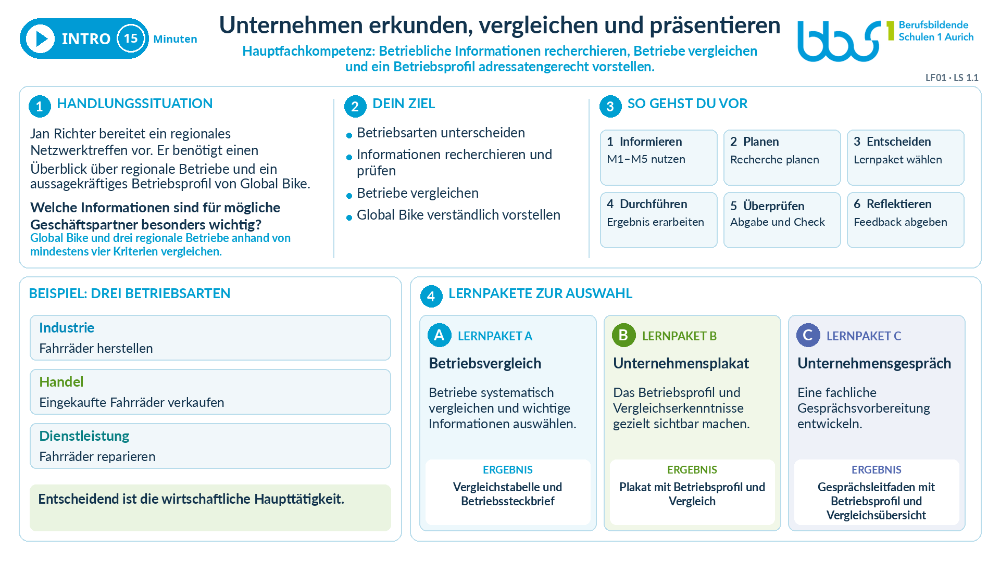](material/Intro_Outro/LF01_LS01_1_Intro.png) 

Der Advance Organizer zeigt das Fallbeispiel und die drei Wahlprodukte. Für den Ablauf und die letzten beiden Phasen gilt die Aufgabenübersicht in diesem Lernpaket. 

[Material als bearbeitbare Markdown-Datei](material/orientierung.md)

## Freiwillige Übungen

[Digitale Fassung öffnen](material/uebungen.html)

BFS dual · Lernfeld 1 · LS 1.1

Die zehn freiwilligen Aufgaben können Sie in beliebiger Reihenfolge bearbeiten und wiederholen. Wählen Sie eine Antwort und prüfen Sie Ihre Entscheidung.

**Übung 1**

- Beide Tätigkeiten sind Handel, weil die Produkte verkauft werden.
- Beide Tätigkeiten sind Industrie, weil Global Bike Hersteller ist.
- Der Helmverkauf ist eine Dienstleistung, weil Kunden beraten werden.
- Global Bike verbindet industrielle Herstellung mit Handelstätigkeit.
- Die Herstellung ist eine Dienstleistung, da Kunden Produkte nachfragen.
- Die Tätigkeiten sind allein nach der Branche einzuordnen.

**Übung 2**

- Die Anzahl angebotener Fahrradmodelle
- Der wirtschaftliche Schwerpunkt der Tätigkeiten
- Die Rechtsform des Unternehmens
- Der Wert der Werkstattausstattung
- Die Anzahl der Kundengruppen
- Die Branche der wichtigsten Lieferanten

**Übung 3**

- Als bestätigte Tatsache mit URL übernehmen
- Als falsch kennzeichnen, weil sie vom Betrieb stammt
- Als eigene Schlussfolgerung wiedergeben
- Mit einer zweiten Werbeaussage des Betriebs belegen
- Allein anhand des Veröffentlichungsdatums beurteilen
- Als Selbstaussage kennzeichnen und unabhängige Belege suchen

**Übung 4**

- Bei allen Betrieben dieselben auftragsbezogenen Kriterien untersuchen
- Je Betrieb andere Merkmale ohne gemeinsamen Maßstab wählen
- Nur vorhandene Umsatzzahlen zusammentragen
- Die Betriebe allein nach ihren Standorten ordnen
- Nur die Betriebsarten auflisten, ohne sie zu begründen
- Die Unternehmensgeschichten vergleichen, ohne die Tätigkeiten zu berücksichtigen

**Übung 5**

- Weil sein gesamter Umsatz Wertschöpfung ist.
- Weil die Herstellung beim Lieferanten ihm zugerechnet wird.
- Weil seine Vorleistungen stets wertlos sind.
- Weil alle Erlöse Gewinn sind.
- Weil er Waren beschafft, verfügbar macht und eigene Handelsleistungen erbringt.
- Weil er durch den Einkauf automatisch eigene Fertigerzeugnisse schafft.

**Übung 6**

- Alle Informationen in kleinerer Schrift übernehmen
- Nur positive Selbstaussagen auswählen
- Informationen nach dem Bedarf der Teilnehmenden auswählen und sachlich darstellen
- Alle Angaben durch Produktbilder ersetzen
- Nur allgemeine Stammdaten vorstellen
- Auswahl ausschließlich nach dem Platzangebot treffen

**Übung 7**

- Die Zahl eines ähnlich großen Betriebs verwenden
- Die fehlende Information kennzeichnen
- Eine ungeprüfte KI-Schätzung nutzen
- Die Zahl aus einem Teamfoto schätzen
- Einen Branchenmittelwert als Betriebszahl eintragen
- Den gesamten Betrieb ohne Prüfung ausschließen

**Übung 8**

- Unterschiedliche Produkte bedeuten unterschiedliche Betriebsarten.
- Beide gehören zwingend derselben Branche an.
- Nur Hersteller identischer Produkte sind vergleichbar.
- Beide können trotz unterschiedlicher Branchen Industriebetriebe sein.
- Die höhere Beschäftigtenzahl bestimmt die Betriebsart.
- Die Betriebsart richtet sich nach der Absatzregion.

**Übung 9**

- Ostfriesland wird dadurch zum Produktionsstandort.
- Ein neues regionales Lager ist bereits angelegt.
- Hamburg verliert seine Distributionsfunktion.
- Die Zentrale wird in die Absatzregion verlegt.
- Global Bike entwickelt den Absatzraum und nutzt weiterhin bestehende Standorte.
- Die Region wird zu einer neuen rechtlich selbstständigen Gesellschaft.

**Übung 10**

- Alle Betriebsarten kommen in der Region gleich häufig vor.
- Die Auswahl ist automatisch repräsentativ, weil alle drei Arten vorkommen.
- Die Auswahl zeigt unterschiedliche Tätigkeiten; Aussagen über die gesamte Region benötigen weitere Belege.
- Eine Betriebsart ist wirtschaftlich überlegen.
- Die regionale Wirtschaftsleistung lässt sich aus der Auswahl ableiten.
- Alle übrigen Betriebe lassen sich anhand dieser drei Fälle sicher zuordnen.

## Lernpaket A · Betriebsvergleich

[Digitale Fassung öffnen](material/weg-a.html)

BFS dual · Lernfeld 1 · LS 1.1

Wählen Sie genau ein Lernpaket. Alle lösen das Problem aus der HS. In jedem Paket recherchieren Sie drei regionale Betriebe, je einen mit erkennbarem Schwerpunkt Industrie, Handel und [Dienstleistung](#dienstleistung), und vergleichen diese mit Global Bike. Verwenden Sie mindestens vier gemeinsame, begründet ausgewählte Vergleichskriterien; Haupttätigkeit und Leistungsangebot sind verpflichtend. Begründen Sie die Betriebsarten aller vier Betriebe, berücksichtigen Sie Mischformen und kennzeichnen Sie Unsicherheiten. Erläutern Sie mindestens eine Gemeinsamkeit und zwei Unterschiede. Entscheiden und begründen Sie, welche zwei bis drei Informationen über Global Bike für mögliche [Geschäftspartner](#geschaeftspartner) besonders wichtig sind. Erstellen Sie ein adressatengerechtes [Betriebsprofil](#betriebsprofil) und bereiten Sie eine Kurzpräsentation in Stichpunkten vor.

Dokumentieren Sie Quellen und kurze Prozessnotizen (Phase 4). Alle Materialien [M1](#m1)–[M5](#m5) und die KI-Lernassistenz sind frei verfügbar. Analog oder digital; Die Zusammenarbeit gestalten Sie selbst. Es ist keine aufwendige Technik nötig. Die tatsächliche Präsentation ist freiwillig.

**Ihr betrieblicher Auftrag:** Wie Sie der HS entnehmen können, fehlen Jan Richter für das regionale Netzwerktreffen ein fundierter Überblick über die Betriebe in Ostfriesland und eine geeignete Vorstellung von Global Bike. Erstellen Sie eine Entscheidungshilfe in Form eines Betriebsvergleichs und eines Betriebssteckbriefs.

**Vorgehen:** 1. Recherchieren Sie die drei regionalen Betriebe sowie Global Bike (M1–M3). 2. Wählen und begründen Sie die vier oder mehr Vergleichskriterien (M4). 3. Stellen Sie alle vier Betriebe tabellarisch gegenüber und begründen Sie die jeweilige Einordnung. 4. Erläutern Sie mindestens eine Gemeinsamkeit und zwei Unterschiede. 5. Leiten Sie daraus zwei bis drei hervorzuhebende Informationen über Global Bike ab und begründen Sie diese für das Netzwerktreffen. 6. Erstellen Sie den Betriebssteckbrief und bereiten Sie die Kurzpräsentation vor (M5).

**Abzugebendes Handlungsergebnis:** Vergleichstabelle mit Einordnungen und Auswertung, Betriebssteckbrief mit begründeter Empfehlung, Quellenangaben und Präsentationsstichpunkte. Jan Richter kann damit entscheiden, wie Global Bike vorgestellt werden soll.

**Zugang:** analytisch-strukturierend. Die Tabelle kann frei gestaltet oder mit dem optionalen Raster in M4 begonnen werden.

[Material als bearbeitbare Markdown-Datei](material/weg-a.md)

## Lernpaket B · Unternehmensplakat

[Digitale Fassung öffnen](material/weg-b.html)

BFS dual · Lernfeld 1 · LS 1.1

Wählen Sie genau ein Lernpaket. Alle lösen das Problem aus der HS. In jedem Paket recherchieren Sie drei regionale Betriebe, je einen mit erkennbarem Schwerpunkt Industrie, Handel und [Dienstleistung](#dienstleistung), und vergleichen diese mit Global Bike. Verwenden Sie mindestens vier gemeinsame, begründet ausgewählte Vergleichskriterien; Haupttätigkeit und Leistungsangebot sind verpflichtend. Begründen Sie die Betriebsarten aller vier Betriebe, berücksichtigen Sie Mischformen und kennzeichnen Sie Unsicherheiten. Erläutern Sie mindestens eine Gemeinsamkeit und zwei Unterschiede. Entscheiden und begründen Sie, welche zwei bis drei Informationen über Global Bike für mögliche [Geschäftspartner](#geschaeftspartner) besonders wichtig sind. Erstellen Sie ein adressatengerechtes [Betriebsprofil](#betriebsprofil) und bereiten Sie eine Kurzpräsentation in Stichpunkten vor.

Dokumentieren Sie Quellen und kurze Prozessnotizen (Phase 4). Alle Materialien [M1](#m1)–[M5](#m5) und die KI-Lernassistenz sind frei verfügbar. Analog oder digital; Die Zusammenarbeit gestalten Sie selbst. Es ist keine aufwendige Technik nötig. Die tatsächliche Präsentation ist freiwillig.

**Ihr betrieblicher Auftrag:** Wie Sie der HS entnehmen können, benötigt Jan Richter für das regionale Netzwerktreffen eine verständliche Vorstellung von Global Bike im regionalen Unternehmensumfeld. Entwickeln Sie ein Plakat, das die fachlichen Erkenntnisse sichtbar macht und wichtige Unternehmensinformationen gezielt hervorhebt.

**Vorgehen:** 1. Recherchieren Sie die drei regionalen Betriebe sowie Global Bike (M1–M3). 2. Wählen und begründen Sie die vier oder mehr Vergleichskriterien (M4). 3. Vergleichen Sie alle vier Betriebe, begründen Sie ihre Einordnung und erläutern Sie mindestens eine Gemeinsamkeit und zwei Unterschiede. 4. Entscheiden und begründen Sie, welche zwei bis drei Global-Bike-Informationen für die Teilnehmenden besonders wichtig sind. 5. Ordnen und visualisieren Sie die Informationen auf dem Plakat. Das Betriebsprofil und die zentralen Vergleichserkenntnisse müssen erkennbar sein. Eine ergänzende Übersicht darf die vollständigen Vergleichsangaben aufnehmen (M5). 6. Bereiten Sie eine Kurzpräsentation vor, die auch die Auswahl und Anordnung der Informationen erläutert.

**Abzugebendes Handlungsergebnis:** Unternehmensplakat mit Betriebsprofil, begründeter Empfehlung und Vergleichserkenntnissen; bei Bedarf ergänzende Vergleichsübersicht; Quellenangaben und Präsentationsstichpunkte. Jan Richter kann es beim Netzwerktreffen einsetzen.

**Zugang:** kreativ-entwickelnd und visuell. Handzeichnung, Textfelder oder einfache digitale Darstellung sind gleichwertig; keine aufwendige Gestaltung vorausgesetzt.

[Material als bearbeitbare Markdown-Datei](material/weg-b.md)

## Lernpaket C · Unternehmensgespräch

[Digitale Fassung öffnen](material/weg-c.html)

BFS dual · Lernfeld 1 · LS 1.1

Wählen Sie genau ein Lernpaket. Alle lösen das Problem aus der HS. In jedem Paket recherchieren Sie drei regionale Betriebe, je einen mit erkennbarem Schwerpunkt Industrie, Handel und [Dienstleistung](#dienstleistung), und vergleichen diese mit Global Bike. Verwenden Sie mindestens vier gemeinsame, begründet ausgewählte Vergleichskriterien; Haupttätigkeit und Leistungsangebot sind verpflichtend. Begründen Sie die Betriebsarten aller vier Betriebe, berücksichtigen Sie Mischformen und kennzeichnen Sie Unsicherheiten. Erläutern Sie mindestens eine Gemeinsamkeit und zwei Unterschiede. Entscheiden und begründen Sie, welche zwei bis drei Informationen über Global Bike für mögliche [Geschäftspartner](#geschaeftspartner) besonders wichtig sind. Erstellen Sie ein adressatengerechtes [Betriebsprofil](#betriebsprofil) und bereiten Sie eine Kurzpräsentation in Stichpunkten vor.

Dokumentieren Sie Quellen und kurze Prozessnotizen (Phase 4). Alle Materialien [M1](#m1)–[M5](#m5) und die KI-Lernassistenz sind frei verfügbar. Analog oder digital; Die Zusammenarbeit gestalten Sie selbst. Es ist keine aufwendige Technik nötig. Die tatsächliche Präsentation ist freiwillig.

**Ihr betrieblicher Auftrag:** Wie Sie der HS entnehmen können, benötigt Jan Richter für das Netzwerktreffen eine fachlich fundierte Gesprächsvorbereitung. Entwickeln Sie einen Gesprächsleitfaden mit Informationskarten, damit er Global Bike verständlich vorstellen und auf mögliche Fragen regionaler Geschäftspartner eingehen kann.

**Vorgehen:** 1. Recherchieren Sie die drei regionalen Betriebe sowie Global Bike (M1–M3). 2. Wählen und begründen Sie die vier oder mehr Vergleichskriterien (M4). 3. Vergleichen Sie alle vier Betriebe, begründen Sie ihre Einordnung und erläutern Sie mindestens eine Gemeinsamkeit und zwei Unterschiede. 4. Entscheiden und begründen Sie, welche zwei bis drei Informationen über Global Bike für mögliche Gesprächspartner besonders wichtig sind. 5. Entwickeln Sie Gesprächskarten mit Betriebsprofil sowie mindestens drei möglichen Fragen und fachlich begründeten Antworten (M5). Die Fragen helfen, die ausgewählten Informationen adressatengerecht zu vermitteln. 6. Bereiten Sie eine Kurzvorstellung vor und üben Sie, die Erkenntnisse in eigenen Worten zu erklären.

**Abzugebendes Handlungsergebnis:** Gesprächsleitfaden mit Betriebsprofil, begründeter Empfehlung, Fragen und Antworten, Vergleichsübersicht mit Auswertung, Quellenangaben und Stichpunkten zur Kurzvorstellung (diese dürfen in den Karten enthalten sein). Jan Richter kann die Unterlagen unmittelbar zur Gesprächsvorbereitung nutzen.

**Zugang:** ganzheitlich-vernetzend und sprachlich/dialogisch. Keine Videoaufnahme und kein tatsächliches Gespräch als Pflichtabgabe. Im freiwilligen Pitch kann das Gespräch simuliert werden.

[Material als bearbeitbare Markdown-Datei](material/weg-c.md)

## Materialübersicht und Quellen

[Digitale Fassung öffnen](materialien.html)

Wähle eine Unterlage für deinen nächsten Arbeitsschritt.

#### [M1 – Die Global Bike Deutschland GmbH](#m1)

Unternehmensprofil, Leistungen, Standorte, Absatzregion, Produktcollage und Partnergruppen.

#### [M2 – Betriebsarten unterscheiden](#m2)

Merkmale und Abläufe von Industrie-, Handels- und Dienstleistungsbetrieben mit Bildbeispielen.

#### [M3 – Betriebliche Informationen recherchieren](#m3)

Recherche, Quellenbewertung, Dokumentation und Umgang mit Widersprüchen.

#### [M4 – Betriebe systematisch vergleichen](#m4)

Kriterien, Vorgehen und Tabellenraster für die begründete Gegenüberstellung.

#### [M5 – Ein Betriebsprofil erstellen](#m5)

Profil, Zielgruppe, Informationsauswahl und Vorbereitung einer Kurzvorstellung.

#### [Lernpaket A · Betriebsvergleich](#weg-a)

Vollständiger Arbeitsauftrag und Material für Betriebsvergleich.

#### [Lernpaket B · Unternehmensplakat](#weg-b)

Vollständiger Arbeitsauftrag und Material für Unternehmensplakat.

#### [Lernpaket C · Unternehmensgespräch](#weg-c)

Vollständiger Arbeitsauftrag und Material für Unternehmensgespräch.

#### [Fachliche Sicherung](#fachsicherung)

Kernaussagen und Anwendungsbeispiel für die fachliche Schlussprüfung am Produkt.

#### [Übersicht zum Fall](#orientierung)

Originale Einstiegsübersicht zum Fall und zu den drei Lernwegen.

#### [Glossar der Boardfassung](#fachwoerter)

Kernwortschatz und weitere Begriffe zum Nachschlagen, auch als PDF.

#### [Freiwillige Übungen](#uebungen)

Zehn originale Aufgaben zum Fall mit sofortiger fachlicher Rückmeldung.

## Peer-Check · LS 1.1

[Digitale Fassung öffnen](peer-check.html)

Prüfen Sie das zugeteilte Handlungsprodukt anhand der gemeinsamen fachlichen Kriterien. Eine Fundstelle kann eine Textzeile, ein Bildausschnitt oder eine Zeitmarke in der Übergabe sein.

Was möchten Sie festhalten?

 (Meine Rückmeldung zu einer fremden Arbeit / Meine Entscheidung nach Erhalt der Rückmeldung)

### Peer-Rückmeldung zur zugeteilten Arbeit

Nutzen Sie diese Fragen beim Lesen, Betrachten oder Anhören.

- Alle vier Betriebe sind nach ihrer belegten Haupttätigkeit eingeordnet. Bei Mischformen wird der Schwerpunkt begründet.
- Der Vergleich verwendet mindestens vier gemeinsame Kriterien, darunter Haupttätigkeit und Leistungsangebot. Eine Gemeinsamkeit und zwei Unterschiede werden aus den Angaben abgeleitet.
- Für die regionalen Betriebe sind Quellen, Fundstellen und Abrufdatum erkennbar. Unsichere Merkmale bleiben gekennzeichnet.
- Das Profil empfiehlt zwei bis drei belegte Aussagen über Global Bike und erklärt ihren Nutzen für mögliche Geschäftspartner. Die Stichpunkte können direkt beim Treffen genutzt werden.

Welches Produkt prüfen Sie und auf welche Fundstelle beziehen Sie sich?

Welche Stelle ist fachlich gelungen und wem hilft sie bei der Weiterarbeit und warum?

Wo bleibt eine Frage offen? Welchen konkreten Änderungsvorschlag machen Sie für diese Stelle?

**Rückmeldung weitergeben.** Übertragen Sie Ihren Text in die zugeteilte Arbeit in der Moodle-Aktivität „Peer-Feedback“ und geben Sie ihn dort ab. Ohne Moodle geben Sie den Bogen mit dem vereinbarten Arbeitscode an die Lehrkraft zur Rückgabe an die einreichende Person. Setzen Sie Ihren Namen als rückmeldende Person auf den Ausdruck oder die Textdatei.

Die Eingaben bleiben im geöffneten Bogen. Laden Sie die gewählte Ansicht vor dem Verlassen als Textdatei herunter, wenn Sie sie behalten möchten.

## Glossar zur Kundenanfrage

[Digitale Fassung öffnen](ls-glossar.html)

Begriffsblatt zum Nachschlagen und zur Vorbereitung auf den Fachbegriffscheck.

[Zurück zum Material](#materialien)

### Unternehmen

Eine rechtlich selbstständige wirtschaftliche Einheit, die einen oder mehrere Betriebe umfassen kann.

Ein Unternehmen ist rechtlich selbstständig und kann mehrere Betriebe umfassen. Global Bike ist ein Unternehmen mit Tätigkeiten an zwei Standorten. (M2)

### Betrieb

Eine organisierte Einheit, in der Güter hergestellt, Waren gehandelt oder Dienstleistungen erbracht werden.

Ein Betrieb ist eine organisierte Einheit zur Herstellung, zum Handel oder zur Leistungserbringung. Vergleichen Sie, welche Leistung die regionale Einheit erbringt. (M2)

### Betriebsart

Einteilung eines Betriebs danach, was er hauptsächlich macht.

Die Einteilung erfolgt hier nach dem wirtschaftlichen Tätigkeitsschwerpunkt. Bei einem Fahrradgeschäft mit Werkstatt entscheidet der wirtschaftliche Schwerpunkt. (M2)

### Industriebetrieb

Ein Betrieb, der Sachgüter industriell herstellt oder Rohstoffe gewinnt. Häufig werden Maschinen eingesetzt und größere Mengen hergestellt.

Industrielle Herstellung oder Rohstoffgewinnung steht im Mittelpunkt. Die serienmäßige Fahrradproduktion ist ein industrieller Vorgang. (M2)

### Handelsbetrieb

Ein Betrieb, der Waren einkauft und überwiegend unverändert weiterverkauft.

Der Einkauf fertiger Waren zum Weiterverkauf ist das zentrale Merkmal. Der Weiterverkauf eingekaufter Helme ist Handel. (M2)

### Dienstleistungsbetrieb

Ein Betrieb, der hauptsächlich Leistungen für andere erbringt.

Die Leistung für andere steht im Mittelpunkt. Steht die Reparatur im Vordergrund, bildet die Leistung für den Kunden den Schwerpunkt. (M2)

### Sachgut

Ein körperlicher Gegenstand mit wirtschaftlichem Nutzen, zum Beispiel ein Fahrrad.

Ein Fahrrad oder Helm ist beispielsweise ein Sachgut. Ein Helm ist ein greifbares Wirtschaftsgut. (M2)

### Dienstleistung

Eine Tätigkeit, die für andere erbracht wird, zum Beispiel eine Reparatur.

Reparatur, Beratung oder Transport sind Dienstleistungen. Bei einer Fahrradreparatur bezahlt der Kunde eine Tätigkeit. (M2)

### Branche

Ein Wirtschaftsbereich, in dem Unternehmen ähnliche Produkte oder Leistungen anbieten.

Eine Branche bezeichnet einen Wirtschaftsbereich mit ähnlichen Tätigkeiten oder Angeboten. Hersteller, Händler und Werkstatt können alle zur Fahrradbranche gehören. (M2)

### Standort

Ein Ort, an dem ein Unternehmen betriebliche Tätigkeiten ausführt.

Ein Standort ist ein Ort betrieblicher Tätigkeit, nicht die gesamte Absatzregion. Hamburg ist ein Standort; Ostfriesland ist im Fall die angestrebte Absatzregion. (M1)

### Geschäftspartner

Eine Person oder Organisation, mit der ein Unternehmen geschäftlich zusammenarbeitet.

Lieferanten, gewerbliche Kunden und Dienstleister können Geschäftspartner sein. Beim Netzwerktreffen sucht Jan Kontakte für künftige Zusammenarbeit. (M1)

### Recherche

Die gezielte Suche nach Informationen.

Recherche bedeutet gezielte Informationssuche. Für die drei regionalen Betriebe suchen Sie gezielt Belege. (M3)

### Informationsquelle

Der Ursprung oder das Medium, aus dem eine Information stammt.

Quellen liefern Informationen, z. B. Websites oder interne Unterlagen. Notieren Sie für das Sortiment die konkrete Unternehmensseite. (M3)

### Vergleichskriterium

Ein Merkmal, anhand dessen mehrere Betriebe gegenübergestellt werden.

Gemeinsame Merkmale machen eine systematische Gegenüberstellung möglich. Alle vier Betriebe werden beispielsweise nach ihrem Leistungsangebot verglichen. (M4)

### Betriebsprofil

Eine übersichtliche Darstellung wichtiger Informationen über einen Betrieb.

Ein Profil vermittelt einen zielgerichteten Überblick. Der Steckbrief bündelt die für Jan wesentlichen Global-Bike-Fakten. (M5)

### Zielgruppe

Die Personen oder Organisationen, an die sich eine Information oder ein Angebot richtet.

Die Zielgruppe beeinflusst die Auswahl der Inhalte und ihrer Darstellung. Die Auswahl der Angaben richtet sich hier an mögliche regionale Geschäftspartner. (M5)

### Adressatengerechtigkeit

Informationen so auswählen und erklären, dass sie zu den Menschen passen, für die sie bestimmt sind.

Eine adressatengerechte Darstellung berücksichtigt Bedürfnisse und Voraussetzungen der Empfänger. Jan braucht eine Auswahl, die einen Gesprächseinstieg erleichtert. (M5)

## Lehrkraftmaterial und Moodle

Die Lehrkraft erhält die Erwartungshinweise und Unterlagen separat. Die Aktivität *Peer-Feedback* und das abschließende *Feedback* werden im jeweiligen Moodle-Kurs eingerichtet. Für das Peer-Feedback gelten die fallbezogenen Kriterien unter „Bewerten“.

## Erklärbilder

- [Betriebsarten nach ihrer Haupttätigkeit unterscheiden](material/m2.html#erklaerbild-ls-1-1-betriebsarten-im-vergleich) · [Bilddatei](material/erklaerbilder/LS_1_1_Betriebsarten_im_Vergleich.png)
