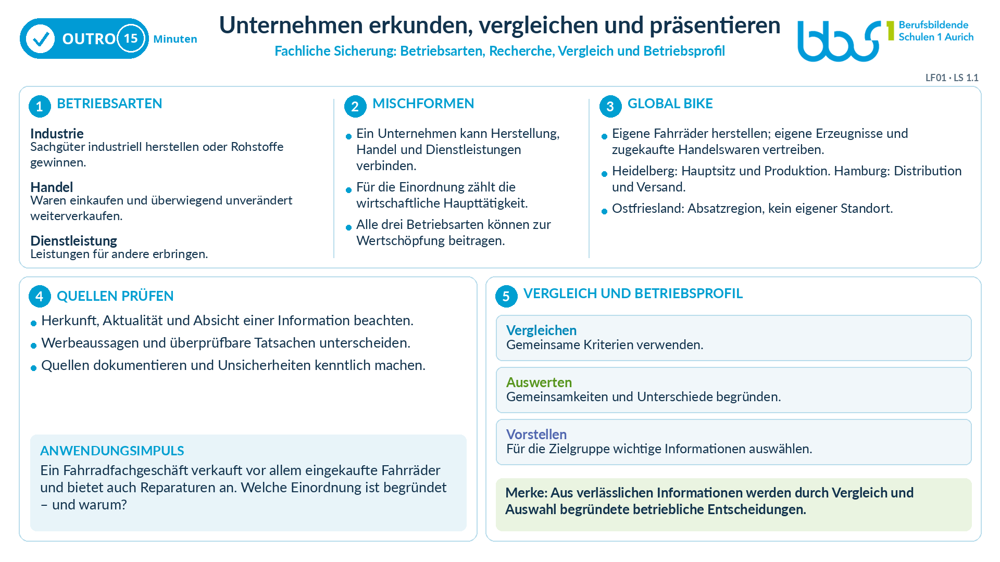

# Fachliche Sicherung

<figure><figcaption>Fachliche Sicherung zu Betriebsarten, Global Bike, Recherche und Betriebsprofil.</figcaption></figure>

- Industrie: industrielle Herstellung von Sachgütern oder Gewinnung von Rohstoffen. Handel: Einkauf und überwiegend unveränderter Weiterverkauf. Dienstleistung: Leistung für andere.
- Unternehmen können mehrere Tätigkeiten verbinden. Für die Einordnung zählt der wirtschaftliche Schwerpunkt; alle drei Betriebsarten können zur Wertschöpfung beitragen.
- Global Bike verbindet eigene Herstellung mit dem Vertrieb eigener Erzeugnisse und eingekaufter Handelswaren. Heidelberg ist Hauptsitz und Produktionsstandort, Hamburg Distributions- und Versandstandort. Ostfriesland ist Absatzregion, kein eigener Standort.
- Informationen müssen zum Auftrag passen, nachvollziehbar und überprüft sein. Quellen und Unsicherheiten sind transparent zu machen.
- Ein Betriebsvergleich verwendet gemeinsame Kriterien und führt zu begründeten Erkenntnissen. Ein Profil enthält sachlich richtige, zielgruppenrelevante Informationen.

Anwendungsimpuls für die gemeinsame Sicherung: Ein Fahrradfachgeschäft verkauft vor allem eingekaufte Fahrräder und bietet zusätzlich Reparaturen an. Welche Einordnung ist anhand der Angaben begründet? Warum?

Merksatz: Aus verlässlichen Informationen werden durch Vergleich und Auswahl begründete betriebliche Entscheidungen.
