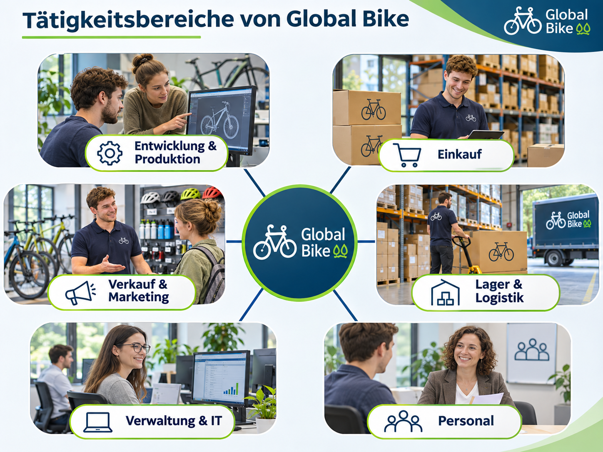
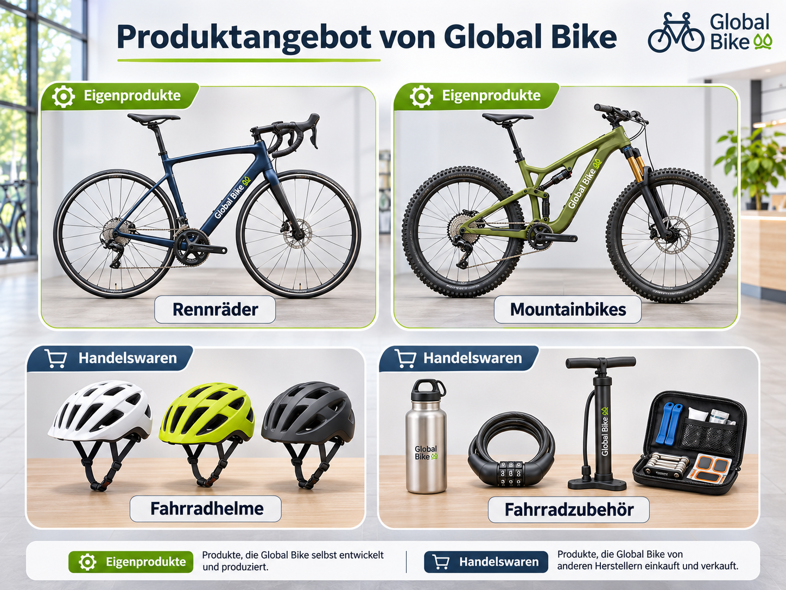
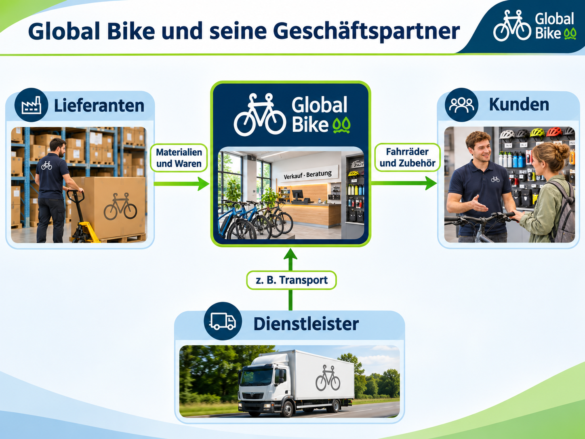

# M1 – Die Global Bike Deutschland GmbH

### 1. Das Unternehmen im Überblick

Die Global Bike Deutschland GmbH wurde 2009 in Heidelberg gegründet und gehört zur Global Bike Group. Sie entwickelt, produziert und vertreibt Fahrräder und ausgewählte Fahrradkomponenten. Zubehörartikel werden auch von externen Lieferanten bezogen. Zu ihren Kunden gehören Groß- und Einzelhändler. Die Geschäftsleitung besteht aus Peter Schwarz und Hans-Werner Schoor. Global Bike ist das Modellunternehmen für diese betrieblichen Aufgaben.

### 2. Was macht Global Bike?

<figure><figcaption>Tätigkeitsbereiche von Global Bike. Vereinfachte Funktionsübersicht, kein Organigramm.</figcaption></figure>

Entwicklung und Produktion: Fahrräder und ausgewählte Komponenten entwickeln und fertigen; Bauteile werden beispielsweise montiert und Produkte geprüft.

Einkauf: Materialien, Bauteile und fertige Zubehörartikel beschaffen.

Verkauf und Marketing: Kunden betreuen, Produkte verkaufen und über das Sortiment informieren.

Lager und Logistik: Waren lagern, für Aufträge bereitstellen und versenden.

Verwaltung und IT: Betriebliche Abläufe organisieren, Rechnungswesen und IT unterstützen.

Personal: Mitarbeitende betreuen und deren Entwicklung unterstützen.

### 3. Produkte und Leistungen

Global Bike bietet eigene Erzeugnisse und eingekaufte Handelswaren an. Fertigerzeugnisse sind hier selbst hergestellte, verkaufsfertige Produkte. Handelswaren sind fertig eingekaufte Produkte zum Weiterverkauf.

| Eigenprodukte (Auswahl) | Handelswaren (Auswahl) |
|---|---|
| Rennräder | Fahrradhelme |
| Mountainbikes | Wasserflaschen, Luftpumpen |
| | Fahrrad-Zahlenschlösser, Reparatursets |

<figure><figcaption>Beispielhafte Produktgruppen, keine authentischen SAP-Produktabbildungen und kein vollständiger Katalog.</figcaption></figure>

### 4. Standorte und Absatzregion

| Standort | Aufgaben |
|---|---|
| Heidelberg | Hauptsitz, Verwaltung, Produktion, Lager, Büros und Ladengeschäft |
| Hamburg | Lager für Norddeutschland, Distribution und Versand |

Ein Standort ist ein Ort, an dem betriebliche Tätigkeiten ausgeführt werden. Eine Absatzregion ist dagegen ein Gebiet, in dem ein Unternehmen Produkte verkauft oder Kunden gewinnen möchte. Global Bike möchte in Ostfriesland Kundenbeziehungen entwickeln, ohne dort einen neuen Standort zu eröffnen. Warenbewegungen werden weiterhin über die bestehenden Standorte, insbesondere Hamburg, abgewickelt.

### 5. Geschäftspartner

Lieferanten liefern Materialien, Bauteile und Handelswaren. Kunden kaufen die angebotenen Produkte. Dienstleister übernehmen beispielsweise Transportleistungen. Diese Gruppen können Geschäftspartner sein: Personen oder Organisationen, mit denen das Unternehmen geschäftlich zusammenarbeitet.

<figure><figcaption>Beispielhafte Partnergruppen und Leistungsbeziehungen; keine Aussage über konkrete Verträge oder regionale Partner. Die Kundenstruktur umfasst insbesondere Groß- und Einzelhändler.</figcaption></figure>

### 6. Vertiefung: Wie hängen die Tätigkeiten zusammen?

Die Produktion benötigt beschaffte Materialien. Fehlt ein wichtiges Bauteil, kann sich die Herstellung verzögern. Dadurch können zugesagte Liefertermine gefährdet werden. Der Verkauf benötigt daher Informationen über verfügbare Produkte; Lager und Logistik stellen Waren für Kundenaufträge bereit. Verwaltung, IT und Personal unterstützen diese Abläufe.

Vereinfachter Zusammenhang: Beschaffung → Produktion → Bereitstellung und Versand; Verkauf stimmt Kundenbedarf und Aufträge mit den beteiligten Bereichen ab. Das ist kein fest vorgeschriebener SAP-Prozess.

Der Verkauf eigener Erzeugnisse und der Weiterverkauf eingekaufter Waren unterscheiden sich. Ein Hersteller wird nicht allein deshalb zum Handelsbetrieb, weil er seine Produkte verkauft. Entscheidend ist der wirtschaftliche Schwerpunkt (M2).

**Merke:** Ein Unternehmen kann verschiedene Tätigkeiten verbinden. Standort und Absatzregion sind nicht dasselbe.

### Quellen M1 (interne Unterlagen; externe Fachgrundlagen, geprüft 26.11.2026)

- Global Bike Deutschland GmbH (1).pdf, Abschnitte 4–10; Organigramm der Global Bike Deutschland GmbH.pdf; Narrativer Rahmen für die Arbeit mit dem Modellunternehmen.pdf.
- Stammdaten Global Bike.xlsx, Fertigwaren Stammdaten und Handelswaren Stammdaten.
- Gabler Wirtschaftslexikon: [Fertigerzeugnis](https://wirtschaftslexikon.gabler.de/definition/fertigerzeugnis-33755), [Handelswaren](https://wirtschaftslexikon.gabler.de/definition/handelswaren-33567).
- Duden Wirtschaft / bpb: [Betriebswirtschaftslehre](https://www.bpb.de/kurz-knapp/lexika/lexikon-der-wirtschaft/18887/betriebswirtschaftslehre/).
