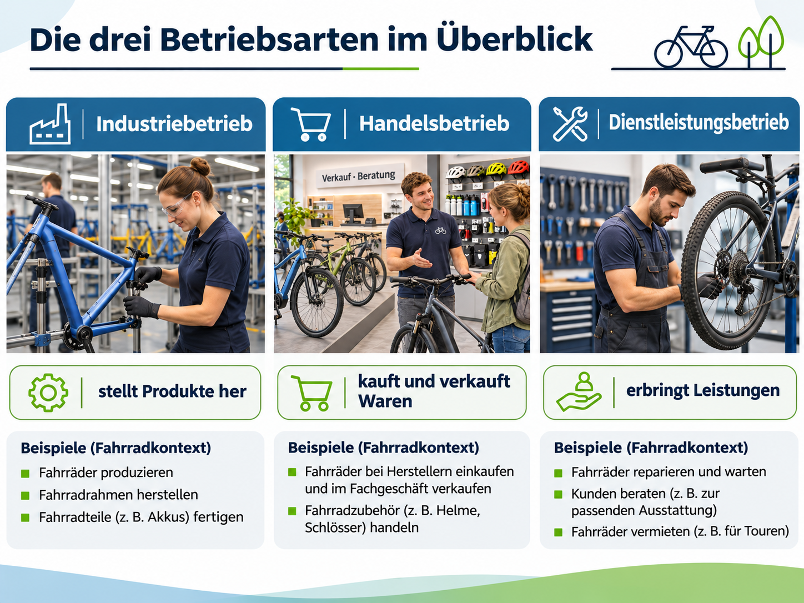
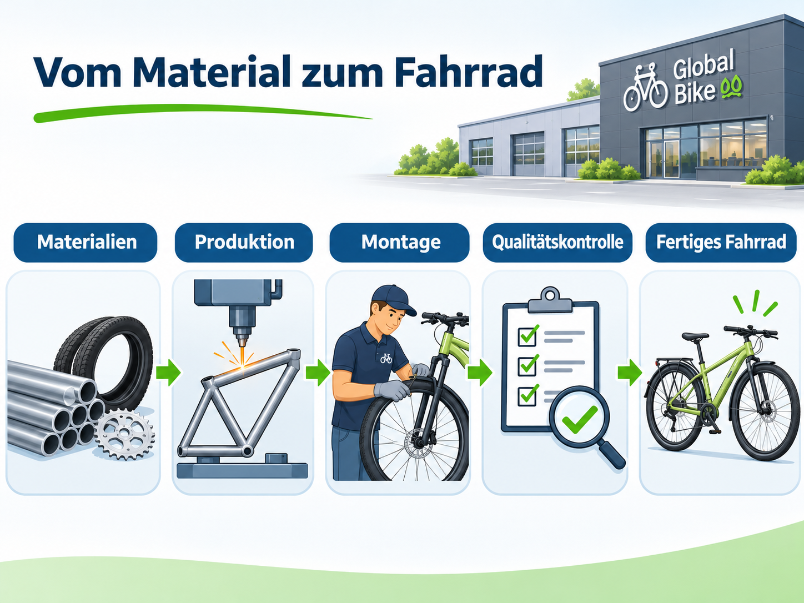
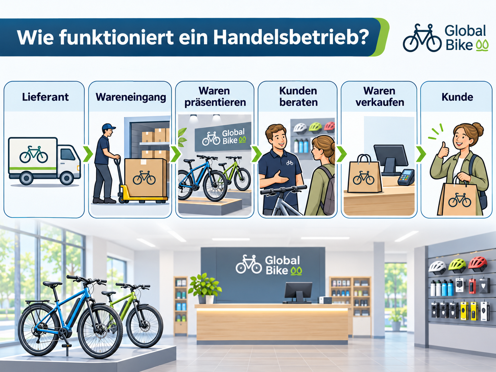
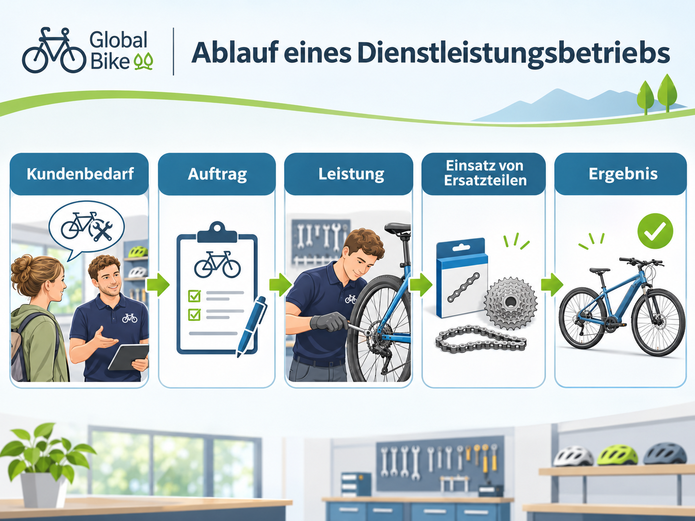

# M2 – Betriebsarten unterscheiden

### 1. Betrieb und Unternehmen

Ein Betrieb ist eine organisierte Einheit, in der Güter hergestellt, Waren gehandelt oder Dienstleistungen erbracht werden. Ein Unternehmen ist eine rechtlich selbstständige wirtschaftliche Einheit, die einen oder mehrere Betriebe umfassen kann. In der Alltagssprache werden beide Begriffe häufig gleichbedeutend verwendet. Eine Betriebsart beschreibt in dieser Lernsituation den Schwerpunkt der wirtschaftlichen Tätigkeit.

Ein Fahrrad wird hergestellt, verkauft und möglicherweise später repariert. An diesen Tätigkeiten können unterschiedliche Betriebe beteiligt sein.

<figure><figcaption>Drei ausgewählte Betriebsarten am Beispiel der Fahrradbranche. Die wirtschaftliche Haupttätigkeit entscheidet über die begründete Einordnung.</figcaption></figure>

### 2. Industriebetrieb

Ein Industriebetrieb stellt Sachgüter industriell her oder gewinnt Rohstoffe. Typisch sind häufig Maschinen, Arbeitsteilung, standardisierte Abläufe und größere Produktionsmengen. Materialien werden verarbeitet, Bauteile montiert, Produkte geprüft und verkauft.

<figure><figcaption>Industrielle Fahrradproduktion: Materialien, Montage, Qualitätskontrolle, Fertigerzeugnis. Allgemeines Anschauungsbild.</figcaption></figure>

<figure><figcaption>Vereinfachter industrieller Herstellungsablauf. Die dargestellte Rahmenfertigung ist ein allgemeines Beispiel, kein Nachweis eines konkreten Global-Bike-Fertigungsverfahrens.</figcaption></figure>

Auch Handwerksbetriebe stellen Produkte her, häufig stärker auf einzelne Kundenaufträge bezogen. Produktionsmenge und Maschineneinsatz sind Hinweise, aber keine ausnahmslosen Abgrenzungsregeln.

**Merke:** Industrielle Herstellung oder Rohstoffgewinnung steht im Mittelpunkt.

### 3. Handelsbetrieb

Ein Handelsbetrieb kauft Waren ein und verkauft sie überwiegend unverändert weiter. Er beschafft, lagert, präsentiert und verkauft Waren und berät häufig Kunden.

<figure><figcaption>Fahrradfachhandel: Wareneingang, Warenpräsentation, Kundenberatung und Verkauf.</figcaption></figure>

<figure><figcaption>Allgemeines Beispiel aus der Fahrradbranche: Lieferant, Wareneingang, Präsentation, Beratung, Verkauf, Kunde. Das Logo dient der didaktischen Illustration; keine Einordnung von Global Bike als reiner Handelsbetrieb.</figcaption></figure>

Der Handel macht Waren für Kunden verfügbar. Er kann unterschiedliche Produkte zu einem Sortiment zusammenstellen und räumliche oder zeitliche Unterschiede zwischen Herstellung und Nachfrage ausgleichen. Beratung, Lieferung oder Montage können ergänzende Leistungen sein.

**Merke:** Der Einkauf und Weiterverkauf fertiger Waren steht im Mittelpunkt.

### 4. Dienstleistungsbetrieb

Ein Dienstleistungsbetrieb erbringt hauptsächlich Leistungen für andere Menschen oder Unternehmen. Beispiele sind Reparatur, Beratung oder Transport. Es geht vor allem um eine Tätigkeit für den Kunden, nicht um die Herstellung eines neuen Sachguts.

<figure><figcaption>Fahrradreparatur: Kundenbedarf, Ersatzteile, Reparaturleistung und angestrebtes Ergebnis. Das Foto zeigt die laufende Reparatur, nicht den Nachweis eines fertigen Ergebnisses.</figcaption></figure>

<figure><figcaption>Allgemeines Beispiel eines Reparaturauftrags. Ersatzteile werden bei Bedarf im Rahmen der Leistung eingesetzt, nicht zwingend erst danach; kein belegter eigener Reparaturbetrieb von Global Bike.</figcaption></figure>

Bei einer Reparatur können Sachgüter wie Bremsbeläge oder Reifen eingesetzt werden. Dennoch steht die Reparaturleistung im Mittelpunkt.

**Merke:** Dienstleistungen erfüllen einen Bedarf durch eine Leistung für andere.

### 5. Sachgüter und Dienstleistungen im Vergleich

Ein Sachgut ist ein körperlicher Gegenstand mit wirtschaftlichem Nutzen, etwa ein Fahrrad oder Helm. Eine Dienstleistung ist eine Tätigkeit für andere, zum Beispiel die Reparatur eines Fahrrads.

| Merkmal | Industriebetrieb | Handelsbetrieb | Dienstleistungsbetrieb |
|---|---|---|---|
| Haupttätigkeit | industriell herstellen / gewinnen | einkaufen und weiterverkaufen | Leistungen erbringen |
| Angebot | eigene Erzeugnisse | eingekaufte Waren | Leistungen |
| Beispiel | Fahrradproduktion | Fahrradfachhandel | Fahrradreparatur |
| Nutzen | Produkte entstehen | Produkte werden verfügbar | Kundenbedarf wird erfüllt |

### 6. Mischformen und Haupttätigkeit

Ein Fahrradfachgeschäft kann Waren verkaufen und gleichzeitig eine Werkstatt betreiben. Ein Hersteller kann auch zugekaufte Artikel verkaufen. Die wirtschaftliche Haupttätigkeit ist in der amtlichen Wirtschaftsklassifikation die Tätigkeit mit dem größten Beitrag zur Wertschöpfung. Für unsere vereinfachte Einordnung helfen Angaben zu Leistungsangebot, Herstellungsverfahren und erkennbaren Arbeitsschwerpunkten. Umsatzanteile können Hinweise geben, sind aber nicht dasselbe wie Wertschöpfungsanteile. Wenn Zahlen fehlen, begründen Sie Ihre Einschätzung und kennzeichnen Unsicherheiten.

### 7. Vertiefung: Wertschöpfung

Industrie, Handel und Dienstleistungen können zusätzlichen wirtschaftlichen Wert schaffen. Ein Hersteller verarbeitet Materialien; ein Händler macht ein Sortiment verfügbar; ein Reparaturbetrieb erbringt eine Leistung. Bruttowertschöpfung ist der Produktionswert abzüglich der Vorleistungen (bezogene und bei der Leistungserstellung verbrauchte Waren und Dienstleistungen). Sie ist nicht mit Gewinn gleichzusetzen.

Fiktives Rechenbeispiel zur Veranschaulichung, keine Global-Bike-Daten: Produktionswert 500 €, Vorleistungen 300 €, Bruttowertschöpfung 200 €. Eine Berechnung wird in der LS nicht verlangt.

### 8. Branche und Betriebsart

Eine Branche beschreibt den Wirtschaftsbereich, in dem ähnliche Tätigkeiten oder Angebote vorkommen. Die Betriebsart beschreibt hier die Haupttätigkeit. Hersteller, Händler und Werkstatt können zur Fahrradbranche gehören, obwohl sie unterschiedliche Tätigkeiten übernehmen.

### 9. Vertiefung: Wirtschaftssektoren

Die drei in dieser LS untersuchten Betriebsarten sind keine vollständige Einteilung aller Betriebe. In der Volkswirtschaftslehre gibt es eine weitere Betrachtung:

| Sektor | Beispiele |
|---|---|
| Primär | Landwirtschaft, Fischerei |
| Sekundär | verarbeitende Industrie, Bauwirtschaft |
| Tertiär | Handel, Transport, Beratung |

Handel zählt hier zum tertiären Sektor. Das widerspricht der betriebswirtschaftlichen Unterscheidung zwischen Handels- und Dienstleistungsbetrieben nicht, weil die Einteilungen unterschiedliche Zwecke haben. Je nach Sektorabgrenzung gibt es weitere Zuordnungen (z. B. Bergbau).

**Merke:** Für eine begründete Zuordnung zählt die wirtschaftliche Haupttätigkeit. Mischformen sind möglich. Fehlende Daten rechtfertigen keine unbelegten Behauptungen.

### Quellen M2 (geprüft 26.11.2026)

- Duden Wirtschaft / bpb: [Betrieb](https://www.bpb.de/kurz-knapp/lexika/lexikon-der-wirtschaft/18861/betrieb/), [Unternehmen](https://www.bpb.de/kurz-knapp/lexika/lexikon-der-wirtschaft/20918/unternehmen/), [Industriebetrieb](https://www.bpb.de/kurz-knapp/lexika/lexikon-der-wirtschaft/19717/industriebetrieb/), [Dienstleistungsbetrieb](https://www.bpb.de/kurz-knapp/lexika/lexikon-der-wirtschaft/19049/dienstleistungsbetrieb/).
- Gabler Wirtschaftslexikon: [Handelsbetrieb](https://wirtschaftslexikon.gabler.de/definition/handelsbetrieb-32612), [Handel](https://wirtschaftslexikon.gabler.de/definition/handel-35491).
- Statistisches Bundesamt: [FAQ WZ 2025](https://www.destatis.de/DE/Methoden/Klassifikationen/FAQ/wz-2025-faq-cluster.html), [Bruttoinlandsprodukt und Wertschöpfung](https://www.destatis.de/DE/Themen/Wirtschaft/Volkswirtschaftliche-Gesamtrechnungen-Inlandsprodukt/Methoden/bip.html).
- bpb: [Wirtschaftssektoren](https://www.bpb.de/kurz-knapp/lexika/politiklexikon/296546/wirtschaftssektoren/).
