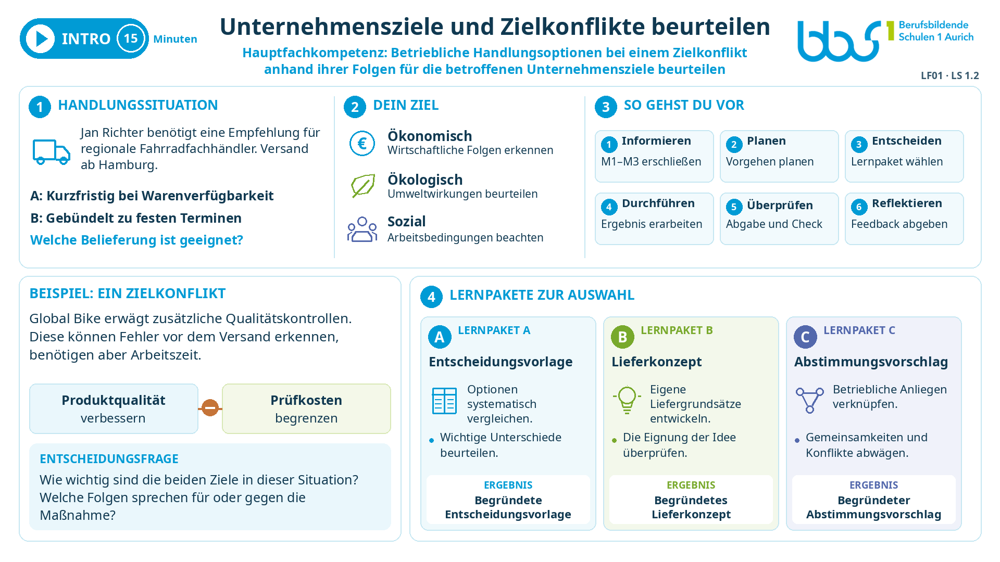
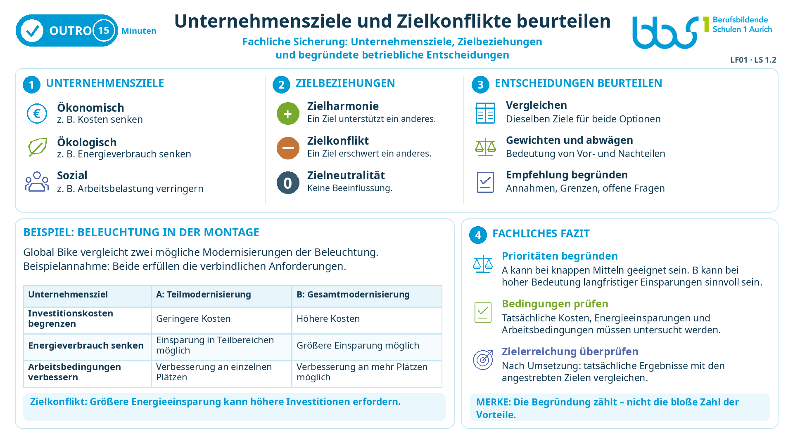
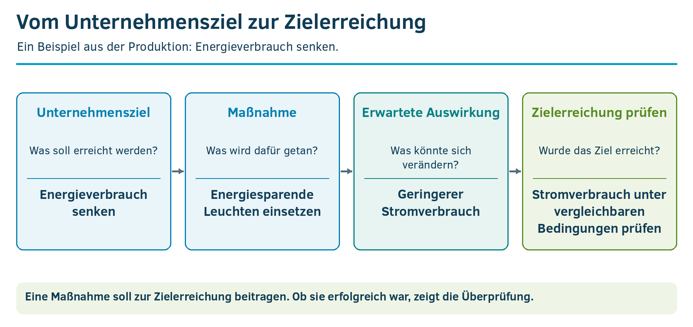
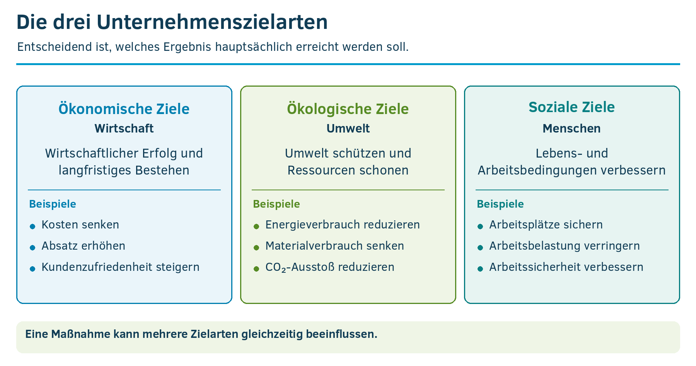
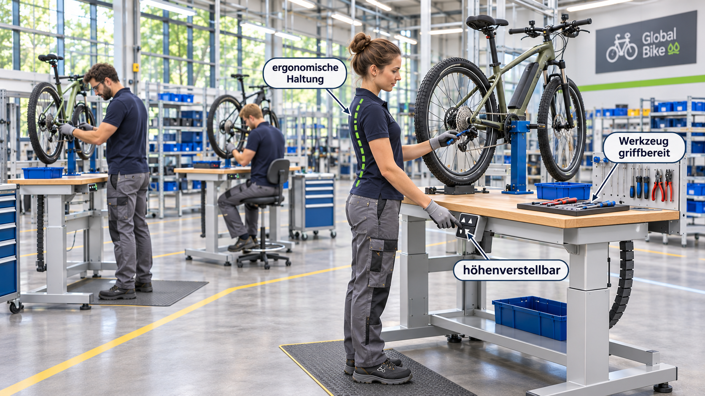
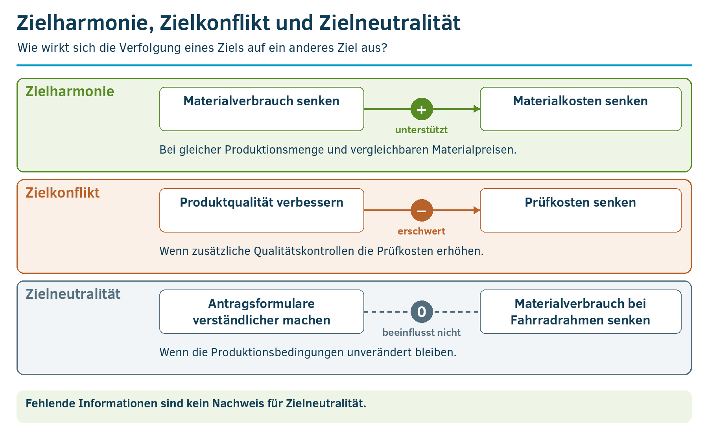
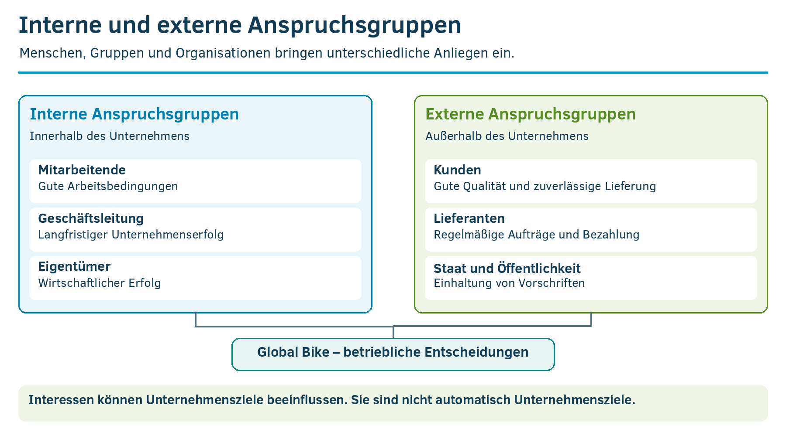
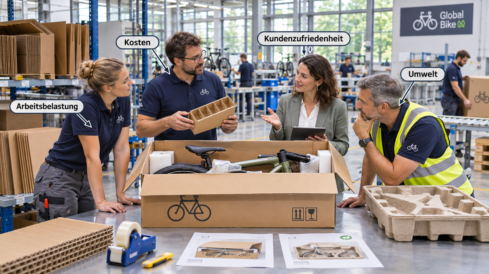
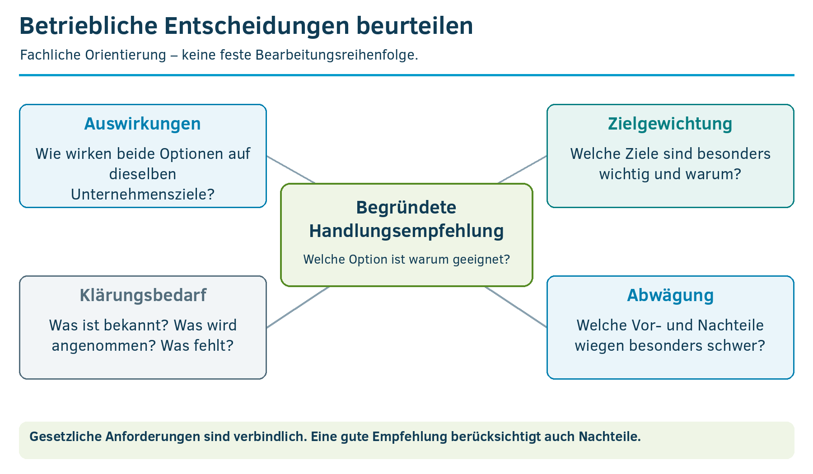

# BFS dual · Lernfeld 1 · LS 1.2 · Unternehmensziele und Zielkonflikte beurteilen

**Bildungsgang** · BFS dual, Profil Wirtschaft  
**Lernsituation** · 1.2 · Unternehmensziele und Zielkonflikte beurteilen (Paketkennung `BFSDUAL-LF01-LS02`)  
**Unterrichtlicher Bezug** · Handlungsorientierte Fallbearbeitung bei der Global Bike Deutschland GmbH  
**Zeitrahmen** · 6 Unterrichtsstunden à 45 Minuten, insgesamt 270 Minuten für einen gewählten Lernweg  
**Digitale Fassung** · [Orientierung öffnen](index.html) · [Unterlagen und Downloads](materialien.html)  
**Formgrundlage** · [BFSdual-Vorlage, Arbeitsstand vom 26. November 2026](https://github.com/macmaris83/Lernsituationen/blob/a1dd9b693df1a234bf3c7387198fcf5b5aab6afc/Fachbereiche/BFSdual/Vorlage_Lernsituation.md)

## Aufgabenzeiten

Für jeden der drei Wege gilt derselbe Zeitrahmen. Bei Durchführen zählt der Auftrag zum gewählten Lernpaket einmal.

| Station | Minuten je Lernweg |
| --- | ---: |
| Orientierung | 10 |
| Handlungssituation | 10 |
| Informieren | 35 |
| Fachbegriffscheck | 15 |
| Planen | 15 |
| Entscheiden | 10 |
| Durchführen | 120 |
| Bewerten | 45 |
| Reflektieren | 10 |
| **Gesamt** | **270** |

## Orientierung

[Digitale Fassung öffnen](index.html)

BFS dual · Lernfeld 1 · Lernsituation 1.2 · 6 Unterrichtsstunden

#### Den Auftrag überblicken

Bei einem regionalen Händler ist Zubehör ausverkauft. Anderen Händlern reicht eine Lieferung zum vereinbarten Sammeltermin. Global Bike muss entscheiden, wie der Vertrieb Kundenwünsche, Kosten, Umweltwirkungen und Arbeitsbedingungen bei der Belieferung berücksichtigen soll. Du bereitest die Entscheidung für Jan Richter und die Geschäftsleitung vor.

Jan Richter erhält für die Geschäftsleitung ein begründetes Urteil zur Belieferung ab Hamburg. Du erstellst entweder eine Entscheidungsvorlage, ein Lieferkonzept oder einen betrieblichen Abstimmungsvorschlag. Halte die wichtigsten Gründe für eine kurze Vorstellung bereit.

Du entscheidest, welche Aufgaben du selbstständig oder mit anderen bearbeitest. Für die Rückmeldung erhält jede Person ein fremdes Produkt.

10 Minuten

*Fachbuchverweis · Für diesen Auftrag ist keine Buchseite hinterlegt.*

Kompetenzprofil der Lernsituation

Die Gewichtung zeigt, wie häufig und wofür die Kompetenz in den Aufgaben gebraucht wird. 1 bedeutet „kurz in einer Aufgabe“, 6 „von der Vorbereitung bis zur Auswertung“.

| Kompetenz | Gewicht (1–6) | Was übe ich? |
| --- | --- | --- |
| F · Fachkompetenz | 6 / 6 | Ich kann zwei Liefermodelle anhand ihrer Folgen für ökonomische, ökologische und soziale Ziele beurteilen und eine Empfehlung begründen. |
| P · Personalkompetenz | 4 / 6 | Ich kann Annahmen kennzeichnen und offene Fragen zur Entscheidung formulieren. |
| S · Sozialkompetenz | 5 / 6 | Ich kann unterschiedliche Interessen sachlich erläutern und produktbezogen Rückmeldung geben. |
| M · Methodenkompetenz | 6 / 6 | Ich kann dieselben Kriterien auf zwei Handlungsoptionen anwenden und Ziele begründet gewichten. |
| D · Medienkompetenz | 4 / 6 | Ich kann den Vergleich für eine interne Besprechung als Tabelle, Schaubild oder strukturierten Text aufbereiten. |

Übersicht aus dem Board ansehen

Der Advance Organizer aus der Boardfassung zeigt die Aufgabenstellung und die Wahlprodukte.

## Handlungssituation

[Digitale Fassung öffnen](handlungssituation.html)

#### Neue Geschäftsmöglichkeiten – aber zu welchen Bedingungen?

Die Global Bike Deutschland GmbH möchte ihre Geschäftsbeziehungen in der Region Nordwest weiterentwickeln.

Im Zusammenhang mit der Vorbereitung des regionalen Netzwerktreffens beschäftigt sich Jan Richter, Leiter Verkauf und Marketing, mit möglichen Geschäftsbeziehungen zu regionalen Fahrradfachhändlern.

Für diese Händler ist nicht nur das Produktangebot von Global Bike interessant. Auch die Lieferbedingungen spielen eine wichtige Rolle. Während manche Händler ihre Waren frühzeitig bestellen können, benötigen andere kurzfristig Ersatz für bereits verkaufte Fahrräder oder fehlendes Zubehör.

Jan Richter möchte deshalb ein attraktives und zugleich langfristig tragfähiges Lieferkonzept für die Region Nordwest entwickeln.

In einer internen Besprechung werden zwei Möglichkeiten diskutiert:

**Handlungsoption A – Bedarfsorientierte Belieferung**

Bestellungen werden bei Warenverfügbarkeit möglichst kurzfristig vom Distributionsstandort Hamburg versendet. Dabei können auch kleinere Lieferungen erforderlich sein.

**Handlungsoption B – Gebündelte Belieferung**

Bestellungen werden gesammelt und zu festgelegten Terminen gemeinsam vom Distributionsstandort Hamburg ausgeliefert. Dadurch können mehrere Bestellungen zusammengefasst werden.

Bei der Besprechung wird deutlich, dass unterschiedliche Anforderungen berücksichtigt werden müssen.

Jan Richter möchte die Bedürfnisse der Kunden erfüllen und die Geschäftsbeziehungen ausbauen. Paul Kühn weist darauf hin, dass die Belieferung wirtschaftlich tragfähig sein muss. Torsten Schulze möchte die Umweltbelastung durch Transporte möglichst gering halten. Lea Porbst macht auf die Arbeitsbedingungen der beteiligten Mitarbeitenden aufmerksam. Ali Gül weist darauf hin, dass die Belieferung mit den vorhandenen betrieblichen Möglichkeiten zuverlässig organisiert werden muss.

Eine Entscheidung wurde bisher nicht getroffen.

Jan Richter beauftragt Sie deshalb, die beiden Handlungsoptionen zu untersuchen. Berücksichtigen Sie die unterschiedlichen Unternehmensziele, stellen Sie die möglichen Folgen gegenüber und entwickeln Sie eine begründete Handlungsempfehlung für die Geschäftsleitung.

**Zentrale Entscheidungsfrage:** Wie sollte Global Bike die regionalen Fahrradfachhändler zukünftig beliefern, wenn wirtschaftliche, ökologische und soziale Unternehmensziele berücksichtigt werden sollen?

2 Minuten

*Fachbuchverweis · Für diesen Auftrag ist keine Buchseite hinterlegt.*

#### Wer benötigt die Empfehlung, und welche Geschäftsbeziehungen sind gemeint?

Lesehilfe

Achte auf Jan Richters Funktion und die angesprochenen Händler.

- ☐ Jan Richter benötigt für die Geschäftsleitung eine Empfehlung zur Belieferung regionaler Fahrradfachhändler im Nordwesten.
- ☐ Lea Porbst soll für die Personalabteilung einen Arbeitszeitplan für die Montage in Heidelberg vorlegen.
- ☐ Paul Kühn benötigt für einen Händler ein verbindliches Preisangebot für einen Einzelauftrag.

2 Minuten

*Fachbuchverweis · Für diesen Auftrag ist keine Buchseite hinterlegt.*

#### Wie unterscheiden sich die beiden Lieferoptionen?

Lesehilfe

Vergleiche Auslöser und Zeitpunkt des Versands ab Hamburg.

- ☐ Beim ersten Modell wird ausschließlich in Heidelberg produziert, beim zweiten ausschließlich in Hamburg.
- ☐ Beim ersten Modell werden verfügbare Bestellungen möglichst kurzfristig versendet; beim zweiten werden sie für feste Liefertermine gesammelt.
- ☐ Beide Modelle haben die gleichen Versandtermine; nur die Zahlungsfrist der Händler unterscheidet sich.

2 Minuten

*Fachbuchverweis · Für diesen Auftrag ist keine Buchseite hinterlegt.*

#### Welches Anliegen bringt Torsten Schulze ein?

Lesehilfe

Lies die unterschiedlichen Perspektiven aus der internen Besprechung.

- ☐ Er möchte klären, welche Person die verbindlichen Versandpreise freigeben darf.
- ☐ Er möchte die Arbeitsbedingungen der Mitarbeitenden zum Hauptthema machen.
- ☐ Er möchte die Umweltbelastung durch Transporte möglichst gering halten.

2 Minuten

*Fachbuchverweis · Für diesen Auftrag ist keine Buchseite hinterlegt.*

#### Warum reicht die Liefergeschwindigkeit als einziges Kriterium nicht aus?

Lesehilfe

Achte auf weitere Bedingungen, unter denen das Konzept dauerhaft funktionieren soll.

- ☐ Auch Kosten, Umweltfolgen, Arbeitsbedingungen und die Möglichkeiten am Standort beeinflussen die Tragfähigkeit eines Lieferkonzepts.
- ☐ Alle regionalen Händler bestellen nach derselben festen Frist; daher bietet der Vergleich der Kosten keinen Erkenntnisgewinn.
- ☐ Die Geschäftsleitung hat die gebündelte Belieferung bereits beschlossen; zu klären ist allein der konkrete Wochentag.

2 Minuten

*Fachbuchverweis · Für diesen Auftrag ist keine Buchseite hinterlegt.*

## Informieren

[Digitale Fassung öffnen](informieren.html)

Erschließe die Angaben und Unterlagen für deinen Auftrag.

18 Minuten

#### Ziele im Fall identifizieren

Notiere für die beiden Liefermodelle mindestens vier relevante Ziele aus allen drei Zielarten. Unterscheide Ziel und Maßnahme mit [M1 · Zielarten](#m1).

*Fachbuchverweis · Für diesen Auftrag ist keine Buchseite hinterlegt.*

17 Minuten

#### Interessen und Beziehungen erschließen

Ordne die Anliegen aus der Besprechung den beteiligten Personen zu. Nutze [M2 · Zielbeziehungen](#m2), um einen möglichen Zielkonflikt zu formulieren. Halte fest, welche Informationen für eine sichere Beurteilung noch fehlen.

*Fachbuchverweis · Für diesen Auftrag ist keine Buchseite hinterlegt.*

[Begriffsblatt zum Nachschlagen](#glossar) · [Begriffe prüfen](#begriffstraining)

## Fachbegriffscheck

[Digitale Fassung öffnen](begriffstraining.html)

Wähle zu jedem Begriff die passende Erklärung. Du kannst den Check wiederholen.

15 Minuten

[Begriffsblatt öffnen](#glossar)

Karte `BFSDUAL-LF01-LS02-B01`

**1. Unternehmensziel**

- Das tatsächliche Ergebnis erfüllt die Anforderungen des angestrebten Ziels.
- Ein Zustand oder Ergebnis, das ein Unternehmen in Zukunft erreichen möchte.
- Eine konkrete Handlung, mit der ein Ziel erreicht werden soll.

Karte `BFSDUAL-LF01-LS02-B02`

**2. Maßnahme**

- Eine konkrete Handlung, mit der ein Ziel erreicht werden soll.
- Die Bedeutung einzelner Ziele für eine konkrete Entscheidung begründet festlegen.
- Ein Zustand oder Ergebnis, das ein Unternehmen in Zukunft erreichen möchte.

Karte `BFSDUAL-LF01-LS02-B03`

**3. Zielerreichung**

- Das tatsächliche Ergebnis erfüllt die Anforderungen des angestrebten Ziels.
- Ein Zustand oder Ergebnis, das ein Unternehmen in Zukunft erreichen möchte.
- Ein fachlich begründeter Vorschlag, wie das Unternehmen vorgehen sollte.

Karte `BFSDUAL-LF01-LS02-B04`

**4. Ökonomische Ziele**

- Unternehmensziele, die den wirtschaftlichen Erfolg und das langfristige Bestehen betreffen.
- Unternehmensziele, die den Schutz der Umwelt und den sparsamen Umgang mit natürlichen Ressourcen betreffen.
- Unternehmensziele, die das Wohlergehen von Menschen sowie ihre Lebens- und Arbeitsbedingungen betreffen.

Karte `BFSDUAL-LF01-LS02-B05`

**5. Ökologische Ziele**

- Unternehmensziele, die den wirtschaftlichen Erfolg und das langfristige Bestehen betreffen.
- Unternehmensziele, die das Wohlergehen von Menschen sowie ihre Lebens- und Arbeitsbedingungen betreffen.
- Unternehmensziele, die den Schutz der Umwelt und den sparsamen Umgang mit natürlichen Ressourcen betreffen.

Karte `BFSDUAL-LF01-LS02-B06`

**6. Soziale Ziele**

- Unternehmensziele, die das Wohlergehen von Menschen sowie ihre Lebens- und Arbeitsbedingungen betreffen.
- Unternehmensziele, die den Schutz der Umwelt und den sparsamen Umgang mit natürlichen Ressourcen betreffen.
- Unternehmensziele, die den wirtschaftlichen Erfolg und das langfristige Bestehen betreffen.

Karte `BFSDUAL-LF01-LS02-B07`

**7. Zielharmonie**

- Die Verfolgung eines Ziels beeinflusst die Erreichung eines anderen Ziels in der betrachteten Situation nicht.
- Die Verfolgung eines Ziels unterstützt die Erreichung eines anderen Ziels.
- Die Verfolgung eines Ziels erschwert die Erreichung eines anderen Ziels.

Karte `BFSDUAL-LF01-LS02-B08`

**8. Zielkonflikt**

- Die Verfolgung eines Ziels erschwert die Erreichung eines anderen Ziels.
- Die Verfolgung eines Ziels beeinflusst die Erreichung eines anderen Ziels in der betrachteten Situation nicht.
- Die Verfolgung eines Ziels unterstützt die Erreichung eines anderen Ziels.

Karte `BFSDUAL-LF01-LS02-B09`

**9. Zielneutralität**

- Die Verfolgung eines Ziels beeinflusst die Erreichung eines anderen Ziels in der betrachteten Situation nicht.
- Die Verfolgung eines Ziels erschwert die Erreichung eines anderen Ziels.
- Die Verfolgung eines Ziels unterstützt die Erreichung eines anderen Ziels.

Karte `BFSDUAL-LF01-LS02-B10`

**10. Interesse**

- Ein Zustand oder Ergebnis, das ein Unternehmen in Zukunft erreichen möchte.
- Eine konkrete Handlung, mit der ein Ziel erreicht werden soll.
- Ein Bedürfnis, eine Erwartung oder ein Anliegen einer Person oder Gruppe.

Karte `BFSDUAL-LF01-LS02-B11`

**11. Anspruchsgruppe**

- Ein fachlich begründeter Vorschlag, wie das Unternehmen vorgehen sollte.
- Eine Person, Gruppe oder Organisation, die vom Unternehmen betroffen ist oder Einfluss auf das Unternehmen nehmen kann.
- Ein Bedürfnis, eine Erwartung oder ein Anliegen einer Person oder Gruppe.

Karte `BFSDUAL-LF01-LS02-B12`

**12. Interessenkonflikt**

- Unterschiedliche Anliegen können nicht gleichzeitig oder nicht vollständig erfüllt werden.
- Die Verfolgung eines Ziels unterstützt die Erreichung eines anderen Ziels.
- Die Verfolgung eines Ziels beeinflusst die Erreichung eines anderen Ziels in der betrachteten Situation nicht.

Karte `BFSDUAL-LF01-LS02-B13`

**13. Handlungsoption**

- Die Bedeutung einzelner Ziele für eine konkrete Entscheidung begründet festlegen.
- Eine mögliche Vorgehensweise, um ein betriebliches Problem zu lösen oder ein Ziel zu erreichen.
- Das tatsächliche Ergebnis erfüllt die Anforderungen des angestrebten Ziels.

Karte `BFSDUAL-LF01-LS02-B14`

**14. Zielgewichtung**

- Die Bedeutung einzelner Ziele für eine konkrete Entscheidung begründet festlegen.
- Eine mögliche Vorgehensweise, um ein betriebliches Problem zu lösen oder ein Ziel zu erreichen.
- Die Bedeutung von Zielen sowie die Vorteile und Nachteile verschiedener Handlungsoptionen miteinander vergleichen.

Karte `BFSDUAL-LF01-LS02-B15`

**15. Abwägung**

- Die Bedeutung von Zielen sowie die Vorteile und Nachteile verschiedener Handlungsoptionen miteinander vergleichen.
- Ein fachlich begründeter Vorschlag, wie das Unternehmen vorgehen sollte.
- Das tatsächliche Ergebnis erfüllt die Anforderungen des angestrebten Ziels.

Karte `BFSDUAL-LF01-LS02-B16`

**16. Handlungsempfehlung**

- Ein fachlich begründeter Vorschlag, wie das Unternehmen vorgehen sollte.
- Eine Person, Gruppe oder Organisation, die vom Unternehmen betroffen ist oder Einfluss auf das Unternehmen nehmen kann.
- Ein Bedürfnis, eine Erwartung oder ein Anliegen einer Person oder Gruppe.

## Planen

[Digitale Fassung öffnen](planen.html)

Entwirf deinen Arbeitsplan.

8 Minuten

#### Gemeinsame Vergleichskriterien planen

Lege anhand von [M3 · Entscheidungen beurteilen](#m3) fest, wie du dieselben vier oder mehr Ziele für beide Liefermodelle gegenüberstellst. Plane Platz für Folgen, Belege, Annahmen und eine offene Frage.

*Fachbuchverweis · Für diesen Auftrag ist keine Buchseite hinterlegt.*

7 Minuten

#### Produkt und Material vorbereiten

Sichte die drei Produktaufträge. Plane die Arbeitsschritte bis zu deiner Empfehlung. Die [freiwilligen Übungsfälle](#uebungen) kannst du für einzelne Fachfragen nutzen.

*Fachbuchverweis · Für diesen Auftrag ist keine Buchseite hinterlegt.*

## Entscheiden

[Digitale Fassung öffnen](entscheiden.html)

Wähle einen von drei gleichwertigen Arbeitswegen. Du kannst deine Wahl begründet ändern.

**Lernpaket wählen**

A · Entscheidungsvorlage · Vergleiche beide Liefermodelle systematisch und begründe die Gewichtung. · Eine Vergleichstabelle mit Empfehlung hilft Jan Richter, die entscheidenden Vor- und Nachteile zu erläutern.

B · Lieferkonzept · Entwickle zwei bis drei Grundsätze für die Lieferpraxis und prüfe ihre Folgen. · Ein kompaktes Konzept zeigt, wann und unter welchen Voraussetzungen sich eine Lieferregel eignet.

C · Betrieblicher Abstimmungsvorschlag · Verbinde mindestens drei betriebliche Perspektiven und mache verbleibende Konflikte sichtbar. · Eine Interessenübersicht mit begründetem Vorschlag unterstützt das Gespräch mit der Geschäftsleitung.

Jan Richter erhält für die Geschäftsleitung ein begründetes Urteil zur Belieferung ab Hamburg. Du erstellst entweder eine Entscheidungsvorlage, ein Lieferkonzept oder einen betrieblichen Abstimmungsvorschlag. Halte die wichtigsten Gründe für eine kurze Vorstellung bereit.

10 Minuten

#### Darstellungsweg auswählen

Wähle Entscheidungsvorlage, Lieferkonzept oder Abstimmungsvorschlag. Begründe, wie dein Weg Jan Richter und der Geschäftsleitung bei der Lieferentscheidung hilft. Du kannst den Weg begründet wechseln.

*Fachbuchverweis · Für diesen Auftrag ist keine Buchseite hinterlegt.*

## Durchführen

[Digitale Fassung öffnen](durchfuehren.html)

Bearbeite den Auftrag im gewählten Format.

[Wähle in Entscheiden dein Lernpaket A, B oder C](#entscheiden), um die Aufträge zu öffnen.

Deine Wahl:  · [Wahl ändern](#entscheiden)

Jan Richter erhält für die Geschäftsleitung ein begründetes Urteil zur Belieferung ab Hamburg. Du erstellst entweder eine Entscheidungsvorlage, ein Lieferkonzept oder einen betrieblichen Abstimmungsvorschlag. Halte die wichtigsten Gründe für eine kurze Vorstellung bereit.

24 Minuten

#### Wirkungen beider Optionen gegenüberstellen

Vergleiche die mögliche Wirkung von Einzel- und Sammellieferungen auf Kosten, Kundenbeziehungen, Umwelt und Arbeitsbedingungen. Stütze dich auf den Fall und [M1 · Zielarten](#m1). Sind Lieferhäufigkeiten oder Kosten unbekannt, kennzeichne die Annahme.

*Fachbuchverweis · Für diesen Auftrag ist keine Buchseite hinterlegt.*

24 Minuten

#### Zwei Beziehungen begründen

Beschreibe in mindestens zwei Ursache-Wirkungs-Sätzen, wie die Verfolgung eines Ziels ein anderes Ziel beeinflussen kann. Belege mindestens einen Zielkonflikt und nutze [M2 · Zielbeziehungen](#m2) für die fachliche Einordnung.

*Fachbuchverweis · Für diesen Auftrag ist keine Buchseite hinterlegt.*

48 Minuten

**Lernpaket A**

#### Eine entscheidungsreife Vorlage erstellen

Verdichte den Vergleich zu einer Entscheidungsvorlage. Stelle die beiden Liefermodelle nach denselben Zielen gegenüber und begründe die Priorität deiner Empfehlung. [Zum vollständigen Arbeitsauftrag A](#weg-a)

*Fachbuchverweis · Für diesen Auftrag ist keine Buchseite hinterlegt.*

48 Minuten

**Lernpaket B**

#### Liefergrundsätze entwickeln

Formuliere zwei bis drei Grundsätze für die Belieferung ab Hamburg. Prüfe deine Idee an beiden Optionen, ihren Voraussetzungen und einem verbleibenden Nachteil. [Zum vollständigen Arbeitsauftrag B](#weg-b)

*Fachbuchverweis · Für diesen Auftrag ist keine Buchseite hinterlegt.*

48 Minuten

**Lernpaket C**

#### Interessen zu einem Abstimmungsvorschlag verbinden

Zeige mindestens drei betriebliche Perspektiven auf. Erkläre an beiden Lieferoptionen, welche Anliegen zusammenpassen und wo ein Konflikt bleibt. Leite daraus einen abstimmungsfähigen Vorschlag ab. [Zum vollständigen Arbeitsauftrag C](#weg-c)

*Fachbuchverweis · Für diesen Auftrag ist keine Buchseite hinterlegt.*

24 Minuten

#### Empfehlung fachlich überprüfen

Prüfe mit [M3 · Entscheidungen beurteilen](#m3) und der [fachlichen Sicherung](#fachsicherung), ob die Empfehlung aus deinen gewichteten Zielen folgt. Erläutere einen Nachteil, den deine Empfehlung offenlässt, und formuliere eine konkrete Frage für Jan Richter.

*Fachbuchverweis · Für diesen Auftrag ist keine Buchseite hinterlegt.*

Kriterien für das fertige Produkt

- Mindestens vier für die Belieferung relevante Unternehmensziele sind erläutert. Ökonomische, ökologische und soziale Ziele sind vertreten.
- Bedarfsorientierte und gebündelte Belieferung sind anhand derselben Ziele verglichen. Die Arbeit unterscheidet vorhandene Informationen, begründete Annahmen und offenen Klärungsbedarf.
- Mindestens zwei Zielbeziehungen sind über die mögliche Ursache und Wirkung begründet, darunter mindestens ein Zielkonflikt.
- Die Gewichtung der besonders wichtigen Ziele ist nachvollziehbar. Die Empfehlung benennt einen verbleibenden Nachteil oder eine Voraussetzung und mindestens eine vor der Entscheidung zu klärende Frage.

## Bewerten

[Digitale Fassung öffnen](bewerten.html)

Peer-Check am Handlungsprodukt.

12 Minuten

#### Das Produkt für den Peer-Check bereitstellen

**Reiche** deine Arbeit in der Moodle-Aktivität „Peer-Feedback“ ein. Verwende neutrale Titel und Dateinamen. Entferne Namen aus Text und Dateieigenschaften. Bei einem gemeinsamen Produkt reicht jede Person eine Kopie im eigenen Konto ein. Ohne eingerichtete Aktivität verteilt die Lehrkraft codierte Arbeiten.

*Fachbuchverweis · Für diesen Auftrag ist keine Buchseite hinterlegt.*

22 Minuten

#### Ein fremdes Produkt prüfen

**Prüfe** die dir zugeteilte Arbeit mit den Kriterien unten. Benenne eine konkrete Fundstelle, eine fachlich gelungene Stelle und einen begründeten Verbesserungsvorschlag. Gib die Rückmeldung in Moodle oder mit dem [ausfüllbaren Peer-Bogen](#peer-check) ab. Dein Name ist für die empfangende Person sichtbar.

*Fachbuchverweis · Für diesen Auftrag ist keine Buchseite hinterlegt.*

11 Minuten

#### Die empfangene Rückmeldung nutzen

**Lies** das Feedback zu deinem Produkt. Verbessere die genannte Stelle oder begründe am Material, weshalb du deine Fassung beibehältst. Ergebnis ist die für die weitere Verwendung geprüfte Fassung.

*Fachbuchverweis · Für diesen Auftrag ist keine Buchseite hinterlegt.*

### Fachliche Prüfkriterien

- Mindestens vier für die Belieferung relevante Unternehmensziele sind erläutert. Ökonomische, ökologische und soziale Ziele sind vertreten.
- Bedarfsorientierte und gebündelte Belieferung sind anhand derselben Ziele verglichen. Die Arbeit unterscheidet vorhandene Informationen, begründete Annahmen und offenen Klärungsbedarf.
- Mindestens zwei Zielbeziehungen sind über die mögliche Ursache und Wirkung begründet, darunter mindestens ein Zielkonflikt.
- Die Gewichtung der besonders wichtigen Ziele ist nachvollziehbar. Die Empfehlung benennt einen verbleibenden Nachteil oder eine Voraussetzung und mindestens eine vor der Entscheidung zu klärende Frage.

[Peer-Check öffnen oder drucken](#peer-check)

## Reflektieren

[Digitale Fassung öffnen](reflektieren.html)

Dein Feedback zum Unterricht.

10 Minuten

#### Feedback zur Lernsituation abgeben

**Fülle** die separate Aktivität „Feedback“ in deinem Moodle-Kurs aus und sende deine Rückmeldung dort ab. Falls hier kein Direktlink angezeigt wird, öffne „Feedback“ in der Kursübersicht.

*Fachbuchverweis · Für diesen Auftrag ist keine Buchseite hinterlegt.*

## Materialien
| Kennung | Unterlage |
| --- | --- |
| FACHSICHERUNG | [fachsicherung](#fachsicherung) |
| M1 | [M1 · m1](#m1) |
| M2 | [M2 · m2](#m2) |
| M3 | [M3 · m3](#m3) |
| ORIENTIERUNG | [orientierung](#orientierung) |
| ÜBUNGEN | [Freiwillige Übungen](#uebungen) |
| WEG-A | [weg-a](#weg-a) |
| WEG-B | [weg-b](#weg-b) |
| WEG-C | [weg-c](#weg-c) |
| MATERIALIEN | [Materialübersicht und Quellen](#materialien) |
| PEER-CHECK | [Peer-Check · LS 1.2](#peer-check) |

## fachsicherung

[Digitale Fassung öffnen](material/fachsicherung.html)

### Outro – Fachliche Sicherung (15 Minuten)

**Fachliches Sicherungsbeispiel: Beleuchtung in der Montage.** Zwei Modernisierungsvarianten erfüllen die verbindlichen Anforderungen. Eine Teilmodernisierung verursacht geringere Investitionen; eine Gesamtmodernisierung könnte größere Energieeinsparungen und Verbesserungen an mehr Arbeitsplätzen ermöglichen. Bei knappen Mitteln kann die Teilmodernisierung, bei tragbaren Kosten und hoher Bedeutung der langfristigen Verbesserungen die Gesamtmodernisierung geeignet sein. Die tatsächlichen Kosten, Energieeinsparungen und Arbeitsbedingungen müssen überprüft werden.

Sichern Sie gemeinsam die Unterschiede zwischen Zielarten und Zielbeziehungen, die Bedeutung der [Zielgewichtung](#zielgewichtung) sowie die Begründung einer bedingten Empfehlung. Die Zahl der Vorteile entscheidet nicht allein über die Eignung einer [Handlungsoption](#handlungsoption). Nach Umsetzung werden die tatsächlichen Ergebnisse mit den Zielen verglichen.

[Bearbeitbare Textfassung herunterladen](material/fachsicherung.md)

## M1 · m1

[Digitale Fassung öffnen](material/m1.html)

### M1 – Unternehmensziele und Zielarten

#### Grundwissen

#### Warum benötigen Unternehmen Ziele?

Die Global Bike Deutschland GmbH entwickelt, produziert und verkauft Fahrräder und Fahrradzubehör. Damit das Unternehmen langfristig erfolgreich arbeiten kann, muss es seine Tätigkeiten planen und Entscheidungen treffen.

**Unternehmensziele** beschreiben einen Zustand oder ein Ergebnis, das ein Unternehmen in Zukunft erreichen möchte.

| Funktion | Bedeutung |
| --- | --- |
| Orientierung | Ziele geben die Richtung der Unternehmensentwicklung vor. |
| Planung | Ziele helfen bei der Vorbereitung geeigneter Maßnahmen. |
| Entscheidung | Handlungsoptionen können anhand der Ziele beurteilt werden. |
| Kontrolle | Das Unternehmen kann überprüfen, ob seine Ziele erreicht wurden. |

Unternehmen verfolgen in der Regel mehrere Ziele gleichzeitig. Diese betreffen nicht nur den wirtschaftlichen Erfolg, sondern beispielsweise auch die Umwelt und die Mitarbeitenden.

#### Ziele, Maßnahmen und Zielerreichung

Ein [Unternehmensziel](#unternehmensziel) beschreibt, **was erreicht werden soll**. Eine **Maßnahme** beschreibt, **was dafür getan werden kann**.

Für ein Unternehmensziel können unterschiedliche Maßnahmen geeignet sein. Ob eine [Maßnahme](#massnahme) tatsächlich erfolgreich war, lässt sich durch die Überprüfung der erreichten Ergebnisse feststellen. **Zielerreichung** bedeutet, dass das tatsächliche Ergebnis die Anforderungen des angestrebten Ziels erfüllt.

Vor einer Entscheidung müssen deshalb zunächst die erwarteten Auswirkungen betrachtet werden.

#### Welche Unternehmenszielarten gibt es?

Unternehmensziele lassen sich danach unterscheiden, welches Ergebnis erreicht werden soll.

##### Ökonomische Unternehmensziele

[Ökonomische Ziele](#oekonomische-ziele) betreffen den wirtschaftlichen Erfolg und das langfristige Bestehen eines Unternehmens.

Global Bike benötigt wirtschaftlichen Erfolg, um beispielsweise Materialien beschaffen, Mitarbeitende beschäftigen und Investitionen ermöglichen zu können.

| Mögliche Unternehmensziele | Bedeutung |
| --- | --- |
| Gewinn steigern | Einen höheren wirtschaftlichen Überschuss erzielen. |
| Kosten senken | Beispielsweise Material- oder Energiekosten verringern. |
| Absatz erhöhen | Mehr Fahrräder und Zubehör verkaufen. |
| Kundenzufriedenheit steigern | Kundenbedürfnisse besser erfüllen. |
| Wettbewerbsfähigkeit verbessern | Sich gegenüber anderen Anbietern behaupten. |

##### Ökologische Unternehmensziele

[Ökologische Ziele](#oekologische-ziele) betreffen den Schutz der Umwelt und den verantwortungsvollen Umgang mit natürlichen Ressourcen.

Bei der Herstellung und dem Transport von Fahrrädern werden beispielsweise Rohstoffe und Energie benötigt.

| Mögliche Unternehmensziele | Bedeutung |
| --- | --- |
| Energieverbrauch reduzieren | Weniger Energie benötigen. |
| Materialverbrauch senken | Rohstoffe sparsam einsetzen. |
| Abfallmengen verringern | Unnötige Abfälle vermeiden. |
| CO₂-Ausstoß reduzieren | Klimabelastende Emissionen verringern. |
| Recyclingfähigkeit verbessern | Die Wiederverwertung von Materialien erleichtern. |

##### Soziale Unternehmensziele

[Soziale Ziele](#soziale-ziele) betreffen das Wohlergehen von Menschen sowie ihre Lebens- und Arbeitsbedingungen. Innerhalb von Global Bike beziehen sie sich insbesondere auf die Mitarbeitenden. Sie können aber auch Menschen außerhalb des Unternehmens betreffen, beispielsweise Beschäftigte bei Lieferanten.

| Mögliche Unternehmensziele | Bedeutung |
| --- | --- |
| Arbeitsplätze sichern | Beschäftigung langfristig erhalten. |
| Arbeitssicherheit verbessern | Unfälle und Gesundheitsgefahren vermeiden. |
| Arbeitsbelastung verringern | Körperliche und psychische Überlastung vermeiden. |
| Mitarbeitende weiterqualifizieren | Berufliche Kenntnisse und Fähigkeiten verbessern. |
| Vereinbarkeit von Beruf und Privatleben verbessern | Arbeitszeiten verlässlich und familiengerecht gestalten. |

#### Unternehmensziele richtig zuordnen

Für die Zuordnung eines Unternehmensziels ist entscheidend, welches Ergebnis hauptsächlich erreicht werden soll. Beispielsweise können mit der Beleuchtung in der Produktion unterschiedliche Ziele verbunden sein.

| Zielart | Beispiel Beleuchtung |
| --- | --- |
| Ökonomisch | Stromkosten senken |
| Ökologisch | Energieverbrauch reduzieren |
| Sozial | Arbeitsbedingungen durch bessere Beleuchtung verbessern |

Eine betriebliche Maßnahme kann somit mehrere Unternehmensziele gleichzeitig beeinflussen.

#### Beispiel – Höhenverstellbare Montagearbeitsplätze

Global Bike prüft, ob höhenverstellbare Arbeitsplätze in der Fahrradmontage eingerichtet werden könnten. Die Mitarbeitenden könnten dadurch ihre Arbeitshöhe besser an ihre körperlichen Bedürfnisse anpassen.

*KI-generierte Beispielszene eines Montagearbeitsplatzes. Die Bildhinweise zeigen mögliche ergonomische Merkmale, keine nachgewiesenen Auswirkungen.*

| Zielart | Mögliche Auswirkungen |
| --- | --- |
| Sozial | Geringere körperliche Belastung und besserer Gesundheitsschutz sind möglich. |
| Ökonomisch | Anschaffungskosten entstehen. Langfristig könnten krankheitsbedingte Ausfälle zurückgehen. |
| Ökologisch | Auswirkungen lassen sich anhand dieser Angaben noch nicht beurteilen. |

Die Verbesserung der Arbeitsbedingungen ist das angestrebte soziale Ziel. Die Maßnahme kann gleichzeitig wirtschaftliche Auswirkungen besitzen. Nicht jede Maßnahme beeinflusst zwangsläufig alle drei Zielarten.

Bei betrieblichen Entscheidungen müssen gesetzliche Anforderungen, beispielsweise zum Arbeits- und Umweltschutz, eingehalten werden.

#### Genauer betrachtet – Nachhaltigkeit und überprüfbare Ziele

Nachhaltiges Wirtschaften bedeutet, wirtschaftliche, ökologische und soziale Auswirkungen betrieblicher Entscheidungen langfristig zu berücksichtigen. Dabei müssen nicht alle Ziele bei jeder Entscheidung gleich stark gewichtet werden.

Unternehmensziele können außerdem durch konkrete Zielwerte und Zeiträume besser überprüfbar gemacht werden.

| Allgemeines Ziel | Konkreteres Ziel |
| --- | --- |
| Kosten senken | Energiekosten in der Produktion senken |
| Qualität verbessern | Anteil fehlerhafter Fahrräder verringern |
| Umwelt schützen | Verpackungsmaterial pro Fahrrad reduzieren |

Ein Ziel könnte beispielsweise lauten, den Energieverbrauch pro hergestelltem Fahrrad innerhalb eines Jahres um 10 % zu senken. Dies ist ein fiktives Formulierungsbeispiel und kein tatsächlicher Zielwert von Global Bike.

**Merke:** Unternehmensziele geben die Richtung für betriebliche Entscheidungen vor. Ökonomische Ziele betreffen die Wirtschaft, ökologische Ziele die Umwelt und soziale Ziele die Menschen. Maßnahmen sollen zur Zielerreichung beitragen und können mehrere Unternehmensziele gleichzeitig beeinflussen.

[Bearbeitbare Textfassung herunterladen](material/m1.md)

## M2 · m2

[Digitale Fassung öffnen](material/m2.html)

### M2 – Zielbeziehungen und unterschiedliche Interessen

#### Grundwissen

#### Wie beeinflussen sich Unternehmensziele?

Global Bike verfolgt mehrere Unternehmensziele gleichzeitig. Die Verfolgung eines Ziels kann die Erreichung eines anderen Ziels erleichtern, erschweren oder unbeeinflusst lassen. Diese Zusammenhänge werden als **Zielbeziehungen** bezeichnet.

#### Die drei Zielbeziehungen

| Zielbeziehung | Bedeutung |
| --- | --- |
| [Zielharmonie](#zielharmonie) | Die Verfolgung eines Ziels unterstützt die Erreichung eines anderen Ziels. |
| [Zielkonflikt](#zielkonflikt) | Die Verfolgung eines Ziels erschwert die Erreichung eines anderen Ziels. |
| [Zielneutralität](#zielneutralitaet) | Die Verfolgung eines Ziels beeinflusst die Erreichung eines anderen Ziels in der betrachteten Situation nicht. |

##### Beispiel 1 – Zielharmonie

Global Bike möchte den Materialverbrauch bei der Herstellung von Fahrradrahmen senken. Wenn bei gleicher Produktionsmenge und vergleichbaren Materialpreisen weniger Werkstoffe benötigt werden, können gleichzeitig die Materialkosten sinken.

Das ökologische Ziel unterstützt unter diesen Bedingungen ein ökonomisches Ziel. Es liegt eine Zielharmonie vor.

##### Beispiel 2 – Zielkonflikt

Global Bike möchte die Produktqualität verbessern. Dazu werden zusätzliche Qualitätskontrollen in Betracht gezogen. Diese Kontrollen können dazu beitragen, fehlerhafte Fahrräder vor der Auslieferung zu erkennen. Gleichzeitig benötigen sie Arbeitszeit und können die Prüfkosten erhöhen.

Durch die zusätzlichen Kontrollen können das Ziel, die Produktqualität zu verbessern, und das Ziel, die Prüfkosten zu senken, in Konflikt geraten. Das Beispiel zeigt, dass Zielkonflikte auch zwischen Zielen derselben Zielart entstehen können.

##### Beispiel 3 – Zielneutralität

Global Bike möchte interne Antragsformulare für Mitarbeitende verständlicher formulieren. Gleichzeitig soll der Materialverbrauch bei der Herstellung von Fahrradrahmen gesenkt werden.

Wenn lediglich die Formulierungen der Antragsformulare verändert werden und die Produktionsbedingungen gleich bleiben, wird der Materialverbrauch bei der Herstellung der Fahrradrahmen dadurch nicht beeinflusst. Bezogen auf diese beiden Ziele liegt in der beschriebenen Situation Zielneutralität vor.

**Wichtig:** Fehlende Informationen über mögliche Auswirkungen bedeuten nicht automatisch, dass eine Zielneutralität vorliegt.

#### Warum müssen Zielbeziehungen begründet werden?

Die Zielarten allein geben keinen Aufschluss darüber, welche Zielbeziehung besteht.

| Betrachtete Ziele | Mögliche Zielbeziehung |
| --- | --- |
| Materialverbrauch und Materialkosten senken | Zielharmonie |
| Produktqualität verbessern und Prüfkosten senken | Zielkonflikt |
| Arbeitsbelastung und krankheitsbedingte Ausfallkosten senken | Zielharmonie |
| Mitarbeitende weiterqualifizieren und kurzfristige Personalkosten senken | Zielkonflikt |

Entscheidend ist jeweils, durch welche konkrete [Maßnahme](#massnahme) ein Ziel verfolgt wird und wie sich diese Maßnahme auf das andere Ziel auswirkt.

#### Unterschiedliche Interessen an einem Unternehmen

Global Bike steht mit unterschiedlichen Menschen, Gruppen und Organisationen in Verbindung.

**Interessen** beschreiben Bedürfnisse, Erwartungen oder Anliegen von Personen oder Gruppen.

Personen, Gruppen und Organisationen, die von den Tätigkeiten eines Unternehmens betroffen sind oder Einfluss auf das Unternehmen nehmen können, werden als **Anspruchsgruppen** bezeichnet.

| Anspruchsgruppe | Mögliche Interessen |
| --- | --- |
| Mitarbeitende | Sichere Arbeitsplätze, gute Arbeitsbedingungen |
| Geschäftsleitung und Eigentümer | Langfristiger Unternehmenserfolg |
| Kunden | Gute Qualität, angemessene Preise, zuverlässige Lieferungen |
| Lieferanten | Regelmäßige Aufträge, zuverlässige Bezahlung |
| Staat und Öffentlichkeit | Einhaltung von Vorschriften, verantwortungsvolles Wirtschaften |

Ein [Interesse](#interesse) wird nicht automatisch zu einem Unternehmensziel. Es kann jedoch beeinflussen, welche Ziele das Unternehmen verfolgt.

#### Interessen- und Zielkonflikte unterscheiden

Ein **Interessenkonflikt** entsteht, wenn unterschiedliche Interessen nicht gleichzeitig oder nicht vollständig erfüllt werden können.

##### Beispiel – Fahrradverpackungen bei Global Bike

Global Bike prüft, ob weniger Verpackungsmaterial verwendet werden könnte.

*KI-generierte beispielhafte betriebliche Besprechung. Die Bildhinweise zeigen mögliche Anliegen, keine festgelegten Rollen oder tatsächlichen Aussagen einzelner Personen.*

| Betriebliche Perspektive | Mögliches Anliegen |
| --- | --- |
| Umweltbeauftragter | Rohstoffe schonen |
| Rechnungswesen | Kosten senken |
| Logistik | Sicheren Transport ermöglichen |
| Kunden | Unbeschädigte Ware erhalten |

Auch der Verpackungsaufwand kann die Arbeitsbelastung beeinflussen. Weniger Verpackungsmaterial könnte dem Umweltschutz und der Kostensenkung dienen. Würde dadurch allerdings der Schutz der Fahrräder beeinträchtigt, könnte dies den Interessen der Kunden widersprechen.

Innerhalb von Global Bike könnte daraus ein Zielkonflikt zwischen der Verringerung des Materialverbrauchs und der Sicherung der Produktqualität entstehen.

| Interessenkonflikt | Zielkonflikt |
| --- | --- |
| Unterschiedliche Erwartungen von Personen oder Gruppen stehen im Widerspruch. | Die Verfolgung eines Unternehmensziels erschwert die Erreichung eines anderen Unternehmensziels. |

Ein Zielkonflikt kann auch dann entstehen, wenn dieselbe Person beide Ziele verfolgt. Die verschiedenen Unternehmensbereiche bringen ihre jeweiligen fachlichen Kenntnisse und Perspektiven in Entscheidungen ein. Dabei verfolgt keine Abteilung zwangsläufig ausschließlich wirtschaftliche, ökologische oder [soziale Ziele](#soziale-ziele).

#### Genauer betrachtet – Zielbeziehungen können sich verändern

Global Bike möchte seine Mitarbeitenden durch zusätzliche Schulungen in der Bedienung und Wartung von Maschinen weiterqualifizieren.

| Kurzfristig | Langfristig |
| --- | --- |
| Schulungen verursachen zusätzliche Kosten. | Verbesserte Kenntnisse könnten Maschinenstörungen und damit verbundene Kosten verringern. |
| Möglicher Zielkonflikt | Mögliche Zielharmonie |

Ob die erwarteten Einsparungen tatsächlich eintreten und die zusätzlichen Schulungskosten ausgleichen, müsste untersucht werden.

Eine Zielbeziehung kann somit von der gewählten Maßnahme, den betrieblichen Bedingungen und dem betrachteten Zeitraum abhängen.

**Merke:** Unternehmensziele können sich unterstützen, behindern oder unbeeinflusst lassen. Zielbeziehungen müssen anhand konkreter Auswirkungen begründet werden. Unterschiedliche Interessen können Unternehmensziele beeinflussen und zu Zielkonflikten beitragen. Ein Zielkonflikt bedeutet nicht automatisch, dass eine Maßnahme ungeeignet ist.

[Bearbeitbare Textfassung herunterladen](material/m2.md)

## M3 · m3

[Digitale Fassung öffnen](material/m3.html)

### M3 – Betriebliche Entscheidungen beurteilen

#### Fachliche Entscheidungshilfe

Bei betrieblichen Entscheidungen stehen häufig mehrere Möglichkeiten zur Verfügung.

Eine **Handlungsoption** ist eine mögliche Vorgehensweise zur Lösung eines betrieblichen Problems oder zur Erreichung eines Unternehmensziels.

Um beurteilen zu können, welche [Handlungsoption](#handlungsoption) geeignet ist, müssen ihre Auswirkungen auf die betroffenen Unternehmensziele berücksichtigt werden.

#### Auswirkungen vergleichen

Handlungsoptionen sollten anhand derselben Unternehmensziele verglichen werden. Dabei sind sowohl Vorteile als auch Nachteile und mögliche Risiken zu berücksichtigen. Nicht alle Auswirkungen lassen sich im Voraus sicher bestimmen.

| Informationsgrundlage | Bedeutung |
| --- | --- |
| Bekannte Information | Ein Sachverhalt ist durch vorhandene Angaben belegt. |
| Begründete Annahme | Eine erwartete Auswirkung ist fachlich plausibel, aber noch nicht nachgewiesen. |
| Klärungsbedarf | Für eine sichere Beurteilung fehlen Informationen. |

#### Unternehmensziele gewichten

Die **Zielgewichtung** beschreibt, welche Bedeutung einzelnen Unternehmenszielen bei einer konkreten Entscheidung zugemessen wird.

Nicht alle Ziele müssen gleich wichtig sein. Ihre Bedeutung hängt beispielsweise von der betrieblichen Situation, der Dringlichkeit eines Problems und den erwarteten Folgen ab. Eine Gewichtung muss fachlich begründet werden.

#### Auswirkungen abwägen

Eine **Abwägung** bedeutet, die Bedeutung unterschiedlicher Ziele sowie die Vorteile und Nachteile der Handlungsoptionen miteinander zu vergleichen.

Die Handlungsoption mit den meisten Vorteilen ist nicht automatisch die beste. Entscheidend ist auch, wie bedeutsam die einzelnen Vorteile und Nachteile sind.

Gesetzliche Anforderungen und verbindliche Verpflichtungen müssen eingehalten werden. Sie stehen nicht zur freien [Abwägung](#abwaegung).

#### Eine Handlungsempfehlung entwickeln

Eine **Handlungsempfehlung** beschreibt, welche Vorgehensweise aufgrund einer fachlichen Beurteilung vorgeschlagen wird.

Eine nachvollziehbare Empfehlung berücksichtigt auch die Nachteile der bevorzugten Option und benennt gegebenenfalls noch offene Fragen.

Auch eine Kombination verschiedener Handlungsoptionen ist möglich. Ihre Auswirkungen müssen jedoch ebenfalls beurteilt werden.

#### Orientierung für betriebliche Entscheidungen

Die fachlichen Gesichtspunkte stehen miteinander in Verbindung. Eine feste Bearbeitungsreihenfolge ist nicht vorgegeben.

**Merke:** Eine gute betriebliche Entscheidung zeichnet sich nicht dadurch aus, dass sie keine Nachteile besitzt, sondern dadurch, dass sie fachlich nachvollziehbar begründet wird.

[Bearbeitbare Textfassung herunterladen](material/m3.md)

## orientierung

[Digitale Fassung öffnen](material/orientierung.html)

### Intro – 15 Minuten

**Handlungssituation:** Jan Richter benötigt eine Empfehlung zur zukünftigen Belieferung regionaler Fahrradfachhändler vom Standort Hamburg aus.

**Ihr Ziel:** Unternehmensziele unterscheiden, ihre Beziehungen und die Auswirkungen betrieblicher Entscheidungen beurteilen.

**Beispiel:** Zusätzliche Qualitätskontrollen können Fehler vor dem Versand erkennen, benötigen aber Arbeitszeit. Wie wichtig sind die Ziele Produktqualität und geringe Prüfkosten? Welche Auswirkungen sprechen für oder gegen die Maßnahme?

**Lernpakete zur Auswahl:** A – Entscheidungsvorlage; B – Lieferkonzept; C – Betrieblicher Abstimmungsvorschlag. Die verbindliche Wahl erfolgt in Phase 3.

[Bearbeitbare Textfassung herunterladen](material/orientierung.md)

## Freiwillige Übungen

[Digitale Fassung öffnen](material/uebungen.html)

Wähle jeweils die fachlich passende Antwort und prüfe deine Entscheidung.

**1. Global Bike stellt fest, dass bei der Vorbereitung von Fahrrädern für den Versand vergleichsweise viel Verpackungsabfall entsteht. Welche Aussage verbindet ein ökologisches Unternehmensziel mit einer dazu passenden Maßnahme?**

- Ziel: Verpackungen austauschen – Maßnahme: Umweltbelastungen reduzieren.
- Ziel: Verpackungskosten senken – Maßnahme: Einkaufspreise vergleichen.
- Ziel: Verpackungsabfall reduzieren – Maßnahme: Wiederverwendbare Transportbehälter einsetzen.
- Ziel: Arbeitsplätze sichern – Maßnahme: Verpackungen günstiger einkaufen.
- Ziel: Kundenzufriedenheit steigern – Maßnahme: Abfallmengen erfassen.
- Ziel: Wiederverwendbare Behälter einsetzen – Maßnahme: Materialverbrauch reduzieren.

**2. Global Bike erwägt die Anschaffung ergonomischer Montagehilfen. Diese könnten die körperliche Belastung der Mitarbeitenden verringern, verursachen jedoch Anschaffungskosten. Welche Aussage ist fachlich richtig?**

- Die Anschaffung verfolgt ausschließlich ökonomische Ziele, da Kosten entstehen.
- Die Verbesserung der Arbeitsbedingungen ist ein ökologisches Ziel.
- Durch die Anschaffung werden automatisch alle drei Zielarten unterstützt.
- Die Anschaffungskosten sind ein soziales Unternehmensziel.
- Die Maßnahme verfolgt ein soziales Ziel und besitzt gleichzeitig wirtschaftliche Auswirkungen.
- Durch die entstehenden Kosten kann kein soziales Ziel erreicht werden.

**3. Global Bike verbessert die Lagerorganisation. Dadurch könnten weniger Fahrräder beschädigt werden und die Kosten für Ersatzlieferungen sinken. Welche Aussage beschreibt den Zusammenhang zutreffend?**

- Es besteht ein Zielkonflikt, weil die Ziele unterschiedliche Ergebnisse betreffen.
- Es besteht eine mögliche Zielharmonie, weil weniger Schäden auch zur Kostensenkung beitragen können.
- Es besteht Zielneutralität, weil Schäden und Kosten getrennt erfasst werden.
- Es besteht ein Interessenkonflikt zwischen Lager und Rechnungswesen.
- Eine Zielharmonie liegt nur vor, wenn zusätzlich ökologische Ziele erreicht werden.
- Die Zielbeziehung ist bedeutungslos, weil beide Ziele ökonomisch sind.

**4. Global Bike möchte seine telefonische Kundenberatung zeitlich ausweiten. Dafür wäre zusätzlicher Personaleinsatz erforderlich, der die laufenden Kosten erhöht. Zwischen welchen Zielen kann dadurch ein Konflikt entstehen?**

- Kundenzufriedenheit steigern und Kundenbedürfnisse besser erfüllen.
- Personalkosten begrenzen und wirtschaftlichen Erfolg sichern.
- Beratungsqualität verbessern und Kundenbeziehungen stärken.
- Kundenberatung verbessern und Erreichbarkeit erhöhen.
- Zusätzliche Mitarbeitende einsetzen und Beratungszeiten ausweiten.
- Kundenzufriedenheit steigern und Personalkosten begrenzen.

**5. Global Bike überarbeitet die Gestaltung seines Produktkatalogs. Es liegen noch keine Informationen darüber vor, wie sich diese Änderung auf den Papierverbrauch auswirken wird. Welche Aussage ist richtig?**

- Die Zielbeziehung zum Ziel, den Papierverbrauch zu senken, kann noch nicht sicher beurteilt werden.
- Es liegt Zielneutralität vor, da bisher keine Auswirkung bekannt ist.
- Es liegt Zielharmonie vor, weil eine Überarbeitung meistens Verbesserungen ermöglicht.
- Es liegt ein Zielkonflikt vor, weil eine Überarbeitung zusätzliche Arbeit verursacht.
- Ökologische Auswirkungen sind nicht relevant, weil der Produktkatalog zum Marketing gehört.
- Die Zielbeziehung kann allein anhand der Zuständigkeit für den Produktkatalog bestimmt werden.

**6. Mitarbeitende von Global Bike wünschen sich verlässlichere Arbeitszeiten. Die Geschäftsleitung prüft, ob sie die Planbarkeit der Arbeitszeiten verbessern möchte. Welche Aussage beschreibt den Zusammenhang richtig?**

- Das Interesse der Mitarbeitenden ist bereits eine umgesetzte Maßnahme.
- Die Geschäftsleitung muss jedes geäußerte Interesse unverändert übernehmen.
- Das Interesse der Mitarbeitenden ist ausschließlich wirtschaftlich ausgerichtet.
- Das Interesse kann die Festlegung eines sozialen Unternehmensziels beeinflussen.
- Durch die Äußerung des Interesses ist das Unternehmensziel bereits erreicht.
- Interessen der Mitarbeitenden haben grundsätzlich keinen Einfluss auf Unternehmensziele.

**7. Global Bike untersucht zwei Möglichkeiten zur Modernisierung seiner Lagerbeleuchtung. Welche Vorgehensweise ermöglicht einen sachgerechten Vergleich?**

- Bei Option A nur die Anschaffungskosten und bei Option B nur die Umweltwirkungen untersuchen.
- Ausschließlich die Vorteile beider Optionen gegenüberstellen.
- Beide Optionen anhand derselben relevanten Unternehmensziele untersuchen und ihre Vor- und Nachteile berücksichtigen.
- Zunächst eine bevorzugte Option auswählen und anschließend nur diese untersuchen.
- Die Option mit den geringsten Anschaffungskosten grundsätzlich bevorzugen.
- Nur diejenigen Auswirkungen berücksichtigen, die bereits sicher nachgewiesen sind.

**8. Global Bike erwägt, mehrere Bestellungen von Werkstoffen zusammenzufassen. Dadurch könnten weniger Anlieferungen erforderlich werden. Welche Aussage wäre fachlich angemessen?**

- Die Maßnahme wird die Transportkosten auf jeden Fall senken.
- Die Transportkosten werden unverändert bleiben, solange keine Berechnung vorliegt.
- Die Maßnahme führt zwangsläufig zu geringeren CO₂-Emissionen.
- Ohne genaue Zahlen darf keine betriebliche Empfehlung entwickelt werden.
- Geringere Transportkosten sind möglich, wenn durch die Bündelung tatsächlich Fahrten eingespart werden.
- Die wirtschaftlichen Auswirkungen können allein aus der Anzahl der Bestellungen abgeleitet werden.

**9. Global Bike muss zwischen zwei technisch geeigneten Maßnahmen wählen. Eine Maßnahme ist günstiger, die andere könnte die körperliche Belastung der Mitarbeitenden stärker reduzieren. An den betroffenen Arbeitsplätzen wurden bereits erhebliche körperliche Belastungen festgestellt. Welche Begründung für die Zielgewichtung ist fachlich überzeugend?**

- Die Verringerung der Arbeitsbelastung erhält eine hohe Bedeutung, weil an den betroffenen Arbeitsplätzen bereits erhebliche Belastungen festgestellt wurden.
- Die Kostensenkung muss immer am höchsten gewichtet werden, weil Global Bike ein Unternehmen ist.
- Soziale Ziele müssen grundsätzlich wichtiger sein als alle anderen Unternehmensziele.
- Beide Ziele müssen gleich gewichtet werden, weil es sich um zwei unterschiedliche Zielarten handelt.
- Das Ziel mit den meisten möglichen Maßnahmen erhält die höchste Gewichtung.
- Die Gewichtung richtet sich danach, welche Maßnahme einfacher beschrieben werden kann.

**10. Global Bike prüft den Einsatz wiederverwendbarer Verpackungen. Diese könnten Abfälle reduzieren, benötigen jedoch Rücktransporte und verursachen zusätzliche Anschaffungskosten. Welche Empfehlung berücksichtigt die betriebliche Situation am besten?**

- Global Bike sollte wiederverwendbare Verpackungen grundsätzlich einsetzen, weil ökologische Ziele immer Vorrang haben.
- Global Bike sollte den Einsatz empfehlen, wenn die Verpackungen ausreichend häufig wiederverwendet werden können und die zusätzlichen Kosten sowie Rücktransporte vertretbar sind.
- Global Bike sollte die Maßnahme ablehnen, weil zusätzliche Anschaffungskosten entstehen.
- Global Bike sollte beide Verpackungsarten kombinieren, da Kombinationen grundsätzlich überlegen sind.
- Global Bike sollte sich allein an den Anschaffungskosten orientieren.
- Global Bike sollte die Maßnahme empfehlen, weil wiederverwendbare Verpackungen keine Umweltbelastungen verursachen.

[Bearbeitbare Textfassung herunterladen](material/uebungen.md)

## weg-a

[Digitale Fassung öffnen](material/weg-a.html)

### LP A – Entscheidungsvorlage

#### Ihr Auftrag

Jan Richter benötigt eine fachlich fundierte Entscheidungsvorlage, um die zukünftige Belieferung der regionalen Fahrradfachhändler mit der Geschäftsleitung abzustimmen.

Untersuchen Sie die beiden vorgeschlagenen Handlungsoptionen. Arbeiten Sie heraus, worin die entscheidenden Unterschiede bestehen und welche Vorgehensweise für Global Bike besonders geeignet erscheint.

#### Ihr Handlungsergebnis

Erstellen Sie eine übersichtliche Entscheidungsvorlage für Jan Richter und die Geschäftsleitung.

Ihre Entscheidungsvorlage soll folgende Inhalte enthalten:

- Mindestens vier relevante Unternehmensziele aus allen drei Zielarten.
- Einen Vergleich der Vorteile, Nachteile und möglichen Auswirkungen beider Handlungsoptionen anhand derselben Unternehmensziele.
- Mindestens zwei begründete Zielbeziehungen, darunter mindestens einen [Zielkonflikt](#zielkonflikt).
- Eine begründete Gewichtung der besonders bedeutsamen Unternehmensziele.
- Eine [Handlungsempfehlung](#handlungsempfehlung), die aus Ihrer [Abwägung](#abwaegung) hervorgeht und auch verbleibende Nachteile berücksichtigt.
- Mindestens eine Frage, die vor einer endgültigen Entscheidung noch geklärt werden sollte.

Unterscheiden Sie zwischen vorhandenen Informationen und begründeten Annahmen.

Auch eine begründete Kombination der beiden Handlungsoptionen ist möglich.

#### Gestaltung Ihres Lernpakets

Entscheiden Sie selbst, wie Sie Ihre Entscheidungsvorlage gestalten. Eine kompakte Darstellung in Tabellen, Stichpunkten, Schaubildern oder kurzen Texten genügt, wenn Ihre fachlichen Überlegungen nachvollziehbar werden.

Sie entscheiden, wie Sie zusammenarbeiten.

Nutzen Sie die Handlungssituation und die Materialien M1–M3.

[Bearbeitbare Textfassung herunterladen](material/weg-a.md)

## weg-b

[Digitale Fassung öffnen](material/weg-b.html)

### LP B – Lieferkonzept

#### Ihr Auftrag

Jan Richter möchte die zukünftige Belieferung der regionalen Fahrradfachhändler sinnvoll gestalten.

Entwickeln Sie eine eigene Lösungsidee dafür, wie Global Bike die regionalen Fahrradfachhändler zukünftig vom Distributionsstandort Hamburg aus beliefern sollte.

Überprüfen Sie die Eignung Ihrer Idee unter Berücksichtigung der beiden vorgeschlagenen Handlungsoptionen und der betroffenen Unternehmensziele.

#### Ihr Handlungsergebnis

Erstellen Sie ein begründetes Lieferkonzept für Jan Richter und die Geschäftsleitung.

Ihr Lieferkonzept soll folgende Inhalte enthalten:

- Wenige selbst entwickelte Grundsätze für die zukünftige Belieferung. Orientieren Sie sich an zwei bis drei wesentlichen Grundsätzen.
- Mindestens vier relevante Unternehmensziele aus allen drei Zielarten.
- Einen in die Konzeptbegründung eingebundenen Vergleich der Vorteile, Nachteile und möglichen Auswirkungen beider Handlungsoptionen anhand derselben Unternehmensziele.
- Mindestens zwei begründete Zielbeziehungen, darunter mindestens einen [Zielkonflikt](#zielkonflikt).
- Eine begründete Gewichtung der für Ihr Konzept besonders bedeutsamen Unternehmensziele.
- Eine fachliche Begründung Ihres Konzepts, die auch seine Nachteile und Voraussetzungen berücksichtigt.
- Mindestens eine Frage, die vor einer endgültigen Entscheidung noch geklärt werden sollte.

Unterscheiden Sie zwischen vorhandenen Informationen und begründeten Annahmen.

Sie können eine der beiden Handlungsoptionen ausgestalten oder beide miteinander kombinieren. Eine Kombination muss ebenfalls fachlich begründet werden.

Eine detaillierte Touren- oder Personaleinsatzplanung ist nicht erforderlich.

#### Gestaltung Ihres Lernpakets

Entscheiden Sie selbst, wie Sie Ihr Lieferkonzept darstellen. Eine kompakte Darstellung in Schaubildern, Stichpunkten, Skizzen oder kurzen Texten genügt, wenn Ihre Lösungsidee und deren fachliche Begründung nachvollziehbar werden.

Der Vergleich der Handlungsoptionen ist Bestandteil Ihres Konzepts. Eine zusätzliche Entscheidungsvorlage ist nicht erforderlich.

Sie entscheiden, wie Sie zusammenarbeiten.

Nutzen Sie die Handlungssituation und die Materialien M1–M3.

[Bearbeitbare Textfassung herunterladen](material/weg-b.md)

## weg-c

[Digitale Fassung öffnen](material/weg-c.html)

### LP C – Betrieblicher Abstimmungsvorschlag

#### Ihr Auftrag

Bei der zukünftigen Belieferung der regionalen Fahrradfachhändler müssen unterschiedliche betriebliche Interessen berücksichtigt werden.

Jan Richter benötigt einen Vorschlag, der die Anliegen der beteiligten Personen miteinander verbindet und eine begründete Entscheidung der Geschäftsleitung vorbereitet.

Untersuchen Sie die unterschiedlichen betrieblichen Perspektiven. Arbeiten Sie heraus, welche Anliegen miteinander vereinbar sind und wo Konflikte entstehen können.

Entwickeln Sie daraus eine begründete [Handlungsempfehlung](#handlungsempfehlung).

#### Ihr Handlungsergebnis

Erstellen Sie einen betrieblichen Abstimmungsvorschlag für Jan Richter und die Geschäftsleitung.

Ihr Abstimmungsvorschlag soll folgende Inhalte enthalten:

- Mindestens drei unterschiedliche betriebliche Perspektiven und deren Zusammenhänge.
- Mindestens vier relevante Unternehmensziele aus allen drei Zielarten.
- Einen Vergleich der Vorteile, Nachteile und möglichen Auswirkungen beider Handlungsoptionen anhand derselben Unternehmensziele.
- Mindestens zwei begründete Zielbeziehungen, darunter mindestens einen [Zielkonflikt](#zielkonflikt).
- Eine begründete Gewichtung der besonders bedeutsamen Unternehmensziele.
- Eine Handlungsempfehlung, aus der hervorgeht, welche Anliegen berücksichtigt werden können und welche Nachteile oder Einschränkungen bestehen bleiben.
- Mindestens eine Frage, die vor einer endgültigen Entscheidung noch geklärt werden sollte.

Unterscheiden Sie zwischen vorhandenen Informationen und begründeten Annahmen.

Inhaltlich ähnliche Anliegen können Sie zusammenfassen. Berücksichtigen Sie dabei die für Ihre Entscheidung wesentlichen Interessen. Nicht alle Interessen müssen vollständig erfüllt werden.

Auch eine begründete Kombination der beiden Handlungsoptionen ist möglich.

#### Gestaltung Ihres Lernpakets

Entscheiden Sie selbst, wie Sie Ihren Abstimmungsvorschlag darstellen. Eine kompakte Interessenübersicht, ein Schaubild oder eine Darstellung in Stichpunkten oder kurzen Texten genügt.

Der Vergleich der Handlungsoptionen kann unmittelbar mit den unterschiedlichen Interessen verbunden werden. Eine zusätzliche Entscheidungsvorlage oder ein ausformuliertes Gespräch ist nicht erforderlich.

Sie entscheiden, wie Sie zusammenarbeiten.

Nutzen Sie die Handlungssituation und die Materialien M1–M3.

[Bearbeitbare Textfassung herunterladen](material/weg-c.md)

## Materialübersicht und Quellen

[Digitale Fassung öffnen](materialien.html)

Wähle eine Unterlage für deinen nächsten Arbeitsschritt.

#### [M1 · Unternehmensziele und Zielarten](#m1)

Ziele, Maßnahmen und Zielerreichung anhand von ökonomischen, ökologischen und sozialen Zielen unterscheiden.

#### [M2 · Zielbeziehungen und unterschiedliche Interessen](#m2)

Zielharmonie, Zielkonflikt und Zielneutralität an konkreten Auswirkungen prüfen und Interessen unterscheiden.

#### [M3 · Betriebliche Entscheidungen beurteilen](#m3)

Handlungsoptionen vergleichen, betroffene Ziele gewichten und eine Empfehlung formulieren.

#### [Lernpaket A · Entscheidungsvorlage](#weg-a)

Originalauftrag, Anforderungen und Gestaltungsmöglichkeiten.

#### [Lernpaket B · Lieferkonzept](#weg-b)

Originalauftrag, Anforderungen und Gestaltungsmöglichkeiten.

#### [Lernpaket C · Betrieblicher Abstimmungsvorschlag](#weg-c)

Originalauftrag, Anforderungen und Gestaltungsmöglichkeiten.

#### [Orientierung · Lieferentscheidung](#orientierung)

Einstiegsgrafik und Überblick über die drei Wahlprodukte.

#### [Fachliche Sicherung](#fachsicherung)

Die Ziele der Lieferentscheidung, Folgen und Zielbeziehungen zusammenführen.

#### [Freiwillige Übungen](#uebungen)

Zehn Fallfragen mit individueller fachlicher Rückmeldung.

## Peer-Check · LS 1.2

[Digitale Fassung öffnen](peer-check.html)

Prüfen Sie das zugeteilte Handlungsprodukt anhand der gemeinsamen fachlichen Kriterien. Eine Fundstelle kann eine Textzeile, ein Bildausschnitt oder eine Zeitmarke in der Übergabe sein.

Was möchten Sie festhalten?

 (Meine Rückmeldung zu einer fremden Arbeit / Meine Entscheidung nach Erhalt der Rückmeldung)

### Peer-Rückmeldung zur zugeteilten Arbeit

Nutzen Sie diese Fragen beim Lesen, Betrachten oder Anhören.

- Mindestens vier für die Belieferung relevante Unternehmensziele sind erläutert. Ökonomische, ökologische und soziale Ziele sind vertreten.
- Bedarfsorientierte und gebündelte Belieferung sind anhand derselben Ziele verglichen. Die Arbeit unterscheidet vorhandene Informationen, begründete Annahmen und offenen Klärungsbedarf.
- Mindestens zwei Zielbeziehungen sind über die mögliche Ursache und Wirkung begründet, darunter mindestens ein Zielkonflikt.
- Die Gewichtung der besonders wichtigen Ziele ist nachvollziehbar. Die Empfehlung benennt einen verbleibenden Nachteil oder eine Voraussetzung und mindestens eine vor der Entscheidung zu klärende Frage.

Welches Produkt prüfen Sie und auf welche Fundstelle beziehen Sie sich?

Welche Stelle ist fachlich gelungen und wem hilft sie bei der Weiterarbeit und warum?

Wo bleibt eine Frage offen? Welchen konkreten Änderungsvorschlag machen Sie für diese Stelle?

**Rückmeldung weitergeben.** Übertragen Sie Ihren Text in die zugeteilte Arbeit in der Moodle-Aktivität „Peer-Feedback“ und geben Sie ihn dort ab. Ohne Moodle geben Sie den Bogen mit dem vereinbarten Arbeitscode an die Lehrkraft zur Rückgabe an die einreichende Person. Setzen Sie Ihren Namen als rückmeldende Person auf den Ausdruck oder die Textdatei.

Die Eingaben bleiben im geöffneten Bogen. Laden Sie die gewählte Ansicht vor dem Verlassen als Textdatei herunter, wenn Sie sie behalten möchten.

## Glossar zur Kundenanfrage

[Digitale Fassung öffnen](ls-glossar.html)

Begriffsblatt zum Nachschlagen und zur Vorbereitung auf den Fachbegriffscheck.

[Zurück zum Material](#materialien)

### Unternehmensziel

Ein Zustand oder Ergebnis, das ein Unternehmen in Zukunft erreichen möchte.

Jan möchte für die Region ein langfristig tragfähiges Lieferkonzept. (M1)

### Maßnahme

Eine konkrete Handlung, mit der ein Ziel erreicht werden soll.

Ein fester Sammeltermin wäre ein Mittel, Transportvorgänge zu bündeln. (M1)

### Zielerreichung

Das tatsächliche Ergebnis erfüllt die Anforderungen des angestrebten Ziels.

Ob das gewählte Modell die Arbeitsbelastung tatsächlich senkt, zeigt erst ein Vergleich nach der Umsetzung. (M1)

### Ökonomische Ziele

Unternehmensziele, die den wirtschaftlichen Erfolg und das langfristige Bestehen betreffen.

Paul Kühn interessiert, ob die Transporte dauerhaft bezahlbar sind. (M1)

### Ökologische Ziele

Unternehmensziele, die den Schutz der Umwelt und den sparsamen Umgang mit natürlichen Ressourcen betreffen.

Torsten Schulze achtet auf die möglichen Umweltfolgen der Fahrten. (M1)

### Soziale Ziele

Unternehmensziele, die das Wohlergehen von Menschen sowie ihre Lebens- und Arbeitsbedingungen betreffen.

Lea Porbst betrachtet die Arbeitsbedingungen der beteiligten Mitarbeitenden. (M1)

### Zielharmonie

Die Verfolgung eines Ziels unterstützt die Erreichung eines anderen Ziels.

Wenn weniger Fahrten zugleich Kosten und Emissionen senken, unterstützen sich zwei Ziele. (M2)

### Zielkonflikt

Die Verfolgung eines Ziels erschwert die Erreichung eines anderen Ziels.

Schnelle Einzellieferungen können den Kunden helfen und zugleich zusätzliche Kosten verursachen. (M2)

### Zielneutralität

Die Verfolgung eines Ziels beeinflusst die Erreichung eines anderen Ziels in der betrachteten Situation nicht.

Eine unbekannte Wirkung reicht nicht aus, um Zielneutralität festzustellen. (M2)

### Interesse

Ein Bedürfnis, eine Erwartung oder ein Anliegen einer Person oder Gruppe.

Ein Händler mit ausverkauftem Zubehör wünscht sich eine kurzfristige Nachlieferung. (M2)

### Anspruchsgruppe

Eine Person, Gruppe oder Organisation, die vom Unternehmen betroffen ist oder Einfluss auf das Unternehmen nehmen kann.

Kunden und Beschäftigte können von derselben Lieferentscheidung unterschiedlich betroffen sein. (M2)

### Interessenkonflikt

Unterschiedliche Anliegen können nicht gleichzeitig oder nicht vollständig erfüllt werden.

Der Wunsch eines Händlers nach sofortigem Versand kann mit dem Wunsch nach planbaren Arbeitszeiten kollidieren. (M2)

### Handlungsoption

Eine mögliche Vorgehensweise, um ein betriebliches Problem zu lösen oder ein Ziel zu erreichen.

Ein Versand nach Bedarf und ein Versand zu Sammelterminen sind die beiden Ausgangsoptionen. (M3)

### Zielgewichtung

Die Bedeutung einzelner Ziele für eine konkrete Entscheidung begründet festlegen.

Erkläre, weshalb z. B. Lieferfähigkeit oder Umweltwirkungen bei dieser konkreten Entscheidung stärker zählen. (M3)

### Abwägung

Die Bedeutung von Zielen sowie die Vorteile und Nachteile verschiedener Handlungsoptionen miteinander vergleichen.

Vergleiche beide Liefermodelle anhand derselben Ziele und benenne verbleibende Nachteile. (M3)

### Handlungsempfehlung

Ein fachlich begründeter Vorschlag, wie das Unternehmen vorgehen sollte.

Ein tragfähiger Vorschlag für Jan nennt die bevorzugte Lösung, ihre Gründe und einen offenen Klärungspunkt. (M3)

## Lehrkraftmaterial und Moodle

Die Lehrkraft erhält die Erwartungshinweise und Unterlagen separat. Die Aktivität *Peer-Feedback* und das abschließende *Feedback* werden im jeweiligen Moodle-Kurs eingerichtet. Für das Peer-Feedback gelten die fallbezogenen Kriterien unter „Bewerten“.
