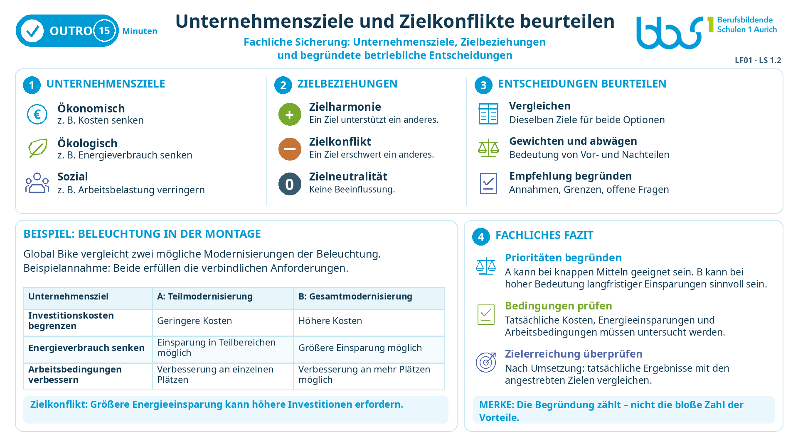

## Outro – Fachliche Sicherung (15 Minuten)

**Fachliches Sicherungsbeispiel: Beleuchtung in der Montage.** Zwei Modernisierungsvarianten erfüllen die verbindlichen Anforderungen. Eine Teilmodernisierung verursacht geringere Investitionen; eine Gesamtmodernisierung könnte größere Energieeinsparungen und Verbesserungen an mehr Arbeitsplätzen ermöglichen. Bei knappen Mitteln kann die Teilmodernisierung, bei tragbaren Kosten und hoher Bedeutung der langfristigen Verbesserungen die Gesamtmodernisierung geeignet sein. Die tatsächlichen Kosten, Energieeinsparungen und Arbeitsbedingungen müssen überprüft werden.

Sichern Sie gemeinsam die Unterschiede zwischen Zielarten und Zielbeziehungen, die Bedeutung der Zielgewichtung sowie die Begründung einer bedingten Empfehlung. Die Zahl der Vorteile entscheidet nicht allein über die Eignung einer Handlungsoption. Nach Umsetzung werden die tatsächlichen Ergebnisse mit den Zielen verglichen.
