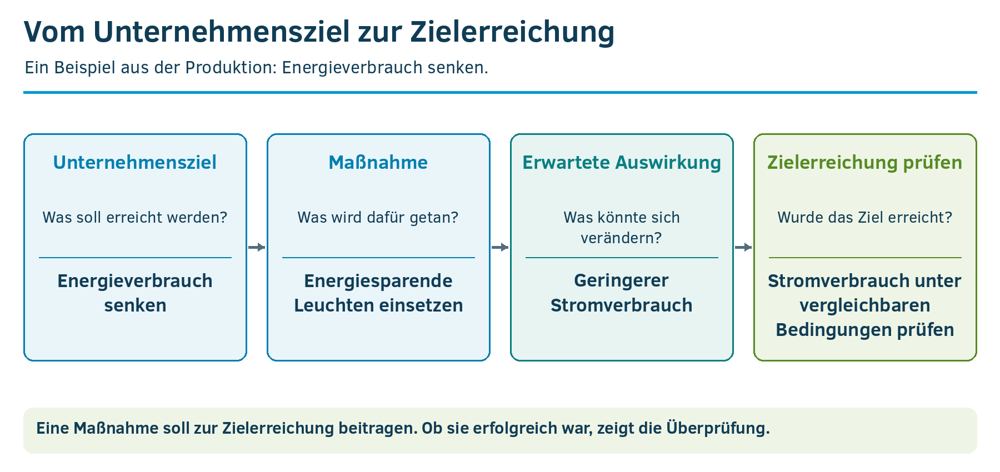
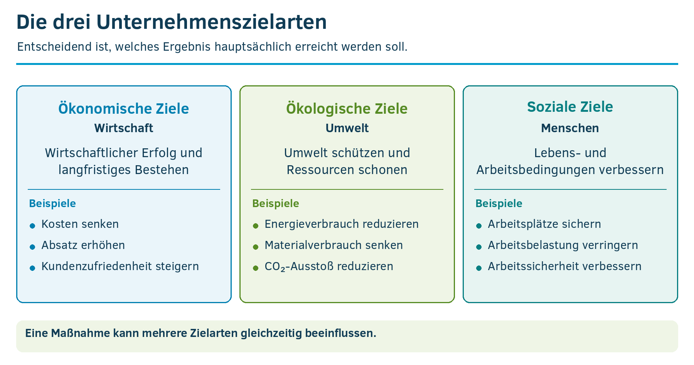
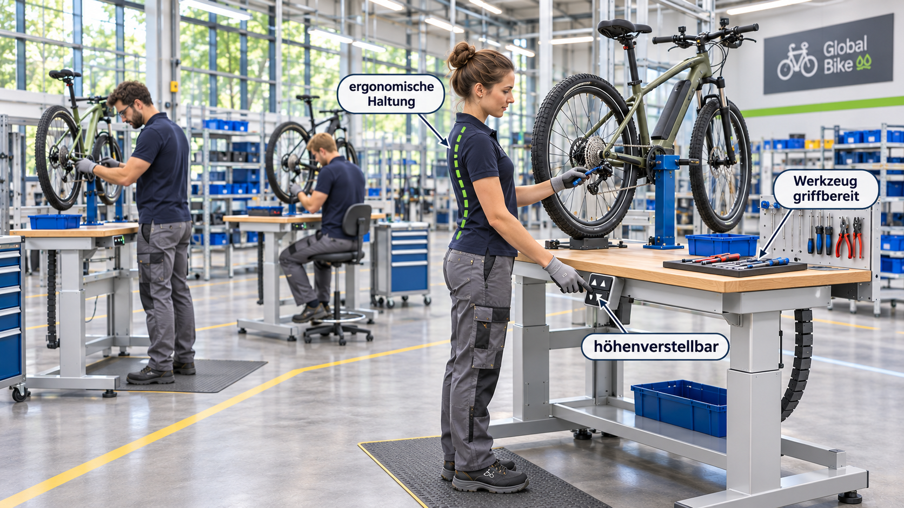

## M1 – Unternehmensziele und Zielarten

### Grundwissen

### Warum benötigen Unternehmen Ziele?

Die Global Bike Deutschland GmbH entwickelt, produziert und verkauft Fahrräder und Fahrradzubehör. Damit das Unternehmen langfristig erfolgreich arbeiten kann, muss es seine Tätigkeiten planen und Entscheidungen treffen.

**Unternehmensziele** beschreiben einen Zustand oder ein Ergebnis, das ein Unternehmen in Zukunft erreichen möchte.

| Funktion | Bedeutung |
|---|---|
| Orientierung | Ziele geben die Richtung der Unternehmensentwicklung vor. |
| Planung | Ziele helfen bei der Vorbereitung geeigneter Maßnahmen. |
| Entscheidung | Handlungsoptionen können anhand der Ziele beurteilt werden. |
| Kontrolle | Das Unternehmen kann überprüfen, ob seine Ziele erreicht wurden. |

Unternehmen verfolgen in der Regel mehrere Ziele gleichzeitig. Diese betreffen nicht nur den wirtschaftlichen Erfolg, sondern beispielsweise auch die Umwelt und die Mitarbeitenden.

### Ziele, Maßnahmen und Zielerreichung

Ein Unternehmensziel beschreibt, **was erreicht werden soll**. Eine **Maßnahme** beschreibt, **was dafür getan werden kann**.

Für ein Unternehmensziel können unterschiedliche Maßnahmen geeignet sein. Ob eine Maßnahme tatsächlich erfolgreich war, lässt sich durch die Überprüfung der erreichten Ergebnisse feststellen. **Zielerreichung** bedeutet, dass das tatsächliche Ergebnis die Anforderungen des angestrebten Ziels erfüllt.

Vor einer Entscheidung müssen deshalb zunächst die erwarteten Auswirkungen betrachtet werden.

### Welche Unternehmenszielarten gibt es?

Unternehmensziele lassen sich danach unterscheiden, welches Ergebnis erreicht werden soll.

#### Ökonomische Unternehmensziele

Ökonomische Ziele betreffen den wirtschaftlichen Erfolg und das langfristige Bestehen eines Unternehmens.

Global Bike benötigt wirtschaftlichen Erfolg, um beispielsweise Materialien beschaffen, Mitarbeitende beschäftigen und Investitionen ermöglichen zu können.

| Mögliche Unternehmensziele | Bedeutung |
|---|---|
| Gewinn steigern | Einen höheren wirtschaftlichen Überschuss erzielen. |
| Kosten senken | Beispielsweise Material- oder Energiekosten verringern. |
| Absatz erhöhen | Mehr Fahrräder und Zubehör verkaufen. |
| Kundenzufriedenheit steigern | Kundenbedürfnisse besser erfüllen. |
| Wettbewerbsfähigkeit verbessern | Sich gegenüber anderen Anbietern behaupten. |

#### Ökologische Unternehmensziele

Ökologische Ziele betreffen den Schutz der Umwelt und den verantwortungsvollen Umgang mit natürlichen Ressourcen.

Bei der Herstellung und dem Transport von Fahrrädern werden beispielsweise Rohstoffe und Energie benötigt.

| Mögliche Unternehmensziele | Bedeutung |
|---|---|
| Energieverbrauch reduzieren | Weniger Energie benötigen. |
| Materialverbrauch senken | Rohstoffe sparsam einsetzen. |
| Abfallmengen verringern | Unnötige Abfälle vermeiden. |
| CO₂-Ausstoß reduzieren | Klimabelastende Emissionen verringern. |
| Recyclingfähigkeit verbessern | Die Wiederverwertung von Materialien erleichtern. |

#### Soziale Unternehmensziele

Soziale Ziele betreffen das Wohlergehen von Menschen sowie ihre Lebens- und Arbeitsbedingungen. Innerhalb von Global Bike beziehen sie sich insbesondere auf die Mitarbeitenden. Sie können aber auch Menschen außerhalb des Unternehmens betreffen, beispielsweise Beschäftigte bei Lieferanten.

| Mögliche Unternehmensziele | Bedeutung |
|---|---|
| Arbeitsplätze sichern | Beschäftigung langfristig erhalten. |
| Arbeitssicherheit verbessern | Unfälle und Gesundheitsgefahren vermeiden. |
| Arbeitsbelastung verringern | Körperliche und psychische Überlastung vermeiden. |
| Mitarbeitende weiterqualifizieren | Berufliche Kenntnisse und Fähigkeiten verbessern. |
| Vereinbarkeit von Beruf und Privatleben verbessern | Arbeitszeiten verlässlich und familiengerecht gestalten. |

### Unternehmensziele richtig zuordnen

Für die Zuordnung eines Unternehmensziels ist entscheidend, welches Ergebnis hauptsächlich erreicht werden soll. Beispielsweise können mit der Beleuchtung in der Produktion unterschiedliche Ziele verbunden sein.

| Zielart | Beispiel Beleuchtung |
|---|---|
| Ökonomisch | Stromkosten senken |
| Ökologisch | Energieverbrauch reduzieren |
| Sozial | Arbeitsbedingungen durch bessere Beleuchtung verbessern |

Eine betriebliche Maßnahme kann somit mehrere Unternehmensziele gleichzeitig beeinflussen.

### Beispiel – Höhenverstellbare Montagearbeitsplätze

Global Bike prüft, ob höhenverstellbare Arbeitsplätze in der Fahrradmontage eingerichtet werden könnten. Die Mitarbeitenden könnten dadurch ihre Arbeitshöhe besser an ihre körperlichen Bedürfnisse anpassen.

*KI-generierte Beispielszene eines Montagearbeitsplatzes. Die Bildhinweise zeigen mögliche ergonomische Merkmale, keine nachgewiesenen Auswirkungen.*

| Zielart | Mögliche Auswirkungen |
|---|---|
| Sozial | Geringere körperliche Belastung und besserer Gesundheitsschutz sind möglich. |
| Ökonomisch | Anschaffungskosten entstehen. Langfristig könnten krankheitsbedingte Ausfälle zurückgehen. |
| Ökologisch | Auswirkungen lassen sich anhand dieser Angaben noch nicht beurteilen. |

Die Verbesserung der Arbeitsbedingungen ist das angestrebte soziale Ziel. Die Maßnahme kann gleichzeitig wirtschaftliche Auswirkungen besitzen. Nicht jede Maßnahme beeinflusst zwangsläufig alle drei Zielarten.

Bei betrieblichen Entscheidungen müssen gesetzliche Anforderungen, beispielsweise zum Arbeits- und Umweltschutz, eingehalten werden.

### Genauer betrachtet – Nachhaltigkeit und überprüfbare Ziele

Nachhaltiges Wirtschaften bedeutet, wirtschaftliche, ökologische und soziale Auswirkungen betrieblicher Entscheidungen langfristig zu berücksichtigen. Dabei müssen nicht alle Ziele bei jeder Entscheidung gleich stark gewichtet werden.

Unternehmensziele können außerdem durch konkrete Zielwerte und Zeiträume besser überprüfbar gemacht werden.

| Allgemeines Ziel | Konkreteres Ziel |
|---|---|
| Kosten senken | Energiekosten in der Produktion senken |
| Qualität verbessern | Anteil fehlerhafter Fahrräder verringern |
| Umwelt schützen | Verpackungsmaterial pro Fahrrad reduzieren |

Ein Ziel könnte beispielsweise lauten, den Energieverbrauch pro hergestelltem Fahrrad innerhalb eines Jahres um 10 % zu senken. Dies ist ein fiktives Formulierungsbeispiel und kein tatsächlicher Zielwert von Global Bike.

**Merke:** Unternehmensziele geben die Richtung für betriebliche Entscheidungen vor. Ökonomische Ziele betreffen die Wirtschaft, ökologische Ziele die Umwelt und soziale Ziele die Menschen. Maßnahmen sollen zur Zielerreichung beitragen und können mehrere Unternehmensziele gleichzeitig beeinflussen.
