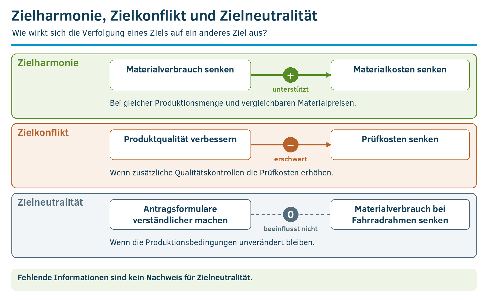
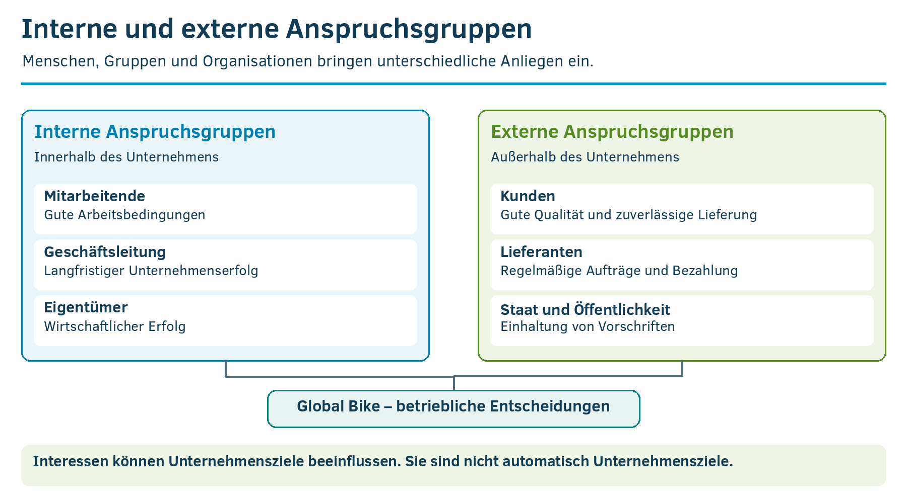
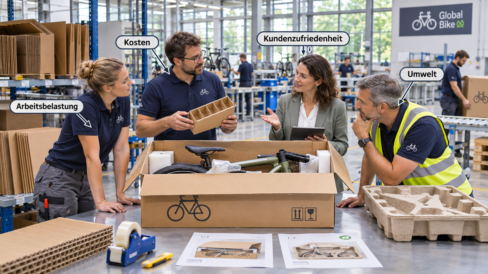

## M2 – Zielbeziehungen und unterschiedliche Interessen

### Grundwissen

### Wie beeinflussen sich Unternehmensziele?

Global Bike verfolgt mehrere Unternehmensziele gleichzeitig. Die Verfolgung eines Ziels kann die Erreichung eines anderen Ziels erleichtern, erschweren oder unbeeinflusst lassen. Diese Zusammenhänge werden als **Zielbeziehungen** bezeichnet.

### Die drei Zielbeziehungen

| Zielbeziehung | Bedeutung |
|---|---|
| Zielharmonie | Die Verfolgung eines Ziels unterstützt die Erreichung eines anderen Ziels. |
| Zielkonflikt | Die Verfolgung eines Ziels erschwert die Erreichung eines anderen Ziels. |
| Zielneutralität | Die Verfolgung eines Ziels beeinflusst die Erreichung eines anderen Ziels in der betrachteten Situation nicht. |

#### Beispiel 1 – Zielharmonie

Global Bike möchte den Materialverbrauch bei der Herstellung von Fahrradrahmen senken. Wenn bei gleicher Produktionsmenge und vergleichbaren Materialpreisen weniger Werkstoffe benötigt werden, können gleichzeitig die Materialkosten sinken.

Das ökologische Ziel unterstützt unter diesen Bedingungen ein ökonomisches Ziel. Es liegt eine Zielharmonie vor.

#### Beispiel 2 – Zielkonflikt

Global Bike möchte die Produktqualität verbessern. Dazu werden zusätzliche Qualitätskontrollen in Betracht gezogen. Diese Kontrollen können dazu beitragen, fehlerhafte Fahrräder vor der Auslieferung zu erkennen. Gleichzeitig benötigen sie Arbeitszeit und können die Prüfkosten erhöhen.

Durch die zusätzlichen Kontrollen können das Ziel, die Produktqualität zu verbessern, und das Ziel, die Prüfkosten zu senken, in Konflikt geraten. Das Beispiel zeigt, dass Zielkonflikte auch zwischen Zielen derselben Zielart entstehen können.

#### Beispiel 3 – Zielneutralität

Global Bike möchte interne Antragsformulare für Mitarbeitende verständlicher formulieren. Gleichzeitig soll der Materialverbrauch bei der Herstellung von Fahrradrahmen gesenkt werden.

Wenn lediglich die Formulierungen der Antragsformulare verändert werden und die Produktionsbedingungen gleich bleiben, wird der Materialverbrauch bei der Herstellung der Fahrradrahmen dadurch nicht beeinflusst. Bezogen auf diese beiden Ziele liegt in der beschriebenen Situation Zielneutralität vor.

**Wichtig:** Fehlende Informationen über mögliche Auswirkungen bedeuten nicht automatisch, dass eine Zielneutralität vorliegt.

### Warum müssen Zielbeziehungen begründet werden?

Die Zielarten allein geben keinen Aufschluss darüber, welche Zielbeziehung besteht.

| Betrachtete Ziele | Mögliche Zielbeziehung |
|---|---|
| Materialverbrauch und Materialkosten senken | Zielharmonie |
| Produktqualität verbessern und Prüfkosten senken | Zielkonflikt |
| Arbeitsbelastung und krankheitsbedingte Ausfallkosten senken | Zielharmonie |
| Mitarbeitende weiterqualifizieren und kurzfristige Personalkosten senken | Zielkonflikt |

Entscheidend ist jeweils, durch welche konkrete Maßnahme ein Ziel verfolgt wird und wie sich diese Maßnahme auf das andere Ziel auswirkt.

### Unterschiedliche Interessen an einem Unternehmen

Global Bike steht mit unterschiedlichen Menschen, Gruppen und Organisationen in Verbindung.

**Interessen** beschreiben Bedürfnisse, Erwartungen oder Anliegen von Personen oder Gruppen.

Personen, Gruppen und Organisationen, die von den Tätigkeiten eines Unternehmens betroffen sind oder Einfluss auf das Unternehmen nehmen können, werden als **Anspruchsgruppen** bezeichnet.

| Anspruchsgruppe | Mögliche Interessen |
|---|---|
| Mitarbeitende | Sichere Arbeitsplätze, gute Arbeitsbedingungen |
| Geschäftsleitung und Eigentümer | Langfristiger Unternehmenserfolg |
| Kunden | Gute Qualität, angemessene Preise, zuverlässige Lieferungen |
| Lieferanten | Regelmäßige Aufträge, zuverlässige Bezahlung |
| Staat und Öffentlichkeit | Einhaltung von Vorschriften, verantwortungsvolles Wirtschaften |

Ein Interesse wird nicht automatisch zu einem Unternehmensziel. Es kann jedoch beeinflussen, welche Ziele das Unternehmen verfolgt.

### Interessen- und Zielkonflikte unterscheiden

Ein **Interessenkonflikt** entsteht, wenn unterschiedliche Interessen nicht gleichzeitig oder nicht vollständig erfüllt werden können.

#### Beispiel – Fahrradverpackungen bei Global Bike

Global Bike prüft, ob weniger Verpackungsmaterial verwendet werden könnte.

*KI-generierte beispielhafte betriebliche Besprechung. Die Bildhinweise zeigen mögliche Anliegen, keine festgelegten Rollen oder tatsächlichen Aussagen einzelner Personen.*

| Betriebliche Perspektive | Mögliches Anliegen |
|---|---|
| Umweltbeauftragter | Rohstoffe schonen |
| Rechnungswesen | Kosten senken |
| Logistik | Sicheren Transport ermöglichen |
| Kunden | Unbeschädigte Ware erhalten |

Auch der Verpackungsaufwand kann die Arbeitsbelastung beeinflussen. Weniger Verpackungsmaterial könnte dem Umweltschutz und der Kostensenkung dienen. Würde dadurch allerdings der Schutz der Fahrräder beeinträchtigt, könnte dies den Interessen der Kunden widersprechen.

Innerhalb von Global Bike könnte daraus ein Zielkonflikt zwischen der Verringerung des Materialverbrauchs und der Sicherung der Produktqualität entstehen.

| Interessenkonflikt | Zielkonflikt |
|---|---|
| Unterschiedliche Erwartungen von Personen oder Gruppen stehen im Widerspruch. | Die Verfolgung eines Unternehmensziels erschwert die Erreichung eines anderen Unternehmensziels. |

Ein Zielkonflikt kann auch dann entstehen, wenn dieselbe Person beide Ziele verfolgt. Die verschiedenen Unternehmensbereiche bringen ihre jeweiligen fachlichen Kenntnisse und Perspektiven in Entscheidungen ein. Dabei verfolgt keine Abteilung zwangsläufig ausschließlich wirtschaftliche, ökologische oder soziale Ziele.

### Genauer betrachtet – Zielbeziehungen können sich verändern

Global Bike möchte seine Mitarbeitenden durch zusätzliche Schulungen in der Bedienung und Wartung von Maschinen weiterqualifizieren.

| Kurzfristig | Langfristig |
|---|---|
| Schulungen verursachen zusätzliche Kosten. | Verbesserte Kenntnisse könnten Maschinenstörungen und damit verbundene Kosten verringern. |
| Möglicher Zielkonflikt | Mögliche Zielharmonie |

Ob die erwarteten Einsparungen tatsächlich eintreten und die zusätzlichen Schulungskosten ausgleichen, müsste untersucht werden.

Eine Zielbeziehung kann somit von der gewählten Maßnahme, den betrieblichen Bedingungen und dem betrachteten Zeitraum abhängen.

**Merke:** Unternehmensziele können sich unterstützen, behindern oder unbeeinflusst lassen. Zielbeziehungen müssen anhand konkreter Auswirkungen begründet werden. Unterschiedliche Interessen können Unternehmensziele beeinflussen und zu Zielkonflikten beitragen. Ein Zielkonflikt bedeutet nicht automatisch, dass eine Maßnahme ungeeignet ist.
