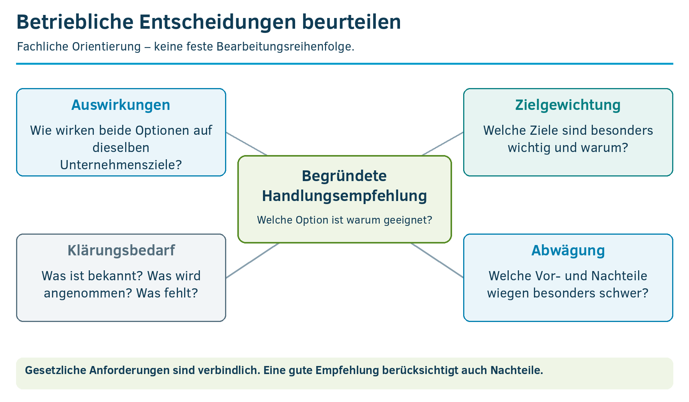

## M3 – Betriebliche Entscheidungen beurteilen

### Fachliche Entscheidungshilfe

Bei betrieblichen Entscheidungen stehen häufig mehrere Möglichkeiten zur Verfügung.

Eine **Handlungsoption** ist eine mögliche Vorgehensweise zur Lösung eines betrieblichen Problems oder zur Erreichung eines Unternehmensziels.

Um beurteilen zu können, welche Handlungsoption geeignet ist, müssen ihre Auswirkungen auf die betroffenen Unternehmensziele berücksichtigt werden.

### Auswirkungen vergleichen

Handlungsoptionen sollten anhand derselben Unternehmensziele verglichen werden. Dabei sind sowohl Vorteile als auch Nachteile und mögliche Risiken zu berücksichtigen. Nicht alle Auswirkungen lassen sich im Voraus sicher bestimmen.

| Informationsgrundlage | Bedeutung |
|---|---|
| Bekannte Information | Ein Sachverhalt ist durch vorhandene Angaben belegt. |
| Begründete Annahme | Eine erwartete Auswirkung ist fachlich plausibel, aber noch nicht nachgewiesen. |
| Klärungsbedarf | Für eine sichere Beurteilung fehlen Informationen. |

### Unternehmensziele gewichten

Die **Zielgewichtung** beschreibt, welche Bedeutung einzelnen Unternehmenszielen bei einer konkreten Entscheidung zugemessen wird.

Nicht alle Ziele müssen gleich wichtig sein. Ihre Bedeutung hängt beispielsweise von der betrieblichen Situation, der Dringlichkeit eines Problems und den erwarteten Folgen ab. Eine Gewichtung muss fachlich begründet werden.

### Auswirkungen abwägen

Eine **Abwägung** bedeutet, die Bedeutung unterschiedlicher Ziele sowie die Vorteile und Nachteile der Handlungsoptionen miteinander zu vergleichen.

Die Handlungsoption mit den meisten Vorteilen ist nicht automatisch die beste. Entscheidend ist auch, wie bedeutsam die einzelnen Vorteile und Nachteile sind.

Gesetzliche Anforderungen und verbindliche Verpflichtungen müssen eingehalten werden. Sie stehen nicht zur freien Abwägung.

### Eine Handlungsempfehlung entwickeln

Eine **Handlungsempfehlung** beschreibt, welche Vorgehensweise aufgrund einer fachlichen Beurteilung vorgeschlagen wird.

Eine nachvollziehbare Empfehlung berücksichtigt auch die Nachteile der bevorzugten Option und benennt gegebenenfalls noch offene Fragen.

Auch eine Kombination verschiedener Handlungsoptionen ist möglich. Ihre Auswirkungen müssen jedoch ebenfalls beurteilt werden.

### Orientierung für betriebliche Entscheidungen

Die fachlichen Gesichtspunkte stehen miteinander in Verbindung. Eine feste Bearbeitungsreihenfolge ist nicht vorgegeben.

**Merke:** Eine gute betriebliche Entscheidung zeichnet sich nicht dadurch aus, dass sie keine Nachteile besitzt, sondern dadurch, dass sie fachlich nachvollziehbar begründet wird.
