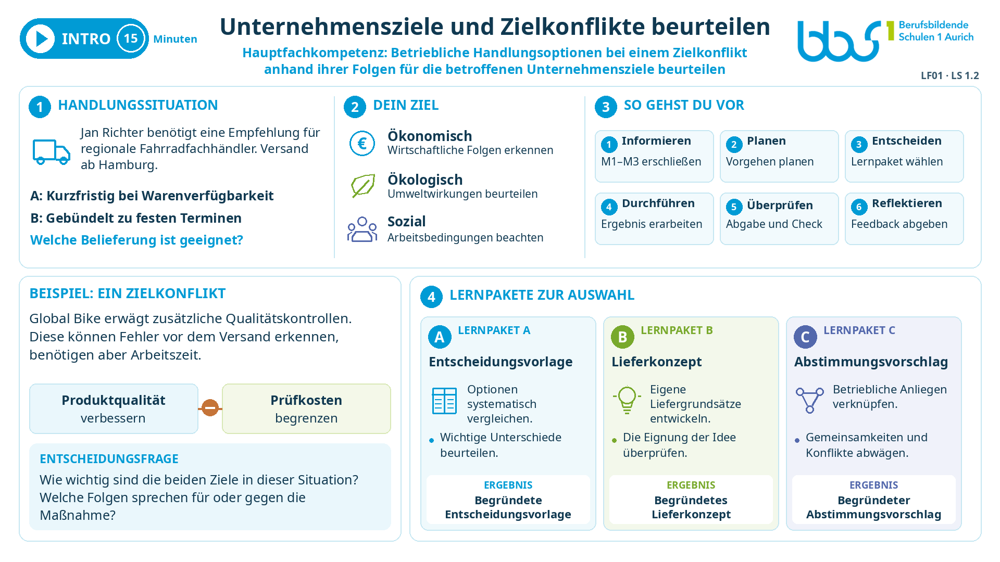

## Intro – 15 Minuten

**Handlungssituation:** Jan Richter benötigt eine Empfehlung zur zukünftigen Belieferung regionaler Fahrradfachhändler vom Standort Hamburg aus.

**Ihr Ziel:** Unternehmensziele unterscheiden, ihre Beziehungen und die Auswirkungen betrieblicher Entscheidungen beurteilen.

**Beispiel:** Zusätzliche Qualitätskontrollen können Fehler vor dem Versand erkennen, benötigen aber Arbeitszeit. Wie wichtig sind die Ziele Produktqualität und geringe Prüfkosten? Welche Auswirkungen sprechen für oder gegen die Maßnahme?

**Lernpakete zur Auswahl:** A – Entscheidungsvorlage; B – Lieferkonzept; C – Betrieblicher Abstimmungsvorschlag. Die verbindliche Wahl erfolgt in Phase 3.
