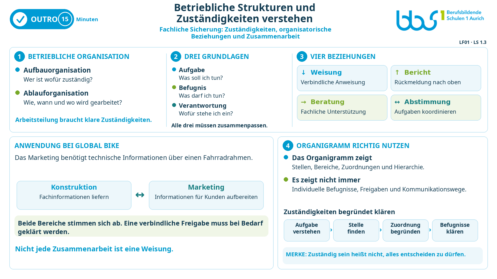
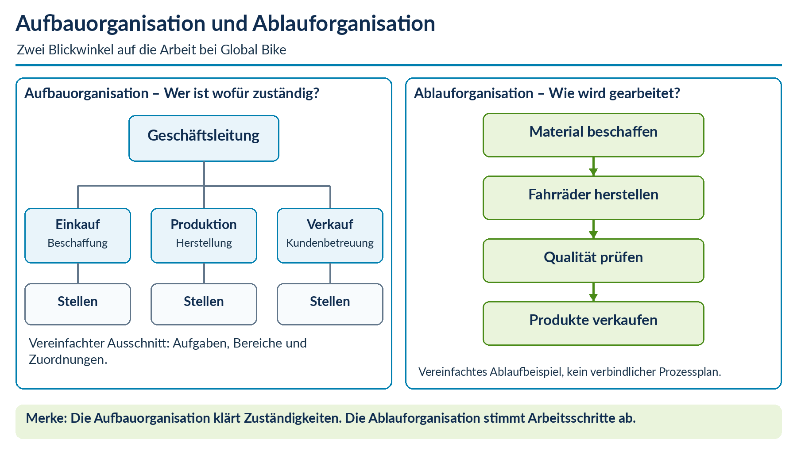
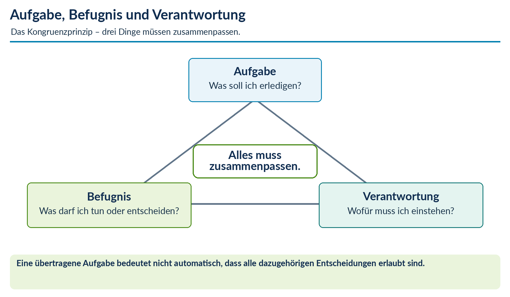
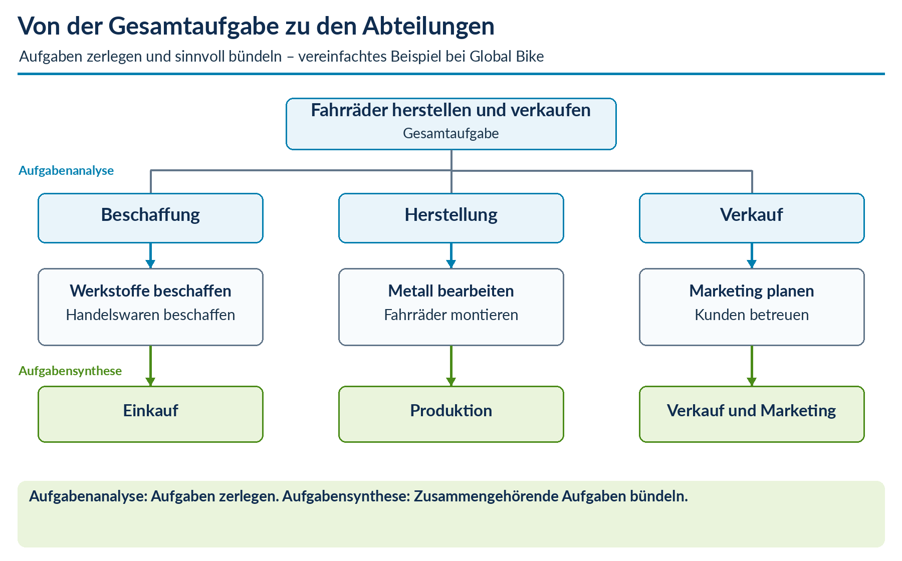
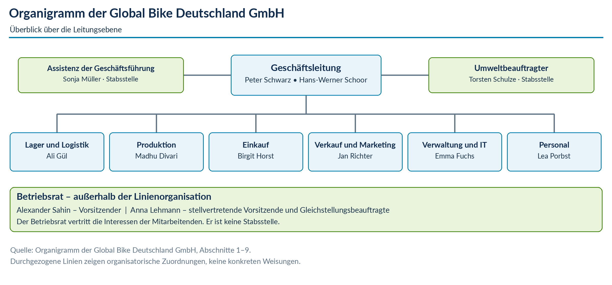
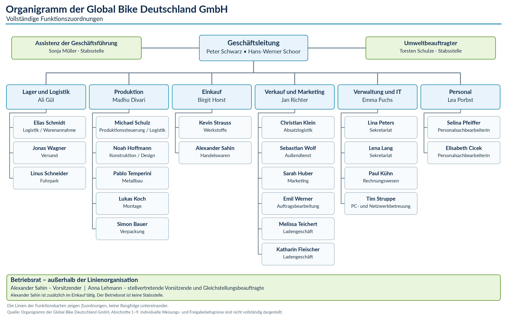
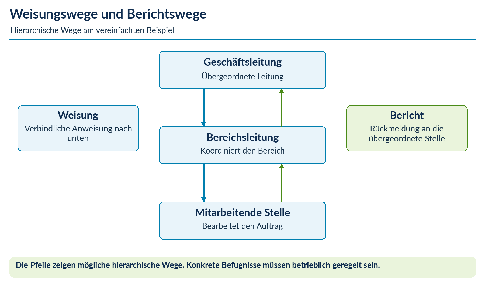
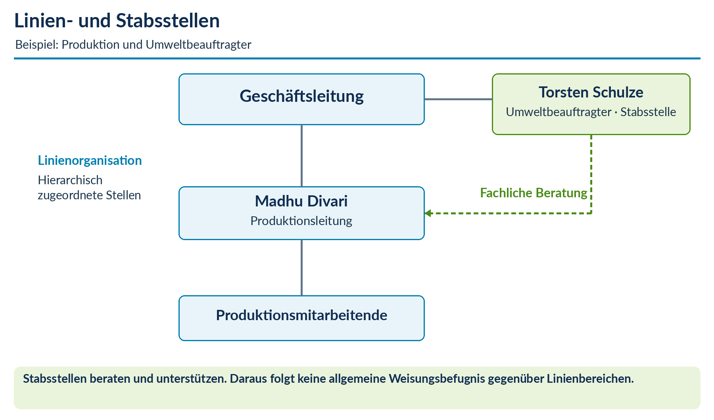
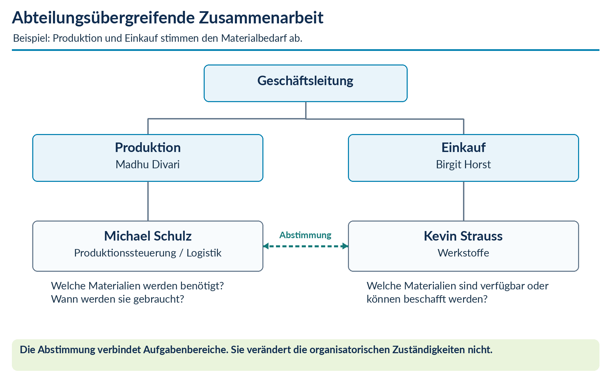
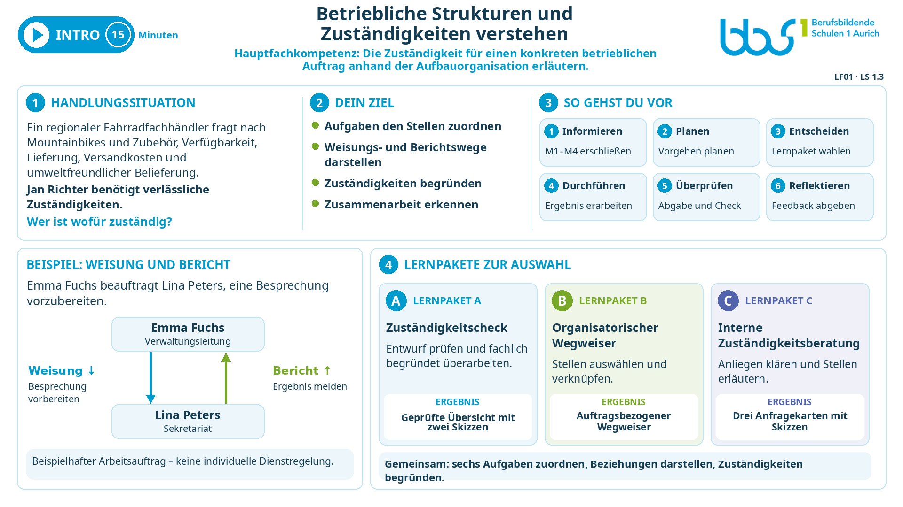

# BFS dual · Lernfeld 1 · LS 1.3 · Betriebliche Strukturen und Zuständigkeiten verstehen

**Bildungsgang** · BFS dual, Profil Wirtschaft  
**Lernsituation** · 1.3 · Betriebliche Strukturen und Zuständigkeiten verstehen (Paketkennung `BFSDUAL-LF01-LS03`)  
**Unterrichtlicher Bezug** · Handlungsorientierte Fallbearbeitung bei der Global Bike Deutschland GmbH  
**Zeitrahmen** · 6 Unterrichtsstunden à 45 Minuten, insgesamt 270 Minuten für einen gewählten Lernweg  
**Digitale Fassung** · [Orientierung öffnen](index.html) · [Unterlagen und Downloads](materialien.html)  
**Formgrundlage** · [BFSdual-Vorlage, Arbeitsstand vom 26. November 2026](https://github.com/macmaris83/Lernsituationen/blob/a1dd9b693df1a234bf3c7387198fcf5b5aab6afc/Fachbereiche/BFSdual/Vorlage_Lernsituation.md)

## Aufgabenzeiten

Für jeden der drei Wege gilt derselbe Zeitrahmen. Bei Durchführen zählt der Auftrag zum gewählten Lernpaket einmal.

| Station | Minuten je Lernweg |
| --- | ---: |
| Orientierung | 10 |
| Handlungssituation | 15 |
| Informieren | 20 |
| Fachbegriffscheck | 15 |
| Planen | 15 |
| Entscheiden | 10 |
| Durchführen | 135 |
| Bewerten | 40 |
| Reflektieren | 10 |
| **Gesamt** | **270** |

## Orientierung

[Digitale Fassung öffnen](index.html)

BFS dual · Lernfeld 1 · Lernsituation 1.3 · 6 Unterrichtsstunden

#### Den Auftrag überblicken

Ein Fahrradfachhändler braucht Auskunft aus mehreren Bereichen von Global Bike. Wer kann den Bestand prüfen, wer darf etwas zusagen? Sie klären für Jan Richter die Zuständigkeiten und zeigen, welche Stellen sich abstimmen müssen. [Fallübersicht ansehen](#orientierung).

Jan Richter benötigt eine begründete Zuordnung aller sechs Aufgaben. Zwei Skizzen zeigen mögliche Weisungs- und Berichtswege aus zwei Linienbereichen. Das Produkt erläutert Schnittstellen, Stabsberatung, offenen Klärungsbedarf und betrieblichen Nutzen. Stichpunkte für die kurze Vorstellung gehören zum gewählten Produkt.

Du entscheidest, welche Aufgaben du selbstständig oder mit anderen bearbeitest. Für die Rückmeldung erhält jede Person ein fremdes Produkt.

10 Minuten

*Fachbuchverweis · Für diesen Auftrag ist keine Buchseite hinterlegt.*

Kompetenzprofil der Lernsituation

Die Gewichtung zeigt, wie häufig und wofür die Kompetenz in den Aufgaben gebraucht wird. 1 bedeutet „kurz in einer Aufgabe“, 6 „von der Vorbereitung bis zur Auswertung“.

| Kompetenz | Gewicht (1–6) | Was übe ich? |
| --- | --- | --- |
| F · Fachkompetenz | 6 / 6 | Ich kann sechs Aufgaben der Kundenanfrage begründet zuordnen und Weisungs-, Berichts- und Abstimmungswege unterscheiden. |
| P · Personalkompetenz | 4 / 6 | Ich kann einen Klärungsbedarf erkennen und im Ergebnis sichtbar halten. |
| S · Sozialkompetenz | 5 / 6 | Ich kann den Informationsbedarf zweier Bereiche beschreiben und eine nützliche Rückmeldung geben. |
| M · Methodenkompetenz | 6 / 6 | Ich kann Organigramm und Stellenübersicht auswerten und zwischen Beleg und Ableitung unterscheiden. |
| D · Medienkompetenz | 5 / 6 | Ich kann Beziehungen mit beschrifteten Pfeilen oder einer verständlichen Legende darstellen. |

## Handlungssituation

[Digitale Fassung öffnen](handlungssituation.html)

 

Jan Richter, Emma Fuchs und Lina Peters stimmen ab, wer die Fragen eines Fachhändlers zu Sortiment, Versand und umweltfreundlicher Belieferung bearbeitet.

Ein Fahrradfachhändler aus der Region Nordwest möchte Mountainbikes und Fahrradzubehör beziehen. Er fragt nach verfügbaren Produkten, Liefermöglichkeiten, Versandkosten und umweltfreundlicher Belieferung. Für Lagerbestand und Versand ist der bestehende Standort Hamburg relevant.

Jan Richter leitet Verkauf und Marketing. Bevor er dem Fachhändler antwortet, benötigt er eine Übersicht über sechs Aufgaben. Sie sollen die Anfrage kaufmännisch bearbeiten lassen, den Lagerbestand klären, Lieferwünsche intern abstimmen, Versandmöglichkeiten prüfen, Versandkosten kaufmännisch beurteilen und eine umweltfreundliche Belieferung einschätzen lassen.

Ordnen Sie jeder Aufgabe eine geeignete betriebliche Stelle zu. Erklären Sie die Zusammenarbeit und kennzeichnen Sie, welche Entscheidungsbefugnis vor einer verbindlichen Zusage noch zu klären ist. Das Ergebnis soll Jan Richter und den beteiligten Mitarbeitenden als Arbeitsunterlage dienen.

#### Woran hat der Fachhändler Interesse, und worüber braucht er Auskunft?

- Mountainbikes und Zubehör sowie Auskünfte zu Liefermöglichkeiten, Kosten und umweltfreundlichem Versand.
- Gravelbikes und Ersatzteile sowie einen Termin für eine Schulung.
- Büroausstattung und Angaben zur Lagergebühr.

3 Minuten

#### Wer braucht Ihre Übersicht und wofür?

- Lina Peters braucht die Übersicht zur Planung einer Betriebsfeier.
- Jan Richter braucht die Übersicht, um Zuständigkeiten zu klären und dem Fachhändler zu antworten.
- Der Fachhändler braucht sie, um das interne Organigramm von Global Bike zu ändern.

3 Minuten

#### Welche Aufgaben betreffen den Standort Hamburg?

- Die regionale Werbung entwerfen und die Verkaufsfläche gestalten.
- Das Rechnungswesen umstellen und neue Arbeitsverträge prüfen.
- Lagerbestand klären und Versandmöglichkeiten prüfen.

3 Minuten

#### Welche Art von Frage bleibt möglicherweise trotz Organigramm offen?

- Wer im konkreten Vorgang eine verbindliche Zusage freigeben darf.
- Welche Stellen es im Unternehmen gibt.
- Welche Abteilungen im Organigramm aufgeführt werden.

2 Minuten

## Informieren

[Digitale Fassung öffnen](informieren.html)

Erschließe die Angaben und Unterlagen für deinen Auftrag.

10 Minuten

#### Aufbau und Ablauf unterscheiden

Lesen Sie [M1 · Betriebliche Organisation](#m1) und [M2 · Aufgaben und Verantwortung](#m2). Erklären Sie am Beispiel einer Besprechung, wie sich Aufgabe, Befugnis und Verantwortung unterscheiden.

*Fachbuchverweis · Für diesen Auftrag ist keine Buchseite hinterlegt.*

10 Minuten

#### Das Organigramm lesen

Öffnen Sie die Leitungsebene in [M3 · Organigramm](#m3). Bestimmen Sie Linienbereiche, Geschäftsleitung und Stabsstellen. Nutzen Sie die vollständige Grafik zum Nachschlagen und [M4 · Zusammenarbeit](#m4) für die Bedeutung der Verbindungslinien.

*Fachbuchverweis · Für diesen Auftrag ist keine Buchseite hinterlegt.*

[Begriffsblatt zum Nachschlagen](#glossar) · [Begriffe prüfen](#begriffstraining)

## Fachbegriffscheck

[Digitale Fassung öffnen](begriffstraining.html)

Wähle zu jedem Begriff die passende Erklärung. Du kannst den Check wiederholen.

15 Minuten

[Begriffsblatt öffnen](#glossar)

Karte `BFSDUAL-LF01-LS03-B01`

**1. Aufbauorganisation**

- Die Reihenfolge einzelner Arbeitsschritte.
- Die zeitliche Planung von Kundenaufträgen.
- Regelt, welche Stellen und Abteilungen bestehen, wofür sie zuständig sind und wie sie zusammenhängen.

Karte `BFSDUAL-LF01-LS03-B02`

**2. Ablauforganisation**

- Regelt, wie, wann und wo Arbeitsschritte ausgeführt und aufeinander abgestimmt werden.
- Die Festlegung der Unternehmensleitung.
- Die Zuordnung von Mitarbeitenden zu Abteilungen.

Karte `BFSDUAL-LF01-LS03-B03`

**3. Aufgabe**

- Das Recht, anderen Mitarbeitenden Anweisungen zu erteilen.
- Die Position einer Person im Organigramm.
- Eine Tätigkeit oder Arbeit, die erledigt werden soll.

Karte `BFSDUAL-LF01-LS03-B04`

**4. Stelle**

- Die kleinste organisatorische Einheit mit festgelegten Aufgaben und Befugnissen, unabhängig von der Person, die sie besetzt.
- Der gesamte Aufgabenbereich eines Unternehmens.
- Eine Person mit ihrem Namen und ihren persönlichen Eigenschaften.

Karte `BFSDUAL-LF01-LS03-B05`

**5. Abteilung**

- Zwei Mitarbeitende tauschen Informationen aus.
- Eine Person erhält eine einzelne betriebliche Aufgabe.
- Mehrere Stellen, die unter einer gemeinsamen Leitung zusammengefasst sind.

Karte `BFSDUAL-LF01-LS03-B06`

**6. Zuständigkeit**

- Wie lange die Bearbeitung einer Aufgabe dauern darf.
- Wie hoch die Kosten einer Aufgabe sein dürfen.
- Der festgelegte Bereich von Aufgaben oder Angelegenheiten, für den eine Stelle zuständig ist.

Karte `BFSDUAL-LF01-LS03-B07`

**7. Befugnis**

- Die Pflicht, über jedes Arbeitsergebnis zu berichten.
- Die Tätigkeit, die einer Stelle übertragen wurde.
- Das Recht, bestimmte Handlungen vorzunehmen oder Entscheidungen zu treffen.

Karte `BFSDUAL-LF01-LS03-B08`

**8. Verantwortung**

- Die Aufgabe einer bestimmten Abteilung zuzuordnen.
- Die Pflicht, für die ordnungsgemäße Erfüllung einer Aufgabe einzustehen.
- Über die notwendigen Befugnisse zu entscheiden.

Karte `BFSDUAL-LF01-LS03-B09`

**9. Organigramm**

- Die Entwicklung der betrieblichen Umsätze.
- Eine grafische Übersicht über die Aufbauorganisation eines Unternehmens.
- Den zeitlichen Ablauf eines Kundenauftrags.

Karte `BFSDUAL-LF01-LS03-B10`

**10. Hierarchie**

- Die Zusammenarbeit zwischen gleichgeordneten Stellen.
- Die Über- und Unterordnung von Stellen in einem Unternehmen.
- Die Reihenfolge, in der Kundenaufträge eingehen.

Karte `BFSDUAL-LF01-LS03-B11`

**11. Weisungsweg**

- Der Weg einer verbindlichen Anweisung von einer befugten zu einer untergeordneten Stelle.
- Den Austausch von Informationen zwischen gleichgeordneten Stellen.
- Die Rückmeldung eines Arbeitsergebnisses an die Leitung.

Karte `BFSDUAL-LF01-LS03-B12`

**12. Berichtsweg**

- Den Weg einer Anweisung von der Leitung zu den Mitarbeitenden.
- Die Beratung einer Führungskraft durch eine Stabsstelle.
- Der Weg einer Rückmeldung von einer untergeordneten zu einer übergeordneten Stelle.

Karte `BFSDUAL-LF01-LS03-B13`

**13. Stabsstelle**

- Sie vertritt die Interessen der Mitarbeitenden gegenüber dem Arbeitgeber.
- Eine Stelle, die eine Leitung durch Beratung oder besondere Fachaufgaben unterstützt. Sie hat dadurch nicht automatisch Weisungsrechte gegenüber anderen Bereichen.
- Sie koordiniert als Linienleitung die Aufgaben untergeordneter Stellen.

Karte `BFSDUAL-LF01-LS03-B14`

**14. Schnittstelle**

- Ein Punkt, an dem Aufgaben oder Informationen verschiedener Stellen aufeinandertreffen und abgestimmt werden müssen.
- Wenn eine Person eine neue Stelle im Unternehmen übernimmt.
- Wenn die Geschäftsleitung eine neue Abteilung bildet.

## Planen

[Digitale Fassung öffnen](planen.html)

Entwirf deinen Arbeitsplan.

8 Minuten

#### Den Prüfweg für sechs Aufgaben vorbereiten

Sammeln Sie die sechs Aufgaben aus der Handlungssituation. Planen Sie, wie Sie mit [M3 · Organigramm](#m3) Zuständigkeiten belegen, offene Befugnisse markieren und die benötigten Schnittstellen prüfen.

*Fachbuchverweis · Für diesen Auftrag ist keine Buchseite hinterlegt.*

7 Minuten

#### Darstellung und Zeit planen

Skizzieren Sie, wo Belege und begründete Ableitungen festgehalten werden. Planen Sie zwei Wegeskizzen in unterschiedlichen Linienbereichen ein. Wählen Sie geeignete Materialien und Arbeitsschritte.

*Fachbuchverweis · Für diesen Auftrag ist keine Buchseite hinterlegt.*

## Entscheiden

[Digitale Fassung öffnen](entscheiden.html)

Wähle einen von drei gleichwertigen Arbeitswegen. Du kannst deine Wahl begründet ändern.

**Lernpaket wählen**

A · Zuständigkeitscheck · Prüfen Sie sechs vorgeschlagene Zuordnungen auf Fehler. · Eine korrigierte Übersicht mit Begründungen und zwei Skizzen eignet sich für die systematische Prüfung eines Entwurfs.

B · Organisatorischer Wegweiser · Wählen Sie relevante Stellen aus und verbinden Sie die Aufgaben und Informationswege. · Eine auf den Auftrag reduzierte Karte mit beschrifteten Beziehungen bietet schnelle Orientierung.

C · Interne Zuständigkeitsberatung · Beantworten Sie drei interne Anfragekarten aus Sicht der Beteiligten. · Drei begründete Antworten mit Skizzen und Fazit helfen bei der Beratung zu noch offenen Fragen.

Jan Richter benötigt eine begründete Zuordnung aller sechs Aufgaben. Zwei Skizzen zeigen mögliche Weisungs- und Berichtswege aus zwei Linienbereichen. Das Produkt erläutert Schnittstellen, Stabsberatung, offenen Klärungsbedarf und betrieblichen Nutzen. Stichpunkte für die kurze Vorstellung gehören zum gewählten Produkt.

10 Minuten

#### Arbeitsweg und Medium begründen

Wählen Sie einen der drei Arbeitswege. Begründen Sie aus Sicht der Adressaten, warum sich beispielsweise eine geprüfte Übersicht, ein Wegweiser oder drei Anfragekarten eignen. Nennen Sie eine Alternative und halten Sie Ihr gewünschtes Medium fest.

*Fachbuchverweis · Für diesen Auftrag ist keine Buchseite hinterlegt.*

## Durchführen

[Digitale Fassung öffnen](durchfuehren.html)

Bearbeite den Auftrag im gewählten Format.

[Wähle in Entscheiden dein Lernpaket A, B oder C](#entscheiden), um die Aufträge zu öffnen.

Deine Wahl:  · [Wahl ändern](#entscheiden)

Jan Richter benötigt eine begründete Zuordnung aller sechs Aufgaben. Zwei Skizzen zeigen mögliche Weisungs- und Berichtswege aus zwei Linienbereichen. Das Produkt erläutert Schnittstellen, Stabsberatung, offenen Klärungsbedarf und betrieblichen Nutzen. Stichpunkte für die kurze Vorstellung gehören zum gewählten Produkt.

34 Minuten

#### Die sechs betrieblichen Aufgaben zuordnen

Prüfen Sie für jede Aufgabe anhand von [M3 · Organigramm](#m3), welche Stelle die erforderlichen Informationen besitzt. Kennzeichnen Sie jeweils, was belegt, was fachlich abgeleitet und was offen ist. Achten Sie besonders auf die Entscheidungsbefugnis für Versandkosten.

*Fachbuchverweis · Für diesen Auftrag ist keine Buchseite hinterlegt.*

67 Minuten

**Lernpaket A**

#### Sechs Vorschläge prüfen

Vergleichen Sie alle sechs Aussagen im ungeprüften Entwurf aus [Arbeitsauftrag A](#weg-a) mit den Belegen. Korrigieren und begründen Sie die Zuordnungen. Fügen Sie zwei Skizzen, Erläuterungen und Stichpunkte für Jan hinzu.

*Fachbuchverweis · Für diesen Auftrag ist keine Buchseite hinterlegt.*

67 Minuten

**Lernpaket B**

#### Den organisatorischen Wegweiser erstellen

Stellen Sie mit [Arbeitsauftrag B](#weg-b) einen Wegweiser aus den relevanten Stellen und Aufgaben zusammen. Verbinden und beschriften Sie die Beziehungen. Erläutern Sie die zwei Schnittstellen, die Stabsfunktion und den betrieblichen Nutzen.

*Fachbuchverweis · Für diesen Auftrag ist keine Buchseite hinterlegt.*

67 Minuten

**Lernpaket C**

#### Drei interne Anfragen beantworten

Beantworten Sie die drei Originalkarten in [Arbeitsauftrag C](#weg-c). Begründen Sie jede der sechs Zuordnungen, ergänzen Sie die beiden beschrifteten Skizzen und formulieren Sie ein kurzes Fazit für Jan.

*Fachbuchverweis · Für diesen Auftrag ist keine Buchseite hinterlegt.*

34 Minuten

#### Wege und Schnittstellen ausarbeiten

Entwerfen Sie in zwei verschiedenen Linienbereichen je einen möglichen Weisungsweg und Gegenweg für den Bericht. Erläutern Sie zwei Schnittstellen und die beratende Rolle einer Stabsstelle mit [M4 · Zusammenarbeit](#m4). Nutzen Sie [die fachliche Sicherung](#fachsicherung) für die Beschriftung Ihrer Darstellung.

*Fachbuchverweis · Für diesen Auftrag ist keine Buchseite hinterlegt.*

Kriterien für das fertige Produkt

- Jede der sechs Aufgaben ist einer geeigneten Stelle zugeordnet. Begründungen unterscheiden dokumentierte Zuständigkeit, begründete Ableitung und offene Befugnis.
- Zwei verschiedene Linienbereiche sind mit je einem möglichen Weisungsweg und dem dazugehörigen Berichtsweg dargestellt. Die Pfeile sind beschriftet oder in einer Legende erklärt.
- Zwei Schnittstellen zwischen Bereichen sind erklärt. Die Rolle der Stabsstelle wird als fachliche Unterstützung kenntlich.
- Eine offene Entscheidungsbefugnis ist konkret benannt. Jan kann erkennen, was vor einer verbindlichen Antwort an den Händler zu klären ist.

## Bewerten

[Digitale Fassung öffnen](bewerten.html)

Peer-Check am Handlungsprodukt.

10 Minuten

#### Das Produkt für den Peer-Check bereitstellen

**Reiche** deine Arbeit in der Moodle-Aktivität „Peer-Feedback“ ein. Verwende neutrale Titel und Dateinamen. Entferne Namen aus Text und Dateieigenschaften. Bei einem gemeinsamen Produkt reicht jede Person eine Kopie im eigenen Konto ein. Ohne eingerichtete Aktivität verteilt die Lehrkraft codierte Arbeiten.

*Fachbuchverweis · Für diesen Auftrag ist keine Buchseite hinterlegt.*

20 Minuten

#### Ein fremdes Produkt prüfen

**Prüfe** die dir zugeteilte Arbeit mit den Kriterien unten. Benenne eine konkrete Fundstelle, eine fachlich gelungene Stelle und einen begründeten Verbesserungsvorschlag. Gib die Rückmeldung in Moodle oder mit dem [ausfüllbaren Peer-Bogen](#peer-check) ab. Dein Name ist für die empfangende Person sichtbar.

*Fachbuchverweis · Für diesen Auftrag ist keine Buchseite hinterlegt.*

10 Minuten

#### Die empfangene Rückmeldung nutzen

**Lies** das Feedback zu deinem Produkt. Verbessere die genannte Stelle oder begründe am Material, weshalb du deine Fassung beibehältst. Ergebnis ist die für die weitere Verwendung geprüfte Fassung.

*Fachbuchverweis · Für diesen Auftrag ist keine Buchseite hinterlegt.*

### Fachliche Prüfkriterien

- Jede der sechs Aufgaben ist einer geeigneten Stelle zugeordnet. Begründungen unterscheiden dokumentierte Zuständigkeit, begründete Ableitung und offene Befugnis.
- Zwei verschiedene Linienbereiche sind mit je einem möglichen Weisungsweg und dem dazugehörigen Berichtsweg dargestellt. Die Pfeile sind beschriftet oder in einer Legende erklärt.
- Zwei Schnittstellen zwischen Bereichen sind erklärt. Die Rolle der Stabsstelle wird als fachliche Unterstützung kenntlich.
- Eine offene Entscheidungsbefugnis ist konkret benannt. Jan kann erkennen, was vor einer verbindlichen Antwort an den Händler zu klären ist.

[Peer-Check öffnen oder drucken](#peer-check)

## Reflektieren

[Digitale Fassung öffnen](reflektieren.html)

Dein Feedback zum Unterricht.

10 Minuten

#### Feedback zur Lernsituation abgeben

**Fülle** die separate Aktivität „Feedback“ in deinem Moodle-Kurs aus und sende deine Rückmeldung dort ab. Falls hier kein Direktlink angezeigt wird, öffne „Feedback“ in der Kursübersicht.

*Fachbuchverweis · Für diesen Auftrag ist keine Buchseite hinterlegt.*

## Materialien
| Kennung | Unterlage |
| --- | --- |
| FACHSICHERUNG | [Fachliche Sicherung](#fachsicherung) |
| FACHWOERTER | [Glossar der Boardfassung](#fachwoerter) |
| M1 | [M1 – Betriebliche Organisation verstehen](#m1) |
| M2 | [M2 – Aufgaben, Stellen und Verantwortung](#m2) |
| M3 | [M3 – Das Organigramm der Global Bike Deutschland GmbH](#m3) |
| M4 | [M4 – Weisungswege, Berichtswege und Zusammenarbeit](#m4) |
| ORIENTIERUNG | [Übersicht zum Fall](#orientierung) |
| ÜBUNGEN | [Freiwillige Übungen](#uebungen) |
| WEG-A | [Lernpaket A · Zuständigkeitscheck](#weg-a) |
| WEG-B | [Lernpaket B · Organisatorischer Wegweiser](#weg-b) |
| WEG-C | [Lernpaket C · Interne Zuständigkeitsberatung](#weg-c) |
| MATERIALIEN | [Materialübersicht und Quellen](#materialien) |
| PEER-CHECK | [Peer-Check · LS 1.3](#peer-check) |

## Fachliche Sicherung

[Digitale Fassung öffnen](material/fachsicherung.html)

BFS dual · Lernfeld 1 · LS 1.3

 

Fachliche Sicherung: Aufbau und Ablauf, [Aufgabe](#aufgabe)/[Befugnis](#befugnis)/[Verantwortung](#verantwortung), vier Beziehungen, Grenzen des Organigramms und Anwendungsbeispiel. 

**Aufbauorganisation:** Wer ist wofür zuständig? **Ablauforganisation:** Wie, wann und wo wird gearbeitet?

Aufgabe, Befugnis und Verantwortung müssen zusammenpassen. Zuständig zu sein bedeutet nicht, alles selbst entscheiden zu dürfen.

| Beziehung | Bedeutung |
| --- | --- |
| Weisung | Eine befugte [Stelle](#stelle) erteilt eine verbindliche Anweisung. |
| Bericht | Ergebnisse werden an eine übergeordnete Stelle zurückgemeldet. |
| Beratung | Fachwissen unterstützt eine Entscheidung. |
| Abstimmung | Unterschiedliche Stellen koordinieren ihre Aufgaben. |

Das [Organigramm](#organigramm) zeigt Stellen, Bereiche und [Hierarchie](#hierarchie); es zeigt nicht sämtliche individuellen Entscheidungsbefugnisse, Freigaben und Kommunikationswege.

**Vorgehen:** Aufgabe verstehen → Stelle finden → Zuordnung begründen → offene Befugnisse klären.

**Anwendung bei Global Bike:** Das Marketing benötigt technische Informationen über einen Fahrradrahmen. Die Konstruktion kann die Fachinformationen liefern; das Marketing bereitet sie für die Kundenkommunikation auf. Beide stimmen sich ab. Eine verbindliche Freigabe muss bei Bedarf geklärt werden.

Das Outro dient der fachlichen Sicherung, nicht einer erneuten Prozessreflexion.

[Material als bearbeitbare Markdown-Datei](material/fachsicherung.md)

## Glossar der Boardfassung

[Digitale Fassung öffnen](material/fachwoerter.html)

BFS dual · Lernfeld 1 · LS 1.3

★ Kernwortschatz des Fachbegriffschecks. Die weiteren Begriffe helfen beim Verstehen und Nachschlagen; sie werden nicht als zusätzliche Fachwörter im Fachbegriffscheck abgefragt.

#### Kernbegriffe

**Abteilung ★** – Mehrere Stellen, die unter einer gemeinsamen Leitung zusammengefasst sind.

**Ablauforganisation ★** – Regelt, wie, wann und wo Arbeitsschritte ausgeführt und aufeinander abgestimmt werden.

**Aufbauorganisation ★** – Regelt, welche Stellen und Abteilungen bestehen, wofür sie zuständig sind und wie sie zusammenhängen.

**Aufgabe ★** – Eine Tätigkeit oder Arbeit, die erledigt werden soll.

**Befugnis ★** – Das Recht, bestimmte Handlungen vorzunehmen oder Entscheidungen zu treffen.

**Berichtsweg ★** – Der Weg einer Rückmeldung von einer untergeordneten zu einer übergeordneten Stelle.

**Hierarchie ★** – Die Über- und Unterordnung von Stellen in einem Unternehmen.

**Organigramm ★** – Eine grafische Übersicht über die Aufbauorganisation eines Unternehmens.

**Schnittstelle ★** – Ein Punkt, an dem Aufgaben oder Informationen verschiedener Stellen aufeinandertreffen und abgestimmt werden müssen.

**Stabsstelle ★** – Eine Stelle, die eine Leitung durch Beratung oder besondere Fachaufgaben unterstützt. Sie hat dadurch nicht automatisch Weisungsrechte gegenüber anderen Bereichen.

**Stelle ★** – Die kleinste organisatorische Einheit mit festgelegten Aufgaben und Befugnissen, unabhängig von der Person, die sie besetzt.

**Verantwortung ★** – Die Pflicht, für die ordnungsgemäße Erfüllung einer Aufgabe einzustehen.

**Weisungsweg ★** – Der Weg einer verbindlichen Anweisung von einer befugten zu einer untergeordneten Stelle.

**Zuständigkeit ★** – Der festgelegte Bereich von Aufgaben oder Angelegenheiten, für den eine Stelle zuständig ist.

#### Weitere Begriffe zum Nachschlagen und Vertiefen

**Arbeitsteilung** – Eine größere Aufgabe wird auf mehrere Personen oder Bereiche verteilt.

**Aufgabenanalyse** – Eine Gesamtaufgabe wird in kleinere Teilaufgaben zerlegt.

**Aufgabensynthese** – Zusammengehörende Teilaufgaben werden gebündelt und organisatorischen Einheiten zugeordnet.

**Delegation** – Eine Führungskraft überträgt Aufgaben, passende Befugnisse und Verantwortung. Ihre eigenen Leitungs- und Kontrollaufgaben bleiben bestehen.

**Formale Organisation** – Die offiziell festgelegten Strukturen und Regeln eines Unternehmens.

**Funktionale Organisation** – Ein Unternehmen ist nach Aufgabenbereichen gegliedert, bei Global Bike zum Beispiel Einkauf, Produktion und Verkauf.

**Informelle Organisation** – Nicht offiziell festgelegte Formen der Zusammenarbeit, die etwa durch persönliche Kontakte entstehen.

**Instanz** – Eine Leitungsstelle mit Weisungsbefugnissen gegenüber untergeordneten Stellen.

**Kongruenzprinzip** – Aufgabe, Befugnis und Verantwortung müssen zusammenpassen.

**Koordination** – Die Abstimmung von Aufgaben oder Tätigkeiten, damit sie sinnvoll zusammenwirken.

**Linienorganisation** – Die hierarchisch miteinander verbundenen Stellen und Unternehmensbereiche.

**Stelleninhaber / Stelleninhaberin** – Die Person, die eine bestimmte Stelle besetzt.

**Weisungsbefugnis** – Das Recht, innerhalb eines festgelegten Bereichs verbindliche Anweisungen zu erteilen.

[Glossar als PDF](material/glossar.pdf)

[Material als bearbeitbare Markdown-Datei](material/fachwoerter.md)

## M1 – Betriebliche Organisation verstehen

[Digitale Fassung öffnen](material/m1.html)

BFS dual · Lernfeld 1 · LS 1.3

#### Grundwissen

Bei Global Bike werden Fahrräder entwickelt, Materialien und Zubehör beschafft, Fahrräder hergestellt und Produkte verkauft. Nicht alle Mitarbeitenden übernehmen alle Tätigkeiten. Durch **Arbeitsteilung** werden größere Aufgaben auf unterschiedliche Stellen verteilt. Damit diese zusammenwirken, müssen sie abgestimmt werden (Koordination).

Betriebliche Organisation schafft dafür Strukturen und Regeln. Sie hilft, Aufgaben zu verteilen, Zuständigkeiten festzulegen und die Zusammenarbeit zu gestalten.

| Aufbauorganisation | Ablauforganisation |
| --- | --- |
| Wer ist wofür zuständig? | Wie, wann und wo wird gearbeitet? |
| Gliedert das Unternehmen in Stellen und Abteilungen; zeigt ihre Zuordnung und [Hierarchie](#hierarchie). | Regelt die Reihenfolge und zeitliche sowie räumliche Abstimmung von Arbeitsschritten. |

  

Vergleich [Aufbauorganisation](#aufbauorganisation) und [Ablauforganisation](#ablauforganisation); vereinfachte Funktions- und Ablaufbeispiele, kein verbindlicher Prozessplan. 

#### Beispiel

Der Einkauf beschafft Materialien, die Produktion fertigt Fahrräder und der Verkauf betreut Kunden. Diese Aufgabenverteilung gehört zur Aufbauorganisation. Wie die Materialbeschaffung, Fertigung, Qualitätsprüfung und der Verkauf aufeinander abgestimmt werden, betrifft die Ablauforganisation.

Beide Organisationsformen ergänzen sich. Fehlende Abstimmung kann dazu führen, dass Aufgaben doppelt erledigt, vergessen oder verspätet abgeschlossen werden.

#### Genauer betrachtet

Die **formale Organisation** umfasst offiziell festgelegte Strukturen und Regeln. Daneben entsteht durch persönliche Kontakte eine **informelle Organisation**. Mitarbeitende können sich beispielsweise direkt gegenseitig informieren. Daraus entsteht jedoch nicht automatisch eine neue Entscheidungs- oder Weisungsbefugnis.

**Merke:** Aufbauorganisation klärt, wer wofür zuständig ist. Ablauforganisation klärt, wie die Arbeitsschritte zusammenwirken.

[Material als bearbeitbare Markdown-Datei](material/m1.md)

## M2 – Aufgaben, Stellen und Verantwortung

[Digitale Fassung öffnen](material/m2.html)

BFS dual · Lernfeld 1 · LS 1.3

#### Grundwissen

Eine **Aufgabe** beschreibt eine Tätigkeit oder Arbeit, die erledigt werden soll. Die Gesamtaufgabe eines Unternehmens wird auf kleinere Aufgaben verteilt. Zusammengehörende Aufgaben werden organisatorischen Einheiten zugeordnet.

| Begriff | Bedeutung und Beispiel bei Global Bike |
| --- | --- |
| [Stelle](#stelle) | Kleinste organisatorische Einheit mit festgelegten Aufgaben und Befugnissen, z. B. Marketing. |
| Stelleninhaberin / Stelleninhaber | Person, die eine Stelle besetzt, z. B. Sarah Huber im Marketing. |
| [Abteilung](#abteilung) | Mehrere Stellen unter einer gemeinsamen Leitung, z. B. Verkauf und Marketing. |
| [Zuständigkeit](#zustaendigkeit) | Aufgaben oder Angelegenheiten, die zum Bereich einer Stelle gehören. |
| [Befugnis](#befugnis) | Was eine Person im Rahmen ihrer Aufgaben tun oder entscheiden darf. |
| [Verantwortung](#verantwortung) | Pflicht, für die ordnungsgemäße Erfüllung einer [Aufgabe](#aufgabe) einzustehen. |

Auch wenn eine Person das Unternehmen verlässt, bleibt ihre Stelle in der Regel bestehen.

Aufgabe, Befugnis und Verantwortung müssen zusammenpassen. Wer eine Aufgabe übernehmen soll, benötigt die dafür notwendigen Befugnisse.

  

Aufgabe, Befugnis und Verantwortung müssen zusammenpassen; drei Leitfragen. 

#### Beispiel

Sarah Huber soll eine Marketingkampagne vorbereiten. Dafür kann sie Informationen sammeln und Vorschläge entwickeln. Sie ist für die Vorbereitung verantwortlich. Ob sie auch selbst kostenpflichtige Anzeigen buchen darf, hängt von den betrieblichen Befugnisregelungen ab. Ist diese Befugnis nicht geklärt, kann es zu Verzögerungen kommen.

#### Genauer betrachtet

Bei der **Aufgabenanalyse** wird die Gesamtaufgabe in Teilaufgaben zerlegt. Bei der **Aufgabensynthese** werden zusammengehörende Aufgaben gebündelt und organisatorischen Einheiten zugeordnet.

  

Gesamtaufgabe in konkrete Tätigkeiten zerlegen und den Bereichen Einkauf, Produktion und Verkauf und Marketing zuordnen. 

Eine Leitungsstelle mit Weisungsbefugnissen wird auch **Instanz** genannt. Das Zusammenpassen von Aufgabe, Befugnis und Verantwortung heißt **Kongruenzprinzip**. Bei der **Delegation** werden Aufgaben, dazu passende Befugnisse und Verantwortung übertragen. Die Leitung behält ihre eigenen Leitungs- und Kontrollaufgaben.

**Merke:** Wer für eine Aufgabe zuständig ist, darf deshalb nicht automatisch jede damit verbundene Entscheidung treffen. Das Organigramm zeigt nicht alle einzelnen Befugnisse.

[Material als bearbeitbare Markdown-Datei](material/m2.md)

## M3 – Das Organigramm der Global Bike Deutschland GmbH

[Digitale Fassung öffnen](material/m3.html)

BFS dual · Lernfeld 1 · LS 1.3

#### Grundwissen – erste Orientierung

Global Bike ist nach betrieblichen Aufgabenbereichen gegliedert (funktionale Organisation). Ein **Organigramm** stellt die Aufbauorganisation grafisch dar. Die **Hierarchie** beschreibt die Über- und Unterordnung der Stellen. Beginnen Sie mit der Leitungsebene.

  

Geschäftsleitung, Stabsstellen, sechs gleichgeordnete Linienbereiche und separat dargestellter Betriebsrat. 

| Unternehmensbereich | Leitung | Aufgaben des Bereichs |
| --- | --- | --- |
| Lager und Logistik | Ali Gül | Warenannahme und Wareneingangskontrolle; Lagerhaltung und Bestandsführung; Versand und Auslieferung; Fuhrpark |
| Produktion | Madhu Divari | Produktionsplanung und -steuerung; Konstruktion und Design; Fertigung und Montage; Verpackung; Qualität |
| Einkauf | Birgit Horst | Bedarfsermittlung; Lieferantenauswahl und -bewertung; Preis- und Vertragsverhandlungen; Beschaffung |
| Verkauf und Marketing | Jan Richter | Kundenbetreuung und Akquise; Absatzplanung und Vertriebssteuerung; Marketing; Auftragsbearbeitung; Ladengeschäft |
| Verwaltung und IT | Emma Fuchs | Kaufmännische Verwaltung; Rechnungswesen und Buchhaltung; IT- und Netzwerkbetreuung; organisatorische Unterstützung |
| Personal | Lea Porbst | Personalverwaltung; Ausbildung und Personalentwicklung; arbeitsrechtliche Fragen; Betreuung der Mitarbeitenden |

| Geschäftsleitung und Stabsstellen | Aufgaben |
| --- | --- |
| Peter Schwarz und Hans-Werner Schoor – Geschäftsleitung | Strategische Ausrichtung; Investitions- und Grundsatzentscheidungen; Produkt- und Sortimentspolitik; wirtschaftliche Steuerung und übergreifende Koordination |
| Sonja Müller – Assistenz der Geschäftsführung | Administrative und organisatorische Unterstützung; Termine und Kommunikation koordinieren; Entscheidungen und Besprechungen vorbereiten |
| Torsten Schulze – Umweltbeauftragter | Umweltmanagement; Nachhaltigkeitsmaßnahmen; Umweltauflagen; umweltfreundliche Produktions- und Logistikprozesse weiterentwickeln |

Eine **Stabsstelle** unterstützt eine Leitung durch besondere Fachaufgaben oder Beratung. Sie hat dadurch nicht automatisch eine allgemeine Weisungsbefugnis gegenüber anderen Unternehmensbereichen.

#### Gezieltes Nachschlagen – vollständiges Organigramm

  

Vollständige Organisationsstruktur; Funktionskarten je Bereich gleichgeordnet, keine Rangfolge. Betriebsrat separat. Textliche Zuordnungen folgen. 

##### Lager und Logistik – Leitung: Ali Gül

- Elias Schmidt – Logistik / Warenannahme
- Jonas Wagner – Versand
- Linus Schneider – Fuhrpark

##### Produktion – Leitung: Madhu Divari

- Michael Schulz – Produktionssteuerung / Logistik
- Noah Hoffmann – Konstruktion / Design
- Pablo Temperini – Metallbau
- Lukas Koch – Montage
- Simon Bauer – Verpackung

##### Einkauf – Leitung: Birgit Horst

- Kevin Strauss – Werkstoffe
- Alexander Sahin – Handelswaren

##### Verkauf und Marketing – Leitung: Jan Richter

- Christian Klein – Absatzlogistik
- Sebastian Wolf – Außendienst
- Sarah Huber – Marketing
- Emil Werner – Auftragsbearbeitung
- Melissa Teichert – Ladengeschäft
- Katharin Fleischer – Ladengeschäft

##### Verwaltung und IT – Leitung: Emma Fuchs

- Lina Peters – Sekretariat
- Lena Lang – Sekretariat
- Paul Kühn – Rechnungswesen
- Tim Struppe – PC- und Netzwerkbetreuung

##### Personal – Leitung: Lea Porbst

- Selina Pfeiffer – Personalsachbearbeiterin
- Elisabeth Cicek – Personalsachbearbeiterin

**Betriebsrat:** Alexander Sahin – Vorsitzender; Anna Lehmann – stellvertretende Vorsitzende und Gleichstellungsbeauftragte. Der Betriebsrat vertritt die Interessen der Mitarbeitenden. Er steht außerhalb der Linienorganisation und ist keine Stabsstelle. Alexander Sahin ist zugleich im Einkauf tätig; seine beiden Funktionen sind zu unterscheiden.

#### Beispiel – gezielt nachschlagen

Für eine technische Konstruktionszeichnung ist Noah Hoffmann (Konstruktion / Design) im Produktionsbereich ein geeigneter Ansprechpartner. Madhu Divari leitet diesen Bereich. Eine konkrete technische Freigabebefugnis geht aus dem [Organigramm](#organigramm) nicht hervor.

#### Genauer betrachtet

Das Organigramm zeigt organisatorische Zuordnungen, aber nicht alle individuellen Dienstwege, Freigabegrenzen oder Entscheidungsrechte. Die folgenden Fragen helfen: Welche [Aufgabe](#aufgabe) liegt vor? Zu welchem Bereich gehört sie? Welche [Stelle](#stelle) passt dazu? Was lässt sich über die Befugnisse tatsächlich erkennen?

**Merke:** Erst den passenden Bereich finden, dann die Funktionsrolle nachschlagen. Namen und alle Rollen müssen nicht auswendig gelernt werden.

[Material als bearbeitbare Markdown-Datei](material/m3.md)

## M4 – Weisungswege, Berichtswege und Zusammenarbeit

[Digitale Fassung öffnen](material/m4.html)

BFS dual · Lernfeld 1 · LS 1.3

#### Grundwissen

Bei Global Bike arbeiten verschiedene Unternehmensbereiche mit eigenen Aufgaben und Leitungen zusammen. Damit die Mitarbeitenden wissen, von wem sie verbindliche Anweisungen erhalten und an wen sie Ergebnisse zurückmelden, bestehen hierarchische Beziehungen.

| Beziehung | Leitfrage und Bedeutung |
| --- | --- |
| Weisung | Wer darf mir verbindlich sagen, was ich tun soll? |
| Bericht | Wem melde ich meine Ergebnisse oder Schwierigkeiten zurück? |
| Beratung | Wer kann mich fachlich unterstützen? |
| Abstimmung | Mit wem muss ich zusammenarbeiten? |

**Weisungsbefugnis** ist das Recht, innerhalb eines festgelegten Zuständigkeitsbereichs verbindliche Anweisungen zu erteilen. Ein hierarchischer **Weisungsweg** führt von einer befugten übergeordneten Stelle zu einer untergeordneten Stelle. Der **Berichtsweg** führt in die Gegenrichtung: Ergebnisse, Informationen und Schwierigkeiten werden an eine übergeordnete Stelle zurückgemeldet.

  

Drei Hierarchieebenen mit Weisungspfeilen nach unten und Berichtspfeilen nach oben. 

#### Beispiel – Weisung und Bericht

Birgit Horst beauftragt Kevin Strauss beispielsweise damit, Informationen über benötigte Werkstoffe einzuholen. Weisung: Birgit Horst → Kevin Strauss. Bericht: Kevin Strauss → Birgit Horst. Eine verbindliche Vertragsabschlussbefugnis folgt aus diesem Auftrag nicht automatisch.

#### Linien- und Stabsstellen

Die **Linienorganisation** umfasst hierarchisch miteinander verbundene Stellen. Stabsstellen unterstützen eine Leitung durch Beratung oder besondere Aufgaben. Torsten Schulze ist der Geschäftsleitung als Umweltbeauftragter zugeordnet. Er kann die Produktion fachlich beraten. Eine allgemeine Weisungsbefugnis gegenüber der Produktion ist damit nicht automatisch verbunden.

  

Linie Geschäftsleitung, Produktionsleitung und Mitarbeitende; [Stabsstelle](#stabsstelle) Umweltbeauftragter mit möglicher fachlicher Beratung. 

#### Schnittstellen und Zusammenarbeit

Eine **Schnittstelle** entsteht dort, wo Aufgaben oder Informationen unterschiedlicher Stellen aufeinandertreffen und abgestimmt werden müssen. Die Produktion benötigt beispielsweise Angaben über bestellte Materialien aus dem Einkauf. Michael Schulz (Produktionssteuerung / Logistik) und Kevin Strauss (Werkstoffe) können sich dazu abstimmen. Dadurch entsteht keine automatische Weisungsbefugnis.

  

Beispielhafte Abstimmung zwischen Produktion und Einkauf, getrennte Linienbereiche. 

Gute Abstimmung hilft, Informationsverluste, widersprüchliche Anweisungen, doppelte Arbeit und Verzögerungen zu vermeiden.

#### Genauer betrachtet

Fachliche Weisungen beziehen sich auf die Ausführung einer [Aufgabe](#aufgabe). Disziplinarische Befugnisse betreffen die Personalführung, beispielsweise bestimmte personalbezogene Entscheidungen. Beide können unterschiedlich geregelt sein. Nicht jede Führungskraft besitzt gegenüber allen Mitarbeitenden dieselben Rechte.

Bei unklaren Befugnissen: Welche Aufgabe liegt vor? Wer darf entscheiden? Wer muss Informationen liefern oder mitwirken? An wen wird berichtet? Klären Sie offene Fragen mit der zuständigen Leitung. Die in den Schaubildern gezeigten Wege sind mögliche, aus der Organisationsstruktur abgeleitete Beispiele.

**Merke:** Weisung ist eine verbindliche Anweisung. Bericht ist eine Rückmeldung. Beratung unterstützt eine Entscheidung. Abstimmung verbindet unterschiedliche Aufgabenbereiche. Nicht jede Zusammenarbeit begründet eine Weisungsbefugnis.

[Material als bearbeitbare Markdown-Datei](material/m4.md)

## Übersicht zum Fall

[Digitale Fassung öffnen](material/orientierung.html)

BFS dual · Lernfeld 1 · LS 1.3

 

Der Advance Organizer zeigt das Fallbeispiel und die drei Wahlprodukte. Für den Ablauf und die letzten beiden Phasen gilt die Aufgabenübersicht in diesem Lernpaket. 

[Material als bearbeitbare Markdown-Datei](material/orientierung.md)

## Freiwillige Übungen

[Digitale Fassung öffnen](material/uebungen.html)

BFS dual · Lernfeld 1 · LS 1.3

Die zehn freiwilligen Aufgaben können Sie in beliebiger Reihenfolge bearbeiten und wiederholen. Wählen Sie eine Antwort und prüfen Sie Ihre Entscheidung.

**Übung 1**

- Produktion
- Lager und Logistik
- Einkauf
- Verkauf und Marketing
- Verwaltung und IT
- Personal

**Übung 2**

- Pablo Temperini – Metallbau
- Lukas Koch – Montage
- Sarah Huber – Marketing
- Sebastian Wolf – Außendienst
- Kevin Strauss – Werkstoffe
- Noah Hoffmann – Konstruktion / Design

**Übung 3**

- Verkauf und Marketing
- Einkauf
- Produktion
- Lager und Logistik
- Verwaltung und IT
- Personal

**Übung 4**

- Kevin Strauss → Birgit Horst
- Birgit Horst → Alexander Sahin
- Alexander Sahin → Birgit Horst
- Birgit Horst → Kevin Strauss
- Kevin Strauss → Alexander Sahin
- Alexander Sahin → Kevin Strauss

**Übung 5**

- Simon Bauer → Madhu Divari
- Madhu Divari → Simon Bauer
- Madhu Divari → Lukas Koch
- Lukas Koch → Madhu Divari
- Simon Bauer → Lukas Koch
- Lukas Koch → Simon Bauer

**Übung 6**

- Ali Gül → Elias Schmidt
- Jonas Wagner → Ali Gül
- Ali Gül → Jonas Wagner
- Elias Schmidt → Jonas Wagner
- Elias Schmidt → Ali Gül
- Jonas Wagner → Elias Schmidt

**Übung 7**

- Lea Porbst → Selina Pfeiffer
- Elisabeth Cicek → Lea Porbst
- Selina Pfeiffer → Lea Porbst
- Lea Porbst → Elisabeth Cicek
- Selina Pfeiffer → Elisabeth Cicek
- Elisabeth Cicek → Selina Pfeiffer

**Übung 8**

- Beide Bereiche stimmen Informationen ab; ihre Zuständigkeiten bleiben bestehen.
- Die Produktion wird für die Bestellung zur Leitung des Einkaufs.
- Der Einkauf übernimmt durch die Auskunft die Produktionsplanung.
- Die Produktion muss die Liefertermine ohne Rückfrage selbst bestimmen.
- Der Einkauf meldet die Liefertermine als hierarchischen Bericht an die Produktion.
- Die Informationsanfrage begründet eine verbindliche Weisung an den Einkauf.

**Übung 9**

- Er übernimmt damit die Verantwortung für die gesamte Produktionsplanung.
- Er darf aus seiner Stabsfunktion allein die Umsetzung verbindlich anordnen.
- Er muss den Vorschlag ausschließlich mit dem Personalbereich klären.
- Er ist durch den Vorschlag der Produktionsleitung organisatorisch unterstellt.
- Er kann die benötigte Freigabe aus seiner Funktionsbezeichnung ableiten.
- Er kann fachlich beraten; die Umsetzung und Befugnisse sind abzustimmen.

**Übung 10**

- Die Veröffentlichung allein aufgrund der Funktionsrolle freigeben.
- Die Vorbereitung wegen möglicher Kosten an das Rechnungswesen abgeben.
- Die Veröffentlichung als Teil der Aufgabe ohne weitere Prüfung buchen.
- Die Vorbereitung übernehmen und die Freigabebefugnis klären.
- Die Aufgabe ablehnen, da keine Freigaberegel in den Unterlagen steht.
- Die Zuständigkeit für Marketing mit der Kostenfreigabe gleichsetzen.

## Lernpaket A · Zuständigkeitscheck

[Digitale Fassung öffnen](material/weg-a.html)

BFS dual · Lernfeld 1 · LS 1.3

Wählen Sie genau eines der folgenden Lernpakete. Für alle drei gelten dieselben Anforderungen: sechs Aufgaben zuordnen und jeweils fachlich begründen; zwei mögliche Weisungswege und die dazugehörigen Berichtswege in zwei unterschiedlichen Linienbereichen darstellen; zwei unterschiedliche Schnittstellen zwischen Unternehmensbereichen erläutern; die unterstützende Funktion einer [Stabsstelle](#stabsstelle) erklären; mindestens eine offene Entscheidungsbefugnis begründet benennen; betrieblichen Nutzen erläutern und Kurzpräsentation vorbereiten.

Unterscheiden Sie dokumentierte Zuständigkeiten, begründete Ableitungen und offenen Klärungsbedarf. Stichpunkte, einfache Skizzen und vorhandene Organigrammausschnitte reichen aus. Ein vollständiges neues [Organigramm](#organigramm) oder eine zusätzliche Präsentationsdatei sind nicht erforderlich. Analog und digital sind gleichwertig; Die Zusammenarbeit gestalten Sie selbst. Freiwillige Hilfen führen nicht zu Bewertungsnachteilen.

**Denkweg:** Prüfen, überarbeiten, begründen. **Handlungsergebnis:** Geprüfte Zuständigkeitsübersicht mit zwei kleinen Skizzen.

Jan Richter liegt ein erster Entwurf zur Aufgabenverteilung vor. Dieser wurde noch nicht mit dem Organigramm abgeglichen. Prüfen Sie den Entwurf, bevor die Kundenanfrage weiterbearbeitet wird.

#### Betriebliche Ausgangsinformation

Global Bike Deutschland GmbH – interne Arbeitsunterlage, Region Nordwest. Betreff: Kundenanfrage zu Mountainbikes und Fahrradzubehör. Bearbeitungsstand: ungeprüfter Entwurf (didaktisch konstruiert).

| Nr. | Betriebliche Aufgabe | Vorgeschlagene Zuständigkeit |
| --- | --- | --- |
| 1 | Kundenanfrage kaufmännisch bearbeiten | Emil Werner übernimmt die Bearbeitung der Anfrage. |
| 2 | Verfügbarkeit im Lager Hamburg klären | Michael Schulz soll die Lagerbestände prüfen. |
| 3 | Lieferwünsche intern abstimmen | Christian Klein übernimmt die Abstimmung und kann Jonas Wagner direkt verbindliche Arbeitsanweisungen erteilen. |
| 4 | Versandmöglichkeiten vom Standort Hamburg prüfen | Jonas Wagner prüft die Möglichkeiten des Versands. |
| 5 | Versandkosten kaufmännisch beurteilen | Paul Kühn beurteilt die Kosten und entscheidet verbindlich, welche Versandkosten dem Kunden berechnet werden. |
| 6 | Umweltfreundliche Belieferung einschätzen | Torsten Schulze wird nicht beteiligt, da er keiner operativen [Abteilung](#abteilung) angehört. |

#### Arbeitsauftrag

**A1:** Prüfen Sie alle sechs Vorschläge mithilfe von M1–M4. Entscheiden Sie, welche Aussagen übernommen, geändert oder weiter geklärt werden müssen. Erstellen Sie eine überarbeitete Übersicht und begründen Sie jede Entscheidung. Unterscheiden Sie belegte Zuständigkeiten, begründete Ableitungen und offenen Klärungsbedarf.

**A2:** Wählen Sie zwei unterschiedliche beteiligte Linienbereiche. Stellen Sie jeweils einen möglichen Weisungsweg und den zugehörigen Berichtsweg dar. Beschriften Sie die Pfeile.

**A3:** Erläutern Sie zwei unterschiedliche Schnittstellen zwischen Unternehmensbereichen, die unterstützende Funktion einer Stabsstelle und mindestens eine noch zu klärende Entscheidungsbefugnis. Sie können diese Erläuterungen in die Übersicht aufnehmen.

**A4:** Stellen Sie Ihr Ergebnis für Jan Richter fertig und bereiten Sie eine kurze Vorstellung vor. Erläutern Sie Ihre Änderungen, Gründe und den betrieblichen Nutzen.

#### Freiwillige Unterstützung

Satzanfänge: Für diese [Aufgabe](#aufgabe) ist … zuständig, weil …; Aus dem Organigramm geht hervor, dass …; Der Vorschlag sollte geändert werden, da …; Eine Abstimmung ist erforderlich, weil …; Ob die Person selbst entscheiden darf, muss geklärt werden, da …

| Nr. | Meine geprüfte Zuordnung | Fachliche Begründung / offener Klärungsbedarf |
| --- | --- | --- |
| 1 |  |  |
| 2 |  |  |
| 3 |  |  |
| 4 |  |  |
| 5 |  |  |
| 6 |  |  |

[Material als bearbeitbare Markdown-Datei](material/weg-a.md)

## Lernpaket B · Organisatorischer Wegweiser

[Digitale Fassung öffnen](material/weg-b.html)

BFS dual · Lernfeld 1 · LS 1.3

Wählen Sie genau eines der folgenden Lernpakete. Für alle drei gelten dieselben Anforderungen: sechs Aufgaben zuordnen und jeweils fachlich begründen; zwei mögliche Weisungswege und die dazugehörigen Berichtswege in zwei unterschiedlichen Linienbereichen darstellen; zwei unterschiedliche Schnittstellen zwischen Unternehmensbereichen erläutern; die unterstützende Funktion einer [Stabsstelle](#stabsstelle) erklären; mindestens eine offene Entscheidungsbefugnis begründet benennen; betrieblichen Nutzen erläutern und Kurzpräsentation vorbereiten.

Unterscheiden Sie dokumentierte Zuständigkeiten, begründete Ableitungen und offenen Klärungsbedarf. Stichpunkte, einfache Skizzen und vorhandene Organigrammausschnitte reichen aus. Ein vollständiges neues [Organigramm](#organigramm) oder eine zusätzliche Präsentationsdatei sind nicht erforderlich. Analog und digital sind gleichwertig; Die Zusammenarbeit gestalten Sie selbst. Freiwillige Hilfen führen nicht zu Bewertungsnachteilen.

**Denkweg:** Auswählen, reduzieren, verknüpfen, erläutern. **Handlungsergebnis:** Auftragsbezogener organisatorischer Wegweiser.

Das vollständige Organigramm enthält zahlreiche Informationen. Jan Richter benötigt eine Orientierungshilfe, die für die beteiligten Mitarbeitenden nur die für diese Kundenanfrage wichtigen Stellen, Aufgaben und Beziehungen sichtbar macht.

#### Betriebliche Ausgangsinformation

Global Bike Deutschland GmbH – interne Arbeitsunterlage, Region Nordwest. Betreff: Kundenanfrage zu Mountainbikes und Fahrradzubehör.

| Nr. | Zu klärende betriebliche Aufgabe |
| --- | --- |
| 1 | Kundenanfrage kaufmännisch bearbeiten |
| 2 | Verfügbarkeit der vorhandenen Produkte im Lager Hamburg klären |
| 3 | Lieferwünsche des Kunden intern abstimmen |
| 4 | Versandmöglichkeiten vom Standort Hamburg prüfen |
| 5 | Versandkosten kaufmännisch beurteilen |
| 6 | Möglichkeiten einer umweltfreundlichen Belieferung einschätzen |

Die Zuständigkeiten sind noch zu klären.

#### Arbeitsauftrag

**B1:** Untersuchen Sie das vollständige Organigramm und die Aufgabenübersichten. Wählen Sie selbstständig die für den Auftrag benötigten Stellen und Unternehmensbereiche aus.

**B2:** Erstellen Sie einen einfachen organisatorischen Wegweiser für die Kundenanfrage. Nutzen Sie vorhandene Organigrammausschnitte, eigene Skizzen oder die freiwilligen Strukturkarten. Ordnen Sie den ausgewählten Stellen die sechs Aufgaben zu und ergänzen Sie jeweils eine kurze fachliche Begründung. Ihr Wegweiser darf aus mehreren kleinen, zusammengehörenden Darstellungen bestehen. Die bestehende Aufbauorganisation von Global Bike muss erhalten bleiben.

**B3:** Ergänzen Sie zwei mögliche Weisungswege und die zugehörigen Berichtswege in unterschiedlichen Linienbereichen. Erläutern Sie zwei unterschiedliche Schnittstellen zwischen Unternehmensbereichen, die unterstützende Funktion einer Stabsstelle und mindestens eine offene Entscheidungsbefugnis. Kennzeichnen Sie Beziehungen durch Pfeile und Beschriftungen oder eine Legende. Unterscheiden Sie belegte Zuordnungen, begründete Ableitungen und Klärungsbedarf.

**B4:** Stellen Sie Ihren Wegweiser fertig und bereiten Sie die kurze Vorstellung vor. Begründen Sie die Auswahl der Stellen, die Beziehungen und den Nutzen für Global Bike.

#### Freiwillige Unterstützung

Leitfragen: Was muss geklärt werden? Welche [Stelle](#stelle) ist geeignet? Welche Stellen sind einander zugeordnet oder müssen zusammenarbeiten? Warum ist die Auswahl für den Auftrag wichtig?

**Leere Strukturkarte zum beliebig häufigen Kopieren oder Zeichnen:**

| Feld | Eintrag |
| --- | --- |
| Unternehmensbereich |  |
| Zuständige Stelle |  |
| [Aufgabe](#aufgabe)(n) |  |
| Kurze Begründung |  |

Anzahl, Auswahl und Anordnung der Karten sowie die Verknüpfungen legen Sie selbst fest. Nummerierte Begründungen neben den Skizzen genügen. Nutzen Sie die Pfeilkonventionen aus [M4](#m4) (Zuordnung, Weisung, Bericht, Beratung und Abstimmung).

Satzanfänge: Diese Stelle habe ich ausgewählt, weil …; Zwischen diesen Stellen ist eine Abstimmung nötig, weil …; Ob diese Person selbst entscheiden darf, muss noch geklärt werden, da …

[Material als bearbeitbare Markdown-Datei](material/weg-b.md)

## Lernpaket C · Interne Zuständigkeitsberatung

[Digitale Fassung öffnen](material/weg-c.html)

BFS dual · Lernfeld 1 · LS 1.3

Wählen Sie genau eines der folgenden Lernpakete. Für alle drei gelten dieselben Anforderungen: sechs Aufgaben zuordnen und jeweils fachlich begründen; zwei mögliche Weisungswege und die dazugehörigen Berichtswege in zwei unterschiedlichen Linienbereichen darstellen; zwei unterschiedliche Schnittstellen zwischen Unternehmensbereichen erläutern; die unterstützende Funktion einer [Stabsstelle](#stabsstelle) erklären; mindestens eine offene Entscheidungsbefugnis begründet benennen; betrieblichen Nutzen erläutern und Kurzpräsentation vorbereiten.

Unterscheiden Sie dokumentierte Zuständigkeiten, begründete Ableitungen und offenen Klärungsbedarf. Stichpunkte, einfache Skizzen und vorhandene Organigrammausschnitte reichen aus. Ein vollständiges neues [Organigramm](#organigramm) oder eine zusätzliche Präsentationsdatei sind nicht erforderlich. Analog und digital sind gleichwertig; Die Zusammenarbeit gestalten Sie selbst. Freiwillige Hilfen führen nicht zu Bewertungsnachteilen.

**Denkweg:** Anliegen erschließen, Perspektiven verbinden, beraten. **Handlungsergebnis:** Drei beantwortete Anfragekarten mit zwei Skizzen und kurzem gemeinsamen Fazit.

Jan Richter hat offene Fragen der beteiligten Mitarbeitenden gesammelt. Helfen Sie ihnen, geeignete Ansprechpartner, Informationsbedürfnisse und Entscheidungsbefugnisse zu klären.

#### Betriebliche Ausgangsinformation – drei Anfragekarten

**Anfragekarte 1 – Kundenanfrage und Warenverfügbarkeit**

„Unser Kunde möchte wissen, ob die gewünschten Mountainbikes und Zubehörartikel verfügbar sind. Bevor wir ihm antworten, benötigen wir verlässliche Informationen. Wer übernimmt die kaufmännische Bearbeitung der Kundenanfrage? Wer kann die Verfügbarkeit der Produkte im Lager Hamburg klären? Warum müssen diese Stellen zusammenarbeiten?“

**Anfragekarte 2 – Lieferabstimmung und Versand**

„Der Kunde hat bestimmte Lieferwünsche. Wer übernimmt die interne Abstimmung der Lieferwünsche? Wer prüft die Versandmöglichkeiten vom Standort Hamburg? Darf die Person, die die Lieferwünsche abstimmt, der zuständigen Person im Versand verbindliche Arbeitsanweisungen erteilen?“

**Anfragekarte 3 – Versandkosten und Umwelt**

„Der Kunde möchte wissen, welche Versandkosten entstehen und welche Möglichkeiten einer umweltfreundlichen Belieferung bestehen. Wer kann die Versandkosten kaufmännisch beurteilen? Wer kann uns bei der Einschätzung umweltfreundlicher Liefermöglichkeiten unterstützen? Mit welchen Bereichen müssen wir uns abstimmen? Wer darf die Versandkosten gegenüber dem Kunden verbindlich festlegen?“

Die internen Anfragen sind didaktisch konstruiert und beziehen sich auf dieselbe Kundenanfrage.

#### Arbeitsauftrag

**C1:** Lesen Sie die Anfragekarten und erschließen Sie anhand von M1–M4 die geeigneten Stellen und Bereiche für alle sechs Aufgaben.

**C2:** Beantworten Sie sämtliche Fragen in fachlich verständlichen Stichpunkten. Begründen Sie die sechs Zuordnungen anhand der Aufbauorganisation. Erläutern Sie zwei unterschiedliche Schnittstellen zwischen Unternehmensbereichen und die unterstützende Funktion der Stabsstelle. Unterscheiden Sie belegte Zuständigkeiten, begründete Ableitungen und mindestens einen offenen Klärungsbedarf.

**C3:** Wählen Sie zwei unterschiedliche beteiligte Linienbereiche aus. Stellen Sie jeweils einen möglichen Weisungsweg und den zugehörigen Berichtsweg grafisch dar. Ergänzen Sie die Skizzen bei den passenden Anfragekarten.

**C4:** Fassen Sie in zwei bis drei Stichpunkten zusammen, welchen Nutzen die geklärten Zuständigkeiten für die Bearbeitung der Kundenanfrage besitzen. Bereiten Sie die kurze Vorstellung vor.

Ein Rollenspiel, ein Gesprächsleitfaden, eine Videoaufnahme oder eine zusätzliche Präsentationsdatei sind nicht erforderlich.

#### Freiwillige Unterstützung

Leitfragen: Was ist das Anliegen? Wer kann helfen? Warum diese [Stelle](#stelle)? Wer muss mitwirken? Was ist noch offen?

Satzanfänge: Für diese [Aufgabe](#aufgabe) kommt … infrage, weil …; Diese Stelle benötigt Informationen von …; Die beiden Bereiche müssen zusammenarbeiten, weil …; Eine verbindliche Anweisung darf nicht automatisch erfolgen, da …; Aus dem Organigramm geht nicht eindeutig hervor, ob …

[Material als bearbeitbare Markdown-Datei](material/weg-c.md)

## Materialübersicht und Quellen

[Digitale Fassung öffnen](materialien.html)

Wähle eine Unterlage für deinen nächsten Arbeitsschritt.

#### [M1 – Betriebliche Organisation verstehen](#m1)

Arbeitsteilung, Aufbau- und Ablauforganisation mit Vergleichsgrafik.

#### [M2 – Aufgaben, Stellen und Verantwortung](#m2)

Aufgabenanalyse und -synthese sowie das Verhältnis von Aufgabe, Befugnis und Verantwortung.

#### [M3 – Das Organigramm der Global Bike Deutschland GmbH](#m3)

Leitungsebene, vollständiges Organigramm von Global Bike und textliche Zuordnung von Stellen und Aufgaben.

#### [M4 – Weisungswege, Berichtswege und Zusammenarbeit](#m4)

Weisung, Bericht, Beratung und Abstimmung an Beispielen der Linien- und Stabsorganisation.

#### [Lernpaket A · Zuständigkeitscheck](#weg-a)

Vollständiger Arbeitsauftrag und Material für Zuständigkeitscheck.

#### [Lernpaket B · Organisatorischer Wegweiser](#weg-b)

Vollständiger Arbeitsauftrag und Material für Organisatorischer Wegweiser.

#### [Lernpaket C · Interne Zuständigkeitsberatung](#weg-c)

Vollständiger Arbeitsauftrag und Material für Interne Zuständigkeitsberatung.

#### [Fachliche Sicherung](#fachsicherung)

Kernaussagen und Anwendungsbeispiel für die fachliche Schlussprüfung am Produkt.

#### [Übersicht zum Fall](#orientierung)

Originale Einstiegsübersicht zum Fall und zu den drei Lernwegen.

#### [Glossar der Boardfassung](#fachwoerter)

Kernwortschatz und weitere Begriffe zum Nachschlagen, auch als PDF.

#### [Freiwillige Übungen](#uebungen)

Zehn originale Aufgaben zum Fall mit sofortiger fachlicher Rückmeldung.

## Peer-Check · LS 1.3

[Digitale Fassung öffnen](peer-check.html)

Prüfen Sie das zugeteilte Handlungsprodukt anhand der gemeinsamen fachlichen Kriterien. Eine Fundstelle kann eine Textzeile, ein Bildausschnitt oder eine Zeitmarke in der Übergabe sein.

Was möchten Sie festhalten?

 (Meine Rückmeldung zu einer fremden Arbeit / Meine Entscheidung nach Erhalt der Rückmeldung)

### Peer-Rückmeldung zur zugeteilten Arbeit

Nutzen Sie diese Fragen beim Lesen, Betrachten oder Anhören.

- Jede der sechs Aufgaben ist einer geeigneten Stelle zugeordnet. Begründungen unterscheiden dokumentierte Zuständigkeit, begründete Ableitung und offene Befugnis.
- Zwei verschiedene Linienbereiche sind mit je einem möglichen Weisungsweg und dem dazugehörigen Berichtsweg dargestellt. Die Pfeile sind beschriftet oder in einer Legende erklärt.
- Zwei Schnittstellen zwischen Bereichen sind erklärt. Die Rolle der Stabsstelle wird als fachliche Unterstützung kenntlich.
- Eine offene Entscheidungsbefugnis ist konkret benannt. Jan kann erkennen, was vor einer verbindlichen Antwort an den Händler zu klären ist.

Welches Produkt prüfen Sie und auf welche Fundstelle beziehen Sie sich?

Welche Stelle ist fachlich gelungen und wem hilft sie bei der Weiterarbeit und warum?

Wo bleibt eine Frage offen? Welchen konkreten Änderungsvorschlag machen Sie für diese Stelle?

**Rückmeldung weitergeben.** Übertragen Sie Ihren Text in die zugeteilte Arbeit in der Moodle-Aktivität „Peer-Feedback“ und geben Sie ihn dort ab. Ohne Moodle geben Sie den Bogen mit dem vereinbarten Arbeitscode an die Lehrkraft zur Rückgabe an die einreichende Person. Setzen Sie Ihren Namen als rückmeldende Person auf den Ausdruck oder die Textdatei.

Die Eingaben bleiben im geöffneten Bogen. Laden Sie die gewählte Ansicht vor dem Verlassen als Textdatei herunter, wenn Sie sie behalten möchten.

## Glossar zur Kundenanfrage

[Digitale Fassung öffnen](ls-glossar.html)

Begriffsblatt zum Nachschlagen und zur Vorbereitung auf den Fachbegriffscheck.

[Zurück zum Material](#materialien)

### Aufbauorganisation

Regelt, welche Stellen und Abteilungen bestehen, wofür sie zuständig sind und wie sie zusammenhängen.

Die Aufbauorganisation regelt, welche Stellen und Abteilungen bestehen, welche Aufgaben sie übernehmen und wie sie einander zugeordnet sind. Jan prüft die Aufgabenverteilung vor der Antwort an den Händler. (M1)

### Ablauforganisation

Regelt, wie, wann und wo Arbeitsschritte ausgeführt und aufeinander abgestimmt werden.

Die Ablauforganisation regelt, wie, wann und wo betriebliche Arbeitsschritte ausgeführt und aufeinander abgestimmt werden. Die Ablaufplanung beschreibt, in welcher Folge Lager und Versand Informationen austauschen. (M1)

### Aufgabe

Eine Tätigkeit oder Arbeit, die erledigt werden soll.

Eine Aufgabe beschreibt, was erledigt werden soll. Die Befugnis regelt dagegen, was eine Person dabei tun oder entscheiden darf. Die verfügbare Menge im Hamburger Lager zu klären ist eine Aufgabe. (M2)

### Stelle

Die kleinste organisatorische Einheit mit festgelegten Aufgaben und Befugnissen, unabhängig von der Person, die sie besetzt.

Eine Stelle ist eine organisatorische Einheit. Sie besteht grundsätzlich unabhängig davon, welche Person sie besetzt. Die Aufgabe einer Stelle besteht bei einem Personalwechsel weiter. (M2)

### Abteilung

Mehrere Stellen, die unter einer gemeinsamen Leitung zusammengefasst sind.

In einer Abteilung werden mehrere Stellen organisatorisch zusammengefasst. So können zusammengehörende Aufgaben gemeinsam koordiniert werden. Im Organigramm finden Sie mehrere Stellen unter derselben Bereichsleitung. (M2)

### Zuständigkeit

Der festgelegte Bereich von Aufgaben oder Angelegenheiten, für den eine Stelle zuständig ist.

Die Zuständigkeit legt fest, welche Aufgaben in den Aufgabenbereich einer Stelle fallen. Daraus ergibt sich nicht automatisch jede erforderliche Entscheidungsbefugnis. Die kaufmännische Zuständigkeit belegt allein noch keine Befugnis für Preiszusagen. (M2)

### Befugnis

Das Recht, bestimmte Handlungen vorzunehmen oder Entscheidungen zu treffen.

Eine Befugnis beschreibt, was eine Person im festgelegten Rahmen tun oder entscheiden darf. Wer Versandkosten endgültig zusagen darf, muss betrieblich geklärt werden. (M2)

### Verantwortung

Die Pflicht, für die ordnungsgemäße Erfüllung einer Aufgabe einzustehen.

Verantwortung bedeutet, für die Erfüllung einer übernommenen Aufgabe einzustehen. Aufgabe, Befugnis und Verantwortung müssen zusammenpassen. Für die Bearbeitung muss klar sein, wer für das Ergebnis einsteht. (M2)

### Organigramm

Eine grafische Übersicht über die Aufbauorganisation eines Unternehmens.

Ein Organigramm stellt die Aufbauorganisation grafisch dar. Nicht alle individuellen Befugnisse und Kommunikationswege lassen sich daraus erkennen. Jan nutzt das Organigramm, um die passenden Stellen zu finden. (M3)

### Hierarchie

Die Über- und Unterordnung von Stellen in einem Unternehmen.

Die Hierarchie zeigt, welche Stellen innerhalb der Organisation über- oder untergeordnet sind. Die Linie zwischen Bereichsleitung und zugeordneten Stellen zeigt eine Hierarchie. (M3)

### Weisungsweg

Der Weg einer verbindlichen Anweisung von einer befugten zu einer untergeordneten Stelle.

Ein hierarchischer Weisungsweg führt von einer weisungsbefugten Stelle zu einer untergeordneten Stelle. Eine Weisung kann von Emma Fuchs an Lina Peters gerichtet sein. (M4)

### Berichtsweg

Der Weg einer Rückmeldung von einer untergeordneten zu einer übergeordneten Stelle.

Über den Berichtsweg werden Ergebnisse, Informationen oder Schwierigkeiten an eine übergeordnete Stelle zurückgemeldet. Lina kann das Ergebnis an Emma zurückmelden. (M4)

### Stabsstelle

Eine Stelle, die eine Leitung durch Beratung oder besondere Fachaufgaben unterstützt. Sie hat dadurch nicht automatisch Weisungsrechte gegenüber anderen Bereichen.

Stabsstellen unterstützen Leitungen durch besondere Fachkenntnisse oder organisatorische Aufgaben. Ihre Funktion begründet keine allgemeine Weisungsbefugnis gegenüber Linienbereichen. Der Umweltbeauftragte kann eine umweltfreundliche Belieferung fachlich einschätzen. (M4)

### Schnittstelle

Ein Punkt, an dem Aufgaben oder Informationen verschiedener Stellen aufeinandertreffen und abgestimmt werden müssen.

Schnittstellen verbinden die Tätigkeiten unterschiedlicher Stellen. Eine gute Abstimmung hilft, Informationsverluste, Missverständnisse und doppelte Arbeiten zu vermeiden. Auskunft über Bestände erfordert Abstimmung zwischen kaufmännischer Bearbeitung und Lager. (M4)

## Lehrkraftmaterial und Moodle

Die Lehrkraft erhält die Erwartungshinweise und Unterlagen separat. Die Aktivität *Peer-Feedback* und das abschließende *Feedback* werden im jeweiligen Moodle-Kurs eingerichtet. Für das Peer-Feedback gelten die fallbezogenen Kriterien unter „Bewerten“.

## Erklärbilder

- [Zuständigkeiten bei einer Kundenanfrage am Organigramm nachvollziehen](material/m4.html#erklaerbild-ls-1-3-zustaendigkeiten-und-zusammenarbeit) · [Bilddatei](material/erklaerbilder/LS_1_3_Zustaendigkeiten_und_Zusammenarbeit.png)
