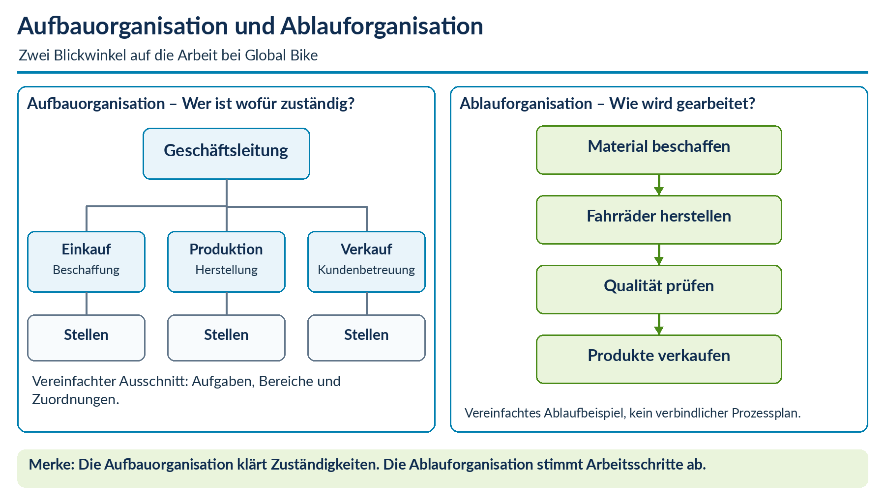

# M1 – Betriebliche Organisation verstehen

### Grundwissen

Bei Global Bike werden Fahrräder entwickelt, Materialien und Zubehör beschafft, Fahrräder hergestellt und Produkte verkauft. Nicht alle Mitarbeitenden übernehmen alle Tätigkeiten. Durch **Arbeitsteilung** werden größere Aufgaben auf unterschiedliche Stellen verteilt. Damit diese zusammenwirken, müssen sie abgestimmt werden (Koordination).

Betriebliche Organisation schafft dafür Strukturen und Regeln. Sie hilft, Aufgaben zu verteilen, Zuständigkeiten festzulegen und die Zusammenarbeit zu gestalten.

| Aufbauorganisation | Ablauforganisation |
|---|---|
| Wer ist wofür zuständig? | Wie, wann und wo wird gearbeitet? |
| Gliedert das Unternehmen in Stellen und Abteilungen; zeigt ihre Zuordnung und Hierarchie. | Regelt die Reihenfolge und zeitliche sowie räumliche Abstimmung von Arbeitsschritten. |

<figure><figcaption>Vergleich Aufbauorganisation und Ablauforganisation; vereinfachte Funktions- und Ablaufbeispiele, kein verbindlicher Prozessplan.</figcaption></figure>

### Beispiel

Der Einkauf beschafft Materialien, die Produktion fertigt Fahrräder und der Verkauf betreut Kunden. Diese Aufgabenverteilung gehört zur Aufbauorganisation. Wie die Materialbeschaffung, Fertigung, Qualitätsprüfung und der Verkauf aufeinander abgestimmt werden, betrifft die Ablauforganisation.

Beide Organisationsformen ergänzen sich. Fehlende Abstimmung kann dazu führen, dass Aufgaben doppelt erledigt, vergessen oder verspätet abgeschlossen werden.

### Genauer betrachtet

Die **formale Organisation** umfasst offiziell festgelegte Strukturen und Regeln. Daneben entsteht durch persönliche Kontakte eine **informelle Organisation**. Mitarbeitende können sich beispielsweise direkt gegenseitig informieren. Daraus entsteht jedoch nicht automatisch eine neue Entscheidungs- oder Weisungsbefugnis.

**Merke:** Aufbauorganisation klärt, wer wofür zuständig ist. Ablauforganisation klärt, wie die Arbeitsschritte zusammenwirken.
