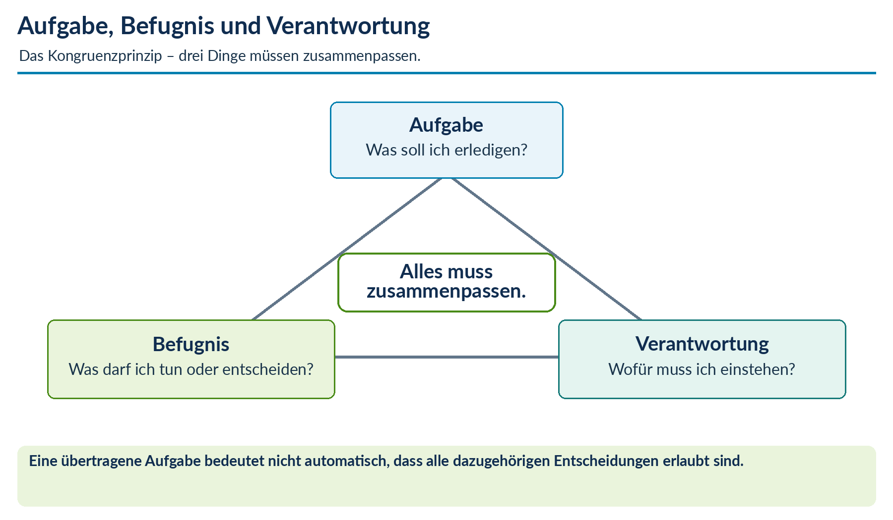
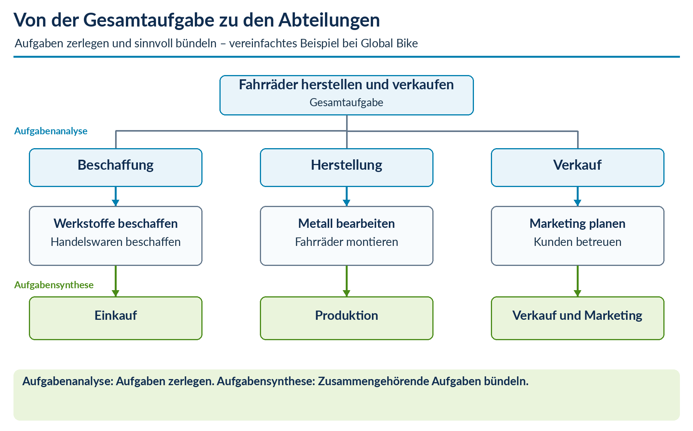

# M2 – Aufgaben, Stellen und Verantwortung

### Grundwissen

Eine **Aufgabe** beschreibt eine Tätigkeit oder Arbeit, die erledigt werden soll. Die Gesamtaufgabe eines Unternehmens wird auf kleinere Aufgaben verteilt. Zusammengehörende Aufgaben werden organisatorischen Einheiten zugeordnet.

| Begriff | Bedeutung und Beispiel bei Global Bike |
|---|---|
| Stelle | Kleinste organisatorische Einheit mit festgelegten Aufgaben und Befugnissen, z. B. Marketing. |
| Stelleninhaberin / Stelleninhaber | Person, die eine Stelle besetzt, z. B. Sarah Huber im Marketing. |
| Abteilung | Mehrere Stellen unter einer gemeinsamen Leitung, z. B. Verkauf und Marketing. |
| Zuständigkeit | Aufgaben oder Angelegenheiten, die zum Bereich einer Stelle gehören. |
| Befugnis | Was eine Person im Rahmen ihrer Aufgaben tun oder entscheiden darf. |
| Verantwortung | Pflicht, für die ordnungsgemäße Erfüllung einer Aufgabe einzustehen. |

Auch wenn eine Person das Unternehmen verlässt, bleibt ihre Stelle in der Regel bestehen.

Aufgabe, Befugnis und Verantwortung müssen zusammenpassen. Wer eine Aufgabe übernehmen soll, benötigt die dafür notwendigen Befugnisse.

<figure><figcaption>Aufgabe, Befugnis und Verantwortung müssen zusammenpassen; drei Leitfragen.</figcaption></figure>

### Beispiel

Sarah Huber soll eine Marketingkampagne vorbereiten. Dafür kann sie Informationen sammeln und Vorschläge entwickeln. Sie ist für die Vorbereitung verantwortlich. Ob sie auch selbst kostenpflichtige Anzeigen buchen darf, hängt von den betrieblichen Befugnisregelungen ab. Ist diese Befugnis nicht geklärt, kann es zu Verzögerungen kommen.

### Genauer betrachtet

Bei der **Aufgabenanalyse** wird die Gesamtaufgabe in Teilaufgaben zerlegt. Bei der **Aufgabensynthese** werden zusammengehörende Aufgaben gebündelt und organisatorischen Einheiten zugeordnet.

<figure><figcaption>Gesamtaufgabe in konkrete Tätigkeiten zerlegen und den Bereichen Einkauf, Produktion und Verkauf und Marketing zuordnen.</figcaption></figure>

Eine Leitungsstelle mit Weisungsbefugnissen wird auch **Instanz** genannt. Das Zusammenpassen von Aufgabe, Befugnis und Verantwortung heißt **Kongruenzprinzip**. Bei der **Delegation** werden Aufgaben, dazu passende Befugnisse und Verantwortung übertragen. Die Leitung behält ihre eigenen Leitungs- und Kontrollaufgaben.

**Merke:** Wer für eine Aufgabe zuständig ist, darf deshalb nicht automatisch jede damit verbundene Entscheidung treffen. Das Organigramm zeigt nicht alle einzelnen Befugnisse.
