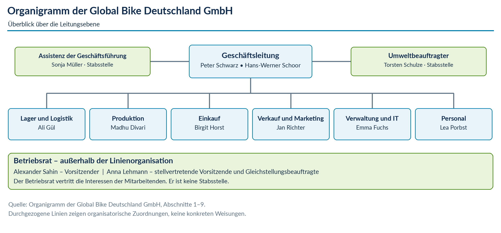
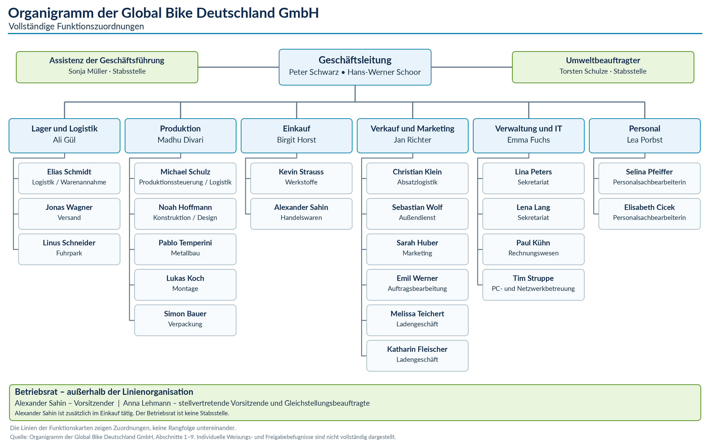

# M3 – Das Organigramm der Global Bike Deutschland GmbH

### Grundwissen – erste Orientierung

Global Bike ist nach betrieblichen Aufgabenbereichen gegliedert (funktionale Organisation). Ein **Organigramm** stellt die Aufbauorganisation grafisch dar. Die **Hierarchie** beschreibt die Über- und Unterordnung der Stellen. Beginnen Sie mit der Leitungsebene.

<figure><figcaption>Geschäftsleitung, Stabsstellen, sechs gleichgeordnete Linienbereiche und separat dargestellter Betriebsrat.</figcaption></figure>

| Unternehmensbereich | Leitung | Aufgaben des Bereichs |
|---|---|---|
| Lager und Logistik | Ali Gül | Warenannahme und Wareneingangskontrolle; Lagerhaltung und Bestandsführung; Versand und Auslieferung; Fuhrpark |
| Produktion | Madhu Divari | Produktionsplanung und -steuerung; Konstruktion und Design; Fertigung und Montage; Verpackung; Qualität |
| Einkauf | Birgit Horst | Bedarfsermittlung; Lieferantenauswahl und -bewertung; Preis- und Vertragsverhandlungen; Beschaffung |
| Verkauf und Marketing | Jan Richter | Kundenbetreuung und Akquise; Absatzplanung und Vertriebssteuerung; Marketing; Auftragsbearbeitung; Ladengeschäft |
| Verwaltung und IT | Emma Fuchs | Kaufmännische Verwaltung; Rechnungswesen und Buchhaltung; IT- und Netzwerkbetreuung; organisatorische Unterstützung |
| Personal | Lea Porbst | Personalverwaltung; Ausbildung und Personalentwicklung; arbeitsrechtliche Fragen; Betreuung der Mitarbeitenden |

| Geschäftsleitung und Stabsstellen | Aufgaben |
|---|---|
| Peter Schwarz und Hans-Werner Schoor – Geschäftsleitung | Strategische Ausrichtung; Investitions- und Grundsatzentscheidungen; Produkt- und Sortimentspolitik; wirtschaftliche Steuerung und übergreifende Koordination |
| Sonja Müller – Assistenz der Geschäftsführung | Administrative und organisatorische Unterstützung; Termine und Kommunikation koordinieren; Entscheidungen und Besprechungen vorbereiten |
| Torsten Schulze – Umweltbeauftragter | Umweltmanagement; Nachhaltigkeitsmaßnahmen; Umweltauflagen; umweltfreundliche Produktions- und Logistikprozesse weiterentwickeln |

Eine **Stabsstelle** unterstützt eine Leitung durch besondere Fachaufgaben oder Beratung. Sie hat dadurch nicht automatisch eine allgemeine Weisungsbefugnis gegenüber anderen Unternehmensbereichen.

### Gezieltes Nachschlagen – vollständiges Organigramm

<figure><figcaption>Die Funktionskarten jedes Bereichs sind gleichgeordnet. Der Betriebsrat ist separat dargestellt. Öffnen Sie das Organigramm bei Bedarf in Originalgröße. Die folgenden Listen ordnen die Stellen ihren Bereichen zu.</figcaption></figure>

#### Lager und Logistik – Leitung: Ali Gül

- Elias Schmidt – Logistik / Warenannahme
- Jonas Wagner – Versand
- Linus Schneider – Fuhrpark

#### Produktion – Leitung: Madhu Divari

- Michael Schulz – Produktionssteuerung / Logistik
- Noah Hoffmann – Konstruktion / Design
- Pablo Temperini – Metallbau
- Lukas Koch – Montage
- Simon Bauer – Verpackung

#### Einkauf – Leitung: Birgit Horst

- Kevin Strauss – Werkstoffe
- Alexander Sahin – Handelswaren

#### Verkauf und Marketing – Leitung: Jan Richter

- Christian Klein – Absatzlogistik
- Sebastian Wolf – Außendienst
- Sarah Huber – Marketing
- Emil Werner – Auftragsbearbeitung
- Melissa Teichert – Ladengeschäft
- Katharin Fleischer – Ladengeschäft

#### Verwaltung und IT – Leitung: Emma Fuchs

- Lina Peters – Sekretariat
- Lena Lang – Sekretariat
- Paul Kühn – Rechnungswesen
- Tim Struppe – PC- und Netzwerkbetreuung

#### Personal – Leitung: Lea Porbst

- Selina Pfeiffer – Personalsachbearbeiterin
- Elisabeth Cicek – Personalsachbearbeiterin

**Betriebsrat:** Alexander Sahin – Vorsitzender; Anna Lehmann – stellvertretende Vorsitzende und Gleichstellungsbeauftragte. Der Betriebsrat vertritt die Interessen der Mitarbeitenden. Er steht außerhalb der Linienorganisation und ist keine Stabsstelle. Alexander Sahin ist zugleich im Einkauf tätig; seine beiden Funktionen sind zu unterscheiden.

### Beispiel – gezielt nachschlagen

Für eine technische Konstruktionszeichnung ist Noah Hoffmann (Konstruktion / Design) im Produktionsbereich ein geeigneter Ansprechpartner. Madhu Divari leitet diesen Bereich. Eine konkrete technische Freigabebefugnis geht aus dem Organigramm nicht hervor.

### Genauer betrachtet

Das Organigramm zeigt organisatorische Zuordnungen, aber nicht alle individuellen Dienstwege, Freigabegrenzen oder Entscheidungsrechte. Die folgenden Fragen helfen: Welche Aufgabe liegt vor? Zu welchem Bereich gehört sie? Welche Stelle passt dazu? Was lässt sich über die Befugnisse tatsächlich erkennen?

**Merke:** Erst den passenden Bereich finden, dann die Funktionsrolle nachschlagen. Namen und alle Rollen müssen nicht auswendig gelernt werden.
