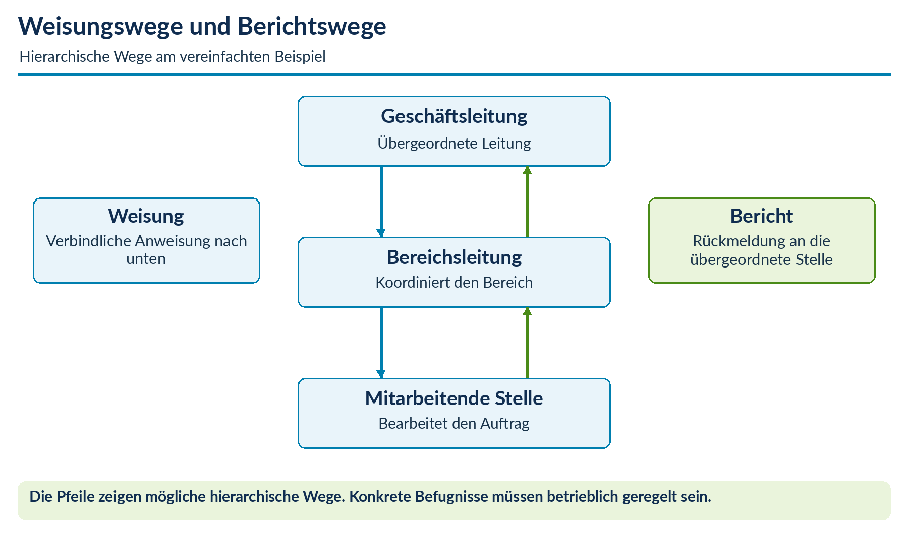
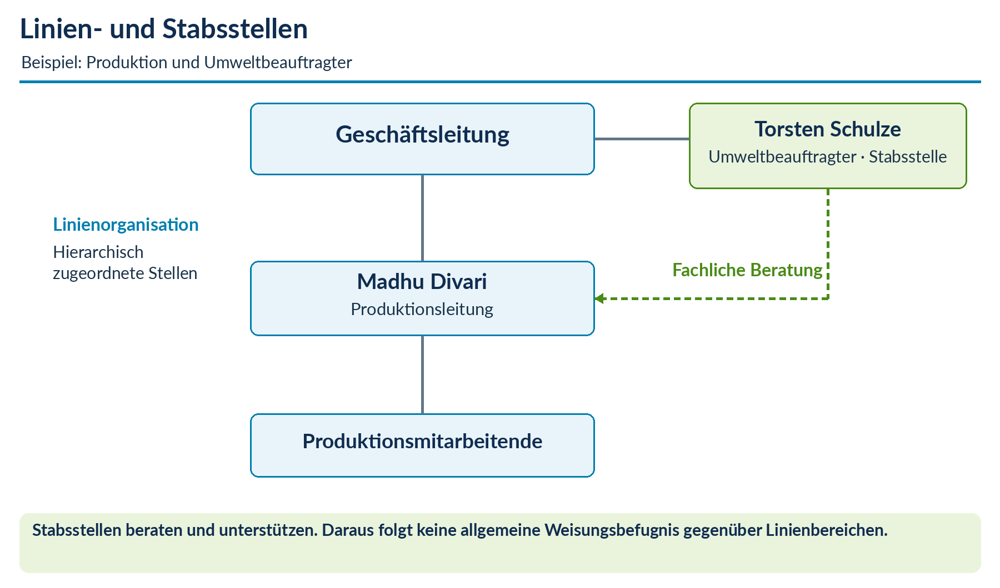
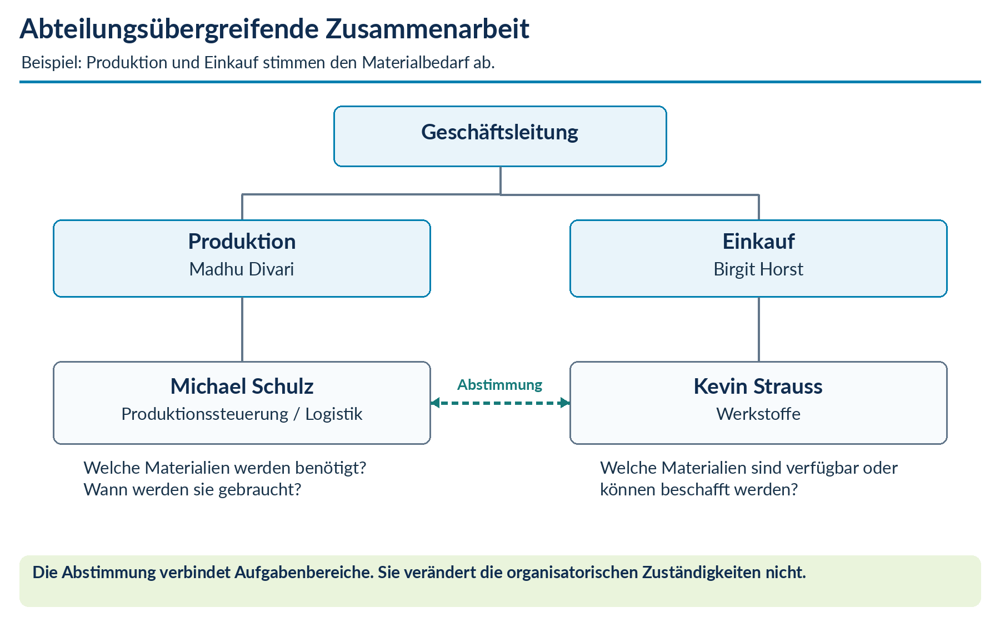

# M4 – Weisungswege, Berichtswege und Zusammenarbeit

### Grundwissen

Bei Global Bike arbeiten verschiedene Unternehmensbereiche mit eigenen Aufgaben und Leitungen zusammen. Damit die Mitarbeitenden wissen, von wem sie verbindliche Anweisungen erhalten und an wen sie Ergebnisse zurückmelden, bestehen hierarchische Beziehungen.

| Beziehung | Leitfrage und Bedeutung |
|---|---|
| Weisung | Wer darf mir verbindlich sagen, was ich tun soll? |
| Bericht | Wem melde ich meine Ergebnisse oder Schwierigkeiten zurück? |
| Beratung | Wer kann mich fachlich unterstützen? |
| Abstimmung | Mit wem muss ich zusammenarbeiten? |

**Weisungsbefugnis** ist das Recht, innerhalb eines festgelegten Zuständigkeitsbereichs verbindliche Anweisungen zu erteilen. Ein hierarchischer **Weisungsweg** führt von einer befugten übergeordneten Stelle zu einer untergeordneten Stelle. Der **Berichtsweg** führt in die Gegenrichtung: Ergebnisse, Informationen und Schwierigkeiten werden an eine übergeordnete Stelle zurückgemeldet.

<figure><figcaption>Drei Hierarchieebenen mit Weisungspfeilen nach unten und Berichtspfeilen nach oben.</figcaption></figure>

### Beispiel – Weisung und Bericht

Birgit Horst beauftragt Kevin Strauss beispielsweise damit, Informationen über benötigte Werkstoffe einzuholen. Weisung: Birgit Horst → Kevin Strauss. Bericht: Kevin Strauss → Birgit Horst. Eine verbindliche Vertragsabschlussbefugnis folgt aus diesem Auftrag nicht automatisch.

### Linien- und Stabsstellen

Die **Linienorganisation** umfasst hierarchisch miteinander verbundene Stellen. Stabsstellen unterstützen eine Leitung durch Beratung oder besondere Aufgaben. Torsten Schulze ist der Geschäftsleitung als Umweltbeauftragter zugeordnet. Er kann die Produktion fachlich beraten. Eine allgemeine Weisungsbefugnis gegenüber der Produktion ist damit nicht automatisch verbunden.

<figure><figcaption>Linie Geschäftsleitung, Produktionsleitung und Mitarbeitende; Stabsstelle Umweltbeauftragter mit möglicher fachlicher Beratung.</figcaption></figure>

### Schnittstellen und Zusammenarbeit

Eine **Schnittstelle** entsteht dort, wo Aufgaben oder Informationen unterschiedlicher Stellen aufeinandertreffen und abgestimmt werden müssen. Die Produktion benötigt beispielsweise Angaben über bestellte Materialien aus dem Einkauf. Michael Schulz (Produktionssteuerung / Logistik) und Kevin Strauss (Werkstoffe) können sich dazu abstimmen. Dadurch entsteht keine automatische Weisungsbefugnis.

<figure><figcaption>Beispielhafte Abstimmung zwischen Produktion und Einkauf, getrennte Linienbereiche.</figcaption></figure>

Gute Abstimmung hilft, Informationsverluste, widersprüchliche Anweisungen, doppelte Arbeit und Verzögerungen zu vermeiden.

### Genauer betrachtet

Fachliche Weisungen beziehen sich auf die Ausführung einer Aufgabe. Disziplinarische Befugnisse betreffen die Personalführung, beispielsweise bestimmte personalbezogene Entscheidungen. Beide können unterschiedlich geregelt sein. Nicht jede Führungskraft besitzt gegenüber allen Mitarbeitenden dieselben Rechte.

Bei unklaren Befugnissen: Welche Aufgabe liegt vor? Wer darf entscheiden? Wer muss Informationen liefern oder mitwirken? An wen wird berichtet? Klären Sie offene Fragen mit der zuständigen Leitung. Die in den Schaubildern gezeigten Wege sind mögliche, aus der Organisationsstruktur abgeleitete Beispiele.

**Merke:** Weisung ist eine verbindliche Anweisung. Bericht ist eine Rückmeldung. Beratung unterstützt eine Entscheidung. Abstimmung verbindet unterschiedliche Aufgabenbereiche. Nicht jede Zusammenarbeit begründet eine Weisungsbefugnis.
