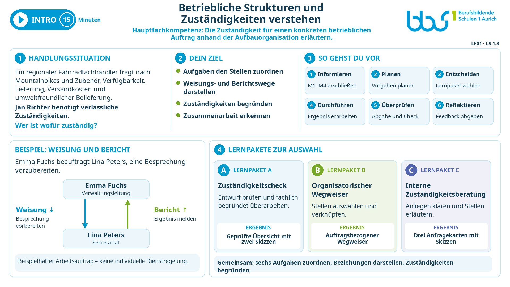

# Übersicht zum Fall

<figure><figcaption>Die Übersicht zeigt die Kundenanfrage, die sechs Handlungsphasen und die drei Wahlprodukte. In diesem Lernpaket führen Sie beim Bewerten einen Peer-Check durch und geben beim Reflektieren Feedback.</figcaption></figure>

