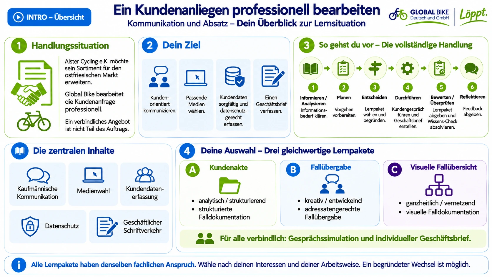
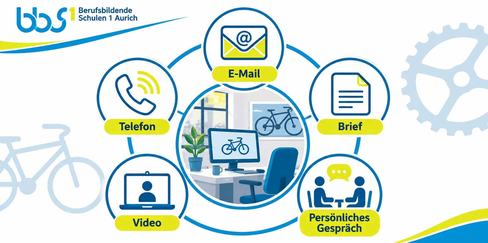
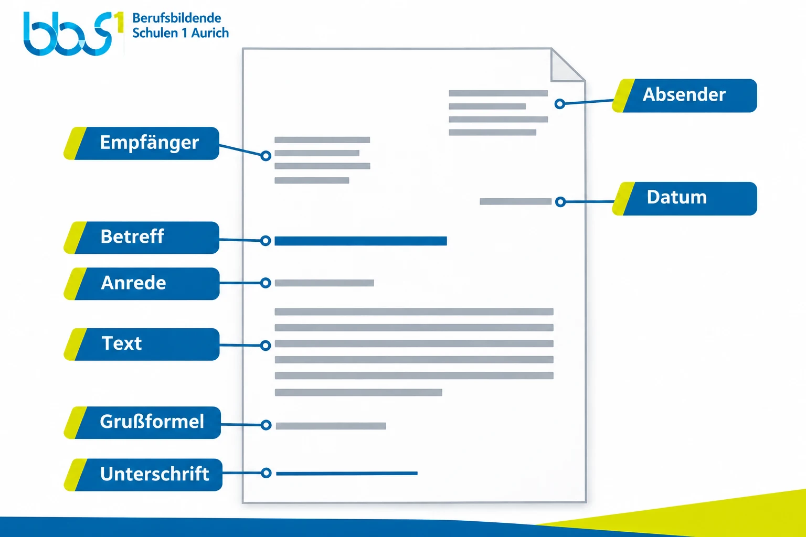

# BFS dual · Lernfeld 2 · LS 2.1 · Ein Kundenanliegen professionell bearbeiten

**Bildungsgang** · BFS dual, Profil Wirtschaft  
**Lernsituation** · 2.1 · Ein Kundenanliegen professionell bearbeiten (Paketkennung `BFSDUAL-LF02-LS01`)  
**Unterrichtlicher Bezug** · Handlungsorientierte Fallbearbeitung bei der Global Bike Deutschland GmbH  
**Zeitrahmen** · 12 Unterrichtsstunden à 45 Minuten, insgesamt 540 Minuten für einen gewählten Lernweg  
**Digitale Fassung** · [Orientierung öffnen](index.html) · [Unterlagen und Downloads](materialien.html)  
**Formgrundlage** · [BFSdual-Vorlage, Arbeitsstand vom 26. November 2026](https://github.com/macmaris83/Lernsituationen/blob/a1dd9b693df1a234bf3c7387198fcf5b5aab6afc/Fachbereiche/BFSdual/Vorlage_Lernsituation.md)

## Aufgabenzeiten

Für jeden der drei Wege gilt derselbe Zeitrahmen. Bei Durchführen zählt der Auftrag zum gewählten Lernpaket einmal.

| Station | Minuten je Lernweg |
| --- | ---: |
| Orientierung | 10 |
| Handlungssituation | 25 |
| Informieren | 80 |
| Fachbegriffscheck | 20 |
| Planen | 45 |
| Entscheiden | 45 |
| Durchführen | 225 |
| Bewerten | 65 |
| Reflektieren | 25 |
| **Gesamt** | **540** |

## Orientierung

[Digitale Fassung öffnen](index.html)

BFS dual · Lernfeld 2 · Lernsituation 2.1 · 12 Unterrichtsstunden

#### Den Auftrag überblicken

Ein Fachhändler interessiert sich für ein neues Fahrrad. Wer im Einkauf zuständig ist, hat sich gerade geändert. Was kannst du schon beantworten und was müsstest du erst klären? Bei Global Bike bearbeitest du die Anfrage so, dass Emil Werner den Vorgang übernehmen kann.

Emil erhält deine Falldokumentation in der gewählten Form. Hinzu kommt pro Person der eigene, bearbeitbare Geschäftsbrief als DOCX. Im Gespräch übernimmt jede Person einmal die Auftragsbearbeitung.

Du entscheidest, welche Aufgaben du selbstständig oder mit anderen bearbeitest. Für die Rückmeldung erhält jede Person ein fremdes Produkt.

10 Minuten

*Fachbuchverweis · Für diesen Auftrag ist keine Buchseite hinterlegt.*

Kompetenzprofil der Lernsituation

Die Gewichtung zeigt, wie häufig und wofür die Kompetenz in den Aufgaben gebraucht wird. 1 bedeutet „kurz in einer Aufgabe“, 6 „von der Vorbereitung bis zur Auswertung“.

| Kompetenz | Gewicht (1–6) | Was übe ich? |
| --- | --- | --- |
| F · Fachkompetenz | 6 / 6 | Ich kläre ein Kundenanliegen, begründe die Medienwahl und verfasse eine sachgerechte Rückmeldung in Word. |
| P · Personalkompetenz | 5 / 6 | Ich kennzeichne offene Angaben und prüfe vor der Weitergabe, welche Daten der Betrieb benötigt. |
| S · Sozialkompetenz | 5 / 6 | Ich höre zu, kläre Rückfragen und gebe einer anderen Person am Produkt begründetes Feedback. |
| M · Methodenkompetenz | 5 / 6 | Ich ordne Informationen nach Quelle und Prüfstatus und leite die nächsten Arbeitsschritte ab. |
| D · Medienkompetenz | 5 / 6 | Ich wähle ein geeignetes Kommunikationsmedium und gestalte einen Geschäftsbrief in Word. |

Übersicht aus dem Board ansehen

Im aktuellen Lernweg ist Phase 5 der Peer-Check am Produkt. In Phase 6 gibst du Feedback zur Lernsituation.

## Handlungssituation

[Digitale Fassung öffnen](handlungssituation.html)

Lies den betrieblichen Auftrag und beantworte die Fragen in eigenen Worten.

 

Emil Werner bearbeitet die Anfrage von Alster Cycling zum silbernen Deluxe Touringbike. Das Motiv gehört zur Annahme und Klärung eines Kundenanliegens.

#### Den Fall lesen

Emil Werner arbeitet bei der Global Bike Deutschland GmbH in der Auftragsbearbeitung. Alster Cycling e.K. möchte sein Sortiment für den ostfriesischen Markt erweitern und interessiert sich für das silberne Deluxe Touringbike. Der Kunde bittet um Informationen und einen Abgleich der geschäftlichen Kontaktdaten. Emil hat schon kurz mit ihm telefoniert. Einige Fragen sind offen.

„Bitte übernehmen Sie die weitere Bearbeitung der Kundenanfrage. Klären Sie das konkrete Anliegen des Kunden, überprüfen Sie die für die weitere Bearbeitung benötigten Kundeninformationen und bereiten Sie eine professionelle schriftliche Rückmeldung vor.“

Emil braucht eine nachvollziehbare Übergabe. Ein verbindliches Angebot gehört erst in einen späteren Vorgang. Die beiden Nachrichten im Wortlaut findest du in [M1](#m1).

10 Minuten

*Fachbuchverweis · Für diesen Auftrag ist keine Buchseite hinterlegt.*

#### Was möchte Alster Cycling von Global Bike erfahren?

Lesehilfe

Schau auf das Produkt und den neuen Absatzmarkt in der E-Mail.

Deine Antwort

5 Minuten

*Fachbuchverweis · Für diesen Auftrag ist keine Buchseite hinterlegt.*

#### Weshalb reicht der bekannte Kundenname für die Rückmeldung noch nicht aus?

Lesehilfe

Die E-Mail beschreibt eine Änderung im Einkauf.

Deine Antwort

5 Minuten

*Fachbuchverweis · Für diesen Auftrag ist keine Buchseite hinterlegt.*

#### Was soll Emil am Ende weiterverwenden können und welche Zusage wäre verfrüht?

Lesehilfe

Lies den internen Auftrag noch einmal und achte auf die Grenze des Auftrags.

Deine Antwort

5 Minuten

*Fachbuchverweis · Für diesen Auftrag ist keine Buchseite hinterlegt.*

## Informieren

[Digitale Fassung öffnen](informieren.html)

Erschließe die Angaben und Unterlagen für deinen Auftrag.

28 Minuten

#### Anfrage und Stammblatt auswerten

**Lies** die Nachrichten in [M1](#m1) und den Stammdatenauszug in [M2](#m2). Halte fest, welche Angabe aus welcher Quelle stammt. Kennzeichne fehlende Daten und formuliere drei gezielte Rückfragen für den Kontakt.

*Fachbuchverweis · Für diesen Auftrag ist keine Buchseite hinterlegt.*

27 Minuten

#### Kommunikation, Datenschutz und Briefgestaltung erschließen

**Prüfe** mit [M3](#m3), [M4](#m4) und [M5](#m5), wie du Daten bestätigen und Ergebnisse schriftlich sichern kannst. Öffne die Bürovorlage. Ermittle, welche Felder du mit dem jetzigen Wissen ausfüllen könntest. Für Fachwörter nutze das [Begriffsblatt](#glossar).

*Fachbuchverweis · Für diesen Auftrag ist keine Buchseite hinterlegt.*

[Begriffsblatt zum Nachschlagen](#glossar) · [Begriffe prüfen](#begriffstraining)

25 Minuten

#### Üben und vertiefen

Nutze nach Bedarf die [Übungen Ü1 bis Ü4](#materialien) oder vertiefe mit M3–M5 eine eigene Fallfrage. Für den Fachbegriffscheck stehen separat 20 Minuten bereit. Du kannst diese Zeit auch für das Begriffsblatt nutzen.

*Fachbuchverweis · Für diesen Auftrag ist keine Buchseite hinterlegt.*

## Fachbegriffscheck

[Digitale Fassung öffnen](begriffstraining.html)

Welche Erklärung passt zum Fachbegriff? Wähle bei jeder Karte eine Antwort. Die Rückmeldung zeigt dir, wie der Begriff im Kundenfall vorkommt. Du kannst deine Auswahl jederzeit ändern.

20 Minuten

Gespräch und Medienwahl

Karte `BFSDUAL-LF02-LS01-B01`

**Aktives Zuhören**

- Aufmerksam zuhören, ausreden lassen und Verständnis sichern
- Unklare Angaben durch eine gezielte Nachfrage präzisieren
- Den Kontakt mit einer höflichen Anrede eröffnen

Karte `BFSDUAL-LF02-LS01-B02`

**Offene Frage**

- Ermöglicht eine ausführliche Antwort
- Meist mit Ja, Nein oder kurzer eindeutiger Angabe beantwortbar
- Frage mit zwei ausdrücklich vorgegebenen Möglichkeiten

Karte `BFSDUAL-LF02-LS01-B03`

**Geschlossene Frage**

- Frage, bei der die andere Person zwischen ausdrücklich genannten Möglichkeiten wählen soll
- Ermöglicht eine ausführliche Antwort
- Meist mit Ja, Nein oder kurzer eindeutiger Angabe beantwortbar

Karte `BFSDUAL-LF02-LS01-B04`

**Kommunikationsmedium**

- Mittel zur Übermittlung von Informationen
- Grund, aus dem eine Information übermittelt wird
- Person, die für ein bestimmtes Anliegen zuständig ist

Karte `BFSDUAL-LF02-LS01-B05`

**Schriftliche Nachvollziehbarkeit**

- Unterlagen vor unberechtigtem Zugriff schützen
- Geschäftliche Kontaktdaten auf ihre Aktualität prüfen
- Informationen und Vereinbarungen später schriftlich überprüfen können

Kunden und Kontakte

Karte `BFSDUAL-LF02-LS01-B06`

**Kundenstammdaten**

- Grundlegende, längerfristig benötigte Kundeninformationen
- Protokoll über den Ablauf eines einzelnen Telefonats
- Angaben, die nur den Inhalt einer einzelnen Produktanfrage beschreiben

Karte `BFSDUAL-LF02-LS01-B07`

**Ansprechperson**

- Für ein Anliegen zuständige Person
- Bereich der Firma, der für eine bestimmte Produktgruppe zuständig ist
- Vom Unternehmen bevorzugter Weg für Rückmeldungen

Karte `BFSDUAL-LF02-LS01-B08`

**Datenaktualität**

- Eine Akte enthält alle für den Vorgang erforderlichen Angaben
- Eine Angabe lässt ihre Herkunft erkennen
- Daten entsprechen dem gegenwärtigen Stand

Karte `BFSDUAL-LF02-LS01-B09`

**Personenbezogene Daten**

- Angaben zu einem Betrieb ohne Bezug zu einer natürlichen Person
- Informationen über eine identifizierte oder identifizierbare natürliche Person
- Informationen, die ausschließlich eine Produktgruppe beschreiben

Karte `BFSDUAL-LF02-LS01-B10`

**DSGVO**

- Interne Liste der zuständigen Personen für den Datenschutz
- Datenschutz-Grundverordnung der Europäischen Union
- Regelwerk für den Aufbau und die Gestaltung von Geschäftsbriefen

Datenschutz und Briefaufbau

Karte `BFSDUAL-LF02-LS01-B11`

**Datenminimierung**

- Schutz vor unbefugtem Zugriff und Offenlegung
- Erhebung für festgelegte, eindeutige und legitime Zwecke
- Beschränkung personenbezogener Daten auf das erforderliche Maß

Karte `BFSDUAL-LF02-LS01-B12`

**Zweckbindung**

- Beschränkung personenbezogener Daten auf das erforderliche Maß
- Erhebung für festgelegte, eindeutige und legitime Zwecke
- Schutz vor unbefugtem Zugriff und Offenlegung

Karte `BFSDUAL-LF02-LS01-B13`

**Vertraulichkeit**

- Beschränkung personenbezogener Daten auf das erforderliche Maß
- Schutz vor unbefugtem Zugriff und Offenlegung
- Erhebung für festgelegte, eindeutige und legitime Zwecke

Karte `BFSDUAL-LF02-LS01-B14`

**Betreff**

- Darstellung der offenen Fragen im Hauptteil eines Schreibens
- Höfliche Hinwendung an die empfangende Person
- Kurze, aussagekräftige Benennung des Anliegens eines Schreibens

Karte `BFSDUAL-LF02-LS01-B15`

**Grußformel**

- Höflicher Abschluss eines Schreibens
- Auflistung von beigefügten Unterlagen am Briefende
- Höfliche Ansprache zu Beginn eines Briefs

DIN 5008 und Word

Karte `BFSDUAL-LF02-LS01-B16`

**DIN 5008**

- Rechtsgrundlage für die Verarbeitung personenbezogener Daten
- Dateiformat für bearbeitbare Textdokumente
- Schreib- und Gestaltungsregeln für die Text- und Informationsverarbeitung

Karte `BFSDUAL-LF02-LS01-B17`

**Absatzformatierung**

- Einstellung für Schriftart, Schriftgröße und Schriftschnitt einzelner Zeichen
- Einstellungen für Ausrichtung, Abstände und Einzüge eines Absatzes
- Einstellung für Format und Ränder einer ganzen Seite

Karte `BFSDUAL-LF02-LS01-B18`

**Tabstopp**

- Abstand, der vor oder nach einem Absatz eingefügt wird
- Position, an der Word den Text auf einer neuen Seite fortsetzt
- Festgelegte horizontale Position zur Ausrichtung von Text

Karte `BFSDUAL-LF02-LS01-B19`

**Druckvorschau**

- Ansicht, in der Gliederungsebenen eines Textes sortiert werden
- Ansicht zum Überprüfen von Rechtschreibung und Grammatik
- Ansicht des Dokuments in der vorgesehenen Seitengestaltung

Karte `BFSDUAL-LF02-LS01-B20`

**DOCX**

- Dateiformat für eine Tabellenkalkulation
- Bearbeitbares Word-Dateiformat
- Dateiformat zur Weitergabe eines Dokuments mit festem Seitenbild

## Planen

[Digitale Fassung öffnen](planen.html)

Entwirf deinen Arbeitsplan.

23 Minuten

#### Arbeitsschritte planen

**Skizziere** den Ablauf vom ersten Quellenvergleich über die Simulation bis zum Word-Brief. Trage Material, Zeit und erforderliche Absprachen ein. Nutze M1–M5. Plane ein, wer für das Übungsgespräch die Kundenrolle übernimmt.

*Fachbuchverweis · Für diesen Auftrag ist keine Buchseite hinterlegt.*

22 Minuten

#### Arbeitswege vergleichen

**Vergleiche** Kundenakte, mündliche Übergabe und visuelle Übersicht. Überlege für jede Form, wie Emil eine Quelle, eine offene Frage und den nächsten Schritt finden kann. Halte die Unterschiede fest.

*Fachbuchverweis · Für diesen Auftrag ist keine Buchseite hinterlegt.*

## Entscheiden

[Digitale Fassung öffnen](entscheiden.html)

Wähle einen von drei gleichwertigen Arbeitswegen. Du kannst deine Wahl begründet ändern.

**Lernpaket wählen**

A · Kundenakte · Quellen vergleichen und nach Status ordnen · Wähle diesen Weg, wenn eine gegliederte Akte dir hilft, Belege wiederzufinden. Dein Zwischenstand ist ein geordneter Datenauszug.

B · Fallübergabe · Eine mündliche Übergabe vorbereiten und verständlich sprechen · Wähle diesen Weg, wenn du beim Erklären Zusammenhänge leichter erkennst. Dein Zwischenstand ist eine Gliederung für die Aufnahme oder das Sprechmanuskript.

C · Visuelle Fallübersicht · Informationen anordnen, beschriften und verknüpfen · Wähle diesen Weg, wenn du Abhängigkeiten durch Verschieben von Karten herausarbeiten willst. Dein Zwischenstand ist eine kommentierte Skizze.

Emil erhält deine Falldokumentation in der gewählten Form. Hinzu kommt pro Person der eigene, bearbeitbare Geschäftsbrief als DOCX. Im Gespräch übernimmt jede Person einmal die Auftragsbearbeitung.

23 Minuten

#### Arbeitsweg festlegen

**Wähle** deine Produktform oben auf der Seite. Notiere einen Grund für deine Wahl und was Emil mit dem fertigen Produkt tun soll. Ein begründeter Wechsel ist möglich.

*Fachbuchverweis · Für diesen Auftrag ist keine Buchseite hinterlegt.*

22 Minuten

#### Kontaktweg begründen

**Entscheide**, wie du den Kunden kontaktierst. Vergleiche zwei Medien anhand von [M3](#m3). Beziehe dich auf die Dringlichkeit, nötige Rückfragen, schriftliche Nachvollziehbarkeit oder Vertraulichkeit und notiere die Begründung in deinem gewählten Format.

*Fachbuchverweis · Für diesen Auftrag ist keine Buchseite hinterlegt.*

## Durchführen

[Digitale Fassung öffnen](durchfuehren.html)

Bearbeite den Auftrag im gewählten Format.

[Wähle in Entscheiden dein Lernpaket A, B oder C](#entscheiden), um die Aufträge zu öffnen.

Deine Wahl:  · [Wahl ändern](#entscheiden)

Emil erhält deine Falldokumentation in der gewählten Form. Hinzu kommt pro Person der eigene, bearbeitbare Geschäftsbrief als DOCX. Im Gespräch übernimmt jede Person einmal die Auftragsbearbeitung.

30 Minuten

#### Gespräch vorbereiten

**Entwirf** anhand von [M2](#m2) einen Einstieg, eine offene Frage und eine gezielte Rückfrage. Die Lehrkraft gibt die separate Kundenrollenkarte nur an die Person in dieser Rolle aus.

*Fachbuchverweis · Für diesen Auftrag ist keine Buchseite hinterlegt.*

35 Minuten

#### Kundengespräch führen

**Führe** die Simulation durch. Höre zu, fasse Ergebnisse zusammen und vereinbare den nächsten Schritt. Jede Person übernimmt einmal die Auftragsbearbeitung. Bei einer schriftlichen Kontaktstrategie dient das Gespräch als interne Übung.

*Fachbuchverweis · Für diesen Auftrag ist keine Buchseite hinterlegt.*

20 Minuten

#### Gesprächsergebnisse sichern

**Trenne** die bestätigten Angaben von offenen Punkten. Prüfe die Erforderlichkeit angebotener Kontaktdaten mit [M4](#m4). Verändere keine Stammdaten im ERP-System.

*Fachbuchverweis · Für diesen Auftrag ist keine Buchseite hinterlegt.*

60 Minuten

#### Den individuellen Geschäftsbrief schreiben

**Verfasse** mit der [Word-Bürovorlage](material/dateien/M5_Buerovorlage_Global_Bike.docx) deine eigene Rückmeldung an Alster Cycling. Nimm Bezug auf die Anfrage, fasse bestätigte Ergebnisse zusammen und beschreibe das weitere Vorgehen. Markiere ungeklärte Angaben im Entwurf. Nutze die DIN-5008-Arbeitshilfe [M5](#m5).

*Fachbuchverweis · Für diesen Auftrag ist keine Buchseite hinterlegt.*

55 Minuten

**Lernpaket A**

#### Eine Kundenakte anlegen

**Ordne** die Informationen aus M1, M2 und dem Gespräch in einer Kundenakte. Gliedere sie nach Anliegen, bestätigten Angaben, offenen Punkten und nächstem Schritt. Gib zu jeder Angabe die Quelle an. Zeige Emil an einem Beispiel, warum er einen Eintrag vor der Weiterverwendung prüfen muss.

*Fachbuchverweis · Für diesen Auftrag ist keine Buchseite hinterlegt.*

55 Minuten

**Lernpaket B**

#### Den Fall an Emil übergeben

**Erstelle** eine kurze Audioübergabe für Emil. Beginne mit dem Anliegen. Nenne den Stand des Gesprächs, begründe deine Medienwahl und schließe mit einem klaren nächsten Schritt. Markiere mündlich, welche Angaben offen sind. Ohne Aufnahmemöglichkeit gibst du dein selbst formuliertes Sprechmanuskript ab.

*Fachbuchverweis · Für diesen Auftrag ist keine Buchseite hinterlegt.*

55 Minuten

**Lernpaket C**

#### Eine visuelle Fallübersicht gestalten

**Verbinde** Kundenwunsch, Quellen, geklärte Daten, offene Fragen und nächste Schritte in einer kommentierten Übersicht. Kennzeichne den jeweiligen Status durch Beschriftungen. Prüfe, ob Emil von einer offenen Frage zur passenden Zuständigkeit und zur nächsten Kontaktaufnahme gelangt.

*Fachbuchverweis · Für diesen Auftrag ist keine Buchseite hinterlegt.*

25 Minuten

#### DOCX und Übergabe fertigstellen

**Kontrolliere** mit den Formatierungszeichen die Absätze sowie in der Druckvorschau Anschrift, Betreff und Seitenumbruch. Lies deinen Brief aus Sicht des Kunden. Speichere die bearbeitbare DOCX und das gewählte Lernprodukt.

*Fachbuchverweis · Für diesen Auftrag ist keine Buchseite hinterlegt.*

Kriterien für das fertige Produkt

- Das Produkt zeigt das Anliegen, Produkt und Markt. Jede wesentliche Angabe hat eine erkennbare Quelle und einen nachvollziehbaren Prüfstatus.
- Die Medienwahl greift mindestens zwei Fallmerkmale auf, zum Beispiel Rückfragen, Erreichbarkeit oder die gewünschte schriftliche Dokumentation.
- Der Umgang mit Kontaktdaten berücksichtigt deren Zweck, Erforderlichkeit und sichere Weitergabe.
- Der Geschäftsbrief nimmt Bezug auf die Anfrage, unterscheidet Gesichertes und Offenes und nennt den nächsten Schritt. Betreff, Anrede, Absätze und Grußformel entsprechen der Arbeitshilfe M5.
- Emil erkennt, welche Rückfragen noch ausstehen, wer sie klärt und wie der Kunde wieder kontaktiert werden kann.

## Bewerten

[Digitale Fassung öffnen](bewerten.html)

Peer-Check am Handlungsprodukt.

17 Minuten

#### Das Produkt für den Peer-Check bereitstellen

**Reiche** deine Arbeit in der Moodle-Aktivität „Peer-Feedback“ ein. Verwende neutrale Titel und Dateinamen. Entferne Namen aus Text und Dateieigenschaften. Bei einem gemeinsamen Produkt reicht jede Person eine Kopie im eigenen Konto ein. Ohne eingerichtete Aktivität verteilt die Lehrkraft codierte Arbeiten.

*Fachbuchverweis · Für diesen Auftrag ist keine Buchseite hinterlegt.*

32 Minuten

#### Ein fremdes Produkt prüfen

**Prüfe** die dir zugeteilte Arbeit mit den Kriterien unten. Benenne eine konkrete Fundstelle, eine fachlich gelungene Stelle und einen begründeten Verbesserungsvorschlag. Gib die Rückmeldung in Moodle oder mit dem [ausfüllbaren Peer-Bogen](#peer-check) ab. Dein Name ist für die empfangende Person sichtbar.

*Fachbuchverweis · Für diesen Auftrag ist keine Buchseite hinterlegt.*

16 Minuten

#### Die empfangene Rückmeldung nutzen

**Lies** das Feedback zu deinem Produkt. Verbessere die genannte Stelle oder begründe am Material, weshalb du deine Fassung beibehältst. Ergebnis ist die für die weitere Verwendung geprüfte Fassung.

*Fachbuchverweis · Für diesen Auftrag ist keine Buchseite hinterlegt.*

### Fachliche Prüfkriterien

- Das Produkt zeigt das Anliegen, Produkt und Markt. Jede wesentliche Angabe hat eine erkennbare Quelle und einen nachvollziehbaren Prüfstatus.
- Die Medienwahl greift mindestens zwei Fallmerkmale auf, zum Beispiel Rückfragen, Erreichbarkeit oder die gewünschte schriftliche Dokumentation.
- Der Umgang mit Kontaktdaten berücksichtigt deren Zweck, Erforderlichkeit und sichere Weitergabe.
- Der Geschäftsbrief nimmt Bezug auf die Anfrage, unterscheidet Gesichertes und Offenes und nennt den nächsten Schritt. Betreff, Anrede, Absätze und Grußformel entsprechen der Arbeitshilfe M5.
- Emil erkennt, welche Rückfragen noch ausstehen, wer sie klärt und wie der Kunde wieder kontaktiert werden kann.

[Peer-Check öffnen oder drucken](#peer-check)

## Reflektieren

[Digitale Fassung öffnen](reflektieren.html)

Dein Feedback zum Unterricht.

25 Minuten

#### Feedback zur Lernsituation abgeben

**Fülle** die Aktivität „Feedback“ im Moodle-Kurs aus. Melde zurück, welches Material geholfen hat, wo ein Auftrag unklar war, wie Zeit und Wahlmöglichkeiten passten und was wir ändern sollten. Verwende alternativ den [ausfüllbaren Feedbackbogen](#feedback) und gib ihn wie vereinbart ab.

*Fachbuchverweis · Für diesen Auftrag ist keine Buchseite hinterlegt.*

[Feedbackbogen öffnen](#feedback)

## Materialien
| Kennung | Unterlage |
| --- | --- |
| FEEDBACK | [Feedback zur Lernsituation](#feedback) |
| M1 | [M1 · Kundenanfrage und betrieblicher Arbeitsauftrag](#m1) |
| M2 | [M2 · Rollenkarte der Auftragsbearbeitung](#m2) |
| M3 | [M3 · Professionelle Kundenkommunikation](#m3) |
| M4 | [M4 · Kundendaten erfassen und schützen](#m4) |
| M5 | [M5 · Geschäftsbrief in Word](#m5) |
| Ü1 | [Ü1 · Gesprächsregeln](#ue1) |
| Ü2 | [Ü2 · Kommunikationsmedien](#ue2) |
| Ü3 | [Ü3 · Kundendaten und Datenschutz](#ue3) |
| Ü4 | [Ü4 · Geschäftsbrief überarbeiten](#ue4) |
| MATERIALIEN | [Materialübersicht und Quellen](#materialien) |
| PEER-CHECK | [Peer-Check · LS 2.1](#peer-check) |

## Feedback zur Lernsituation

[Digitale Fassung öffnen](feedback.html)

Wie lief die Arbeit an der Lernsituation „Ein Kundenanliegen professionell bearbeiten“? Beschreiben Sie Ihre Erfahrungen so konkret, dass die Lehrkraft den nächsten Durchgang daran anpassen kann.

Welches Material hat Ihnen an welcher Stelle geholfen?

Wo war ein Auftrag oder eine Darstellung unklar?

Wie passten Zeit und freie Wahl des Arbeitswegs zu Ihrem Vorgehen?

Was sollten wir beim nächsten Durchgang beibehalten oder ändern?

**Feedback abgeben.** Im Moodle-Kurs können Sie Ihre Antworten in die Aktivität „Feedback“ übertragen und dort abgeben. Alternativ drucken Sie den ausgefüllten Bogen ohne Namen aus und geben ihn der Lehrkraft an der vereinbarten Sammelstelle. Die Eingaben bleiben bis zum Verlassen dieser Seite im geöffneten Bogen. Für eine eigene Kopie laden Sie die Textdatei herunter.

## M1 · Kundenanfrage und betrieblicher Arbeitsauftrag

[Digitale Fassung öffnen](material/m1.html)

### Eingegangene Kundenanfrage

Von: Alster Cycling e.K.  
 An: Global Bike Deutschland GmbH  
 [Betreff](#betreff): Erweiterung unseres Fahrradsortiments

Guten Tag,

wir möchten unser Fahrradsortiment erweitern, um verstärkt Kunden aus Ostfriesland anzusprechen.

Besonders interessieren wir uns für Ihr Deluxe Touringbike in Silber.

Gerne würden wir hierzu weitere Informationen erhalten und die Möglichkeiten einer Zusammenarbeit besprechen.

Da sich bei uns die Zuständigkeiten geändert haben, müssten außerdem unsere Kontaktdaten abgeglichen werden.

Wir freuen uns auf Ihre Rückmeldung.

Mit freundlichen Grüßen

Alster Cycling e.K.

### Interne Nachricht von Emil Werner

Abteilung: Auftragsbearbeitung  
 Betreff: Bearbeitung der Kundenanfrage

Guten Morgen,

ich habe bereits kurz mit Alster Cycling telefoniert. Leider konnten wir noch nicht alle Fragen klären.

Bitte übernehmen Sie die weitere Bearbeitung der Kundenanfrage. Klären Sie das konkrete Anliegen des Kunden, überprüfen Sie die für die weitere Bearbeitung benötigten Kundeninformationen und bereiten Sie eine professionelle schriftliche Rückmeldung vor. Halten Sie die Ergebnisse so fest, dass ich die Kundenanfrage anschließend weiterbearbeiten kann. Ein verbindliches Angebot ist noch nicht zu erstellen.

Vielen Dank!

Emil Werner  
 Auftragsbearbeitung

## M2 · Rollenkarte der Auftragsbearbeitung

[Digitale Fassung öffnen](material/m2.html)

### Rollenkarte 1 – Auftragsbearbeitung

**Global Bike Deutschland GmbH**

Du übernimmst die Bearbeitung der Anfrage von Alster Cycling e.K. Dir liegen die Kundenanfrage, die interne Nachricht von Emil Werner und folgender Stammdatenauszug vor.

| Kundenname | [Debitor](#debitor) | [Verkaufsorganisation](#verkaufsorganisation) | [Vertriebsweg](#vertriebsweg) | [Sparte](#sparte) |
| --- | --- | --- | --- | --- |
| Alster Cycling e.K. | 11### | DN01 | GH | ZU |
| Alster Cycling e.K. | 11### | DN01 | GH | BI |

Quelle: Stammdaten Global Bike.xlsx, Debitoren Stammdaten, Zeilen 4–5, Spalten A–E. Die Nummer ist in der Quelle maskiert. Kontaktdaten sind im vorliegenden Auszug nicht enthalten.

Deine Aufgabe ist es, das Kundenanliegen im Gespräch so weit zu klären, dass eine professionelle schriftliche Rückmeldung vorbereitet werden kann. Weitere Informationen erhältst du im Gespräch mit der Kundenvertretung. Gestalte das Gespräch eigenständig.

### Im Fall Alster Cycling

Im Auszug stehen **[Kundenstammdaten](#kundenstammdaten)**. Die aktuelle **[Ansprechperson](#ansprechperson)** und ihre geschäftlichen Kontaktdaten klärst du im Gespräch. Alle offenen Felder bleiben bis zur Bestätigung erkennbar.

## M3 · Professionelle Kundenkommunikation

[Digitale Fassung öffnen](material/m3.html)

### 1. Gesprächsregeln

Eine professionelle Kundenkommunikation trägt dazu bei, Missverständnisse zu vermeiden, Kundenanliegen zu verstehen und Vertrauen aufzubauen.

| Gesprächsregel | Bedeutung |
| --- | --- |
| Freundlich auftreten | Höflich und respektvoll kommunizieren. |
| [Aktiv zuhören](#aktives-zuhoeren) | Aufmerksamkeit zeigen und das Gegenüber ausreden lassen. |
| Verständlich sprechen | Klare und verständliche Formulierungen verwenden. |
| Gezielt nachfragen | Fehlende Informationen ermitteln und Unklarheiten beseitigen. |
| Sachlich bleiben | Auch bei schwierigen Gesprächen ruhig reagieren. |
| Ergebnisse sichern | Wichtige Informationen und Vereinbarungen zusammenfassen. |
| Zuverlässig handeln | Keine ungesicherten Zusagen machen. |

### 2. Ablauf eines Kundengesprächs

1. Gespräch eröffnen – Begrüßung und Gesprächsanlass.
2. Anliegen verstehen – Zuhören und Informationen aufnehmen.
3. Anliegen klären – Nachfragen und Informationen austauschen.
4. Ergebnisse sichern – Vereinbarungen zusammenfassen.
5. Gespräch beenden – Weiteres Vorgehen klären und verabschieden.

Der Gesprächsablauf bietet Orientierung. Je nach Gesprächssituation können einzelne Schritte unterschiedlich umfangreich sein.

### 3. Fragetechniken

Durch geeignete Fragen lassen sich Informationen gezielt gewinnen.

| Frageart | Funktion | Allgemeines Beispiel |
| --- | --- | --- |
| [Offene Frage](#offene-frage) | Ausführliche Informationen erhalten | Was ist Ihnen besonders wichtig? |
| [Geschlossene Frage](#geschlossene-frage) | Eine Information bestätigen | Ist das korrekt? |
| [Alternativfrage](#alternativfrage) | Zwischen Möglichkeiten unterscheiden | Bevorzugen Sie A oder B? |
| [Rückfrage](#rueckfrage) | Unklarheiten beseitigen | Wie genau meinen Sie das? |

### 4. Kommunikationsmedien

Unternehmen nutzen unterschiedliche [Kommunikationsmedien](#kommunikationsmedium) für den Austausch mit Kunden.

**Telefon:** Ermöglicht einen direkten Austausch und schnelle Rückfragen. Wichtige Gesprächsergebnisse müssen gegebenenfalls zusätzlich dokumentiert werden.

**E-Mail:** Ermöglicht einen zeitunabhängigen, schriftlich nachvollziehbaren Informationsaustausch. Rückfragen können die Bearbeitung verlängern.

**Persönliches Gespräch:** Ermöglicht einen unmittelbaren Austausch. Auch Körpersprache und Mimik können wahrgenommen werden. Ein gemeinsamer Termin ist erforderlich.

**Geschäftsbrief:** Eignet sich für formelle und schriftlich nachvollziehbare Mitteilungen. Ein unmittelbarer Austausch ist nicht möglich.

**Videokonferenz:** Ermöglicht einen persönlichen Austausch über größere Entfernungen. Technische Voraussetzungen müssen erfüllt sein.

#### Kriterien für die Medienwahl

Die Eignung eines Kommunikationsmediums hängt von verschiedenen Faktoren ab:

- Dringlichkeit des Anliegens
- Umfang der Informationen
- Notwendigkeit von Rückfragen
- [Schriftliche Nachvollziehbarkeit](#schriftliche-nachvollziehbarkeit)
- [Vertraulichkeit](#vertraulichkeit) der Informationen
- Erreichbarkeit der Gesprächspartner

Auch die Kombination verschiedener Kommunikationsmedien kann sinnvoll sein.

### Im Fall Alster Cycling

**Aktives Zuhören** und passende Fragen helfen dir beim Klären der Anfrage. Überlege, welches **Kommunikationsmedium** du dafür einsetzen möchtest. Für die Übergabe an Emil Werner ist die **schriftliche Nachvollziehbarkeit** wichtig.

 

Gesprächsführung · Ausschnitt mit vier Gesprächshandlungen

Kommunikationsmedien im Vergleich

## M4 · Kundendaten erfassen und schützen

[Digitale Fassung öffnen](material/m4.html)

### 1. Kundendaten im Unternehmen

Unternehmen benötigen Kundeninformationen, um Kundenanliegen zu bearbeiten und Geschäftsbeziehungen zu pflegen.

| Datenbereich | Beispiele |
| --- | --- |
| Unternehmensdaten | Firmenname, Geschäftsanschrift |
| Kontaktdaten | [Ansprechperson](#ansprechperson), Telefonnummer, E-Mail-Adresse |
| Geschäftsdaten | Kundennummer, bisherige Geschäftsvorgänge |
| Anliegenbezogene Daten | Produktinteresse, Kundenwünsche, Vereinbarungen |

Welche Daten benötigt werden, hängt vom jeweiligen Geschäftsvorgang ab.

### 2. Kundendaten sorgfältig erfassen

Kundeninformationen müssen zuverlässig sein, damit sie im Unternehmen weiterverwendet werden können.

| Anforderung | Bedeutung |
| --- | --- |
| Richtigkeit | Die Angaben entsprechen den tatsächlichen Informationen. |
| Vollständigkeit | Alle für den Vorgang erforderlichen Angaben liegen vor. |
| Aktualität | Die Informationen entsprechen dem aktuellen Stand. |
| Nachvollziehbarkeit | Herkunft und Bedeutung der Angaben sind erkennbar. |
| Zweckmäßigkeit | Es werden nur benötigte Informationen erfasst. |

Fehlende oder unbestätigte Informationen dürfen nicht durch Vermutungen ersetzt werden.

### 3. Was sind personenbezogene Daten?

[Personenbezogene Daten](#personenbezogene-daten) sind Informationen, die sich auf eine identifizierte oder identifizierbare natürliche Person beziehen.

Dazu gehören beispielsweise:

- Vor- und Nachname
- Persönliche Telefonnummer
- Personenbezogene E-Mail-Adresse
- Private Anschrift

Auch geschäftliche Kontaktdaten können personenbezogene Daten sein, wenn sie einer bestimmten Person zugeordnet werden können.

### 4. Grundsätze des Datenschutzes

Die Datenschutz-Grundverordnung ([DSGVO](#dsgvo)) regelt den Umgang mit personenbezogenen Daten.

| Grundsatz | Bedeutung im Arbeitsalltag |
| --- | --- |
| Rechtmäßigkeit und Transparenz | Daten dürfen nur auf einer zulässigen Grundlage und nachvollziehbar verarbeitet werden. |
| [Zweckbindung](#zweckbindung) | Daten werden für festgelegte Zwecke verwendet. |
| [Datenminimierung](#datenminimierung) | Es werden nur erforderliche Daten verarbeitet. |
| Richtigkeit | Personenbezogene Daten müssen sachlich richtig und erforderlichenfalls aktuell sein. |
| Speicherbegrenzung | Daten dürfen nicht länger als notwendig gespeichert werden. |
| Integrität und [Vertraulichkeit](#vertraulichkeit) | Daten müssen vor Verlust und unbefugtem Zugriff geschützt werden. |
| Rechenschaftspflicht | Das Unternehmen muss die Einhaltung der Grundsätze nachweisen können. |

### 5. Datenschutz im betrieblichen Alltag

**Datenschutzgerechtes Verhalten**

- Nur erforderliche Informationen erfassen.
- Betriebliche Kommunikationswege nutzen.
- Empfänger vor dem Versand überprüfen.
- Informationen vor unbefugtem Zugriff schützen.
- Betriebliche Zuständigkeiten beachten.

**Datenschutzrisiken**

- Unnötige personenbezogene Daten sammeln.
- Kundeninformationen unbefugt weitergeben.
- Kundendaten auf privaten Geräten unbefugt speichern.
- Vertrauliche Informationen offen liegen lassen.
- Ungeprüfte Angaben als gesicherte Daten übernehmen.

### 6. Rechtliche Grundlagen

Die wesentlichen rechtlichen Grundlagen sind:

- DSGVO, Artikel 4: Begriffsbestimmungen
- DSGVO, Artikel 5: Grundsätze der Datenverarbeitung
- DSGVO, Artikel 6: Rechtmäßigkeit der Verarbeitung
- DSGVO, Artikel 32: Sicherheit der Verarbeitung

Weiterführende Quelle: [Datenschutz-Grundverordnung – EUR-Lex](https://eur-lex.europa.eu/eli/reg/2016/679/oj?locale=de)

### Im Fall Alster Cycling

Für die Anfrage ist die **[Datenaktualität](#datenaktualitaet)** wichtig. Prüfe bei Angaben zu einzelnen Menschen, ob es sich um **personenbezogene Daten** handelt. Beachte die **DSGVO**, besonders **Zweckbindung**, **Datenminimierung** und **Vertraulichkeit**.

 

Vertraulichkeit und Zugriffsschutz

## M5 · Geschäftsbrief in Word

[Digitale Fassung öffnen](material/m5.html)

Nutze die betriebliche Vorlage für deine schriftliche Rückmeldung an Alster Cycling. Lass fehlende Angaben als Platzhalter stehen.

[Word-Vorlage herunterladen (DOCX)](material/dateien/M5_Buerovorlage_Global_Bike.docx)

### DIN 5008 und Microsoft Word

Die [DIN 5008](#din-5008) enthält Schreib- und Gestaltungsregeln für die Text- und Informationsverarbeitung. Sie unterstützt lesbare, einheitliche Geschäftskorrespondenz; sie ersetzt keine gesetzlichen Pflichtangaben. Bezugsstand für diese Unterrichtsfassung: DIN 5008:2020-03. Die folgenden Regeln sind eine didaktische Auswahl, keine vollständige Normprüfung.

| Element | Gestaltung und Prüfung |
| --- | --- |
| Anschrift | Empfänger, Straße und Hausnummer, Postleitzahl und Ort in getrennten Zeilen; keine Leerzeile vor dem Ort. Fehlende Angaben kennzeichnen. |
| Datum | Einheitlich und eindeutig, beispielsweise 03.02.2027 (nur Formatbeispiel). |
| [Betreff](#betreff) | Kurz, aussagekräftig, fett; ohne vorangestelltes Wort Betreff und ohne abschließenden Punkt bei einer bloßen Betreffzeile. |
| Anrede | Höflich, mit Komma; anschließender Text beginnt klein, sofern kein ohnehin großzuschreibendes Wort folgt. |
| Brieftext | Sinnabschnitte durch Absatzabstände trennen, linksbündig und einheitlich gestalten. |
| [Grußformel](#grussformel) | Eigener Absatz, ohne abschließendes Satzzeichen. |
| Anlagen | Nur tatsächlich beigefügte Unterlagen aufführen. |
| Pflichtangaben | Betriebliche Vorlage nutzen; fehlende Angaben nicht erfinden. |

### Word-Arbeitsweg

1. M5 in Microsoft Word öffnen und als eigene [DOCX](#docx)-Datei speichern.
2. Unter Layout Papierformat A4 und die vorgegebenen Seitenränder kontrollieren. Anschriften- und Informationsbereich der Vorlage beibehalten.
3. Platzhalter durch bestätigte Informationen ersetzen; offene Angaben sichtbar lassen.
4. Unter Start Schrift und [Absatzformatierung](#absatzformatierung) einheitlich einstellen. Betreff fett formatieren; Absatzabstände über die Absatzoptionen steuern, nicht durch wiederholte Leerzeichen.
5. Formatierungszeichen (¶) einblenden, überflüssige Leerzeichen und Absätze erkennen. Für Ausrichtung vorhandene Tabellen oder [Tabstopps](#tabstopp) nutzen.
6. Unter Überprüfen Rechtschreibung und Grammatik kontrollieren; Vorschläge fachlich beurteilen.
7. [Druckvorschau](#druckvorschau) prüfen: keine abgeschnittenen Angaben, keine unbeabsichtigte zweite Seite, lesbare Anordnung. DOCX speichern; PDF-Export bei Bedarf als zusätzliche Ansicht, nicht als Ersatz der bearbeitbaren Datei.

### Freiwillige Selbstkontrolle

- Anschrift, Datum, Betreff, Anrede und Grußformel sind nachvollziehbar angeordnet.
- Der Betreff ist fett; Absätze sind einheitlich formatiert.
- Die Rückmeldung ist kundenorientiert, enthält keine unbestätigten Zusagen und kennzeichnet offene Daten.
- Rechtschreibung, Druckvorschau und bearbeitbare DOCX-Datei sind geprüft.

 

Bestandteile eines Geschäftsbriefs · vereinfachtes Schema

## Ü1 · Gesprächsregeln

[Digitale Fassung öffnen](material/ue1.html)

Übe anhand von vier unabhängigen Situationen. Wähle jeweils eine Antwort. Du erhältst zu jeder Auswahl eine fachliche Rückmeldung und kannst die Übung wiederholen.

**Ein Händler sagt: „Mit der bisherigen Beratung bin ich nicht zufrieden.“ Welche Antwort eröffnet eine sachliche Klärung?**

- „Dann sollten Sie künftig schriftlich anfragen.“
- „Ich leite Ihre Aussage ohne Rückfrage weiter.“
- „Unsere Beratung ist normalerweise sehr gut.“
- „Ich erläutere Ihnen zuerst unsere internen Abläufe.“
- „War die Beratung also insgesamt schlecht?“
- „Was hat Ihnen bei der Beratung gefehlt?“

**Welche Frage eignet sich besonders, um eine bereits genannte Information eindeutig bestätigen zu lassen?**

- „Welche Informationen benötigen Sie noch?“
- „Wie könnten wir Ihnen weiterhelfen?“
- „Was erwarten Sie von unserer Rückmeldung?“
- „Was ist Ihnen bei der Beratung wichtig?“
- „Wie stellen Sie sich die Zusammenarbeit vor?“
- „Habe ich richtig verstanden, dass Sie eine schriftliche Rückmeldung wünschen?“

**Ein Händler verwendet den Ausdruck „kurzfristig“. Welche Rückfrage beseitigt die Unklarheit am besten?**

- „Sind Sie mit unserer Beratung zufrieden?“
- „Möchten Sie lieber eine E-Mail?“
- „Welchen Zeitraum meinen Sie mit kurzfristig?“
- „Ist kurzfristig für Sie wichtig?“
- „Soll ich die Anfrage als dringend markieren?“
- „Welche Produkte führen Sie bisher?“

**Welche Formulierung ist eine Alternativfrage?**

- „Sind die Unterlagen angekommen?“
- „Was verstehen Sie unter vollständigen Unterlagen?“
- „Welche Unterlagen benötigen Sie?“
- „Wie können wir die Unterlagen verbessern?“
- „Benötigen Sie weitere Unterlagen?“
- „Möchten Sie die Unterlagen per E-Mail oder per Post erhalten?“

## Ü2 · Kommunikationsmedien

[Digitale Fassung öffnen](material/ue2.html)

Übe anhand von vier unabhängigen Situationen. Wähle jeweils eine Antwort. Du erhältst zu jeder Auswahl eine fachliche Rückmeldung und kannst die Übung wiederholen.

**Ein Händler möchte umfangreiche Produktinformationen lesen, sobald er Zeit hat. Die Empfängeradresse ist bestätigt. Welches Vorgehen passt am besten?**

- Ein persönliches Gespräch ohne Unterlagen anbieten.
- Nur eine kurze Rückrufbitte auf der Mailbox hinterlassen.
- Eine telefonische Nachricht mit einzelnen Stichworten hinterlassen.
- Alle Informationen telefonisch vorlesen.
- Eine Videokonferenz ohne Unterlagen vereinbaren.
- Die Informationen per betrieblicher E-Mail übersenden.

**Zwei Gesprächspartner an unterschiedlichen Orten möchten eine Darstellung gemeinsam ansehen und direkt besprechen. Beide verfügen über geeignete Technik. Welches Medium passt am besten?**

- Geschäftsbrief mit Bitte um schriftliche Antwort.
- Mailboxnachricht mit Verweis auf eine Darstellung.
- Telefonat ohne gemeinsame Ansicht.
- E-Mail mit Bitte um spätere Stellungnahme.
- Persönlicher Termin an einem dritten Ort trotz fehlender Reisemöglichkeit.
- Videokonferenz mit gemeinsamer Ansicht.

**Eine formelle Mitteilung soll schriftlich vorliegen. Der Händler wünscht ausdrücklich einen postalischen Brief; Eile besteht nicht. Was ist angemessen?**

- Die Mitteilung nur intern ablegen.
- Eine mündliche Nachricht auf der Mailbox hinterlassen.
- Einen Geschäftsbrief über den betrieblichen Postweg versenden.
- Eine E-Mail trotz ausdrücklich gewünschter Post wählen.
- Eine Videokonferenz als Ersatz anbieten.
- Ausschließlich telefonisch informieren.

**Eine Kundenvertretung ist gerade nicht telefonisch erreichbar. Eine nicht vertrauliche Rückfrage kann später beantwortet werden; die geschäftliche E-Mail-Adresse ist bestätigt. Was passt am besten?**

- Einen postalischen Brief wählen, obwohl keine formelle Mitteilung erforderlich ist.
- Die Rückfrage ausschließlich in der internen Akte notieren.
- Ohne Termin persönlich erscheinen.
- Die Rückfrage bis zum nächsten zufälligen Telefonkontakt zurückstellen.
- Eine Videokonferenz ohne Abstimmung starten.
- Eine kurze betriebliche E-Mail mit der konkreten Rückfrage senden.

## Ü3 · Kundendaten und Datenschutz

[Digitale Fassung öffnen](material/ue3.html)

Übe anhand von vier unabhängigen Situationen. Wähle jeweils eine Antwort. Du erhältst zu jeder Auswahl eine fachliche Rückmeldung und kannst die Übung wiederholen.

**Welche Angabe ist personenbezogen, wenn sie einer bestimmten natürlichen Person zugeordnet werden kann?**

- Die Materialnummer eines Zubehörartikels.
- Die Bezeichnung einer Verkaufsorganisation.
- Die geschäftliche E-Mail-Adresse einer namentlich bekannten Ansprechperson.
- Die allgemeine Bezeichnung eines Vertriebswegs.
- Die allgemeine Produktbezeichnung eines Fahrrads.
- Die Bezeichnung einer Produktgruppe.

**Eine Gesprächsnotiz enthält eine bestätigte Information und eine noch ungeprüfte Angabe. Wie wird die Nachvollziehbarkeit am besten gesichert?**

- Nur die ungeprüfte Angabe speichern, weil sie neuer ist.
- Die ungeprüfte Angabe als endgültig behandeln, bis jemand widerspricht.
- Die Quellen weglassen, sobald die Angaben in einer Akte stehen.
- Beide Angaben mit ihrer jeweiligen Quelle und ihrem Prüfstatus kennzeichnen.
- Beide Angaben als bestätigt übernehmen, da sie im selben Gespräch genannt wurden.
- Beide Angaben ohne Unterscheidung in einem gemeinsamen Feld zusammenfassen.

**Eine Kollegin möchte personenbezogene Daten aus einem abgeschlossenen Vorgang für einen neuen, bisher nicht festgelegten Zweck nutzen. Was ist zuerst zu tun?**

- Die Daten weitergeben, wenn der neue Zweck praktisch erscheint.
- Die Daten nutzen, sofern die Kollegin im selben Unternehmen arbeitet.
- Die Daten kopieren und erst bei einer Beschwerde prüfen.
- Die Daten nutzen, weil sie bereits gespeichert sind.
- Die Daten zunächst privat sichern, um die Entscheidung später zu treffen.
- Den neuen Zweck und die zulässige Grundlage mit der zuständigen Stelle klären.

**Eine ausgedruckte Gesprächsnotiz mit personenbezogenen Daten wird am gemeinsam genutzten Drucker gefunden. Wie sollte die zuständige Person handeln?**

- Die Notiz an alle Mitarbeitenden zur Identifikation weiterleiten.
- Die Notiz am Drucker belassen, bis sie jemand abholt.
- Die Notiz im offenen Teamregal ablegen.
- Die Notiz ohne Prüfung der Zuständigkeit mit nach Hause nehmen.
- Ein Foto der Notiz in einer privaten Chatgruppe teilen.
- Die Notiz vor unbefugtem Zugriff sichern und nach betrieblicher Zuständigkeit weitergeben.

## Ü4 · Geschäftsbrief überarbeiten

[Digitale Fassung öffnen](material/ue4.html)

Ein Händler hat allgemeine Produktunterlagen angefordert. Für diesen Übungsfall liegen die Unterlagen zum Beifügen bereit. In der Word-Datei hat sich eine Reihe von Fehlern eingeschlichen.

[Fehlerhaften Brief öffnen (DOCX)](material/dateien/Ue4_Geschaeftsbrief_Uebung.docx)

1. Öffne die Datei und die [Bürovorlage M5](#m5) in Word. Überarbeite den Brief in der Vorlage.
2. Bringe Anschrift, Betreff, Anrede, Brieftext und Grußformel in die richtige Reihenfolge. Prüfe den Ton, die Satzzeichen und die Großschreibung.
3. Formatiere den Betreff und die Absätze. Lass fehlende Angaben als Platzhalter stehen.
4. Prüfe das Ergebnis in der Druckvorschau und speichere deinen Entwurf als DOCX-Datei.

Selbstkontrolle nach der Bearbeitung

Vergleiche Aufbau, Formatierung und Formulierungen mit dieser möglichen Fassung. Auch andere kundenorientierte Formulierungen können passen.

## Materialübersicht und Quellen

[Digitale Fassung öffnen](materialien.html)

Wähle eine Unterlage für deinen nächsten Arbeitsschritt.

#### [M1 · Kundenanfrage und Arbeitsauftrag](#m1)

Kundenanfrage und Arbeitsauftrag

#### [M2 · Rollenkarte und Kundenstammdaten](#m2)

Rollenkarte und Kundenstammdaten

#### [M3 · Professionelle Kundenkommunikation](#m3)

Professionelle Kundenkommunikation

#### [M4 · Kundendaten erfassen und schützen](#m4)

Kundendaten erfassen und schützen

#### [M5 · Word-Bürovorlage und DIN 5008](#m5)

Word-Bürovorlage und DIN 5008

#### [Ü1 · Gesprächsregeln](#ue1)

Freiwillige Vertiefung

#### [Ü2 · Kommunikationsmedien](#ue2)

Freiwillige Vertiefung

#### [Ü3 · Kundendaten und Datenschutz](#ue3)

Freiwillige Vertiefung

#### [Ü4 · Einen Geschäftsbrief überarbeiten](#ue4)

Freiwillige Vertiefung

#### [M1 · Markdown-Fassung](material/M1.md)

Bearbeitbarer Ausgangstext

#### [M2 · Markdown-Fassung](material/M2.md)

Bearbeitbarer Ausgangstext

#### [M3 · Markdown-Fassung](material/M3.md)

Bearbeitbarer Ausgangstext

#### [M4 · Markdown-Fassung](material/M4.md)

Bearbeitbarer Ausgangstext

#### [M5 · Markdown-Fassung](material/M5.md)

Bearbeitbarer Ausgangstext

Externe Quellen aus dem Board

- [eur-lex.europa.eu/eli/reg/2016/679/oj](https://eur-lex.europa.eu/eli/reg/2016/679/oj?locale=de)

## Peer-Check · LS 2.1

[Digitale Fassung öffnen](peer-check.html)

Prüfen Sie das zugeteilte Handlungsprodukt anhand der gemeinsamen fachlichen Kriterien. Eine Fundstelle kann eine Textzeile, ein Bildausschnitt oder eine Zeitmarke in der Übergabe sein.

Was möchten Sie festhalten?

 (Meine Rückmeldung zu einer fremden Arbeit / Meine Entscheidung nach Erhalt der Rückmeldung)

### Peer-Rückmeldung zur zugeteilten Arbeit

Nutzen Sie diese Fragen beim Lesen, Betrachten oder Anhören.

- Das Produkt zeigt das Anliegen, Produkt und Markt. Jede wesentliche Angabe hat eine erkennbare Quelle und einen nachvollziehbaren Prüfstatus.
- Die Medienwahl greift mindestens zwei Fallmerkmale auf, zum Beispiel Rückfragen, Erreichbarkeit oder die gewünschte schriftliche Dokumentation.
- Der Umgang mit Kontaktdaten berücksichtigt deren Zweck, Erforderlichkeit und sichere Weitergabe.
- Der Geschäftsbrief nimmt Bezug auf die Anfrage, unterscheidet Gesichertes und Offenes und nennt den nächsten Schritt. Betreff, Anrede, Absätze und Grußformel entsprechen der Arbeitshilfe M5.
- Emil erkennt, welche Rückfragen noch ausstehen, wer sie klärt und wie der Kunde wieder kontaktiert werden kann.

Welches Produkt prüfen Sie und auf welche Fundstelle beziehen Sie sich?

Welche Stelle ist fachlich gelungen und wem hilft sie bei der Weiterarbeit und warum?

Wo bleibt eine Frage offen? Welchen konkreten Änderungsvorschlag machen Sie für diese Stelle?

**Rückmeldung weitergeben.** Übertragen Sie Ihren Text in die zugeteilte Arbeit in der Moodle-Aktivität „Peer-Feedback“ und geben Sie ihn dort ab. Ohne Moodle geben Sie den Bogen mit dem vereinbarten Arbeitscode an die Lehrkraft zur Rückgabe an die einreichende Person. Setzen Sie Ihren Namen als rückmeldende Person auf den Ausdruck oder die Textdatei.

Die Eingaben bleiben im geöffneten Bogen. Laden Sie die gewählte Ansicht vor dem Verlassen als Textdatei herunter, wenn Sie sie behalten möchten.

## Glossar zur Kundenanfrage

[Digitale Fassung öffnen](ls-glossar.html)

Hier findest du Erklärungen und Beispiele zur Anfrage von Alster Cycling. Wähle einen Begriff oder springe vom Material direkt zur passenden Stelle.

### Absatzformatierung

Einstellungen für Ausrichtung, Abstände und Einzüge eines Absatzes.

**Im Fall** · Nutze in Word den Abstand nach einem Absatz, um im Brief den Hauptteil vom Schluss zu trennen. [M5](#m5-wort-absatzformatierung)

### Aktives Zuhören

Aufmerksam zuhören, ausreden lassen und Verständnis sichern.

**Im Fall** · Greife im Gespräch den Wunsch nach Informationen zum Touringbike auf und fasse ihn mit eigenen Worten zusammen. [M3](#m3-wort-aktives-zuhoeren)

### Alternativfrage

Eine Frage, die zwischen genannten Möglichkeiten wählen lässt.

**Im Fall** · „Wünschen Sie Unterlagen per Post oder per E-Mail?“ bietet zwei Wege an. [M3](#m3-wort-alternativfrage)

### Ansprechperson

Für ein Anliegen zuständige Person.

**Im Fall** · Für die weitere Korrespondenz musst du klären, wer bei Alster Cycling für den Einkauf zuständig ist. [M2](#m2-wort-ansprechperson)

### Betreff

Kurze, aussagekräftige Benennung des Anliegens eines Schreibens.

**Im Fall** · Eine aussagekräftige Betreffzeile wäre „Ihre Anfrage zum Deluxe Touringbike in Silber“. [M5](#m5-wort-betreff)

### Datenaktualität

Daten entsprechen dem gegenwärtigen Stand.

**Im Fall** · Alster Cycling meldet veränderte Zuständigkeiten. Prüfe deshalb, ob ein vorhandener Geschäftskontakt noch aktuell ist. [M4](#m4-wort-datenaktualitaet)

### Datenminimierung

Beschränkung personenbezogener Daten auf das erforderliche Maß.

**Im Fall** · Erfasse nur die Kontaktangaben, die Global Bike für die Rückmeldung an Alster Cycling braucht. [M4](#m4-wort-datenminimierung)

### Debitor

Ein Kunde, dessen Forderungen die Buchhaltung unter einer Kundennummer führt.

**Im Fall** · Alster Cycling hat im Auszug die maskierte Nummer 11###. [M2](#m2-wort-debitor)

### DIN 5008

Schreib- und Gestaltungsregeln für die Text- und Informationsverarbeitung.

**Im Fall** · Die Regeln helfen beim Aufbau der Rückmeldung an Alster Cycling, etwa bei der Gestaltung der Anschrift und der Betreffzeile. [M5](#m5-wort-din-5008)

### DOCX

Bearbeitbares Word-Dateiformat.

**Im Fall** · Speichere deinen Geschäftsbrief in diesem Format, damit Text, Absätze und Betreff in Word weiter bearbeitet werden können. [M5](#m5-wort-docx)

### Druckvorschau

Ansicht des Dokuments in der vorgesehenen Seitengestaltung.

**Im Fall** · Kontrolliere vor der Abgabe, ob die Anschrift vollständig sichtbar ist und ob der Brief auf die geplante Seite passt. [M5](#m5-wort-druckvorschau)

### DSGVO

Datenschutz-Grundverordnung der Europäischen Union.

**Im Fall** · Beim Erfassen von Geschäftskontakten musst du unter anderem den Verwendungszweck und den Zugriff beachten. [M4](#m4-wort-dsgvo)

### Geschlossene Frage

Meist mit Ja, Nein oder kurzer eindeutiger Angabe beantwortbar.

**Im Fall** · „Geht es um das silberne Deluxe Touringbike?“ lässt eine bereits genannte Angabe bestätigen. [M3](#m3-wort-geschlossene-frage)

### Grußformel

Höflicher Abschluss eines Schreibens.

**Im Fall** · „Mit freundlichen Grüßen“ schließt den Brief ab. Danach steht kein Komma. [M5](#m5-wort-grussformel)

### Kommunikationsmedium

Mittel zur Übermittlung von Informationen.

**Im Fall** · Ein Anruf ermöglicht Rückfragen zum Kundenwunsch. Ob du zusätzlich schreibst, hängt von der nötigen Dokumentation ab. [M3](#m3-wort-kommunikationsmedium)

### Kundenstammdaten

Grundlegende, längerfristig benötigte Kundeninformationen.

**Im Fall** · Zum Datenbestand von Alster Cycling gehören der Firmenname und die im Auszug maskierte Debitorennummer. [M2](#m2-wort-kundenstammdaten)

### Offene Frage

Ermöglicht eine ausführliche Antwort.

**Im Fall** · „Was möchten Sie über das Deluxe Touringbike in Silber erfahren?“ lässt Raum für eine ausführliche Antwort. [M3](#m3-wort-offene-frage)

### Personenbezogene Daten

Informationen über eine identifizierte oder identifizierbare natürliche Person.

**Im Fall** · Eine geschäftliche E-Mail-Adresse fällt darunter, wenn sie eine bestimmte Person erkennen lässt. [M4](#m4-wort-personenbezogene-daten)

### Rückfrage

Eine Frage, die eine unklare Angabe genauer bestimmt.

**Im Fall** · „Was meinen Sie mit einer Erweiterung des Sortiments?“ präzisiert den Kundenwunsch. [M3](#m3-wort-rueckfrage)

### Schriftliche Nachvollziehbarkeit

Informationen und Vereinbarungen später schriftlich überprüfen können.

**Im Fall** · Emil Werner kann eine schriftliche Zusammenfassung auch nach dem Gespräch noch nachlesen. [M3](#m3-wort-schriftliche-nachvollziehbarkeit)

### Sparte

Ein Geschäftsbereich, der Produkte oder Leistungen einer Gruppe zuordnet.

**Im Fall** · Bei Alster Cycling sind im Stammdatenauszug die Sparten ZU und BI aufgeführt. [M2](#m2-wort-sparte)

### Tabstopp

Festgelegte horizontale Position zur Ausrichtung von Text.

**Im Fall** · Nutze einen festgelegten Tabstopp, wenn du im Brief Text an einer bestimmten Stelle ausrichten möchtest. [M5](#m5-wort-tabstopp)

### Verkaufsorganisation

Eine Einheit im Vertrieb, die für Verkaufsvorgänge verantwortlich ist.

**Im Fall** · Im Auszug für Alster Cycling steht die Kennung DN01. [M2](#m2-wort-verkaufsorganisation)

### Vertraulichkeit

Schutz vor unbefugtem Zugriff und Offenlegung.

**Im Fall** · Eine Notiz mit personenbezogenen Angaben darf nur für zuständige Personen einsehbar sein. [M4](#m4-wort-vertraulichkeit)

### Vertriebsweg

Der Weg, über den ein Unternehmen seine Produkte an die Kundschaft verkauft.

**Im Fall** · In beiden Zeilen steht GH für den Vertriebsweg. [M2](#m2-wort-vertriebsweg)

### Zweckbindung

Erhebung für festgelegte, eindeutige und legitime Zwecke.

**Im Fall** · Verwende die für diese Anfrage erhaltenen Kontaktdaten für deren Bearbeitung. Ein weiterer Zweck muss gesondert geprüft werden. [M4](#m4-wort-zweckbindung)

## Lehrkraftmaterial und Moodle

Die separate Lehrkraftlieferung enthält die geschützte Rollenkarte für die Kundenvertretung, die Bewertungsunterlagen und die Moodle-Datei für M6. Die Lehrkraft gibt die Rolleninformation unmittelbar vor der Simulation an die Kundenvertretung aus. Die Aktivität *Peer-Feedback* und das abschließende *Feedback* werden im jeweiligen Moodle-Kurs eingerichtet. Für das Peer-Feedback gelten die fallbezogenen Kriterien unter „Bewerten“.
