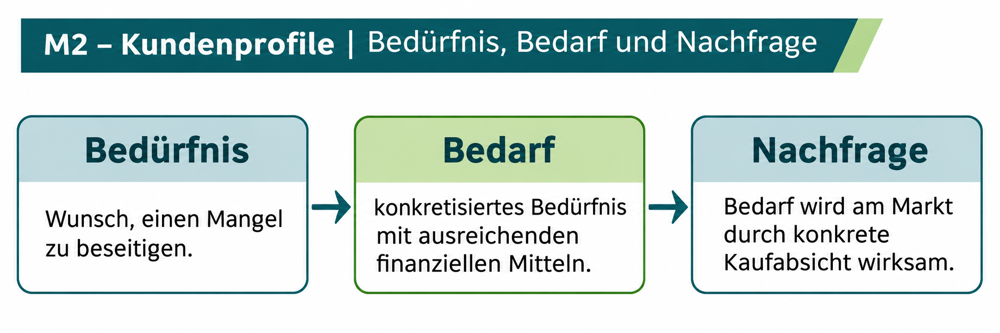
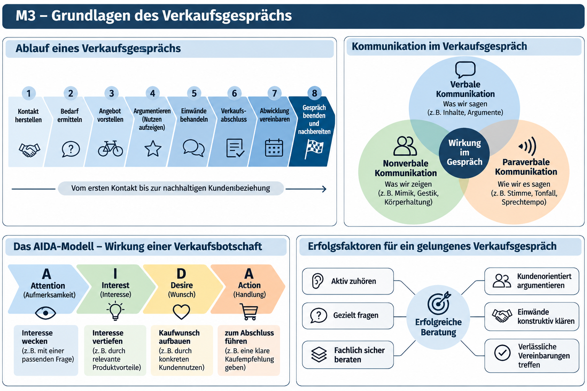
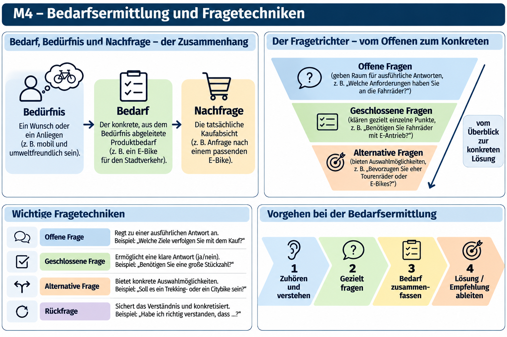
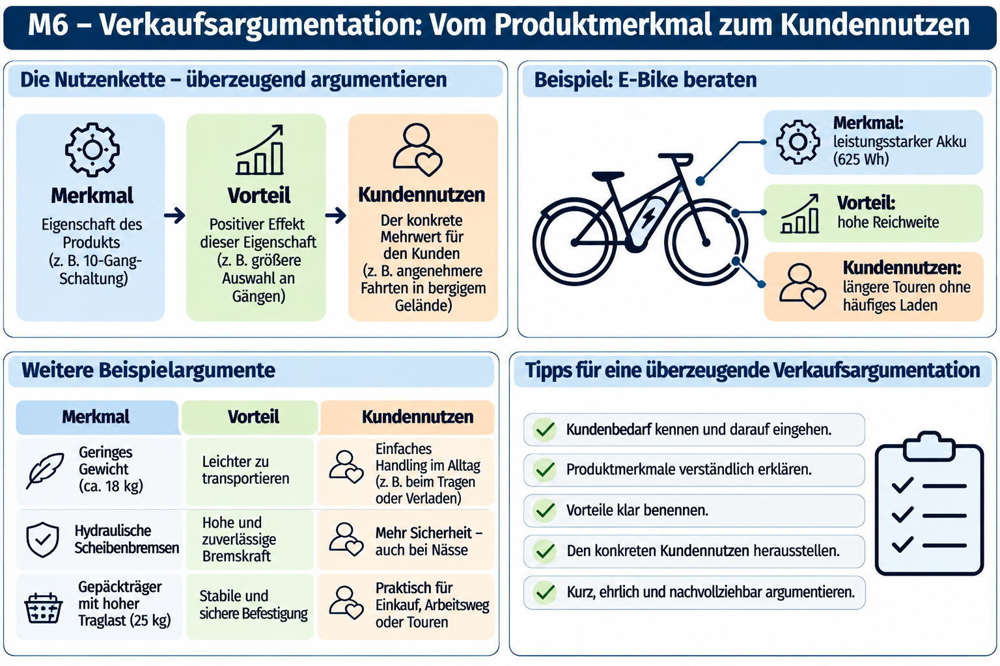

# BFS dual · Lernfeld 2 · LS 2.2 · Kunden bedarfsgerecht beraten und Verkaufsgespräche erfolgreich führen

**Bildungsgang** · BFS dual, Profil Wirtschaft  
**Lernsituation** · 2.2 · Kunden bedarfsgerecht beraten und Verkaufsgespräche erfolgreich führen (Paketkennung `BFSDUAL-LF02-LS02`)  
**Unterrichtlicher Bezug** · Handlungsorientierte Fallbearbeitung bei der Global Bike Deutschland GmbH  
**Zeitrahmen** · 18 Unterrichtsstunden à 45 Minuten, insgesamt 810 Minuten für einen gewählten Lernweg  
**Digitale Fassung** · [Orientierung öffnen](index.html) · [Unterlagen und Downloads](materialien.html)  
**Formgrundlage** · [BFSdual-Vorlage, Arbeitsstand vom 26. November 2026](https://github.com/macmaris83/Lernsituationen/blob/a1dd9b693df1a234bf3c7387198fcf5b5aab6afc/Fachbereiche/BFSdual/Vorlage_Lernsituation.md)

## Aufgabenzeiten

Für jeden der drei Wege gilt derselbe Zeitrahmen. Bei Durchführen zählt der Auftrag zum gewählten Lernpaket einmal.

| Station | Minuten je Lernweg |
| --- | ---: |
| Orientierung | 15 |
| Handlungssituation | 35 |
| Informieren | 105 |
| Fachbegriffscheck | 25 |
| Planen | 90 |
| Entscheiden | 45 |
| Durchführen | 315 |
| Bewerten | 135 |
| Reflektieren | 45 |
| **Gesamt** | **810** |

## Orientierung

[Digitale Fassung öffnen](index.html)

BFS dual · Lernfeld 2 · Lernsituation 2.2 · 18 Unterrichtsstunden

#### Den Auftrag überblicken

Ein Fahrradhändler bittet Sie um eine Empfehlung für sein Sortiment. Er kauft die Räder für andere Menschen und trägt das Risiko, wenn sie im Laden stehen bleiben. Wie finden Sie heraus, welche Räder zu seiner Kundschaft und seinem Budget passen?

Ein tatsächlich geführtes Beratungsgespräch mit dokumentiertem Ergebnis und eine Vorbereitung im gewählten Format. Dazu gehören Bedarfsprofil, Vergleich von mindestens zwei geeigneten Produkten, mindestens drei Nutzenargumente, drei mögliche Einwände, zwei Einwandbehandlungsmethoden und zwei Abschlussmöglichkeiten. Halten Sie die Rückmeldung zum Gespräch und eine konkrete Überarbeitung im gewählten Format fest.

Du entscheidest, welche Aufgaben du selbstständig oder mit anderen bearbeitest. Für die Rückmeldung erhält jede Person ein fremdes Produkt.

15 Minuten

*Fachbuchverweis · Für diesen Auftrag ist keine Buchseite hinterlegt.*

Kompetenzprofil der Lernsituation

Die Gewichtung zeigt, wie häufig und wofür die Kompetenz in den Aufgaben gebraucht wird. 1 bedeutet „kurz in einer Aufgabe“, 6 „von der Vorbereitung bis zur Auswertung“.

| Kompetenz | Gewicht (1–6) | Was übe ich? |
| --- | --- | --- |
| F · Fachkompetenz | 6 / 6 | Ich leite aus erfragtem Bedarf und belegten Produktinformationen eine wirtschaftlich passende Empfehlung ab. |
| P · Personalkompetenz | 5 / 6 | Ich plane die Beratung und kennzeichne offene Angaben, bevor ich Zusagen mache. |
| S · Sozialkompetenz | 6 / 6 | Ich höre aktiv zu, kläre Einwände und respektiere die Kaufentscheidung. |
| M · Methodenkompetenz | 5 / 6 | Ich strukturiere Fragen, gewichte Kriterien und prüfe den Einkaufswert anhand von Simulationspreisen. |
| D · Medienkompetenz | 4 / 6 | Ich nutze Arbeitsvorlagen und Medien so, dass Kundenprofil und Vergleich nachvollziehbar bleiben. |

## Handlungssituation

[Digitale Fassung öffnen](handlungssituation.html)

Lies den betrieblichen Auftrag und beantworte die Fragen in eigenen Worten.

 

Jan Richter hört einer Fachhändlerin zu und ermittelt ihren Bedarf, bevor er mit ihr zwei Fahrräder vergleicht. Im Board erteilt er den Beratungsauftrag an das Verkaufsteam. Die Illustration zeigt eine mögliche Gesprächssituation.

#### Den Fall lesen

Jan Richter leitet bei Global Bike den Verkauf und das Marketing. Sebastian Wolf hat für ihn drei ostfriesische Fachhändler befragt. Der erste achtet auf den Preis für seine Freizeitkundschaft, der zweite sucht überzeugende Qualität für sportliche Nutzer, der dritte möchte sein Sortiment erweitern. Welche Modelle und Stückzahlen tatsächlich sinnvoll sind, wissen Jan und Sebastian noch nicht.

Sie übernehmen die Verkaufsrolle. Bereiten Sie die Beratung anhand eines öffentlichen Händlerprofils vor. Im Rollengespräch gibt die Kundenvertretung weitere Informationen preis, wenn Sie gezielt nachfragen. Vergleichen Sie mindestens zwei geeignete Produkte und erklären Sie die Empfehlung mit belegten Eigenschaften, Kosten und Nutzen. Für kaufmännische Rückfragen ist Emil Werner zuständig, für offene Lieferfragen Christian Klein. Produktzusagen benötigen einen Beleg. Vereinbaren Sie zum Gesprächsende den nächsten Schritt, auch wenn die Entscheidung vertagt wird.

11 Minuten

*Fachbuchverweis · Für diesen Auftrag ist keine Buchseite hinterlegt.*

#### Welche unterschiedlichen Ziele verfolgen die drei Händler?

Lesehilfe

Suchen Sie die drei Beschreibungen in Sebastian Wolfs Bericht.

Deine Antwort

6 Minuten

*Fachbuchverweis · Für diesen Auftrag ist keine Buchseite hinterlegt.*

#### Welche Informationen brauchen Sie, bevor Sie eine Menge und ein Modell empfehlen können?

Lesehilfe

Denken Sie an die offenen Anforderungen des Händlers und die nächsten Schritte im Gespräch.

Deine Antwort

6 Minuten

*Fachbuchverweis · Für diesen Auftrag ist keine Buchseite hinterlegt.*

#### Wer klärt kaufmännische Rückfragen und wer offene Lieferfragen?

Lesehilfe

Lesen Sie die beiden im zweiten Absatz genannten Zuständigkeiten.

Deine Antwort

6 Minuten

*Fachbuchverweis · Für diesen Auftrag ist keine Buchseite hinterlegt.*

#### Welchen Gesprächsabschluss können Sie vereinbaren, wenn der Händler heute noch nicht bestellt?

Lesehilfe

Achten Sie auf die letzte Anweisung.

Deine Antwort

6 Minuten

*Fachbuchverweis · Für diesen Auftrag ist keine Buchseite hinterlegt.*

## Informieren

[Digitale Fassung öffnen](informieren.html)

Erschließe die Angaben und Unterlagen für deinen Auftrag.

53 Minuten

#### Auftrag und Händlerprofile erschließen

Lesen Sie [M1](#m1) und die öffentlichen Profile in [M2](#m2). Erfassen Sie je Profil bekannte Angaben, Vermutungen und offene Fragen.

*Fachbuchverweis · Für diesen Auftrag ist keine Buchseite hinterlegt.*

52 Minuten

#### Fachgrundlagen für die Beratung untersuchen

Sichern Sie aus [M3](#m3), [M4](#m4) und [M5](#m5) Gesprächsphasen, Fragearten und Kriterien für einen Produktvergleich. Unterscheiden Sie bestätigte Angaben und offene technische Merkmale.

*Fachbuchverweis · Für diesen Auftrag ist keine Buchseite hinterlegt.*

[Begriffsblatt zum Nachschlagen](#glossar) · [Begriffe prüfen](#begriffstraining)

## Fachbegriffscheck

[Digitale Fassung öffnen](begriffstraining.html)

Wähle zu jedem Begriff die passende Erklärung. Du kannst den Check wiederholen.

25 Minuten

[Begriffsblatt öffnen](#glossar)

Karte `BFSDUAL-LF02-LS02-B01`

**1. Bedürfnis**

- Die verfügbare Kaufkraft eines Händlers.
- Ein empfundener Mangel oder Wunsch.
- Die verbindliche Bestellung eines bestimmten Modells.

Karte `BFSDUAL-LF02-LS02-B02`

**2. Bedarf**

- Nur die Summe bereits getätigter Bestellungen.
- Jeder Wunsch unabhängig von verfügbaren finanziellen Mitteln.
- Ein konkretisiertes Bedürfnis, für das Kaufkraft vorhanden ist.

Karte `BFSDUAL-LF02-LS02-B03`

**3. Nachfrage**

- Bedarf, der am Markt wirksam wird.
- Ein bloßer Wunsch ohne Kaufkraft.
- Jede geplante Sortimentserweiterung ohne Marktbezug.

Karte `BFSDUAL-LF02-LS02-B04`

**4. B2B**

- Geschäft zwischen Händler und privater Endkundschaft.
- Geschäft zwischen Unternehmen.
- Gespräch zwischen zwei privaten Fahrradnutzern.

Karte `BFSDUAL-LF02-LS02-B05`

**5. Fragetrichter**

- Mit einem bestimmten Modell beginnen und Rückfragen vermeiden.
- Mehrere Fragen in einem Satz bündeln.
- Von offenen zu konkreten Fragen übergehen und das Ergebnis absichern.

Karte `BFSDUAL-LF02-LS02-B06`

**6. Paraphrase**

- Den Kunden direkt auf ein festes Budget festlegen.
- Die gesamte Preisliste wiederholen.
- Eine Aussage mit eigenen Worten wiedergeben und das Verständnis prüfen.

Karte `BFSDUAL-LF02-LS02-B07`

**7. Muss-Anforderung**

- Zwingende Bedingung für eine geeignete Empfehlung.
- Noch ungeprüfte Vermutung über eine Produkteigenschaft.
- Nützliche, aber entbehrliche Zugabe.

Karte `BFSDUAL-LF02-LS02-B08`

**8. Produktmerkmal**

- Nutzen eines Produkts für genau diesen Kunden.
- Beliebige Vermutung aus dem Namen einer Produktlinie.
- Objektiv beschreibbare Eigenschaft eines Produkts.

Karte `BFSDUAL-LF02-LS02-B09`

**9. Kundennutzen**

- Bedeutung eines Vorteils für die konkrete Anforderung des Kunden.
- Jeder positive Werbespruch über ein Modell.
- Die reine Produktbezeichnung im Stammdatenauszug.

Karte `BFSDUAL-LF02-LS02-B10`

**10. Kapitalbindung**

- Zahlungseingang aus dem Absatz aller eingekauften Produkte.
- Verbindliche Zusage, dass sich die Ware verkaufen lässt.
- Finanzielle Mittel sind beispielsweise durch eingekaufte Waren gebunden.

Karte `BFSDUAL-LF02-LS02-B11`

**11. Restbudget**

- Bruttoumsatz abzüglich Rabatt.
- Preis pro Stück abzüglich Umsatzsteuer.
- Verfügbares Budget abzüglich des geplanten Einkaufswerts.

Karte `BFSDUAL-LF02-LS02-B12`

**12. Einwand**

- Sachlicher Vorbehalt oder eine noch offene Frage zu einer Empfehlung.
- Zustimmung des Kunden zu einem Angebot.
- Jede endgültige Ablehnung einer Beratung.

Karte `BFSDUAL-LF02-LS02-B13`

**13. Probeabschluss**

- Bestätigung, dass tatsächlich ein Kaufvertrag geschlossen wurde.
- Frage, ob die Lösung unter den genannten Voraussetzungen grundsätzlich passen würde.
- Zusicherung eines Liefertermins ohne Prüfung.

## Planen

[Digitale Fassung öffnen](planen.html)

Entwirf deinen Arbeitsplan.

45 Minuten

#### Beratungsziel und Arbeitsplan bestimmen

Wählen Sie eines der Händlerprofile aus [M2](#m2). Skizzieren Sie die Arbeitsschritte bis zur Simulation und die Form Ihrer Dokumentation. Reservieren Sie Zeit für Gespräch, Rückmeldung und Überarbeitung.

*Fachbuchverweis · Für diesen Auftrag ist keine Buchseite hinterlegt.*

45 Minuten

#### Fragetrichter und Vergleichskriterien vorbereiten

Entwerfen Sie mit [M4](#m4) einen Fragetrichter. Legen Sie fest, wie Sie Zielgruppe, Muss-Anforderungen, Budget, Menge und offene Angaben klären. Bestimmen Sie anhand von [M5](#m5) geeignete produktbezogene Vergleichskriterien.

*Fachbuchverweis · Für diesen Auftrag ist keine Buchseite hinterlegt.*

## Entscheiden

[Digitale Fassung öffnen](entscheiden.html)

Wähle einen von drei gleichwertigen Arbeitswegen. Du kannst deine Wahl begründet ändern.

**Lernpaket wählen**

A · Beratungsleitfaden · Leitfragen, Entscheidungshilfen und ein Abschlussprotokoll zusammenstellen. · Ein erster Leitfadenabschnitt verbindet Rückfrage und Reaktion. Für einen schriftlich strukturierten Arbeitsweg.

B · Beratungswerkstatt · Gesprächsausschnitte erproben, Rückfragen variieren und Reaktionen beobachten. · Ein getesteter Gesprächsbaustein zeigt, wie sich eine Empfehlung mit neuem Bedarf ändert. Für einen praktisch erprobenden Arbeitsweg.

C · Beratungslandkarte · Kundenbedarf, Produkte, Argumente und Einwände visuell verbinden. · Eine kommentierte Verzweigung führt vom Wunsch über den Produktvergleich zum nächsten Schritt. Für einen visuellen Arbeitsweg.

Ein tatsächlich geführtes Beratungsgespräch mit dokumentiertem Ergebnis und eine Vorbereitung im gewählten Format. Dazu gehören Bedarfsprofil, Vergleich von mindestens zwei geeigneten Produkten, mindestens drei Nutzenargumente, drei mögliche Einwände, zwei Einwandbehandlungsmethoden und zwei Abschlussmöglichkeiten. Halten Sie die Rückmeldung zum Gespräch und eine konkrete Überarbeitung im gewählten Format fest.

45 Minuten

#### Arbeitsweg und Informationsquellen festlegen

Wählen Sie Leitfaden, Werkstatt oder Landkarte. Erläutern Sie, wie Ihr Format im tatsächlichen Gespräch helfen soll. Benennen Sie eine Kundenfrage, die Sie mit [M8](#m8) beantworten können, und eine, die intern geklärt werden muss.

*Fachbuchverweis · Für diesen Auftrag ist keine Buchseite hinterlegt.*

## Durchführen

[Digitale Fassung öffnen](durchfuehren.html)

Bearbeite den Auftrag im gewählten Format.

[Wähle in Entscheiden dein Lernpaket A, B oder C](#entscheiden), um die Aufträge zu öffnen.

Deine Wahl:  · [Wahl ändern](#entscheiden)

Ein tatsächlich geführtes Beratungsgespräch mit dokumentiertem Ergebnis und eine Vorbereitung im gewählten Format. Dazu gehören Bedarfsprofil, Vergleich von mindestens zwei geeigneten Produkten, mindestens drei Nutzenargumente, drei mögliche Einwände, zwei Einwandbehandlungsmethoden und zwei Abschlussmöglichkeiten. Halten Sie die Rückmeldung zum Gespräch und eine konkrete Überarbeitung im gewählten Format fest.

79 Minuten

#### Vergleich und Gesprächsbausteine vorbereiten

Vergleichen Sie mindestens zwei geeignete Produkte und berechnen Sie den vorläufigen Nettoeinkaufswert mit [M8](#m8). Nutzen Sie [M6](#m6) für drei Argumente mit Merkmal, Vorteil und Nutzen. Bereiten Sie in [M7](#m7) drei Einwände, zwei Behandlungsmethoden und zwei mögliche Abschlüsse vor.

*Fachbuchverweis · Für diesen Auftrag ist keine Buchseite hinterlegt.*

157 Minuten

**Lernpaket A**

#### Leitfaden an der Gesprächserfahrung prüfen

Überarbeiten Sie eine konkrete Passage Ihres Leitfadens mithilfe der Rückmeldung. Verbinden Sie Bedarfsfragen, belegte Empfehlung, Kundeneinwand und mögliche nächste Schritte. Markieren Sie, welche Stelle sich nach dem Gespräch geändert hat. [Protokollhilfe](#m7)

*Fachbuchverweis · Für diesen Auftrag ist keine Buchseite hinterlegt.*

157 Minuten

**Lernpaket B**

#### Werkstattstand dokumentieren

Erproben Sie eine alternative Reaktion auf den gewählten Gesprächsausschnitt. Halten Sie die Bausteine, den Vergleich und den Grund für Ihre Überarbeitung in einer für das Verkaufsteam nutzbaren Werkstattdokumentation fest. [Argumentationswerkstatt](#m6)

*Fachbuchverweis · Für diesen Auftrag ist keine Buchseite hinterlegt.*

157 Minuten

**Lernpaket C**

#### Beratungslandkarte vervollständigen

Verbinden Sie bestätigte Anforderungen, Vergleich, Nutzen, Einwände und Abschluss auf der Karte. Kennzeichnen Sie den tatsächlich genommenen Gesprächsweg und eine verbesserte Abzweigung aus dem Feedback. [Bedarfsprofil](#m4)

*Fachbuchverweis · Für diesen Auftrag ist keine Buchseite hinterlegt.*

79 Minuten

#### Kunden beraten und Ergebnis sichern

Vereinbaren Sie eine Kundenvertretung mit der Lehrkraft. Sie erhält die zum Profil passende vertrauliche Rollenkarte separat. Übernehmen Sie selbst die Verkaufsrolle. Erfragen Sie fehlende Bedingungen, passen Sie Vergleich und Empfehlung an und vereinbaren Sie einen angemessenen nächsten Schritt. Protokollieren Sie den Abschluss mit [M7](#m7) oder [M8](#m8). Holen Sie eine Rückmeldung zu einer beobachtbaren Gesprächsstelle ein.

*Fachbuchverweis · Für diesen Auftrag ist keine Buchseite hinterlegt.*

Kriterien für das fertige Produkt

- Ein bedarfsgerechter Einstieg und gezielte Rückfragen machen aus offenen Annahmen bestätigte Kundenanforderungen.
- Mindestens zwei geeignete Artikel sind anhand belegter Angaben aus M5 und M8 verglichen. Mengen, Netto-Einkaufswert und Restbudget sind nachvollziehbar.
- Drei Nutzenargumente verknüpfen jeweils Merkmal, Vorteil und Händler- oder Endkundennutzen. Unbekannte Produkteigenschaften bleiben offen.
- Drei mögliche Einwände, zwei Behandlungsmethoden und zwei Abschlusswege sind vorbereitet. Im Gespräch wird auf den tatsächlichen Einwand und Kundenwunsch reagiert.
- Das Protokoll hält Ergebnis, offene Fragen, Zuständigkeit und nächsten Schritt fest. Eine konkrete Verbesserung geht auf eine Rückmeldung zum Gespräch zurück.

## Bewerten

[Digitale Fassung öffnen](bewerten.html)

Peer-Check am Handlungsprodukt.

34 Minuten

#### Das Produkt für den Peer-Check bereitstellen

**Reiche** deine Arbeit in der Moodle-Aktivität „Peer-Feedback“ ein. Verwende neutrale Titel und Dateinamen. Entferne Namen aus Text und Dateieigenschaften. Bei einem gemeinsamen Produkt reicht jede Person eine Kopie im eigenen Konto ein. Ohne eingerichtete Aktivität verteilt die Lehrkraft codierte Arbeiten.

*Fachbuchverweis · Für diesen Auftrag ist keine Buchseite hinterlegt.*

67 Minuten

#### Ein fremdes Produkt prüfen

**Prüfe** die dir zugeteilte Arbeit mit den Kriterien unten. Benenne eine konkrete Fundstelle, eine fachlich gelungene Stelle und einen begründeten Verbesserungsvorschlag. Gib die Rückmeldung in Moodle oder mit dem [ausfüllbaren Peer-Bogen](#peer-check) ab. Dein Name ist für die empfangende Person sichtbar.

*Fachbuchverweis · Für diesen Auftrag ist keine Buchseite hinterlegt.*

34 Minuten

#### Die empfangene Rückmeldung nutzen

**Lies** das Feedback zu deinem Produkt. Verbessere die genannte Stelle oder begründe am Material, weshalb du deine Fassung beibehältst. Ergebnis ist die für die weitere Verwendung geprüfte Fassung.

*Fachbuchverweis · Für diesen Auftrag ist keine Buchseite hinterlegt.*

### Fachliche Prüfkriterien

- Ein bedarfsgerechter Einstieg und gezielte Rückfragen machen aus offenen Annahmen bestätigte Kundenanforderungen.
- Mindestens zwei geeignete Artikel sind anhand belegter Angaben aus M5 und M8 verglichen. Mengen, Netto-Einkaufswert und Restbudget sind nachvollziehbar.
- Drei Nutzenargumente verknüpfen jeweils Merkmal, Vorteil und Händler- oder Endkundennutzen. Unbekannte Produkteigenschaften bleiben offen.
- Drei mögliche Einwände, zwei Behandlungsmethoden und zwei Abschlusswege sind vorbereitet. Im Gespräch wird auf den tatsächlichen Einwand und Kundenwunsch reagiert.
- Das Protokoll hält Ergebnis, offene Fragen, Zuständigkeit und nächsten Schritt fest. Eine konkrete Verbesserung geht auf eine Rückmeldung zum Gespräch zurück.

[Peer-Check öffnen oder drucken](#peer-check)

## Reflektieren

[Digitale Fassung öffnen](reflektieren.html)

Dein Feedback zum Unterricht.

45 Minuten

#### Feedback zur Lernsituation abgeben

**Fülle** die Aktivität „Feedback“ im Moodle-Kurs aus. Melde zurück, welches Material geholfen hat, wo ein Auftrag unklar war, wie Zeit und Wahlmöglichkeiten passten und was wir ändern sollten. Verwende alternativ den [ausfüllbaren Feedbackbogen](#feedback) und gib ihn wie vereinbart ab.

*Fachbuchverweis · Für diesen Auftrag ist keine Buchseite hinterlegt.*

[Feedbackbogen öffnen](#feedback)

## Materialien
| Kennung | Unterlage |
| --- | --- |
| FEEDBACK | [Feedback zur Lernsituation](#feedback) |
| M1 | [M1 · Betrieblicher Arbeitsauftrag](#m1) |
| M11 | [M11 · Gesamtglossar zum Verkaufsgespräch](#m11) |
| M2 | [M2 · Kundenprofile](#m2) |
| M3 | [M3 · Grundlagen des Verkaufsgesprächs](#m3) |
| M4 | [M4 · Bedarfsermittlung und Fragetechniken](#m4) |
| M5 | [M5 · Produktübersicht und Produktvergleich](#m5) |
| M6 | [M6 · Verkaufsargumentation](#m6) |
| M7 | [M7 · Einwandbehandlung und Verkaufsabschluss](#m7) |
| M8 | [M8 · Verkaufsrolle und Simulationspreise](#m8) |
| MATERIALIEN | [Materialübersicht und Quellen](#materialien) |
| PEER-CHECK | [Peer-Check · LS 2.2](#peer-check) |

## Feedback zur Lernsituation

[Digitale Fassung öffnen](feedback.html)

Wie lief die Arbeit an der Lernsituation „Kunden bedarfsgerecht beraten und Verkaufsgespräche erfolgreich führen“? Beschreiben Sie Ihre Erfahrungen so konkret, dass die Lehrkraft den nächsten Durchgang daran anpassen kann.

Welches Material hat Ihnen an welcher Stelle geholfen?

Wo war ein Auftrag oder eine Darstellung unklar?

Wie passten Zeit und freie Wahl des Arbeitswegs zu Ihrem Vorgehen?

Was sollten wir beim nächsten Durchgang beibehalten oder ändern?

**Feedback abgeben.** Im Moodle-Kurs können Sie Ihre Antworten in die Aktivität „Feedback“ übertragen und dort abgeben. Alternativ drucken Sie den ausgefüllten Bogen ohne Namen aus und geben ihn der Lehrkraft an der vereinbarten Sammelstelle. Die Eingaben bleiben bis zum Verlassen dieser Seite im geöffneten Bogen. Für eine eigene Kopie laden Sie die Textdatei herunter.

## M1 · Betrieblicher Arbeitsauftrag

[Digitale Fassung öffnen](material/m1.html)

[Zur Materialübersicht](#materialien) 

Interne Mitteilung – Jan Richter, Vertriebsleitung

Liebe Mitarbeiterinnen und Mitarbeiter,  
 wir möchten unsere Geschäftsbeziehungen zu regionalen Fahrradhändlern in Ostfriesland weiterentwickeln. Bereiten Sie eine individuelle Beratung vor. Ermitteln Sie den [Bedarf](#bedarf), vergleichen Sie geeignete Produkte, begründen Sie Ihre Empfehlung und berücksichtigen Sie wirtschaftliche Anforderungen. Bearbeiten Sie Einwände und streben Sie einen sinnvollen Verkaufsabschluss an. Dokumentieren Sie das Gespräch und nutzen Sie Feedback zur Verbesserung.  
 Freundliche Grüße  
 Jan Richter

Arbeitsauftrag: Erfassen Sie Ziel, Anforderungen, benötigte Informationen und erwartetes Handlungsergebnis.

| Auftragsziel | Benötigte Informationen | Ergebnis |
| --- | --- | --- |
|  |  |  |
|  |  |  |
|  |  |  |

### Ergänzende ausführliche Arbeitsfassung

Ermitteln Sie den Anlass, die Auftraggeber, die erwartete Leistung und die Grenzen des Auftrags. Halten Sie fest, welche Informationen bereits vorliegen und welche noch beschafft werden müssen. Planen Sie ein Beratungsgespräch mit Feedback. Es wird keine reale Bestellung ausgelöst.

| Aspekt | Notizen |
| --- | --- |
| Auftraggeber |  |
| Geschäftlicher Anlass |  |
| Erwartetes Ergebnis |  |
| Benötigte Informationen |  |
| Offene Fragen |  |

[Text als Markdown herunterladen](material/m1.md) · [Zur Materialübersicht](#materialien)

## M11 · Gesamtglossar zum Verkaufsgespräch

[Digitale Fassung öffnen](material/m11.html)

[Zur Materialübersicht](#materialien) 

Bitte verlinke die aufgeführten Fachbegriffe in den jeweiligen Texten mit den Begriffen aus dem Glossar  
 Nachschlagewerk | konsolidierte Kernfassung

| Fachbegriff | Erläuterung |
| --- | --- |
| Absatzrisiko | Gefahr, dass Waren nicht wie erwartet verkauft werden. |
| Abschlussfrage | Frage, die eine Kaufentscheidung anbahnt. |
| Aktives Zuhören | Aufmerksam zuhören, [nachfragen](#nachfrage) und Verständnis prüfen. |
| Alternativfrage | Frage mit vorgegebenen Wahlmöglichkeiten. |
| Angebot | Hinreichend bestimmter Antrag auf Vertragsschluss (erste Willenserklärung) |
| Annahme | Übereinstimmende Zustimmung zum Angebot (zweite Willenserklärung) |
| [B2B](#b2b) | Business-to-Business: Geschäft zwischen Unternehmen. |
| B2C | Business-to-Consumer: Geschäft mit privaten Endkunden. |
| [Bedarf](#bedarf) | Konkretisiertes, finanziell erfüllbares [Bedürfnis](#beduerfnis). |
| Bedürfnis | Empfundener Mangel oder Wunsch. |
| Belegtechnik | Aussage durch gesicherte Informationen stützen. |
| Bestellmenge | Anzahl bestellter Einheiten. |
| Einkaufsbudget | Verfügbarer Geldbetrag für den Einkauf. |
| Feedback | Rückmeldung zu Verhalten oder Ergebnis. |
| [Fragetrichter](#fragetrichter) | Von offenen zu konkreten Fragen übergehen. |
| [Kapitalbindung](#kapitalbindung) | Bindung finanzieller Mittel etwa in Waren oder Anlagevermögen. |
| Kaufvertrag | Vertrag über Übergabe und Eigentumsverschaffung gegen Zahlung und Abnahme. Ein Kaufvertrag entsteht durch zwei übereinstimmende Willenserklärungen (Angebot und Annahme). |
| Kundenanforderung | Erwartung oder Bedingung des Kunden. |
| Lieferbedingung | Vereinbarung über die Warenlieferung. |
| Materialnummer | Eindeutige Kennzeichnung eines Materials. |
| Metakognition | Nachdenken über das eigene Denken und Lernen. |
| Mindestbestellmenge | Kleinste bestellbare Menge. |
| [Muss-Anforderung](#muss-anforderung) | Zwingend zu erfüllende Bedingung. |
| MVN | Merkmal, Vorteil, Nutzen. |
| Nachfrage | Am Markt wirksamer Bedarf. |
| Nettoverkaufspreis | Verkaufspreis ohne Umsatzsteuer. |
| Nonverbal | Kommunikation ohne Worte, etwa Gestik. |
| Nutzwertanalyse | Gewichteter Vergleich mehrerer Alternativen. |
| Offene Frage | Frage mit frei formulierbarer Antwort. |
| Originalstammdaten | Unverändert übernommene betriebliche Stammdaten. |
| [Paraphrase](#paraphrase) | Wiedergabe einer Aussage in eigenen Worten. |
| Paraverbal | Sprechweise, etwa Tonfall und Lautstärke. |
| Perspektivübernahme | Berücksichtigung der Sicht anderer. |
| [Produktmerkmal](#produktmerkmal) | Beschreibbare Eigenschaft eines Produkts. |
| Produktspezifikation | Konkrete technische und funktionale Produktdaten. |
| Produktvorteil | Positiver Effekt eines Merkmals. |
| [Restbudget](#restbudget) | Budget abzüglich Einkaufswert. |
| Sortiment | Gesamtheit angebotener Waren. |
| Sortimentserweiterung | Aufnahme weiterer Produkte. |
| Verbal | Kommunikation mit Worten. |
| Verkaufsorganisation | SAP-Organisationseinheit für Verkaufsaktivitäten. |
| Vertriebsweg | Organisatorisch abgebildeter Vertriebsweg. |
| Vorwand | Vorgeschobener Grund. |
| Warenverfügbarkeit | Möglichkeit, benötigte Ware bereitzustellen. |
| Zahlungsziel | Vereinbarte Zahlungsfrist. |
| Zusatzverkauf | Verkauf eines bedarfsgerechten Ergänzungsprodukts. |

[Text als Markdown herunterladen](material/m11.md) · [Zur Materialübersicht](#materialien)

## M2 · Kundenprofile

[Digitale Fassung öffnen](material/m2.html)

[Zur Materialübersicht](#materialien)  

| Profil | Ausgangssituation | Offene Fragen |
| --- | --- | --- |
| A | Preisbewusste Alltags- und Freizeitkundschaft; geringe [Kapitalbindung](#kapitalbindung) | Budget, Menge, Einsatz |
| B | Sportorientierte Kundschaft; überzeugende Qualität und Beratung | Ausstattung, Budget, Einsatz |
| C | Sortimentserweiterung; unsichere [Nachfrage](#nachfrage) | Zielgruppen, Menge, Risiko |

[Bedürfnis](#beduerfnis) bezeichnet einen Wunsch oder empfundenen Mangel. [Bedarf](#bedarf) ist ein konkretisiertes, finanziell erfüllbares Bedürfnis; Nachfrage ist am Markt wirksamer Bedarf. [B2B](#b2b) bezeichnet Geschäfte zwischen Unternehmen, B2C zwischen Unternehmen und privaten Endkunden.

| Bekannt | Vermutung | Offene Frage |
| --- | --- | --- |
|  |  |  |
|  |  |  |
|  |  |  |
|  |  |  |
|  |  |  |

Aufgabe: Analysieren Sie das zugeordnete Profil. Formulieren Sie Fragen, ohne Vermutungen als Tatsachen zu behandeln.

Kundenprofile und Kundenanforderungen

| Merkmal | Beschreibung |
| --- | --- |
| Material | M2 |
| Einsatz | Phase 1 – Informieren / Analysieren |
| Materialart | Betriebliche Kundeninformationen |
| Unternehmensbereich | Verkauf und Marketing |
| Informationsquelle | Sebastian Wolf – Außendienst |
| Lernziel | Kundeninformationen analysieren und den Beratungsbedarf erkennen |

#### M2.1 – Informationen aus dem Außendienst

Darstellung als E-Mail:

Empfänger:in

Erste Kundenanfragen aus der Region Nordwest

Guten Tag liebes Verkaufsteam,

im Rahmen unserer Vertriebsaktivitäten in Ostfriesland habe ich erste Gespräche mit regionalen Fahrradhändlern geführt.

Dabei ist deutlich geworden, dass die Händler sehr unterschiedliche Anforderungen an unser Sortiment stellen. Während einige besonders auf den Einkaufspreis achten, legen andere großen Wert auf Qualität, Ausstattung oder die Bedürfnisse bestimmter Kundengruppen.

Ich habe die bisherigen Informationen in drei Kundenprofilen zusammengestellt.

Beachten Sie bitte, dass uns noch nicht alle Informationen vorliegen. Einige Kundenwünsche müssen erst im persönlichen Beratungsgespräch genauer ermittelt werden.

Eine gute Beratung beginnt nicht mit einer Produktempfehlung, sondern mit dem Verständnis der Kundenbedürfnisse.

Nutzen Sie die vorliegenden Informationen, um sich auf die Beratungsgespräche vorzubereiten.

Mit freundlichen Grüßen

Sebastian Wolf

Außendienst

Global Bike Deutschland GmbH

#### M2.2 – Kundenprofile

Die folgenden Kundenprofile bilden unterschiedliche betriebliche Beratungssituationen ab. Sie stellen noch keine vollständige Bedarfsermittlung dar.

Kundenprofil A – Preisbewusster Fahrradhändler

Schwerpunkt: Wirtschaftlichkeit und Absatzmöglichkeiten

| Merkmal | Kundeninformation |
| --- | --- |
| Geschäftstätigkeit | Regionaler Fahrradfachhandel |
| Kundschaft | Überwiegend preisbewusste Freizeitfahrer |
| Kaufinteresse | Erweiterung des bestehenden Fahrradsortiments |
| Besondere Anforderungen | Attraktive Einkaufspreise und gute Absatzmöglichkeiten |
| Kaufmotiv | Wirtschaftlichkeit |
| Bedenken | Zu hohe Einkaufskosten und schwer verkäufliche Produkte |
| Kaufbereitschaft | Grundsätzlich vorhanden |

Aussage des Kunden:

„Meine Kunden achten sehr auf den Preis. Ich möchte mein Sortiment erweitern, aber die Fahrräder müssen sich auch gut verkaufen lassen.“

Kundenprofil B – Qualitätsorientierter Fahrradhändler

Schwerpunkt: Qualität und Kundenzufriedenheit

| Merkmal | Kundeninformation |
| --- | --- |
| Geschäftstätigkeit | Fahrradfachhandel mit intensiver Kundenberatung |
| Kundschaft | Qualitätsbewusste und sportlich interessierte Fahrradfahrer |
| Kaufinteresse | Ergänzung des Sortiments durch hochwertige Fahrräder |
| Besondere Anforderungen | Qualität, Ausstattung und Zuverlässigkeit |
| Kaufmotiv | Qualität und Sicherheit |
| Bedenken | Produkte, die den Erwartungen der Kundschaft nicht entsprechen |
| Kaufbereitschaft | Bei überzeugender Beratung vorhanden |

Aussage des Kunden:

„Meine Kunden sind bereit, für ein gutes Fahrrad mehr zu bezahlen. Dafür erwarten sie aber auch eine entsprechende Qualität.“

Kundenprofil C – Fahrradhändler mit Erweiterungsabsicht

Schwerpunkt: Sortimentserweiterung und neue Kundengruppen

| Merkmal | Kundeninformation |
| --- | --- |
| Geschäftstätigkeit | Regionaler Fahrradfachhandel |
| Kundschaft | Unterschiedliche Alters- und Interessengruppen |
| Kaufinteresse | Erschließung zusätzlicher Kundengruppen |
| Besondere Anforderungen | Sinnvolle Ergänzung des bisherigen Sortiments |
| Kaufmotiv | Wachstum und neue Absatzmöglichkeiten |
| Bedenken | Fehleinschätzung der Nachfrage und unverkaufte Waren |
| Kaufbereitschaft | Noch unentschlossen |

Aussage des Kunden:

„Ich möchte neue Kunden gewinnen. Allerdings weiß ich noch nicht genau, mit welchen Fahrrädern ich mein bisheriges Angebot sinnvoll erweitern kann.“

#### M2.3 – Fachliche Grundlagen: Kundenbedürfnisse verstehen

Bedürfnis, Bedarf und Nachfrage

Im Verkauf ist es wichtig, zwischen einem Bedürfnis, einem Bedarf und einer Nachfrage zu unterscheiden.

| Fachbegriff | Erläuterung |
| --- | --- |
| Bedürfnis | Das Empfinden eines Mangels verbunden mit dem Wunsch, diesen zu beseitigen. |
| Bedarf | Ein konkretisiertes Bedürfnis, für dessen Befriedigung ausreichende finanzielle Mittel zur Verfügung stehen. |
| Nachfrage | Bedarf, der am Markt durch eine konkrete Kaufabsicht wirksam wird. |

Kundenanforderungen

Kundenanforderungen beschreiben, welche Eigenschaften oder Leistungen ein Kunde von einem Produkt oder Angebot erwartet.

Mögliche Kundenanforderungen sind:

- Preis
- Qualität
- Ausstattung
- Sicherheit
- Einsatzmöglichkeiten
- Lieferfähigkeit
- Serviceleistungen
- Wirtschaftlichkeit

Nicht alle Anforderungen sind für jeden Kunden gleich wichtig. Deshalb müssen sie im Beratungsgespräch individuell ermittelt werden.

Kaufmotive

Ein Kaufmotiv ist ein Beweggrund, der einen Kunden zu einer Kaufentscheidung veranlasst.

| Kaufmotiv | Bedeutung |
| --- | --- |
| Wirtschaftlichkeit | Kosten sparen oder wirtschaftliche Vorteile erzielen |
| Sicherheit | Risiken vermeiden und Vertrauen gewinnen |
| Qualität | Hochwertige und zuverlässige Produkte erhalten |
| Komfort | Eine möglichst angenehme Nutzung ermöglichen |
| Leistung | Besonders leistungsfähige Produkte erhalten |
| Wachstum | Neue Kunden und Absatzmöglichkeiten gewinnen |
| Nachhaltigkeit | Umweltbewusste Entscheidungen treffen |
| Prestige | Ansehen oder ein positives Image gewinnen |

Ein Kunde kann gleichzeitig mehrere Kaufmotive haben. Welche Motive besonders wichtig sind, muss im Gespräch herausgefunden werden.

Geschäftskunden und Privatkunden

Die Kundenberatung der Global Bike Deutschland GmbH richtet sich in dieser Lernsituation an Geschäftskunden.

| Fachbegriff | Bedeutung |
| --- | --- |
| B2B – Business to Business | Geschäftsbeziehungen zwischen Unternehmen |
| B2C – Business to Consumer | Geschäftsbeziehungen zwischen Unternehmen und privaten Endverbrauchern |
| Geschäftskunde | Kunde, der Waren oder Dienstleistungen für betriebliche Zwecke erwirbt |
| Endverbraucher | Person, die ein Produkt für den eigenen privaten Bedarf erwirbt |

Bei einer B2B-Beratung müssen sowohl die Anforderungen des Geschäftskunden als auch die Bedürfnisse seiner späteren Endverbraucher berücksichtigt werden.

Bekannte und unbekannte Kundenanforderungen

Vor einem Beratungsgespräch liegen häufig bereits erste Informationen über den Kunden vor. Diese reichen jedoch nicht immer aus, um eine geeignete Produktempfehlung auszusprechen.

Eine professionelle Beratung unterscheidet deshalb zwischen:

| Informationsart | Bedeutung |
| --- | --- |
| Bekannte Anforderungen | Anforderungen, die der Kunde bereits mitgeteilt hat |
| Offene Anforderungen | Informationen, die noch ermittelt werden müssen |
| Vermutete Anforderungen | Annahmen über Kundenwünsche, die noch überprüft werden müssen |

Merksatz: Eine Vermutung über einen Kunden ist noch keine gesicherte Kundeninformation.

#### M2.4 – Arbeitsblatt: Kundenprofil analysieren

Arbeitsauftrag: Analyse der drei Kundenprofile als Vorbereitung auf die späteren Beratungsgespräche.

Aufgabe 1 – Kundeninformationen vergleichen

| Analysekriterium | Kunde A | Kunde B | Kunde C |
| --- | --- | --- | --- |
| Kundengruppe des Händlers |  |  |  |
| Kaufinteresse |  |  |  |
| Kundenanforderungen |  |  |  |
| Kaufmotive |  |  |  |
| Bedenken |  |  |  |
| Kaufbereitschaft |  |  |  |
| Noch fehlende Informationen |  |  |  |

Aufgabe 2 – Beratungsbedarf ermitteln

| Leitfrage | Arbeitsergebnis |
| --- | --- |
| Welche Informationen liegen bereits vor? |  |
| Welche Informationen fehlen für eine Produktempfehlung? |  |
| Welche Kundenanforderungen müssen genauer untersucht werden? |  |
| Welche möglichen Zielkonflikte bestehen? |  |
| Welche Risiken entstehen durch eine unzureichende Bedarfsermittlung? |  |

Ein Zielkonflikt liegt vor, wenn zwei oder mehrere Ziele nicht gleichzeitig vollständig erreicht werden können.

Aufgabe 3 – Bedarfsermittlung vorbereiten

Für jedes Kundenprofil werden mindestens fünf geeignete Fragen entwickelt, mit denen die noch fehlenden Kundeninformationen ermittelt werden können.

| Nr. | Kunde A | Kunde B | Kunde C |
| --- | --- | --- | --- |
| 1 |  |  |  |
| 2 |  |  |  |
| 3 |  |  |  |
| 4 |  |  |  |
| 5 |  |  |  |

Aufgabe 4 – Schlussfolgerungen ziehen

Die Lernenden halten schriftlich fest, warum eine einheitliche Beratung für alle drei Kunden nicht sinnvoll ist, welche Bedeutung die individuellen Kundenanforderungen für die Produktauswahl haben, welche nformationen vor einer begründeten Produktempfehlung vorliegen müssen, warum Kundenbedürfnisse nicht einfach unterstellt werden dürfen. Zwischenergebnis: Eine ausgefüllte Kundenanalyse als Grundlage für die weitere Gesprächsvorbereitung.

[Text als Markdown herunterladen](material/m2.md) · [Zur Materialübersicht](#materialien)

## M3 · Grundlagen des Verkaufsgesprächs

[Digitale Fassung öffnen](material/m3.html)

[Zur Materialübersicht](#materialien)  

Kernfachtext | Phase 1

| Gesprächsphase | Zweck |
| --- | --- |
| Vorbereitung | Informationen und Ziele klären |
| Eröffnung | Kontakt herstellen und Anlass klären |
| Bedarfsermittlung | Anforderungen erfragen und zusammenfassen |
| Produktvergleich | Passende Alternativen gegenüberstellen |
| Argumentation | [Kundennutzen](#kundennutzen) begründen |
| Einwandbehandlung | Bedenken verstehen und bearbeiten |
| Abschluss | Kaufentscheidung oder nächsten Schritt vereinbaren |
| Nachbereitung | Ergebnis dokumentieren und verbessern |

Verbale Kommunikation umfasst Worte, nonverbale Kommunikation etwa Gestik und Mimik, paraverbale Kommunikation etwa Lautstärke und Sprechtempo. Kundenorientierung bedeutet, die Empfehlung am [Bedarf](#bedarf) auszurichten, nicht am bloßen Verkaufsinteresse.

Übung: Ordnen Sie die Gesprächsphasen und erläutern Sie, weshalb eine Empfehlung erst nach der Bedarfsermittlung sinnvoll ist.

Lernsituation: Kunden bedarfsgerecht beraten und Verkaufsgespräche erfolgreich führen

| Merkmal | Beschreibung |
| --- | --- |
| Material | M3 |
| Einsatz | Phase 1 – Informieren / Analysieren |
| Materialart | Fachtext mit Erarbeitungsaufträgen |
| Unternehmensbereich | Verkauf und Marketing |
| Lernziel | Aufbau, Ziele und Anforderungen eines professionellen Verkaufsgesprächs erklären |
| Voraussetzung | Bearbeitung von M1 und M2 |

#### M3.1 – Fachtext: Das professionelle Verkaufsgespräch

#### 1. Was ist ein Verkaufsgespräch?

Ein Verkaufsgespräch ist ein zielgerichtetes Gespräch zwischen einem Verkäufer und einem Kunden. Es dient dazu, die Wünsche und Anforderungen des Kunden zu ermitteln, geeignete Produkte anzubieten und eine Kaufentscheidung herbeizuführen.

Ein professionelles Verkaufsgespräch besteht nicht darin, einem Kunden möglichst schnell ein Produkt zu verkaufen. Vielmehr geht es darum, eine Lösung zu finden, die sowohl für den Kunden als auch für das Unternehmen sinnvoll ist.

Die Global Bike Deutschland GmbH möchte durch eine professionelle Beratung regionale Fahrradhändler als langfristige Geschäftspartner gewinnen.

#### 2. Ziele eines Verkaufsgesprächs

Ziele aus Sicht des Unternehmens

- Produkte verkaufen und Umsatz erzielen
- Neue Kunden gewinnen
- Bestehende Kundenbeziehungen stärken
- Kundenzufriedenheit erreichen
- Vertrauen in das Unternehmen aufbauen
- Langfristige Absatzmöglichkeiten sichern
- Ziele aus Sicht des Kunden
- Informationen über Produkte erhalten
- Unterschiedliche Angebote vergleichen
- Eine passende Lösung finden
- Unsicherheiten und Risiken reduzieren
- Ein angemessenes Preis-Leistungs-Verhältnis erhalten
- Eine begründete Kaufentscheidung treffen
- Ein erfolgreiches Verkaufsgespräch berücksichtigt die Interessen beider Seiten.
- Eine Situation, in der beide Geschäftspartner einen Vorteil erzielen, wird als Win-win-Situation bezeichnet.

#### 3. Kundenorientierung als Grundlage

Kundenorientierung bedeutet, das eigene Handeln an den Bedürfnissen, Erwartungen und Anforderungen des Kunden auszurichten.

Ein kundenorientierter Verkäufer:

- hört aufmerksam zu,
- stellt geeignete Fragen,
- nimmt Kundenwünsche ernst,
- informiert sachlich und verständlich,
- empfiehlt passende Produkte,
- geht auf Bedenken ein,
- vermeidet falsche Versprechungen,
- respektiert die Entscheidung des Kunden.

Kundenorientierung bedeutet nicht, jeden Kundenwunsch erfüllen zu müssen. Auch die wirtschaftlichen Interessen und betrieblichen Möglichkeiten des Unternehmens müssen berücksichtigt werden.

**Kundenzufriedenheit und Kundenbindung**

Kundenzufriedenheit entsteht, wenn die wahrgenommene Leistung den Erwartungen des Kunden entspricht oder diese übertrifft. Werden die Erwartungen nicht erfüllt, kann Unzufriedenheit entstehen. Zufriedene Kunden kaufen möglicherweise erneut bei einem Unternehmen oder empfehlen es weiter. Unter Kundenbindung versteht man Maßnahmen und Wirkungen, die dazu beitragen, dass Kunden einem Unternehmen langfristig verbunden bleiben. Gerade für die Global Bike Deutschland GmbH ist eine langfristige Zusammenarbeit mit regionalen Fahrradhändlern von besonderer Bedeutung.

#### 4. Grundlagen der Kommunikation

Kommunikation ist der Austausch von Informationen zwischen Menschen. In einem Verkaufsgespräch werden nicht nur durch gesprochene Wörter Informationen vermittelt. Auch die Stimme, die Körperhaltung und der Gesichtsausdruck beeinflussen die Wirkung des Gesprächs.

**Verbale Kommunikation**

Die verbale Kommunikation umfasst die gesprochenen oder geschriebenen Wörter.

Dazu gehören:

- Fragen
- Erklärungen
- Antworten
- Verkaufsargumente
- Produktempfehlungen
- Zusammenfassungen

Eine verständliche Wortwahl und klare Formulierungen erleichtern dem Kunden die Informationsaufnahme.

**Nonverbale Kommunikation**

Die nonverbale Kommunikation umfasst Signale, die ohne Worte vermittelt werden.

Dazu gehören:

- Mimik – Gesichtsausdruck
- Gestik – Bewegungen der Hände und Arme
- Körperhaltung
- Blickkontakt
- Körperabstand

Eine zugewandte Körperhaltung kann beispielsweise Interesse und Aufmerksamkeit vermitteln. Einzelne Körpersignale dürfen jedoch nicht vorschnell als eindeutige Hinweise auf die Gefühle oder Absichten eines Kunden verstanden werden.

**Paraverbale Kommunikation**

Die paraverbale Kommunikation beschreibt, wie etwas gesprochen wird.

Dazu gehören:

- Lautstärke
- Sprechtempo
- Betonung
- Tonfall
- Sprechpausen

Eine ruhige und verständliche Sprechweise kann dazu beitragen, Vertrauen aufzubauen.

**Zusammenspiel der Kommunikationsformen**

Verbale, nonverbale und paraverbale Kommunikation wirken gemeinsam. Wenn Worte, Körpersprache und Stimme zueinander passen, spricht man von kongruenter Kommunikation. Passen diese Signale nicht zusammen, kann die Kommunikation widersprüchlich wirken. Dies wird als inkongruente Kommunikation bezeichnet.

#### 5. Die Phasen eines Verkaufsgesprächs

Ein professionelles Verkaufsgespräch lässt sich in mehrere Phasen gliedern. Diese geben dem Gespräch eine Struktur und helfen dabei, wichtige Schritte nicht zu vergessen.

**Phase 1 – Gesprächsvorbereitung**

Bereits vor dem eigentlichen Gespräch bereitet sich der Verkäufer auf den Kunden vor.

Dazu gehören:

- vorhandene Kundeninformationen auswerten,
- Produktinformationen beschaffen,
- mögliche Kundenanforderungen berücksichtigen,
- Gesprächsziele festlegen,
- benötigte Unterlagen vorbereiten,
- mögliche Fragen und Einwände berücksichtigen.

Eine gute Vorbereitung ermöglicht eine sichere und fachlich fundierte Gesprächsführung.

**Phase 2 – Gesprächseröffnung**

Die Gesprächseröffnung dient dazu, den Kontakt zum Kunden herzustellen und eine angenehme Gesprächsatmosphäre zu schaffen.

Typische Bestandteile sind:

- freundliche Begrüßung,
- gegebenenfalls persönliche Vorstellung,
- Aufnahme des Gesprächsanlasses,
- Überleitung zur Bedarfsermittlung.

Der erste Eindruck kann den weiteren Gesprächsverlauf beeinflussen.

**Phase 3 – Bedarfsermittlung**

In dieser Phase versucht der Verkäufer herauszufinden, was der Kunde tatsächlich benötigt.

Dabei werden beispielsweise folgende Informationen ermittelt:

- Wünsche und Erwartungen
- Verwendungszweck der Produkte
- Anforderungen an Qualität und Ausstattung
- finanzielle Möglichkeiten
- gewünschte Mengen
- bisherige Erfahrungen
- besondere Bedenken

Bei Geschäftskunden spielen zusätzlich die Bedürfnisse ihrer eigenen Kundschaft, die Absatzmöglichkeiten und die Wirtschaftlichkeit eine wichtige Rolle. Eine sorgfältige Bedarfsermittlung ist die Grundlage für eine passende Produktempfehlung.

**Phase 4 – Produktpräsentation und Produktvergleich**

Auf Grundlage des ermittelten Bedarfs werden geeignete Produkte ausgewählt, vorgestellt und miteinander verglichen.

Eine Produktpräsentation ist die gezielte Vorstellung eines Produkts und seiner relevanten Eigenschaften.

Ein Produktvergleich ist die Gegenüberstellung mehrerer Produkte anhand festgelegter Kriterien.

Dabei können beispielsweise folgende Kriterien berücksichtigt werden:

- Preis
- Qualität
- Ausstattung
- Einsatzmöglichkeiten
- Kundennutzen
- Wirtschaftlichkeit

Die Produktauswahl muss sich an den zuvor ermittelten Kundenanforderungen orientieren.

**Phase 5 – Verkaufsargumentation**

In dieser Phase erläutert der Verkäufer, warum ein bestimmtes Produkt für den Kunden geeignet sein könnte. Ein Verkaufsargument ist eine nachvollziehbare Begründung, die für den Kauf eines Produkts spricht. Dabei reicht es nicht aus, lediglich Produkteigenschaften aufzuzählen. Entscheidend ist, welchen konkreten Nutzen diese Eigenschaften für den Kunden haben. Die Verbindung zwischen Produkteigenschaften und individuellen Kundenanforderungen wird als Nutzenargumentation bezeichnet.

**Phase 6 – Einwandbehandlung**

Nicht jeder Kunde ist sofort von einem Angebot überzeugt. Ein [Einwand](#einwand) ist ein geäußertes Bedenken oder ein Gegenargument des Kunden.

Einwände können sich beispielsweise beziehen auf:

- den Preis,
- die Qualität,
- die Ausstattung,
- die Lieferbedingungen,
- die Absatzmöglichkeiten,
- das wirtschaftliche Risiko.

Einwände sind nicht automatisch eine Ablehnung des Angebots. Sie können auch zeigen, dass der Kunde weitere Informationen benötigt. Eine professionelle Einwandbehandlung besteht darin, Bedenken ernst zu nehmen, ihre Ursachen zu klären und sachlich darauf einzugehen.

**Phase 7 – Verkaufsabschluss**

Der Verkaufsabschluss ist die Phase, in der eine konkrete Kaufentscheidung angestrebt wird. Der Verkäufer fasst gegebenenfalls die wichtigsten Gesprächsergebnisse zusammen und klärt, ob der Kunde das Angebot annehmen möchte. Bei Geschäftskunden können dabei insbesondere folgende Punkte eine Rolle spielen:

- ausgewählte Produkte,
- Bestellmengen,
- vereinbarte Preise,
- Lieferbedingungen,
- weitere Vereinbarungen.

Ein erfolgreicher Verkaufsabschluss setzt eine freiwillige und informierte Kaufentscheidung voraus. Ein Verkauf darf nicht durch Täuschung, unzulässigen Druck oder falsche Versprechungen herbeigeführt werden. Entscheidet sich ein Kunde gegen einen Kauf, wird diese Entscheidung respektiert.

**Phase 8 – Gesprächsnachbereitung**

Auch nach dem eigentlichen Gespräch können weitere Aufgaben erforderlich sein.

Dazu gehören:

- Gesprächsergebnisse dokumentieren,
- getroffene Vereinbarungen festhalten,
- offene Fragen klären,
- Informationen an zuständige Unternehmensbereiche weitergeben,
- weitere Kundenkontakte vorbereiten,
- das eigene Gesprächsverhalten auswerten.

Bei Global Bike werden notwendige Informationen beispielsweise an die Auftragsbearbeitung oder die Absatzlogistik weitergegeben.

#### 6. Verkaufsgespräche verlaufen nicht immer geradlinig

Die Phasen eines Verkaufsgesprächs dienen der Orientierung. In der Praxis müssen sie nicht immer in einer festen Reihenfolge durchlaufen werden. Ein Kundeneinwand kann beispielsweise dazu führen, dass weitere Informationen über den Bedarf eingeholt oder andere Produkte verglichen werden müssen. Ein professioneller Verkäufer reagiert flexibel auf den Gesprächsverlauf, ohne das Gesprächsziel aus den Augen zu verlieren.

#### 7. Professionelles Verhalten im Verkauf

Ein professionelles Verkaufsgespräch zeichnet sich durch folgende Eigenschaften aus:

- Freundlichkeit
- Fachkompetenz
- Zuverlässigkeit
- Ehrlichkeit
- Verständlichkeit
- Aufmerksamkeit
- Geduld
- Respekt
- Einfühlungsvermögen

Empathie bezeichnet die Fähigkeit, sich in die Situation und Perspektive eines anderen Menschen hineinzuversetzen. Empathie hilft dabei, Kundenwünsche und Bedenken besser zu verstehen.

#### 8. Feedback und Verbesserung

Feedback ist eine Rückmeldung zu beobachtetem Verhalten oder einer erbrachten Leistung.

Durch Feedback können Stärken erkannt und Verbesserungsmöglichkeiten festgestellt werden.

Konstruktives Feedback ist:

- konkret,
- sachlich,
- nachvollziehbar,
- wertschätzend,
- auf beobachtbares Verhalten bezogen.

Die Selbstreflexion ergänzt das Feedback. Dabei wird das eigene Verhalten bewusst betrachtet und hinsichtlich möglicher Verbesserungen untersucht. Beides trägt dazu bei, die Qualität zukünftiger Beratungsgespräche zu verbessern.

**Zusammenfassung**

Ein professionelles Verkaufsgespräch verbindet Fachwissen, Kommunikationsfähigkeit und Kundenorientierung.

Sein Ziel besteht darin, auf Grundlage einer sorgfältigen Bedarfsermittlung eine passende Produktempfehlung zu entwickeln, Kundenfragen und Einwände zu bearbeiten und eine begründete Kaufentscheidung zu ermöglichen.

Langfristige Kundenzufriedenheit ist dabei wichtiger als ein kurzfristig erzwungener Verkauf.

#### M3.2 – Schaubild: Ablauf eines Verkaufsgesprächs

Das folgende Ablaufschema kann als eigenständige Moodle-Textseite oder als Lernübersicht bereitgestellt werden.

| Phase | Zentrale Fragestellung |
| --- | --- |
| 1. Gesprächsvorbereitung | Welche Informationen werden benötigt? |
| ↓ |  |
| 2. Gesprächseröffnung | Wie wird ein positiver Kundenkontakt hergestellt? |
| ↓ |  |
| 3. Bedarfsermittlung | Was benötigt der Kunde tatsächlich? |
| ↓ |  |
| 4. Produktpräsentation und Produktvergleich | Welche Produkte passen zum Kundenbedarf? |
| ↓ |  |
| 5. Verkaufsargumentation | Welchen konkreten Nutzen bieten die Produkte? |
| ↓ |  |
| 6. Einwandbehandlung | Welche Bedenken bestehen und wie können diese geklärt werden? |
| ↓ |  |
| 7. Verkaufsabschluss | Welche Kaufentscheidung trifft der Kunde? |
| ↓ |  |
| 8. Gesprächsnachbereitung | Welche Vereinbarungen und Verbesserungsmöglichkeiten ergeben sich? |

Übergreifende Grundlagen: Kundenorientierung, Kommunikation, Fachwissen und professionelles Verhalten.

Hinweis: Rücksprünge zwischen den Gesprächsphasen sind möglich.

#### M3.3 – Arbeitsblatt: Verkaufsgespräche verstehen

Aufgabe 1 – Ziele eines Verkaufsgesprächs

Die Lernenden arbeiten die unterschiedlichen Interessen der Geschäftspartner heraus.

| Ziele von Global Bike | Ziele des Fahrradhändlers | Gemeinsame Interessen |
| --- | --- | --- |

Anschließend wird erläutert, unter welchen Voraussetzungen eine Win-win-Situation entstehen kann.

Aufgabe 2 – Kommunikationsformen unterscheiden

Die folgenden Verhaltensweisen werden den Kommunikationsformen zugeordnet.

| Beobachtetes Verhalten | Verbal | Nonverbal | Paraverbal |
| --- | --- | --- | --- |
| Der Verkäufer stellt eine Frage. |  |  |  |
| Der Verkäufer spricht sehr leise. |  |  |  |
| Der Verkäufer verschränkt die Arme. |  |  |  |
| Der Verkäufer erläutert eine Produkteigenschaft. |  |  |  |
| Der Verkäufer verändert sein Sprechtempo. |  |  |  |
| Der Verkäufer lächelt. |  |  |  |
| Der Verkäufer fasst die Kundenwünsche zusammen. |  |  |  |
| Der Verkäufer betont einzelne Wörter besonders stark. |  |  |  |
| Der Verkäufer hält Blickkontakt. |  |  |  |

Zusätzlich wird untersucht, welche Wirkung die jeweiligen Verhaltensweisen auf einen Kunden haben können.

Aufgabe 3 – Gesprächsphasen erschließen

| Gesprächsphase | Ziel der Phase | Typische Tätigkeiten des Verkäufers | Mögliche Folgen bei Vernachlässigung |
| --- | --- | --- | --- |
| Gesprächsvorbereitung |  |  |  |
| Gesprächseröffnung |  |  |  |
| Bedarfsermittlung |  |  |  |
| Produktpräsentation und Produktvergleich |  |  |  |
| Verkaufsargumentation |  |  |  |
| Einwandbehandlung |  |  |  |
| Verkaufsabschluss |  |  |  |
| Gesprächsnachbereitung |  |  |  |

Aufgabe 4 – Fehlerhafte Beratung analysieren

Betrieblicher Kurzfall: Ein misslungenes Beratungsgespräch

Ein Mitarbeiter des Verkaufsteams der Global Bike Deutschland GmbH führt ein Gespräch mit einem regionalen Fahrradhändler.

Direkt nach der Begrüßung beginnt der Mitarbeiter, verschiedene Fahrräder vorzustellen. Er erläutert zahlreiche technische Eigenschaften, ohne nach dem bisherigen Sortiment oder den Anforderungen des Händlers zu fragen. Der Händler äußert Bedenken hinsichtlich des Preises. Der Mitarbeiter antwortet, dass hochwertige Fahrräder nun einmal teuer seien. Anschließend versucht er, den Händler zu einer sofortigen Bestellung zu bewegen. Der Händler beendet das Gespräch, ohne eine Bestellung aufzugeben.

Analysevorlage

| Untersuchungsaspekt | Arbeitsergebnis |
| --- | --- |
| Welche Gesprächsphasen wurden berücksichtigt? |  |
| Welche Gesprächsphasen wurden ausgelassen oder unzureichend durchgeführt? |  |
| Welche Fehler sind bei der Kommunikation erkennbar? |  |
| Welche Kundeninformationen fehlen? |  |
| Welche Folgen kann das Gespräch für Global Bike haben? |  |
| Welche Verbesserungsmöglichkeiten bestehen? |  |

Aufgabe 5 – Eigene Qualitätskriterien entwickeln

Die Lernenden entwickeln auf Grundlage des Fachtextes mindestens acht Kriterien für ein professionelles Beratungsgespräch.

| Nr. | Qualitätskriterium | Begründung |
| --- | --- | --- |
| 1 |  |  |
| 2 |  |  |
| 3 |  |  |
| 4 |  |  |
| 5 |  |  |
| 6 |  |  |
| 7 |  |  |
| 8 |  |  |

Zwischenergebnis: Eine individuelle Übersicht über die Gesprächsphasen und die Qualitätsmerkmale professioneller Kundenberatung. Diese Übersicht wird später bei der Bearbeitung des gewählten Lernpakets verwendet.

[Text als Markdown herunterladen](material/m3.md) · [Zur Materialübersicht](#materialien)

## M4 · Bedarfsermittlung und Fragetechniken

[Digitale Fassung öffnen](material/m4.html)

[Zur Materialübersicht](#materialien)  

| Fragetechnik | Beispiel |
| --- | --- |
| Offen | Welche Kundengruppen möchten Sie erreichen? |
| Geschlossen | Ist Schwarz zwingend erforderlich? |
| Alternativ | Liegt der Schwerpunkt auf Alltag oder Touren? |
| Vertiefend | Was verstehen Sie unter sportlicher Nutzung? |
| Bestätigend | Habe ich richtig verstanden, dass das Budget verbindlich ist? |
| Suggestiv | Sie möchten doch sicher das teurere Modell? – vermeiden |
| Mehrfachfrage | Mehrere Fragen gleichzeitig – möglichst vermeiden |

Aktives Zuhören bedeutet aufmerksam zuhören, [nachfragen](#nachfrage), paraphrasieren und Verständnis prüfen. Der [Fragetrichter](#fragetrichter) führt von offenen zu konkreten Fragen. Explizite Anforderungen werden ausgesprochen; implizite Anforderungen müssen durch Rückfragen geklärt werden. [Muss-Anforderungen](#muss-anforderung) sind zwingend, Soll-Anforderungen erwünscht, Kann-Anforderungen optional.

| Kundenanforderung | Muss/Soll/Kann | Bekannt/offen | Rückfrage |
| --- | --- | --- | --- |
|  |  |  |  |
|  |  |  |  |
|  |  |  |  |
|  |  |  |  |
|  |  |  |  |
|  |  |  |  |

Übung: Formulieren Sie je zwei offene und vertiefende Fragen. Erproben Sie eine Zusammenfassung des Kundenbedarfs im Partnergespräch.

#### 1. Die Bedeutung der Bedarfsermittlung

Eine erfolgreiche Kundenberatung beginnt mit dem Verstehen des Kunden und nicht mit der Vorstellung eines Produkts.

Unter Bedarfsermittlung versteht man das systematische Erfassen der Wünsche, Bedürfnisse, Anforderungen und finanziellen Möglichkeiten eines Kunden.

Ziel der Bedarfsermittlung ist es, ausreichend Informationen zu erhalten, um eine passende Produktempfehlung aussprechen zu können.

Bei der Global Bike Deutschland GmbH ist die Bedarfsermittlung besonders wichtig. Die regionalen Fahrradhändler haben unterschiedliche Kundengruppen, Sortimente und wirtschaftliche Ziele.

Ein Fahrrad, das für einen Händler besonders geeignet ist, muss deshalb nicht automatisch auch für einen anderen Händler geeignet sein.

#### Folgen einer unzureichenden Bedarfsermittlung

- Unpassende Produktempfehlungen
- Missverständnisse
- Unzufriedene Kunden
- Kaufabbrüche
- Wirtschaftliche Nachteile
- Verlust von Kundenvertrauen

Eine sorgfältige Bedarfsermittlung schafft dagegen die Grundlage für eine langfristige Kundenbeziehung.

#### 2. Welche Informationen müssen ermittelt werden?

Bei der Beratung eines Geschäftskunden sind verschiedene Informationsbereiche zu berücksichtigen.

| Informationsbereich | Zu klärende Inhalte |
| --- | --- |
| Ausgangssituation | Bisheriges Sortiment und bisherige Erfahrungen |
| Kaufanlass | Grund für den geplanten Einkauf |
| Zielgruppe | Kundschaft des Fahrradhändlers |
| Verwendungszweck | Geplante Einsatzbereiche der Fahrräder |
| Produktanforderungen | Qualität, Ausstattung und Eigenschaften |
| Budget | Verfügbare finanzielle Mittel |
| Bestellmenge | Anzahl der benötigten Produkte |
| Kaufmotive | Beweggründe für die Kaufentscheidung |
| Lieferanforderungen | Gewünschter Lieferzeitpunkt |
| Bedenken | Unsicherheiten und wahrgenommene Risiken |
| Prioritäten | Besonders wichtige Kundenanforderungen |

Das Budget bezeichnet den finanziellen Rahmen, der für einen bestimmten Zweck zur Verfügung steht.

Eine Priorität beschreibt die besondere Wichtigkeit einer Anforderung oder eines Ziels.

Nicht jede Information muss in jedem Beratungsgespräch gleich ausführlich ermittelt werden. Entscheidend ist, welche Informationen für die jeweilige Kaufentscheidung benötigt werden.

#### 3. Ausgesprochene und unausgesprochene Kundenbedürfnisse

Kunden teilen nicht immer alle Wünsche und Anforderungen unmittelbar mit.

#### Explizite Bedürfnisse

Explizite Bedürfnisse werden vom Kunden ausdrücklich genannt.

Beispiel:

„Für die Erweiterung meines Sortiments steht mir nur ein begrenztes Budget zur Verfügung.“

#### Implizite Bedürfnisse

Implizite Bedürfnisse werden nicht ausdrücklich genannt. Sie müssen durch gezielte Fragen erschlossen werden.

Ein Fahrradhändler könnte beispielsweise besonderen Wert auf eine zuverlässige Lieferung legen, ohne dies zu Beginn des Gesprächs zu erwähnen.

Solche Bedürfnisse dürfen nicht einfach unterstellt werden. Sie müssen im Gespräch überprüft werden.

#### 4. Muss-, Soll- und Kann-Anforderungen

Kundenanforderungen können unterschiedlich wichtig sein.

| Anforderungsart | Bedeutung |
| --- | --- |
| Muss-Anforderung | Muss zwingend erfüllt werden. |
| Soll-Anforderung | Sollte möglichst erfüllt werden. |
| Kann-Anforderung | Ist wünschenswert, aber nicht unbedingt erforderlich. |

Eine solche Einteilung hilft dabei, verschiedene Produkte zu vergleichen und begründete Entscheidungen zu treffen.

Welche Anforderungen zu welcher Kategorie gehören, entscheidet der Kunde.

#### 5. Fragetechniken

Eine Fragetechnik ist die gezielte Verwendung bestimmter Frageformen, um Informationen zu erhalten oder ein Gespräch sinnvoll zu strukturieren.

Professionelle Verkäufer verwenden unterschiedliche Fragearten.

#### 5.1 Offene Fragen

Offene Fragen ermöglichen ausführliche Antworten. Sie können normalerweise nicht nur mit „Ja“ oder „Nein“ beantwortet werden.

Sie beginnen häufig mit Fragewörtern wie:

- Was?
- Wie?
- Welche?
- Warum?
- Wofür?

Beispiel:

„Welche Anforderungen stellen Ihre Kunden an ein Fahrrad?“

Einsatzmöglichkeiten:

- Gespräch eröffnen
- Kundenbedürfnisse kennenlernen
- Informationen sammeln
- Kaufmotive ermitteln

Offene Fragen eignen sich besonders für den Beginn der Bedarfsermittlung.

#### 5.2 Geschlossene Fragen

Geschlossene Fragen ermöglichen kurze und eindeutige Antworten.

Beispiel:

„Ist Ihnen ein niedriger Einkaufspreis besonders wichtig?“

Einsatzmöglichkeiten:

- Informationen überprüfen
- Sachverhalte bestätigen
- Entscheidungen konkretisieren
- Missverständnisse vermeiden

Werden ausschließlich geschlossene Fragen gestellt, kann ein Gespräch schnell wie ein Verhör wirken.

#### 5.3 Alternativfragen

Alternativfragen bieten dem Kunden mehrere Antwortmöglichkeiten an.

Beispiel:

„Möchten Sie zunächst Ihr Mountainbike-Sortiment oder Ihr Rennrad-Sortiment erweitern?“

Einsatzmöglichkeiten:

- Auswahlmöglichkeiten eingrenzen
- Entscheidungen erleichtern
- Kundenwünsche konkretisieren

Die angebotenen Alternativen müssen tatsächlich zur Verfügung stehen. Weitere Möglichkeiten dürfen nicht bewusst verschwiegen werden.

#### 5.4 Rückfragen

Rückfragen dienen dazu, Aussagen genauer zu verstehen.

Beispiel:

Kunde: „Das Fahrrad erscheint mir zu teuer.“

Verkäufer: „Womit vergleichen Sie den Preis?“

Einsatzmöglichkeiten:

- Unklare Aussagen konkretisieren
- Missverständnisse vermeiden
- Ursachen von Bedenken ermitteln
- Zusätzliche Informationen gewinnen

#### 5.5 Bestätigungsfragen

Bestätigungsfragen überprüfen, ob Informationen richtig verstanden wurden.

Beispiel:

„Habe ich Sie richtig verstanden, dass Sie vor allem Ihr Angebot für sportlich orientierte Kunden erweitern möchten?“

Bestätigungsfragen helfen dabei, ein gemeinsames Verständnis herzustellen. Sie sind häufig zugleich geschlossene Fragen.

#### 5.6 Suggestivfragen

Suggestivfragen enthalten bereits eine erwartete oder gewünschte Antwort.

Beispiel:

„Sie möchten Ihren Kunden doch sicherlich nur besonders hochwertige Fahrräder anbieten, oder?“

Suggestivfragen können den Kunden beeinflussen und seine Entscheidungsfreiheit einschränken.

Für eine ergebnisoffene Bedarfsermittlung sind neutrale Fragen deshalb besser geeignet.

#### 5.7 Mehrfachfragen

Mehrfachfragen enthalten mehrere Fragen gleichzeitig.

Beispiel:

„Welche Fahrräder benötigen Sie, wie hoch ist Ihr Budget und wann möchten Sie die Lieferung erhalten?“

Mehrfachfragen können den Kunden überfordern. Häufig wird nur ein Teil der Fragen beantwortet.

Eine klare Gesprächsführung verwendet möglichst einzelne, verständliche Fragen.

#### 6. Übersicht der Fragetechniken

| Frageart | Funktion | Typischer Einsatz |
| --- | --- | --- |
| Offene Frage | Informationen gewinnen | Gesprächsbeginn |
| Geschlossene Frage | Informationen konkretisieren | Überprüfung |
| Alternativfrage | Auswahl eingrenzen | Entscheidungsfindung |
| Rückfrage | Aussagen genauer verstehen | Klärung |
| Bestätigungsfrage | Verständnis überprüfen | Zusammenfassung |
| Suggestivfrage | Antwort beeinflussen | Bei neutraler Bedarfsermittlung vermeiden |
| Mehrfachfrage | Mehrere Informationen gleichzeitig erfragen | Möglichst vermeiden |

#### 7. Der Fragetrichter

Der Fragetrichter ist eine Methode, bei der ein Gespräch von allgemeinen Fragen schrittweise zu konkreten Fragen geführt wird.

#### Stufe 1 – Allgemeine Informationen gewinnen

Zu Beginn werden offene Fragen gestellt, um die Situation des Kunden kennenzulernen.

#### Stufe 2 – Informationen vertiefen

Durch gezielte Fragen und Rückfragen werden einzelne Anforderungen genauer untersucht.

#### Stufe 3 – Anforderungen konkretisieren

Geschlossene Fragen und Alternativfragen helfen dabei, die Auswahl einzugrenzen.

#### Stufe 4 – Ergebnisse absichern

Die ermittelten Anforderungen werden zusammengefasst und vom Kunden bestätigt oder korrigiert.

Der Fragetrichter verhindert, dass zu früh eine Produktempfehlung ausgesprochen wird.

Er ist eine Orientierungshilfe und kein starrer Gesprächsablauf.

#### 8. Aktives Zuhören

Fragen allein reichen für eine erfolgreiche Bedarfsermittlung nicht aus.

Der Verkäufer muss die Antworten aufmerksam aufnehmen und verstehen.

Aktives Zuhören bedeutet, dem Gesprächspartner bewusst Aufmerksamkeit zu schenken, seine Aussagen zu verstehen und das eigene Verständnis durch geeignete Rückmeldungen zu überprüfen.

#### Merkmale des aktiven Zuhörens

- Den Gesprächspartner ausreden lassen

- Aufmerksamkeit zeigen

- Unnötige Ablenkungen vermeiden

- Aussagen nicht vorschnell bewerten

- Verständnisfragen stellen

- Wichtige Informationen aufgreifen

- Aussagen zusammenfassen

- Bedenken ernst nehmen

Aktives Zuhören bedeutet nicht, jeder Aussage zustimmen zu müssen.

#### 9. Techniken des aktiven Zuhörens

#### 9.1 Aufmerksamkeit signalisieren

Durch eine zugewandte Körperhaltung und angemessene kurze Rückmeldungen wird Interesse am Gespräch gezeigt.

#### 9.2 Paraphrasieren

Paraphrasieren bedeutet, eine Aussage des Gesprächspartners mit eigenen Worten wiederzugeben.

Beispiel:

Kunde: „Ich möchte nicht zu viele Fahrräder einkaufen, weil ich noch nicht weiß, wie sich die Nachfrage entwickelt.“

Verkäufer: „Sie möchten zunächst Ihr wirtschaftliches Risiko begrenzen.“

Dadurch kann der Kunde bestätigen oder korrigieren, ob seine Aussage richtig verstanden wurde.

#### 9.3 Nachfragen

Unklare Aussagen werden durch gezielte Fragen genauer untersucht.

Dadurch können fehlende Informationen ergänzt werden.

#### 9.4 Gefühle und Bedenken aufgreifen

Der Verkäufer nimmt wahr, dass ein Kunde möglicherweise unsicher ist, und spricht dies vorsichtig an.

Beispiel:

„Habe ich den Eindruck richtig verstanden, dass Sie wegen der Absatzmöglichkeiten noch unsicher sind?“

Gefühle dürfen nicht als gesicherte Tatsachen unterstellt werden.

#### 9.5 Zusammenfassen

Mehrere Informationen werden am Ende eines Gesprächsabschnitts gebündelt wiedergegeben.

Eine Zusammenfassung schafft Klarheit und ermöglicht es dem Kunden, fehlende oder falsch verstandene Informationen zu ergänzen.

#### 10. Beobachtung, Vermutung und gesicherte Information

Bei der Bedarfsermittlung muss zwischen verschiedenen Arten von Informationen unterschieden werden.

| Informationsart | Bedeutung |
| --- | --- |
| Beobachtung | Wahrnehmbares Verhalten oder eine konkrete Aussage |
| Vermutung | Noch nicht überprüfte Annahme |
| Gesicherte Information | Durch verlässliche Angaben oder Rückfragen bestätigte Information |

Ein Verkäufer darf aus dem Verhalten eines Kunden nicht vorschnell auf dessen Kaufmotive oder finanzielle Möglichkeiten schließen.

#### 11. Typische Fehler bei der Bedarfsermittlung

- Zu früh Produkte empfehlen

- Den Kunden unterbrechen

- Ausschließlich geschlossene Fragen stellen

- Kundenantworten ignorieren

- Mehrere Fragen gleichzeitig stellen

- Kundenwünsche unterstellen

- Fachbegriffe verwenden, die der Kunde nicht versteht

- Eigene Interessen in den Vordergrund stellen

- Informationen nicht überprüfen

- Wichtige Anforderungen nicht dokumentieren

Solche Fehler können die Qualität der Beratung erheblich beeinträchtigen.

#### 12. Dokumentation des Kundenbedarfs

Die ermittelten Informationen sollten übersichtlich festgehalten werden.

Eine Bedarfsanalyse ist die strukturierte Auswertung der ermittelten Kundenanforderungen.

Sie bildet die Grundlage für den anschließenden Produktvergleich.

Eine vollständige Bedarfsanalyse enthält insbesondere:

- Kaufanlass

- Zielgruppe

- Produktanforderungen

- Budget

- Bestellmenge

- Kaufmotive

- Prioritäten

- Bedenken

- Offene Fragen

Nicht geklärte Informationen werden als offen gekennzeichnet.

Bei Global Bike dürfen Preise, Liefermöglichkeiten und Produkteigenschaften nicht ohne eine verlässliche Informationsgrundlage zugesichert werden.

#### Zusammenfassung

Eine professionelle Bedarfsermittlung verbindet geeignete Fragetechniken mit aktivem Zuhören.

Offene Fragen ermöglichen einen breiten Gesprächseinstieg. Gezielte Rückfragen vertiefen die Informationen. Geschlossene Fragen und Bestätigungsfragen helfen dabei, die Ergebnisse abzusichern.

Erst wenn die entscheidungsrelevanten Kundenanforderungen ausreichend bekannt sind, kann eine begründete Produktempfehlung ausgesprochen werden.

Merksatz: Erst verstehen, dann beraten, anschließend verkaufen.

#### M4.2 – Erarbeitungsaufträge

Ordnen Sie folgende Fragen einer Frageart zu und begründen Sie die Wirkung: Welche Kundschaft möchten Sie erreichen? Ist der Preis entscheidend? Möchten Sie zunächst Citybikes oder Touringbikes vergleichen? Womit vergleichen Sie den Preis? Habe ich Sie richtig verstanden? Sie wollen doch sicher das beste Modell? Welche Menge, Farbe und Lieferfrist wünschen Sie?

Formulieren Sie die Suggestivfrage neutral und zerlegen Sie die Mehrfachfrage. Entwickeln Sie für jedes Kundenprofil einen Fragetrichter mit vier Stufen. Unterscheiden Sie beobachtete Aussagen, Vermutungen und bestätigte Informationen.

#### M4.3 – Freiwilliges Gesprächstraining

Eine Person spielt den Händler, die andere ermittelt den [Bedarf](#bedarf). Wechseln Sie nach fünf Minuten. Geben Sie eine Aussage mit eigenen Worten wieder und lassen Sie die Zusammenfassung bestätigen. Notieren Sie eine gelungene Frage und eine Verbesserung.

#### M4.4 – Kundenbedarfsprofil

| Bereich | Vorläufige Information | Bestätigte Information / offene Frage |
| --- | --- | --- |
| Kaufanlass |  |  |
| Zielgruppe |  |  |
| Einsatzbereich |  |  |
| Budget |  |  |
| Bestellmenge |  |  |
| Muss-Anforderungen |  |  |
| Soll-Anforderungen |  |  |
| Kann-Anforderungen |  |  |
| Kaufmotive und Bedenken |  |  |
| Lieferanforderungen |  |  |

### M4 – Ausführliche Erarbeitungs- und Vertiefungsaufträge

Aufgabe 1: Ordnen Sie die folgenden Fragen einer Frageart zu und erläutern Sie jeweils die Wirkung: Welche Kundschaft möchten Sie erreichen? Ist Schwarz zwingend? Möchten Sie Touren- oder Cityräder? Womit vergleichen Sie den Preis? Habe ich Sie richtig verstanden, dass die Menge flexibel ist? Sie wollen doch bestimmt das teurere Modell? Welche Räder, welche Menge und welchen Liefertermin wünschen Sie?

Aufgabe 2: Formulieren Sie die letzten beiden Fragen neutral und einzeln. Begründen Sie, warum die neuen Formulierungen eine ergebnisoffene Bedarfsermittlung erleichtern.

Aufgabe 3: Entwickeln Sie für jedes öffentliche Kundenprofil einen Fragetrichter mit mindestens zwei offenen Fragen, zwei vertiefenden Rückfragen, einer geschlossenen Frage und einer Bestätigungsfrage.

Aufgabe 4: Ein Händler sagt: „Ich weiß noch nicht, ob meine Kunden diese Räder kaufen.“ Formulieren Sie eine [Paraphrase](#paraphrase), eine Rückfrage und eine Zusammenfassung. Unterscheiden Sie die beobachtbare Aussage von Ihrer Vermutung über das Kaufmotiv.

Aufgabe 5: Üben Sie zu zweit. Eine Person übernimmt die Händlerrolle, die andere ermittelt den Bedarf. Nach fünf Minuten werden die Rollen gewechselt. Die Händlerrolle gibt nur Informationen preis, nach denen gefragt wird. Besprechen Sie anschließend, welche Fragen besonders hilfreich waren und welche Informationen noch fehlen.

Aufgabe 6: Erstellen Sie ein vorläufiges Bedarfsprofil. Kennzeichnen Sie jede Angabe als bekannt, vermutet oder offen. Ergänzen Sie das Profil erst nach dem tatsächlichen Beratungsgespräch um bestätigte Angaben.

### M4 – Arbeitsvorlage Fragetrichter

| Stufe | Frage | Erwarteter Informationsgewinn | Tatsächliche Antwort |
| --- | --- | --- | --- |
| Allgemein 1 |  |  |  |
| Allgemein 2 |  |  |  |
| Vertiefung 1 |  |  |  |
| Vertiefung 2 |  |  |  |
| Konkretisierung |  |  |  |
| Absicherung |  |  |  |

### M4 – Kundenbedarfsprofil (vorläufig und bestätigt)

| Informationsbereich | Vorläufige Angabe / Status | Bestätigte Angabe | Muss/Soll/Kann |
| --- | --- | --- | --- |
| Kaufanlass |  |  |  |
| Bisheriges Sortiment |  |  |  |
| Zielgruppe |  |  |  |
| Einsatzbereich |  |  |  |
| Qualität/Ausstattung |  |  |  |
| Budget |  |  |  |
| Menge |  |  |  |
| Kaufmotiv |  |  |  |
| Lieferanforderung |  |  |  |
| Bedenken |  |  |  |
| Offene Fragen |  |  |  |

[Text als Markdown herunterladen](material/m4.md) · [Zur Materialübersicht](#materialien)

## M5 · Produktübersicht und Produktvergleich

[Digitale Fassung öffnen](material/m5.html)

[Zur Materialübersicht](#materialien) 

Kernmaterial | Originaldaten und fachliche Orientierung

| Materialnummer | Originalbezeichnung |
| --- | --- |
| DXTR1000 | Deluxe Touringbike (schwarz) |
| DXTR2000 | Deluxe Touringbike (silber) |
| DXTR3000 | Deluxe Touringbike (rot) |
| PRTR1000 | Profi Touringbike (schwarz) |
| PRTR2000 | Profi Touringbike (silber) |
| PRTR3000 | Profi Touringbike (rot) |
| ORMN1000 | Mountainbike Herren |
| ORWN1000 | Mountainbike Damen |
| CTBK1000 | Citybike (schwarz) |
| CTBK2000 | Citybike (weiss) |
| RCPR1000 | Rennrad Profi (schwarz) |
| RCPR2000 | Rennrad Profi (weiss) |

Quelle: Stammdaten Global Bike.xlsx, Fertigwaren Stammdaten, A2:B13. Die Spalten wurden für die Darstellung umgestellt.

### Ergänzende Produkte

| Materialnummer | Originalbezeichnung |
| --- | --- |
| WHCL1000 | Fahrradwandhalterung Classic |
| WHDX1000 | Fahrradwandhalterung Deluxe |
| HDLP1000 | Handluftpumpe Travel (schwarz) |
| GRSK1000 | GPS-Radcomputer road 16GB (schwarz) |
| GRSM1000 | GPS-Radcomputer road 32GB (schwarz) |
| GRSL2000 | GPS-Radcomputer road 64GB (schwarz) |
| GOSK1000 | GPS-Radcomputer offroad 16GB (schwarz) |
| GOSM1000 | GPS-Radcomputer offroad 32GB (schwarz) |
| GOSL2000 | GPS-Radcomputer offroad 64GB (schwarz) |
| EPAD1000 | Ellenbogenschoner |
| KPAD1000 | Knieschoner |
| OHMT1000 | Geländehelm |
| RHMT1000 | Straßenhelm |
| PHMT1000 | Fahrradhelm Profi |
| FZSS1000 | Fahrrad Zahlenschloss Stahl |
| FLSL1000 | Fahrradlicht Set LED |
| CAGE1000 | Wasserflaschenhalter |
| BOTL1000 | Wasserflasche |
| FRLK1000 | Fahrrad-Lenkerkorb |
| SPHO1000 | Smartphonehalterung |
| BMAP2000 | Fahrradkarte Norddeutschland |
| RKIT1000 | Flickzeug |
| PUMP1000 | Luftpumpe |
| RPPT1000 | Reparaturset Pockettool |
| UVSL1000 | Schlauch Universal 26 Zoll |
| UVSL2000 | Schlauch Universal 28 Zoll |
| FCPT1000 | Fahrradcomputer Basic |
| FCPT2000 | Fahrradcomputer Deluxe |
| NVGT1000 | Navigationsgerät (Schwarz) |

Citybike: typischerweise Alltag; Touringbike: längere Touren; Mountainbike: Gelände; Rennrad: sportliche Straßenfahrten. Diese Kategorien belegen keine konkrete Ausstattung. Profi und Deluxe sind keine Qualitätsnachweise. Rahmenmaterial, Bremsen, Gewicht und Federung bleiben ohne Produktdatenblatt offen.

Einkaufswert = Menge × Nettoeinzelpreis. [Restbudget](#restbudget) = Budget − Einkaufswert. Preise ausschließlich aus M8 (Simulation). Absatzrisiko und [Kapitalbindung](#kapitalbindung) berücksichtigen.

| Kriterium/Priorität | Produkt 1 | Produkt 2 | Quelle |
| --- | --- | --- | --- |
|  |  |  |  |
|  |  |  |  |
|  |  |  |  |
|  |  |  |  |
|  |  |  |  |
|  |  |  |  |

E = erfüllt, N = nicht erfüllt, U = ungeklärt. Empfehlung mit Vorteilen, Nachteilen, wirtschaftlicher Begründung und offenen Fragen dokumentieren. Optional: Kriterien gewichten und Nutzwertanalyse durchführen.

### Ergänzende ausführliche Arbeitsfassung (rekonstruiert)

#### M5.1 – Betriebliche Mitteilung

Guten Tag liebes Verkaufsteam,

nachdem Sie sich mit den Anforderungen unserer regionalen Geschäftskunden beschäftigt haben, steht nun die Auswahl geeigneter Produkte an. Unser Sortiment bietet unterschiedliche Möglichkeiten, auf die Wünsche der Fahrradhändler einzugehen. Dabei ist nicht automatisch das teuerste oder technisch hochwertigste Fahrrad die beste Wahl. Entscheidend ist, welches Produkt zu den Anforderungen des jeweiligen Kunden passt. Vergleichen Sie deshalb geeignete Produkte anhand nachvollziehbarer Kriterien. Berücksichtigen Sie sowohl die Bedürfnisse der späteren Fahrradnutzer als auch die wirtschaftlichen Interessen unserer Geschäftskunden. Nutzen Sie ausschließlich die bereitgestellten Produktinformationen. Sollten Ihnen wichtige Informationen fehlen, kennzeichnen Sie diese entsprechend. Ihre Produktempfehlung muss fachlich begründet und für den Kunden verständlich sein.

Mit freundlichen Grüßen

Sebastian Wolf – Außendienst – Global Bike Deutschland GmbH

#### M5.2 – Fachtext: Produktvergleich

Ein Produktvergleich ist die systematische Gegenüberstellung mehrerer Produkte anhand festgelegter Kriterien. Ziel ist es, Gemeinsamkeiten und Unterschiede zu erkennen und eine begründete Auswahl zu ermöglichen. Nicht das allgemein beste Produkt, sondern die Eignung für den Kundenbedarf ist entscheidend.

Fertigerzeugnisse sind selbst hergestellte verkaufsfertige Produkte. Handelswaren werden eingekauft und weiterverkauft. Rennräder sind grundsätzlich für sportliches Fahren auf befestigten Straßen, Mountainbikes für unebene Wege und Gelände ausgelegt. Die tatsächliche Ausstattung ist anhand konkreter Produktinformationen zu prüfen.

| [Produktmerkmal](#produktmerkmal) | Bedeutung |
| --- | --- |
| Fahrradtyp | Bauart und vorgesehener Einsatzbereich |
| Rahmenmaterial | Werkstoff des Rahmens |
| Rahmenhöhe | Größenangabe des Rahmens |
| Gewicht | Masse des Fahrrads |
| Schaltung | System zur Veränderung der Übersetzung |
| Bremsanlage | System zum Abbremsen |
| Bereifung | Art und Eigenschaften der Reifen |
| Federung | Aufnahme von Stößen und Unebenheiten |
| Farbe | Äußere Gestaltung |
| Preis | Geldbetrag des Angebots |

Ein Produktmerkmal beschreibt eine Eigenschaft, ein Produktvorteil deren mögliche positive Wirkung, der [Kundennutzen](#kundennutzen) den konkreten Vorteil für den jeweiligen Kunden. Allgemeines Beispiel: geringes Gewicht – leichteres Tragen – Fahrradnutzer kann das Rad leichter eine Treppe hinauftragen. Dies ist keine Aussage über ein konkretes Global-Bike-Modell.

Vergleichskriterien werden aus dem [Bedarf](#bedarf) abgeleitet: Einkaufspreis, Fahrradtyp, Ausstattung, Einsatzbereich, Qualität, Zielgruppeneignung, Wirtschaftlichkeit, Lieferfähigkeit und Kundennutzen. [Muss-Anforderungen](#muss-anforderung) müssen erfüllt sein; Soll-Anforderungen verbessern die Eignung; Kann-Anforderungen sind zusätzliche Vorteile. Ungeklärte Muss-Anforderungen gelten nicht als erfüllt.

Das Preis-Leistungs-Verhältnis beschreibt den Zusammenhang zwischen Preis und erhaltener Leistung. Ein niedriger Preis ist nicht automatisch günstig, ein hoher Preis kein Qualitätsbeweis. Entscheidend sind die benötigten Leistungen.

Geschäftskunden berücksichtigen Einkaufspreis, eigenen Verkaufspreis, Einkaufswert, Absatzrisiko und Kapitalbindung. Der Einkaufswert ergibt sich aus Menge mal Einkaufspreis je Stück; zusätzliche Kosten und Nachlässe sind gesondert zu berücksichtigen. Absatzrisiko ist die Gefahr, Waren nicht wie erwartet zu verkaufen. Kapitalbindung bedeutet, dass Geld in Waren gebunden ist und nicht unmittelbar anderweitig verfügbar ist.

Nettopreise enthalten keine Umsatzsteuer, Bruttopreise enthalten sie. Vergleichen Sie Preise auf gleicher Grundlage. Interne Material- oder Bewertungspreise dürfen nicht ungeprüft als Verkaufspreise verwendet werden.

Eine Vergleichsmatrix stellt Produkte anhand gemeinsamer Kriterien gegenüber. Fehlende Angaben werden als ungeklärt gekennzeichnet. Eine Empfehlung nennt Bedarf, Prioritäten, Alternativen, Vor- und Nachteile, Eignung und offene Fragen. Zusicherungen ohne verlässliche Grundlage sind unzulässig; gegebenenfalls Rücksprache mit Auftragsbearbeitung oder Absatzlogistik.

Merksatz: Nicht das Produkt mit den meisten Eigenschaften ist automatisch das beste, sondern das Produkt, das die Kundenanforderungen am besten erfüllt.

#### M5.3 – Technische Orientierung

Aluminium und Carbon sind mögliche Rahmenwerkstoffe; Hardtail bezeichnet ein Mountainbike ohne Hinterradfederung, Fully eines mit Vorder- und Hinterradfederung. Scheibenbremsen wirken an einer Bremsscheibe, Felgenbremsen an der Felge. Diese allgemeinen Begriffe belegen keine Ausstattung eines konkreten Modells.

#### M5.5 – Vergleich und Empfehlung

| Kriterium / Priorität | Produkt 1 | Produkt 2 | Quelle / E-N-U |
| --- | --- | --- | --- |
| Materialnummer |  |  |  |
| Einsatzbereich |  |  |  |
| Preis netto |  |  |  |
| Muss-Anforderung 1 |  |  |  |
| Muss-Anforderung 2 |  |  |  |
| Soll-Anforderung |  |  |  |
| Kann-Anforderung |  |  |  |
| Vorteile / Nachteile |  |  |  |
| Offene Informationen |  |  |  |

Berechnen Sie für beide Alternativen den Einkaufswert und das Restbudget. Begründen Sie Ihre Empfehlung und nennen Sie mindestens einen Nachteil oder eine offene Information.

#### M5.8 – Optionale Nutzwertanalyse

Gewichten Sie die Soll- und Kann-Kriterien, vergeben Sie begründete Punkte von 0 bis 3 und multiplizieren Sie Punkte mit Gewicht. Addieren Sie die Werte. Muss-Kriterien werden vorab geprüft und dürfen nicht durch hohe Punktwerte ausgeglichen werden.

### M5.4 / M5.6 / M5.7 – Datenprüfung, Vergleichsmatrix und Empfehlung

Übernehmen Sie Materialnummer und Materialbezeichnung unverändert aus der Stammdatenübersicht. Trennen Sie gesicherte Produktdaten von allgemeinen Aussagen über Fahrradtypen. Verwenden Sie für Preise ausschließlich die ausdrücklich freigegebene Datenquelle. Ein interner Bewertungswert ist kein Verkaufspreis.

Bewerten Sie jedes Muss-Kriterium mit E (erfüllt), N (nicht erfüllt) oder U (ungeklärt). Ein ungeklärtes Muss-Kriterium darf nicht als erfüllt gelten. Begründen Sie die Empfehlung, nennen Sie Nachteile und geben Sie an, welche Rückfragen vor einer verbindlichen Zusage erforderlich sind.

| Kriterium / Priorität | Produkt 1 / Beleg | Produkt 2 / Beleg | Folgerung |
| --- | --- | --- | --- |
| Fahrradtyp |  |  |  |
| Budget / Menge |  |  |  |
| Einsatzbereich |  |  |  |
| Weitere Kundenanforderung |  |  |  |
| Offene Angaben |  |  |  |

### M5.2 – Ausführlicher Fachtext zum Produktvergleich (ergänzende Lesefassung)

1. Warum werden Produkte verglichen?

Kunden stehen häufig vor der Entscheidung zwischen mehreren Produkten. Diese unterscheiden sich beispielsweise hinsichtlich ihres Preises, ihrer Ausstattung oder ihrer Einsatzmöglichkeiten.

Ein Produktvergleich ist die systematische Gegenüberstellung mehrerer Produkte anhand festgelegter Kriterien.

Ziel eines Produktvergleichs ist es, Gemeinsamkeiten und Unterschiede zu erkennen und eine begründete Auswahl zu ermöglichen.

Im Verkauf steht dabei nicht die Frage im Mittelpunkt, welches Produkt allgemein das beste ist. Entscheidend ist, welches Produkt am besten zum ermittelten Kundenbedarf passt.

2. Das Sortiment der Global Bike Deutschland GmbH

Die Global Bike Deutschland GmbH stellt Fahrräder her und vertreibt Fahrräder sowie Fahrradzubehör.

Zum verkaufsrelevanten Sortiment gehören insbesondere Rennräder in unterschiedlichen Ausführungen und Farben, Mountainbikes in Damen- und Herrenmodellen, Fahrradzubehör und Sicherheitsprodukte. Die selbst hergestellten und verkaufsfertigen Fahrräder werden als Fertigerzeugnisse bezeichnet. Zubehörartikel, die von anderen Unternehmen eingekauft und weiterverkauft werden, bezeichnet man als Handelswaren.

Rennräder sind grundsätzlich für sportliches und zügiges Fahren auf befestigten Straßen ausgelegt. Typische Anforderungen können geringes Gewicht, effiziente Kraftübertragung, sportliche Sitzposition und gute Fahreigenschaften auf befestigten Straßen sein.

Mountainbikes sind grundsätzlich für das Fahren auf unebenen Wegen und im Gelände ausgelegt. Typische Anforderungen können Stabilität, geeignete Bereifung, zuverlässige Bremsen und gute Kontrollierbarkeit auf unebenem Untergrund sein. Die tatsächliche Ausstattung eines bestimmten Fahrrads muss anhand seiner Produktinformationen überprüft werden.

3. Produkteigenschaften und Kundenanforderungen

Ein Produktmerkmal ist eine beschreibbare Eigenschaft eines Produkts. Nicht jedes Produktmerkmal ist für jeden Kunden gleich wichtig. Ein regionaler Fahrradhändler muss beispielsweise berücksichtigen, welche Fahrräder seine Kundschaft benötigt und zu welchen Preisen diese voraussichtlich verkauft werden können.

| Produktmerkmal | Bedeutung |
| --- | --- |
| Fahrradtyp | Grundsätzliche Bauart und vorgesehener Einsatzbereich |
| Rahmenmaterial | Werkstoff des Rahmens |
| Rahmenhöhe | Größenangabe des Rahmens |
| Gewicht | Masse des Fahrrads |
| Schaltung | System zur Veränderung der Übersetzung |
| Bremsanlage | System zum Abbremsen |
| Bereifung | Art und Eigenschaften der Reifen |
| Federung | System zur Aufnahme von Stößen |
| Farbe | Äußere farbliche Gestaltung |
| Preis | Geldbetrag, zu dem das Produkt angeboten wird |

### M5.2 – Fortsetzung

4. Produktmerkmal, Produktvorteil und Kundennutzen

Das Produktmerkmal beschreibt, welche Eigenschaft ein Produkt besitzt. Der Produktvorteil beschreibt, welche positive Wirkung sich aus einer Produkteigenschaft ergeben kann. Der Kundennutzen beschreibt, welchen konkreten Vorteil der jeweilige Kunde aus dieser Eigenschaft ziehen kann.

Allgemeines Beispiel: Geringes Fahrradgewicht (Merkmal) – das Fahrrad lässt sich leichter tragen (Vorteil) – ein Fahrradnutzer kann das Fahrrad leichter eine Treppe hinauftragen (Nutzen). Für einen Fahrradhändler kann sich daraus ein zusätzlicher Nutzen ergeben, wenn diese Eigenschaft für seine Kundschaft besonders wichtig ist. Das Beispiel beschreibt einen allgemeinen fachlichen Zusammenhang und kein konkretes Fahrradmodell von Global Bike.

5. Vergleichskriterien festlegen

Ein Vergleichskriterium ist ein Merkmal, anhand dessen unterschiedliche Produkte gegenübergestellt und beurteilt werden. Mögliche Kriterien sind Einkaufspreis, Fahrradtyp, Ausstattung, Einsatzbereich, Qualität, Zielgruppeneignung, Wirtschaftlichkeit, Lieferfähigkeit und Kundennutzen. Die Vergleichskriterien werden aus dem zuvor ermittelten Kundenbedarf abgeleitet. Ein preisbewusster Fahrradhändler kann andere Schwerpunkte setzen als ein Händler, dessen Kundschaft besonders hohe Anforderungen an die Ausstattung stellt.

6. Anforderungen priorisieren

Muss-Anforderungen müssen erfüllt werden. Soll-Anforderungen verbessern die Eignung. Kann-Anforderungen stellen zusätzliche Vorteile dar. Erfüllt ein Produkt eine Muss-Anforderung nicht, ist es grundsätzlich nicht für die unveränderte Kundenanforderung geeignet. Eine Änderung dieser Anforderung darf nur nach Rücksprache mit dem Kunden erfolgen. Unbekannte Eigenschaften sind nicht als erfüllt zu werten.

7. Das Preis-Leistungs-Verhältnis

Das Preis-Leistungs-Verhältnis beschreibt den Zusammenhang zwischen dem Preis eines Produkts und der dafür erhaltenen Leistung. Ein niedriger Preis bedeutet nicht automatisch ein gutes Preis-Leistungs-Verhältnis. Ein höherer Preis bedeutet ebenfalls nicht automatisch eine bessere Eignung für den Kunden. Entscheidend ist, welche Leistungen und Eigenschaften für den Kunden tatsächlich wichtig sind. Ein Produkt mit vielen zusätzlichen Ausstattungsmerkmalen kann für einen Kunden ungeeignet sein, wenn er diese Eigenschaften nicht benötigt. Das Preis-Leistungs-Verhältnis muss deshalb kundenbezogen beurteilt werden.

8. Wirtschaftliche Anforderungen von Geschäftskunden

Fahrradhändler kaufen Produkte ein, um diese anschließend weiterzuverkaufen. Neben den technischen Produkteigenschaften spielen deshalb wirtschaftliche Gesichtspunkte eine wichtige Rolle. Der Einkaufspreis ist der Preis, den der Händler für den Erwerb eines Produkts bezahlt. Der Verkaufspreis ist der Preis, zu dem der Händler das Produkt seinen Kunden anbietet.

Einkaufswert = Menge × Einkaufspreis je Stück. Zusätzliche Kosten oder Preisnachlässe sind gegebenenfalls gesondert zu berücksichtigen.

Das Absatzrisiko beschreibt die Gefahr, dass eingekaufte Produkte nicht oder nicht in der erwarteten Menge verkauft werden können. Kapitalbindung bedeutet, dass finanzielle Mittel beispielsweise in eingekauften Waren gebunden sind und dadurch nicht unmittelbar für andere Zwecke zur Verfügung stehen. Eine zu große Bestellung kann die Kapitalbindung und das Absatzrisiko eines Fahrradhändlers erhöhen. Eine professionelle Beratung berücksichtigt deshalb auch die wirtschaftlichen Interessen des Geschäftskunden.

9. Netto- und Bruttopreise

Im Geschäftsverkehr zwischen Unternehmen werden Preise häufig als Nettopreise angegeben. Der Nettopreis enthält keine Umsatzsteuer. Der Bruttopreis enthält die Umsatzsteuer. Bruttopreis = Nettopreis + Umsatzsteuerbetrag. Bei einem Produktvergleich muss darauf geachtet werden, dass Preise auf derselben Grundlage verglichen werden. Ein Nettopreis darf nicht unmittelbar mit einem Bruttopreis verglichen werden. Ebenso darf ein interner Bewertungs- oder Materialpreis nicht ohne weitere Prüfung als Verkaufspreis verwendet werden. Die Bedeutung eines Preisfeldes muss aus der jeweiligen Datenquelle eindeutig hervorgehen.

10. Die Produktvergleichsmatrix

Eine Produktvergleichsmatrix ist eine tabellarische Übersicht, in der mehrere Produkte anhand gemeinsamer Kriterien verglichen werden. Sie ermöglicht eine übersichtliche Darstellung der Produktinformationen, einen systematischen Vergleich, die Berücksichtigung der Kundenanforderungen, die Erkennung von Vor- und Nachteilen und eine nachvollziehbare Produktempfehlung. Fehlende Informationen werden als „nicht angegeben“ oder „noch zu klären“ gekennzeichnet. Fehlende Produktinformationen dürfen nicht durch Vermutungen ersetzt werden.

11. Eine begründete Produktempfehlung entwickeln

Welche Anforderungen stellt der Kunde? Welche Anforderungen sind besonders wichtig? Welche Produkte kommen grundsätzlich infrage? Welche Gemeinsamkeiten und Unterschiede bestehen? Welche Vorteile und Nachteile ergeben sich für den Kunden? Welches Produkt erfüllt die Kundenanforderungen am besten? Welche Informationen müssen noch geklärt werden? Eine begründete Empfehlung berücksichtigt auch mögliche Nachteile des empfohlenen Produkts.

12. Grenzen einer Produktempfehlung

Verkäufer dürfen keine Eigenschaften, Preise oder Liefermöglichkeiten zusichern, für die keine verlässlichen Informationen vorliegen. Bei fehlenden Informationen muss gegebenenfalls eine Rücksprache mit der zuständigen Abteilung erfolgen. Bei Global Bike betrifft dies beispielsweise die Auftragsbearbeitung oder die Absatzlogistik.

Zusammenfassung: Ein kundenorientierter Produktvergleich beginnt mit dem ermittelten Kundenbedarf. Anschließend werden geeignete Produkte anhand relevanter Kriterien verglichen. Die Unterschiede werden hinsichtlich ihres konkreten Kundennutzens beurteilt. Auf dieser Grundlage entsteht eine nachvollziehbare Produktempfehlung.

Merksatz: Nicht das Produkt mit den meisten Eigenschaften ist automatisch das beste, sondern das Produkt, das die Kundenanforderungen am besten erfüllt.

Für die kaufmännische Simulation verwenden Sie ausschließlich bepreiste Positionen in [M8](#m8). Die weiteren Stammdatensätze sind Vergleichsmaterial. Unbelegte Merkmale oder Konditionen bleiben offen.

[Text als Markdown herunterladen](material/m5.md) · [Zur Materialübersicht](#materialien)

## M6 · Verkaufsargumentation

[Digitale Fassung öffnen](material/m6.html)

[Zur Materialübersicht](#materialien)  

Das E-Bike veranschaulicht die Argumentationsmethode. Für die Beratung im Fall gelten die belegten Merkmale aus M5 und die Simulationspreise aus M8.

Kernfachtext und Argumentationsvorlage

Verkaufsargumentation verbindet Merkmal, Vorteil und Nutzen (MVN). Ein Merkmal beschreibt das Produkt, ein Vorteil dessen positiven Effekt, der Nutzen die Bedeutung für den konkreten Kunden. Sachargumente, wirtschaftliche und emotionale Argumente müssen nachvollziehbar sein. Im [B2B](#b2b)-Geschäft zählen sowohl Händlerinteressen als auch Bedürfnisse seiner Kundschaft.

Beispiel: Eine kleinere Einstiegsbestellung (Merkmal des Angebots) bindet weniger Kapital (Vorteil) und lässt dem Händler finanziellen Spielraum für weitere Sortimentsentscheidungen (Nutzen). Technische Aussagen nur mit Beleg.

| [Bedarf](#bedarf) | Merkmal | Vorteil | Nutzen Händler/Kundschaft | Beleg |
| --- | --- | --- | --- | --- |
|  |  |  |  |  |
|  |  |  |  |  |
|  |  |  |  |  |

Aufgabe: Entwickeln Sie drei vollständige Argumentationsketten. Prüfen Sie Nachteile und formulieren Sie eine Rückfrage zur Kundenreaktion. Optional: Erproben Sie die Argumente im Rollenspiel.

#### M6.1 – Betriebliche Mitteilung

Guten Tag liebes Verkaufsteam,

die ersten Produktvergleiche bilden eine wichtige Grundlage für unsere Beratungsgespräche mit den regionalen Fahrradhändlern. Allerdings reicht es nicht aus, unseren Kunden lediglich technische Daten und Produkteigenschaften zu nennen. Unsere Geschäftskunden möchten wissen, welchen konkreten Nutzen ihnen unsere Produkte bieten. Dabei spielen sowohl die Anforderungen ihrer eigenen Kundschaft als auch ihre wirtschaftlichen Interessen eine wichtige Rolle. Entwickeln Sie deshalb Verkaufsargumente, die sich unmittelbar auf den ermittelten Kundenbedarf beziehen. Achten Sie darauf, dass Ihre Aussagen verständlich, nachvollziehbar und fachlich korrekt sind. Auch mögliche Nachteile eines Produkts dürfen nicht verschwiegen werden. Unser Ziel ist es, durch überzeugende Beratung langfristiges Kundenvertrauen aufzubauen.

Mit freundlichen Grüßen

Jan Richter – Leitung Verkauf und Marketing – Global Bike Deutschland GmbH

#### M6.2 – Fachtext

Informieren bedeutet, Tatsachen verständlich mitzuteilen. Argumentieren bedeutet, eine Empfehlung nachvollziehbar zu begründen. Überzeugen bedeutet, dem Kunden eine eigenständige Entscheidung auf Grundlage dieser Gründe zu ermöglichen. Druck und Täuschung sind keine professionelle Argumentation.

Sachargumente beziehen sich auf überprüfbare Eigenschaften. Nutzenargumente verbinden diese mit dem Bedarf. Wirtschaftliche Argumente betreffen Kosten, [Kapitalbindung](#kapitalbindung) und Absatzrisiko. Emotionale Argumente greifen etwa Sicherheit oder Vertrauen auf, ohne Gefühle zu unterstellen. Im B2B-Verkauf sind Händlernutzen und Endkundennutzen zu unterscheiden.

Eine Argumentationskette beginnt beim Kundenbedarf, nennt ein gesichertes Merkmal, erläutert dessen Vorteil und den konkreten Nutzen, benennt einen Beleg und prüft die Kundenreaktion. Belege können Produktinformationen oder bestätigte Angebotsbedingungen sein. Fehlende Belege werden nicht durch Versprechen ersetzt.

Beispiel: Eine kleinere Einstiegsbestellung bindet weniger Kapital und lässt dem Händler Spielraum für weitere Einkäufe. Sie kann jedoch die Auswahl im Laden begrenzen. Fragen Sie: Würde eine kleinere Anfangsmenge zu Ihrer Planung passen?

#### M6.3 – Übungen

Unterscheiden Sie Merkmal, Vorteil und Nutzen in drei eigenen Beispielen. Überarbeiten Sie die Aussage „Dieses Rad ist das beste“ zu einer überprüfbaren, bedarfsbezogenen Aussage. Erklären Sie, warum eine hohe Bestellmenge nicht automatisch wirtschaftlich ist.

#### M6.6 – Verbindliche Argumentationsvorlage

| Bedarf | Merkmal | Vorteil | Händlernutzen | Endkundennutzen | Beleg / Grenze | Rückfrage |
| --- | --- | --- | --- | --- | --- | --- |
|  |  |  |  |  |  |  |
|  |  |  |  |  |  |  |
|  |  |  |  |  |  |  |

#### M6.7 – Freiwilliges Gesprächstraining

Verkäufer präsentiert ein Argument, Kunde stellt eine Rückfrage, Beobachter prüft Bedarf, Beleg und Verständlichkeit. Rollen wechseln. Überarbeiten Sie anschließend mindestens ein Argument.

### M6.8 – Selbstkontrolle und Vertiefung

Prüfen Sie jedes Ihrer drei Argumente: Ist das Merkmal belegt? Ist der Vorteil nachvollziehbar? Bezieht sich der Nutzen auf den tatsächlichen Kundenbedarf? Wird zwischen Nutzen für den Händler und Nutzen für seine Kundschaft unterschieden? Welche Rückfrage überprüft die Wirkung des Arguments?

Vertiefungsaufgabe: Vergleichen Sie eine kleine Einstiegsbestellung mit einer größeren Bestellung. Erläutern Sie die Auswirkungen auf Kapitalbindung und Absatzrisiko, ohne einen späteren Verkaufserfolg zu versprechen.

### M6 – Ausführlicher Fachtext: Kundenbezogen argumentieren

1. Informieren, argumentieren und überzeugen

Eine Information beschreibt einen Sachverhalt. Ein Argument erklärt, weshalb dieser Sachverhalt für eine Entscheidung relevant ist. Überzeugen bedeutet, dem Kunden nachvollziehbare Gründe zu geben, auf deren Grundlage er selbst entscheiden kann. Ein Verkäufer, der nur technische Daten aufzählt, überlässt dem Kunden die Aufgabe, deren Bedeutung selbst zu erkennen. Ein Verkäufer, der Druck ausübt, gefährdet dagegen Vertrauen und langfristige Kundenbindung.

2. Argumentarten

Sachargumente beziehen sich auf überprüfbare Tatsachen, etwa eine bestätigte Produktbezeichnung oder einen ausgewiesenen Preis. Nutzenargumente stellen eine Verbindung zwischen einer Eigenschaft und dem individuellen Bedarf her. Wirtschaftliche Argumente betreffen beispielsweise Einkaufswert, Kapitalbindung und Absatzrisiko. Emotionale Argumente können Sicherheit, Vertrauen oder das Image eines Händlers berücksichtigen. Gefühle und Kaufmotive müssen jedoch erfragt und dürfen nicht unterstellt werden.

3. Merkmal – Vorteil – Nutzen

Das Merkmal beantwortet die Frage: Was besitzt oder bietet das Produkt? Der Vorteil beantwortet: Welche positive Wirkung kann sich daraus ergeben? Der Nutzen beantwortet: Warum ist diese Wirkung gerade für diesen Kunden wichtig? Ein allgemeiner Vorteil wird erst dann zu einem kundenbezogenen Nutzen, wenn die Verbindung zum ermittelten Bedarf hergestellt wird.

Beispiel: Ein geringes Gewicht kann das Tragen erleichtern. Für einen Endkunden, der sein Fahrrad täglich in den Keller tragen muss, kann dies einen konkreten Nutzen darstellen. Für einen Händler, dessen Kundschaft diese Anforderung häufig nennt, kann ein entsprechend belegtes Produkt das Sortiment sinnvoll ergänzen. Das Beispiel ist keine Aussage über ein bestimmtes Global-Bike-Modell.

4. Zwei Nutzenebenen im B2B-Vertrieb

Der Händler kauft für sein Unternehmen ein. Er muss die Bedürfnisse seiner späteren Kunden berücksichtigen und gleichzeitig wirtschaftlich handeln. Ein Nutzen für den Endkunden ist daher nicht automatisch ein wirtschaftlicher Vorteil für den Händler. Eine begrenzte Anfangsmenge kann beispielsweise die Kapitalbindung reduzieren, aber auch die sofort verfügbare Auswahl einschränken. Beide Seiten sind transparent zu erläutern.

5. Die Argumentationskette

Zunächst wird eine bestätigte Kundenanforderung aufgegriffen. Danach wird ein gesichertes Merkmal genannt, seine Wirkung erklärt und mit dem individuellen Nutzen verbunden. Eine geeignete Quelle oder ein Beleg stützt die Aussage. Abschließend wird durch eine Rückfrage geprüft, ob das Argument für den Kunden tatsächlich relevant ist.

6. Belege und Glaubwürdigkeit

Als Belege eignen sich verlässliche Produktinformationen, bestätigte Preise oder nachvollziehbare Berechnungen. Modellnamen wie „Profi“ oder „Deluxe“ belegen keine konkrete technische Ausstattung. Fehlende Angaben werden offengelegt. Aussagen über künftige Absatzmengen, nicht bestätigte Liefertermine oder nicht genehmigte Rabatte dürfen nicht zugesichert werden.

7. Verständliche Produktpräsentation

Die Präsentation orientiert sich an den wichtigsten Anforderungen des Kunden. Fachbegriffe werden erklärt. Statt zahlreiche Merkmale nacheinander zu nennen, werden wenige relevante Eigenschaften mit ihrem Nutzen verbunden. Rückfragen und Reaktionen des Kunden helfen, die Beratung anzupassen.

8. Nachteile und Grenzen

Eine überzeugende Beratung verschweigt keine Nachteile. Wenn ein Produkt teurer ist, muss der Mehrpreis anhand relevanter, belegter Leistungen begründet werden. Wenn diese Informationen fehlen, ist eine abschließende Qualitätsaussage nicht möglich. Eine andere geeignete Zusammenstellung oder eine spätere Klärung kann sinnvoller sein als ein vorschneller Abschluss.

Merksatz: Ein gutes Verkaufsargument ist belegt, verständlich und auf den konkreten Kundenbedarf bezogen.

### M6 – Erarbeitung, Anwendung und Vertiefung

Aufgabe 1: Unterscheiden Sie Merkmal, Vorteil und Nutzen in den Aussagen „Das Fahrrad hat eine Federgabel“, „Stöße können abgefedert werden“ und „Ihre Kundschaft kann auf unebenen Wegen komfortabler fahren“. Erläutern Sie, warum die technische Eigenschaft zuerst nachgewiesen werden muss.

Aufgabe 2: Überarbeiten Sie die Aussagen „Das ist unser bestes Fahrrad“, „Das verkauft sich garantiert“ und „Das Profi-Modell ist auf jeden Fall hochwertiger“. Formulieren Sie jeweils eine sachliche Alternative und benennen Sie die noch benötigte Information.

Aufgabe 3: Entwickeln Sie für jedes der drei Kundenprofile ein Argument, das dessen jeweiliges Kaufmotiv aufgreift. Unterscheiden Sie gesicherte Informationen und vorläufige Annahmen.

Aufgabe 4: Vergleichen Sie zwei mögliche Einstiegsbestellungen anhand der freigegebenen Simulationspreisliste. Berechnen Sie die Einkaufswerte und erläutern Sie die Folgen für Kapitalbindung, Auswahl und Absatzrisiko. Versprechen Sie keinen Absatz.

Aufgabe 5: Erstellen Sie mindestens drei vollständige Argumentationsketten für Ihr gewähltes Lernpaket. Berücksichtigen Sie insgesamt beide B2B-Nutzenebenen. Nennen Sie die Quelle und eine Rückfrage zur Überprüfung der Kundenreaktion.

Aufgabe 6: Erproben Sie die Argumente im Gespräch. Die Kundenrolle stellt eine kritische Rückfrage; die Beobachtungsrolle dokumentiert Verständlichkeit, Bedarfsbezug und Beleg. Wechseln Sie die Rollen. Überarbeiten Sie anschließend ein Argument.

### M6 – Argumentationswerkstatt

| Bedarf | Merkmal/Quelle | Vorteil | Nutzen Händler | Nutzen Endkunde | Rückfrage |
| --- | --- | --- | --- | --- | --- |
| Argument 1 |  |  |  |  |  |
| Argument 2 |  |  |  |  |  |
| Argument 3 |  |  |  |  |  |

[Text als Markdown herunterladen](material/m6.md) · [Zur Materialübersicht](#materialien)

## M7 · Einwandbehandlung und Verkaufsabschluss

[Digitale Fassung öffnen](material/m7.html)

[Zur Materialübersicht](#materialien) 

Kernfachtext und Gesprächsvorbereitung

Ein [Einwand](#einwand) ist ein geäußertes Bedenken; ein Vorwand verdeckt möglicherweise das eigentliche Bedenken. Vorgehen: zuhören, anerkennen, klären, antworten, Reaktion prüfen.

| Methode | Anwendung |
| --- | --- |
| Rückfrage | Worauf bezieht sich Ihr Preisbedenken? |
| Ja-und | Bedenken anerkennen und ergänzen |
| Bumerang | Einwand als begründeten Vorteil aufgreifen |
| Kompensation | Nachteil offen benennen und Vorteil abwägen |
| Beleg | Aussage durch gesicherte Daten stützen |
| Alternative | Andere passende Lösung anbieten |

Kaufsignale zeigen Interesse, sind aber keine Annahme. Abschlussmethoden: direkte Abschlussfrage, Alternativfrage, Zusammenfassung, Teilabschluss, [Probeabschluss](#probeabschluss). Angebot und übereinstimmende Annahme begründen grundsätzlich einen Vertrag (§§ 145 ff. BGB); § 433 BGB regelt die Hauptpflichten. Auch mündliche Kaufverträge sind grundsätzlich möglich. In der Übung entsteht kein tatsächlicher Vertrag.

| Einwand | Klärungsfrage | Methode | Reaktion |
| --- | --- | --- | --- |
| Abschlussmöglichkeit |  | Voraussetzung |  |
|  |  |  |  |
|  |  |  |  |
|  |  |  |  |
|  |  |  |  |
|  |  |  |  |

### Beratungsprotokoll

| Feld | Eintragung |
| --- | --- |
| Kundenbedarf |  |
| Verglichene Produkte |  |
| Empfehlung |  |
| Artikel/Mengen/Preise |  |
| Einkaufswert/Budget/[Restbudget](#restbudget) |  |
| Einwände |  |
| Liefer-/Zahlungsbedingungen |  |
| Kaufentscheidung |  |
| Offene Fragen/nächste Schritte |  |

### Ergänzende ausführliche Arbeitsfassung

#### M7.2 – Fachtext Einwandbehandlung

Ein Einwand ist ein geäußertes Bedenken. Ein Vorwand kann ein anderes, noch nicht ausgesprochenes Bedenken verdecken. Kaufwiderstand bezeichnet Zurückhaltung gegenüber dem Kauf, ein Kaufhemmnis einen konkreten hindernden Umstand. Einwände können Preis, Qualität, [Bedarf](#bedarf), Lieferbedingungen oder Absatzrisiko betreffen. Sie sind keine persönliche Ablehnung.

Fünf Schritte: zuhören, anerkennen, Ursache klären, sachlich antworten, Reaktion überprüfen. Beispiel: „Das ist mir zu teuer.“ – „Ich verstehe, dass der Preis wichtig ist. Bezieht sich Ihr Bedenken auf den Stückpreis oder den Gesamtwert?“ Erst danach folgt eine passende Antwort.

| Methode | Funktion | Beispiel |
| --- | --- | --- |
| Rückfragemethode | Ursache klären | Womit vergleichen Sie den Preis? |
| Ja-und-Methode | Bedenken anerkennen und ergänzen | Der Preis ist höher, und wir sollten den benötigten Nutzen prüfen. |
| Bumerangmethode | Bedenken als Anlass für einen passenden Vorteil nutzen | Gerade bei unsicherer [Nachfrage](#nachfrage) kann eine kleine Anfangsmenge sinnvoll sein. |
| Kompensationsmethode | Nachteil durch relevanten Vorteil abwägen | Die geringere Auswahl kann durch niedrigere [Kapitalbindung](#kapitalbindung) aufgewogen werden. |
| Belegmethode | Aussage mit gesicherten Informationen stützen | Wir prüfen die bestätigten Angaben gemeinsam. |
| Alternativmethode | Andere passende Lösung anbieten | Wir können eine günstigere Zusammenstellung vergleichen. |

Keine Rabatte, Liefertermine oder technischen Eigenschaften ohne gesicherte Grundlage versprechen. Echte Nachteile offen benennen.

#### M7.3 – Fachtext Verkaufsabschluss

Kaufsignale sind Hinweise auf Interesse, etwa Fragen zu Mengen oder Lieferbedingungen. Sie sind keine verbindliche Annahme. Abschlussfragen sollen eine freiwillige Entscheidung ermöglichen.

Direkter Abschluss: Möchten Sie dieses konkrete Angebot annehmen? Alternativabschluss: Welche der beiden passenden Zusammenstellungen bevorzugen Sie? Zusammenfassungsabschluss: Die vereinbarten Anforderungen sind berücksichtigt; möchten Sie bestellen? Teilabschluss: Können wir die Menge zunächst festhalten? Probeabschluss: Wäre diese Lösung grundsätzlich passend, wenn die offene Frage geklärt ist?

Ein Kaufvertrag entsteht grundsätzlich durch übereinstimmendes Angebot und Annahme (§§ 145 ff. BGB). Eine Annahme mit Änderungen ist grundsätzlich ein neues Angebot (§ 150 Abs. 2 BGB). Nach § 433 BGB schuldet der Verkäufer Übergabe und Eigentumsverschaffung, der Käufer Zahlung und Abnahme. Ein Kaufvertrag kann grundsätzlich auch mündlich geschlossen werden. Eine bloße Kaufabsicht ist keine Annahme. Im Unterricht wird kein realer Vertrag geschlossen.

#### M7.5 – Übungen

Bearbeiten Sie die Einwände: zu teuer; unsichere Nachfrage; unklare Ausstattung; gewünschter Liefertermin nicht bestätigt. Formulieren Sie jeweils eine klärende Frage, eine sachliche Antwort und eine Reaktionsfrage. Unterscheiden Sie bei folgenden Aussagen Interesse und Annahme: „Das klingt gut“; „Ich nehme das konkrete Angebot an“; „Ich nehme es, wenn Sie den Preis senken“. Begründen Sie Ihre Zuordnung.

#### M7.7 – Gesprächsvorbereitung

| Einwand | Klärungsfrage | Methode | Antwort | Reaktionsfrage |
| --- | --- | --- | --- | --- |
|  |  |  |  |  |
|  |  |  |  |  |
|  |  |  |  |  |

Formulieren Sie zwei unterschiedliche Abschlussfragen. Dokumentieren Sie nach dem Gespräch Produkte, Mengen, bestätigte Preise, Bedingungen, Ergebnis, offene Fragen und nächste Schritte.

### M7.8–M7.11 – Gesprächstraining und Ergebnissicherung

Üben Sie einen Preiseinwand, einen Einwand zur Ausstattung und einen Einwand zur Absatzsicherheit. Wechseln Sie die Rollen. Die beobachtende Person hält fest, ob der Einwand zunächst geklärt, sachlich beantwortet und anschließend auf verbleibende Bedenken geprüft wurde.

Unterscheiden Sie eine unverbindliche Kaufabsicht von einem hinreichend bestimmten Angebot und dessen unveränderter Annahme. Bei einer geänderten Annahme liegt grundsätzlich ein neuer Antrag vor (§ 150 Abs. 2 BGB). Im Rollenspiel entsteht kein tatsächlicher Kaufvertrag.

Selbstkontrolle: Sind Artikel, Mengen, Preise und Bedingungen eindeutig dokumentiert? Sind offene Fragen erkennbar? Ist die Entscheidung freiwillig?

| Beratungsprotokoll | Eintrag |
| --- | --- |
| Kunde / Datum |  |
| Bestätigter Bedarf |  |
| Verglichene Artikel |  |
| Empfehlung und Begründung |  |
| Einwände und Antworten |  |
| Artikel / Menge / Preis |  |
| Abschlussstatus / offene Fragen |  |
| Nächster Schritt / Zuständigkeit |  |

### M7 – Ausführlicher Fachtext: Einwände bearbeiten

1. Einwände verstehen

Ein Einwand ist ein geäußertes Bedenken gegen ein Angebot oder einen Teil davon. Ein Vorwand kann ein anderes, noch nicht ausgesprochenes Bedenken verdecken. Verkäufer können dies nicht sicher aus einer einzelnen Aussage erkennen. Kaufwiderstand bezeichnet die Zurückhaltung gegenüber einer Kaufentscheidung; ein Kaufhemmnis ist ein konkreter Umstand, der den Kauf erschwert. Einwände können aus fehlenden Informationen, tatsächlichen Nachteilen, wirtschaftlichen Risiken oder unterschiedlichen Erwartungen entstehen.

2. Einwandarten

Preiseinwände betreffen den Stückpreis, den Gesamtwert oder das Budget. Qualitätseinwände betreffen die Eignung oder Zuverlässigkeit. Bedarfseinwände stellen infrage, ob ein Produkt überhaupt benötigt wird. Liefer- und Konditioneneinwände betreffen die Abwicklung. Absatzbezogene Einwände betreffen die Unsicherheit über die spätere Nachfrage. Dieselbe Aussage kann verschiedene Ursachen haben.

3. Die fünf Schritte

Zuhören: Lassen Sie den Kunden ausreden. Anerkennen: Zeigen Sie, dass Sie das Bedenken ernst nehmen, ohne einer unzutreffenden Behauptung zustimmen zu müssen. Klären: Fragen Sie nach der Ursache. Antworten: Geben Sie eine sachliche, bedarfsbezogene Antwort oder bieten Sie eine Alternative an. Überprüfen: Fragen Sie, ob das Bedenken geklärt wurde oder weitere Informationen benötigt werden.

4. Methoden

Rückfragemethode: „Bezieht sich Ihr Bedenken auf den Stückpreis oder auf den gesamten Einkaufswert?“ Die Frage klärt die Ursache.

Ja-und-Methode: „Ich verstehe, dass Sie die Kosten begrenzen möchten. Wir können zusätzlich prüfen, welche kleinere Zusammenstellung Ihren Bedarf erfüllt.“ Das Bedenken bleibt anerkannt.

Bumerangmethode: Ein Einwand kann unter bestimmten Voraussetzungen auf einen Vorteil hinweisen. Eine kleinere Menge bedeutet weniger Auswahl, kann aber gerade bei unsicherer Nachfrage die Kapitalbindung begrenzen. Der tatsächliche Nachteil darf nicht geleugnet werden.

Kompensationsmethode: Ein tatsächlicher Nachteil wird durch einen anderen, für den Kunden relevanten Vorteil abgewogen. Ob dieser Vorteil den Nachteil ausgleicht, entscheidet der Kunde.

Belegmethode: Eine Aussage wird durch eine zuverlässige Quelle oder Berechnung überprüft. Ein Modellname allein ist kein Qualitätsbeleg.

Alternativmethode: Eine andere passende Lösung wird angeboten, wenn die ursprüngliche Empfehlung eine Anforderung nicht erfüllt.

5. Preise und echte Nachteile

Ein Preisnachlass darf nicht ohne Berechtigung zugesagt werden. Ein niedrigerer Gesamtwert kann gegebenenfalls durch eine andere Menge oder Zusammenstellung erreicht werden. Bei fehlenden technischen Angaben oder unbestätigter Lieferung muss die zuständige Stelle einbezogen werden. Eine sachlich begründete Ablehnung des Angebots ist zu respektieren.

Merksatz: Einwände sind ein Anlass zur Klärung, nicht zum Überreden.

### M7 – Einwandtraining

| Einwand | Mögliche Ursache | Klärende Frage | Methode und Antwort | Reaktionsfrage |
| --- | --- | --- | --- | --- |
| Zu teuer |  |  |  |  |
| Unklare Qualität |  |  |  |  |
| Unsichere Nachfrage |  |  |  |  |
| Liefertermin unklar |  |  |  |  |
| Zu hohe Kapitalbindung |  |  |  |  |

[Text als Markdown herunterladen](material/m7.md) · [Zur Materialübersicht](#materialien)

## M8 · Verkaufsrolle und Simulationspreise

[Digitale Fassung öffnen](material/m8.html)

[Zur Materialübersicht](#materialien) 

### Öffentliche Simulationspreisliste

| Artikel | Bezeichnung | Übungspreis netto (€) |
| --- | --- | --- |
| CTBK1000 | Citybike (schwarz) | 420 |
| CTBK2000 | Citybike (weiss) | 420 |
| DXTR1000 | Deluxe Touringbike (schwarz) | 680 |
| DXTR2000 | Deluxe Touringbike (silber) | 680 |
| DXTR3000 | Deluxe Touringbike (rot) | 680 |
| PRTR1000 | Profi Touringbike (schwarz) | 920 |
| PRTR2000 | Profi Touringbike (silber) | 920 |
| PRTR3000 | Profi Touringbike (rot) | 920 |
| ORMN1000 | Mountainbike Herren | 780 |
| ORWN1000 | Mountainbike Damen | 780 |
| RCPR1000 | Rennrad Profi (schwarz) | 1250 |
| RCPR2000 | Rennrad Profi (weiss) | 1250 |
| FZSS1000 | Fahrrad Zahlenschloss Stahl | 18 |
| FLSL1000 | Fahrradlicht Set LED | 24 |
| FRLK1000 | Fahrrad-Lenkerkorb | 22 |
| RKIT1000 | Flickzeug | 5 |
| RHMT1000 | Straßenhelm | 45 |
| PHMT1000 | Fahrradhelm Profi | 75 |
| OHMT1000 | Geländehelm | 55 |
| KPAD1000 | Knieschoner | 20 |
| EPAD1000 | Ellenbogenschoner | 18 |
| CAGE1000 | Wasserflaschenhalter | 9 |
| BOTL1000 | Wasserflasche | 6 |
| FCPT1000 | Fahrradcomputer Basic | 25 |
| FCPT2000 | Fahrradcomputer Deluxe | 55 |
| RPPT1000 | Reparaturset Pockettool | 15 |
| GRSM1000 | GPS-Radcomputer road 32GB (schwarz) | 140 |
| GOSK1000 | GPS-Radcomputer offroad 16GB (schwarz) | 120 |

Nur Simulation: Mindestmenge 1 je Artikel, keine Rabatte oder zusätzlichen Bezugskosten, Artikel gelten als verfügbar, Lieferung über Hamburg innerhalb zehn Werktagen, Zahlung innerhalb 30 Tagen nach Rechnungsstellung. Keine SAP-Auftragserfassung.

### Verkaufsrolle

[Bedarf](#bedarf) erfragen, zwei Alternativen vergleichen, Empfehlung und Einkaufswert begründen, [Einwand](#einwand) bearbeiten, Abschluss anstreben. Vertrauliche Angaben erst im Gespräch erschließen.

#### Bestellvorlage (Simulation)

| Materialnummer | Bezeichnung | Menge | Nettoeinzelpreis | Gesamtpreis |
| --- | --- | --- | --- | --- |
|  |  |  |  |  |
|  |  |  |  |  |
|  |  |  |  |  |
|  |  |  |  |  |

Gesamtwert: ______ Budget: ______ [Restbudget](#restbudget): ______

Abschlussstatus: verbindliche Einigung im Rollenspiel / Kaufabsicht / Vertagung / Ablehnung. Bei einer Einigung konkrete Artikel, Mengen, Preise und Bedingungen benennen. Keine echte Bestellung.

[Text als Markdown herunterladen](material/m8.md) · [Zur Materialübersicht](#materialien)

## Materialübersicht und Quellen

[Digitale Fassung öffnen](materialien.html)

Wähle eine Unterlage für deinen nächsten Arbeitsschritt.

#### [M1 · Betrieblicher Arbeitsauftrag](#m1)

Nachricht von Jan Richter und zwei Arbeitstabellen.

#### [M2 · Kundenprofile](#m2)

Drei öffentliche Händlerprofile und Arbeitsblatt zur Auswertung.

#### [M3 · Grundlagen des Verkaufsgesprächs](#m3)

Gesprächsphasen, Kommunikationsformen und Übungen.

#### [M4 · Bedarfsermittlung und Fragetechniken](#m4)

Fragetrichter, Fragetechniken, aktives Zuhören und Kundenbedarfsprofil.

#### [M5 · Produktübersicht und Produktvergleich](#m5)

Produktstammdaten, Vergleichsmatrix, wirtschaftliche Kriterien und freiwillige Nutzwertanalyse.

#### [M6 · Verkaufsargumentation](#m6)

Merkmal, Vorteil und Nutzen sowie Arbeitsvorlagen für die Argumentation.

#### [M7 · Einwandbehandlung und Verkaufsabschluss](#m7)

Einwandbehandlung, Abschlussmöglichkeiten und Beratungsprotokoll.

#### [M8 · Verkaufsrolle und Simulationspreise](#m8)

Öffentliche Simulationspreise, Bedingungen und Bestellvorlage.

#### [M11 · Gesamtglossar zum Verkaufsgespräch](#m11)

Alle Fachbegriffe des Ausgangsfalls in einem Nachschlageblatt.

## Peer-Check · LS 2.2

[Digitale Fassung öffnen](peer-check.html)

Prüfen Sie das zugeteilte Handlungsprodukt anhand der gemeinsamen fachlichen Kriterien. Eine Fundstelle kann eine Textzeile, ein Bildausschnitt oder eine Zeitmarke in der Übergabe sein.

Was möchten Sie festhalten?

 (Meine Rückmeldung zu einer fremden Arbeit / Meine Entscheidung nach Erhalt der Rückmeldung)

### Peer-Rückmeldung zur zugeteilten Arbeit

Nutzen Sie diese Fragen beim Lesen, Betrachten oder Anhören.

- Ein bedarfsgerechter Einstieg und gezielte Rückfragen machen aus offenen Annahmen bestätigte Kundenanforderungen.
- Mindestens zwei geeignete Artikel sind anhand belegter Angaben aus M5 und M8 verglichen. Mengen, Netto-Einkaufswert und Restbudget sind nachvollziehbar.
- Drei Nutzenargumente verknüpfen jeweils Merkmal, Vorteil und Händler- oder Endkundennutzen. Unbekannte Produkteigenschaften bleiben offen.
- Drei mögliche Einwände, zwei Behandlungsmethoden und zwei Abschlusswege sind vorbereitet. Im Gespräch wird auf den tatsächlichen Einwand und Kundenwunsch reagiert.
- Das Protokoll hält Ergebnis, offene Fragen, Zuständigkeit und nächsten Schritt fest. Eine konkrete Verbesserung geht auf eine Rückmeldung zum Gespräch zurück.

Welches Produkt prüfen Sie und auf welche Fundstelle beziehen Sie sich?

Welche Stelle ist fachlich gelungen und wem hilft sie bei der Weiterarbeit und warum?

Wo bleibt eine Frage offen? Welchen konkreten Änderungsvorschlag machen Sie für diese Stelle?

**Rückmeldung weitergeben.** Übertragen Sie Ihren Text in die zugeteilte Arbeit in der Moodle-Aktivität „Peer-Feedback“ und geben Sie ihn dort ab. Ohne Moodle geben Sie den Bogen mit dem vereinbarten Arbeitscode an die Lehrkraft zur Rückgabe an die einreichende Person. Setzen Sie Ihren Namen als rückmeldende Person auf den Ausdruck oder die Textdatei.

Die Eingaben bleiben im geöffneten Bogen. Laden Sie die gewählte Ansicht vor dem Verlassen als Textdatei herunter, wenn Sie sie behalten möchten.

## Glossar zur Kundenanfrage

[Digitale Fassung öffnen](ls-glossar.html)

Begriffsblatt zum Nachschlagen und zur Vorbereitung auf den Fachbegriffscheck.

[Zurück zum Material](#materialien)

### Bedürfnis

Ein empfundener Mangel oder Wunsch.

Im Kundenprofil ist der Wunsch nach einem erweiterten Sortiment ein Ausgangspunkt. (M2)

### Bedarf

Ein konkretisiertes Bedürfnis, für das Kaufkraft vorhanden ist.

Erst im Gespräch wird aus dem Wunsch ein finanziell tragbarer Einkaufsbedarf. (M2)

### Nachfrage

Bedarf, der am Markt wirksam wird.

Ein Händler tritt mit seinem konkreten Bedarf an Global Bike heran. (M2)

### B2B

Geschäft zwischen Unternehmen.

Global Bike berät einen gewerblichen Fachhändler, der für sein Sortiment einkauft. (M2)

### Fragetrichter

Von offenen zu konkreten Fragen übergehen und das Ergebnis absichern.

Aus der Frage nach der Kundschaft werden Rückfragen zu Einsatz, Budget und Menge. (M4)

### Paraphrase

Eine Aussage mit eigenen Worten wiedergeben und das Verständnis prüfen.

Fassen Sie den Wunsch des Händlers in einem Satz zusammen und lassen Sie ihn bestätigen. (M4)

### Muss-Anforderung

Zwingende Bedingung für eine geeignete Empfehlung.

Fehlt eine bestätigte Muss-Eigenschaft, muss die offene Frage vor einer festen Empfehlung geklärt werden. (M4, M5)

### Produktmerkmal

Objektiv beschreibbare Eigenschaft eines Produkts.

Eine belegte Farbe lässt sich als Merkmal angeben, ein Rahmenmaterial nur bei vorliegendem Nachweis. (M5)

### Kundennutzen

Bedeutung eines Vorteils für die konkrete Anforderung des Kunden.

Der Nutzen wird erst nachvollziehbar, wenn ein Merkmal mit einem im Gespräch bestätigten Ziel verbunden ist. (M6)

### Kapitalbindung

Finanzielle Mittel sind beispielsweise durch eingekaufte Waren gebunden.

Eine größere Einstiegsbestellung kann für einen Händler länger Mittel binden. (M2, M5)

### Restbudget

Verfügbares Budget abzüglich des geplanten Einkaufswerts.

Rechnen Sie Mengen mal Simulationspreis und vergleichen Sie die Summe mit dem im Gespräch bestätigten Budget. (M8)

### Einwand

Sachlicher Vorbehalt oder eine noch offene Frage zu einer Empfehlung.

Eine Nachfrage zum Preis ist ein Anlass, den konkreten Vorbehalt zu klären. (M7)

### Probeabschluss

Frage, ob die Lösung unter den genannten Voraussetzungen grundsätzlich passen würde.

Bei offener Produktfrage können Sie zunächst die grundsätzliche Eignung der Zusammenstellung erfragen. (M7)

## Lehrkraftmaterial und Moodle

Die Lehrkraft erhält die Erwartungshinweise und Unterlagen separat. Die Aktivität *Peer-Feedback* und das abschließende *Feedback* werden im jeweiligen Moodle-Kurs eingerichtet. Für das Peer-Feedback gelten die fallbezogenen Kriterien unter „Bewerten“.
