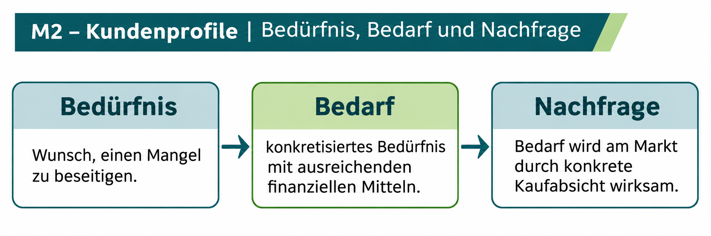

# Kundenprofile

| Profil | Ausgangssituation                                                     | Offene Fragen                |
|--------|-----------------------------------------------------------------------|------------------------------|
| A      | Preisbewusste Alltags- und Freizeitkundschaft; geringe Kapitalbindung | Budget, Menge, Einsatz       |
| B      | Sportorientierte Kundschaft; überzeugende Qualität und Beratung       | Ausstattung, Budget, Einsatz |
| C      | Sortimentserweiterung; unsichere Nachfrage                            | Zielgruppen, Menge, Risiko   |

Bedürfnis bezeichnet einen Wunsch oder empfundenen Mangel. Bedarf ist ein konkretisiertes, finanziell erfüllbares Bedürfnis; Nachfrage ist am Markt wirksamer Bedarf. B2B bezeichnet Geschäfte zwischen Unternehmen, B2C zwischen Unternehmen und privaten Endkunden.

| Bekannt | Vermutung | Offene Frage |
|---------|-----------|--------------|
|         |           |              |
|         |           |              |
|         |           |              |
|         |           |              |
|         |           |              |

Aufgabe: Analysieren Sie das zugeordnete Profil. Formulieren Sie Fragen, ohne Vermutungen als Tatsachen zu behandeln.

Kundenprofile und Kundenanforderungen

| Merkmal             | Beschreibung                                                     |
|---------------------|------------------------------------------------------------------|
| Material            | M2                                                               |
| Einsatz             | Phase 1 – Informieren / Analysieren                              |
| Materialart         | Betriebliche Kundeninformationen                                 |
| Unternehmensbereich | Verkauf und Marketing                                            |
| Informationsquelle  | Sebastian Wolf – Außendienst                                     |
| Lernziel            | Kundeninformationen analysieren und den Beratungsbedarf erkennen |

### M2.1 – Informationen aus dem Außendienst 

Darstellung als E-Mail:

Empfänger:in

Erste Kundenanfragen aus der Region Nordwest

Guten Tag liebes Verkaufsteam,

im Rahmen unserer Vertriebsaktivitäten in Ostfriesland habe ich erste Gespräche mit regionalen Fahrradhändlern geführt.

Dabei ist deutlich geworden, dass die Händler sehr unterschiedliche Anforderungen an unser Sortiment stellen. Während einige besonders auf den Einkaufspreis achten, legen andere großen Wert auf Qualität, Ausstattung oder die Bedürfnisse bestimmter Kundengruppen.

Ich habe die bisherigen Informationen in drei Kundenprofilen zusammengestellt.

Beachten Sie bitte, dass uns noch nicht alle Informationen vorliegen. Einige Kundenwünsche müssen erst im persönlichen Beratungsgespräch genauer ermittelt werden.

Eine gute Beratung beginnt nicht mit einer Produktempfehlung, sondern mit dem Verständnis der Kundenbedürfnisse.

Nutzen Sie die vorliegenden Informationen, um sich auf die Beratungsgespräche vorzubereiten.

Mit freundlichen Grüßen

Sebastian Wolf

Außendienst

Global Bike Deutschland GmbH

### M2.2 – Kundenprofile

Die folgenden Kundenprofile bilden unterschiedliche betriebliche Beratungssituationen ab. Sie stellen noch keine vollständige Bedarfsermittlung dar.

Kundenprofil A – Preisbewusster Fahrradhändler

Schwerpunkt: Wirtschaftlichkeit und Absatzmöglichkeiten

| Merkmal                 | Kundeninformation                                       |
|-------------------------|---------------------------------------------------------|
| Geschäftstätigkeit      | Regionaler Fahrradfachhandel                            |
| Kundschaft              | Überwiegend preisbewusste Freizeitfahrer                |
| Kaufinteresse           | Erweiterung des bestehenden Fahrradsortiments           |
| Besondere Anforderungen | Attraktive Einkaufspreise und gute Absatzmöglichkeiten  |
| Kaufmotiv               | Wirtschaftlichkeit                                      |
| Bedenken                | Zu hohe Einkaufskosten und schwer verkäufliche Produkte |
| Kaufbereitschaft        | Grundsätzlich vorhanden                                 |

Aussage des Kunden:

„Meine Kunden achten sehr auf den Preis. Ich möchte mein Sortiment erweitern, aber die Fahrräder müssen sich auch gut verkaufen lassen.“

Kundenprofil B – Qualitätsorientierter Fahrradhändler

Schwerpunkt: Qualität und Kundenzufriedenheit

| Merkmal                 | Kundeninformation                                              |
|-------------------------|----------------------------------------------------------------|
| Geschäftstätigkeit      | Fahrradfachhandel mit intensiver Kundenberatung                |
| Kundschaft              | Qualitätsbewusste und sportlich interessierte Fahrradfahrer    |
| Kaufinteresse           | Ergänzung des Sortiments durch hochwertige Fahrräder           |
| Besondere Anforderungen | Qualität, Ausstattung und Zuverlässigkeit                      |
| Kaufmotiv               | Qualität und Sicherheit                                        |
| Bedenken                | Produkte, die den Erwartungen der Kundschaft nicht entsprechen |
| Kaufbereitschaft        | Bei überzeugender Beratung vorhanden                           |

Aussage des Kunden:

„Meine Kunden sind bereit, für ein gutes Fahrrad mehr zu bezahlen. Dafür erwarten sie aber auch eine entsprechende Qualität.“

Kundenprofil C – Fahrradhändler mit Erweiterungsabsicht

Schwerpunkt: Sortimentserweiterung und neue Kundengruppen

| Merkmal                 | Kundeninformation                                    |
|-------------------------|------------------------------------------------------|
| Geschäftstätigkeit      | Regionaler Fahrradfachhandel                         |
| Kundschaft              | Unterschiedliche Alters- und Interessengruppen       |
| Kaufinteresse           | Erschließung zusätzlicher Kundengruppen              |
| Besondere Anforderungen | Sinnvolle Ergänzung des bisherigen Sortiments        |
| Kaufmotiv               | Wachstum und neue Absatzmöglichkeiten                |
| Bedenken                | Fehleinschätzung der Nachfrage und unverkaufte Waren |
| Kaufbereitschaft        | Noch unentschlossen                                  |

Aussage des Kunden:

„Ich möchte neue Kunden gewinnen. Allerdings weiß ich noch nicht genau, mit welchen Fahrrädern ich mein bisheriges Angebot sinnvoll erweitern kann.“

### M2.3 – Fachliche Grundlagen: Kundenbedürfnisse verstehen

Bedürfnis, Bedarf und Nachfrage

Im Verkauf ist es wichtig, zwischen einem Bedürfnis, einem Bedarf und einer Nachfrage zu unterscheiden.

| Fachbegriff | Erläuterung                                                                                                  |
|-------------|--------------------------------------------------------------------------------------------------------------|
| Bedürfnis   | Das Empfinden eines Mangels verbunden mit dem Wunsch, diesen zu beseitigen.                                  |
| Bedarf      | Ein konkretisiertes Bedürfnis, für dessen Befriedigung ausreichende finanzielle Mittel zur Verfügung stehen. |
| Nachfrage   | Bedarf, der am Markt durch eine konkrete Kaufabsicht wirksam wird.                                           |

Kundenanforderungen

Kundenanforderungen beschreiben, welche Eigenschaften oder Leistungen ein Kunde von einem Produkt oder Angebot erwartet.

Mögliche Kundenanforderungen sind:

- Preis

- Qualität

- Ausstattung

- Sicherheit

- Einsatzmöglichkeiten

- Lieferfähigkeit

- Serviceleistungen

- Wirtschaftlichkeit

Nicht alle Anforderungen sind für jeden Kunden gleich wichtig. Deshalb müssen sie im Beratungsgespräch individuell ermittelt werden.

Kaufmotive

Ein Kaufmotiv ist ein Beweggrund, der einen Kunden zu einer Kaufentscheidung veranlasst.

| Kaufmotiv          | Bedeutung                                            |
|--------------------|------------------------------------------------------|
| Wirtschaftlichkeit | Kosten sparen oder wirtschaftliche Vorteile erzielen |
| Sicherheit         | Risiken vermeiden und Vertrauen gewinnen             |
| Qualität           | Hochwertige und zuverlässige Produkte erhalten       |
| Komfort            | Eine möglichst angenehme Nutzung ermöglichen         |
| Leistung           | Besonders leistungsfähige Produkte erhalten          |
| Wachstum           | Neue Kunden und Absatzmöglichkeiten gewinnen         |
| Nachhaltigkeit     | Umweltbewusste Entscheidungen treffen                |
| Prestige           | Ansehen oder ein positives Image gewinnen            |

Ein Kunde kann gleichzeitig mehrere Kaufmotive haben. Welche Motive besonders wichtig sind, muss im Gespräch herausgefunden werden.

Geschäftskunden und Privatkunden

Die Kundenberatung der Global Bike Deutschland GmbH richtet sich in dieser Lernsituation an Geschäftskunden.

| Fachbegriff                | Bedeutung                                                              |
|----------------------------|------------------------------------------------------------------------|
| B2B – Business to Business | Geschäftsbeziehungen zwischen Unternehmen                              |
| B2C – Business to Consumer | Geschäftsbeziehungen zwischen Unternehmen und privaten Endverbrauchern |
| Geschäftskunde             | Kunde, der Waren oder Dienstleistungen für betriebliche Zwecke erwirbt |
| Endverbraucher             | Person, die ein Produkt für den eigenen privaten Bedarf erwirbt        |

Bei einer B2B-Beratung müssen sowohl die Anforderungen des Geschäftskunden als auch die Bedürfnisse seiner späteren Endverbraucher berücksichtigt werden.

Bekannte und unbekannte Kundenanforderungen

Vor einem Beratungsgespräch liegen häufig bereits erste Informationen über den Kunden vor. Diese reichen jedoch nicht immer aus, um eine geeignete Produktempfehlung auszusprechen.

Eine professionelle Beratung unterscheidet deshalb zwischen:

| Informationsart         | Bedeutung                                                     |
|-------------------------|---------------------------------------------------------------|
| Bekannte Anforderungen  | Anforderungen, die der Kunde bereits mitgeteilt hat           |
| Offene Anforderungen    | Informationen, die noch ermittelt werden müssen               |
| Vermutete Anforderungen | Annahmen über Kundenwünsche, die noch überprüft werden müssen |

Merksatz: Eine Vermutung über einen Kunden ist noch keine gesicherte Kundeninformation.

### M2.4 – Arbeitsblatt: Kundenprofil analysieren

Arbeitsauftrag: Analyse der drei Kundenprofile als Vorbereitung auf die späteren Beratungsgespräche.

Aufgabe 1 – Kundeninformationen vergleichen

| Analysekriterium            | Kunde A | Kunde B | Kunde C |
|-----------------------------|---------|---------|---------|
| Kundengruppe des Händlers   |         |         |         |
| Kaufinteresse               |         |         |         |
| Kundenanforderungen         |         |         |         |
| Kaufmotive                  |         |         |         |
| Bedenken                    |         |         |         |
| Kaufbereitschaft            |         |         |         |
| Noch fehlende Informationen |         |         |         |

Aufgabe 2 – Beratungsbedarf ermitteln

| Leitfrage                                                            | Arbeitsergebnis |
|----------------------------------------------------------------------|-----------------|
| Welche Informationen liegen bereits vor?                             |                 |
| Welche Informationen fehlen für eine Produktempfehlung?              |                 |
| Welche Kundenanforderungen müssen genauer untersucht werden?         |                 |
| Welche möglichen Zielkonflikte bestehen?                             |                 |
| Welche Risiken entstehen durch eine unzureichende Bedarfsermittlung? |                 |

Ein Zielkonflikt liegt vor, wenn zwei oder mehrere Ziele nicht gleichzeitig vollständig erreicht werden können.

Aufgabe 3 – Bedarfsermittlung vorbereiten

Für jedes Kundenprofil werden mindestens fünf geeignete Fragen entwickelt, mit denen die noch fehlenden Kundeninformationen ermittelt werden können.

| Nr. | Kunde A | Kunde B | Kunde C |
|-----|---------|---------|---------|
| 1   |         |         |         |
| 2   |         |         |         |
| 3   |         |         |         |
| 4   |         |         |         |
| 5   |         |         |         |

Aufgabe 4 – Schlussfolgerungen ziehen

Die Lernenden halten schriftlich fest, warum eine einheitliche Beratung für alle drei Kunden nicht sinnvoll ist, welche Bedeutung die individuellen Kundenanforderungen für die Produktauswahl haben, welche nformationen vor einer begründeten Produktempfehlung vorliegen müssen, warum Kundenbedürfnisse nicht einfach unterstellt werden dürfen. Zwischenergebnis: Eine ausgefüllte Kundenanalyse als Grundlage für die weitere Gesprächsvorbereitung.
