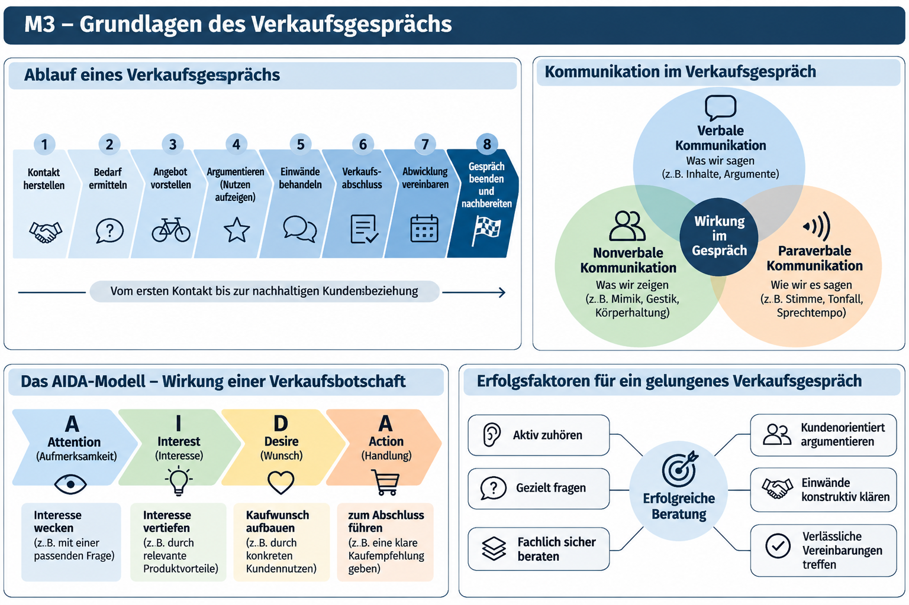

# Grundlagen des Verkaufsgesprächs

Kernfachtext \| Phase 1

| Gesprächsphase    | Zweck                                              |
|-------------------|----------------------------------------------------|
| Vorbereitung      | Informationen und Ziele klären                     |
| Eröffnung         | Kontakt herstellen und Anlass klären               |
| Bedarfsermittlung | Anforderungen erfragen und zusammenfassen          |
| Produktvergleich  | Passende Alternativen gegenüberstellen             |
| Argumentation     | Kundennutzen begründen                             |
| Einwandbehandlung | Bedenken verstehen und bearbeiten                  |
| Abschluss         | Kaufentscheidung oder nächsten Schritt vereinbaren |
| Nachbereitung     | Ergebnis dokumentieren und verbessern              |

Verbale Kommunikation umfasst Worte, nonverbale Kommunikation etwa Gestik und Mimik, paraverbale Kommunikation etwa Lautstärke und Sprechtempo. Kundenorientierung bedeutet, die Empfehlung am Bedarf auszurichten, nicht am bloßen Verkaufsinteresse.

Übung: Ordnen Sie die Gesprächsphasen und erläutern Sie, weshalb eine Empfehlung erst nach der Bedarfsermittlung sinnvoll ist.

Lernsituation: Kunden bedarfsgerecht beraten und Verkaufsgespräche erfolgreich führen

| Merkmal             | Beschreibung                                                                     |
|---------------------|----------------------------------------------------------------------------------|
| Material            | M3                                                                               |
| Einsatz             | Phase 1 – Informieren / Analysieren                                              |
| Materialart         | Fachtext mit Erarbeitungsaufträgen                                               |
| Unternehmensbereich | Verkauf und Marketing                                                            |
| Lernziel            | Aufbau, Ziele und Anforderungen eines professionellen Verkaufsgesprächs erklären |
| Voraussetzung       | Bearbeitung von M1 und M2                                                        |

### M3.1 – Fachtext: Das professionelle Verkaufsgespräch

### 1. Was ist ein Verkaufsgespräch?

Ein Verkaufsgespräch ist ein zielgerichtetes Gespräch zwischen einem Verkäufer und einem Kunden. Es dient dazu, die Wünsche und Anforderungen des Kunden zu ermitteln, geeignete Produkte anzubieten und eine Kaufentscheidung herbeizuführen.

Ein professionelles Verkaufsgespräch besteht nicht darin, einem Kunden möglichst schnell ein Produkt zu verkaufen. Vielmehr geht es darum, eine Lösung zu finden, die sowohl für den Kunden als auch für das Unternehmen sinnvoll ist.

Die Global Bike Deutschland GmbH möchte durch eine professionelle Beratung regionale Fahrradhändler als langfristige Geschäftspartner gewinnen.

### 2. Ziele eines Verkaufsgesprächs

Ziele aus Sicht des Unternehmens

- Produkte verkaufen und Umsatz erzielen

- Neue Kunden gewinnen

- Bestehende Kundenbeziehungen stärken

- Kundenzufriedenheit erreichen

- Vertrauen in das Unternehmen aufbauen

- Langfristige Absatzmöglichkeiten sichern

- Ziele aus Sicht des Kunden

- Informationen über Produkte erhalten

- Unterschiedliche Angebote vergleichen

- Eine passende Lösung finden

- Unsicherheiten und Risiken reduzieren

- Ein angemessenes Preis-Leistungs-Verhältnis erhalten

- Eine begründete Kaufentscheidung treffen

- Ein erfolgreiches Verkaufsgespräch berücksichtigt die Interessen beider Seiten.

- Eine Situation, in der beide Geschäftspartner einen Vorteil erzielen, wird als Win-win-Situation bezeichnet.

### 3. Kundenorientierung als Grundlage

Kundenorientierung bedeutet, das eigene Handeln an den Bedürfnissen, Erwartungen und Anforderungen des Kunden auszurichten.

Ein kundenorientierter Verkäufer:

- hört aufmerksam zu,

- stellt geeignete Fragen,

- nimmt Kundenwünsche ernst,

- informiert sachlich und verständlich,

- empfiehlt passende Produkte,

- geht auf Bedenken ein,

- vermeidet falsche Versprechungen,

- respektiert die Entscheidung des Kunden.

Kundenorientierung bedeutet nicht, jeden Kundenwunsch erfüllen zu müssen. Auch die wirtschaftlichen Interessen und betrieblichen Möglichkeiten des Unternehmens müssen berücksichtigt werden.

**Kundenzufriedenheit und Kundenbindung**

Kundenzufriedenheit entsteht, wenn die wahrgenommene Leistung den Erwartungen des Kunden entspricht oder diese übertrifft. Werden die Erwartungen nicht erfüllt, kann Unzufriedenheit entstehen. Zufriedene Kunden kaufen möglicherweise erneut bei einem Unternehmen oder empfehlen es weiter. Unter Kundenbindung versteht man Maßnahmen und Wirkungen, die dazu beitragen, dass Kunden einem Unternehmen langfristig verbunden bleiben. Gerade für die Global Bike Deutschland GmbH ist eine langfristige Zusammenarbeit mit regionalen Fahrradhändlern von besonderer Bedeutung.

### 4. Grundlagen der Kommunikation

Kommunikation ist der Austausch von Informationen zwischen Menschen. In einem Verkaufsgespräch werden nicht nur durch gesprochene Wörter Informationen vermittelt. Auch die Stimme, die Körperhaltung und der Gesichtsausdruck beeinflussen die Wirkung des Gesprächs.

**Verbale Kommunikation**

Die verbale Kommunikation umfasst die gesprochenen oder geschriebenen Wörter.

Dazu gehören:

- Fragen

- Erklärungen

- Antworten

- Verkaufsargumente

- Produktempfehlungen

- Zusammenfassungen

Eine verständliche Wortwahl und klare Formulierungen erleichtern dem Kunden die Informationsaufnahme.

**Nonverbale Kommunikation**

Die nonverbale Kommunikation umfasst Signale, die ohne Worte vermittelt werden.

Dazu gehören:

- Mimik – Gesichtsausdruck

- Gestik – Bewegungen der Hände und Arme

- Körperhaltung

- Blickkontakt

- Körperabstand

Eine zugewandte Körperhaltung kann beispielsweise Interesse und Aufmerksamkeit vermitteln. Einzelne Körpersignale dürfen jedoch nicht vorschnell als eindeutige Hinweise auf die Gefühle oder Absichten eines Kunden verstanden werden.

**Paraverbale Kommunikation**

Die paraverbale Kommunikation beschreibt, wie etwas gesprochen wird.

Dazu gehören:

- Lautstärke

- Sprechtempo

- Betonung

- Tonfall

- Sprechpausen

Eine ruhige und verständliche Sprechweise kann dazu beitragen, Vertrauen aufzubauen.

**Zusammenspiel der Kommunikationsformen**

Verbale, nonverbale und paraverbale Kommunikation wirken gemeinsam. Wenn Worte, Körpersprache und Stimme zueinander passen, spricht man von kongruenter Kommunikation. Passen diese Signale nicht zusammen, kann die Kommunikation widersprüchlich wirken. Dies wird als inkongruente Kommunikation bezeichnet.

### 5. Die Phasen eines Verkaufsgesprächs

Ein professionelles Verkaufsgespräch lässt sich in mehrere Phasen gliedern. Diese geben dem Gespräch eine Struktur und helfen dabei, wichtige Schritte nicht zu vergessen.

**Phase 1 – Gesprächsvorbereitung**

Bereits vor dem eigentlichen Gespräch bereitet sich der Verkäufer auf den Kunden vor.

Dazu gehören:

- vorhandene Kundeninformationen auswerten,

- Produktinformationen beschaffen,

- mögliche Kundenanforderungen berücksichtigen,

- Gesprächsziele festlegen,

- benötigte Unterlagen vorbereiten,

- mögliche Fragen und Einwände berücksichtigen.

Eine gute Vorbereitung ermöglicht eine sichere und fachlich fundierte Gesprächsführung.

**Phase 2 – Gesprächseröffnung**

Die Gesprächseröffnung dient dazu, den Kontakt zum Kunden herzustellen und eine angenehme Gesprächsatmosphäre zu schaffen.

Typische Bestandteile sind:

- freundliche Begrüßung,

- gegebenenfalls persönliche Vorstellung,

- Aufnahme des Gesprächsanlasses,

- Überleitung zur Bedarfsermittlung.

Der erste Eindruck kann den weiteren Gesprächsverlauf beeinflussen.

**Phase 3 – Bedarfsermittlung**

In dieser Phase versucht der Verkäufer herauszufinden, was der Kunde tatsächlich benötigt.

Dabei werden beispielsweise folgende Informationen ermittelt:

- Wünsche und Erwartungen

- Verwendungszweck der Produkte

- Anforderungen an Qualität und Ausstattung

- finanzielle Möglichkeiten

- gewünschte Mengen

- bisherige Erfahrungen

- besondere Bedenken

Bei Geschäftskunden spielen zusätzlich die Bedürfnisse ihrer eigenen Kundschaft, die Absatzmöglichkeiten und die Wirtschaftlichkeit eine wichtige Rolle. Eine sorgfältige Bedarfsermittlung ist die Grundlage für eine passende Produktempfehlung.

**Phase 4 – Produktpräsentation und Produktvergleich**

Auf Grundlage des ermittelten Bedarfs werden geeignete Produkte ausgewählt, vorgestellt und miteinander verglichen.

Eine Produktpräsentation ist die gezielte Vorstellung eines Produkts und seiner relevanten Eigenschaften.

Ein Produktvergleich ist die Gegenüberstellung mehrerer Produkte anhand festgelegter Kriterien.

Dabei können beispielsweise folgende Kriterien berücksichtigt werden:

- Preis

- Qualität

- Ausstattung

- Einsatzmöglichkeiten

- Kundennutzen

- Wirtschaftlichkeit

Die Produktauswahl muss sich an den zuvor ermittelten Kundenanforderungen orientieren.

**Phase 5 – Verkaufsargumentation**

In dieser Phase erläutert der Verkäufer, warum ein bestimmtes Produkt für den Kunden geeignet sein könnte. Ein Verkaufsargument ist eine nachvollziehbare Begründung, die für den Kauf eines Produkts spricht. Dabei reicht es nicht aus, lediglich Produkteigenschaften aufzuzählen. Entscheidend ist, welchen konkreten Nutzen diese Eigenschaften für den Kunden haben. Die Verbindung zwischen Produkteigenschaften und individuellen Kundenanforderungen wird als Nutzenargumentation bezeichnet.

**Phase 6 – Einwandbehandlung**

Nicht jeder Kunde ist sofort von einem Angebot überzeugt. Ein Einwand ist ein geäußertes Bedenken oder ein Gegenargument des Kunden.

Einwände können sich beispielsweise beziehen auf:

- den Preis,

- die Qualität,

- die Ausstattung,

- die Lieferbedingungen,

- die Absatzmöglichkeiten,

- das wirtschaftliche Risiko.

Einwände sind nicht automatisch eine Ablehnung des Angebots. Sie können auch zeigen, dass der Kunde weitere Informationen benötigt. Eine professionelle Einwandbehandlung besteht darin, Bedenken ernst zu nehmen, ihre Ursachen zu klären und sachlich darauf einzugehen.

**Phase 7 – Verkaufsabschluss**

Der Verkaufsabschluss ist die Phase, in der eine konkrete Kaufentscheidung angestrebt wird. Der Verkäufer fasst gegebenenfalls die wichtigsten Gesprächsergebnisse zusammen und klärt, ob der Kunde das Angebot annehmen möchte. Bei Geschäftskunden können dabei insbesondere folgende Punkte eine Rolle spielen:

- ausgewählte Produkte,

- Bestellmengen,

- vereinbarte Preise,

- Lieferbedingungen,

- weitere Vereinbarungen.

Ein erfolgreicher Verkaufsabschluss setzt eine freiwillige und informierte Kaufentscheidung voraus. Ein Verkauf darf nicht durch Täuschung, unzulässigen Druck oder falsche Versprechungen herbeigeführt werden. Entscheidet sich ein Kunde gegen einen Kauf, wird diese Entscheidung respektiert.

**Phase 8 – Gesprächsnachbereitung**

Auch nach dem eigentlichen Gespräch können weitere Aufgaben erforderlich sein.

Dazu gehören:

- Gesprächsergebnisse dokumentieren,

- getroffene Vereinbarungen festhalten,

- offene Fragen klären,

- Informationen an zuständige Unternehmensbereiche weitergeben,

- weitere Kundenkontakte vorbereiten,

- das eigene Gesprächsverhalten auswerten.

Bei Global Bike werden notwendige Informationen beispielsweise an die Auftragsbearbeitung oder die Absatzlogistik weitergegeben.

### 6. Verkaufsgespräche verlaufen nicht immer geradlinig

Die Phasen eines Verkaufsgesprächs dienen der Orientierung. In der Praxis müssen sie nicht immer in einer festen Reihenfolge durchlaufen werden. Ein Kundeneinwand kann beispielsweise dazu führen, dass weitere Informationen über den Bedarf eingeholt oder andere Produkte verglichen werden müssen. Ein professioneller Verkäufer reagiert flexibel auf den Gesprächsverlauf, ohne das Gesprächsziel aus den Augen zu verlieren.

### 7. Professionelles Verhalten im Verkauf

Ein professionelles Verkaufsgespräch zeichnet sich durch folgende Eigenschaften aus:

- Freundlichkeit

- Fachkompetenz

- Zuverlässigkeit

- Ehrlichkeit

- Verständlichkeit

- Aufmerksamkeit

- Geduld

- Respekt

- Einfühlungsvermögen

Empathie bezeichnet die Fähigkeit, sich in die Situation und Perspektive eines anderen Menschen hineinzuversetzen. Empathie hilft dabei, Kundenwünsche und Bedenken besser zu verstehen.

### 8. Feedback und Verbesserung

Feedback ist eine Rückmeldung zu beobachtetem Verhalten oder einer erbrachten Leistung.

Durch Feedback können Stärken erkannt und Verbesserungsmöglichkeiten festgestellt werden.

Konstruktives Feedback ist:

- konkret,

- sachlich,

- nachvollziehbar,

- wertschätzend,

- auf beobachtbares Verhalten bezogen.

Die Selbstreflexion ergänzt das Feedback. Dabei wird das eigene Verhalten bewusst betrachtet und hinsichtlich möglicher Verbesserungen untersucht. Beides trägt dazu bei, die Qualität zukünftiger Beratungsgespräche zu verbessern.

**Zusammenfassung**

Ein professionelles Verkaufsgespräch verbindet Fachwissen, Kommunikationsfähigkeit und Kundenorientierung.

Sein Ziel besteht darin, auf Grundlage einer sorgfältigen Bedarfsermittlung eine passende Produktempfehlung zu entwickeln, Kundenfragen und Einwände zu bearbeiten und eine begründete Kaufentscheidung zu ermöglichen.

Langfristige Kundenzufriedenheit ist dabei wichtiger als ein kurzfristig erzwungener Verkauf.

### M3.2 – Schaubild: Ablauf eines Verkaufsgesprächs

Das folgende Ablaufschema kann als eigenständige Moodle-Textseite oder als Lernübersicht bereitgestellt werden.

| Phase                                        | Zentrale Fragestellung                                             |
|----------------------------------------------|--------------------------------------------------------------------|
| 1\. Gesprächsvorbereitung                    | Welche Informationen werden benötigt?                              |
| ↓                                            |                                                                    |
| 2\. Gesprächseröffnung                       | Wie wird ein positiver Kundenkontakt hergestellt?                  |
| ↓                                            |                                                                    |
| 3\. Bedarfsermittlung                        | Was benötigt der Kunde tatsächlich?                                |
| ↓                                            |                                                                    |
| 4\. Produktpräsentation und Produktvergleich | Welche Produkte passen zum Kundenbedarf?                           |
| ↓                                            |                                                                    |
| 5\. Verkaufsargumentation                    | Welchen konkreten Nutzen bieten die Produkte?                      |
| ↓                                            |                                                                    |
| 6\. Einwandbehandlung                        | Welche Bedenken bestehen und wie können diese geklärt werden?      |
| ↓                                            |                                                                    |
| 7\. Verkaufsabschluss                        | Welche Kaufentscheidung trifft der Kunde?                          |
| ↓                                            |                                                                    |
| 8\. Gesprächsnachbereitung                   | Welche Vereinbarungen und Verbesserungsmöglichkeiten ergeben sich? |

Übergreifende Grundlagen: Kundenorientierung, Kommunikation, Fachwissen und professionelles Verhalten.

Hinweis: Rücksprünge zwischen den Gesprächsphasen sind möglich.

### M3.3 – Arbeitsblatt: Verkaufsgespräche verstehen

Aufgabe 1 – Ziele eines Verkaufsgesprächs

Die Lernenden arbeiten die unterschiedlichen Interessen der Geschäftspartner heraus.

| Ziele von Global Bike | Ziele des Fahrradhändlers | Gemeinsame Interessen |
|-----------------------|---------------------------|-----------------------|

Anschließend wird erläutert, unter welchen Voraussetzungen eine Win-win-Situation entstehen kann.

Aufgabe 2 – Kommunikationsformen unterscheiden

Die folgenden Verhaltensweisen werden den Kommunikationsformen zugeordnet.

| Beobachtetes Verhalten                                | Verbal | Nonverbal | Paraverbal |
|-------------------------------------------------------|--------|-----------|------------|
| Der Verkäufer stellt eine Frage.                      |        |           |            |
| Der Verkäufer spricht sehr leise.                     |        |           |            |
| Der Verkäufer verschränkt die Arme.                   |        |           |            |
| Der Verkäufer erläutert eine Produkteigenschaft.      |        |           |            |
| Der Verkäufer verändert sein Sprechtempo.             |        |           |            |
| Der Verkäufer lächelt.                                |        |           |            |
| Der Verkäufer fasst die Kundenwünsche zusammen.       |        |           |            |
| Der Verkäufer betont einzelne Wörter besonders stark. |        |           |            |
| Der Verkäufer hält Blickkontakt.                      |        |           |            |

Zusätzlich wird untersucht, welche Wirkung die jeweiligen Verhaltensweisen auf einen Kunden haben können.

Aufgabe 3 – Gesprächsphasen erschließen

| Gesprächsphase                           | Ziel der Phase | Typische Tätigkeiten des Verkäufers | Mögliche Folgen bei Vernachlässigung |
|------------------------------------------|----------------|-------------------------------------|--------------------------------------|
| Gesprächsvorbereitung                    |                |                                     |                                      |
| Gesprächseröffnung                       |                |                                     |                                      |
| Bedarfsermittlung                        |                |                                     |                                      |
| Produktpräsentation und Produktvergleich |                |                                     |                                      |
| Verkaufsargumentation                    |                |                                     |                                      |
| Einwandbehandlung                        |                |                                     |                                      |
| Verkaufsabschluss                        |                |                                     |                                      |
| Gesprächsnachbereitung                   |                |                                     |                                      |

Aufgabe 4 – Fehlerhafte Beratung analysieren

Betrieblicher Kurzfall: Ein misslungenes Beratungsgespräch

Ein Mitarbeiter des Verkaufsteams der Global Bike Deutschland GmbH führt ein Gespräch mit einem regionalen Fahrradhändler.

Direkt nach der Begrüßung beginnt der Mitarbeiter, verschiedene Fahrräder vorzustellen. Er erläutert zahlreiche technische Eigenschaften, ohne nach dem bisherigen Sortiment oder den Anforderungen des Händlers zu fragen. Der Händler äußert Bedenken hinsichtlich des Preises. Der Mitarbeiter antwortet, dass hochwertige Fahrräder nun einmal teuer seien. Anschließend versucht er, den Händler zu einer sofortigen Bestellung zu bewegen. Der Händler beendet das Gespräch, ohne eine Bestellung aufzugeben.

Analysevorlage

| Untersuchungsaspekt                                                       | Arbeitsergebnis |
|---------------------------------------------------------------------------|-----------------|
| Welche Gesprächsphasen wurden berücksichtigt?                             |                 |
| Welche Gesprächsphasen wurden ausgelassen oder unzureichend durchgeführt? |                 |
| Welche Fehler sind bei der Kommunikation erkennbar?                       |                 |
| Welche Kundeninformationen fehlen?                                        |                 |
| Welche Folgen kann das Gespräch für Global Bike haben?                    |                 |
| Welche Verbesserungsmöglichkeiten bestehen?                               |                 |

Aufgabe 5 – Eigene Qualitätskriterien entwickeln

Die Lernenden entwickeln auf Grundlage des Fachtextes mindestens acht Kriterien für ein professionelles Beratungsgespräch.

| Nr. | Qualitätskriterium | Begründung |
|-----|--------------------|------------|
| 1   |                    |            |
| 2   |                    |            |
| 3   |                    |            |
| 4   |                    |            |
| 5   |                    |            |
| 6   |                    |            |
| 7   |                    |            |
| 8   |                    |            |

Zwischenergebnis: Eine individuelle Übersicht über die Gesprächsphasen und die Qualitätsmerkmale professioneller Kundenberatung. Diese Übersicht wird später bei der Bearbeitung des gewählten Lernpakets verwendet.
