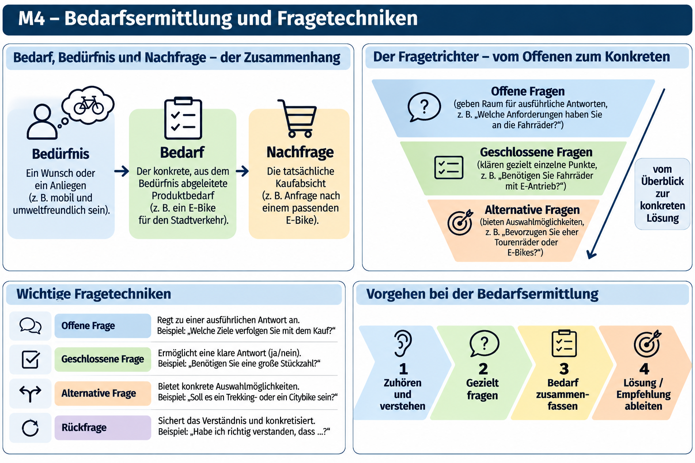

# Bedarfsermittlung und Fragetechniken

| Fragetechnik  | Beispiel                                                      |
|---------------|---------------------------------------------------------------|
| Offen         | Welche Kundengruppen möchten Sie erreichen?                   |
| Geschlossen   | Ist Schwarz zwingend erforderlich?                            |
| Alternativ    | Liegt der Schwerpunkt auf Alltag oder Touren?                 |
| Vertiefend    | Was verstehen Sie unter sportlicher Nutzung?                  |
| Bestätigend   | Habe ich richtig verstanden, dass das Budget verbindlich ist? |
| Suggestiv     | Sie möchten doch sicher das teurere Modell? – vermeiden       |
| Mehrfachfrage | Mehrere Fragen gleichzeitig – möglichst vermeiden             |

Aktives Zuhören bedeutet aufmerksam zuhören, nachfragen, paraphrasieren und Verständnis prüfen. Der Fragetrichter führt von offenen zu konkreten Fragen. Explizite Anforderungen werden ausgesprochen; implizite Anforderungen müssen durch Rückfragen geklärt werden. Muss-Anforderungen sind zwingend, Soll-Anforderungen erwünscht, Kann-Anforderungen optional.

| Kundenanforderung | Muss/Soll/Kann | Bekannt/offen | Rückfrage |
|-------------------|----------------|---------------|-----------|
|                   |                |               |           |
|                   |                |               |           |
|                   |                |               |           |
|                   |                |               |           |
|                   |                |               |           |
|                   |                |               |           |

Übung: Formulieren Sie je zwei offene und vertiefende Fragen. Erproben Sie eine Zusammenfassung des Kundenbedarfs im Partnergespräch.

### 1. Die Bedeutung der Bedarfsermittlung

Eine erfolgreiche Kundenberatung beginnt mit dem Verstehen des Kunden und nicht mit der Vorstellung eines Produkts.

Unter Bedarfsermittlung versteht man das systematische Erfassen der Wünsche, Bedürfnisse, Anforderungen und finanziellen Möglichkeiten eines Kunden.

Ziel der Bedarfsermittlung ist es, ausreichend Informationen zu erhalten, um eine passende Produktempfehlung aussprechen zu können.

Bei der Global Bike Deutschland GmbH ist die Bedarfsermittlung besonders wichtig. Die regionalen Fahrradhändler haben unterschiedliche Kundengruppen, Sortimente und wirtschaftliche Ziele.

Ein Fahrrad, das für einen Händler besonders geeignet ist, muss deshalb nicht automatisch auch für einen anderen Händler geeignet sein.

### Folgen einer unzureichenden Bedarfsermittlung

- Unpassende Produktempfehlungen

- Missverständnisse

- Unzufriedene Kunden

- Kaufabbrüche

- Wirtschaftliche Nachteile

- Verlust von Kundenvertrauen

Eine sorgfältige Bedarfsermittlung schafft dagegen die Grundlage für eine langfristige Kundenbeziehung.

### 2. Welche Informationen müssen ermittelt werden?

Bei der Beratung eines Geschäftskunden sind verschiedene Informationsbereiche zu berücksichtigen.

| Informationsbereich  | Zu klärende Inhalte                            |
|----------------------|------------------------------------------------|
| Ausgangssituation    | Bisheriges Sortiment und bisherige Erfahrungen |
| Kaufanlass           | Grund für den geplanten Einkauf                |
| Zielgruppe           | Kundschaft des Fahrradhändlers                 |
| Verwendungszweck     | Geplante Einsatzbereiche der Fahrräder         |
| Produktanforderungen | Qualität, Ausstattung und Eigenschaften        |
| Budget               | Verfügbare finanzielle Mittel                  |
| Bestellmenge         | Anzahl der benötigten Produkte                 |
| Kaufmotive           | Beweggründe für die Kaufentscheidung           |
| Lieferanforderungen  | Gewünschter Lieferzeitpunkt                    |
| Bedenken             | Unsicherheiten und wahrgenommene Risiken       |
| Prioritäten          | Besonders wichtige Kundenanforderungen         |

Das Budget bezeichnet den finanziellen Rahmen, der für einen bestimmten Zweck zur Verfügung steht.

Eine Priorität beschreibt die besondere Wichtigkeit einer Anforderung oder eines Ziels.

Nicht jede Information muss in jedem Beratungsgespräch gleich ausführlich ermittelt werden. Entscheidend ist, welche Informationen für die jeweilige Kaufentscheidung benötigt werden.

### 3. Ausgesprochene und unausgesprochene Kundenbedürfnisse

Kunden teilen nicht immer alle Wünsche und Anforderungen unmittelbar mit.

### Explizite Bedürfnisse

Explizite Bedürfnisse werden vom Kunden ausdrücklich genannt.

Beispiel:

„Für die Erweiterung meines Sortiments steht mir nur ein begrenztes Budget zur Verfügung.“

### Implizite Bedürfnisse

Implizite Bedürfnisse werden nicht ausdrücklich genannt. Sie müssen durch gezielte Fragen erschlossen werden.

Ein Fahrradhändler könnte beispielsweise besonderen Wert auf eine zuverlässige Lieferung legen, ohne dies zu Beginn des Gesprächs zu erwähnen.

Solche Bedürfnisse dürfen nicht einfach unterstellt werden. Sie müssen im Gespräch überprüft werden.

### 4. Muss-, Soll- und Kann-Anforderungen

Kundenanforderungen können unterschiedlich wichtig sein.

| Anforderungsart  | Bedeutung                                             |
|------------------|-------------------------------------------------------|
| Muss-Anforderung | Muss zwingend erfüllt werden.                         |
| Soll-Anforderung | Sollte möglichst erfüllt werden.                      |
| Kann-Anforderung | Ist wünschenswert, aber nicht unbedingt erforderlich. |

Eine solche Einteilung hilft dabei, verschiedene Produkte zu vergleichen und begründete Entscheidungen zu treffen.

Welche Anforderungen zu welcher Kategorie gehören, entscheidet der Kunde.

### 5. Fragetechniken

Eine Fragetechnik ist die gezielte Verwendung bestimmter Frageformen, um Informationen zu erhalten oder ein Gespräch sinnvoll zu strukturieren.

Professionelle Verkäufer verwenden unterschiedliche Fragearten.

### 5.1 Offene Fragen

Offene Fragen ermöglichen ausführliche Antworten. Sie können normalerweise nicht nur mit „Ja“ oder „Nein“ beantwortet werden.

Sie beginnen häufig mit Fragewörtern wie:

- Was?

- Wie?

- Welche?

- Warum?

- Wofür?

Beispiel:

„Welche Anforderungen stellen Ihre Kunden an ein Fahrrad?“

Einsatzmöglichkeiten:

- Gespräch eröffnen

- Kundenbedürfnisse kennenlernen

- Informationen sammeln

- Kaufmotive ermitteln

Offene Fragen eignen sich besonders für den Beginn der Bedarfsermittlung.

### 5.2 Geschlossene Fragen

Geschlossene Fragen ermöglichen kurze und eindeutige Antworten.

Beispiel:

„Ist Ihnen ein niedriger Einkaufspreis besonders wichtig?“

Einsatzmöglichkeiten:

- Informationen überprüfen

- Sachverhalte bestätigen

- Entscheidungen konkretisieren

- Missverständnisse vermeiden

Werden ausschließlich geschlossene Fragen gestellt, kann ein Gespräch schnell wie ein Verhör wirken.

### 5.3 Alternativfragen

Alternativfragen bieten dem Kunden mehrere Antwortmöglichkeiten an.

Beispiel:

„Möchten Sie zunächst Ihr Mountainbike-Sortiment oder Ihr Rennrad-Sortiment erweitern?“

Einsatzmöglichkeiten:

- Auswahlmöglichkeiten eingrenzen

- Entscheidungen erleichtern

- Kundenwünsche konkretisieren

Die angebotenen Alternativen müssen tatsächlich zur Verfügung stehen. Weitere Möglichkeiten dürfen nicht bewusst verschwiegen werden.

### 5.4 Rückfragen

Rückfragen dienen dazu, Aussagen genauer zu verstehen.

Beispiel:

Kunde: „Das Fahrrad erscheint mir zu teuer.“

Verkäufer: „Womit vergleichen Sie den Preis?“

Einsatzmöglichkeiten:

- Unklare Aussagen konkretisieren

- Missverständnisse vermeiden

- Ursachen von Bedenken ermitteln

- Zusätzliche Informationen gewinnen

### 5.5 Bestätigungsfragen

Bestätigungsfragen überprüfen, ob Informationen richtig verstanden wurden.

Beispiel:

„Habe ich Sie richtig verstanden, dass Sie vor allem Ihr Angebot für sportlich orientierte Kunden erweitern möchten?“

Bestätigungsfragen helfen dabei, ein gemeinsames Verständnis herzustellen. Sie sind häufig zugleich geschlossene Fragen.

### 5.6 Suggestivfragen

Suggestivfragen enthalten bereits eine erwartete oder gewünschte Antwort.

Beispiel:

„Sie möchten Ihren Kunden doch sicherlich nur besonders hochwertige Fahrräder anbieten, oder?“

Suggestivfragen können den Kunden beeinflussen und seine Entscheidungsfreiheit einschränken.

Für eine ergebnisoffene Bedarfsermittlung sind neutrale Fragen deshalb besser geeignet.

### 5.7 Mehrfachfragen

Mehrfachfragen enthalten mehrere Fragen gleichzeitig.

Beispiel:

„Welche Fahrräder benötigen Sie, wie hoch ist Ihr Budget und wann möchten Sie die Lieferung erhalten?“

Mehrfachfragen können den Kunden überfordern. Häufig wird nur ein Teil der Fragen beantwortet.

Eine klare Gesprächsführung verwendet möglichst einzelne, verständliche Fragen.

### 6. Übersicht der Fragetechniken

| Frageart           | Funktion                                    | Typischer Einsatz                         |
|--------------------|---------------------------------------------|-------------------------------------------|
| Offene Frage       | Informationen gewinnen                      | Gesprächsbeginn                           |
| Geschlossene Frage | Informationen konkretisieren                | Überprüfung                               |
| Alternativfrage    | Auswahl eingrenzen                          | Entscheidungsfindung                      |
| Rückfrage          | Aussagen genauer verstehen                  | Klärung                                   |
| Bestätigungsfrage  | Verständnis überprüfen                      | Zusammenfassung                           |
| Suggestivfrage     | Antwort beeinflussen                        | Bei neutraler Bedarfsermittlung vermeiden |
| Mehrfachfrage      | Mehrere Informationen gleichzeitig erfragen | Möglichst vermeiden                       |

### 7. Der Fragetrichter

Der Fragetrichter ist eine Methode, bei der ein Gespräch von allgemeinen Fragen schrittweise zu konkreten Fragen geführt wird.

### Stufe 1 – Allgemeine Informationen gewinnen

Zu Beginn werden offene Fragen gestellt, um die Situation des Kunden kennenzulernen.

### Stufe 2 – Informationen vertiefen

Durch gezielte Fragen und Rückfragen werden einzelne Anforderungen genauer untersucht.

### Stufe 3 – Anforderungen konkretisieren

Geschlossene Fragen und Alternativfragen helfen dabei, die Auswahl einzugrenzen.

### Stufe 4 – Ergebnisse absichern

Die ermittelten Anforderungen werden zusammengefasst und vom Kunden bestätigt oder korrigiert.

Der Fragetrichter verhindert, dass zu früh eine Produktempfehlung ausgesprochen wird.

Er ist eine Orientierungshilfe und kein starrer Gesprächsablauf.

### 8. Aktives Zuhören

Fragen allein reichen für eine erfolgreiche Bedarfsermittlung nicht aus.

Der Verkäufer muss die Antworten aufmerksam aufnehmen und verstehen.

Aktives Zuhören bedeutet, dem Gesprächspartner bewusst Aufmerksamkeit zu schenken, seine Aussagen zu verstehen und das eigene Verständnis durch geeignete Rückmeldungen zu überprüfen.

### Merkmale des aktiven Zuhörens

\- Den Gesprächspartner ausreden lassen

\- Aufmerksamkeit zeigen

\- Unnötige Ablenkungen vermeiden

\- Aussagen nicht vorschnell bewerten

\- Verständnisfragen stellen

\- Wichtige Informationen aufgreifen

\- Aussagen zusammenfassen

\- Bedenken ernst nehmen

Aktives Zuhören bedeutet nicht, jeder Aussage zustimmen zu müssen.

### 9. Techniken des aktiven Zuhörens

### 9.1 Aufmerksamkeit signalisieren

Durch eine zugewandte Körperhaltung und angemessene kurze Rückmeldungen wird Interesse am Gespräch gezeigt.

### 9.2 Paraphrasieren

Paraphrasieren bedeutet, eine Aussage des Gesprächspartners mit eigenen Worten wiederzugeben.

Beispiel:

Kunde: „Ich möchte nicht zu viele Fahrräder einkaufen, weil ich noch nicht weiß, wie sich die Nachfrage entwickelt.“

Verkäufer: „Sie möchten zunächst Ihr wirtschaftliches Risiko begrenzen.“

Dadurch kann der Kunde bestätigen oder korrigieren, ob seine Aussage richtig verstanden wurde.

### 9.3 Nachfragen

Unklare Aussagen werden durch gezielte Fragen genauer untersucht.

Dadurch können fehlende Informationen ergänzt werden.

### 9.4 Gefühle und Bedenken aufgreifen

Der Verkäufer nimmt wahr, dass ein Kunde möglicherweise unsicher ist, und spricht dies vorsichtig an.

Beispiel:

„Habe ich den Eindruck richtig verstanden, dass Sie wegen der Absatzmöglichkeiten noch unsicher sind?“

Gefühle dürfen nicht als gesicherte Tatsachen unterstellt werden.

### 9.5 Zusammenfassen

Mehrere Informationen werden am Ende eines Gesprächsabschnitts gebündelt wiedergegeben.

Eine Zusammenfassung schafft Klarheit und ermöglicht es dem Kunden, fehlende oder falsch verstandene Informationen zu ergänzen.

### 10. Beobachtung, Vermutung und gesicherte Information

Bei der Bedarfsermittlung muss zwischen verschiedenen Arten von Informationen unterschieden werden.

| Informationsart        | Bedeutung                                                         |
|------------------------|-------------------------------------------------------------------|
| Beobachtung            | Wahrnehmbares Verhalten oder eine konkrete Aussage                |
| Vermutung              | Noch nicht überprüfte Annahme                                     |
| Gesicherte Information | Durch verlässliche Angaben oder Rückfragen bestätigte Information |

Ein Verkäufer darf aus dem Verhalten eines Kunden nicht vorschnell auf dessen Kaufmotive oder finanzielle Möglichkeiten schließen.

### 11. Typische Fehler bei der Bedarfsermittlung

\- Zu früh Produkte empfehlen

\- Den Kunden unterbrechen

\- Ausschließlich geschlossene Fragen stellen

\- Kundenantworten ignorieren

\- Mehrere Fragen gleichzeitig stellen

\- Kundenwünsche unterstellen

\- Fachbegriffe verwenden, die der Kunde nicht versteht

\- Eigene Interessen in den Vordergrund stellen

\- Informationen nicht überprüfen

\- Wichtige Anforderungen nicht dokumentieren

Solche Fehler können die Qualität der Beratung erheblich beeinträchtigen.

### 12. Dokumentation des Kundenbedarfs

Die ermittelten Informationen sollten übersichtlich festgehalten werden.

Eine Bedarfsanalyse ist die strukturierte Auswertung der ermittelten Kundenanforderungen.

Sie bildet die Grundlage für den anschließenden Produktvergleich.

Eine vollständige Bedarfsanalyse enthält insbesondere:

\- Kaufanlass

\- Zielgruppe

\- Produktanforderungen

\- Budget

\- Bestellmenge

\- Kaufmotive

\- Prioritäten

\- Bedenken

\- Offene Fragen

Nicht geklärte Informationen werden als offen gekennzeichnet.

Bei Global Bike dürfen Preise, Liefermöglichkeiten und Produkteigenschaften nicht ohne eine verlässliche Informationsgrundlage zugesichert werden.

### Zusammenfassung

Eine professionelle Bedarfsermittlung verbindet geeignete Fragetechniken mit aktivem Zuhören.

Offene Fragen ermöglichen einen breiten Gesprächseinstieg. Gezielte Rückfragen vertiefen die Informationen. Geschlossene Fragen und Bestätigungsfragen helfen dabei, die Ergebnisse abzusichern.

Erst wenn die entscheidungsrelevanten Kundenanforderungen ausreichend bekannt sind, kann eine begründete Produktempfehlung ausgesprochen werden.

Merksatz: Erst verstehen, dann beraten, anschließend verkaufen.

### M4.2 – Erarbeitungsaufträge

Ordnen Sie folgende Fragen einer Frageart zu und begründen Sie die Wirkung: Welche Kundschaft möchten Sie erreichen? Ist der Preis entscheidend? Möchten Sie zunächst Citybikes oder Touringbikes vergleichen? Womit vergleichen Sie den Preis? Habe ich Sie richtig verstanden? Sie wollen doch sicher das beste Modell? Welche Menge, Farbe und Lieferfrist wünschen Sie?

Formulieren Sie die Suggestivfrage neutral und zerlegen Sie die Mehrfachfrage. Entwickeln Sie für jedes Kundenprofil einen Fragetrichter mit vier Stufen. Unterscheiden Sie beobachtete Aussagen, Vermutungen und bestätigte Informationen.

### M4.3 – Freiwilliges Gesprächstraining

Eine Person spielt den Händler, die andere ermittelt den Bedarf. Wechseln Sie nach fünf Minuten. Geben Sie eine Aussage mit eigenen Worten wieder und lassen Sie die Zusammenfassung bestätigen. Notieren Sie eine gelungene Frage und eine Verbesserung.

### M4.4 – Kundenbedarfsprofil

| Bereich                 | Vorläufige Information | Bestätigte Information / offene Frage |
|-------------------------|------------------------|---------------------------------------|
| Kaufanlass              |                        |                                       |
| Zielgruppe              |                        |                                       |
| Einsatzbereich          |                        |                                       |
| Budget                  |                        |                                       |
| Bestellmenge            |                        |                                       |
| Muss-Anforderungen      |                        |                                       |
| Soll-Anforderungen      |                        |                                       |
| Kann-Anforderungen      |                        |                                       |
| Kaufmotive und Bedenken |                        |                                       |
| Lieferanforderungen     |                        |                                       |

## M4 – Ausführliche Erarbeitungs- und Vertiefungsaufträge

Aufgabe 1: Ordnen Sie die folgenden Fragen einer Frageart zu und erläutern Sie jeweils die Wirkung: Welche Kundschaft möchten Sie erreichen? Ist Schwarz zwingend? Möchten Sie Touren- oder Cityräder? Womit vergleichen Sie den Preis? Habe ich Sie richtig verstanden, dass die Menge flexibel ist? Sie wollen doch bestimmt das teurere Modell? Welche Räder, welche Menge und welchen Liefertermin wünschen Sie?

Aufgabe 2: Formulieren Sie die letzten beiden Fragen neutral und einzeln. Begründen Sie, warum die neuen Formulierungen eine ergebnisoffene Bedarfsermittlung erleichtern.

Aufgabe 3: Entwickeln Sie für jedes öffentliche Kundenprofil einen Fragetrichter mit mindestens zwei offenen Fragen, zwei vertiefenden Rückfragen, einer geschlossenen Frage und einer Bestätigungsfrage.

Aufgabe 4: Ein Händler sagt: „Ich weiß noch nicht, ob meine Kunden diese Räder kaufen.“ Formulieren Sie eine Paraphrase, eine Rückfrage und eine Zusammenfassung. Unterscheiden Sie die beobachtbare Aussage von Ihrer Vermutung über das Kaufmotiv.

Aufgabe 5: Üben Sie zu zweit. Eine Person übernimmt die Händlerrolle, die andere ermittelt den Bedarf. Nach fünf Minuten werden die Rollen gewechselt. Die Händlerrolle gibt nur Informationen preis, nach denen gefragt wird. Besprechen Sie anschließend, welche Fragen besonders hilfreich waren und welche Informationen noch fehlen.

Aufgabe 6: Erstellen Sie ein vorläufiges Bedarfsprofil. Kennzeichnen Sie jede Angabe als bekannt, vermutet oder offen. Ergänzen Sie das Profil erst nach dem tatsächlichen Beratungsgespräch um bestätigte Angaben.

## M4 – Arbeitsvorlage Fragetrichter

| Stufe           | Frage | Erwarteter Informationsgewinn | Tatsächliche Antwort |
|-----------------|-------|-------------------------------|----------------------|
| Allgemein 1     |       |                               |                      |
| Allgemein 2     |       |                               |                      |
| Vertiefung 1    |       |                               |                      |
| Vertiefung 2    |       |                               |                      |
| Konkretisierung |       |                               |                      |
| Absicherung     |       |                               |                      |

## M4 – Kundenbedarfsprofil (vorläufig und bestätigt)

| Informationsbereich  | Vorläufige Angabe / Status | Bestätigte Angabe | Muss/Soll/Kann |
|----------------------|----------------------------|-------------------|----------------|
| Kaufanlass           |                            |                   |                |
| Bisheriges Sortiment |                            |                   |                |
| Zielgruppe           |                            |                   |                |
| Einsatzbereich       |                            |                   |                |
| Qualität/Ausstattung |                            |                   |                |
| Budget               |                            |                   |                |
| Menge                |                            |                   |                |
| Kaufmotiv            |                            |                   |                |
| Lieferanforderung    |                            |                   |                |
| Bedenken             |                            |                   |                |
| Offene Fragen        |                            |                   |                |
