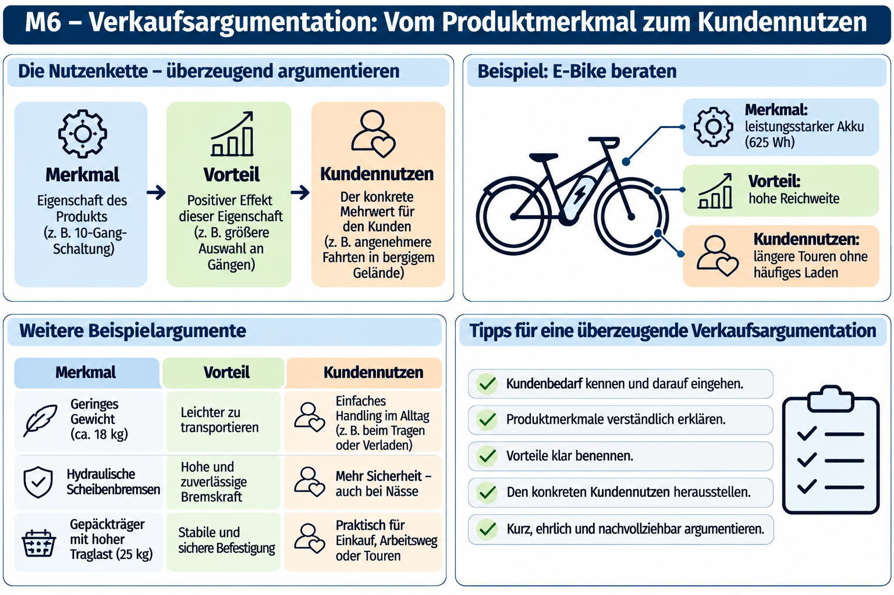

# Verkaufsargumentation

Das E-Bike veranschaulicht die Argumentationsmethode. Für die Beratung im Fall gelten die belegten Merkmale aus M5 und die Simulationspreise aus M8.

Kernfachtext und Argumentationsvorlage

Verkaufsargumentation verbindet Merkmal, Vorteil und Nutzen (MVN). Ein Merkmal beschreibt das Produkt, ein Vorteil dessen positiven Effekt, der Nutzen die Bedeutung für den konkreten Kunden. Sachargumente, wirtschaftliche und emotionale Argumente müssen nachvollziehbar sein. Im B2B-Geschäft zählen sowohl Händlerinteressen als auch Bedürfnisse seiner Kundschaft.

Beispiel: Eine kleinere Einstiegsbestellung (Merkmal des Angebots) bindet weniger Kapital (Vorteil) und lässt dem Händler finanziellen Spielraum für weitere Sortimentsentscheidungen (Nutzen). Technische Aussagen nur mit Beleg.

| Bedarf | Merkmal | Vorteil | Nutzen Händler/Kundschaft | Beleg |
|--------|---------|---------|---------------------------|-------|
|        |         |         |                           |       |
|        |         |         |                           |       |
|        |         |         |                           |       |

Aufgabe: Entwickeln Sie drei vollständige Argumentationsketten. Prüfen Sie Nachteile und formulieren Sie eine Rückfrage zur Kundenreaktion. Optional: Erproben Sie die Argumente im Rollenspiel.

### M6.1 – Betriebliche Mitteilung

Guten Tag liebes Verkaufsteam,

die ersten Produktvergleiche bilden eine wichtige Grundlage für unsere Beratungsgespräche mit den regionalen Fahrradhändlern. Allerdings reicht es nicht aus, unseren Kunden lediglich technische Daten und Produkteigenschaften zu nennen. Unsere Geschäftskunden möchten wissen, welchen konkreten Nutzen ihnen unsere Produkte bieten. Dabei spielen sowohl die Anforderungen ihrer eigenen Kundschaft als auch ihre wirtschaftlichen Interessen eine wichtige Rolle. Entwickeln Sie deshalb Verkaufsargumente, die sich unmittelbar auf den ermittelten Kundenbedarf beziehen. Achten Sie darauf, dass Ihre Aussagen verständlich, nachvollziehbar und fachlich korrekt sind. Auch mögliche Nachteile eines Produkts dürfen nicht verschwiegen werden. Unser Ziel ist es, durch überzeugende Beratung langfristiges Kundenvertrauen aufzubauen.

Mit freundlichen Grüßen

Jan Richter – Leitung Verkauf und Marketing – Global Bike Deutschland GmbH

### M6.2 – Fachtext

Informieren bedeutet, Tatsachen verständlich mitzuteilen. Argumentieren bedeutet, eine Empfehlung nachvollziehbar zu begründen. Überzeugen bedeutet, dem Kunden eine eigenständige Entscheidung auf Grundlage dieser Gründe zu ermöglichen. Druck und Täuschung sind keine professionelle Argumentation.

Sachargumente beziehen sich auf überprüfbare Eigenschaften. Nutzenargumente verbinden diese mit dem Bedarf. Wirtschaftliche Argumente betreffen Kosten, Kapitalbindung und Absatzrisiko. Emotionale Argumente greifen etwa Sicherheit oder Vertrauen auf, ohne Gefühle zu unterstellen. Im B2B-Verkauf sind Händlernutzen und Endkundennutzen zu unterscheiden.

Eine Argumentationskette beginnt beim Kundenbedarf, nennt ein gesichertes Merkmal, erläutert dessen Vorteil und den konkreten Nutzen, benennt einen Beleg und prüft die Kundenreaktion. Belege können Produktinformationen oder bestätigte Angebotsbedingungen sein. Fehlende Belege werden nicht durch Versprechen ersetzt.

Beispiel: Eine kleinere Einstiegsbestellung bindet weniger Kapital und lässt dem Händler Spielraum für weitere Einkäufe. Sie kann jedoch die Auswahl im Laden begrenzen. Fragen Sie: Würde eine kleinere Anfangsmenge zu Ihrer Planung passen?

### M6.3 – Übungen

Unterscheiden Sie Merkmal, Vorteil und Nutzen in drei eigenen Beispielen. Überarbeiten Sie die Aussage „Dieses Rad ist das beste“ zu einer überprüfbaren, bedarfsbezogenen Aussage. Erklären Sie, warum eine hohe Bestellmenge nicht automatisch wirtschaftlich ist.

### M6.6 – Verbindliche Argumentationsvorlage

| Bedarf | Merkmal | Vorteil | Händlernutzen | Endkundennutzen | Beleg / Grenze | Rückfrage |
|--------|---------|---------|---------------|-----------------|----------------|-----------|
|        |         |         |               |                 |                |           |
|        |         |         |               |                 |                |           |
|        |         |         |               |                 |                |           |

### M6.7 – Freiwilliges Gesprächstraining

Verkäufer präsentiert ein Argument, Kunde stellt eine Rückfrage, Beobachter prüft Bedarf, Beleg und Verständlichkeit. Rollen wechseln. Überarbeiten Sie anschließend mindestens ein Argument.

## M6.8 – Selbstkontrolle und Vertiefung

Prüfen Sie jedes Ihrer drei Argumente: Ist das Merkmal belegt? Ist der Vorteil nachvollziehbar? Bezieht sich der Nutzen auf den tatsächlichen Kundenbedarf? Wird zwischen Nutzen für den Händler und Nutzen für seine Kundschaft unterschieden? Welche Rückfrage überprüft die Wirkung des Arguments?

Vertiefungsaufgabe: Vergleichen Sie eine kleine Einstiegsbestellung mit einer größeren Bestellung. Erläutern Sie die Auswirkungen auf Kapitalbindung und Absatzrisiko, ohne einen späteren Verkaufserfolg zu versprechen.

## M6 – Ausführlicher Fachtext: Kundenbezogen argumentieren

1\. Informieren, argumentieren und überzeugen

Eine Information beschreibt einen Sachverhalt. Ein Argument erklärt, weshalb dieser Sachverhalt für eine Entscheidung relevant ist. Überzeugen bedeutet, dem Kunden nachvollziehbare Gründe zu geben, auf deren Grundlage er selbst entscheiden kann. Ein Verkäufer, der nur technische Daten aufzählt, überlässt dem Kunden die Aufgabe, deren Bedeutung selbst zu erkennen. Ein Verkäufer, der Druck ausübt, gefährdet dagegen Vertrauen und langfristige Kundenbindung.

2\. Argumentarten

Sachargumente beziehen sich auf überprüfbare Tatsachen, etwa eine bestätigte Produktbezeichnung oder einen ausgewiesenen Preis. Nutzenargumente stellen eine Verbindung zwischen einer Eigenschaft und dem individuellen Bedarf her. Wirtschaftliche Argumente betreffen beispielsweise Einkaufswert, Kapitalbindung und Absatzrisiko. Emotionale Argumente können Sicherheit, Vertrauen oder das Image eines Händlers berücksichtigen. Gefühle und Kaufmotive müssen jedoch erfragt und dürfen nicht unterstellt werden.

3\. Merkmal – Vorteil – Nutzen

Das Merkmal beantwortet die Frage: Was besitzt oder bietet das Produkt? Der Vorteil beantwortet: Welche positive Wirkung kann sich daraus ergeben? Der Nutzen beantwortet: Warum ist diese Wirkung gerade für diesen Kunden wichtig? Ein allgemeiner Vorteil wird erst dann zu einem kundenbezogenen Nutzen, wenn die Verbindung zum ermittelten Bedarf hergestellt wird.

Beispiel: Ein geringes Gewicht kann das Tragen erleichtern. Für einen Endkunden, der sein Fahrrad täglich in den Keller tragen muss, kann dies einen konkreten Nutzen darstellen. Für einen Händler, dessen Kundschaft diese Anforderung häufig nennt, kann ein entsprechend belegtes Produkt das Sortiment sinnvoll ergänzen. Das Beispiel ist keine Aussage über ein bestimmtes Global-Bike-Modell.

4\. Zwei Nutzenebenen im B2B-Vertrieb

Der Händler kauft für sein Unternehmen ein. Er muss die Bedürfnisse seiner späteren Kunden berücksichtigen und gleichzeitig wirtschaftlich handeln. Ein Nutzen für den Endkunden ist daher nicht automatisch ein wirtschaftlicher Vorteil für den Händler. Eine begrenzte Anfangsmenge kann beispielsweise die Kapitalbindung reduzieren, aber auch die sofort verfügbare Auswahl einschränken. Beide Seiten sind transparent zu erläutern.

5\. Die Argumentationskette

Zunächst wird eine bestätigte Kundenanforderung aufgegriffen. Danach wird ein gesichertes Merkmal genannt, seine Wirkung erklärt und mit dem individuellen Nutzen verbunden. Eine geeignete Quelle oder ein Beleg stützt die Aussage. Abschließend wird durch eine Rückfrage geprüft, ob das Argument für den Kunden tatsächlich relevant ist.

6\. Belege und Glaubwürdigkeit

Als Belege eignen sich verlässliche Produktinformationen, bestätigte Preise oder nachvollziehbare Berechnungen. Modellnamen wie „Profi“ oder „Deluxe“ belegen keine konkrete technische Ausstattung. Fehlende Angaben werden offengelegt. Aussagen über künftige Absatzmengen, nicht bestätigte Liefertermine oder nicht genehmigte Rabatte dürfen nicht zugesichert werden.

7\. Verständliche Produktpräsentation

Die Präsentation orientiert sich an den wichtigsten Anforderungen des Kunden. Fachbegriffe werden erklärt. Statt zahlreiche Merkmale nacheinander zu nennen, werden wenige relevante Eigenschaften mit ihrem Nutzen verbunden. Rückfragen und Reaktionen des Kunden helfen, die Beratung anzupassen.

8\. Nachteile und Grenzen

Eine überzeugende Beratung verschweigt keine Nachteile. Wenn ein Produkt teurer ist, muss der Mehrpreis anhand relevanter, belegter Leistungen begründet werden. Wenn diese Informationen fehlen, ist eine abschließende Qualitätsaussage nicht möglich. Eine andere geeignete Zusammenstellung oder eine spätere Klärung kann sinnvoller sein als ein vorschneller Abschluss.

Merksatz: Ein gutes Verkaufsargument ist belegt, verständlich und auf den konkreten Kundenbedarf bezogen.

## M6 – Erarbeitung, Anwendung und Vertiefung

Aufgabe 1: Unterscheiden Sie Merkmal, Vorteil und Nutzen in den Aussagen „Das Fahrrad hat eine Federgabel“, „Stöße können abgefedert werden“ und „Ihre Kundschaft kann auf unebenen Wegen komfortabler fahren“. Erläutern Sie, warum die technische Eigenschaft zuerst nachgewiesen werden muss.

Aufgabe 2: Überarbeiten Sie die Aussagen „Das ist unser bestes Fahrrad“, „Das verkauft sich garantiert“ und „Das Profi-Modell ist auf jeden Fall hochwertiger“. Formulieren Sie jeweils eine sachliche Alternative und benennen Sie die noch benötigte Information.

Aufgabe 3: Entwickeln Sie für jedes der drei Kundenprofile ein Argument, das dessen jeweiliges Kaufmotiv aufgreift. Unterscheiden Sie gesicherte Informationen und vorläufige Annahmen.

Aufgabe 4: Vergleichen Sie zwei mögliche Einstiegsbestellungen anhand der freigegebenen Simulationspreisliste. Berechnen Sie die Einkaufswerte und erläutern Sie die Folgen für Kapitalbindung, Auswahl und Absatzrisiko. Versprechen Sie keinen Absatz.

Aufgabe 5: Erstellen Sie mindestens drei vollständige Argumentationsketten für Ihr gewähltes Lernpaket. Berücksichtigen Sie insgesamt beide B2B-Nutzenebenen. Nennen Sie die Quelle und eine Rückfrage zur Überprüfung der Kundenreaktion.

Aufgabe 6: Erproben Sie die Argumente im Gespräch. Die Kundenrolle stellt eine kritische Rückfrage; die Beobachtungsrolle dokumentiert Verständlichkeit, Bedarfsbezug und Beleg. Wechseln Sie die Rollen. Überarbeiten Sie anschließend ein Argument.

## M6 – Argumentationswerkstatt

| Bedarf     | Merkmal/Quelle | Vorteil | Nutzen Händler | Nutzen Endkunde | Rückfrage |
|------------|----------------|---------|----------------|-----------------|-----------|
| Argument 1 |                |         |                |                 |           |
| Argument 2 |                |         |                |                 |           |
| Argument 3 |                |         |                |                 |           |
