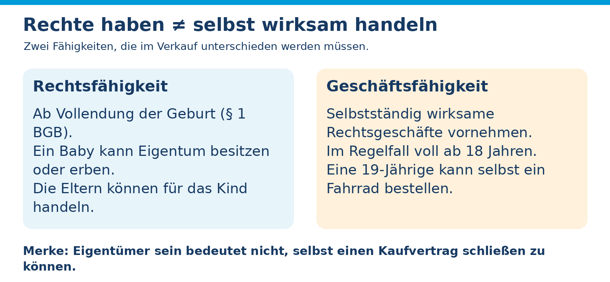
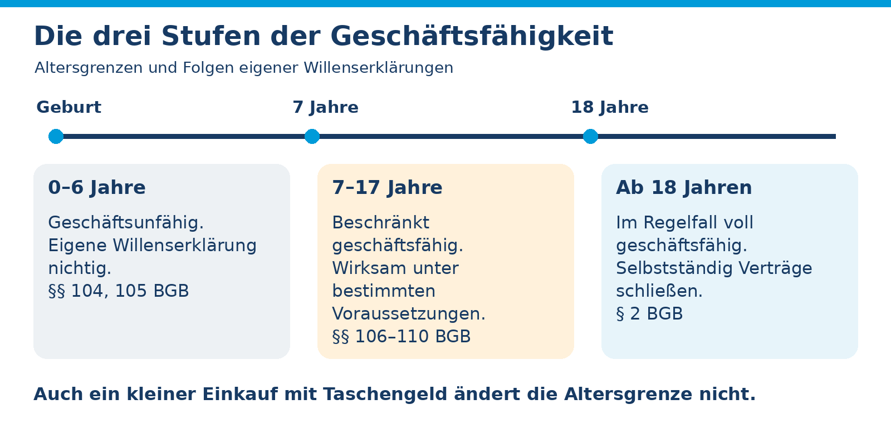
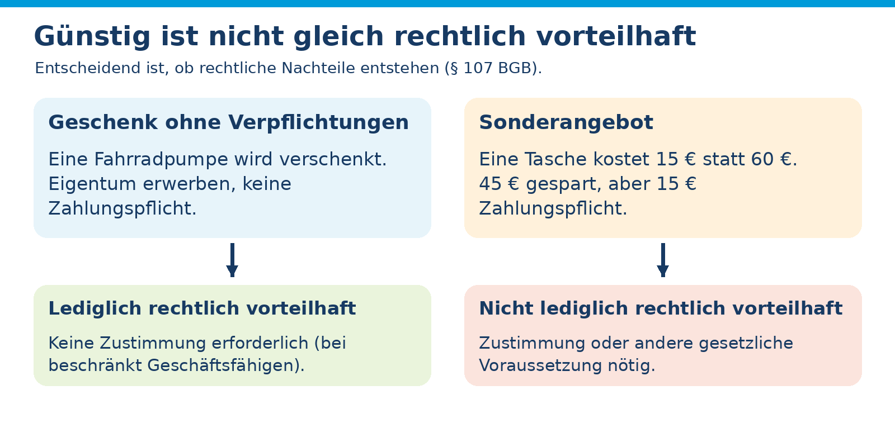
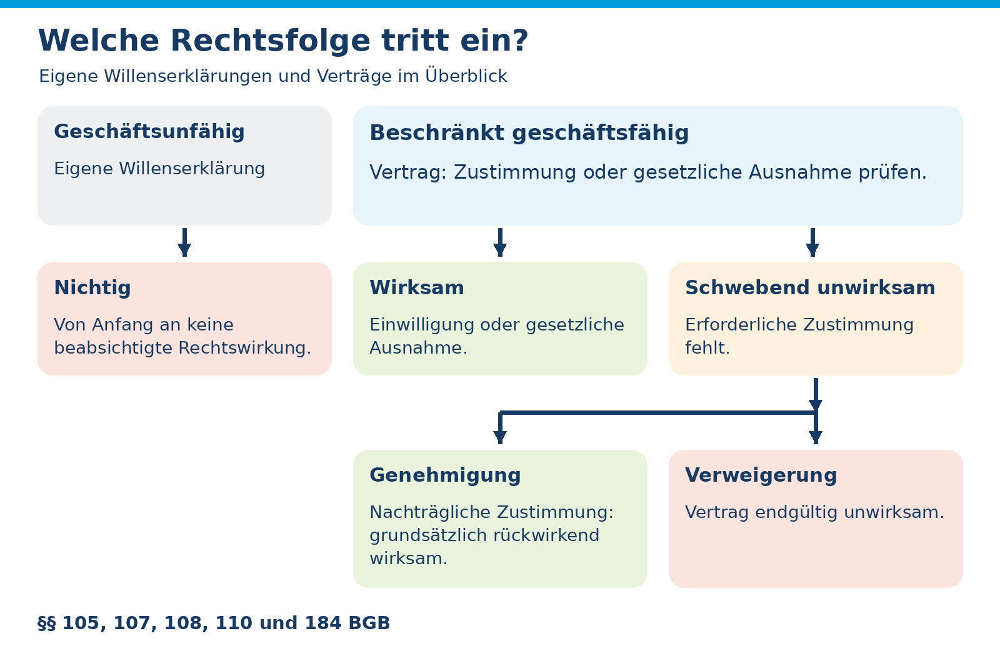
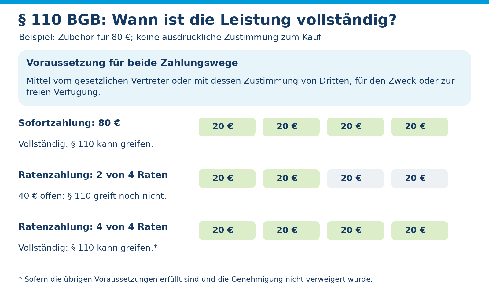
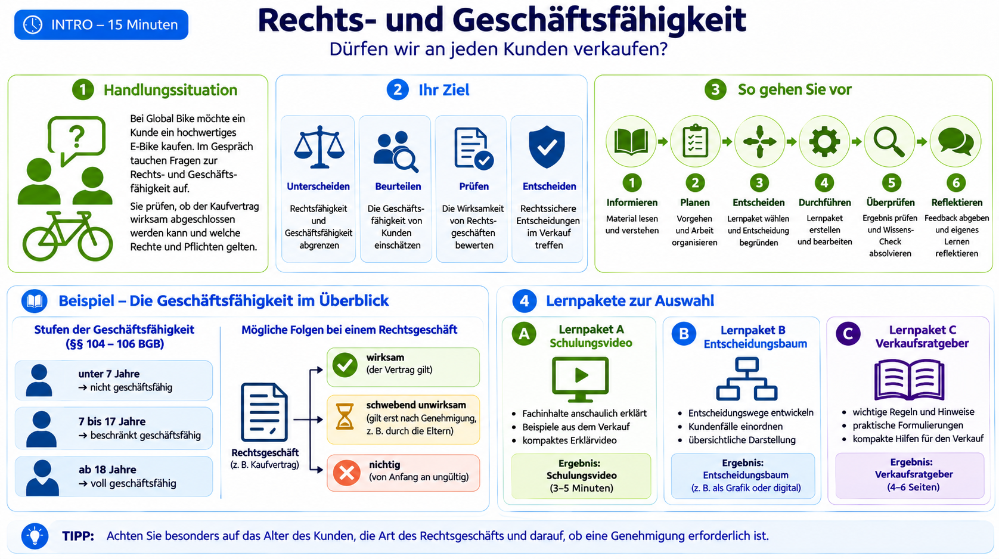

# BFS dual · Lernfeld 2 · LS 2.3 · Dürfen wir an jeden Kunden verkaufen?

**Bildungsgang** · BFS dual, Profil Wirtschaft  
**Lernsituation** · 2.3 · Dürfen wir an jeden Kunden verkaufen? (Paketkennung `BFSDUAL-LF02-LS03`)  
**Unterrichtlicher Bezug** · Handlungsorientierte Fallbearbeitung bei der Global Bike Deutschland GmbH  
**Zeitrahmen** · 10 Unterrichtsstunden à 45 Minuten, insgesamt 450 Minuten für einen gewählten Lernweg  
**Digitale Fassung** · [Orientierung öffnen](index.html) · [Unterlagen und Downloads](materialien.html)  
**Formgrundlage** · [BFSdual-Vorlage, Arbeitsstand vom 26. November 2026](https://github.com/macmaris83/Lernsituationen/blob/a1dd9b693df1a234bf3c7387198fcf5b5aab6afc/Fachbereiche/BFSdual/Vorlage_Lernsituation.md)

## Aufgabenzeiten

Für jeden der drei Wege gilt derselbe Zeitrahmen. Bei Durchführen zählt der Auftrag zum gewählten Lernpaket einmal.

| Station | Minuten je Lernweg |
| --- | ---: |
| Orientierung | 15 |
| Handlungssituation | 25 |
| Informieren | 115 |
| Fachbegriffscheck | 25 |
| Planen | 22 |
| Entscheiden | 23 |
| Durchführen | 135 |
| Bewerten | 68 |
| Reflektieren | 22 |
| **Gesamt** | **450** |

## Orientierung

[Digitale Fassung öffnen](index.html)

BFS dual · Lernfeld 2 · Lernsituation 2.3 · 10 Unterrichtsstunden

#### Den Auftrag überblicken

An der Kasse legt ein Kind eine Klingel und das passende Geld auf den Tresen. Was darf die Verkäuferin tun? Bei Global Bike klären Sie, wann Alter, Zustimmung der Eltern und Art der Bezahlung den Verkauf beeinflussen.

Eine Entscheidungshilfe für den Verkauf bei Global Bike. Sie bearbeitet Ben, Mia, Finn und Hannah einschließlich aller Varianten. Zu jedem Ergebnis gehören die maßgebliche Voraussetzung, eine passende BGB-Stelle, der Zeitpunkt der Rechtswirkung und der nächste Schritt im Verkauf.

Du entscheidest, welche Aufgaben du selbstständig oder mit anderen bearbeitest. Für die Rückmeldung erhält jede Person ein fremdes Produkt.

15 Minuten

*Fachbuchverweis · Für diesen Auftrag ist keine Buchseite hinterlegt.*

Kompetenzprofil der Lernsituation

Die Gewichtung zeigt, wie häufig und wofür die Kompetenz in den Aufgaben gebraucht wird. 1 bedeutet „kurz in einer Aufgabe“, 6 „von der Vorbereitung bis zur Auswertung“.

| Kompetenz | Gewicht (1–6) | Was übe ich? |
| --- | --- | --- |
| F · Fachkompetenz | 6 / 6 | Ich prüfe einen Kundenfall anhand der einschlägigen BGB-Regeln und leite eine Handlungsempfehlung ab. |
| P · Personalkompetenz | 4 / 6 | Ich plane meine Fallprüfung und halte offene Voraussetzungen sichtbar fest. |
| S · Sozialkompetenz | 4 / 6 | Ich erkläre Entscheidungen verständlich und prüfe eine fremde Arbeit anhand von Fallbelegen. |
| M · Methodenkompetenz | 6 / 6 | Ich ordne Alter, Pflichten, Zustimmung, Mittelherkunft und Zahlungsstand systematisch. |
| D · Medienkompetenz | 5 / 6 | Ich gestalte eine leicht auffindbare Entscheidungshilfe für die Mitarbeitenden. |

## Handlungssituation

[Digitale Fassung öffnen](handlungssituation.html)

 

Jan Richter und Emma Fuchs klären den Kaufwunsch einer jugendlichen Kundin. Das Bild eröffnet die Prüfung der Geschäftsfähigkeit und der Wirksamkeit eines möglichen Kaufvertrags.

Jan Richter arbeitet im Verkauf der Global Bike Deutschland GmbH. Kinder und Jugendliche aus Ostfriesland kommen ins Geschäft, weil sie Fahrräder oder Zubehör erwerben möchten. Einige bezahlen sofort, andere möchten eine Rechnung oder Ratenzahlung. Manchmal wurden die Eltern zuvor gefragt, manchmal erfahren sie erst nach dem Kauf davon.

Jan bittet Emma Fuchs aus der Verwaltung um Unterstützung. Eine allgemeine Altersgrenze allein hilft ihnen an der Kasse wenig. Ihr Auftrag lautet, vier Kundenfälle samt Varianten zu prüfen und neuen Mitarbeitenden eine verlässliche Entscheidungshilfe an die Hand zu geben. Die Mitarbeitenden sollen daraus entnehmen können, welche Rückfrage jetzt nötig ist und ob sie den Kauf abschließen können.

#### Wer benötigt die Entscheidungshilfe und wofür?

- Jan und Emma brauchen eine Entscheidungshilfe für neue Mitarbeitende im Verkauf.
- Die Einkaufsabteilung braucht eine Entscheidungshilfe zur Bestellmenge.
- Die Eltern brauchen eine Übersicht über Fahrradmodelle.

5 Minuten

#### Welche Zahlungswege kommen in den Anfragen vor?

- Ausschließlich Vorauszahlung per Überweisung.
- Sofortzahlung, Rechnung und Ratenzahlung.
- Nur Barzahlung und Kartenzahlung am Folgetag.

5 Minuten

#### Welche Information ist neben Alter und Zahlungsweise für Jan wichtig?

- In welchem Ort das Zubehör hergestellt wurde.
- Welche Farbe das Fahrrad hat.
- Ob die Eltern vorher zugestimmt haben oder noch von dem Kauf erfahren.

5 Minuten

## Informieren

[Digitale Fassung öffnen](informieren.html)

Erschließe die Angaben und Unterlagen für deinen Auftrag.

58 Minuten

#### Grundlagen im BGB erschließen

Lesen Sie [M02](#m02). Legen Sie für jede Altersstufe fest, was Global Bike prüfen muss. Notieren Sie für jede Regel eine BGB-Stelle.

*Fachbuchverweis · Für diesen Auftrag ist keine Buchseite hinterlegt.*

57 Minuten

#### Vier Kundenfälle aufschließen

Entnehmen Sie [M03](#m03) für jeden Fall Alter, Geschäft, Zustimmung und Leistungsstand. Markieren Sie das Merkmal, das sich mit jeder Variante ändert.

*Fachbuchverweis · Für diesen Auftrag ist keine Buchseite hinterlegt.*

[Begriffsblatt zum Nachschlagen](#glossar) · [Begriffe prüfen](#begriffstraining)

## Fachbegriffscheck

[Digitale Fassung öffnen](begriffstraining.html)

Wähle zu jedem Begriff die passende Erklärung. Du kannst den Check wiederholen.

25 Minuten

[Begriffsblatt öffnen](#glossar)

Karte `BFSDUAL-LF02-LS03-B01`

**1. Rechtsfähigkeit**

- Rechte und Pflichten haben können.
- Das achtzehnte Lebensjahr vollendet haben.
- Allein wirksame Verträge abschließen können.

Karte `BFSDUAL-LF02-LS03-B02`

**2. Geschäftsfähigkeit**

- Einen Preisnachlass erhalten.
- Selbstständig wirksame Rechtsgeschäfte vornehmen können.
- Rechte und Pflichten haben können.

Karte `BFSDUAL-LF02-LS03-B03`

**3. Geschäftsunfähigkeit**

- Die eigene Willenserklärung ist nach § 105 Abs. 1 grundsätzlich nichtig.
- Eigentum kann nicht erworben werden.
- Der Kauf gilt immer, wenn sofort gezahlt wird.

Karte `BFSDUAL-LF02-LS03-B04`

**4. Beschränkte Geschäftsfähigkeit**

- Minderjährige können grundsätzlich kein Eigentum besitzen.
- Minderjährige ab sieben Jahren können unter bestimmten Voraussetzungen selbst wirksame Geschäfte abschließen.
- Es sind ausschließlich Verträge bis 50 Euro zulässig.

Karte `BFSDUAL-LF02-LS03-B05`

**5. Volljährigkeit**

- Beginn des 18. Lebensjahres.
- Abschluss der ersten Berufsausbildung.
- Vollendung des 18. Lebensjahres.

Karte `BFSDUAL-LF02-LS03-B06`

**6. Willenserklärung**

- Äußerung, die eine bestimmte Rechtsfolge herbeiführen soll.
- Nachfrage zum Produkt ohne Bindungswillen.
- Auskunft zum Lieferweg eines Fahrrads.

Karte `BFSDUAL-LF02-LS03-B07`

**7. Lediglich rechtlicher Vorteil**

- Der Käufer bezahlt erst später.
- Der Verkaufspreis liegt unter dem Listenpreis.
- Das Geschäft bringt keine rechtlichen Nachteile mit sich.

Karte `BFSDUAL-LF02-LS03-B08`

**8. Einwilligung**

- Vorherige Zustimmung.
- Nachträgliche Zustimmung.
- Ablehnung eines Kaufvertrags.

Karte `BFSDUAL-LF02-LS03-B09`

**9. Genehmigung**

- Vollständige Zahlung mit beliebigem Geld.
- Vorherige Zustimmung.
- Nachträgliche Zustimmung.

Karte `BFSDUAL-LF02-LS03-B10`

**10. Schwebende Unwirksamkeit**

- Die Ware bleibt bis zur Übergabe im Lager.
- Jede Möglichkeit einer Genehmigung ist bereits ausgeschlossen.
- Die Wirksamkeit eines Vertrags hängt noch von der erforderlichen Genehmigung ab.

Karte `BFSDUAL-LF02-LS03-B11`

**11. Nichtigkeit**

- Eine Rechnung wurde zu spät versandt.
- Die beabsichtigte Rechtswirkung tritt von Anfang an nicht ein.
- Eine spätere Zahlung ist noch offen.

Karte `BFSDUAL-LF02-LS03-B12`

**12. Taschengeldparagraph**

- § 110 BGB macht nach der ersten Rate jeden Kauf wirksam.
- § 110 BGB verlangt die vollständige vertragsmäßige Leistung mit zulässigen Mitteln.
- § 110 BGB setzt eine feste Preisobergrenze von 100 Euro.

## Planen

[Digitale Fassung öffnen](planen.html)

Entwirf deinen Arbeitsplan.

22 Minuten

#### Prüfschritte in eine Reihenfolge bringen

Skizzieren Sie mit [M02](#m02) und [M03](#m03) einen Prüfplan. Legen Sie fest, wo Sie je Fall Beleg, Rechtsfolge und Entscheidung festhalten.

*Fachbuchverweis · Für diesen Auftrag ist keine Buchseite hinterlegt.*

## Entscheiden

[Digitale Fassung öffnen](entscheiden.html)

Wähle einen von drei gleichwertigen Arbeitswegen. Du kannst deine Wahl begründet ändern.

**Lernpaket wählen**

A · Schulungsvideo · Fallentscheidungen anhand kurzer Szenen erläutern. · Ein Storyboard verbindet Kundenfrage, Regel und nächste Handlung. Geeignet, wenn Sie Zusammenhänge mündlich vermitteln möchten.

B · Entscheidungsbaum · Mit Prüffragen und Verzweigungen arbeiten. · Ein erster Entscheidungsweg lässt sich mit einem zweiten Fall testen. Geeignet, wenn Sie Fallunterschiede sichtbar machen möchten.

C · Verkaufsratgeber · Typische Rückfragen und Antworten zum Nachschlagen ordnen. · Eine Musterseite verknüpft Fall, Rechtsfolge und Handlungstipp. Geeignet, wenn Sie verständliche Texte schreiben möchten.

Eine Entscheidungshilfe für den Verkauf bei Global Bike. Sie bearbeitet Ben, Mia, Finn und Hannah einschließlich aller Varianten. Zu jedem Ergebnis gehören die maßgebliche Voraussetzung, eine passende BGB-Stelle, der Zeitpunkt der Rechtswirkung und der nächste Schritt im Verkauf.

23 Minuten

#### Arbeitsweg für die Verkaufshilfe wählen

Vergleichen Sie [die Produktaufträge in M04](#m04). Wählen Sie eine Darstellung und erläutern Sie an einem Fall, wie ein neuer Mitarbeiter darin die Antwort findet.

*Fachbuchverweis · Für diesen Auftrag ist keine Buchseite hinterlegt.*

## Durchführen

[Digitale Fassung öffnen](durchfuehren.html)

Bearbeite den Auftrag im gewählten Format.

[Wähle in Entscheiden dein Lernpaket A, B oder C](#entscheiden), um die Aufträge zu öffnen.

Deine Wahl:  · [Wahl ändern](#entscheiden)

Eine Entscheidungshilfe für den Verkauf bei Global Bike. Sie bearbeitet Ben, Mia, Finn und Hannah einschließlich aller Varianten. Zu jedem Ergebnis gehören die maßgebliche Voraussetzung, eine passende BGB-Stelle, der Zeitpunkt der Rechtswirkung und der nächste Schritt im Verkauf.

34 Minuten

#### Fälle rechtlich prüfen

Prüfen Sie die vier Fälle und alle Varianten aus [M03](#m03). Belegen Sie jede Entscheidung mit dem relevanten Merkmal und einer Vorschrift aus [M02](#m02). Unterscheiden Sie den Zeitpunkt des Kaufs und spätere Ereignisse.

*Fachbuchverweis · Für diesen Auftrag ist keine Buchseite hinterlegt.*

67 Minuten

**Lernpaket A**

#### Schulungsvideo herstellen

Setzen Sie Ihr Storyboard als Video um. Zeigen oder erklären Sie alle Kundenfälle und mindestens die jeweils vorgegebenen veränderten Voraussetzungen. Eine Stimme, beschriftetes Papier oder Folien genügen. [Produktauftrag M04](#m04)

*Fachbuchverweis · Für diesen Auftrag ist keine Buchseite hinterlegt.*

67 Minuten

**Lernpaket B**

#### Entscheidungsbaum erproben

Bauen Sie den Baum aus klar beantwortbaren Fragen. Verfolgen Sie jeden Fall und seine Varianten bis zur Empfehlung. Versehen Sie die Entscheidungspunkte mit den passenden BGB-Regeln. [Fälle M03](#m03)

*Fachbuchverweis · Für diesen Auftrag ist keine Buchseite hinterlegt.*

67 Minuten

**Lernpaket C**

#### Verkaufsratgeber gestalten

Gestalten Sie einen Ratgeber mit Suchbegriffen oder Inhaltsübersicht. Verknüpfen Sie jede typische Verkaufsfrage mit Voraussetzung, Regel, Beispiel und nächstem Schritt. Nutzen Sie alle Fälle aus [M03](#m03).

*Fachbuchverweis · Für diesen Auftrag ist keine Buchseite hinterlegt.*

34 Minuten

#### Handlungsempfehlungen formulieren

Formulieren Sie für jede Rechtsfolge eine konkrete Antwort für den Tresen. Erproben Sie eine Variante mit verändertem Alter, Zustimmungszeitpunkt oder Zahlungsstand aus [M03](#m03).

*Fachbuchverweis · Für diesen Auftrag ist keine Buchseite hinterlegt.*

Kriterien für das fertige Produkt

- Die Arbeit unterscheidet Rechtsfähigkeit und Geschäftsfähigkeit und ordnet die Altersstufen korrekt zu.
- Alle vier Fälle und die Varianten aus M03 sind auffindbar. Die Empfehlungen stützen sich auf das BGB und ein konkretes Sachverhaltsmerkmal.
- Geschenk und günstiger Kauf, vorherige und nachträgliche Zustimmung sowie die unterschiedlichen Rechtsfolgen sind unterscheidbar.
- Bei Hannah sind Herkunft und Zweck des Geldes sowie der Zahlungsstand geprüft. Die Entscheidung nennt eine konkrete Handlung im Verkauf.

## Bewerten

[Digitale Fassung öffnen](bewerten.html)

Peer-Check am Handlungsprodukt.

17 Minuten

#### Das Produkt für den Peer-Check bereitstellen

**Reiche** deine Arbeit in der Moodle-Aktivität „Peer-Feedback“ ein. Verwende neutrale Titel und Dateinamen. Entferne Namen aus Text und Dateieigenschaften. Bei einem gemeinsamen Produkt reicht jede Person eine Kopie im eigenen Konto ein. Ohne eingerichtete Aktivität verteilt die Lehrkraft codierte Arbeiten.

*Fachbuchverweis · Für diesen Auftrag ist keine Buchseite hinterlegt.*

34 Minuten

#### Ein fremdes Produkt prüfen

**Prüfe** die dir zugeteilte Arbeit mit den Kriterien unten. Benenne eine konkrete Fundstelle, eine fachlich gelungene Stelle und einen begründeten Verbesserungsvorschlag. Gib die Rückmeldung in Moodle oder mit dem [ausfüllbaren Peer-Bogen](#peer-check) ab. Dein Name ist für die empfangende Person sichtbar.

*Fachbuchverweis · Für diesen Auftrag ist keine Buchseite hinterlegt.*

17 Minuten

#### Die empfangene Rückmeldung nutzen

**Lies** das Feedback zu deinem Produkt. Verbessere die genannte Stelle oder begründe am Material, weshalb du deine Fassung beibehältst. Ergebnis ist die für die weitere Verwendung geprüfte Fassung.

*Fachbuchverweis · Für diesen Auftrag ist keine Buchseite hinterlegt.*

### Fachliche Prüfkriterien

- Die Arbeit unterscheidet Rechtsfähigkeit und Geschäftsfähigkeit und ordnet die Altersstufen korrekt zu.
- Alle vier Fälle und die Varianten aus M03 sind auffindbar. Die Empfehlungen stützen sich auf das BGB und ein konkretes Sachverhaltsmerkmal.
- Geschenk und günstiger Kauf, vorherige und nachträgliche Zustimmung sowie die unterschiedlichen Rechtsfolgen sind unterscheidbar.
- Bei Hannah sind Herkunft und Zweck des Geldes sowie der Zahlungsstand geprüft. Die Entscheidung nennt eine konkrete Handlung im Verkauf.

[Peer-Check öffnen oder drucken](#peer-check)

## Reflektieren

[Digitale Fassung öffnen](reflektieren.html)

Dein Feedback zum Unterricht.

22 Minuten

#### Feedback zur Lernsituation abgeben

**Fülle** die separate Aktivität „Feedback“ in deinem Moodle-Kurs aus und sende deine Rückmeldung dort ab. Falls hier kein Direktlink angezeigt wird, öffne „Feedback“ in der Kursübersicht.

*Fachbuchverweis · Für diesen Auftrag ist keine Buchseite hinterlegt.*

## Materialien
| Kennung | Unterlage |
| --- | --- |
| M02 | [M02 · Rechts- und Geschäftsfähigkeit im Verkauf](#m02) |
| M03 | [M03 · Vier Kundenfälle mit Varianten](#m03) |
| M04 | [M04 · Drei Arbeitshilfen für den Verkauf](#m04) |
| MATERIALIEN | [Materialübersicht und Quellen](#materialien) |
| PEER-CHECK | [Peer-Check · LS 2.3](#peer-check) |

## M02 · Rechts- und Geschäftsfähigkeit im Verkauf

[Digitale Fassung öffnen](material/m02.html)

[Zur Materialübersicht](#materialien) 

M02.1 – [Rechtsfähigkeit](#rechtsfaehigkeit) und [Geschäftsfähigkeit](#geschaeftsfaehigkeit)

### Rechtsfähigkeit und Geschäftsfähigkeit

**Leitfrage:** Warum kann ein Baby Eigentümer sein, aber nicht selbst kaufen?

Rechtsfähigkeit bedeutet, Träger von Rechten und Pflichten sein zu können. Sie beginnt mit Vollendung der Geburt. Auch ein Baby kann Eigentum erwerben oder erben. Geschäftsfähigkeit bedeutet dagegen, selbstständig wirksame Rechtsgeschäfte vorzunehmen. Mit 18 Jahren ist man volljährig und im Regelfall voll geschäftsfähig. Eine [Willenserklärung](#willenserklaerung) ist eine Äußerung, die auf eine rechtliche Folge gerichtet ist. Sie kann mündlich, schriftlich oder durch eindeutiges Verhalten erfolgen. Ein Kaufvertrag entsteht durch zwei übereinstimmende Willenserklärungen: Antrag und Annahme. Der Verkäufer schuldet Übergabe und Eigentumsverschaffung, der Käufer Zahlung und Abnahme.

**Beispiel bei Global Bike:** Ein Mitarbeiter schenkt seinem neugeborenen Patenkind ein Fahrrad; die Eltern nehmen es in dessen Namen an. Eine 19-jährige Kundin kann dagegen selbst ein Fahrrad bestellen.

| Rechtsfähigkeit | Geschäftsfähigkeit |
| --- | --- |
| Rechte und Pflichten haben | Wirksame Rechtsgeschäfte selbst vornehmen |
| Ab Vollendung der Geburt | Im Regelfall vollständig ab 18 |

  

Antrag → übereinstimmende Annahme → Kaufvertrag

#### Gesetzliche Grundlage

§ 1 BGB: Die Rechtsfähigkeit des Menschen beginnt mit der Vollendung der Geburt.  
 § 2 BGB: Die [Volljährigkeit](#volljaehrigkeit) tritt mit der Vollendung des 18. Lebensjahres ein.

**Merke:** Rechte haben und selbst wirksam handeln sind nicht dasselbe.

**Kurz nachgedacht:** Warum kann ein Baby Eigentümer eines Fahrrads sein, aber selbst kein Fahrrad kaufen?

M02.2 – Die drei Stufen der Geschäftsfähigkeit

### Die drei Stufen der Geschäftsfähigkeit

**Leitfrage:** Welche Bedeutung hat das Alter?

Unter sieben Jahren sind Kinder geschäftsunfähig. Ihre eigenen Willenserklärungen sind nichtig, auch bei kleinen Einkäufen. Eltern können in ihrem Namen handeln. Ab sieben bis einschließlich 17 Jahren sind Minderjährige beschränkt geschäftsfähig. Verträge können insbesondere bei lediglich rechtlichem Vorteil, Zustimmung oder unter den Voraussetzungen des § 110 BGB wirksam sein. Fehlt die erforderliche Zustimmung, ist ein Vertrag zunächst grundsätzlich schwebend unwirksam. Ab 18 Jahren besteht im Regelfall volle Geschäftsfähigkeit.

**Beispiel bei Global Bike:** Ein vierjähriges Kind möchte einen Reflektor für 2 Euro kaufen: seine eigene Erklärung ist nichtig. Ein 13-Jähriger darf mit vorheriger Zustimmung einen Fahrradcomputer auf Rechnung kaufen. Eine 20-Jährige benötigt keine Zustimmung ihrer Eltern.

| 0–6 Jahre | 7–17 Jahre | Ab 18 Jahren |
| --- | --- | --- |
| Geschäftsunfähig | Beschränkt geschäftsfähig | Im Regelfall voll geschäftsfähig |
| Eigene Erklärung nichtig | Unter Voraussetzungen wirksam | Selbstständig wirksam |

  

#### Gesetzliche Grundlage

§ 104 Nr. 1 BGB (Auszug): Geschäftsunfähig ist: 1. wer nicht das siebente Lebensjahr vollendet hat, […]  
 § 105 Abs. 1 BGB: Die Willenserklärung eines Geschäftsunfähigen ist nichtig.  
 § 106 BGB: Ein Minderjähriger, der das siebente Lebensjahr vollendet hat, ist nach Maßgabe der §§ 107 bis 113 in der Geschäftsfähigkeit beschränkt.

**Merke:** Das Alter bestimmt, welche Voraussetzungen für wirksames Handeln gelten.

**Kurz nachgedacht:** Warum spielt das Alter eine Rolle, obwohl ein Kunde genügend Geld besitzt?

M02.3 – Geschenke und rechtliche Vorteile

### Geschenke und rechtliche Vorteile

**Leitfrage:** Ist ein günstiges Geschäft rechtlich vorteilhaft?

Lediglich rechtlich vorteilhaft bedeutet, dass keine rechtlichen Nachteile entstehen. Beschränkt Geschäftsfähige dürfen solche Geschäfte ohne Zustimmung vornehmen. Ein gewöhnliches Geschenk ohne Verpflichtungen ist lediglich rechtlich vorteilhaft. Ein Kauf hingegen begründet eine Zahlungspflicht, auch wenn der Preis sehr günstig ist. Ein wirtschaftlicher Vorteil ist daher nicht dasselbe wie ein lediglich rechtlicher Vorteil. Ein Geschenk mit kostenpflichtigem Abonnement ist ebenfalls nicht lediglich rechtlich vorteilhaft.

**Beispiel bei Global Bike:** Eine 12-Jährige erhält eine Fahrradpumpe ohne Verpflichtungen. Ein 16-Jähriger erhält einen Fahrradcomputer nur bei Abschluss eines kostenpflichtigen Serviceabos. Eine reduzierte Tasche für 15 statt 60 Euro spart Geld, verpflichtet aber zur Zahlung.

| Geschenk ohne Pflichten | Reduzierter Kauf |
| --- | --- |
| Recht erwerben, keine Nachteile | Preis sparen, Zahlungspflicht |
| Lediglich rechtlich vorteilhaft | Nicht lediglich rechtlich vorteilhaft |

  

#### Gesetzliche Grundlage

§ 107 BGB: Der Minderjährige bedarf zu einer Willenserklärung, durch die er nicht lediglich einen rechtlichen Vorteil erlangt, der [Einwilligung](#einwilligung) seines gesetzlichen Vertreters.

**Merke:** Entscheidend sind rechtliche Folgen, nicht der Preis.

**Kurz nachgedacht:** Warum ist ein Sonderangebot nicht automatisch lediglich rechtlich vorteilhaft?

M02.4 – Wenn die Eltern zustimmen müssen

### Wenn die Eltern zustimmen müssen

**Leitfrage:** Wann ist die Zustimmung entscheidend?

Einwilligung ist die vorherige Zustimmung. Ein damit erlaubter Kauf auf Rechnung ist bereits wirksam, auch ohne Zahlung. [Genehmigung](#genehmigung) ist die nachträgliche Zustimmung. Fehlt die erforderliche Einwilligung und greift keine Ausnahme, ist der Vertrag zunächst schwebend unwirksam. Eine Genehmigung macht ihn grundsätzlich rückwirkend wirksam. Wird sie verweigert, ist der Vertrag endgültig unwirksam; aus ihm kann keine Kaufpreiszahlung verlangt werden. Bereits ausgetauschte Leistungen müssen gegebenenfalls rückabgewickelt werden. Vertiefung: Fordert Global Bike die gesetzlichen Vertreter nach § 108 Abs. 2 zur Erklärung auf, gilt die Genehmigung nach zwei Wochen ab Empfang der Aufforderung ohne Genehmigung als verweigert.

**Beispiel bei Global Bike:** Ein 14-Jähriger darf vorher ausdrücklich ein Schloss auf Rechnung kaufen. Eine 15-Jährige bestellt eine Tasche ohne Zustimmung; später genehmigen die Eltern den Vertrag gegenüber Global Bike.

| Rechtsfolge | Bedeutung |
| --- | --- |
| Wirksam | Vertrag entfaltet Rechtswirkung |
| Nichtig | Von Anfang an keine beabsichtigte Rechtswirkung |
| Schwebend unwirksam | Wirksamkeit noch offen |
| Endgültig unwirksam | Etwa nach verweigerter Genehmigung |

  

Einwilligung → Kauf → wirksam  
 Kauf ohne erforderliche Zustimmung → schwebend unwirksam → Genehmigung: wirksam / Verweigerung: endgültig unwirksam

#### Gesetzliche Grundlage

§ 108 Abs. 1 BGB: Schließt der Minderjährige einen Vertrag ohne die erforderliche Einwilligung des gesetzlichen Vertreters, so hängt die Wirksamkeit des Vertrags von der Genehmigung des Vertreters ab.  
 § 183 BGB (Auszug): Die vorherige Zustimmung (Einwilligung) ist bis zur Vornahme des Rechtsgeschäfts widerruflich, soweit nicht aus dem ihrer Erteilung zugrunde liegenden Rechtsverhältnis sich ein anderes ergibt.  
 § 184 Abs. 1 BGB: Die nachträgliche Zustimmung (Genehmigung) wirkt auf den Zeitpunkt der Vornahme des Rechtsgeschäfts zurück, soweit nicht ein anderes bestimmt ist.

**Merke:** Einwilligung vorher, Genehmigung nachher.

**Kurz nachgedacht:** Welche Bedeutung hat der Zeitpunkt der Zustimmung?

M02.5 – Der [Taschengeldparagraph](#taschengeldparagraph)

### Der Taschengeldparagraph

**Leitfrage:** Wann reicht die Zahlung aus?

§ 110 BGB ermöglicht beschränkt Geschäftsfähigen wirksame Verträge ohne ausdrückliche Zustimmung zum konkreten Kauf. Die Mittel müssen vom gesetzlichen Vertreter oder mit dessen Zustimmung von Dritten für diesen Zweck oder zur freien Verfügung überlassen worden sein. Die vertragsmäßige Leistung muss vollständig erbracht sein. Es gibt keine feste Preisgrenze. Bei gewöhnlichen Käufen kommt es auf die vollständige Zahlung an, nicht auf Bar- oder Kartenzahlung. Bei Rechnung oder Raten bleibt der Vertrag ohne erforderliche Zustimmung zunächst schwebend unwirksam. Nach vollständiger Leistung mit zulässigen Mitteln kann er von Anfang an wirksam gelten, sofern die Genehmigung nicht bereits verweigert wurde. § 110 gilt nicht für Geschäftsunfähige.

**Beispiel bei Global Bike:** Ein 12-Jähriger zahlt eine Pumpe für 18 Euro vollständig mit frei verfügbarem Taschengeld. Eine 15-Jährige nutzt dagegen Geld ausschließlich für eine Klassenfahrt für Zubehör: § 110 greift nicht. Ein 16-Jähriger zahlt Zubehör für 80 Euro in vier Raten zu 20 Euro.

| Zahlungsstand | § 110 bei sonst erfüllten Voraussetzungen |
| --- | --- |
| 80 € sofort | Erfüllt |
| 2 von 4 Raten: 40 € | Noch nicht erfüllt |
| 4 von 4 Raten: 80 € | Erfüllt |

  

#### Gesetzliche Grundlage

§ 110 BGB: Ein von dem Minderjährigen ohne Zustimmung des gesetzlichen Vertreters geschlossener Vertrag gilt als von Anfang an wirksam, wenn der Minderjährige die vertragsmäßige Leistung mit Mitteln bewirkt, die ihm zu diesem Zweck oder zu freier Verfügung von dem Vertreter oder mit dessen Zustimmung von einem Dritten überlassen worden sind.

**Merke:** Vollständige Leistung und zulässige Mittel sind entscheidend.

**Kurz nachgedacht:** Warum reicht vollständige Zahlung allein nicht aus?

[Gesetzestexte im Bürgerlichen Gesetzbuch](https://www.gesetze-im-internet.de/bgb/)

 

Ausschnitt der Boardübersicht. Die drei Produktformen und das fachliche Beispiel im Überblick.

### Begriffe zum Fall

[Geschäftsunfähigkeit](#geschaeftsunfaehigkeit) – Die eigene Willenserklärung ist nach § 105 Abs. 1 grundsätzlich nichtig. Bei einem Kind unter sieben Jahren kommt es auf das Alter an, auch wenn der Betrag klein ist.

[Beschränkte Geschäftsfähigkeit](#beschraenkte-geschaeftsfaehigkeit) – Minderjährige ab sieben Jahren können unter bestimmten Voraussetzungen selbst wirksame Geschäfte abschließen. Beim Kauf einer 15-Jährigen kommt es unter anderem darauf an, welche Pflichten entstehen.

[Lediglich rechtlicher Vorteil](#lediglich-rechtlicher-vorteil) – Das Geschäft bringt keine rechtlichen Nachteile mit sich. Prüfen Sie beim Geschenk, ob daran eine rechtliche Verpflichtung hängt.

[Schwebende Unwirksamkeit](#schwebende-unwirksamkeit) – Die Wirksamkeit eines Vertrags hängt noch von der erforderlichen Genehmigung ab. Bei einer Bestellung ohne erforderliche Zustimmung kann der Vertrag noch genehmigt werden.

[Nichtigkeit](#nichtigkeit) – Die beabsichtigte Rechtswirkung tritt von Anfang an nicht ein. § 105 Abs. 1 beschreibt die Wirkung der Erklärung eines Geschäftsunfähigen.

[Text als Markdown herunterladen](material/m02.md) · [Zur Materialübersicht](#materialien)

## M03 · Vier Kundenfälle mit Varianten

[Digitale Fassung öffnen](material/m03.html)

[Zur Materialübersicht](#materialien) 

M03 – Vier Kundenfälle

Prüfen Sie die vier Kundenfälle einschließlich ihrer Varianten mithilfe der Informationsmaterialien und des BGB. Berücksichtigen Sie die [Geschäftsfähigkeit](#geschaeftsfaehigkeit), die rechtlichen Voraussetzungen und die Wirksamkeit der Rechtsgeschäfte. Begründen Sie Ihre Entscheidungen nachvollziehbar unter Angabe der entsprechenden BGB-Vorschriften. Halten Sie Ihre Ergebnisse in einer selbst gewählten Form fest und nutzen Sie diese als Grundlage für Ihr Lernpaket.

#### Fall 1 – Ein kleiner Einkauf

Der sechsjährige Ben kauft eine Fahrradklingel für 8 Euro und bezahlt mit seinem Taschengeld. Seine Eltern sind nicht dabei.

#### Fall 2 – Ein Geschenk

Die 15-jährige Mia erhält eine Fahrradtrinkflasche geschenkt. Damit sind keine Verpflichtungen verbunden. Ihre Eltern wissen nichts davon.

#### Fall 3 – Ein Kauf auf Rechnung

Der 16-jährige Finn bestellt ohne vorherige Zustimmung Fahrradzubehör für 85 Euro auf Rechnung. Am nächsten Tag genehmigen seine Eltern den Kauf gegenüber Global Bike. Varianten: Die Eltern stimmen bereits vorher zu oder verweigern die nachträgliche [Genehmigung](#genehmigung).

#### Fall 4 – Ein Fahrrad auf Raten

Die 17-jährige Hannah kauft ohne Zustimmung ein Fahrrad für 600 Euro in sechs Raten zu 100 Euro. Die erste Rate bezahlt sie mit frei verfügbarem Geld ihrer Eltern. Varianten: Sie bezahlt alle Raten mit diesen Mitteln, ohne dass die Genehmigung verweigert wurde; das Geld ist ausschließlich für Schulmaterial bestimmt; Hannah ist beim Kauf bereits 18 Jahre alt.

[Text als Markdown herunterladen](material/m03.md) · [Zur Materialübersicht](#materialien)

## M04 · Drei Arbeitshilfen für den Verkauf

[Digitale Fassung öffnen](material/m04.html)

[Zur Materialübersicht](#materialien) 

### Lernpaket A – Schulungsvideo für neue Mitarbeitende

Erstellen Sie ein Schulungsvideo zur selbstständigen Einarbeitung neuer Mitarbeitender. Erklären Sie die rechtlichen Zusammenhänge anhand der Kundenfälle und begründen Sie die Rechtsfolgen und Handlungsempfehlungen mit dem BGB. Sie müssen nicht vor der Kamera erscheinen. Eine aufwendige technische Bearbeitung ist nicht erforderlich.

Beziehen Sie alle vier Übungsfälle einschließlich Varianten ein. Bearbeitungszeit: 3 UStd.

Lernpaket B – Entscheidungsbaum für den Verkauf

### Lernpaket B – Entscheidungsbaum für den Verkauf

Entwickeln Sie eine grafische Entscheidungshilfe, die durch geeignete Fragen zu rechtlich begründeten Entscheidungen führt. Berücksichtigen Sie neben dem Alter die weiteren rechtlichen Voraussetzungen, Rechtsfolgen, BGB-Vorschriften und Handlungsempfehlungen. Testen und erläutern Sie die Entscheidungswege anhand der Kundenfälle.

Beziehen Sie alle vier Übungsfälle einschließlich Varianten ein. Bearbeitungszeit: 3 UStd.

Lernpaket C – Verkaufsratgeber

### Lernpaket C – Verkaufsratgeber

Erstellen Sie ein Nachschlagewerk für typische rechtliche Fragen im Verkaufsalltag. Erklären Sie die Voraussetzungen und Rechtsfolgen und begründen Sie diese anhand der Kundenfälle und BGB-Vorschriften. Formulieren Sie Handlungsempfehlungen und gestalten Sie den Ratgeber so, dass Informationen gezielt auffindbar sind.

Beziehen Sie alle vier Übungsfälle einschließlich Varianten ein. Bearbeitungszeit: 3 UStd.

[Text als Markdown herunterladen](material/m04.md) · [Zur Materialübersicht](#materialien)

## Materialübersicht und Quellen

[Digitale Fassung öffnen](materialien.html)

Wähle eine Unterlage für deinen nächsten Arbeitsschritt.

#### [M02 · Rechts- und Geschäftsfähigkeit im Verkauf](#m02)

Fünf Fachtexte mit altersbezogenen Beispielen, Schaubildern und Auszügen aus dem BGB.

#### [M03 · Vier Kundenfälle mit Varianten](#m03)

Ben kauft eine Klingel, Mia erhält ein Geschenk, Finn bestellt auf Rechnung und Hannah möchte in Raten zahlen.

#### [M04 · Drei Arbeitshilfen für den Verkauf](#m04)

Originalaufträge für Schulungsvideo, Entscheidungsbaum und Verkaufsratgeber.

Externe Quellen aus dem Board

- [www.bbs1-aurich.de/](https://www.bbs1-aurich.de/)
- [www.gesetze-im-internet.de/bgb/](https://www.gesetze-im-internet.de/bgb/)

## Peer-Check · LS 2.3

[Digitale Fassung öffnen](peer-check.html)

Prüfen Sie das zugeteilte Handlungsprodukt anhand der gemeinsamen fachlichen Kriterien. Eine Fundstelle kann eine Textzeile, ein Bildausschnitt oder eine Zeitmarke in der Übergabe sein.

Was möchten Sie festhalten?

 (Meine Rückmeldung zu einer fremden Arbeit / Meine Entscheidung nach Erhalt der Rückmeldung)

### Peer-Rückmeldung zur zugeteilten Arbeit

Nutzen Sie diese Fragen beim Lesen, Betrachten oder Anhören.

- Die Arbeit unterscheidet Rechtsfähigkeit und Geschäftsfähigkeit und ordnet die Altersstufen korrekt zu.
- Alle vier Fälle und die Varianten aus M03 sind auffindbar. Die Empfehlungen stützen sich auf das BGB und ein konkretes Sachverhaltsmerkmal.
- Geschenk und günstiger Kauf, vorherige und nachträgliche Zustimmung sowie die unterschiedlichen Rechtsfolgen sind unterscheidbar.
- Bei Hannah sind Herkunft und Zweck des Geldes sowie der Zahlungsstand geprüft. Die Entscheidung nennt eine konkrete Handlung im Verkauf.

Welches Produkt prüfen Sie und auf welche Fundstelle beziehen Sie sich?

Welche Stelle ist fachlich gelungen und wem hilft sie bei der Weiterarbeit und warum?

Wo bleibt eine Frage offen? Welchen konkreten Änderungsvorschlag machen Sie für diese Stelle?

**Rückmeldung weitergeben.** Übertragen Sie Ihren Text in die zugeteilte Arbeit in der Moodle-Aktivität „Peer-Feedback“ und geben Sie ihn dort ab. Ohne Moodle geben Sie den Bogen mit dem vereinbarten Arbeitscode an die Lehrkraft zur Rückgabe an die einreichende Person. Setzen Sie Ihren Namen als rückmeldende Person auf den Ausdruck oder die Textdatei.

Die Eingaben bleiben im geöffneten Bogen. Laden Sie die gewählte Ansicht vor dem Verlassen als Textdatei herunter, wenn Sie sie behalten möchten.

## Glossar zur Kundenanfrage

[Digitale Fassung öffnen](ls-glossar.html)

Begriffsblatt zum Nachschlagen und zur Vorbereitung auf den Fachbegriffscheck.

[Zurück zum Material](#materialien)

### Rechtsfähigkeit

Rechte und Pflichten haben können.

Ein Baby kann Eigentümer eines Fahrrads sein. (M02, M03)

### Geschäftsfähigkeit

Selbstständig wirksame Rechtsgeschäfte vornehmen können.

Für den Abschluss eines Kaufs im Geschäft ist entscheidend, ob die Person wirksam handeln kann. (M02, M03)

### Geschäftsunfähigkeit

Die eigene Willenserklärung ist nach § 105 Abs. 1 grundsätzlich nichtig.

Bei einem Kind unter sieben Jahren kommt es auf das Alter an, auch wenn der Betrag klein ist. (M02, M03)

### Beschränkte Geschäftsfähigkeit

Minderjährige ab sieben Jahren können unter bestimmten Voraussetzungen selbst wirksame Geschäfte abschließen.

Beim Kauf einer 15-Jährigen kommt es unter anderem darauf an, welche Pflichten entstehen. (M02, M03)

### Volljährigkeit

Vollendung des 18. Lebensjahres.

Die Altersvariante zum Fahrradkauf verändert den ersten Prüfschritt. (M02, M03)

### Willenserklärung

Äußerung, die eine bestimmte Rechtsfolge herbeiführen soll.

Eine Bestellung kann den Willen zum Abschluss eines Kaufvertrags zeigen. (M02, M03)

### Lediglich rechtlicher Vorteil

Das Geschäft bringt keine rechtlichen Nachteile mit sich.

Prüfen Sie beim Geschenk, ob daran eine rechtliche Verpflichtung hängt. (M02, M03)

### Einwilligung

Vorherige Zustimmung.

Die Eltern können einem Kauf auf Rechnung schon vor der Bestellung zustimmen. (M02, M03)

### Genehmigung

Nachträgliche Zustimmung.

Wenn die Eltern erst am Tag nach der Bestellung zustimmen, kommt der Zeitpunkt ins Spiel. (M02, M03)

### Schwebende Unwirksamkeit

Die Wirksamkeit eines Vertrags hängt noch von der erforderlichen Genehmigung ab.

Bei einer Bestellung ohne erforderliche Zustimmung kann der Vertrag noch genehmigt werden. (M02, M03)

### Nichtigkeit

Die beabsichtigte Rechtswirkung tritt von Anfang an nicht ein.

§ 105 Abs. 1 beschreibt die Wirkung der Erklärung eines Geschäftsunfähigen. (M02, M03)

### Taschengeldparagraph

§ 110 BGB verlangt die vollständige vertragsmäßige Leistung mit zulässigen Mitteln.

Bei der Ratenzahlung müssen Herkunft, Zweck und bereits gezahlter Betrag geprüft werden. (M02, M03)

## Lehrkraftmaterial und Moodle

Die Lehrkraft erhält die Erwartungshinweise und Unterlagen separat. Die Aktivität *Peer-Feedback* und das abschließende *Feedback* werden im jeweiligen Moodle-Kurs eingerichtet. Für das Peer-Feedback gelten die fallbezogenen Kriterien unter „Bewerten“.

## Erklärbilder

- [Kauf einer Fahrradlampe durch Minderjährige](material/m02.html#erklaerbild-ls-2-3-geschaeftsfaehigkeit-und-kauf) · [Bilddatei](material/erklaerbilder/LS_2_3_Geschaeftsfaehigkeit_und_Kauf.png)
