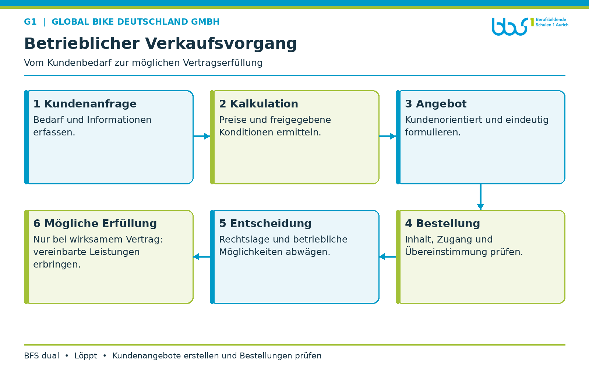
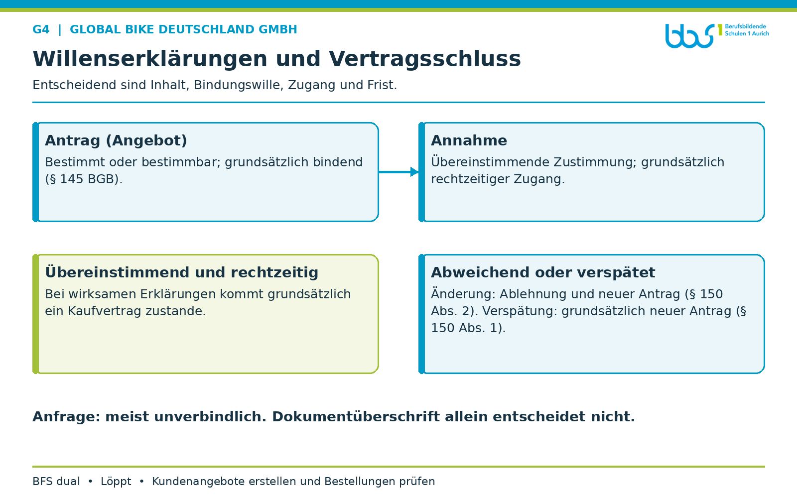
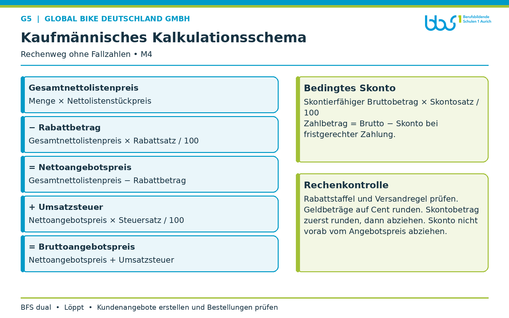
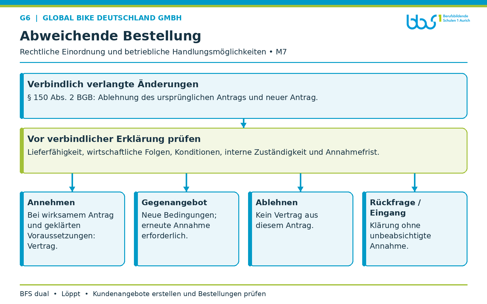
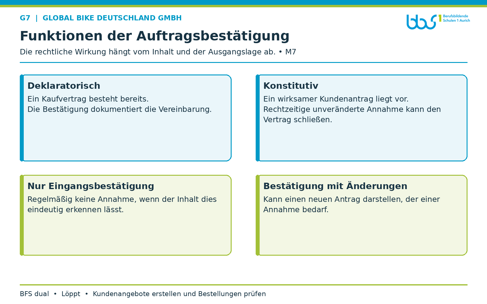
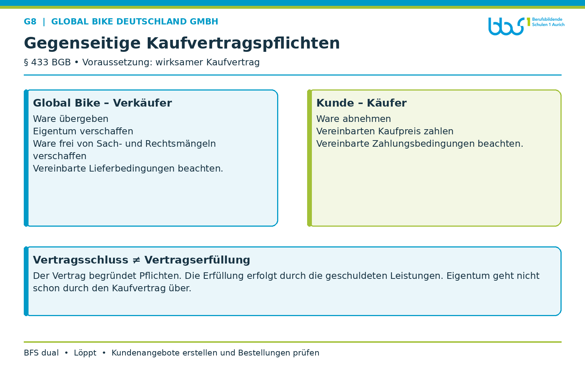
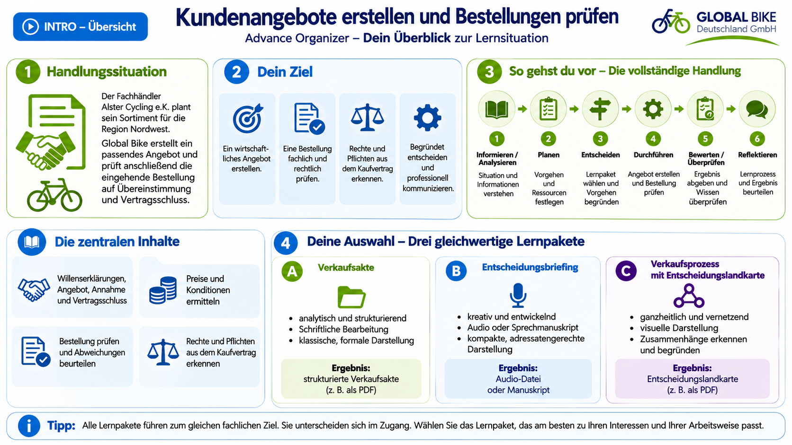
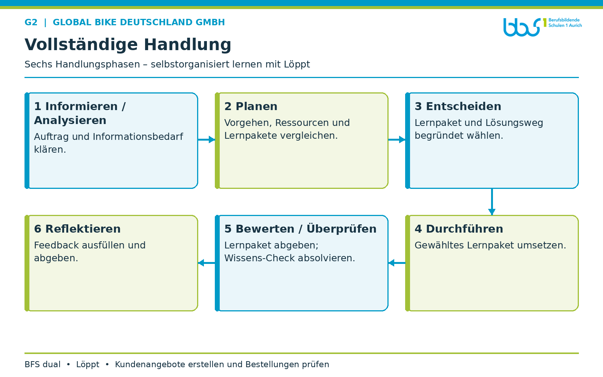
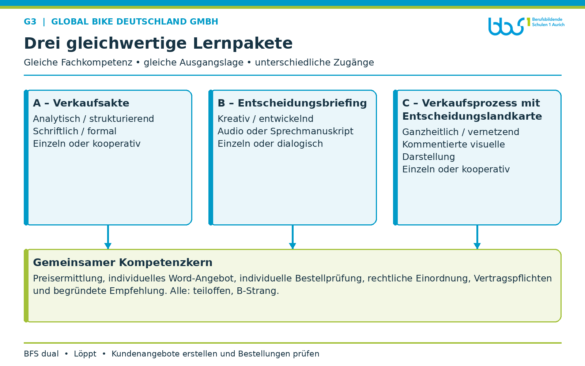

# BFS dual · Lernfeld 2 · LS 2.4 · Kundenangebote erstellen und Bestellungen prüfen

**Bildungsgang** · BFS dual, Profil Wirtschaft  
**Lernsituation** · 2.4 · Kundenangebote erstellen und Bestellungen prüfen (Paketkennung `BFSDUAL-LF02-LS04`)  
**Unterrichtlicher Bezug** · Handlungsorientierte Fallbearbeitung bei der Global Bike Deutschland GmbH  
**Zeitrahmen** · 24 Unterrichtsstunden à 45 Minuten, insgesamt 1080 Minuten für einen gewählten Lernweg  
**Digitale Fassung** · [Orientierung öffnen](index.html) · [Unterlagen und Downloads](materialien.html)  
**Formgrundlage** · [BFSdual-Vorlage, Arbeitsstand vom 26. November 2026](https://github.com/macmaris83/Lernsituationen/blob/a1dd9b693df1a234bf3c7387198fcf5b5aab6afc/Fachbereiche/BFSdual/Vorlage_Lernsituation.md)

## Aufgabenzeiten

Für jeden der drei Wege gilt derselbe Zeitrahmen. Bei Durchführen zählt der Auftrag zum gewählten Lernpaket einmal.

| Station | Minuten je Lernweg |
| --- | ---: |
| Orientierung | 15 |
| Handlungssituation | 50 |
| Informieren | 145 |
| Fachbegriffscheck | 15 |
| Planen | 100 |
| Entscheiden | 60 |
| Durchführen | 490 |
| Bewerten | 165 |
| Reflektieren | 40 |
| **Gesamt** | **1080** |

## Orientierung

[Digitale Fassung öffnen](index.html)

BFS dual · Lernfeld 2 · Lernsituation 2.4 · 24 Unterrichtsstunden

#### Den Auftrag überblicken

Ein Händler bittet um ein Angebot für 20 Fahrräder. Du hast Preise, einen Mengenrabatt und eine Lieferfreigabe. Was darfst du verbindlich zusagen, und worauf musst du achten, wenn später eine Bestellung eingeht?

Jede Person erstellt ein eigenes verbindliches Word-Angebot (DOCX) und eine individuelle Bestellprüfung. Die gewählte Verkaufsakte, das Briefing oder die kommentierte Prozessdarstellung verbindet Preisrechnung, Erklärungen, Vertragsschluss, Auftragsbestätigung, Vertragspflichten und die Handlungsempfehlung für Emil Werner.

Du entscheidest, welche Aufgaben du selbstständig oder mit anderen bearbeitest. Für die Rückmeldung erhält jede Person ein fremdes Produkt.

15 Minuten

*Fachbuchverweis · Für diesen Auftrag ist keine Buchseite hinterlegt.*

Kompetenzprofil der Lernsituation

Die Gewichtung zeigt, wie häufig und wofür die Kompetenz in den Aufgaben gebraucht wird. 1 bedeutet „kurz in einer Aufgabe“, 6 „von der Vorbereitung bis zur Auswertung“.

| Kompetenz | Gewicht (1–6) | Was übe ich? |
| --- | --- | --- |
| F · Fachkompetenz | 6 / 6 | Ich berechne ein Kundenangebot, vergleiche eine Bestellung damit und begründe die rechtliche und kaufmännische Entscheidung. |
| P · Personalkompetenz | 5 / 6 | Ich kontrolliere Rechenwerte, Fristen und Freigaben vor jeder verbindlichen Zusage. |
| S · Sozialkompetenz | 5 / 6 | Ich erkläre der Kundschaft Konditionen verständlich und bereite für Emil Werner eine belastbare Entscheidung vor. |
| M · Methodenkompetenz | 6 / 6 | Ich prüfe die Erklärungen in zeitlicher Reihenfolge und belege Abweichungen durch einen genauen Soll-Ist-Vergleich. |
| D · Medienkompetenz | 6 / 6 | Ich erstelle und kontrolliere in Word ein bearbeitbares Angebot auf der betrieblichen Vorlage. |

## Handlungssituation

[Digitale Fassung öffnen](handlungssituation.html)

Lies den betrieblichen Auftrag und beantworte die Fragen in eigenen Worten.

 

Emil Werner vergleicht Anfrage, Angebot und Bestellung von Alster Cycling in der Auftragsbearbeitung.

#### Den Fall lesen

Am 2. Februar 2027 bittet Alster Cycling e.K. die Global Bike Deutschland GmbH um ein schriftliches Angebot für 20 silberne Deluxe Touringbikes. Der Händler plant sein Sortiment für Ostfriesland. Er möchte Preise, Mengenrabatt, Liefer- und Zahlungsbedingungen sowie die Gültigkeitsdauer kennen.

Emil Werner aus der Auftragsbearbeitung gibt dir den Fall. Jan Richter hat die Lieferfähigkeit für die angefragten 20 Räder und die Konditionen in M2 freigegeben. Erstelle ein verbindliches, befristetes Angebot mit dem simulierten Angebots- und Zugangsdatum 3. Februar 2027. Offene Anschrifts- und Kontaktdaten kennzeichnest du im Entwurf.

Nach der Prüfung deines Angebots erhältst du eine zweite Nachricht von Alster Cycling. Vergleiche die Bestellung mit deinem eigenen Angebot, prüfe die Rechtswirkung und bereite für Emil Werner eine begründete Entscheidung über das weitere Vorgehen vor.

20 Minuten

*Fachbuchverweis · Für diesen Auftrag ist keine Buchseite hinterlegt.*

#### Welches Produkt, welche Menge und welche Informationen fordert der Händler an?

Lesehilfe

Lies die Anfrage vom 2. Februar in M1.

Deine Antwort

10 Minuten

*Fachbuchverweis · Für diesen Auftrag ist keine Buchseite hinterlegt.*

#### Wer darf die Lieferfähigkeit und die Konditionen freigeben?

Lesehilfe

Im Fall sind die Verantwortung für die Auftragsbearbeitung und die Freigabe im Vertrieb getrennt.

Deine Antwort

10 Minuten

*Fachbuchverweis · Für diesen Auftrag ist keine Buchseite hinterlegt.*

#### Warum bewahrst du deine erste Angebotsfassung auf?

Lesehilfe

Überlege, welche beiden Erklärungen du nach Eingang der Bestellung vergleichen musst.

Deine Antwort

10 Minuten

*Fachbuchverweis · Für diesen Auftrag ist keine Buchseite hinterlegt.*

## Informieren

[Digitale Fassung öffnen](informieren.html)

Erschließe die Angaben und Unterlagen für deinen Auftrag.

73 Minuten

#### Anfrage und Freigabe lesen

Markiere in [M1](#m1) den Kundenwunsch und Emils Auftrag. Ordne in [M2](#m2) Artikel, Mengenstaffel, Leistungsumfang und Zuständigkeiten zu.

*Fachbuchverweis · Für diesen Auftrag ist keine Buchseite hinterlegt.*

72 Minuten

#### Die rechtlichen und rechnerischen Grundlagen klären

Prüfe mit [M3](#m3) die Rechtswirkung einer Anfrage. Erprobe das Kalkulationsschema in [M4](#m4) zunächst an einem dortigen Beispiel.

*Fachbuchverweis · Für diesen Auftrag ist keine Buchseite hinterlegt.*

[Begriffsblatt zum Nachschlagen](#glossar) · [Begriffe prüfen](#begriffstraining)

## Fachbegriffscheck

[Digitale Fassung öffnen](begriffstraining.html)

Wähle zu jedem Begriff die passende Erklärung. Du kannst den Check wiederholen.

15 Minuten

[Begriffsblatt öffnen](#glossar)

Karte `BFSDUAL-LF02-LS04-B01`

**1. Willenserklärung**

- Hinreichend bestimmter Vorschlag, der durch Zustimmung zum Vertrag führen kann.
- Erklärung gelangt so zum Empfänger, dass unter gewöhnlichen Umständen Kenntnisnahme möglich ist.
- Äußerung, die auf eine Rechtsfolge gerichtet ist.

Karte `BFSDUAL-LF02-LS04-B02`

**2. Antrag**

- Hinreichend bestimmter Vorschlag, der durch Zustimmung zum Vertrag führen kann.
- Uneingeschränkte Zustimmung zu einem vorliegenden Antrag.
- Zeitraum, innerhalb dessen ein Antrag angenommen werden kann.

Karte `BFSDUAL-LF02-LS04-B03`

**3. Annahme**

- Uneingeschränkte Zustimmung zu einem vorliegenden Antrag.
- Äußerung, die auf eine Rechtsfolge gerichtet ist.
- Erklärung gelangt so zum Empfänger, dass unter gewöhnlichen Umständen Kenntnisnahme möglich ist.

Karte `BFSDUAL-LF02-LS04-B04`

**4. Zugang**

- Zeitraum, innerhalb dessen ein Antrag angenommen werden kann.
- Hinreichend bestimmter Vorschlag, der durch Zustimmung zum Vertrag führen kann.
- Erklärung gelangt so zum Empfänger, dass unter gewöhnlichen Umständen Kenntnisnahme möglich ist.

Karte `BFSDUAL-LF02-LS04-B05`

**5. Annahmefrist**

- Zeitraum, innerhalb dessen ein Antrag angenommen werden kann.
- Äußerung, die auf eine Rechtsfolge gerichtet ist.
- Uneingeschränkte Zustimmung zu einem vorliegenden Antrag.

Karte `BFSDUAL-LF02-LS04-B06`

**6. Mengenrabatt**

- Preis nach unbedingten Nachlässen, ohne Umsatzsteuer.
- Preisnachlass in Abhängigkeit von der Abnahmemenge.
- Angebotspreis einschließlich Umsatzsteuer.

Karte `BFSDUAL-LF02-LS04-B07`

**7. Nettoangebotspreis**

- Ausgangspreis ohne Umsatzsteuer und ohne Preisnachlässe.
- Steuer, die beim steuerpflichtigen Verkauf zum Nettobetrag hinzukommt.
- Preis nach unbedingten Nachlässen, ohne Umsatzsteuer.

Karte `BFSDUAL-LF02-LS04-B08`

**8. Umsatzsteuer**

- Angebotspreis einschließlich Umsatzsteuer.
- Steuer, die beim steuerpflichtigen Verkauf zum Nettobetrag hinzukommt.
- Preisnachlass in Abhängigkeit von der Abnahmemenge.

Karte `BFSDUAL-LF02-LS04-B09`

**9. Bruttoangebotspreis**

- Ausgangspreis ohne Umsatzsteuer und ohne Preisnachlässe.
- Angebotspreis einschließlich Umsatzsteuer.
- Preis nach unbedingten Nachlässen, ohne Umsatzsteuer.

Karte `BFSDUAL-LF02-LS04-B10`

**10. Skonto**

- Bedingter Preisnachlass bei Zahlung innerhalb der vereinbarten Frist.
- Zeitraum, innerhalb dessen die Zahlung erfolgen muss, um den bedingten Preisnachlass zu nutzen.
- Vereinbarter Zeitraum für die geschuldete Lieferung.

Karte `BFSDUAL-LF02-LS04-B11`

**11. Zahlungsziel**

- Vereinbarte Frist für die Zahlung ohne Skontoabzug.
- Vereinbarter Zeitraum für die geschuldete Lieferung.
- Bedingter Preisnachlass bei Zahlung innerhalb der vereinbarten Frist.

Karte `BFSDUAL-LF02-LS04-B12`

**12. Lieferfrist**

- Vereinbarung darüber, wer die Kosten des Versands trägt.
- Zeitraum, innerhalb dessen die Zahlung erfolgen muss, um den bedingten Preisnachlass zu nutzen.
- Vereinbarter Zeitraum für die geschuldete Lieferung.

Karte `BFSDUAL-LF02-LS04-B13`

**13. Abweichende Bestellung**

- Bestellung mit verbindlich verlangten Änderungen gegenüber einem vorliegenden Angebot.
- Begründet als wirksame Annahme eines Kundenantrags den Vertrag.
- Erneuter Vertragsvorschlag, der eine eigene Annahme erfordert.

Karte `BFSDUAL-LF02-LS04-B14`

**14. Neuer Antrag**

- Bestätigt lediglich den Erhalt einer Bestellung, sofern ihr Inhalt keine Annahme erklärt.
- Dokumentiert einen bereits zustande gekommenen Vertrag.
- Erneuter Vertragsvorschlag, der eine eigene Annahme erfordert.

Karte `BFSDUAL-LF02-LS04-B15`

**15. Deklaratorische Auftragsbestätigung**

- Dokumentiert einen bereits zustande gekommenen Vertrag.
- Begründet als wirksame Annahme eines Kundenantrags den Vertrag.
- Bestellung mit verbindlich verlangten Änderungen gegenüber einem vorliegenden Angebot.

Karte `BFSDUAL-LF02-LS04-B16`

**16. Konstitutive Auftragsbestätigung**

- Bestätigt lediglich den Erhalt einer Bestellung, sofern ihr Inhalt keine Annahme erklärt.
- Begründet als wirksame Annahme eines Kundenantrags den Vertrag.
- Erneuter Vertragsvorschlag, der eine eigene Annahme erfordert.

Karte `BFSDUAL-LF02-LS04-B17`

**17. Eingangsbestätigung**

- Dokumentiert einen bereits zustande gekommenen Vertrag.
- Bestätigt lediglich den Erhalt einer Bestellung, sofern ihr Inhalt keine Annahme erklärt.
- Bestellung mit verbindlich verlangten Änderungen gegenüber einem vorliegenden Angebot.

Karte `BFSDUAL-LF02-LS04-B18`

**18. Übergabe**

- Entrichtung des vereinbarten Kaufpreises durch den Käufer.
- Dem Käufer das Eigentum an der Ware übertragen.
- Dem Käufer die tatsächliche Verfügung über die Ware ermöglichen.

Karte `BFSDUAL-LF02-LS04-B19`

**19. Eigentumsverschaffung**

- Dem Käufer das Eigentum an der Ware übertragen.
- Ware entspricht den maßgeblichen Anforderungen und ist frei von entgegenstehenden Rechten Dritter, die nicht übernommen werden sollen.
- Entgegennahme der gekauften Ware durch den Käufer.

Karte `BFSDUAL-LF02-LS04-B20`

**20. Kaufpreiszahlung**

- Entrichtung des vereinbarten Kaufpreises durch den Käufer.
- Dem Käufer das Eigentum an der Ware übertragen.
- Entgegennahme der gekauften Ware durch den Käufer.

## Planen

[Digitale Fassung öffnen](planen.html)

Entwirf deinen Arbeitsplan.

50 Minuten

#### Rechnen und Schreiben vorbereiten

Plane vom angefragten Bedarf bis zum geprüften Word-Dokument. Lege in [M5](#m5) fest, wo Produkt, Preise, Fristen und Bedingungen stehen sollen.

*Fachbuchverweis · Für diesen Auftrag ist keine Buchseite hinterlegt.*

50 Minuten

#### Vergleichstabelle vorbereiten

Entwirf Spalten für eigenes Angebot, Bestellung, Übereinstimmung oder Abweichung, Rechtsfolge und nächste Freigabe. Nutze die Prüffragen aus [M7](#m7).

*Fachbuchverweis · Für diesen Auftrag ist keine Buchseite hinterlegt.*

## Entscheiden

[Digitale Fassung öffnen](entscheiden.html)

Wähle einen von drei gleichwertigen Arbeitswegen. Du kannst deine Wahl begründet ändern.

**Lernpaket wählen**

A · Verkaufsakte · Ordne Schriftstücke, Rechenwege und Prüfergebnisse nach Vorgang. · Eine Akte mit Querverweisen unterstützt die schriftliche Übergabe an Emil Werner.

B · Entscheidungsbriefing · Erkläre den Vorgang als kurzes Audio oder selbst verfasstes Sprechmanuskript. · Ein Briefing verknüpft die Rechenbelege mit deiner rechtlichen und betrieblichen Empfehlung.

C · Verkaufsprozess mit Entscheidungslandkarte · Zeige Belege, Erklärungen und Handlungsmöglichkeiten auf einer kommentierten Übersicht. · Ein Prozessbild verdeutlicht, wann eine Freigabe oder neue Erklärung erforderlich wird.

Jede Person erstellt ein eigenes verbindliches Word-Angebot (DOCX) und eine individuelle Bestellprüfung. Die gewählte Verkaufsakte, das Briefing oder die kommentierte Prozessdarstellung verbindet Preisrechnung, Erklärungen, Vertragsschluss, Auftragsbestätigung, Vertragspflichten und die Handlungsempfehlung für Emil Werner.

60 Minuten

#### Konditionen und Nachweise festlegen

Begründe mit [M2](#m2) Preisstaffel und Bedingungen. Halte fest, wo du die Rechnung und die spätere individuelle Bestellprüfung im gewählten Lernprodukt nachweist.

*Fachbuchverweis · Für diesen Auftrag ist keine Buchseite hinterlegt.*

## Durchführen

[Digitale Fassung öffnen](durchfuehren.html)

Bearbeite den Auftrag im gewählten Format.

[Wähle in Entscheiden dein Lernpaket A, B oder C](#entscheiden), um die Aufträge zu öffnen.

Deine Wahl:  · [Wahl ändern](#entscheiden)

Jede Person erstellt ein eigenes verbindliches Word-Angebot (DOCX) und eine individuelle Bestellprüfung. Die gewählte Verkaufsakte, das Briefing oder die kommentierte Prozessdarstellung verbindet Preisrechnung, Erklärungen, Vertragsschluss, Auftragsbestätigung, Vertragspflichten und die Handlungsempfehlung für Emil Werner.

123 Minuten

#### Individuelles Angebot erstellen und prüfen

Berechne aus [M2](#m2) sämtliche Beträge und Fristen. Erstelle mit [M5 und der Word-Vorlage](#m5) dein eigenes befristetes Angebot. Sichere genau diese Fassung. Lass die gemeinsamen Ausgangskonditionen vor der Ausgabe von M6 prüfen.

*Fachbuchverweis · Für diesen Auftrag ist keine Buchseite hinterlegt.*

244 Minuten

**Lernpaket A**

#### Die Verkaufsakte abschließen

Führe Rechnung, eigenes Angebot und individuellen Prüfvermerk zusammen. Nenne die Rechtsfolge und die Handlungsempfehlung für Emil Werner mit Belegstellen.

*Fachbuchverweis · Für diesen Auftrag ist keine Buchseite hinterlegt.*

244 Minuten

**Lernpaket B**

#### Ein Entscheidungsbriefing ausarbeiten

Erkläre Emil Werner als Audio oder Manuskript den Verlauf, den Vergleich und die möglichen Entscheidungen. Verweise auf Rechenweg, eigenes Word-Angebot und individuellen Prüfvermerk.

*Fachbuchverweis · Für diesen Auftrag ist keine Buchseite hinterlegt.*

244 Minuten

**Lernpaket C**

#### Die Entscheidungslandkarte fertigstellen

Verbinde Anfrage, Angebot, Bestellung und rechtliche Prüfung. Kommentiere die Handlungsmöglichkeiten einschließlich erforderlicher Freigaben und füge dein Word-Angebot und deine Bestellprüfung bei.

*Fachbuchverweis · Für diesen Auftrag ist keine Buchseite hinterlegt.*

123 Minuten

#### Zweite Nachricht auswerten

Erhalte M6 nach Prüfung deines Angebots von der Lehrkraft. Vergleiche beide Dokumente individuell. Unterscheide mit [M7](#m7) die Erklärungsinhalte. Prüfe Vertragsschluss, Handlungsalternativen und mit [M8](#m8) die Pflichten, die sich bei wirksamem Vertrag ergeben.

*Fachbuchverweis · Für diesen Auftrag ist keine Buchseite hinterlegt.*

Kriterien für das fertige Produkt

- Angefragter Artikel und Menge stimmen. Rabatt, Netto, Umsatzsteuer, Brutto und bedingtes Skonto sind mit Bezugsgröße und kaufmännischer Rundung nachvollziehbar.
- Das individuelle Angebot nennt Lieferfreigabe, Versandkosten, Zahlungsbedingungen, Gültigkeit und letzten Annahmetag. Fehlende Anschriftsdaten bleiben offen.
- Die eigene Bestellprüfung vergleicht Menge, Preise, Zahlungs- und Lieferkonditionen sowie Zugang Zeile für Zeile mit dem tatsächlich erstellten Angebot.
- Rechtswirkung und Vertragspflichten werden anhand der zeitlichen Folge begründet. Eingangsbestätigung, deklaratorische und konstitutive Bestätigung sind unterschieden.
- Die Empfehlung benennt zulässige Alternativen, notwendige interne Freigaben und den nächsten Schritt für Emil Werner.

## Bewerten

[Digitale Fassung öffnen](bewerten.html)

Peer-Check am Handlungsprodukt.

42 Minuten

#### Das Produkt für den Peer-Check bereitstellen

**Reiche** deine Arbeit in der Moodle-Aktivität „Peer-Feedback“ ein. Verwende neutrale Titel und Dateinamen. Entferne Namen aus Text und Dateieigenschaften. Bei einem gemeinsamen Produkt reicht jede Person eine Kopie im eigenen Konto ein. Ohne eingerichtete Aktivität verteilt die Lehrkraft codierte Arbeiten.

*Fachbuchverweis · Für diesen Auftrag ist keine Buchseite hinterlegt.*

82 Minuten

#### Ein fremdes Produkt prüfen

**Prüfe** die dir zugeteilte Arbeit mit den Kriterien unten. Benenne eine konkrete Fundstelle, eine fachlich gelungene Stelle und einen begründeten Verbesserungsvorschlag. Gib die Rückmeldung in Moodle oder mit dem [ausfüllbaren Peer-Bogen](#peer-check) ab. Dein Name ist für die empfangende Person sichtbar.

*Fachbuchverweis · Für diesen Auftrag ist keine Buchseite hinterlegt.*

41 Minuten

#### Die empfangene Rückmeldung nutzen

**Lies** das Feedback zu deinem Produkt. Verbessere die genannte Stelle oder begründe am Material, weshalb du deine Fassung beibehältst. Ergebnis ist die für die weitere Verwendung geprüfte Fassung.

*Fachbuchverweis · Für diesen Auftrag ist keine Buchseite hinterlegt.*

### Fachliche Prüfkriterien

- Angefragter Artikel und Menge stimmen. Rabatt, Netto, Umsatzsteuer, Brutto und bedingtes Skonto sind mit Bezugsgröße und kaufmännischer Rundung nachvollziehbar.
- Das individuelle Angebot nennt Lieferfreigabe, Versandkosten, Zahlungsbedingungen, Gültigkeit und letzten Annahmetag. Fehlende Anschriftsdaten bleiben offen.
- Die eigene Bestellprüfung vergleicht Menge, Preise, Zahlungs- und Lieferkonditionen sowie Zugang Zeile für Zeile mit dem tatsächlich erstellten Angebot.
- Rechtswirkung und Vertragspflichten werden anhand der zeitlichen Folge begründet. Eingangsbestätigung, deklaratorische und konstitutive Bestätigung sind unterschieden.
- Die Empfehlung benennt zulässige Alternativen, notwendige interne Freigaben und den nächsten Schritt für Emil Werner.

[Peer-Check öffnen oder drucken](#peer-check)

## Reflektieren

[Digitale Fassung öffnen](reflektieren.html)

Dein Feedback zum Unterricht.

40 Minuten

#### Feedback zur Lernsituation abgeben

**Fülle** die Aktivität „Feedback“ im Moodle-Kurs aus. Melde zurück, welches Material geholfen hat, wo ein Auftrag unklar war, wie Zeit und Wahlmöglichkeiten passten und was wir ändern sollten. Verwende alternativ den [ausfüllbaren Feedbackbogen](#feedback) und gib ihn wie vereinbart ab.

*Fachbuchverweis · Für diesen Auftrag ist keine Buchseite hinterlegt.*

[Feedbackbogen öffnen](#feedback)

## Materialien
| Kennung | Unterlage |
| --- | --- |
| FEEDBACK | [Feedback zur Lernsituation](#feedback) |
| M1 | [M1 – Kundenanfrage und betrieblicher Arbeitsauftrag](#m1) |
| M2 | [M2 – Produktinformationen, Preise und Konditionen](#m2) |
| M3 | [M3 – Willenserklärungen, Angebot und Annahme](#m3) |
| M4 | [M4 – Preise und Konditionen ermitteln](#m4) |
| M5 | [M5 – Betriebliche Bürovorlage zur Angebotserstellung](#m5) |
| M6 | [M6 · Kundenbestellung erhalten](#m6) |
| M7 | [M7 – Abweichende Bestellung und Auftragsbestätigung](#m7) |
| M8 | [M8 – Pflichten aus dem Kaufvertrag](#m8) |
| M9 | [M9 · Begriffsblatt zu Angebot und Bestellung](#m9) |
| Ü1 | [Ü1 · Ü1 – Willenserklärungen](#ue1) |
| Ü2 | [Ü2 · Ü2 – Zustandekommen von Kaufverträgen](#ue2) |
| Ü3 | [Ü3 · Ü3 – Preise, Rabatte und Skonto](#ue3) |
| Ü4 | [Ü4 · Ü4 – Angebote erstellen und überprüfen](#ue4) |
| Ü5 | [Ü5 · Ü5 – Abweichende Bestellungen](#ue5) |
| Ü6 | [Ü6 · Ü6 – Auftragsbestätigungen](#ue6) |
| Ü7 | [Ü7 · Ü7 – Pflichten aus dem Kaufvertrag](#ue7) |
| ÜBERSICHT | [Übersicht zum Verkaufsvorgang](#uebersicht) |
| MATERIALIEN | [Materialübersicht und Quellen](#materialien) |
| PEER-CHECK | [Peer-Check · LS 2.4](#peer-check) |

## Feedback zur Lernsituation

[Digitale Fassung öffnen](feedback.html)

Wie lief die Arbeit an der Lernsituation „Kundenangebote erstellen und Bestellungen prüfen“? Beschreiben Sie Ihre Erfahrungen so konkret, dass die Lehrkraft den nächsten Durchgang daran anpassen kann.

Welches Material hat Ihnen an welcher Stelle geholfen?

Wo war ein Auftrag oder eine Darstellung unklar?

Wie passten Zeit und freie Wahl des Arbeitswegs zu Ihrem Vorgehen?

Was sollten wir beim nächsten Durchgang beibehalten oder ändern?

**Feedback abgeben.** Im Moodle-Kurs können Sie Ihre Antworten in die Aktivität „Feedback“ übertragen und dort abgeben. Alternativ drucken Sie den ausgefüllten Bogen ohne Namen aus und geben ihn der Lehrkraft an der vereinbarten Sammelstelle. Die Eingaben bleiben bis zum Verlassen dieser Seite im geöffneten Bogen. Für eine eigene Kopie laden Sie die Textdatei herunter.

## M1 – Kundenanfrage und betrieblicher Arbeitsauftrag

[Digitale Fassung öffnen](material/m1.html)

Materialart: Betriebliche Korrespondenz. Bereitstellung ab Phase 1.

### M1.1 – Eingehende Kundenanfrage

**Von:** Alster Cycling e.K.

**An:** Global Bike Deutschland GmbH

**Datum:** 02.02.2027

**Betreff:** Angebotsanfrage – Deluxe Touringbike Silber

Guten Tag,

vielen Dank für Ihre bisherige Unterstützung.

Unsere Sortimentsplanung für den ostfriesischen Markt ist inzwischen weiter fortgeschritten.

Wir interessieren uns konkret für die Abnahme von 20 Deluxe Touringbikes in Silber und bitten Sie um ein schriftliches Angebot.

Für unsere interne Entscheidung benötigen wir insbesondere Informationen zu den Preisen, möglichen Mengenrabatten sowie Ihren Liefer- und Zahlungsbedingungen.

Bitte teilen Sie uns auch mit, wie lange Ihr Angebot gültig ist.

Nach Prüfung Ihres Angebots werden wir über eine Bestellung entscheiden.

Vielen Dank im Voraus.

Mit freundlichen Grüßen

Alster Cycling e.K.

### M1.2 – Interner betrieblicher Arbeitsauftrag

**Von:** Emil Werner – Auftragsbearbeitung

**An:** Auftragsbearbeitung

**Betreff:** Weitere Bearbeitung der Anfrage von Alster Cycling

Guten Morgen,

Alster Cycling hat seine Anfrage inzwischen konkretisiert.

Bitte übernehmen Sie die weitere Bearbeitung des Verkaufsvorgangs und erstellen Sie auf Grundlage der vorliegenden Kundenanfrage und der freigegebenen Konditionen ein verbindliches, befristetes Angebot.

Sobald die Bestellung des Kunden vorliegt, prüfen Sie diese und beurteilen Sie die rechtlichen und kaufmännischen Auswirkungen.

Bereiten Sie Ihre Ergebnisse so auf, dass ich über die weitere Auftragsbearbeitung entscheiden kann.

Bitte beachten Sie, dass Änderungen der freigegebenen Konditionen zunächst intern abgestimmt werden müssen.

Vielen Dank!

Emil Werner

Auftragsbearbeitung

 

Betrieblicher Verkaufsvorgang

## M2 – Produktinformationen, Preise und Konditionen

[Digitale Fassung öffnen](material/m2.html)

Materialart: Interner Stammdatenauszug und vertriebliche Konditionenfreigabe. Bereitstellung ab Phase 1.

### M2.1 – Kundenstammdatenauszug

| Merkmal | Stammdaten |
| --- | --- |
| Kundenname | Alster Cycling e.K. |
| Debitorennummer | 11### |
| Verkaufsorganisation | DN01 |
| Vertriebsweg | GH |
| Sparten | ZU und BI |

Quelle: Stammdaten Global Bike.xlsx – Debitoren Stammdaten.

Die aktuellen geschäftlichen Kontakt- und Anschriftendaten sind im bereitgestellten Auszug nicht enthalten.

### M2.2 – Produktstammdatenauszug

**Deluxe Touringbike (silber)**

Materialnummer: DXTR2000

Quelle: Stammdaten Global Bike.xlsx – Fertigwaren Stammdaten.

### M2.3 – Interne Konditionenfreigabe

Global Bike Deutschland GmbH – Verkauf und Marketing

Geltungsbereich: Verkaufsvorgang Alster Cycling e.K.

Produkt: Deluxe Touringbike (silber), DXTR2000

Listenverkaufspreis je Stück, netto: **2.500,00 EUR**

| Abnahmemenge | [Mengenrabatt](#mengenrabatt) |
| --- | --- |
| 1–9 Stück | 0 % |
| 10–19 Stück | 5 % |
| 20–29 Stück | 10 % |
| Ab 30 Stück | 12 % |

Die Rabattstaffeln gelten alternativ und werden nicht miteinander kombiniert. Der zutreffende Rabatt gilt für die gesamte Bestellmenge.

| Kondition | Freigegebene Regelung |
| --- | --- |
| [Umsatzsteuer](#umsatzsteuer) | 19 % |
| [Skonto](#skonto) | 2 % bei Zahlung innerhalb von 10 Tagen ab Rechnungsdatum |
| [Zahlungsziel](#zahlungsziel) | 30 Tage ab Rechnungsdatum ohne Abzug |
| Versandkosten | Übernahme durch Global Bike |
| Versandabwicklung | Über Hamburg |
| [Lieferfrist](#lieferfrist) | Innerhalb von 14 Kalendertagen nach Vertragsschluss |
| Angebotsgültigkeit | 14 Kalendertage ab Angebotsdatum |
| Verbindlichkeit | Verbindliches, befristetes Angebot |

#### Interne Lieferfreigabe

Die Lieferfähigkeit für die angefragten 20 Fahrräder ist für diesen Verkaufsvorgang bestätigt.

Änderungen der Abnahmemenge oder der freigegebenen Konditionen bedürfen einer erneuten internen Prüfung.

Jan Richter – Leitung Verkauf und Marketing

**Quellenhinweis:** Preise, Rabattstaffeln, Zahlungs- und Lieferbedingungen sowie Lieferfreigabe sind bestätigte didaktische Fallvorgaben, keine tatsächlichen SAP-Konditionsdaten.

## M3 – Willenserklärungen, Angebot und Annahme

[Digitale Fassung öffnen](material/m3.html)

Global Bike Deutschland GmbH | Fachinformation | ab Phase 1 | bedarfsorientiert nutzbar

### 1. Worum geht es?

In der Auftragsbearbeitung gehen täglich Anfragen, Bestellungen und Nachrichten von Geschäftspartnern ein. Nicht jede Nachricht verpflichtet Global Bike bereits zur Lieferung. Wer eine Nachricht bearbeitet, muss deshalb unterscheiden, ob ein Kunde lediglich Informationen benötigt, einen verbindlichen [Antrag](#antrag) stellt oder einem bestehenden Angebot zustimmt. Diese Unterscheidung schützt beide Geschäftspartner vor Missverständnissen und ungeprüften Zusagen.

Die folgenden Mini-Fälle sind eigenständige Unterrichtssimulationen. Produktbezeichnungen und Beispielbedingungen dienen ausschließlich der Erklärung; sie stellen keine neuen SAP-Stammdaten oder betrieblichen Freigaben dar.

### 2. Was ist eine Willenserklärung?

Eine [Willenserklärung](#willenserklaerung) ist eine Äußerung, die auf eine Rechtsfolge gerichtet ist. Wer beispielsweise verbindlich eine Ware kaufen möchte und dies gegenüber dem Verkäufer erklärt, will eine rechtliche Bindung herbeiführen. Nicht jede Äußerung im Geschäftsverkehr ist deshalb eine Willenserklärung.

| Form | Erläuterung | Beispiel |
| --- | --- | --- |
| Schriftlich | Der Wille wird schriftlich ausgedrückt (alltagssprachlich; keine Aussage über gesetzliche Schriftform). | Ein Händler sendet eine verbindliche Bestellung per E-Mail. |
| Mündlich | Der Wille wird ausgesprochen. | Ein Händler nimmt telefonisch ein konkretes Angebot sofort unverändert an. |
| Durch schlüssiges Verhalten | Das Verhalten lässt im Zusammenhang einen Rechtsfolgewillen erkennen. | Global Bike führt einen wirksamen Kundenantrag durch Versand aus, wenn nach den Umständen diese Handlung als [Annahme](#annahme) genügt. |

Schweigen ist grundsätzlich keine Annahme. Besondere gesetzliche oder kaufmännische Ausnahmen werden hier nicht vertieft. Auch eine interne Notiz, die noch nicht gegenüber dem Geschäftspartner erklärt wurde, ist nicht allein deshalb ein wirksamer Antrag.

**Merke:** Entscheidend ist nicht das Medium, sondern der erkennbare Wille, eine Rechtsfolge herbeizuführen.

### 3. Anfrage, Angebot, Bestellung und Auftragsbestätigung

| Dokument | Bedeutung im betrieblichen Regelfall |
| --- | --- |
| Anfrage | Unverbindliche Informationsbeschaffung |
| Angebot | Verbindlicher Antrag oder unverbindliche Aufforderung zur Bestellung, abhängig vom Inhalt |
| Bestellung | Annahme eines passenden verbindlichen Angebots oder eigener Antrag |
| Auftragsbestätigung | Annahme eines Antrags oder Dokumentation eines bereits bestehenden Vertrags |

Ein Antrag (auch Angebot genannt) muss so bestimmt sein, dass der Empfänger grundsätzlich durch ein einfaches Ja den Vertrag schließen kann. Beim Kauf müssen insbesondere Vertragspartner, Ware und Preis bestimmt oder bestimmbar sein. Auch Menge und vereinbarte Konditionen sind zu beachten.

Eine Annahme ist die Zustimmung zu einem Antrag. Sie muss grundsätzlich inhaltlich mit diesem übereinstimmen und rechtzeitig wirksam werden.

**Mini-Fall: Informationsbedarf.** Ein Händler schreibt an Global Bike: „Welche Fahrradpumpen können Sie derzeit anbieten?“ Er nennt noch keine verbindliche Kaufabsicht. Die Nachricht dient der Informationsbeschaffung. Ein Kaufvertrag entsteht nicht.

**Mini-Fall: unverbindliche Preisinformation.** Global Bike teilt einem Händler ausdrücklich unverbindliche Preise für Zubehör mit. Der Händler bestellt anschließend verbindlich zu bestimmten Bedingungen. Die Bestellung kann nun selbst der Antrag sein. Eine wirksame Annahme durch Global Bike ist noch erforderlich.

### 4. Bindung an einen Antrag

Nach § 145 BGB ist der Antragende grundsätzlich an seinen Antrag gebunden, sofern er die Bindung nicht ausgeschlossen hat. Das bedeutet: Der Empfänger kann den Antrag innerhalb der maßgeblichen Frist durch eine passende Annahme zum Vertrag werden lassen. Ein Antrag ist nicht mit einem bereits geschlossenen Vertrag gleichzusetzen.

Freizeichnungsklauseln können die Bindung ausschließen. Formulierungen wie „unverbindlich“ oder „freibleibend“ sind deshalb wichtige Hinweise. Der gesamte Wortlaut und der Zusammenhang müssen betrachtet werden.

### 5. Zugang und Annahmefrist

Bei empfangsbedürftigen Willenserklärungen gegenüber Abwesenden kommt es grundsätzlich auf den [Zugang](#zugang) an (§ 130 Abs. 1 BGB). Zugang liegt vor, wenn die Erklärung in den Empfangsbereich gelangt und unter gewöhnlichen Umständen mit der Möglichkeit der Kenntnisnahme zu rechnen ist. Tatsächliches Lesen ist nicht zwingend erforderlich. Ein vorher oder gleichzeitig zugehender Widerruf verhindert die Wirksamkeit.

| Vorschrift | Bedeutung |
| --- | --- |
| § 146 BGB | Ablehnung oder nicht rechtzeitige Annahme lässt den Antrag erlöschen. |
| § 147 BGB | Ohne festgelegte Frist: im unmittelbaren Gespräch grundsätzlich sofort; gegenüber Abwesenden innerhalb der gewöhnlich zu erwartenden Antwortzeit. |
| § 148 BGB | Bei festgelegter [Annahmefrist](#annahmefrist) muss die Annahme innerhalb dieser Frist erfolgen. |
| § 150 Abs. 1 BGB | Verspätete Annahme gilt grundsätzlich als [neuer Antrag](#neuer-antrag). |
| § 150 Abs. 2 BGB | Annahme mit Änderungen gilt als Ablehnung verbunden mit einem neuen Antrag. |

**Mini-Fall: Frist.** Global Bike bietet einem Händler verbindlich Zubehör an. Die Annahme muss bis Freitag eingehen. Der Händler sendet seine Zustimmung am Donnerstag; sie geht erst am folgenden Montag zu. Im Regelfall ist sie verspätet und gilt als neuer Antrag. Die Ausnahme nach § 149 BGB bei erkennbar ungewöhnlich verspäteter Übermittlung bleibt zu beachten und wird hier nicht vertieft.

### 6. Ein vollständiger beispielhafter Schriftwechsel

| Vorgang | Nachricht | Fachliche Einordnung |
| --- | --- | --- |
| 1 | Händler: „Bitte nennen Sie uns Ihre Konditionen für zwölf Fahrradklingeln.“ | Anfrage, noch kein Kaufvertrag |
| 2 | Global Bike: „Wir bieten Ihnen verbindlich zwölf Fahrradklingeln zu insgesamt 96 EUR netto an, zuzüglich [Umsatzsteuer](#umsatzsteuer). Annahme bis Mittwoch; Lieferung und Zahlung gemäß den beigefügten vereinbarten Bedingungen.“ | Antrag, sofern die Bedingungen vollständig bestimmt oder bestimmbar sind |
| 3 | Händler: „Wir nehmen Ihr Angebot unverändert an.“ Die Nachricht geht am Dienstag zu. | Rechtzeitige, übereinstimmende Annahme |
| 4 | Global Bike bestätigt die vereinbarten Inhalte. | Dokumentation des bereits geschlossenen Vertrags |

Unter den genannten Voraussetzungen entsteht der Kaufvertrag bei Schritt 3, nicht erst bei Schritt 4. Alle Beträge und Bedingungen sind rein didaktisch.

### 7. Wenn die Erklärungen nicht übereinstimmen

Eine verbindlich verlangte Änderung ist keine unveränderte Annahme. Nach § 150 Abs. 2 BGB wird der ursprüngliche Antrag abgelehnt und ein neuer Antrag gestellt. Eine bloße Rückfrage ist dagegen nicht automatisch eine Ablehnung. Der Unterschied liegt im erkennbaren Erklärungswillen.

Beispiel: Ein Händler fragt nach einer anderen Verpackung, ohne bereits eine Bestellung zu erklären. Das kann eine unverbindliche Rückfrage sein. Erklärt er dagegen, ausschließlich zu einer geänderten Verpackungsbedingung verbindlich bestellen zu wollen, liegt bei einem zuvor verbindlichen Angebot grundsätzlich ein neuer Antrag vor. Die weitere betriebliche Prüfung erläutert M7.

### 8. Handlungshilfe: rechtliche Prüfung

1. Nachrichten in zeitlicher Reihenfolge betrachten.
2. Absender, Empfänger und Inhalt feststellen.
3. Prüfen, ob eine rechtliche Bindung gewollt ist.
4. Antrag und mögliche Annahme identifizieren.
5. Inhaltliche Übereinstimmung prüfen.
6. Zugang und maßgebliche Annahmefrist prüfen.
7. Ergebnis begründen: Vertrag geschlossen, noch offen oder Antrag erloschen bzw. neuer Antrag.

Erst wenn ein wirksamer Kaufvertrag vorliegt, entstehen die kaufvertraglichen Hauptpflichten nach § 433 BGB (M8).

### 9. Typische Fehler

| Fehlvorstellung | Fachlich richtig |
| --- | --- |
| Jede Bestellung schließt einen Vertrag. | Sie kann auch erst einen Antrag darstellen. |
| Ein Angebot ist bereits ein Vertrag. | Eine wirksame Annahme ist grundsätzlich erforderlich. |
| Absenden genügt zur Fristwahrung. | Grundsätzlich zählt der rechtzeitige Zugang. |
| Schweigen bedeutet Zustimmung. | Grundsätzlich nicht. |
| Eine Auftragsbestätigung ist immer erforderlich. | Ein Vertrag kann bereits vorher geschlossen sein. |
| Jede Rückfrage ist eine Ablehnung. | Wortlaut und Zusammenhang sind entscheidend. |

### 10. Schaubild und Merksätze

Schaubild G4: Willenserklärungen und Vertragsschluss (in Moodle hier einbetten).

**Merke:** Zwei wirksame, übereinstimmende Willenserklärungen – Antrag und Annahme – begründen grundsätzlich den Kaufvertrag. Dokumentüberschriften allein entscheiden nicht. Zugang, Frist und Inhalt sind gemeinsam zu prüfen.

Freiwillige Vertiefung: M9, Ü1 und Ü2; für abweichende Bestellungen M7 und Ü5.

### Gesetzesgrundlagen

[§ 130 BGB](https://www.gesetze-im-internet.de/bgb/__130.html), [§§ 145–151 BGB](https://www.gesetze-im-internet.de/bgb/BJNR001950896.html), [§ 433 BGB](https://www.gesetze-im-internet.de/bgb/__433.html). Didaktische Erläuterungen zum Regelfall; Rechts- und Geschäftsfähigkeit als Vorwissen. Sonderfälle nach §§ 149 und 151 BGB werden nicht vertieft. Die Rechtsgrundlagen wurden aus der bisherigen Fassung übernommen, nicht erneut online geprüft.

 

Willenserklärungen und Vertragsschluss

## M4 – Preise und Konditionen ermitteln

[Digitale Fassung öffnen](material/m4.html)

Global Bike Deutschland GmbH | Fachinformation | ab Phase 1 | bedarfsorientiert nutzbar

### 1. Worum geht es?

Ein Händler benötigt nicht nur einen Preis pro Fahrrad oder Zubehörartikel. Er möchte wissen, welchen Gesamtbetrag er zahlen muss, wann die Zahlung fällig wird und wann die Ware geliefert werden kann. In der Auftragsbearbeitung von Global Bike müssen diese Informationen zusammenpassen. Ein falscher Rabatt kann den Erlös verringern; eine ungeprüfte Lieferzusage kann zu Problemen bei der Erfüllung führen.

Alle folgenden Beispiele sind unabhängige Unterrichtssimulationen mit Zubehörartikeln. Die Zahlen sind keine SAP-Preise oder betrieblichen Freigaben. Für den eigentlichen Verkaufsvorgang gilt ausschließlich M2.

### 2. Fachbegriffe

| Begriff | Bedeutung |
| --- | --- |
| Nettolistenstückpreis | Ausgangspreis eines Artikels ohne [Umsatzsteuer](#umsatzsteuer) und vor Rabatt |
| Gesamtnettolistenpreis | Menge mal Nettolistenstückpreis |
| [Mengenrabatt](#mengenrabatt) | Preisnachlass abhängig von der Abnahmemenge |
| Rabattbetrag | Preisnachlass in Euro |
| [Nettoangebotspreis](#nettoangebotspreis) | Gesamtpreis nach unbedingten Nachlässen, ohne Umsatzsteuer |
| Nettostückpreis nach Rabatt | Nettoangebotspreis geteilt durch Menge, sofern nur Warenpreis enthalten |
| Umsatzsteuer | Steuer, die beim steuerpflichtigen Verkauf zum Nettobetrag hinzukommt |
| [Bruttoangebotspreis](#bruttoangebotspreis) | Nettoangebotspreis zuzüglich Umsatzsteuer |
| [Skonto](#skonto) | Bedingter Preisnachlass bei fristgerechter Zahlung |
| [Zahlungsziel](#zahlungsziel) | Frist für Zahlung ohne Skontoabzug |
| Lieferbedingungen | Vereinbarungen über Lieferung, Frist und Versandkosten |
| Angebotsgültigkeit | Zeitraum, in dem ein befristeter [Antrag](#antrag) angenommen werden kann |

### 3. Prozentrechnung als Werkzeug

Der Grundwert ist der Betrag, auf den sich ein Prozentsatz bezieht. Der Prozentwert ist der errechnete Teilbetrag. Beispielsweise sind 6 % von 350 EUR genau 21 EUR: 350 × 6 / 100 = 21. Auf dem Taschenrechner kann auch 350 × 0,06 eingegeben werden.

Ein Rabatt wird abgezogen. Umsatzsteuer wird hinzugerechnet. Der jeweilige Grundwert ist wichtig: Die Umsatzsteuer wird nach dem Rabatt auf den steuerpflichtigen Nettobetrag berechnet, nicht auf den ursprünglichen Listenwert. Skonto wird in unseren Beispielen auf den skontierfähigen Bruttobetrag berechnet.

### 4. Allgemeines Kalkulationsschema

1. Menge × Nettolistenstückpreis = Gesamtnettolistenpreis.
2. Gesamtnettolistenpreis × Rabattsatz / 100 = Rabattbetrag.
3. Gesamtnettolistenpreis − Rabattbetrag = Nettoangebotspreis (bei kostenfreier Lieferung).
4. Nettoangebotspreis × Umsatzsteuersatz / 100 = Umsatzsteuer.
5. Nettoangebotspreis + Umsatzsteuer = Bruttoangebotspreis.
6. Skontierfähiger Bruttobetrag × Skontosatz / 100 = möglicher Skontoabzug.
7. Bruttoangebotspreis − Skontoabzug = möglicher Zahlbetrag bei fristgerechter Zahlung.

Der sechste und siebte Schritt verändern nicht den zunächst ausgewiesenen Bruttoangebotspreis. Versandkosten sind nach der jeweiligen Vereinbarung gesondert zu berücksichtigen.

Schaubild G5: Kaufmännisches Kalkulationsschema (in Moodle einbetten).

### 5. Beispiel A – vollständige Kalkulation

Global Bike kalkuliert acht Zubehörartikel zu je 125,00 EUR netto, 4 % Rabatt, 19 % Umsatzsteuer und 3 % Skonto innerhalb von sieben Tagen ab Rechnungsdatum, sonst 21 Tage ohne Abzug. Versandkosten trägt Global Bike.

| Schritt | Rechnung | Betrag |
| --- | --- | --- |
| Listenwert | 8 × 125,00 | 1.000,00 EUR |
| Rabatt | 1.000,00 × 0,04 | 40,00 EUR |
| Nettoangebot | 1.000,00 − 40,00 | 960,00 EUR |
| Umsatzsteuer | 960,00 × 0,19 | 182,40 EUR |
| Bruttoangebot | 960,00 + 182,40 | 1.142,40 EUR |
| Mögliches Skonto | 1.142,40 × 0,03 | 34,27 EUR |
| Möglicher Zahlbetrag | 1.142,40 − 34,27 | 1.108,13 EUR |

Der Nettostückpreis nach Rabatt beträgt 960,00 / 8 = 120,00 EUR. Bei Zahlung nach Ablauf der Skontofrist, aber innerhalb des Zahlungsziels, sind 1.142,40 EUR zu zahlen. Die Skontonutzung ist freiwillig.

### 6. Beispiel B – Rabattstaffel richtig anwenden

Für einen unabhängigen Verkauf von Fahrradkörben gelten beispielhaft folgende Staffel und ein Nettolistenstückpreis von 32,00 EUR:

| Menge | Rabatt auf die gesamte Menge |
| --- | --- |
| 1–14 | 0 % |
| 15–39 | 6 % |
| ab 40 | 9 % |

Ein Händler fragt 18 Körbe an. Die mittlere Stufe gilt für alle 18 Stück, nicht nur für die Stücke oberhalb der Mengengrenze. Die Rabatte werden nicht addiert.

| Schritt | Rechnung | Betrag |
| --- | --- | --- |
| Listenwert | 18 × 32,00 | 576,00 EUR |
| Rabatt | 576,00 × 0,06 | 34,56 EUR |
| Nettoangebot | 576,00 − 34,56 | 541,44 EUR |
| Nettostückpreis | 541,44 / 18 | 30,08 EUR |
| Umsatzsteuer | 541,44 × 0,19 | 102,87 EUR |
| Bruttoangebot | 541,44 + 102,87 | 644,31 EUR |

Versandkosten übernimmt Global Bike; kein Skonto vereinbart. Bei genau 40 Stück wäre die höchste Stufe erreicht. Bei anderen Staffelmodellen können Teilmengen unterschiedlich rabattiert werden. Maßgeblich ist immer die konkrete Freigabe. Eine größere Menge bedeutet nicht automatisch, dass sie lieferbar ist.

### 7. Beispiel C – Versandkosten und Rundung

Global Bike kalkuliert sieben Fahrradpflegeartikel zu je 19,95 EUR netto mit 5 % Rabatt auf die Ware. Zusätzlich sind 8,00 EUR netto Versandkosten vereinbart. Für dieses Beispiel gelten 19 % Umsatzsteuer auf Ware und Versand sowie 1,5 % Skonto auf den gesamten Bruttobetrag.

| Schritt | Rechnung | Betrag |
| --- | --- | --- |
| Listenwert | 7 × 19,95 | 139,65 EUR |
| Rabatt | 139,65 × 0,05 = 6,9825 | 6,98 EUR |
| Warenwert netto | 139,65 − 6,98 | 132,67 EUR |
| Gesamt netto | 132,67 + 8,00 | 140,67 EUR |
| Umsatzsteuer | 140,67 × 0,19 = 26,7273 | 26,73 EUR |
| Brutto | 140,67 + 26,73 | 167,40 EUR |
| Skonto | 167,40 × 0,015 = 2,511 | 2,51 EUR |
| Zahlbetrag mit Skonto | 167,40 − 2,51 | 164,89 EUR |

Der rabattierte Warenstückpreis beträgt rechnerisch 132,67 / 7 = rund 18,95 EUR. Sieben gerundete Stückpreise ergeben 132,65 EUR. Die Differenz von zwei Cent entsteht durch Rundung. Nach der für diese Lernsituation festgelegten Gesamtbetragsmethode bleibt der nachvollziehbar ermittelte Gesamtwarenwert maßgeblich. Einen gerundeten Stückpreis als solchen kennzeichnen; bei echten Geschäftsdokumenten die betriebliche Rundungsregel beachten und Widersprüche klären.

### 8. Rabatt, Skonto und Rundung

Rabatt ist ein unbedingter Nachlass, der direkt in den Angebotspreis eingeht. Skonto ist bedingt. Wird Skonto tatsächlich genutzt, ändert sich auch die Umsatzsteuerbemessungsgrundlage; die buchhalterische Behandlung wird hier nicht vertieft.

Für diese Lernsituation werden Rabatt und Umsatzsteuer jeweils auf Basis des Gesamtbetrags berechnet und auf Cent gerundet. Bei Skonto zuerst den Abzugsbetrag runden, dann vom Bruttobetrag abziehen. Kaufmännisch gilt: dritte Nachkommastelle 0–4 abrunden, 5–9 aufrunden. Beispiel: 12,345 EUR wird zu 12,35 EUR. Nicht bereits den Prozentsatz oder unnötige Zwischenwerte runden.

### 9. Liefer- und Zahlungsbedingungen

Eine klare [Lieferfrist](#lieferfrist) nennt Dauer und Fristbeginn. „Innerhalb von acht Kalendertagen nach Vertragsschluss“ ist eindeutiger als „bald“. Kalendertage umfassen auch Wochenenden; bei Fristenden können gesetzliche Sonderregeln gelten. Versandkosten und Lieferfähigkeit sind getrennt zu prüfen. Die operative Abwicklung erfolgt über bestehende Standorte, insbesondere Hamburg.

Ein Zahlungsziel nennt Frist und Ausgangsdatum. Beispiel: „1,5 % Skonto bei Zahlung innerhalb von sechs Tagen ab Rechnungsdatum, sonst innerhalb von 18 Tagen ohne Abzug.“ Skontofrist und Zahlungsziel laufen hier vom gleichen Ausgangsdatum, nicht nacheinander. Das Beispiel setzt rechtzeitigen Rechnungszugang voraus. Die Angebotsgültigkeit betrifft dagegen die [Annahme](#annahme) des Angebots, nicht die Zahlung. Keine Kondition ohne Freigabe zusagen.

### 10. Handlungshilfe und Selbstkontrolle

| Typischer Fehler | Kontrolle |
| --- | --- |
| Falsche Rabattstufe | Menge und Grenzwerte vergleichen |
| Rabattstufen addiert | Regel zur gesamten Menge oder Teilmengen prüfen |
| Umsatzsteuer vor Rabatt berechnet | Steuerpflichtigen Nettobetrag als Basis verwenden |
| Skonto sofort vom Angebot abgezogen | Brutto und bedingten Zahlbetrag trennen |
| Versandkosten ungeprüft weggelassen | Kostenregel und Steuerbasis prüfen |
| Fristen verwechselt | Beginn, Dauer und Zweck jeder Frist prüfen |

Freiwillige Selbstkontrolle: Sind Menge, Einheit und Prozentsätze eindeutig? Ist der Nettopreis nach Rabatt höchstens so hoch wie der Listenwert (ohne zusätzliche Kosten)? Ist der Bruttobetrag bei positiver Umsatzsteuer größer als der Nettobetrag? Ist der mögliche Skontozahlbetrag kleiner als der Bruttobetrag? Stimmen die Ergebnisse mit der freigegebenen Regelung überein?

**Merke:** Erst die freigegebenen Konditionen klären, dann nachvollziehbar rechnen. Rabatt und Skonto haben unterschiedliche Funktionen. M4 ersetzt weder M2 noch M5.

Freiwillige Vertiefung: M9 und Ü3; Anwendung in Ü4.

 

Kaufmännisches Kalkulationsschema

## M5 – Betriebliche Bürovorlage zur Angebotserstellung

[Digitale Fassung öffnen](material/m5.html)

Global Bike Deutschland GmbH | Selbstlernmaterial | ab Phase 1 verfügbar, Verwendung in Phase 4

[Bearbeitbare Angebotsvorlage öffnen (DOCX)](material/M5_Angebotsvorlage.docx). Simuliertes Angebotsdatum und Zugang: 03.02.2027. Die Annahmefrist ist gemäß M2 zu ermitteln. Alle fachlichen Werte sind selbst einzutragen.

### 1. Worum geht es?

Ein Angebot verbindet kaufmännische Berechnungen mit professioneller Kundenkommunikation. Ein Händler soll erkennen können, welche Ware Global Bike zu welchen Bedingungen anbietet. Auch die Auftragsbearbeitung benötigt eindeutige Angaben, damit eine spätere Bestellung mit dem Angebot verglichen werden kann.

Ein ansprechend gestaltetes Dokument allein reicht nicht aus. Preise, Konditionen und rechtliche Aussagen müssen stimmen. Ein verbindliches Angebot kann rechtliche Folgen haben (M3). Deshalb werden nur intern freigegebene Bedingungen verwendet.

### 2. Welche Informationen gehören in die Vorlage?

| Bereich | Funktion |
| --- | --- |
| Empfänger | Geschäftspartner eindeutig benennen |
| Datum und Angebotsreferenz | Vorgang zeitlich und organisatorisch zuordnen |
| Betreff | Anlass und Gegenstand erkennen lassen |
| Anrede und Einleitung | Kundenorientiert auf die Anfrage eingehen |
| Artikeltabelle | Artikel, Materialnummer, Menge, Nettolistenstückpreis und Gesamtlistenwert netto darstellen |
| Preisübersicht | Listenwert, Rabatt, [Nettoangebotspreis](#nettoangebotspreis), [Umsatzsteuer](#umsatzsteuer) und [Bruttoangebotspreis](#bruttoangebotspreis) ausweisen |
| Nettostückpreis nach Rabatt | Rabattierten Preis pro Stück nachvollziehbar machen |
| Lieferbedingungen | [Lieferfrist](#lieferfrist), Fristbeginn und Versandkostenregel angeben |
| Zahlungsbedingungen | Skontosatz, Skontofrist, [Zahlungsziel](#zahlungsziel) und Fristbeginn eindeutig nennen |
| Angebotsgültigkeit und Verbindlichkeit | Rechtliche Bindung und [Annahmefrist](#annahmefrist) klar ausdrücken |
| Schluss und Grußformel | Professionellen Abschluss gestalten |
| Name/Funktion und Unternehmenspflichtangaben | Absender und betriebliche Zuordnung kenntlich machen |

Die Artikeltabelle der vorhandenen Vorlage verwendet den Listenpreis netto je Stück. Der Gesamtwert dieser Zeile ist daher vor Rabatt zu berechnen. Der Rabatt erscheint anschließend in der Preisübersicht. So wird derselbe Nachlass nicht zweimal abgezogen.

### 3. Informationen vorbereiten

Die Kundenanfrage liefert den Bedarf. M2 enthält die belegten Stammdaten und die für den Fall freigegebenen Konditionen. M4 erläutert die Berechnung. M3 hilft bei der rechtlichen Formulierung.

Fehlende Anschriften, Ansprechpartner oder Unternehmenspflichtangaben werden nicht erfunden. Die vorgesehenen Platzhalter bleiben als erkennbare Hinweise auf fehlende Informationen bestehen. Auch eine Angebotsreferenz darf keine echte SAP-Belegnummer vortäuschen. Eine eindeutig als Unterrichtsreferenz gekennzeichnete Bezeichnung kann zur Zuordnung dienen. Kein tatsächlicher Versand und keine SAP-Buchung.

Die Vorlage ist eine didaktische Bürovorlage, keine auf DIN 5008 geprüfte oder rechtsvollständige Geschäftsvorlage. Für reale Geschäftsschreiben wären die fehlenden Angaben und gesetzlichen Anforderungen vor Versand zu klären.

### 4. Arbeiten mit Word

1. Die DOCX-Datei öffnen und über „Speichern unter“ eine eigene Arbeitskopie erstellen. Je nach Word-Version heißt die Funktion auch „Kopie speichern“. Ein nachvollziehbarer Dateiname erleichtert die Zuordnung.
2. Die vorhandenen Textfelder und Tabellen nutzen. Platzhalter gezielt ersetzen, statt das Layout neu aufzubauen. Belegte Empfängerangaben übernehmen.
3. Einen aussagekräftigen Betreff und eine kurze Einleitung formulieren. Unbekannte Ansprechpartner nicht erfinden.
4. Artikelbezeichnung, Materialnummer, Menge und Listenpreise aus den freigegebenen Informationen übernehmen. Die Artikeltabelle und Preisübersicht anhand der eigenen Kalkulation ausfüllen.
5. Nettostückpreis nach Rabatt, Liefer- und Zahlungsbedingungen sowie Angebotsgültigkeit ergänzen. Beträge mit zwei Nachkommastellen und eindeutiger Währungsangabe darstellen.
6. Schluss, Grußformel und betriebliche Funktion ergänzen. Fehlende Pflichtangaben sichtbar offen lassen.
7. Rechtschreibprüfung und Druckvorschau nutzen. Tabellenbreiten, Seitenumbrüche, abgeschnittene Texte und widersprüchliche Beträge kontrollieren. Die Vorlage berechnet Preise nicht automatisch.
8. Die bearbeitbare Word-Datei speichern. Sie bleibt als individueller Nachweis Bestandteil des gewählten Lernpakets.

Die Menübezeichnungen können je nach Word-Version variieren. Die vorhandene Vorlage wird nicht durch eine neue Pflichtvorlage ersetzt.

### 5. Formulierungsbeispiele

Die folgenden Textbausteine stammen aus unabhängigen, fiktiven Zubehörvorgängen bei Global Bike. Sie sind keine freigegebenen Konditionen für den eigentlichen Fall und kein vollständiges Musterangebot.

| Zweck | Mögliches Beispiel |
| --- | --- |
| Betreff | Angebot – Fahrradkörbe |
| Anrede ohne bekannten Namen | Sehr geehrte Damen und Herren, |
| Bezug zur Anfrage | Vielen Dank für Ihre Anfrage zu unserem Fahrradzubehör. |
| Einleitung | Gerne unterbreiten wir Ihnen das folgende Angebot. |
| Lieferfrist | Die Lieferung erfolgt innerhalb von acht Kalendertagen nach Vertragsschluss. |
| Versandkosten | Die vereinbarten Versandkosten sind in der Preisübersicht gesondert ausgewiesen. |
| Zahlungsbedingungen | Bei Zahlung innerhalb von sechs Tagen ab Rechnungsdatum gewähren wir 1,5 % [Skonto](#skonto). Andernfalls ist der Rechnungsbetrag innerhalb von 18 Tagen ab Rechnungsdatum ohne Abzug zu zahlen. |
| Befristung | Dieses Angebot ist verbindlich. Ihre [Annahme](#annahme) muss uns spätestens am angegebenen Fristende zugehen. |
| Schluss | Für Rückfragen stehen wir Ihnen gerne zur Verfügung. |
| Grußformel | Mit freundlichen Grüßen |

Die Beispiele zeigen sprachliche Möglichkeiten. Konkrete Angaben müssen zur jeweiligen Freigabe passen. Die Befristung muss im eigenen Angebot durch ein eindeutiges Fristende konkretisiert werden. Eine unverbindliche Formulierung wie „freibleibend“ darf nicht versehentlich in ein verbindlich vorgesehenes Angebot übernommen werden.

### 6. Beispiel: unklare Angaben verbessern

Ein fiktiver Entwurf für Fahrradzubehör enthält „Lieferung schnell, Zahlung wie üblich“. Der Kunde kann daraus weder einen konkreten Lieferzeitraum noch die Zahlungsfrist erkennen. Sind intern beispielsweise acht Kalendertage ab Vertragsschluss und 18 Tage ab Rechnungsdatum freigegeben, können diese Angaben eindeutig ausformuliert werden.

Ein weiterer Entwurf nennt einen Gesamtpreis ohne Kennzeichnung als netto oder brutto. Die Preisübersicht muss beide Beträge und die Umsatzsteuer nachvollziehbar unterscheiden. Ein bedingter Skontoabzug darf nicht als bereits gewährter Rabatt erscheinen.

### 7. Typische Fehler vermeiden

| Fehler | Verbesserung |
| --- | --- |
| Artikel oder Materialnummer vertauscht | Mit belegten Produktinformationen abgleichen |
| Rabatt zweimal abgezogen | Listenwert und rabattierten Wert getrennt ausweisen |
| Skonto als sicherer Nachlass dargestellt | Zahlungsbedingung ausdrücklich nennen |
| Lieferfrist ohne Fristbeginn | Ausgangsereignis angeben |
| Unklare Angebotsgültigkeit | Eindeutiges Annahmefristende nennen |
| Fehlende Anschrift erfunden | Fehlende Information sichtbar offen lassen |
| Ungeprüfte Sonderkondition zugesagt | Nur freigegebene Bedingungen verwenden |
| Tabelleninhalt abgeschnitten | Druckvorschau und Layout prüfen |

### 8. Freiwillige Selbstkontrolle vor der Angebotsprüfung

Die folgende Checkliste ist eine Arbeitshilfe, keine zusätzliche Abgabe.

- Kunden- und Produktangaben stimmen mit den belegten Informationen überein.
- Menge, Nettolistenstückpreis und Gesamtlistenwert stimmen.
- Rabatt, Nettoangebotspreis, Umsatzsteuer und Bruttoangebotspreis sind nachvollziehbar.
- Nettostückpreis nach Rabatt ist korrekt ausgewiesen.
- Lieferfrist, Fristbeginn und Versandkostenregel sind eindeutig.
- Skonto, Skontofrist und Zahlungsziel sind richtig formuliert.
- Verbindlichkeit und Annahmefrist sind eindeutig.
- Keine fehlenden Stammdaten oder ungeprüften Zusagen wurden erfunden.
- Sprache, Tabellen und Druckansicht sind professionell.
- Die individuelle Word-Datei ist gespeichert.

### 9. Einordnung in den Arbeitsprozess

Die Lehrkraft prüft das individuell erstellte Angebot auf die gemeinsamen Ausgangskonditionen, bevor M6 freigegeben wird. Bei Korrekturbedarf bleibt M6 zunächst gesperrt. Die spätere Bestellung wird mit dem eigenen Angebot verglichen. Diese Freigabe ist keine zusätzliche Pflichtabgabe und gilt für alle drei Lernpakete gleichermaßen.

**Merke:** Ein gutes Angebot ist fachlich richtig, rechtlich eindeutig, kundenorientiert und nachvollziehbar gestaltet. Die Bürovorlage unterstützt die Arbeit, ersetzt aber weder die eigene Berechnung noch die fachliche Prüfung.

Freiwillige Vertiefung: Ü4 mit separater Bürovorlage und Musterlösung; M3 und M4 als Nachschlagehilfen.

## M6 · Kundenbestellung erhalten

[Digitale Fassung öffnen](material/m6.html)

Nach Fertigstellung und Prüfung des individuellen Word-Angebots gibt die Lehrkraft die zweite Kundenmitteilung aus. Bewahre dein eigenes Angebot für den Vergleich auf. Halte beim Prüfen Produkt, Menge, Netto-Einzelpreis, Rabatte, Lieferbedingungen, Zahlungsbedingungen und Zugang fest.

## M7 – Abweichende Bestellung und Auftragsbestätigung

[Digitale Fassung öffnen](material/m7.html)

Global Bike Deutschland GmbH | Fachinformation | ab Phase 1 dauerhaft und bedarfsorientiert verfügbar

### 1. Worum geht es?

In der Auftragsbearbeitung ist eine eingehende Bestellung nicht automatisch ein Auftrag zur Lieferung. Zunächst muss geklärt werden, was der Kunde tatsächlich erklärt hat, ob bereits ein Vertrag besteht und welche Handlungsmöglichkeiten Global Bike hat. Eine vorschnelle Auftragsbestätigung kann eine rechtliche Bindung auslösen. Umgekehrt darf ein bereits geschlossener Vertrag nicht einfach als unverbindlicher Kundenwunsch behandelt werden.

Alle Beispiele in diesem Material sind unabhängige Unterrichtssimulationen mit Fahrradzubehör. Sie enthalten keine neuen SAP-Stammdaten oder betrieblichen Freigaben.

### 2. Fachbegriffe

| Begriff | Bedeutung |
| --- | --- |
| Bestellung | Erklärung eines Kunden, die je nach Inhalt [Antrag](#antrag) oder [Annahme](#annahme) sein kann |
| [Abweichende Bestellung](#abweichende-bestellung) | Bestellung, deren verbindlich verlangte Bedingungen nicht mit einem vorherigen Angebot übereinstimmen |
| [Neuer Antrag](#neuer-antrag) | Neues verbindliches Vertragsangebot, das einer wirksamen Annahme bedarf |
| [Deklaratorische Auftragsbestätigung](#deklaratorische-auftragsbestaetigung) | Bestätigung, die einen bereits geschlossenen Vertrag dokumentiert |
| [Konstitutive Auftragsbestätigung](#konstitutive-auftragsbestaetigung) | Bestätigung, die durch wirksame Annahme einen Vertrag zustande bringt |
| [Eingangsbestätigung](#eingangsbestaetigung) | Nachricht, die lediglich den Empfang einer Erklärung bestätigt |
| Interne Freigabe | Betriebliche Zustimmung zur Bearbeitung oder Zusage bestimmter Bedingungen |

### 3. Systematischer Bestellprüfleitfaden

Eine Prüfung beginnt mit dem tatsächlich abgegebenen Angebot, nicht mit einer vermuteten oder gewünschten Vereinbarung. Angebot und Bestellung werden nebeneinander betrachtet. Bei fehlenden Informationen bleibt das Ergebnis zunächst offen.

| Prüfbereich | Leitfrage |
| --- | --- |
| Geschäftspartner und Bezug | Gehört die Bestellung zum Angebot? |
| Artikel und Ausführung | Stimmen Produkt, Materialnummer und vereinbarte Eigenschaften überein? |
| Menge | Ist die Abnahmemenge identisch? |
| Preis | Stimmen Preisbasis, Stückpreis, Rabatt und Gesamtbetrag? |
| Zahlung | Stimmen [Zahlungsziel](#zahlungsziel), [Skonto](#skonto), Fristbeginn und weitere Bedingungen? |
| Lieferung | Stimmen [Lieferfrist](#lieferfrist), Lieferart und Versandkostenregel? |
| Verbindlichkeit | War das ursprüngliche Angebot verbindlich? |
| [Zugang](#zugang) und Frist | Ist die Erklärung rechtzeitig wirksam geworden? |
| Erklärungsinhalt | Liegt eine Zustimmung, eine verbindliche Änderung oder nur eine Rückfrage vor? |

Eine allgemeine Prüfdokumentation kann die Spalten „Prüfmerkmal“, „Angebot“, „Bestellung“, „Übereinstimmung/Abweichung“ und „Bedeutung“ enthalten. Die Darstellungsform bleibt frei. Eine rechnerische Übereinstimmung allein genügt nicht: Auch nicht preisbezogene Bedingungen können rechtlich bedeutsam sein.

### 4. Rechtliche Einordnung

Nach § 145 BGB ist ein Antrag grundsätzlich bindend, sofern die Bindung nicht ausgeschlossen wurde. Eine rechtzeitige unveränderte Annahme eines wirksamen Antrags führt grundsätzlich zum Vertragsschluss. Bei Erklärungen gegenüber Abwesenden zählt regelmäßig der Zugang (§ 130 BGB).

| Ausgangslage | Rechtsfolge im Regelfall |
| --- | --- |
| Rechtzeitige unveränderte Annahme | Kaufvertrag entsteht |
| Annahme mit verbindlich verlangten Änderungen | Ablehnung und neuer Antrag (§ 150 Abs. 2 BGB) |
| Verspätete Annahme | Neuer Antrag (§ 150 Abs. 1 BGB; Ausnahme § 149 beachten) |
| Bestellung nach unverbindlicher Information | Kann selbst ein Antrag sein |
| Bloße Rückfrage | Nicht automatisch Annahme oder Ablehnung |

Ein abgelehnter Antrag erlischt nach § 146 BGB. Er kann nicht einfach später angenommen werden. Eine erneute Einigung ist notwendig. Ohne festgelegte [Annahmefrist](#annahmefrist) gilt § 147 BGB; bei gesetzter Frist § 148 BGB. Eine Rückfrage oder interne Prüfung verlängert die Annahmefrist nicht automatisch.

**Mini-Fall A – andere Ausführung:** Global Bike bietet verbindlich Fahrradhelme in einer bestimmten Ausführung an. Der Händler erklärt, ausschließlich eine andere Ausführung bestellen zu wollen. Die verbindliche Änderung ist nach § 150 Abs. 2 BGB ein neuer Antrag. Ein Kaufvertrag ist dadurch noch nicht geschlossen.

**Mini-Fall B – Rückfrage:** Ein Händler erhält ein verbindliches Angebot für Fahrradpumpen und fragt lediglich, ob eine andere Verpackung möglich wäre. Er erklärt weder eine Zustimmung noch eine Ablehnung. Die Rückfrage allein lässt das Angebot nicht automatisch erlöschen. Die Annahmefrist läuft weiter. Der genaue Wortlaut und Zusammenhang sind entscheidend.

**Mini-Fall C – Frist:** Ein verbindliches Angebot für Zubehör kann bis Donnerstag angenommen werden. Die unveränderte Zustimmung geht erst am darauffolgenden Dienstag zu. Im Regelfall gilt sie als neuer Antrag. § 149 BGB: War die Erklärung erkennbar so rechtzeitig abgesendet, dass sie normalerweise fristgerecht angekommen wäre, muss der Antragende die Verspätung unverzüglich anzeigen. Andernfalls gilt die Annahme als rechtzeitig. Im Beispiel wird eine solche Ausnahme nicht vorausgesetzt.

### 5. Auftragsbestätigung: zwei unterschiedliche Funktionen

Deklaratorisch bedeutet feststellend oder dokumentierend. Konstitutiv bedeutet rechtsbegründend. Entscheidend ist, ob vor der Bestätigung bereits ein Vertrag besteht und was die Bestätigung tatsächlich erklärt.

#### Deklaratorische Auftragsbestätigung

Ein Händler nimmt ein verbindliches Angebot für Fahrradschlösser rechtzeitig und unverändert an. Global Bike bestätigt anschließend die vereinbarten Inhalte. Der Vertrag besteht bereits seit der wirksamen Annahme durch den Händler. Die spätere Bestätigung dokumentiert ihn. Sie ist nicht der Zeitpunkt des Vertragsschlusses.

#### Konstitutive Auftragsbestätigung

Nach einer unverbindlichen Produktinformation bestellt ein Händler verbindlich Fahrradbeleuchtung zu eindeutig bestimmten Bedingungen. Global Bike prüft Lieferfähigkeit und interne Befugnisse und erklärt anschließend rechtzeitig die unveränderte Annahme. Die Bestätigung geht dem Händler zu. Unter diesen Voraussetzungen entsteht erst jetzt der Kaufvertrag.

#### Eingangsbestätigung

Ein Händler sendet einen verbindlichen Antrag für Zubehör. Global Bike teilt lediglich mit, dass die Nachricht eingegangen ist und geprüft wird. Wenn der gesamte Inhalt eindeutig keine Annahme enthält, entsteht dadurch regelmäßig kein Vertrag.

#### Bestätigung mit Änderungen

Global Bike antwortet auf einen noch offenen Kundenantrag für Fahrradständer mit einer verbindlich verlangten anderen Verpackungsregelung. Diese Antwort ist grundsätzlich keine unveränderte Annahme, sondern ein neuer Antrag. Der Kunde muss ihm zustimmen. Besteht dagegen bereits ein Vertrag, verändert eine abweichende Bestätigung diesen nicht allein durch ihre Übersendung; eine Vertragsänderung erfordert grundsätzlich eine Einigung.

| Frage | Deklaratorisch | Konstitutiv |
| --- | --- | --- |
| Vertrag vorher vorhanden? | Ja | Nein, wirksamer Antrag liegt vor |
| Funktion | Dokumentieren | Antrag annehmen |
| Vertragsschluss | Bereits vorher | Durch wirksame Annahme |
| Inhalt | Vereinbarung richtig wiedergeben | Antrag unverändert annehmen |

Die Überschrift „Auftragsbestätigung“ entscheidet nicht allein. Inhalt und Zusammenhang sind nach §§ 133 und 157 BGB maßgeblich. Eine interne Freigabe oder ein noch nicht abgesendeter Entwurf ist für sich keine zugegangene Annahme. Sonderfälle nach § 151 BGB werden nicht vertieft.

Schaubild G7: Funktionen der Auftragsbestätigung (in Moodle einbetten).

### 6. Betriebliche Entscheidungsmöglichkeiten

Die rechtliche Einordnung und die wirtschaftliche Entscheidung sind zwei unterschiedliche Schritte. Wenn bereits ein Vertrag besteht, sind dessen Pflichten zu beachten (M8). Liegt dagegen ein noch offener Kundenantrag vor, muss Global Bike vor einer verbindlichen Antwort die Voraussetzungen prüfen.

| Möglichkeit | Wann sinnvoll? | Rechtliche Folge |
| --- | --- | --- |
| Unverändert annehmen | Antrag besteht noch, Lieferfähigkeit und Konditionen sind geklärt, zuständige Person darf handeln | Bei wirksamer Annahme Vertragsschluss |
| Ablehnen | Bedingungen können oder sollen nicht erfüllt werden | Kein Vertrag aus diesem Antrag |
| Gegenangebot | Andere Bedingungen sind möglich und freigegeben | Neuer Antrag, Annahme erforderlich |
| Rückfrage oder reine Eingangsbestätigung | Angaben oder interne Voraussetzungen sind ungeklärt | Regelmäßig keine Annahme; Frist beachten |

Zur wirtschaftlichen Prüfung gehören verfügbare Mengen, Liefertermin, Kosten, Erlös, Zahlungsbedingungen und Kundenbeziehung. Ein höherer Umsatz bedeutet nicht automatisch höheren Gewinn. Ohne Kostendaten ist keine belastbare Gewinnberechnung möglich. Ungeklärte Konditionen sind intern abzustimmen. Interne Freigabe und rechtliche Vertretungsmacht sind nicht dasselbe; eine fehlende interne Freigabe verhindert nicht zwingend eine rechtliche Bindung nach außen.

**Mini-Fall D – Entscheidung:** Ein Händler stellt einen verbindlichen Antrag für Fahrradkörbe mit einer besonderen Verpackung. Global Bike kann die Standardverpackung liefern, die Sonderverpackung ist noch ungeklärt. Eine unveränderte Annahme wäre ohne Prüfung riskant. Eine klare Eingangsbestätigung und interne Klärung können sinnvoll sein. Falls die Sonderverpackung nicht möglich ist, kommen Ablehnung oder ein freigegebenes Gegenangebot infrage. Die Annahmefrist ist dabei zu beachten.

Schaubild G6: Abweichende Bestellung und Handlungsmöglichkeiten (in Moodle einbetten).

### 7. Sprachliche Handlungshilfen

Die folgenden Bausteine zeigen unterschiedliche Erklärungsabsichten. Sie sind keine fertigen Antworten auf den eigentlichen Kundenfall und keine Versandfreigabe.

| Absicht | Mögliches Formulierungsbeispiel |
| --- | --- |
| Eingang bestätigen | Vielen Dank für Ihre Bestellung. Wir bestätigen ausschließlich den Eingang. Eine Annahme erklären wir damit nicht. |
| Rückfrage | Bitte teilen Sie uns mit, welche Verpackungsausführung Sie benötigen. Eine verbindliche Zusage erfolgt damit noch nicht. |
| Antrag annehmen | Wir nehmen Ihre Bestellung zu den darin genannten Bedingungen unverändert an. |
| Bestehenden Vertrag dokumentieren | Wir bestätigen die bereits vereinbarten Vertragsbedingungen. |
| Antrag ablehnen | Ihren Antrag zu den genannten Bedingungen nehmen wir nicht an. |
| Gegenangebot | Ihren Antrag nehmen wir nicht an. Gerne unterbreiten wir Ihnen ein neues Angebot zu den nachfolgend genannten Bedingungen. |

Ein Gegenangebot muss seine konkreten Bedingungen eindeutig benennen. Die Annahmeformulierung darf nur verwendet werden, wenn eine verbindliche Annahme tatsächlich beabsichtigt und betrieblich zulässig ist. Ein Satz wie „Wir bestätigen Ihre Bestellung“ kann missverständlich sein, wenn lediglich der Eingang gemeint ist.

### 8. Typische Fehler und freiwillige Selbstkontrolle

| Fehler | Fachliche Korrektur |
| --- | --- |
| Jede Bestellung als Vertrag behandeln | Ausgangslage und Erklärungen prüfen |
| Nur den Gesamtpreis vergleichen | Alle vereinbarten Bedingungen vergleichen |
| Abweichung als unveränderte Annahme behandeln | § 150 Abs. 2 BGB beachten |
| Erloschenes Angebot als weiterhin bindend ansehen | Erneute Einigung erforderlich |
| Jede Bestätigung als Vertragsschluss ansehen | Deklaratorische und konstitutive Wirkung unterscheiden |
| Interne Freigabe mit Zugang verwechseln | Interne und externe Vorgänge trennen |
| Ohne Prüfung verbindlich zusagen | Lieferfähigkeit, Konditionen und Befugnisse klären |

Freiwillige Selbstkontrolle: Kann ich erklären, welche Erklärung zuerst vorlag? Kann ich Abweichungen konkret benennen und ihre rechtliche Bedeutung begründen? Kann ich den Zeitpunkt eines möglichen Vertragsschlusses bestimmen? Kann ich die Wirkung einer Bestätigung erklären und eine betriebliche Empfehlung von der rechtlichen Beurteilung unterscheiden?

**Merke:** Erst vergleichen, dann rechtlich einordnen, anschließend betrieblich entscheiden. Nicht jede Bestellung ist ein Vertrag und nicht jede Auftragsbestätigung begründet einen Vertrag.

Freiwillige Vertiefung: M9, Ü5 und Ü6; Grundlagen M3, Pflichten M8.

### Gesetzesgrundlagen

[§ 130 BGB](https://www.gesetze-im-internet.de/bgb/__130.html), [§ 133 BGB](https://www.gesetze-im-internet.de/bgb/__133.html), [§§ 145–151 BGB](https://www.gesetze-im-internet.de/bgb/BJNR001950896.html), [§ 157 BGB](https://www.gesetze-im-internet.de/bgb/__157.html). Didaktische Darstellung des Regelfalls. Kaufmännisches Bestätigungsschreiben, Vertretungsmacht und Sonderfälle werden nicht vertieft.

 

Abweichende Bestellung

Funktionen der Auftragsbestätigung · Nach bestehendem Vertrag ändert eine fehlerhafte Bestätigung die Abmachung nicht einseitig.

## M8 – Pflichten aus dem Kaufvertrag

[Digitale Fassung öffnen](material/m8.html)

Global Bike Deutschland GmbH | Fachinformation | ab Phase 1 dauerhaft und bedarfsorientiert verfügbar

### 1. Worum geht es?

Wenn Global Bike und ein Händler einen wirksamen Kaufvertrag schließen, entstehen auf beiden Seiten verbindliche Pflichten. Die Auftragsbearbeitung muss wissen, welche Leistungen geschuldet werden und wann sie zu erbringen sind. Der Vertragsschluss bedeutet aber nicht, dass die Ware bereits geliefert, das Eigentum übertragen oder der Kaufpreis bezahlt wurde.

Alle folgenden Zubehörbeispiele sind eigenständige Unterrichtssimulationen ohne neue SAP-Stammdaten.

### 2. Wann entstehen die Pflichten?

Ein wirksamer Kaufvertrag entsteht grundsätzlich durch übereinstimmende wirksame Willenserklärungen (M3 und M7). Eine bloße Anfrage oder ein noch nicht angenommener [Antrag](#antrag) begründet die kaufvertraglichen Hauptpflichten nicht. Vorvertragliche Pflichten können unabhängig davon bestehen, werden hier aber nicht vertieft.

Die Pflichten entstehen grundsätzlich mit dem Vertragsschluss. Wann sie fällig sind, richtet sich nach den vereinbarten Bedingungen und gesetzlichen Regeln.

### 3. Sämtliche Hauptpflichten nach § 433 BGB

| Verkäufer – Global Bike (§ 433 Abs. 1) | Käufer – Händler (§ 433 Abs. 2) |
| --- | --- |
| Ware übergeben | Vereinbarten Kaufpreis zahlen |
| Eigentum an der Ware verschaffen | Gekaufte Ware abnehmen |
| Ware frei von Sach- und Rechtsmängeln verschaffen | Vereinbarte Zahlungsbedingungen beachten (Konkretisierung der Zahlungspflicht) |

Liefer- und Zahlungsbedingungen konkretisieren die gesetzlichen Pflichten. Sie sind keine zusätzlichen eigenständigen Hauptpflichten aus dem Wortlaut des § 433 BGB.

### 4. Übergabe, Eigentum und Mangelfreiheit

[Übergabe](#uebergabe) bedeutet vereinfacht, dem Käufer die tatsächliche Verfügung über die Ware zu ermöglichen. Besitz beschreibt die tatsächliche Sachherrschaft; Eigentum die rechtliche Herrschaft über eine Sache. Beides ist nicht dasselbe.

[Eigentumsverschaffung](#eigentumsverschaffung) bedeutet, dass der Käufer rechtlich Eigentümer wird. Bei beweglichen Sachen erfolgt die Eigentumsübertragung im Regelfall durch Einigung über den Eigentumsübergang und Übergabe (§ 929 Satz 1 BGB). Der Kaufvertrag allein überträgt kein Eigentum. Sonderfälle werden hier nicht vertieft.

Sachmängelfreiheit bedeutet vereinfacht, dass die Ware bei Gefahrübergang den maßgeblichen vereinbarten und gesetzlichen Anforderungen entspricht (§ 434 BGB). Rechtsmängelfreiheit bedeutet, dass Dritte keine Rechte gegen den Käufer geltend machen können, die dieser nicht nach dem Kaufvertrag übernommen hat (§ 435 BGB).

**Mini-Fall A – Ware noch im Lager:** Ein Händler und Global Bike schließen einen Kaufvertrag über Fahrradpumpen. Die Ware befindet sich noch im Lager in Hamburg. Der Händler hat einen Anspruch auf die geschuldete Leistung, ist aber nicht allein durch den Kaufvertrag Eigentümer geworden. Übergabe und Eigentumsverschaffung stehen noch aus.

**Mini-Fall B – Beschaffenheit:** Ein Händler kauft neue, funktionsfähige Fahrradklingeln. Bei der Übergabe sind einige Klingeln bereits beschädigt und nicht funktionsfähig. Die Ware entspricht insoweit nicht der vereinbarten Beschaffenheit. Die Pflicht zur sachmangelfreien Verschaffung ist nicht ordnungsgemäß erfüllt. Welche konkreten Mängelrechte daraus folgen, ist nicht Gegenstand dieser Lernsituation.

**Mini-Fall C – Rechte Dritter:** Bei einem fiktiven Verkauf von Transportzubehör besteht ein nicht übernommenes Recht eines Dritten, das dieser gegen den Käufer geltend machen kann. Hier ist die Rechtsmängelfreiheit betroffen. Ein äußerlich einwandfreier Artikel kann also dennoch einen Rechtsmangel aufweisen.

### 5. Pflichten des Käufers

Der Käufer muss den vereinbarten Kaufpreis zahlen und die gekaufte Ware abnehmen. Abnahme meint hier die Entgegennahme der Ware im Rahmen der geschuldeten Leistung, nicht eine werkvertragliche Abnahmeprüfung. Die Zahlung muss entsprechend den vereinbarten Bedingungen erfolgen.

**Mini-Fall D – Abholung:** Global Bike und ein Händler vereinbaren wirksam die Abholung von Fahrradpedalen zu einem bestimmten Termin in Hamburg. Global Bike stellt die vertragsgemäße Ware zur vereinbarten Übergabe bereit. Der Händler muss die Ware entsprechend der Vereinbarung abnehmen und den vereinbarten Kaufpreis zahlen. Die Abholung ist in diesem Beispiel Teil der konkreten Liefervereinbarung, nicht bei jedem Kauf vorgeschrieben.

### 6. Rechte und Pflichten gehören zusammen

| Anspruch | Entsprechende Pflicht |
| --- | --- |
| Käufer: vereinbarte Ware erhalten | Verkäufer: Ware übergeben |
| Käufer: Eigentum erwerben | Verkäufer: Eigentum verschaffen |
| Käufer: mangelfreie Ware erhalten | Verkäufer: sach- und rechtsmangelfrei verschaffen |
| Verkäufer: Kaufpreis erhalten | Käufer: vereinbarten Kaufpreis zahlen |
| Verkäufer: Abnahme verlangen | Käufer: gekaufte Ware abnehmen |

Schaubild G8: Gegenseitige Kaufvertragspflichten (in Moodle einbetten).

### 7. Vertragsschluss und Vertragserfüllung im zeitlichen Zusammenhang

Ein unabhängiger Beispielvorgang: Global Bike verkauft einem Händler Fahrradpumpen. Beide einigen sich wirksam auf Lieferung innerhalb einer Woche nach Vertragsschluss und Zahlung innerhalb von 21 Tagen ab Rechnungsdatum. Die Versandkosten trägt in diesem Beispiel Global Bike.

| Vorgang | Bedeutung |
| --- | --- |
| Wirksame Einigung | Vertragsschluss: gegenseitige Pflichten entstehen |
| Vorbereitung im Lager | Betriebliche Vorbereitung der Erfüllung |
| Vertragsgemäße Übergabe und Eigentumsübertragung | Verkäufer erfüllt die entsprechenden Pflichten |
| Entgegennahme | Käufer erfüllt seine Abnahmepflicht |
| Zahlung des vereinbarten Betrags | Käufer erfüllt seine Zahlungspflicht |

Diese Reihenfolge ist ein vereinfachtes Beispiel, keine zwingende gesetzliche Reihenfolge. Zahlung kann etwa auch vor der Lieferung vereinbart sein. Übergabe und Eigentumsübertragung können in Sonderfällen zeitlich auseinanderfallen. Erfüllung bedeutet, dass die jeweils geschuldete Leistung bewirkt wird; dadurch erlischt der entsprechende Anspruch grundsätzlich (§ 362 Abs. 1 BGB).

### 8. Bedeutung der vereinbarten Konditionen

Die [Lieferfrist](#lieferfrist) konkretisiert den Zeitpunkt der geschuldeten Lieferung. Die Versandkostenregel legt fest, wer die vereinbarten Kosten trägt. Das [Zahlungsziel](#zahlungsziel) bestimmt, wann der Kaufpreis zu zahlen ist. [Skonto](#skonto) ist ein bedingter Nachlass und keine Pflicht zur vorzeitigen Zahlung.

Beispiel: Bei einem unabhängigen Zubehörverkauf beträgt der Bruttorechnungsbetrag 238,00 EUR. Vereinbart sind 1 % Skonto innerhalb von fünf Tagen ab Rechnungsdatum, sonst 16 Tage ohne Abzug; rechtzeitiger Rechnungszugang wird vorausgesetzt. Bei fristgerechter Skontonutzung beträgt der Zahlbetrag 235,62 EUR. Ohne Skontonutzung sind 238,00 EUR innerhalb des Zahlungsziels zu zahlen. Die Zahlung des reduzierten Betrags erfüllt bei wirksamer Skontovereinbarung und Einhaltung der Bedingungen die Zahlungspflicht.

### 9. Handlungshilfe und typische Fehler

Für die fachliche Einordnung sind vier Fragen hilfreich: Besteht bereits ein wirksamer Vertrag? Welche Leistungen schuldet jede Seite? Wann und unter welchen Bedingungen sind sie zu erbringen? Welche Leistungen sind bereits erbracht und welche stehen noch aus?

| Fehlvorstellung | Fachlich richtig |
| --- | --- |
| Anfrage verpflichtet bereits zur Lieferung | Kaufvertragliche Hauptpflichten setzen einen wirksamen Vertrag voraus |
| Kaufvertrag überträgt sofort Eigentum | Eigentumsübertragung ist ein eigener rechtlicher Vorgang |
| Versandvorbereitung ist bereits vollständige Erfüllung | Die geschuldeten Leistungen müssen bewirkt werden |
| Unbeschädigte Ware ist immer mangelfrei | Auch vereinbarte Eigenschaften und Rechte Dritter sind relevant |
| Nur der Verkäufer hat Pflichten | Käufer schuldet Zahlung und Abnahme |
| Skonto muss genutzt werden | Skonto ist eine bedingte Möglichkeit |
| Jede Pflicht ist sofort fällig | Vereinbarungen und gesetzliche Regeln bestimmen die Fälligkeit |

Freiwillige Selbstkontrolle: Kann ich alle Hauptpflichten beider Seiten nennen? Kann ich Besitz und Eigentum unterscheiden? Kann ich erklären, warum Vertragsschluss und Erfüllung nicht dasselbe sind? Kann ich aus einer vereinbarten Liefer- oder Zahlungsbedingung die konkrete Pflicht ableiten?

**Merke:** Der Kaufvertrag begründet Pflichten. Die Vertragserfüllung verwirklicht sie. Übergabe, Eigentumsverschaffung, Mangelfreiheit, Abnahme und Zahlung sind jeweils fachlich zu unterscheiden.

Freiwillige Vertiefung: M9 und Ü7; Zusammenhang mit M3 und M7.

### Gesetzesgrundlagen

[§ 433 BGB](https://www.gesetze-im-internet.de/bgb/__433.html), ergänzend [§ 434 BGB](https://www.gesetze-im-internet.de/bgb/__434.html), [§ 435 BGB](https://www.gesetze-im-internet.de/bgb/__435.html), [§ 929 BGB](https://www.gesetze-im-internet.de/bgb/__929.html), [§ 362 BGB](https://www.gesetze-im-internet.de/bgb/__362.html). Vereinfachte Darstellung; Leistungsstörungen, Mängelrechte und besondere Eigentumsübertragungsformen werden nicht vertieft.

 

Gegenseitige Kaufvertragspflichten

## M9 · Begriffsblatt zu Angebot und Bestellung

[Digitale Fassung öffnen](material/m9.html)

Die 25 Begriffe aus dem Board illustrieren die fünf Themenbereiche. Der Fachbegriffscheck des Pakets greift 20 davon auf.

- **[Willenserklärung](#willenserklaerung)** – Äußerung, die auf eine Rechtsfolge gerichtet ist.
- **[Antrag](#antrag)** – Hinreichend bestimmter Vorschlag, der durch Zustimmung zum Vertrag führen kann.
- **[Annahme](#annahme)** – Uneingeschränkte Zustimmung zu einem vorliegenden Antrag.
- **[Zugang](#zugang)** – Erklärung gelangt so zum Empfänger, dass unter gewöhnlichen Umständen Kenntnisnahme möglich ist.
- **[Annahmefrist](#annahmefrist)** – Zeitraum, innerhalb dessen ein Antrag angenommen werden kann.
- **Listenverkaufspreis netto** – Ausgangspreis ohne [Umsatzsteuer](#umsatzsteuer) und ohne Preisnachlässe.
- **[Mengenrabatt](#mengenrabatt)** – Preisnachlass in Abhängigkeit von der Abnahmemenge.
- **[Nettoangebotspreis](#nettoangebotspreis)** – Preis nach unbedingten Nachlässen, ohne Umsatzsteuer.
- **Umsatzsteuer** – Steuer, die beim steuerpflichtigen Verkauf zum Nettobetrag hinzukommt.
- **[Bruttoangebotspreis](#bruttoangebotspreis)** – Angebotspreis einschließlich Umsatzsteuer.
- **[Skonto](#skonto)** – Bedingter Preisnachlass bei Zahlung innerhalb der vereinbarten Frist.
- **Skontofrist** – Zeitraum, innerhalb dessen die Zahlung erfolgen muss, um den bedingten Preisnachlass zu nutzen.
- **[Zahlungsziel](#zahlungsziel)** – Vereinbarte Frist für die Zahlung ohne Skontoabzug.
- **[Lieferfrist](#lieferfrist)** – Vereinbarter Zeitraum für die geschuldete Lieferung.
- **Versandkostenregelung** – Vereinbarung darüber, wer die Kosten des Versands trägt.
- **[Abweichende Bestellung](#abweichende-bestellung)** – Bestellung mit verbindlich verlangten Änderungen gegenüber einem vorliegenden Angebot.
- **[Neuer Antrag](#neuer-antrag)** – Erneuter Vertragsvorschlag, der eine eigene Annahme erfordert.
- **[Deklaratorische Auftragsbestätigung](#deklaratorische-auftragsbestaetigung)** – Dokumentiert einen bereits zustande gekommenen Vertrag.
- **[Konstitutive Auftragsbestätigung](#konstitutive-auftragsbestaetigung)** – Begründet als wirksame Annahme eines Kundenantrags den Vertrag.
- **[Eingangsbestätigung](#eingangsbestaetigung)** – Bestätigt lediglich den Erhalt einer Bestellung, sofern ihr Inhalt keine Annahme erklärt.
- **[Übergabe](#uebergabe)** – Dem Käufer die tatsächliche Verfügung über die Ware ermöglichen.
- **[Eigentumsverschaffung](#eigentumsverschaffung)** – Dem Käufer das Eigentum an der Ware übertragen.
- **Sach- und Rechtsmängelfreiheit** – Ware entspricht den maßgeblichen Anforderungen und ist frei von entgegenstehenden Rechten Dritter, die nicht übernommen werden sollen.
- **[Kaufpreiszahlung](#kaufpreiszahlung)** – Entrichtung des vereinbarten Kaufpreises durch den Käufer.
- **Abnahme** – Entgegennahme der gekauften Ware durch den Käufer.

## Ü1 · Ü1 – Willenserklärungen

[Digitale Fassung öffnen](material/ue1.html)

Wähle je Frage eine Antwort. Du erhältst unmittelbar eine fachliche Erklärung. Die Übung ist freiwillig und wiederholbar.

**Ein Händler schreibt an Global Bike: „Bitte reservieren Sie die Ware unverbindlich bis zu unserer internen Entscheidung.“ Welche Einordnung passt?Genau eine Antwort ist richtig.**

- Kaufvertrag
- Verbindlicher Antrag auf Kauf
- Kaufpreiszahlung
- Widerruf einer Annahme
- Verbindliche Annahme
- Bitte um unverbindliche Reservierung

**Emil Werner speichert einen fertigen Angebotsentwurf nur intern. Welche Aussage trifft zu?Genau eine Antwort ist richtig.**

- Der Kunde hat den Entwurf angenommen.
- Der Entwurf ist dem Kunden noch nicht zugegangen.
- Der Kunde muss bereits antworten.
- Die interne Speicherung ersetzt den Versand.
- Die Annahmefrist beginnt zwingend mit dem Speichern.
- Der Vertrag ist geschlossen.

**Ein Händler bestellt telefonisch eindeutig bestimmte Ware zu einem vereinbarten Preis verbindlich. Wie ist seine Erklärung grundsätzlich einzuordnen, wenn kein vorheriger Antrag vorliegt?Genau eine Antwort ist richtig.**

- Mündlicher Kaufantrag
- Unwirksame Erklärung allein wegen fehlender Schriftform
- Annahme eines vorherigen Antrags
- Rechnung
- Lieferbestätigung
- Reine Preisanfrage

**Ein Händler erhält ein Angebot und antwortet: „Können Sie mir zusätzlich die Verpackungsmaße nennen? Ich entscheide danach.“ Was liegt vor?Genau eine Antwort ist richtig.**

- Rückfrage ohne erklärte Annahme
- Zwingend eine Ablehnung
- Zwingend ein neuer Kaufantrag
- Vertragserfüllung
- Auftragsbestätigung
- Unveränderte Annahme

**Global Bike erhält eine verbindliche Bestellung per E-Mail. Welche Information ist für die Auslegung der Erklärung entscheidend?Genau eine Antwort ist richtig.**

- Allein die Betreffzeile
- Ausschließlich die interne Zuordnung als Auftrag
- Inhalt und erkennbarer Zusammenhang der Nachricht
- Ausschließlich die ausdrücklich verwendete Produktbezeichnung
- Ausschließlich die bisherige Geschäftsbeziehung
- Ausschließlich die vom Kunden gewählte Dokumentbezeichnung

## Ü2 · Ü2 – Zustandekommen von Kaufverträgen

[Digitale Fassung öffnen](material/ue2.html)

Wähle je Frage eine Antwort. Du erhältst unmittelbar eine fachliche Erklärung. Die Übung ist freiwillig und wiederholbar.

**Ein verbindliches Angebot gilt bis 8. April. Der Händler lehnt es am 5. April ausdrücklich ab und möchte es am 6. April doch annehmen. Was gilt?Genau eine Antwort ist richtig.**

- Das ursprüngliche Angebot ist erloschen; eine neue Einigung ist nötig.
- Global Bike muss die spätere Erklärung akzeptieren.
- Der Vertrag entstand am 5. April.
- Das Angebot bleibt bis 8. April zwingend bestehen.
- Die Ablehnung verlängert die Frist.
- Der Vertrag entsteht automatisch am 6. April.

**Ein Händler antwortet auf ein befristetes Angebot erst zwei Tage nach Fristende; die Nachricht wird auch erst dann abgesendet. Wie gilt die Erklärung grundsätzlich?Genau eine Antwort ist richtig.**

- Als bereits erfüllter Vertrag
- Als rechtzeitige Annahme
- Als Rechnung
- Als zwingend unwirksame Erklärung ohne jede mögliche Wirkung
- Als neuer Antrag
- Als automatische Fristverlängerung

**Global Bike macht telefonisch ein verbindliches Angebot ohne besondere Annahmefrist. Der Händler möchte erst am nächsten Tag entscheiden. Welche Regel gilt grundsätzlich?Genau eine Antwort ist richtig.**

- Das Angebot bleibt unbegrenzt gültig.
- Der Händler hat stets 30 Tage Zeit.
- Die Annahmefrist beträgt stets 14 Tage.
- Schweigen schließt sofort den Vertrag.
- Ein Antrag unter Anwesenden bzw. am Telefon kann nur sofort angenommen werden.
- Telefonische Angebote sind grundsätzlich unwirksam.

**Ein Händler nimmt ein Angebot ausdrücklich nur unter der Bedingung kostenloser Sonderverpackung an, die nicht angeboten wurde. Global Bike lehnt diese Bedingung ab. Was folgt?Genau eine Antwort ist richtig.**

- Vertrag mit halben Verpackungskosten.
- Vertrag mit kostenloser Sonderverpackung.
- Vertrag ohne Sonderverpackung automatisch.
- Vertrag durch die Ablehnung des neuen Antrags.
- Kein Vertrag aufgrund dieser Erklärungen.
- Vertrag allein durch die erste Anfrage.

**Ein Angebot ist ausdrücklich bis 20. Mai befristet. Der Händler schweigt bis zum Fristende. Es bestehen keine Sondervereinbarungen oder Handelsbräuche. Was gilt?Genau eine Antwort ist richtig.**

- Das Angebot erlischt ohne Vertragsschluss.
- Die Frist verlängert sich automatisch.
- Der Händler muss eine Stornogebühr zahlen.
- Schweigen gilt als Annahme.
- Der Kaufpreis wird fällig.
- Global Bike muss liefern.

## Ü3 · Ü3 – Preise, Rabatte und Skonto

[Digitale Fassung öffnen](material/ue3.html)

Wähle je Frage eine Antwort. Du erhältst unmittelbar eine fachliche Erklärung. Die Übung ist freiwillig und wiederholbar.

**Global Bike kalkuliert 18 Zubehörsets zu je 37,50 € netto. Der Mengenrabatt beträgt 6 %. Wie hoch ist der Rabattbetrag?Genau eine Antwort ist richtig.**

- 634,50 €
- 67,50 €
- 40,50 €
- 45,00 €
- 37,50 €
- 4,05 €

**Für einen Übungsauftrag gelten 15 Stück zu je 48 € netto, 7 % Rabatt und 19 % Umsatzsteuer. Wie hoch ist die Umsatzsteuer nach Rabatt?Genau eine Antwort ist richtig.**

- 669,60 €
- 50,40 €
- 127,20 €
- 117,80 €
- 127,22 €
- 136,80 €

**Ein Angebot umfasst 16 Stück zu je 62,50 € netto. Ab 12 Stück gelten 6 %, ab 24 Stück 9 % Rabatt, nicht kumulativ auf die gesamte Menge. Wie hoch ist der Bruttopreis bei 19 % Umsatzsteuer?Genau eine Antwort ist richtig.**

- 1.190,00 €
- 1.082,90 €
- 1.118,60 €
- 940,00 €
- 1.130,00 €
- 1.011,50 €

**Eine Rechnung über 2.345,60 € brutto erlaubt 2,5 % Skonto auf den gesamten Betrag innerhalb von 8 Tagen. Der Kunde zahlt am 6. Tag. Wie hoch ist der Skontobetrag, auf Cent gerundet?Genau eine Antwort ist richtig.**

- 46,91 €
- 5,86 €
- 58,64 €
- 2.286,96 €
- 234,56 €
- 23,46 €

**Global Bike stellt 892,50 € brutto in Rechnung. Vereinbart sind 3 % Skonto binnen 5 Tagen, sonst Zahlung binnen 20 Tagen. Der Kunde zahlt am 12. Tag. Welcher Betrag ist geschuldet?Genau eine Antwort ist richtig.**

- 750,00 €
- 865,72 €
- 919,28 €
- 26,78 €
- 865,73 €
- 892,50 €

## Ü4 · Ü4 – Angebote erstellen und überprüfen

[Digitale Fassung öffnen](material/ue4.html)

Freiwillig, unbenotet, ca. 30–45 Minuten. Hilfsmittel: M3, M4, Word, Taschenrechner. Keine KI.

### Kundenanfrage

Von: Einkaufsabteilung eines bestehenden Fachhändlers (anonymisiert) An: Global Bike Deutschland GmbH – Auftragsbearbeitung Datum: 10.03.2027 Betreff: Angebot für Fahrradschlösser

Guten Tag,

für unsere Sortimentsplanung benötigen wir 36 Fahrradschlösser. Bitte senden Sie uns ein verbindliches schriftliches Angebot mit Mengenrabatt, Liefer- und Zahlungsbedingungen sowie einer Angabe zur Gültigkeit.

Mit freundlichen Grüßen Einkaufsabteilung

### Interner Auftrag

Emil Werner bittet die Auftragsbearbeitung, das Angebot am 11.03.2027 anhand der folgenden freigegebenen Übungskonditionen zu erstellen. Der Zugang beim Kunden wird für denselben Tag angenommen. Kein tatsächlicher Versand.

### Produktinformationen und Konditionen

| Merkmal | Übungsangabe |
| --- | --- |
| Artikel | Fahrradschloss (anonymisierte Artikelbezeichnung) |
| Menge | 36 Stück |
| Listenstückpreis netto | 45,00 EUR |
| Mengenrabatt | 1–19 Stück: 0 %; 20–39 Stück: 7 %; ab 40 Stück: 11 % |
| Rabattregel | Zutreffender Satz auf die gesamte Menge, nicht kumulativ |
| Umsatzsteuer | 19 % |
| Lieferfähigkeit | 36 Stück für diesen Übungsfall bestätigt |
| Lieferung | Innerhalb von 8 Kalendertagen nach Vertragsschluss, über Hamburg |
| Versandkosten | Global Bike trägt die Kosten |
| Zahlung | 1,5 % Skonto bei Zahlung innerhalb von 7 Kalendertagen, sonst voller Rechnungsbetrag innerhalb von 21 Kalendertagen, jeweils ab Rechnungsdatum; rechtzeitiger Rechnungszugang vorausgesetzt |
| Skontobasis | Gesamter Bruttorechnungsbetrag |
| Angebot | Verbindlich, Annahme muss spätestens am 22.03.2027 zugehen |
| Angebotsreferenz | UE4-2027-01 (reine Übungsreferenz) |

Alle Zahlen und Konditionen sind didaktisch. Kundenname, Anschrift und Materialnummer sind anonymisiert bzw. nicht bereitgestellt; keine SAP-Stammdaten ergänzen. Fehlende Angaben kennzeichnen.

### Arbeitsauftrag

Erstellen Sie mit der bearbeitbaren Ü4-Bürovorlage ein kundenorientiertes Angebot. Berechnen Sie Listenwert, Rabatt, Nettoangebotspreis, Nettostückpreis nach Rabatt, Umsatzsteuer und Bruttoangebotspreis. Berechnen Sie zusätzlich für Ihre interne Kontrolle den möglichen Skontobetrag und Zahlbetrag. Runden Sie Geldbeträge kaufmännisch auf Cent; Skonto vom gerundeten Bruttobetrag berechnen, gerundeten Skontobetrag abziehen. Stellen Sie Skonto im Angebot als bedingten Nachlass dar. Prüfen Sie das Dokument mit der Checkliste und vergleichen Sie es erst danach mit der separat bereitgestellten Musterlösung. Kein Upload erforderlich.

### Checkliste zur Selbstüberprüfung

- Empfänger, Datum, Referenz, Betreff und Anfragebezug vorhanden?
- Fehlende Stammdaten gekennzeichnet statt erfunden?
- Artikel, Menge und Listenstückpreis korrekt?
- Rabattstaffel korrekt gewählt und auf die gesamte Menge angewandt?
- Nettoangebotspreis, Nettostückpreis, Umsatzsteuer und Bruttoangebotspreis nachvollziehbar?
- Skonto nur bedingt dargestellt und intern richtig berechnet?
- Lieferfrist, Fristbeginn, Versandkosten und Zahlungsfristen vollständig?
- Verbindlichkeit und letzter Annahmetag eindeutig?
- Anrede, kundenorientierter Text, Grußformel und übersichtliche Gestaltung vorhanden?
- Rechtschreibung und Beträge abschließend kontrolliert?

### Dateien

[Bearbeitbare Word-Vorlage](material/UE4_Buerovorlage.docx). Nach deiner Bearbeitung steht eine  zur Verfügung.

## Ü5 · Ü5 – Abweichende Bestellungen

[Digitale Fassung öffnen](material/ue5.html)

Wähle je Frage eine Antwort. Du erhältst unmittelbar eine fachliche Erklärung. Die Übung ist freiwillig und wiederholbar.

**Global Bike bietet Helme mit Lieferung frei Haus an. Der Händler bestellt ausdrücklich nur bei Abholung und einem zusätzlichen Abholrabatt. Welche Position muss die Auftragsbearbeitung zuerst klären?Genau eine Antwort ist richtig.**

- Ob Global Bike den neuen Antrag mit Abholung und Rabatt annehmen kann.
- Ob die ursprüngliche Lieferpflicht trotz Ablehnung sofort erfüllt werden muss.
- Nur die Abholzeit, da der Rabatt automatisch gilt.
- Ob die Bestellung als Zahlung verbucht werden kann.
- Ob der Händler ohne Zustimmung einen Rabatt festlegen darf.
- Nur die Rechnungsnummer, da der Vertrag bereits besteht.

**Ein Händler bestellt nach einem verbindlichen Angebot für Gepäckträger ausdrücklich mit einer anderen Lieferadresse. Im Angebot ist die Lieferadresse als verbindliche Vertragsbedingung festgelegt. Welche Beurteilung ist sachgerecht?Genau eine Antwort ist richtig.**

- Der ursprüngliche Antrag bleibt trotz der verbindlichen Änderung unverändert annahmefähig.
- Der Vertrag besteht bereits; die Lieferadresse ist lediglich intern zu ändern.
- Die Änderung ist als neuer Antrag zu behandeln.
- Die Adresse kann als unverbindlicher Wunsch behandelt werden, obwohl sie ausdrücklich Vertragsbedingung ist.
- Die Bestellung ist automatisch eine unveränderte Annahme.
- Die Bestellung ist allein wegen der Adressänderung nichtig.

**Ein Händler sendet zu einem Angebot für Schutzbleche eine Bestellung mit zwei widersprüchlichen Lieferterminen. Was sollte Emil Werner vor einer verbindlichen Antwort tun?Genau eine Antwort ist richtig.**

- Den späteren Termin als automatisch vereinbart behandeln.
- Die Bestellung als bereits erfüllt kennzeichnen.
- Den früheren Termin ohne Prüfung bestätigen.
- Beide Termine gleichzeitig verbindlich zusagen.
- Die widersprüchlichen Angaben ohne Rückfrage löschen.
- Den gewünschten Termin eindeutig klären und die Annahmefrist beachten.

**Ein Händler verlangt in seiner abweichenden Bestellung für Montageständer kostenlose Expresslieferung. Global Bike kann nur kostenpflichtigen Expressversand anbieten. Wie kann die Auftragsbearbeitung einen Vertrag zu diesen Bedingungen anbahnen?Genau eine Antwort ist richtig.**

- Eine Rechnung als Ersatz für die erforderliche Einigung senden.
- Die ursprünglichen Konditionen einseitig als Vertrag festlegen.
- Kostenpflichtigen Versand als bereits vereinbart buchen.
- Den Kundenantrag ablehnen und ein verbindliches Gegenangebot mit Versandkosten unterbreiten.
- Die Bestellung ohne Nachricht als angenommen behandeln.
- Kostenlose Expresslieferung bestätigen und später berechnen.

**Ein neuer Kundenantrag für Fahrradkörbe enthält einen Sonderrabatt. Die zuständige Leitung lehnt den Rabatt intern ab. Der Antrag ist noch wirksam. Welche externe Reaktion entspricht dieser Entscheidung, wenn kein Gegenangebot gewünscht ist?Genau eine Antwort ist richtig.**

- Den Auftrag als geschlossen buchen und den Rabatt später korrigieren.
- Den Kundenantrag eindeutig ablehnen.
- Den Antrag unverändert verbindlich bestätigen.
- Eine Lieferzusage mit dem Sonderrabatt versenden.
- Den Rabatt intern streichen und die Bestellung als unverändert angenommen melden.
- Den Kunden zur Zahlung des nicht vereinbarten höheren Preises auffordern.

## Ü6 · Ü6 – Auftragsbestätigungen

[Digitale Fassung öffnen](material/ue6.html)

Wähle je Frage eine Antwort. Du erhältst unmittelbar eine fachliche Erklärung. Die Übung ist freiwillig und wiederholbar.

**Ein Händler hat ein verbindliches Angebot für Fahrradständer rechtzeitig unverändert angenommen. Am Folgetag erhält er eine Bestätigung mit denselben Konditionen. Welche Funktion hat diese?Genau eine Antwort ist richtig.**

- Deklaratorisch: Sie dokumentiert den bestehenden Vertrag.
- Sie hebt den Vertrag automatisch auf.
- Sie ersetzt die Eigentumsübertragung.
- Konstitutiv: Erst sie schließt zwingend den Vertrag.
- Sie setzt eine neue Annahmefrist für den ursprünglichen Antrag.
- Sie ist eine neue Bestellung des Händlers.

**Ein Händler unterbreitet Global Bike einen verbindlichen Kaufantrag für Werkzeugsets mit Frist bis Freitag. Die freigegebene unveränderte Auftragsbestätigung geht am Donnerstag zu. Welche Wirkung hat sie?Genau eine Antwort ist richtig.**

- Sie ist eine Ablehnung des Kundenantrags.
- Deklaratorisch: Der Vertrag bestand schon allein durch den Antrag.
- Sie überträgt unmittelbar das Eigentum an den Werkzeugsets.
- Sie verlängert lediglich die Antragsfrist.
- Konstitutiv: Sie schließt den Vertrag durch Annahme.
- Sie ist nur eine interne Freigabe.

**Ein Händler bietet den Kauf von Fahrradanhängern mit Zahlung binnen 14 Tagen an. Global Bike antwortet ausdrücklich verbindlich, aber nur gegen Vorkasse. Wie ist diese Auftragsbestätigung einzuordnen?Genau eine Antwort ist richtig.**

- Als Zahlung des Händlers.
- Als neuer Antrag, der noch angenommen werden muss.
- Als bloße interne Notiz ohne Außenwirkung.
- Als deklaratorische Dokumentation eines bereits bestehenden Vertrags.
- Als automatische Änderung eines geschlossenen Vertrags.
- Als unveränderte konstitutive Annahme.

**Eine unveränderte Annahme eines Kundenantrags für Satteltaschen wurde intern freigegeben, aber die Auftragsbestätigung liegt noch im E-Mail-Entwurfsordner. Was gilt im Regelfall ohne Sondervereinbarung?Genau eine Antwort ist richtig.**

- Die Freigabe wirkt bereits als Zugang beim Händler.
- Die Ware ist bereits sein Eigentum.
- Die Bestätigung ist bereits deklaratorisch.
- Der Antrag gilt durch die Freigabe als abgelehnt.
- Die interne Freigabe allein hat den Vertrag noch nicht geschlossen.
- Der Händler muss sofort zahlen.

**Nach wirksamem Vertragsschluss über Fahrradgriffe enthält eine spätere Auftragsbestätigung versehentlich einen höheren Preis. Welche Reaktion ist sachgerecht?Genau eine Antwort ist richtig.**

- Den höheren Preis automatisch als Vertragsinhalt behandeln.
- Die Bestätigung als zwingend konstitutiv behandeln.
- Die Abweichung klären und die Bestätigung an den vereinbarten Preis anpassen.
- Den ursprünglichen Vertrag als automatisch erloschen ansehen.
- Den vereinbarten Preis aus den Unterlagen löschen.
- Den Händler ohne Einigung zur Mehrzahlung verpflichten.

## Ü7 · Ü7 – Pflichten aus dem Kaufvertrag

[Digitale Fassung öffnen](material/ue7.html)

Wähle je Frage eine Antwort. Du erhältst unmittelbar eine fachliche Erklärung. Die Übung ist freiwillig und wiederholbar.

**Global Bike hat einen wirksamen Kaufvertrag über Fahrradhelme geschlossen. Die Ware steht noch im Hamburger Lager. Welche Aussage unterscheidet Vertragsschluss und Erfüllung korrekt?Genau eine Antwort ist richtig.**

- Der Käufer hat einen Anspruch auf Übergabe und Eigentumsverschaffung; der Vertrag allein überträgt kein Eigentum.
- Der Käufer ist allein durch Vertragsschluss bereits Eigentümer.
- Die Lagerung erfüllt bereits sämtliche Verkäuferpflichten.
- Die Eigentumsverschaffung ist allein Aufgabe des Käufers.
- Die Zahlungspflicht entsteht erst durch Eigentumsübertragung in jedem Fall.
- Der Vertrag entsteht erst mit der Abholung.

**Ein Händler erhält vereinbarungsgemäß neue Fahrradklingeln. Ein Teil ist bereits bei Übergabe beschädigt. Welche Pflicht ist unmittelbar betroffen?Genau eine Antwort ist richtig.**

- Die Pflicht zur Ausstellung einer neuen Bestellung.
- Die Pflicht zur Verschaffung sachmangelfreier Ware.
- Die Pflicht des Käufers zur Angebotsabgabe.
- Die Pflicht des Käufers zur Eigentumsverschaffung.
- Die Pflicht zur Nutzung von Skonto.
- Die Pflicht zur Gewährung eines beliebigen Rabatts.

**Bei einem Verkauf von Fahrradtransportboxen stellt sich heraus, dass ein Dritter ein Recht an der Ware hat, das der Käufer nicht übernehmen soll. Welche Verkäuferpflicht ist betroffen?Genau eine Antwort ist richtig.**

- Die Pflicht zur telefonischen Annahme.
- Die Pflicht zur Festlegung einer Rabattstaffel.
- Die Pflicht zur Erstellung einer neuen Kundenanfrage.
- Die Pflicht des Käufers zur Abnahme allein.
- Die Pflicht zur Gewährung von Skonto.
- Die Pflicht zur Verschaffung rechtsmangelfreier Ware.

**Ein wirksamer Kaufvertrag über Fahrradpedale sieht vor, dass der Händler die mangelfreie Ware am vereinbarten Termin abholt. Global Bike stellt sie vertragsgemäß bereit. Welche Käuferpflicht wird durch die Abholung erfüllt?Genau eine Antwort ist richtig.**

- Die Pflicht zur Herstellung der Ware.
- Die Pflicht zur Angebotsannahme erneut.
- Die Abnahmepflicht.
- Die Pflicht zur Preisfestsetzung.
- Die Pflicht zur Eigentumsverschaffung an Global Bike.
- Die Pflicht zur Gewährung eines Mengenrabatts.

**Ein Vertrag über Fahrradspiegel sieht vor, dass Global Bike die Versandkosten trägt. Die Rechnung enthält dennoch einen zusätzlichen Versandkostenbetrag. Welche betriebliche Maßnahme entspricht der Vereinbarung?Genau eine Antwort ist richtig.**

- Die Abnahme als neue Preisvereinbarung behandeln.
- Die Lieferpflicht rückwirkend aufheben.
- Den Käufer unabhängig vom Vertrag zur Mehrzahlung verpflichten.
- Die Rechnung als einseitige Änderung des Kaufvertrags ansehen.
- Die Versandkosten automatisch als Skonto behandeln.
- Die Rechnung prüfen und den nicht vereinbarten Versandkostenbetrag korrigieren.

## Übersicht zum Verkaufsvorgang

[Digitale Fassung öffnen](material/uebersicht.html)

Das Schaubild aus dem Board fasst den Verkaufsvorgang zusammen. Für diese Fassung gilt beim Bewerten der Peer-Check; das Reflektieren besteht im Ausfüllen des Feedbacks zur Lernsituation.

Lernübersicht aus dem Board. Bewerten erfolgt hier als Peer-Check, Reflektieren als Feedback.

Sechs Handlungsphasen der Boardfassung. In diesem Paket bearbeitest du beim Bewerten den Peer-Check.

Verkaufsakte, Entscheidungsbriefing und kommentierte Entscheidungslandkarte. Alle drei Wege nutzen die gleichen Belege.

## Materialübersicht und Quellen

[Digitale Fassung öffnen](materialien.html)

Wähle eine Unterlage für deinen nächsten Arbeitsschritt.

#### [M1 – Kundenanfrage und betrieblicher Arbeitsauftrag](#m1)

E-Mail von Alster Cycling und verbindlicher Arbeitsauftrag von Emil Werner.

#### [M2 – Produktinformationen, Preise und Konditionen](#m2)

Artikel DXTR2000, Rabattstaffel, verbindliche Freigaben sowie Termine für Lieferung und Zahlung.

#### [M3 – Willenserklärungen, Angebot und Annahme](#m3)

Erklärung, Bindungswille, Zugang, Annahmefrist und selbstständige Übungsfälle.

#### [M4 – Preise und Konditionen ermitteln](#m4)

Kalkulationsschema und Beispiele für Nettopreise, Umsatzsteuer, Brutto und Skonto.

#### [M5 – Betriebliche Bürovorlage zur Angebotserstellung](#m5)

Bearbeitbare Bürovorlage und Word-Arbeitsgang für das eigene Angebot.

#### [M5 · Angebotsvorlage für Word](material/M5_Angebotsvorlage.docx)

Originalvorlage zum Speichern und Bearbeiten des individuellen Angebots.

#### [M6 · Kundenbestellung erhalten](#m6)

Zeitpunkt und Verfahren für die Ausgabe des zweiten Geschäftsbelegs.

#### [M7 – Abweichende Bestellung und Auftragsbestätigung](#m7)

Prüfschritte zum Umgang mit abweichenden Erklärungen und mögliche betriebliche Reaktionen.

#### [M8 – Pflichten aus dem Kaufvertrag](#m8)

Vertragsschluss, Erfüllung, Übergabe, Eigentum, Abnahme und Zahlung.

#### [Übersicht und Arbeitswege](#uebersicht)

Die Lernübersicht aus dem Board und die Schaubilder zu Phasen und Produktwahl.

#### [M9 · Begriffsblatt zu Angebot und Bestellung](#m9)

Die 25 Begriffe der fünf Themenbereiche als Nachschlageblatt.

#### [Ü1 – Willenserklärungen](#ue1)

Fünf freiwillige Aufgaben mit direkter Rückmeldung, beliebig wiederholbar.

#### [Ü2 – Zustandekommen von Kaufverträgen](#ue2)

Fünf freiwillige Aufgaben mit direkter Rückmeldung, beliebig wiederholbar.

#### [Ü3 – Preise, Rabatte und Skonto](#ue3)

Fünf freiwillige Aufgaben mit direkter Rückmeldung, beliebig wiederholbar.

#### [Ü4 – Angebote erstellen und überprüfen](#ue4)

Freiwillige Word-Aufgabe mit Vorlage und gesonderter Selbstkontrolle.

#### [Ü5 – Abweichende Bestellungen](#ue5)

Fünf freiwillige Aufgaben mit direkter Rückmeldung, beliebig wiederholbar.

#### [Ü6 – Auftragsbestätigungen](#ue6)

Fünf freiwillige Aufgaben mit direkter Rückmeldung, beliebig wiederholbar.

#### [Ü7 – Pflichten aus dem Kaufvertrag](#ue7)

Fünf freiwillige Aufgaben mit direkter Rückmeldung, beliebig wiederholbar.

#### [Materialheft (Word)](material/Arbeitsmaterialien.docx)

Fallunterlagen und freiwillige Aufgaben als bearbeitbares Dokument.

#### [Materialheft (Markdown)](material/Arbeitsmaterialien.md)

Bearbeitbarer Text mit Tabellen und Aufgaben.

Externe Quellen aus dem Board

- [www.gesetze-im-internet.de/bgb/BJNR001950896.html](https://www.gesetze-im-internet.de/bgb/BJNR001950896.html)
- [www.gesetze-im-internet.de/bgb/__130.html](https://www.gesetze-im-internet.de/bgb/__130.html)
- [www.gesetze-im-internet.de/bgb/__133.html](https://www.gesetze-im-internet.de/bgb/__133.html)
- [www.gesetze-im-internet.de/bgb/__149.html](https://www.gesetze-im-internet.de/bgb/__149.html)
- [www.gesetze-im-internet.de/bgb/__150.html](https://www.gesetze-im-internet.de/bgb/__150.html)
- [www.gesetze-im-internet.de/bgb/__157.html](https://www.gesetze-im-internet.de/bgb/__157.html)
- [www.gesetze-im-internet.de/bgb/__362.html](https://www.gesetze-im-internet.de/bgb/__362.html)
- [www.gesetze-im-internet.de/bgb/__433.html](https://www.gesetze-im-internet.de/bgb/__433.html)
- [www.gesetze-im-internet.de/bgb/__434.html](https://www.gesetze-im-internet.de/bgb/__434.html)
- [www.gesetze-im-internet.de/bgb/__435.html](https://www.gesetze-im-internet.de/bgb/__435.html)
- [www.gesetze-im-internet.de/bgb/__929.html](https://www.gesetze-im-internet.de/bgb/__929.html)

## Peer-Check · LS 2.4

[Digitale Fassung öffnen](peer-check.html)

Prüfen Sie das zugeteilte Handlungsprodukt anhand der gemeinsamen fachlichen Kriterien. Eine Fundstelle kann eine Textzeile, ein Bildausschnitt oder eine Zeitmarke in der Übergabe sein.

Was möchten Sie festhalten?

 (Meine Rückmeldung zu einer fremden Arbeit / Meine Entscheidung nach Erhalt der Rückmeldung)

### Peer-Rückmeldung zur zugeteilten Arbeit

Nutzen Sie diese Fragen beim Lesen, Betrachten oder Anhören.

- Angefragter Artikel und Menge stimmen. Rabatt, Netto, Umsatzsteuer, Brutto und bedingtes Skonto sind mit Bezugsgröße und kaufmännischer Rundung nachvollziehbar.
- Das individuelle Angebot nennt Lieferfreigabe, Versandkosten, Zahlungsbedingungen, Gültigkeit und letzten Annahmetag. Fehlende Anschriftsdaten bleiben offen.
- Die eigene Bestellprüfung vergleicht Menge, Preise, Zahlungs- und Lieferkonditionen sowie Zugang Zeile für Zeile mit dem tatsächlich erstellten Angebot.
- Rechtswirkung und Vertragspflichten werden anhand der zeitlichen Folge begründet. Eingangsbestätigung, deklaratorische und konstitutive Bestätigung sind unterschieden.
- Die Empfehlung benennt zulässige Alternativen, notwendige interne Freigaben und den nächsten Schritt für Emil Werner.

Welches Produkt prüfen Sie und auf welche Fundstelle beziehen Sie sich?

Welche Stelle ist fachlich gelungen und wem hilft sie bei der Weiterarbeit und warum?

Wo bleibt eine Frage offen? Welchen konkreten Änderungsvorschlag machen Sie für diese Stelle?

**Rückmeldung weitergeben.** Übertragen Sie Ihren Text in die zugeteilte Arbeit in der Moodle-Aktivität „Peer-Feedback“ und geben Sie ihn dort ab. Ohne Moodle geben Sie den Bogen mit dem vereinbarten Arbeitscode an die Lehrkraft zur Rückgabe an die einreichende Person. Setzen Sie Ihren Namen als rückmeldende Person auf den Ausdruck oder die Textdatei.

Die Eingaben bleiben im geöffneten Bogen. Laden Sie die gewählte Ansicht vor dem Verlassen als Textdatei herunter, wenn Sie sie behalten möchten.

## Glossar zur Kundenanfrage

[Digitale Fassung öffnen](ls-glossar.html)

Begriffsblatt zum Nachschlagen und zur Vorbereitung auf den Fachbegriffscheck.

[Zurück zum Material](#materialien)

### Willenserklärung

Äußerung, die auf eine Rechtsfolge gerichtet ist.

Der Inhalt der Nachricht entscheidet, ob Alster Cycling eine Rechtsfolge will (M3).

### Antrag

Hinreichend bestimmter Vorschlag, der durch Zustimmung zum Vertrag führen kann.

Das befristete Angebot von Global Bike muss so bestimmt sein, dass die Kundschaft unverändert zustimmen kann (M3/M5).

### Annahme

Uneingeschränkte Zustimmung zu einem vorliegenden Antrag.

Eine Antwort, die neue Bedingungen verlangt, ist keine uneingeschränkte Zustimmung (M7).

### Zugang

Erklärung gelangt so zum Empfänger, dass unter gewöhnlichen Umständen Kenntnisnahme möglich ist.

Der simulierte Zugang des Angebots ist am 3. Februar 2027. Abgabe und Zugang werden unterschieden (M3/M5).

### Annahmefrist

Zeitraum, innerhalb dessen ein Antrag angenommen werden kann.

M2 legt für das befristete Angebot 14 Kalendertage ab Angebotsdatum fest.

### Mengenrabatt

Preisnachlass in Abhängigkeit von der Abnahmemenge.

In M2 richtet sich der anwendbare Rabatt nach der angefragten Menge und gilt dann für alle Stücke.

### Nettoangebotspreis

Preis nach unbedingten Nachlässen, ohne Umsatzsteuer.

In M4 wird zuerst der Listenwert um den Rabatt vermindert. Erst danach wird die Steuer berechnet.

### Umsatzsteuer

Steuer, die beim steuerpflichtigen Verkauf zum Nettobetrag hinzukommt.

M2 nennt 19 % für die Kalkulation der angebotenen Ware.

### Bruttoangebotspreis

Angebotspreis einschließlich Umsatzsteuer.

Für den Kundenbetrag wird die Umsatzsteuer auf den ermittelten Nettoangebotspreis aufgeschlagen (M4).

### Skonto

Bedingter Preisnachlass bei Zahlung innerhalb der vereinbarten Frist.

M2 erlaubt den Abzug von 2 % nur bei rechtzeitiger Zahlung.

### Zahlungsziel

Vereinbarte Frist für die Zahlung ohne Skontoabzug.

Ohne Skonto gilt in M2 eine Zahlungsfrist von 30 Tagen ab Rechnungsdatum.

### Lieferfrist

Vereinbarter Zeitraum für die geschuldete Lieferung.

M2 bindet den Beginn der vierzehntägigen Lieferfrist an den Vertragsschluss.

### Abweichende Bestellung

Bestellung mit verbindlich verlangten Änderungen gegenüber einem vorliegenden Angebot.

Prüfe jede verbindlich verlangte Änderung im Vergleich mit deinem eigenen Angebot (M7).

### Neuer Antrag

Erneuter Vertragsvorschlag, der eine eigene Annahme erfordert.

Ein neuer Vorschlag braucht eine eigene wirksame Annahme durch die andere Seite (M7).

### Deklaratorische Auftragsbestätigung

Dokumentiert einen bereits zustande gekommenen Vertrag.

Wenn ein Vertrag bereits besteht, kann eine Bestätigung die Vereinbarung dokumentieren (M7).

### Konstitutive Auftragsbestätigung

Begründet als wirksame Annahme eines Kundenantrags den Vertrag.

Ist ein Kundenantrag noch offen, kann eine wirksame unveränderte Annahme den Vertrag herbeiführen (M7).

### Eingangsbestätigung

Bestätigt lediglich den Erhalt einer Bestellung, sofern ihr Inhalt keine Annahme erklärt.

Für den Prüfvermerk ist entscheidend, ob die Mitteilung nur den Eingang oder bereits eine Annahme erklärt (M7).

### Übergabe

Dem Käufer die tatsächliche Verfügung über die Ware ermöglichen.

Global Bike muss dem Käufer bei bestehendem Vertrag die Ware tatsächlich übergeben (M8).

### Eigentumsverschaffung

Dem Käufer das Eigentum an der Ware übertragen.

M8 unterscheidet den körperlichen Besitz vom Eigentum am Fahrrad.

### Kaufpreiszahlung

Entrichtung des vereinbarten Kaufpreises durch den Käufer.

Die Zahlung ist nach Vertragsschluss und nach den maßgeblichen Vereinbarungen geschuldet (M8).

## Lehrkraftmaterial und Moodle

Die Lehrkraft erhält die Erwartungshinweise und Unterlagen separat. Die Aktivität *Peer-Feedback* und das abschließende *Feedback* werden im jeweiligen Moodle-Kurs eingerichtet. Für das Peer-Feedback gelten die fallbezogenen Kriterien unter „Bewerten“.
