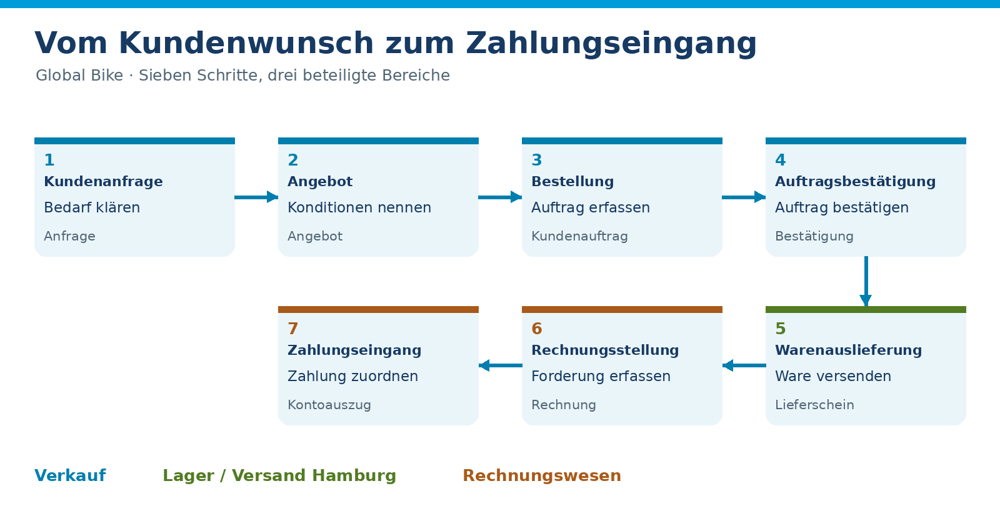
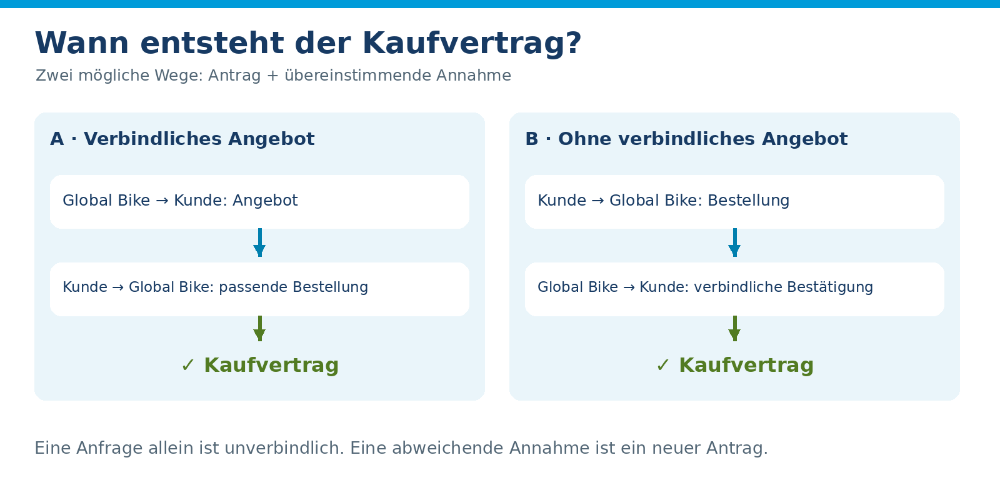
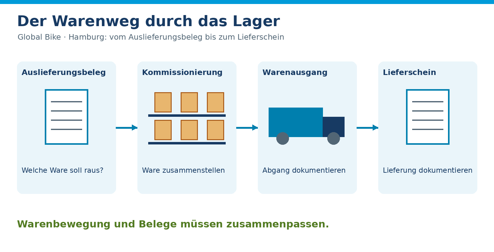
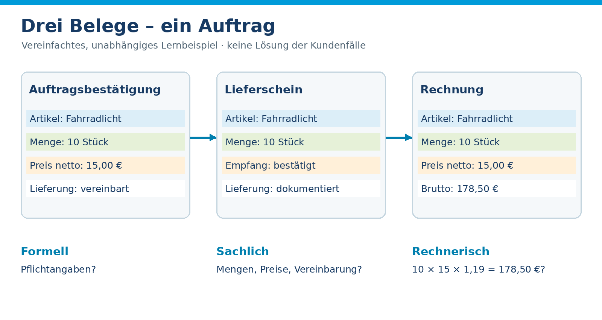
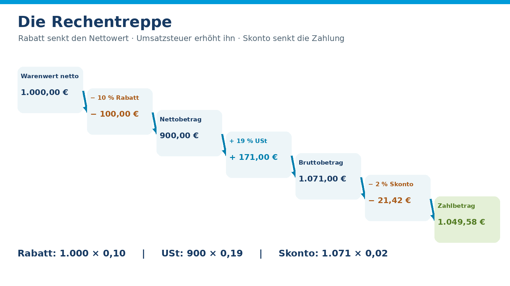
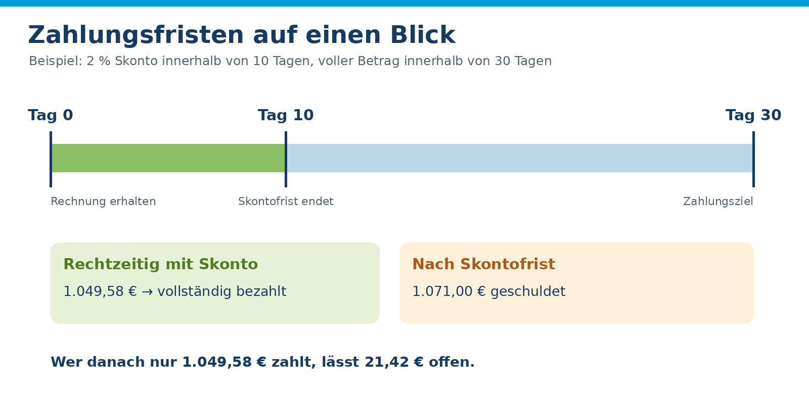
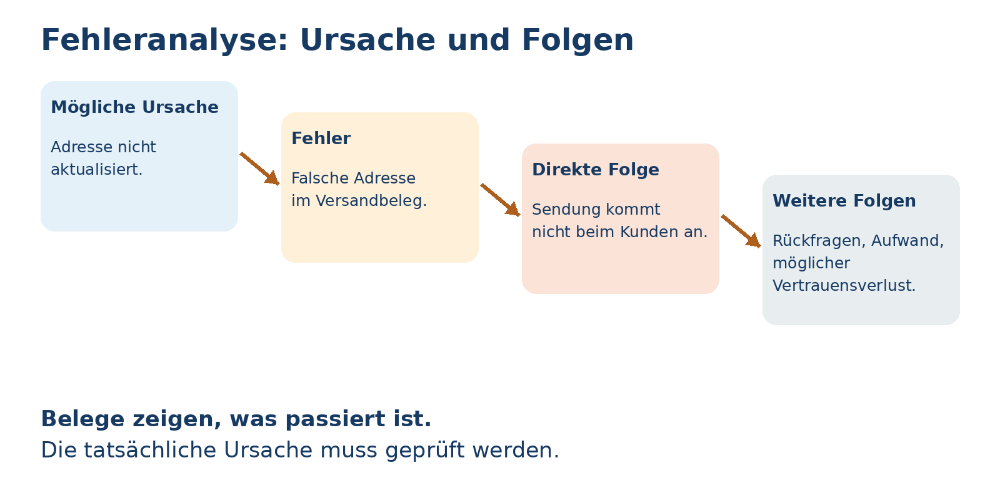
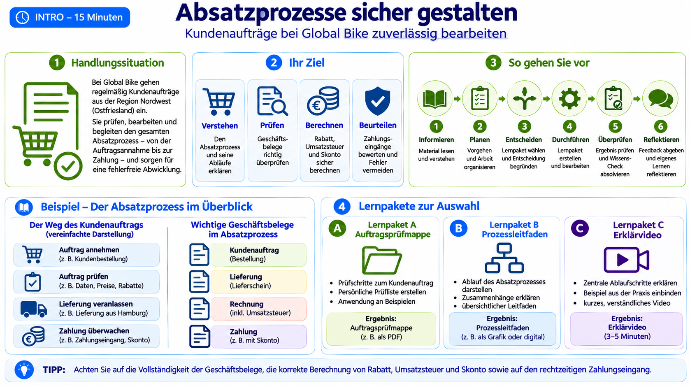

# BFS dual · Lernfeld 2 · LS 2.5 · Ist der Kundenauftrag wirklich abgeschlossen?

**Bildungsgang** · BFS dual, Profil Wirtschaft  
**Lernsituation** · 2.5 · Ist der Kundenauftrag wirklich abgeschlossen? (Paketkennung `BFSDUAL-LF02-LS05`)  
**Unterrichtlicher Bezug** · Handlungsorientierte Fallbearbeitung bei der Global Bike Deutschland GmbH  
**Zeitrahmen** · 16 Unterrichtsstunden à 45 Minuten, insgesamt 720 Minuten für einen gewählten Lernweg  
**Digitale Fassung** · [Orientierung öffnen](index.html) · [Unterlagen und Downloads](materialien.html)  
**Formgrundlage** · [BFSdual-Vorlage, Arbeitsstand vom 26. November 2026](https://github.com/macmaris83/Lernsituationen/blob/a1dd9b693df1a234bf3c7387198fcf5b5aab6afc/Fachbereiche/BFSdual/Vorlage_Lernsituation.md)

## Aufgabenzeiten

Für jeden der drei Wege gilt derselbe Zeitrahmen. Bei Durchführen zählt der Auftrag zum gewählten Lernpaket einmal.

| Station | Minuten je Lernweg |
| --- | ---: |
| Orientierung | 15 |
| Handlungssituation | 35 |
| Informieren | 240 |
| Fachbegriffscheck | 25 |
| Planen | 22 |
| Entscheiden | 23 |
| Durchführen | 225 |
| Bewerten | 112 |
| Reflektieren | 23 |
| **Gesamt** | **720** |

## Orientierung

[Digitale Fassung öffnen](index.html)

BFS dual · Lernfeld 2 · Lernsituation 2.5 · 16 Unterrichtsstunden

#### Den Auftrag überblicken

Eine Überweisung fällt niedriger aus als die Rechnung. Ist der Abzug berechtigt, fehlt Ware oder ist im Büro etwas falsch gelaufen? Wer Bestellung, Lieferschein, Rechnung und Kontoauszug nebeneinanderlegt, kann eine Kundenreklamation begründet beantworten.

Eine erprobte Arbeitshilfe für Jan, Emma und die Verkaufsabteilung. Sie enthält den Belegfluss der drei Originalaufträge, die Berechnungen, den belegten Bearbeitungsstand und konkrete Kontrollschritte für den nächsten Auftrag.

Du entscheidest, welche Aufgaben du selbstständig oder mit anderen bearbeitest. Für die Rückmeldung erhält jede Person ein fremdes Produkt.

15 Minuten

*Fachbuchverweis · Für diesen Auftrag ist keine Buchseite hinterlegt.*

Kompetenzprofil der Lernsituation

Die Gewichtung zeigt, wie häufig und wofür die Kompetenz in den Aufgaben gebraucht wird. 1 bedeutet „kurz in einer Aufgabe“, 6 „von der Vorbereitung bis zur Auswertung“.

| Kompetenz | Gewicht (1–6) | Was übe ich? |
| --- | --- | --- |
| F · Fachkompetenz | 6 / 6 | Ich kontrolliere Kundenaufträge anhand von Belegen, Beträgen und Fristen und begründe den nächsten Arbeitsschritt. |
| P · Personalkompetenz | 5 / 6 | Ich dokumentiere belegte Abweichungen und kennzeichne mögliche Ursachen als Vermutung. |
| S · Sozialkompetenz | 4 / 6 | Ich formuliere Prüfhinweise für Mitarbeitende und gebe Rückmeldung mit einer konkreten Fundstelle. |
| M · Methodenkompetenz | 6 / 6 | Ich verknüpfe Belegnummern und prüfe Mengen, Zahlbeträge und Fristen systematisch. |
| D · Medienkompetenz | 5 / 6 | Ich gestalte eine übersichtliche Anleitung, in der ein fremder Mitarbeiter eine Prüfung nachvollziehen kann. |

## Handlungssituation

[Digitale Fassung öffnen](handlungssituation.html)

 

Jan Richter und Emma Fuchs gleichen Auftragsbelege und Zahlungseingang ab. Die Szene führt in die Prüfung von Liefermenge, Rabatt und Skonto ein.

In der Verkaufsabteilung von Global Bike häufen sich Rückfragen aus Ostfriesland. Jan Richter berichtet von einem Kunden, dessen Liefermenge von der Bestellung abweicht. Ein anderer hält den Rabatt auf seiner Rechnung für falsch.

Emma Fuchs hat in der Verwaltung geringere Zahlungseingänge festgestellt, als auf den Rechnungen stehen. Sie möchte wissen, ob die Kunden zu Recht Skonto abziehen durften. Jan und Emma legen Ihnen drei Aufträge vom November 2026 vor. Untersuchen Sie die Belegketten vom Kundenkontakt bis zur Zahlung. Bereiten Sie eine Arbeitshilfe vor, mit der die Mitarbeitenden die nächsten Aufträge zuverlässig kontrollieren können.

#### Welche Unstimmigkeiten melden die Kunden an Jan?

- Eine abweichende Liefermenge und einen möglicherweise falschen Rabatt.
- Einen unleserlichen Werbeflyer und einen fehlerhaften Rückruf.
- Einen falsch berechneten Lagerbestand und eine fehlende Bestellung.

7 Minuten

#### Warum genügt Emma der Vergleich von Rechnungsbetrag und Zahlungseingang noch nicht?

- Sie muss den Verkaufsprospekt mit dem Rechnungsbetrag vergleichen.
- Sie muss zusätzlich prüfen, ob Skonto vereinbart war und innerhalb der Frist abgezogen wurde.
- Sie kann jede Differenz unabhängig von Vereinbarung und Frist als Skonto buchen.

7 Minuten

#### Welches Ergebnis erwartet die Verkaufsabteilung von Ihnen?

- Einen neuen Einzelhandelspreis für alle Räder.
- Eine Übersicht der Lagerbestände ohne Rechnungsbezug.
- Eine Arbeitshilfe für die Prüfung der Belegkette vom Kundenkontakt bis zur Zahlung.

7 Minuten

## Informieren

[Digitale Fassung öffnen](informieren.html)

Erschließe die Angaben und Unterlagen für deinen Auftrag.

80 Minuten

#### Belegfluss rekonstruieren

Lesen Sie [M02.1 bis M02.3](#m02). Ordnen Sie zu jedem Prozessschritt den Beleg und die kontrollierende Abteilung. Markieren Sie, aus welchen Erklärungen ein Kaufvertrag hervorgeht.

*Fachbuchverweis · Für diesen Auftrag ist keine Buchseite hinterlegt.*

80 Minuten

#### Drei Aufträge erschließen

Lesen Sie die drei Belegsätze in [M03](#m03). Übernehmen Sie je Auftrag Kundenname, Belegnummern und vereinbarte Bedingungen in Ihre Arbeitsnotizen. Kennzeichnen Sie, ob eine Zahlung dokumentiert ist.

*Fachbuchverweis · Für diesen Auftrag ist keine Buchseite hinterlegt.*

80 Minuten

#### Rechenweg und Frist klären

Rechnen Sie das Beispiel in [M02.4 und M02.5](#m02) nach. Notieren Sie für jede Stufe den Grundwert und die Rundung auf Cent. Bestimmen Sie für die Zahlungsprüfung, welches Datum die Frist auslöst.

*Fachbuchverweis · Für diesen Auftrag ist keine Buchseite hinterlegt.*

[Begriffsblatt zum Nachschlagen](#glossar) · [Begriffe prüfen](#begriffstraining)

## Fachbegriffscheck

[Digitale Fassung öffnen](begriffstraining.html)

Wähle zu jedem Begriff die passende Erklärung. Du kannst den Check wiederholen.

25 Minuten

[Begriffsblatt öffnen](#glossar)

Karte `BFSDUAL-LF02-LS05-B01`

**1. Vertriebsprozess**

- Transport der Ware vom Lager zum Kunden.
- Abfolge der Arbeitsschritte bei der Warenherstellung.
- Abfolge vom ersten Kundenkontakt bis zur Zahlung.

Karte `BFSDUAL-LF02-LS05-B02`

**2. Kundenanfrage**

- Bitte um Auskunft über Ware, Preise oder Liefermöglichkeiten.
- Verbindliche Bestätigung eines Zahlungseingangs.
- Dokumentation der gelieferten Menge.

Karte `BFSDUAL-LF02-LS05-B03`

**3. Angebot**

- Mitteilung, dass die Rechnung bezahlt ist.
- Nachweis, dass die Ware bereits zugestellt wurde.
- Erklärung, zu bestimmten Bedingungen einen Vertrag schließen zu wollen.

Karte `BFSDUAL-LF02-LS05-B04`

**4. Auftragsbestätigung**

- Nachweis des Zahlungseingangs.
- Mitteilung über die Annahme oder Bestätigung der Bestellung zu benannten Bedingungen.
- Rechnung für die ausgeführte Lieferung.

Karte `BFSDUAL-LF02-LS05-B05`

**5. Kommissionierung**

- Zusammenstellen der bestellten Ware im Lager.
- Erfassen des Kontoauszugs in der Buchhaltung.
- Berechnen des Bruttowerts einer Rechnung.

Karte `BFSDUAL-LF02-LS05-B06`

**6. Lieferschein**

- Beleg über den Geldeingang auf dem Bankkonto.
- Zahlungsaufforderung über den vereinbarten Kaufpreis.
- Beleg über Artikel und Mengen einer Lieferung.

Karte `BFSDUAL-LF02-LS05-B07`

**7. Ausgangsrechnung**

- Bitte des Käufers um eine Preiskalkulation.
- Dokument, mit dem der Verkäufer die Ware oder Leistung abrechnet.
- Bestätigung des Käufers, dass er bezahlt hat.

Karte `BFSDUAL-LF02-LS05-B08`

**8. Rabatt**

- Abzug, der nur an die Einhaltung einer Zahlungsfrist geknüpft ist.
- Preisnachlass auf den vereinbarten Ausgangspreis.
- Steuer auf das Entgelt ohne Umsatzsteuer.

Karte `BFSDUAL-LF02-LS05-B09`

**9. Umsatzsteuer**

- Preisnachlass auf den Bruttorechnungsbetrag bei früher Zahlung.
- Steuer auf den steuerpflichtigen Umsatz, im Beispiel auf das Nettoentgelt nach Rabatt.
- Betrag eines noch offenen Zahlungseingangs.

Karte `BFSDUAL-LF02-LS05-B10`

**10. Skonto**

- Zusätzlicher Lieferkostenanteil bei Teillieferungen.
- Preisnachlass, der bei jeder Bestellung unabhängig vom Zahlungstermin gilt.
- Vereinbarter Preisnachlass bei Zahlung innerhalb bestimmter Frist.

Karte `BFSDUAL-LF02-LS05-B11`

**11. Offener Posten**

- Zu spät gelieferte Ware.
- Noch nicht vollständig ausgeglichene Forderung.
- Jeder offene Liefertermin, auch vor Rechnungsstellung.

Karte `BFSDUAL-LF02-LS05-B12`

**12. Sachliche Rechnungsprüfung**

- Ausschließliche Prüfung der formalen Pflichtangaben.
- Ausschließliches Nachrechnen von Multiplikation und Addition.
- Vergleich von Artikel, Menge, Preis und Bedingungen mit der tatsächlichen Leistung und Vereinbarung.

## Planen

[Digitale Fassung öffnen](planen.html)

Entwirf deinen Arbeitsplan.

22 Minuten

#### Arbeitsplan für die Auftragsprüfung erstellen

Planen Sie mit [M02](#m02) und [M03](#m03) eine Prüfung vom Kundenkontakt bis zur Zahlung. Vermerken Sie, wann Sie Belege vergleichen, Fristen ermitteln, rechnen und Ihre Arbeitshilfe erproben.

*Fachbuchverweis · Für diesen Auftrag ist keine Buchseite hinterlegt.*

## Entscheiden

[Digitale Fassung öffnen](entscheiden.html)

Wähle einen von drei gleichwertigen Arbeitswegen. Du kannst deine Wahl begründet ändern.

**Lernpaket wählen**

A · Auftragsprüfmappe · Belege nebeneinanderlegen und fallweise vergleichen. · Ein erstes Prüfformular verbindet Beleg, Soll, Ist und Konsequenz. Geeignet, wenn Sie gerne mit Akten arbeiten.

B · Prozessleitfaden · Arbeitsschritte anordnen und Kontrollpunkte festlegen. · Ein Prozessabschnitt benennt Eingang, Prüfung und Übergabe. Geeignet, wenn Sie Zusammenhänge veranschaulichen möchten.

C · Erklärvideo · Prüfentscheidungen anhand der Originalbelege vorführen. · Eine kurze Probesequenz zeigt Belegnummer, Rechenschritt und Folgerung. Geeignet, wenn Sie Abläufe gern mündlich erklären.

Eine erprobte Arbeitshilfe für Jan, Emma und die Verkaufsabteilung. Sie enthält den Belegfluss der drei Originalaufträge, die Berechnungen, den belegten Bearbeitungsstand und konkrete Kontrollschritte für den nächsten Auftrag.

23 Minuten

#### Form der Arbeitshilfe festlegen

Vergleichen Sie die drei Aufträge aus [M04 bis M06](#m04). Entscheiden Sie, welche Form Ihnen hilft, eine belegte Abweichung im Vertrieb sichtbar zu machen. Begründen Sie Ihre Wahl an einem konkreten Beleg.

*Fachbuchverweis · Für diesen Auftrag ist keine Buchseite hinterlegt.*

## Durchführen

[Digitale Fassung öffnen](durchfuehren.html)

Bearbeite den Auftrag im gewählten Format.

[Wähle in Entscheiden dein Lernpaket A, B oder C](#entscheiden), um die Aufträge zu öffnen.

Deine Wahl:  · [Wahl ändern](#entscheiden)

Eine erprobte Arbeitshilfe für Jan, Emma und die Verkaufsabteilung. Sie enthält den Belegfluss der drei Originalaufträge, die Berechnungen, den belegten Bearbeitungsstand und konkrete Kontrollschritte für den nächsten Auftrag.

57 Minuten

#### Belege und Beträge miteinander abgleichen

Prüfen Sie alle drei Kundenaufträge aus [M03](#m03). Vergleichen Sie Vereinbarung, Lieferung, Rechnung und die jeweils dokumentierte Zahlung. Rechnen Sie Nettowert, Rabatt, Umsatzsteuer und gegebenenfalls Skonto nach. Halten Sie jeden Abgleich mit Belegnummer und Datum fest.

*Fachbuchverweis · Für diesen Auftrag ist keine Buchseite hinterlegt.*

112 Minuten

**Lernpaket A**

#### Prüfmappe fallweise fertigstellen

Legen Sie drei Vorgänge an. Ordnen Sie die Belege, zeigen Sie den Rechenweg und ergänzen Sie pro Vorgang einen begründeten Bearbeitungsstand. Testen Sie Ihr Prüfformular an einer zweiten Belegkette. [Auftrag M04](#m04)

*Fachbuchverweis · Für diesen Auftrag ist keine Buchseite hinterlegt.*

112 Minuten

**Lernpaket B**

#### Prozessleitfaden mit Kontrollen erproben

Führen Sie Mitarbeitende von der Anfrage bis zum Zahlungseingang. Zeigen Sie an den drei Aufträgen, was zu vergleichen ist, wie eine Abweichung erkennbar wird und wer sie klärt. Testen Sie einen Durchgang mit [M03](#m03).

*Fachbuchverweis · Für diesen Auftrag ist keine Buchseite hinterlegt.*

112 Minuten

**Lernpaket C**

#### Erklärvideo mit Belegbeispielen produzieren

Zeigen Sie für alle drei Aufträge relevante Belege und sprechen Sie Rechenschritte sowie Fristen verständlich aus. Schließen Sie jede Sequenz mit einem Kontrollhinweis. Ein sichtbarer Belegausschnitt reicht als Bild. [Auftrag M06](#m04)

*Fachbuchverweis · Für diesen Auftrag ist keine Buchseite hinterlegt.*

56 Minuten

#### Folgen und Maßnahmen begründen

Formulieren Sie für jeden Auftrag, was erledigt ist und welche Frage offenbleibt. Trennen Sie festgestellte Abweichungen von möglichen Ursachen. Leiten Sie eine konkrete Fehlerkontrolle für Verkauf, Lager oder Rechnungswesen ab. [Belegprüfung in M02](#m02)

*Fachbuchverweis · Für diesen Auftrag ist keine Buchseite hinterlegt.*

Kriterien für das fertige Produkt

- Die Arbeit ordnet alle drei Belegketten zu und erklärt, wann der Kaufvertrag im Fall zustande kommt.
- Bestellte, gelieferte und berechnete Mengen werden mit Datum und Belegnummer verglichen.
- Rabatt, Umsatzsteuer, Skonto und Restforderung sind auf Cent nachvollziehbar. Zahlungsdatum, Frist und Fälligkeit sind unterscheidbar.
- Die Erklärung trennt belegte Fehler von möglichen Ursachen. Zu einer Abweichung nennt sie eine machbare Kontrolle und die zuständige Stelle.
- Eine neue Kollegin kann die einzelnen Schritte an einem der Originalaufträge nachvollziehen.

## Bewerten

[Digitale Fassung öffnen](bewerten.html)

Peer-Check am Handlungsprodukt.

28 Minuten

#### Das Produkt für den Peer-Check bereitstellen

**Reiche** deine Arbeit in der Moodle-Aktivität „Peer-Feedback“ ein. Verwende neutrale Titel und Dateinamen. Entferne Namen aus Text und Dateieigenschaften. Bei einem gemeinsamen Produkt reicht jede Person eine Kopie im eigenen Konto ein. Ohne eingerichtete Aktivität verteilt die Lehrkraft codierte Arbeiten.

*Fachbuchverweis · Für diesen Auftrag ist keine Buchseite hinterlegt.*

56 Minuten

#### Ein fremdes Produkt prüfen

**Prüfe** die dir zugeteilte Arbeit mit den Kriterien unten. Benenne eine konkrete Fundstelle, eine fachlich gelungene Stelle und einen begründeten Verbesserungsvorschlag. Gib die Rückmeldung in Moodle oder mit dem [ausfüllbaren Peer-Bogen](#peer-check) ab. Dein Name ist für die empfangende Person sichtbar.

*Fachbuchverweis · Für diesen Auftrag ist keine Buchseite hinterlegt.*

28 Minuten

#### Die empfangene Rückmeldung nutzen

**Lies** das Feedback zu deinem Produkt. Verbessere die genannte Stelle oder begründe am Material, weshalb du deine Fassung beibehältst. Ergebnis ist die für die weitere Verwendung geprüfte Fassung.

*Fachbuchverweis · Für diesen Auftrag ist keine Buchseite hinterlegt.*

### Fachliche Prüfkriterien

- Die Arbeit ordnet alle drei Belegketten zu und erklärt, wann der Kaufvertrag im Fall zustande kommt.
- Bestellte, gelieferte und berechnete Mengen werden mit Datum und Belegnummer verglichen.
- Rabatt, Umsatzsteuer, Skonto und Restforderung sind auf Cent nachvollziehbar. Zahlungsdatum, Frist und Fälligkeit sind unterscheidbar.
- Die Erklärung trennt belegte Fehler von möglichen Ursachen. Zu einer Abweichung nennt sie eine machbare Kontrolle und die zuständige Stelle.
- Eine neue Kollegin kann die einzelnen Schritte an einem der Originalaufträge nachvollziehen.

[Peer-Check öffnen oder drucken](#peer-check)

## Reflektieren

[Digitale Fassung öffnen](reflektieren.html)

Dein Feedback zum Unterricht.

23 Minuten

#### Feedback zur Lernsituation abgeben

**Fülle** die Aktivität „Feedback“ im Moodle-Kurs aus. Melde zurück, welches Material geholfen hat, wo ein Auftrag unklar war, wie Zeit und Wahlmöglichkeiten passten und was wir ändern sollten. Verwende alternativ den [ausfüllbaren Feedbackbogen](#feedback) und gib ihn wie vereinbart ab.

*Fachbuchverweis · Für diesen Auftrag ist keine Buchseite hinterlegt.*

[Feedbackbogen öffnen](#feedback)

## Materialien
| Kennung | Unterlage |
| --- | --- |
| FEEDBACK | [Feedback zur Lernsituation](#feedback) |
| M02 | [M02 · Vertriebsprozess und kaufmännische Prüfung](#m02) |
| M03 | [M03 · Die Auftragsbelege für November 2026](#m03) |
| M04 | [M04 · Das Produkt für die Verkaufsabteilung](#m04) |
| MATERIALIEN | [Materialübersicht und Quellen](#materialien) |
| PEER-CHECK | [Peer-Check · LS 2.5](#peer-check) |

## Feedback zur Lernsituation

[Digitale Fassung öffnen](feedback.html)

Wie lief die Arbeit an der Lernsituation „Ist der Kundenauftrag wirklich abgeschlossen?“? Beschreiben Sie Ihre Erfahrungen so konkret, dass die Lehrkraft den nächsten Durchgang daran anpassen kann.

Welches Material hat Ihnen an welcher Stelle geholfen?

Wo war ein Auftrag oder eine Darstellung unklar?

Wie passten Zeit und freie Wahl des Arbeitswegs zu Ihrem Vorgehen?

Was sollten wir beim nächsten Durchgang beibehalten oder ändern?

**Feedback abgeben.** Im Moodle-Kurs können Sie Ihre Antworten in die Aktivität „Feedback“ übertragen und dort abgeben. Alternativ drucken Sie den ausgefüllten Bogen ohne Namen aus und geben ihn der Lehrkraft an der vereinbarten Sammelstelle. Die Eingaben bleiben bis zum Verlassen dieser Seite im geöffneten Bogen. Für eine eigene Kopie laden Sie die Textdatei herunter.

## M02 · Vertriebsprozess und kaufmännische Prüfung

[Digitale Fassung öffnen](material/m02.html)

[Zur Materialübersicht](#materialien) 

##### M02.1 Vertriebsprozess und Belege

  

| Schritt | Funktion |
| --- | --- |
| [Kundenanfrage](#kundenanfrage) | Was möchte der Kunde? |
| [Angebot](#angebot) | Zu welchen Bedingungen kann geliefert werden? |
| Bestellung | Was bestellt der Kunde? |
| [Auftragsbestätigung](#auftragsbestaetigung) | Was bestätigt Global Bike? |
| Warenauslieferung | Was wird geliefert? |
| Rechnungsstellung | Was muss bezahlt werden? |
| Zahlungseingang | Was wurde bezahlt? |

**Merke:** Der Belegfluss verbindet die Dokumente eines Auftrags.

Vertiefungswissen

 Verkauf, Lager und Rechnungswesen arbeiten zusammen. Die Warenauslieferung erfolgt über Hamburg. Belegnummern und Bezugnahmen helfen, einen Auftrag nachzuverfolgen.

##### M02.2 Vom Kundenwunsch zum Kaufvertrag

  

Ein Kaufvertrag entsteht durch zwei übereinstimmende Willenserklärungen. Global Bike muss die vereinbarte Ware liefern und der Kunde muss sie abnehmen und bezahlen.

**Merke:** Eine Anfrage allein ist noch kein Kaufvertrag.

Vertiefungswissen

 Ein freibleibendes Angebot ist nicht bindend. Eine veränderte Annahme gilt als neuer Antrag (§ 150 Abs. 2 BGB). Eine reine Eingangsbestätigung ist nicht zwingend eine Annahme. Grundlagen: §§ 145 ff., 433 BGB.

##### M02.3 Lieferung und Rechnungsprüfung

  

Bei der [Kommissionierung](#kommissionierung) wird die bestellte Ware zusammengestellt. Der Warenausgang dokumentiert, dass die Ware das Lager verlässt.

  

| Prüfung | Leitfrage |
| --- | --- |
| Formell | Sind notwendige Angaben vorhanden? |
| Sachlich | Stimmen Mengen, Preise und Vereinbarungen? |
| Rechnerisch | Sind Beträge richtig berechnet? |

**Merke:** Eine rechnerisch richtige Rechnung kann sachlich falsch sein.

Vertiefungswissen

 Lieferbedingungen regeln beispielsweise Liefertermin und Transportkosten. Frei Haus bedeutet hier, dass Global Bike die Transportkosten bis zum vereinbarten Lieferort trägt. Ein Lieferschein enthält typischerweise Empfänger, Artikel und Menge. Rechnungsangaben regelt § 14 Abs. 4 UStG. Teillieferungen sind anhand der Vereinbarung zu prüfen.

##### M02.4 Rabatt, Umsatzsteuer und Skonto

  

| Beispiel | Betrag |
| --- | --- |
| Warenwert netto | 1.000,00 € |
| − 10 % [Rabatt](#rabatt) | 100,00 € |
| = Nettobetrag | 900,00 € |
| + 19 % [Umsatzsteuer](#umsatzsteuer) | 171,00 € |
| = Bruttobetrag | 1.071,00 € |
| − 2 % [Skonto](#skonto) | 21,42 € |
| = Zahlbetrag | 1.049,58 € |

**Merke:** Rabatt wird hier vom Nettowarenwert, Umsatzsteuer vom verminderten Nettobetrag und Skonto vom vereinbarten Bruttobetrag berechnet.

Vertiefungswissen und Rechenhilfe

 Prozentbetrag = Grundwert × Prozentsatz / 100. Nettobetrag aus Brutto bei 19 % Umsatzsteuer = Brutto / 1,19. Geldbeträge auf Cent runden.

##### M02.5 Zahlungseingang und Fehleranalyse

  

Prüfen Sie, wer wann wie viel für welche Rechnung bezahlt hat. Im Beispiel aus M02.4 ist bei rechtzeitigem Skonto der Zahlbetrag 1.049,58 €. Ohne Skontoberechtigung bleiben bei dieser Zahlung 21,42 € offen.

  

**Merke:** Ein [offener Posten](#offener-posten) ist eine noch nicht vollständig ausgeglichene Forderung.

Vertiefungswissen

 Restforderung = geschuldeter Betrag minus zugeordneter Zahlung. Offen bedeutet nicht automatisch überfällig. Fehler können Beschwerden, zusätzliche Arbeit und finanzielle Nachteile auslösen. Eine Fehlerkorrektur beseitigt einen bestehenden Fehler; Fehlervermeidung soll Wiederholungen verhindern. Berechtigtes Skonto verändert auch die Umsatzsteuerbemessungsgrundlage (§ 17 UStG).

 

Ausschnitt der Boardübersicht. Die drei Produktformen und das fachliche Beispiel im Überblick.

### Begriffe zum Fall

[Ausgangsrechnung](#ausgangsrechnung) – Dokument, mit dem der Verkäufer die Ware oder Leistung abrechnet. RE-2603 enthält Nettobetrag, Steuer und Betrag, den VeloDOM zahlen soll.

[Sachliche Rechnungsprüfung](#sachliche-rechnungspruefung) – Vergleich von Artikel, Menge, Preis und Bedingungen mit der tatsächlichen Leistung und Vereinbarung. Die Rechnungsmenge der Helme lässt sich mit der bestätigten Liefermenge abgleichen.

[Text als Markdown herunterladen](material/m02.md) · [Zur Materialübersicht](#materialien)

## M03 · Die Auftragsbelege für November 2026

[Digitale Fassung öffnen](material/m03.html)

[Zur Materialübersicht](#materialien) 

#### M03 – Kundenaufträge

Die folgenden Belege sind vereinfachte Unterrichtsbelege. Preise, Termine und Belegnummern sind didaktische Falldaten, keine SAP-Bewegungsdaten. Alle Daten beziehen sich auf November 2026.

##### Auftrag A – Alster Cycling e.K. (KA2601)

| Beleg | Datum | Inhalt |
| --- | --- | --- |
| [Kundenanfrage](#kundenanfrage) | 02.11. | 50 Wasserflaschen BOTL1000 |
| [Angebot](#angebot) | 03.11. | 50 × 10,00 € netto; verbindlich bis 06.11.; frei Haus bis 10.11.; Zahlung binnen 30 Tagen ab Rechnungserhalt |
| Bestellung | 04.11. | Angebot unverändert angenommen |
| [Auftragsbestätigung](#auftragsbestaetigung) | 05.11. | Bestellung unverändert bestätigt |
| [Lieferschein](#lieferschein) | 09.11. | 50 Wasserflaschen aus Hamburg; Empfang bestätigt |
| Rechnung RE-2601 | 09.11. | Netto 500,00 €; USt 95,00 €; brutto 595,00 € |
| Kontoauszug | 20.11. | 595,00 € von Alster Cycling, RE-2601 |

Lernhilfe

Vergleichen Sie Menge, Preis und Zahlung. Nutzen Sie M02.1.

##### Auftrag B – Drahtesel e.K. (KA2602)

| Beleg | Datum | Inhalt |
| --- | --- | --- |
| Bestellung B-2602 | 04.11. | 20 Geländehelme OHMT1000 × 40,00 € netto; vollständige Lieferung bis 12.11.; keine Teillieferung; unverändert bestätigt |
| Lieferschein LS-2602 | 10.11. | 15 Helme aus Hamburg; Empfang bestätigt |
| Rechnung RE-2602 | 10.11. | 20 × 40,00 €; netto 800,00 €; USt 152,00 €; brutto 952,00 €; Zahlung binnen 30 Tagen ab Erhalt |

Lernhilfe

Vergleichen Sie die Mengen in den Belegen. Nutzen Sie M02.3.

##### Auftrag C – VeloDOM GmbH (KA2603)

| Beleg | Datum | Inhalt |
| --- | --- | --- |
| Auftragsbestätigung AB-2603 | 05.11. | 40 Luftpumpen PUMP1000 × 20,00 € netto; 10 % [Rabatt](#rabatt); 19 % USt; 2 % [Skonto](#skonto) auf Brutto binnen 10 Tagen ab Rechnungserhalt, 30 Tage netto |
| Rechnung RE-2603 | 10.11. | Vollständige Lieferung und Rechnungserhalt am 10.11.; Warenwert 800,00 €; Rabatt 80,00 €; netto 720,00 €; USt 136,80 €; brutto 856,80 € |
| Kontoauszug | 25.11. | 839,66 € von VeloDOM, RE-2603 abzgl. 2 % Skonto |

Lernhilfe

Nutzen Sie M02.4 und prüfen Sie anschließend die Zahlungsfrist.

[Text als Markdown herunterladen](material/m03.md) · [Zur Materialübersicht](#materialien)

## M04 · Das Produkt für die Verkaufsabteilung

[Digitale Fassung öffnen](material/m04.html)

[Zur Materialübersicht](#materialien) 

#### M04 – Lernpaket A: Auftragsprüfmappe

Erstellen Sie eine Auftragsprüfmappe für die Verkaufsabteilung der Global Bike Deutschland GmbH. Bereiten Sie Ihre Untersuchungsergebnisse so auf, dass die Mitarbeitenden nachvollziehen können, wie Kundenaufträge abgewickelt und überprüft werden. Entwickeln Sie auf Grundlage Ihrer Erkenntnisse Empfehlungen zur Vermeidung zukünftiger Fehler. Über die Gestaltung Ihrer Auftragsprüfmappe entscheiden Sie selbst.

#### M05 – Lernpaket B: Prozessleitfaden

Entwickeln Sie einen Prozessleitfaden für die Verkaufsabteilung der Global Bike Deutschland GmbH. Stellen Sie den [Vertriebsprozess](#vertriebsprozess) so dar, dass die Mitarbeitenden die einzelnen Arbeitsschritte und die notwendigen Überprüfungen nachvollziehen können. Nutzen Sie Ihre Erkenntnisse aus den Kundenaufträgen, um Möglichkeiten zur Fehlervermeidung aufzuzeigen. Über die Gestaltung Ihres Prozessleitfadens entscheiden Sie selbst.

#### M06 – Lernpaket C: Erklärvideo

Erstellen Sie ein Erklärvideo für die Mitarbeitenden der Global Bike Deutschland GmbH. Veranschaulichen Sie anhand der untersuchten Kundenaufträge, wie der Vertriebsprozess funktioniert, wie Aufträge überprüft werden und wie Fehler vermieden werden können. Bereiten Sie die fachlichen Zusammenhänge verständlich und anschaulich auf. Über die Gestaltung und Umsetzung Ihres Erklärvideos entscheiden Sie selbst.

[Text als Markdown herunterladen](material/m04.md) · [Zur Materialübersicht](#materialien)

## Materialübersicht und Quellen

[Digitale Fassung öffnen](materialien.html)

Wähle eine Unterlage für deinen nächsten Arbeitsschritt.

#### [M02 · Vertriebsprozess und kaufmännische Prüfung](#m02)

Fünf Fachtexte mit sieben Schaubildern, Beispielrechnung, Zahlungsfristen und Prüffragen.

#### [M03 · Die Auftragsbelege für November 2026](#m03)

Belegketten für KA2601 Alster Cycling, KA2602 Drahtesel und KA2603 VeloDOM mit Originalbeträgen und vereinbarten Fristen.

#### [M04 · Das Produkt für die Verkaufsabteilung](#m04)

Originalaufträge M04 bis M06 für Auftragsprüfmappe, Prozessleitfaden und Erklärvideo.

Externe Quellen aus dem Board

- [www.bbs1-aurich.de/](https://www.bbs1-aurich.de/)

## Peer-Check · LS 2.5

[Digitale Fassung öffnen](peer-check.html)

Prüfen Sie das zugeteilte Handlungsprodukt anhand der gemeinsamen fachlichen Kriterien. Eine Fundstelle kann eine Textzeile, ein Bildausschnitt oder eine Zeitmarke in der Übergabe sein.

Was möchten Sie festhalten?

 (Meine Rückmeldung zu einer fremden Arbeit / Meine Entscheidung nach Erhalt der Rückmeldung)

### Peer-Rückmeldung zur zugeteilten Arbeit

Nutzen Sie diese Fragen beim Lesen, Betrachten oder Anhören.

- Die Arbeit ordnet alle drei Belegketten zu und erklärt, wann der Kaufvertrag im Fall zustande kommt.
- Bestellte, gelieferte und berechnete Mengen werden mit Datum und Belegnummer verglichen.
- Rabatt, Umsatzsteuer, Skonto und Restforderung sind auf Cent nachvollziehbar. Zahlungsdatum, Frist und Fälligkeit sind unterscheidbar.
- Die Erklärung trennt belegte Fehler von möglichen Ursachen. Zu einer Abweichung nennt sie eine machbare Kontrolle und die zuständige Stelle.
- Eine neue Kollegin kann die einzelnen Schritte an einem der Originalaufträge nachvollziehen.

Welches Produkt prüfen Sie und auf welche Fundstelle beziehen Sie sich?

Welche Stelle ist fachlich gelungen und wem hilft sie bei der Weiterarbeit und warum?

Wo bleibt eine Frage offen? Welchen konkreten Änderungsvorschlag machen Sie für diese Stelle?

**Rückmeldung weitergeben.** Übertragen Sie Ihren Text in die zugeteilte Arbeit in der Moodle-Aktivität „Peer-Feedback“ und geben Sie ihn dort ab. Ohne Moodle geben Sie den Bogen mit dem vereinbarten Arbeitscode an die Lehrkraft zur Rückgabe an die einreichende Person. Setzen Sie Ihren Namen als rückmeldende Person auf den Ausdruck oder die Textdatei.

Die Eingaben bleiben im geöffneten Bogen. Laden Sie die gewählte Ansicht vor dem Verlassen als Textdatei herunter, wenn Sie sie behalten möchten.

## Glossar zur Kundenanfrage

[Digitale Fassung öffnen](ls-glossar.html)

Begriffsblatt zum Nachschlagen und zur Vorbereitung auf den Fachbegriffscheck.

[Zurück zum Material](#materialien)

### Vertriebsprozess

Abfolge vom ersten Kundenkontakt bis zur Zahlung.

Bei KA2601 lässt sich der Weg von der Anfrage bis zum Kontoauszug verfolgen. (M02.1, M03)

### Kundenanfrage

Bitte um Auskunft über Ware, Preise oder Liefermöglichkeiten.

Die Anfrage von Alster Cycling steht vor dem konkreten Angebot. (M02.1, M03)

### Angebot

Erklärung, zu bestimmten Bedingungen einen Vertrag schließen zu wollen.

Bei KA2601 steht im Angebot, wie lange es verbindlich ist. (M02.2, M03)

### Auftragsbestätigung

Mitteilung über die Annahme oder Bestätigung der Bestellung zu benannten Bedingungen.

Bei Drahtesel gibt die bestätigte Bestellung die vereinbarte Menge vor. (M02.1, M03)

### Kommissionierung

Zusammenstellen der bestellten Ware im Lager.

Für KA2602 ist die vom Lager bereitgestellte Menge für die Prüfung interessant. (M02.3, M03)

### Lieferschein

Beleg über Artikel und Mengen einer Lieferung.

In LS-2602 steht, wie viele Helme die Lieferung enthielt. (M02.3, M03)

### Ausgangsrechnung

Dokument, mit dem der Verkäufer die Ware oder Leistung abrechnet.

RE-2603 enthält Nettobetrag, Steuer und Betrag, den VeloDOM zahlen soll. (M02.3, M03)

### Rabatt

Preisnachlass auf den vereinbarten Ausgangspreis.

Die Auftragsbestätigung für die Luftpumpen nennt einen Rabatt auf den Warenwert. (M02.4, M03)

### Umsatzsteuer

Steuer auf den steuerpflichtigen Umsatz, im Beispiel auf das Nettoentgelt nach Rabatt.

Prüfen Sie in RE-2603, auf welchen Grundwert die 19 Prozent angewendet werden. (M02.4, M03)

### Skonto

Vereinbarter Preisnachlass bei Zahlung innerhalb bestimmter Frist.

Bei VeloDOM sind neben dem Betrag das Rechnungs-Empfangsdatum und der Zahlungstag nötig. (M02.4, M03)

### Offener Posten

Noch nicht vollständig ausgeglichene Forderung.

Ein verringerter Zahlungseingang kann eine offene Restforderung hinterlassen. Prüfen Sie zunächst die Skontobedingung. (M02.5, M03)

### Sachliche Rechnungsprüfung

Vergleich von Artikel, Menge, Preis und Bedingungen mit der tatsächlichen Leistung und Vereinbarung.

Die Rechnungsmenge der Helme lässt sich mit der bestätigten Liefermenge abgleichen. (M02.3, M03)

## Lehrkraftmaterial und Moodle

Die Lehrkraft erhält die Erwartungshinweise und Unterlagen separat. Die Aktivität *Peer-Feedback* und das abschließende *Feedback* werden im jeweiligen Moodle-Kurs eingerichtet. Für das Peer-Feedback gelten die fallbezogenen Kriterien unter „Bewerten“.

## Erklärbilder

- [Auftrag, Lieferschein, Rechnung und Zahlung abgleichen](material/m02.html#erklaerbild-ls-2-5-belegkette-und-zahlungseingang) · [Bilddatei](material/erklaerbilder/LS_2_5_Belegkette_und_Zahlungseingang.png)
