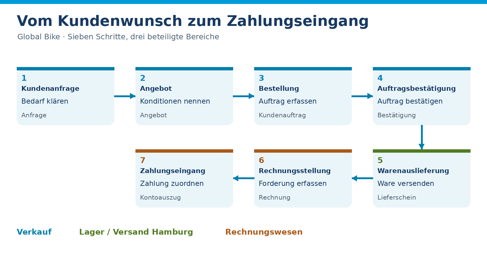
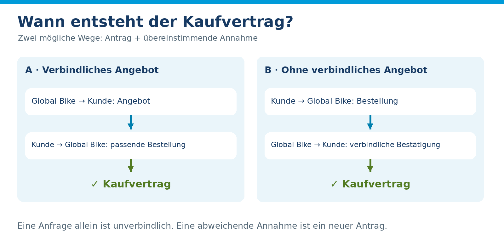
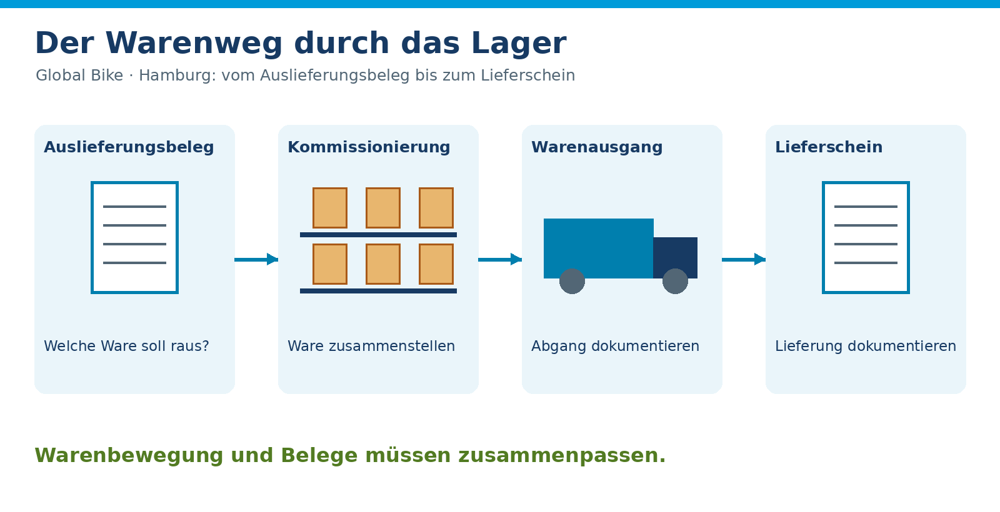
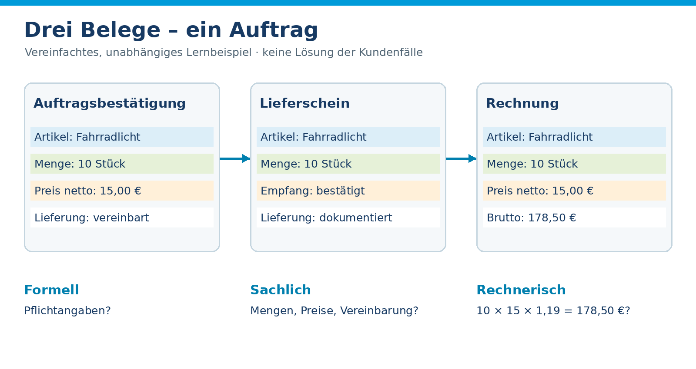
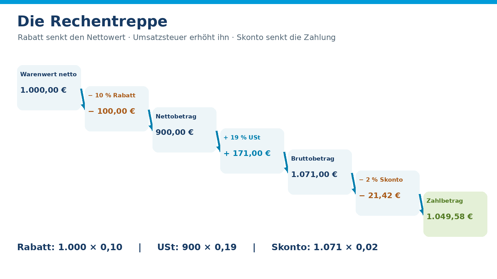
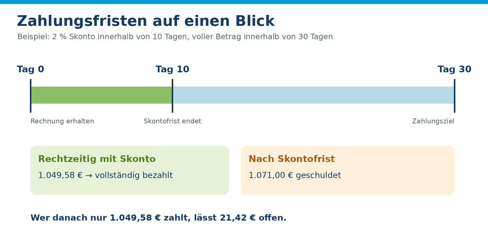
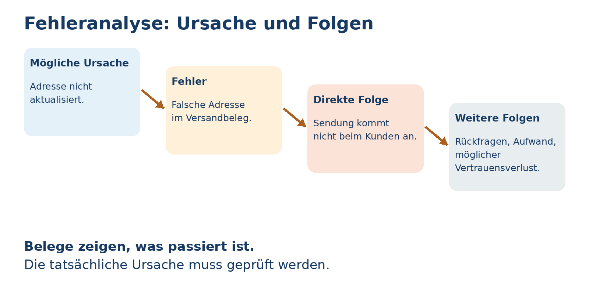

# Vertriebsprozess und kaufmännische Prüfung

#### M02.1 Vertriebsprozess und Belege

| Schritt | Funktion |
|---|---|
| Kundenanfrage | Was möchte der Kunde? |
| Angebot | Zu welchen Bedingungen kann geliefert werden? |
| Bestellung | Was bestellt der Kunde? |
| Auftragsbestätigung | Was bestätigt Global Bike? |
| Warenauslieferung | Was wird geliefert? |
| Rechnungsstellung | Was muss bezahlt werden? |
| Zahlungseingang | Was wurde bezahlt? |

**Merke:** Der Belegfluss verbindet die Dokumente eines Auftrags.

Vertiefungswissen

Verkauf, Lager und Rechnungswesen arbeiten zusammen. Die Warenauslieferung erfolgt über Hamburg. Belegnummern und Bezugnahmen helfen, einen Auftrag nachzuverfolgen.

#### M02.2 Vom Kundenwunsch zum Kaufvertrag

Ein Kaufvertrag entsteht durch zwei übereinstimmende Willenserklärungen. Global Bike muss die vereinbarte Ware liefern und der Kunde muss sie abnehmen und bezahlen.

**Merke:** Eine Anfrage allein ist noch kein Kaufvertrag.

Vertiefungswissen

Ein freibleibendes Angebot ist nicht bindend. Eine veränderte Annahme gilt als neuer Antrag (§ 150 Abs. 2 BGB). Eine reine Eingangsbestätigung ist nicht zwingend eine Annahme. Grundlagen: §§ 145 ff., 433 BGB.

#### M02.3 Lieferung und Rechnungsprüfung

Bei der Kommissionierung wird die bestellte Ware zusammengestellt. Der Warenausgang dokumentiert, dass die Ware das Lager verlässt.

| Prüfung | Leitfrage |
|---|---|
| Formell | Sind notwendige Angaben vorhanden? |
| Sachlich | Stimmen Mengen, Preise und Vereinbarungen? |
| Rechnerisch | Sind Beträge richtig berechnet? |

**Merke:** Eine rechnerisch richtige Rechnung kann sachlich falsch sein.

Vertiefungswissen

Lieferbedingungen regeln beispielsweise Liefertermin und Transportkosten. Frei Haus bedeutet hier, dass Global Bike die Transportkosten bis zum vereinbarten Lieferort trägt. Ein Lieferschein enthält typischerweise Empfänger, Artikel und Menge. Rechnungsangaben regelt § 14 Abs. 4 UStG. Teillieferungen sind anhand der Vereinbarung zu prüfen.

#### M02.4 Rabatt, Umsatzsteuer und Skonto

| Beispiel | Betrag |
|---|---:|
| Warenwert netto | 1.000,00 € |
| − 10 % Rabatt | 100,00 € |
| = Nettobetrag | 900,00 € |
| + 19 % Umsatzsteuer | 171,00 € |
| = Bruttobetrag | 1.071,00 € |
| − 2 % Skonto | 21,42 € |
| = Zahlbetrag | 1.049,58 € |

**Merke:** Rabatt wird hier vom Nettowarenwert, Umsatzsteuer vom verminderten Nettobetrag und Skonto vom vereinbarten Bruttobetrag berechnet.

Vertiefungswissen und Rechenhilfe

Prozentbetrag = Grundwert × Prozentsatz / 100. Nettobetrag aus Brutto bei 19 % Umsatzsteuer = Brutto / 1,19. Geldbeträge auf Cent runden.

#### M02.5 Zahlungseingang und Fehleranalyse

Prüfen Sie, wer wann wie viel für welche Rechnung bezahlt hat. Im Beispiel aus M02.4 ist bei rechtzeitigem Skonto der Zahlbetrag 1.049,58 €. Ohne Skontoberechtigung bleiben bei dieser Zahlung 21,42 € offen.

**Merke:** Ein offener Posten ist eine noch nicht vollständig ausgeglichene Forderung.

Vertiefungswissen

Restforderung = geschuldeter Betrag minus zugeordneter Zahlung. Offen bedeutet nicht automatisch überfällig. Fehler können Beschwerden, zusätzliche Arbeit und finanzielle Nachteile auslösen. Eine Fehlerkorrektur beseitigt einen bestehenden Fehler; Fehlervermeidung soll Wiederholungen verhindern. Berechtigtes Skonto verändert auch die Umsatzsteuerbemessungsgrundlage (§ 17 UStG).

