# BFS dual · Lernfeld 2 · LS 2.6a · Excel für Büroaufgaben – Eine digitale Büroübersicht erstellen

**Bildungsgang** · BFS dual, Profil Wirtschaft  
**Lernsituation** · 2.6a · Excel für Büroaufgaben – Eine digitale Büroübersicht erstellen (Paketkennung `BFSDUAL-LF02-LS06A`)  
**Unterrichtlicher Bezug** · Handlungsorientierte Fallbearbeitung bei der Global Bike Deutschland GmbH  
**Zeitrahmen** · 12 Unterrichtsstunden à 45 Minuten, insgesamt 540 Minuten für einen gewählten Lernweg  
**Digitale Fassung** · [Orientierung öffnen](index.html) · [Unterlagen und Downloads](materialien.html)  
**Formgrundlage** · [BFSdual-Vorlage, Arbeitsstand vom 26. November 2026](https://github.com/macmaris83/Lernsituationen/blob/a1dd9b693df1a234bf3c7387198fcf5b5aab6afc/Fachbereiche/BFSdual/Vorlage_Lernsituation.md)

## Aufgabenzeiten

Für jeden der drei Wege gilt derselbe Zeitrahmen. Bei Durchführen zählt der Auftrag zum gewählten Lernpaket einmal.

| Station | Minuten je Lernweg |
| --- | ---: |
| Orientierung | 8 |
| Handlungssituation | 12 |
| Informieren | 15 |
| Fachbegriffscheck | 10 |
| Planen | 45 |
| Entscheiden | 23 |
| Durchführen | 315 |
| Bewerten | 90 |
| Reflektieren | 22 |
| **Gesamt** | **540** |

## Orientierung

[Digitale Fassung öffnen](index.html)

BFS dual · Lernfeld 2 · Lernsituation 2.6a · 12 Unterrichtsstunden

#### Den Auftrag überblicken

Muss zuerst eine Frist nachgeholt oder ein hoher Kostenposten geklärt werden? Eine aussagekräftige Büroübersicht macht solche Entscheidungen möglich. Für Emma Fuchs wertest du das erste Halbjahr 2027 aus und entwickelst in Excel eine Arbeitsmappe, die auch im nächsten Monat noch funktioniert.

Gib die bearbeitbare XLSX-Arbeitsmappe mit allen vier Datenbereichen, einer einseitig druckbaren Besprechungsübersicht und deiner begründeten Empfehlung ab. Die Übersicht darf als Blatt der Arbeitsmappe vorliegen. Die Arbeitsweise und der Austausch mit anderen sind frei wählbar.

Du entscheidest, welche Aufgaben du selbstständig oder mit anderen bearbeitest. Für die Rückmeldung erhält jede Person ein fremdes Produkt.

8 Minuten

*Fachbuchverweis · Für diesen Auftrag ist keine Buchseite hinterlegt.*

Kompetenzprofil der Lernsituation

Die Gewichtung zeigt, wie häufig und wofür die Kompetenz in den Aufgaben gebraucht wird. 1 bedeutet „kurz in einer Aufgabe“, 6 „von der Vorbereitung bis zur Auswertung“.

| Kompetenz | Gewicht (1–6) | Was übe ich? |
| --- | --- | --- |
| F · Fachkompetenz | 6 / 6 | Ich kann Post, Termine und Kosten mit Excel auswerten und daraus eine begründete Entscheidung für die Verwaltung ableiten. |
| P · Personalkompetenz | 5 / 6 | Ich kann Arbeitsschritte planen, Prioritäten setzen und die Qualität des Ergebnisses prüfen. |
| S · Sozialkompetenz | 4 / 6 | Ich kann nachvollziehbare Auswertungen für andere Mitarbeitende erstellen und einer anderen Person konkrete Hinweise geben. |
| M · Methodenkompetenz | 6 / 6 | Ich kann Bezugsgrößen wählen, Quellen abgleichen und die Wiederverwendbarkeit mit drei Änderungstests kontrollieren. |
| D · Medienkompetenz | 6 / 6 | Ich kann in Excel Formeln, Zellbezüge, Filter, Diagramme und Drucklayout gezielt einsetzen. |

Übersicht aus dem Board ansehen

Für Aufgaben und Abschluss gelten die aktuellen Phasen im Lernpaket.

## Handlungssituation

[Digitale Fassung öffnen](handlungssituation.html)

Emma Fuchs aus der Verwaltung der Global Bike Deutschland GmbH bereitet am 1. Juli 2027 eine Besprechung zum Marktgebiet Nordwest vor. Postvorgänge, Termine, interne Fristen und Büroausgaben liegen bisher in getrennten Aufzeichnungen. Emma möchte sehen, welche Vorgänge sofort bearbeitet werden müssen, wie sich die Kosten entwickeln und ob das Halbjahresbudget reicht.

Untersuche die vier Datenbereiche D1–D4 in [M1 · Original-Rohdaten (XLSX)](material/M1_Rohdaten.xlsx). Der Auswertungszeitraum reicht vom 1. Januar bis 30. Juni 2027, der Stichtag ist der 1. Juli 2027. Das Halbjahresbudget beträgt 2.500,00 Euro netto. Für Fristen zählen Kalendertage ab dem Tag nach dem Ausgangstag. Das Fristende wird auch an Wochenenden oder Feiertagen beibehalten. Die internen Ablagefristen gelten für diese Simulation.

Dein Auftrag ist eine wiederverwendbare Excel-Arbeitsmappe mit Formeln und Diagrammen. Bereite für Emma auf einer Druckseite die Besprechungsübersicht und eine Empfehlung zu Fristen, Budget und Büroorganisation vor.

4 Minuten

*Fachbuchverweis · Für diesen Auftrag ist keine Buchseite hinterlegt.*

#### Wer benötigt die Büroübersicht und warum?

Lesehilfe

Suche die Person, ihre Abteilung und den Anlass im ersten Absatz.

- ☐ Emma Fuchs aus der Verwaltung braucht verlässliche Fristen- und Kostenauswertungen für die interne Besprechung.
- ☐ Die Einkaufsleitung benötigt ein verbindliches Angebot für einen neuen Lieferanten in Nordwest.
- ☐ Die Produktionsleitung benötigt einen Einsatzplan für die Werkstatt in Hamburg.

2 Minuten

*Fachbuchverweis · Für diesen Auftrag ist keine Buchseite hinterlegt.*

#### Welchen Zeitraum, Stichtag und Budgetrahmen verwendest du?

Lesehilfe

Vergleiche die drei Angaben im zweiten Absatz.

- ☐ 1. Januar bis 30. Juni 2027; Stichtag 30. Juni 2027; Halbjahresbudget 2.500 Euro brutto.
- ☐ 1. Januar bis 30. Juni 2027; Stichtag 1. Juli 2027; Halbjahresbudget 2.500 Euro netto.
- ☐ 1. Juli bis 31. Dezember 2027; Stichtag 1. Januar 2028; Halbjahresbudget 2.500 Euro netto.

2 Minuten

*Fachbuchverweis · Für diesen Auftrag ist keine Buchseite hinterlegt.*

#### Wie werden Wochenenden und der Ausgangstag bei den internen Fristen behandelt?

Lesehilfe

Beachte den Beginn der Zählung und die Regel zum Verschieben.

- ☐ Der Ausgangstag zählt mit; das Fristende verschiebt sich auf den nächsten Arbeitstag.
- ☐ Die Zählung beginnt am Folgetag; Samstage, Sonntage und Feiertage werden ausgelassen.
- ☐ Die Zählung beginnt am Folgetag; das Fristende bleibt auch an Wochenenden und Feiertagen bestehen.

2 Minuten

*Fachbuchverweis · Für diesen Auftrag ist keine Buchseite hinterlegt.*

#### Welche Unterlagen soll Emma in der Besprechung nutzen können?

Lesehilfe

Der letzte Absatz beschreibt das bearbeitbare Arbeitsprodukt und die Form der Übersicht.

- ☐ Eine bearbeitbare Excel-Arbeitsmappe mit einseitiger Besprechungsübersicht und begründeter Empfehlung.
- ☐ Vier separate PDF-Ausdrucke der Rohdaten mit einem kurzen Hinweis auf die höchsten Ausgaben.
- ☐ Eine Präsentation der Monatsmeldungen und eine unveränderte Kopie der Rohdatendatei.

2 Minuten

*Fachbuchverweis · Für diesen Auftrag ist keine Buchseite hinterlegt.*

## Informieren

[Digitale Fassung öffnen](informieren.html)

Erschließe die Angaben und Unterlagen für deinen Auftrag.

8 Minuten

#### Betrieblichen Auftrag und Daten untersuchen

Lies [M1 · Auftrag und Regeln](#m1) und öffne [M1 · Original-Rohdaten (XLSX)](material/M1_Rohdaten.xlsx). Beschreibe für jeden der vier Datenbereiche die Einheit und die Bedeutung einer Zeile. Unterscheide Einzelvorgänge, Belege, Fristaufgaben und Monatsmeldungen.

*Fachbuchverweis · Für diesen Auftrag ist keine Buchseite hinterlegt.*

7 Minuten

#### Informationsbedarf bestimmen

Markiere Stichtag, Nettobudget und Fristregel in M1. Sammle die Fragen, auf die Emma eine Antwort benötigt. Suche für zwei davon die passende Datengrundlage und nenne eine Kontrollmöglichkeit.

*Fachbuchverweis · Für diesen Auftrag ist keine Buchseite hinterlegt.*

[Begriffsblatt zum Nachschlagen](#glossar) · [Begriffe prüfen](#begriffstraining)

## Fachbegriffscheck

[Digitale Fassung öffnen](begriffstraining.html)

Wähle zu jedem Begriff die passende Erklärung. Du kannst den Check wiederholen.

10 Minuten

[Begriffsblatt öffnen](#glossar)

Karte `BFSDUAL-LF02-LS06A-B01`

**1. Vorgangskennzeichen**

- Eindeutige Kennung eines Bearbeitungsfalls
- Zusammengehöriger betrieblicher Bearbeitungsfall
- Für die Bearbeitung verantwortlicher Bereich

Karte `BFSDUAL-LF02-LS06A-B02`

**2. Budgetauslastung**

- Vorgegebener finanzieller Rahmen
- Verhältnis der Ausgaben zum Budget
- Geldbetrag ohne Umsatzsteuer

Karte `BFSDUAL-LF02-LS06A-B03`

**3. Restbudget**

- Budget abzüglich tatsächlicher Ausgaben
- Vorgegebener finanzieller Rahmen
- Geldbetrag ohne Umsatzsteuer

Karte `BFSDUAL-LF02-LS06A-B04`

**4. Arbeitsmappe**

- Einzelne Bearbeitungsfläche innerhalb einer Excel-Datei
- Excel-Datei mit mindestens einem Arbeitsblatt
- Waagerechte Anordnung von Zellen

Karte `BFSDUAL-LF02-LS06A-B05`

**5. Zelladresse**

- Momentan ausgewähltes Einzelfeld
- Gruppe von Zellen, etwa A1:B5
- Kennung aus Spaltenbuchstaben und Zeilennummer

Karte `BFSDUAL-LF02-LS06A-B06`

**6. Zellwert**

- Tatsächlich gespeicherter Inhalt beziehungsweise berechneter Wert
- Allgemeine Anzeige ohne festgelegte spezielle Zahlenform
- Regel für die Darstellung numerischer Werte

Karte `BFSDUAL-LF02-LS06A-B07`

**7. Formel**

- Zeichen für eine Rechenoperation
- Vordefinierte Berechnung mit festgelegter Syntax
- Mit Gleichheitszeichen beginnender Berechnungsausdruck

Karte `BFSDUAL-LF02-LS06A-B08`

**8. SUMME**

- Ermittelt den kleinsten numerischen Wert
- Addiert numerische Werte
- Ermittelt den größten numerischen Wert

Karte `BFSDUAL-LF02-LS06A-B09`

**9. MIN**

- Ermittelt den größten numerischen Wert
- Addiert numerische Werte
- Ermittelt den kleinsten numerischen Wert

Karte `BFSDUAL-LF02-LS06A-B10`

**10. MAX**

- Addiert numerische Werte
- Ermittelt den größten numerischen Wert
- Ermittelt den kleinsten numerischen Wert

Karte `BFSDUAL-LF02-LS06A-B11`

**11. MITTELWERT**

- Ermittelt das arithmetische Mittel numerischer Werte
- Addiert numerische Werte
- Ermittelt den kleinsten numerischen Wert

Karte `BFSDUAL-LF02-LS06A-B12`

**12. Relativer Zellbezug**

- Beim Kopieren entsprechend der Verschiebung angepasster Bezug
- Beim Kopieren in Spalte und Zeile festgehaltener Bezug
- Kennzeichnet einen festgehaltenen Teil einer Zelladresse

Karte `BFSDUAL-LF02-LS06A-B13`

**13. Absoluter Zellbezug**

- Beim Kopieren entsprechend der Verschiebung angepasster Bezug
- Kennzeichnet einen festgehaltenen Teil einer Zelladresse
- Beim Kopieren in Spalte und Zeile festgehaltener Bezug

Karte `BFSDUAL-LF02-LS06A-B14`

**14. Stichtag**

- Zeitraum, innerhalb dessen etwas geschehen soll
- Festgelegtes Datum für die Beurteilung eines Sachstands
- Festgelegter Zeitpunkt oder Kalendertag

Karte `BFSDUAL-LF02-LS06A-B15`

**15. Sortieren**

- Ändert die Reihenfolge der Datensätze
- Reihenfolge vom kleineren zum größeren Wert beziehungsweise A bis Z
- Blendet nicht passende Datensätze vorübergehend aus

Karte `BFSDUAL-LF02-LS06A-B16`

**16. Filtern**

- Reihenfolge vom kleineren zum größeren Wert beziehungsweise A bis Z
- Blendet nicht passende Datensätze vorübergehend aus
- Ändert die Reihenfolge der Datensätze

Karte `BFSDUAL-LF02-LS06A-B17`

**17. Rangfolge**

- Auswahl anhand numerischer Bedingungen
- Auswahl anhand von Textmerkmalen
- Geordnete Platzierung anhand eines Vergleichsmerkmals

Karte `BFSDUAL-LF02-LS06A-B18`

**18. Datenreihe**

- Bezeichnung einer dargestellten Gruppe oder eines Zeitabschnitts
- Zusammengehörige Folge dargestellter Werte
- Zellbereich oder Tabelle, aus der die Grafik ihre Werte erhält

Karte `BFSDUAL-LF02-LS06A-B19`

**19. Druckbereich**

- Festgelegter Zellbereich für die Ausgabe
- Abmessungen des Ausgabeblatts, etwa A4
- Seitenausrichtung mit größerer Höhe als Breite

Karte `BFSDUAL-LF02-LS06A-B20`

**20. Druckvorschau**

- Dateiformat für die Weitergabe mit festem Seitenlayout
- Anzeige der geplanten Druckausgabe vor dem Drucken
- Visuelle Hilfslinien zwischen Zellen

## Planen

[Digitale Fassung öffnen](planen.html)

Entwirf deinen Arbeitsplan.

23 Minuten

#### Arbeitsmappe und Arbeitsfolge entwerfen

Skizziere Eingaben, Berechnungen, Auswertungen und Druckseite. Halte fest, wie die vier Datenbereiche verknüpft und Monatssummen kontrolliert werden. Plane Zeit für drei Änderungstests ein.

*Fachbuchverweis · Für diesen Auftrag ist keine Buchseite hinterlegt.*

22 Minuten

#### Hilfen auswählen

Vergleiche die drei Zugänge. Ordne deinem Arbeitsplan gezielt [freiwillige Übungen Ü1–Ü14](#uebungen) und Fachmaterialien zu. Prüfe, welche Excel-Funktionen du für das individuelle Produkt benötigst.

*Fachbuchverweis · Für diesen Auftrag ist keine Buchseite hinterlegt.*

## Entscheiden

[Digitale Fassung öffnen](entscheiden.html)

Wähle einen von drei gleichwertigen Arbeitswegen. Du kannst deine Wahl begründet ändern.

**Lernpaket wählen**

A · Analytische Büroübersicht · Beginne bei den Datenbeziehungen und den benötigten Kennzahlen. · Erstelle eine kompakte zahlenorientierte Besprechungsübersicht, in der Fristen, Abweichungen und Kennzahlen prüfbar sind.

B · Visuell gestaltete Büroübersicht · Skizziere die Besprechungsseite und leite daraus die benötigten Datenreihen und Berechnungen ab. · Eine visuell geordnete Übersicht macht Entwicklungen und Handlungsbedarf auf einen Blick erkennbar.

C · Vernetzte Büroübersicht · Verfolge den Zusammenhang von Postvorgang, Frist, Zuständigkeit, Kosten und Monatsmeldung. · Eine prozessorientierte Übersicht hilft Emma, Prioritäten und nächste Arbeitsschritte abzustimmen.

Gib die bearbeitbare XLSX-Arbeitsmappe mit allen vier Datenbereichen, einer einseitig druckbaren Besprechungsübersicht und deiner begründeten Empfehlung ab. Die Übersicht darf als Blatt der Arbeitsmappe vorliegen. Die Arbeitsweise und der Austausch mit anderen sind frei wählbar.

23 Minuten

#### Zugang und Darstellung begründen

Wähle A, B oder C und begründe deine Entscheidung anhand des Arbeitsauftrags. Lege Struktur, Darstellungsform und Prüfschritte fest. Halte fest, welchen Diagrammtyp du für den Monatsverlauf erprobst und warum.

*Fachbuchverweis · Für diesen Auftrag ist keine Buchseite hinterlegt.*

## Durchführen

[Digitale Fassung öffnen](durchfuehren.html)

Bearbeite den Auftrag im gewählten Format.

[Wähle in Entscheiden dein Lernpaket A, B oder C](#entscheiden), um die Aufträge zu öffnen.

Deine Wahl:  · [Wahl ändern](#entscheiden)

Gib die bearbeitbare XLSX-Arbeitsmappe mit allen vier Datenbereichen, einer einseitig druckbaren Besprechungsübersicht und deiner begründeten Empfehlung ab. Die Übersicht darf als Blatt der Arbeitsmappe vorliegen. Die Arbeitsweise und der Austausch mit anderen sind frei wählbar.

63 Minuten

#### Post und Fristen sichtbar machen

Baue deine Arbeitsmappe auf Basis von [M1 · Original-Rohdaten (XLSX)](material/M1_Rohdaten.xlsx) auf. Erhalte Vorgangskennzeichen, Referenzen und unveränderte Eingaben. Berechne Fristenden, Differenzen und Status mit [M9 · Post und Fristen](#m9). Prüfe mit Filter oder Sortierung, welche offenen Aufgaben Emma zuerst klären sollte.

*Fachbuchverweis · Für diesen Auftrag ist keine Buchseite hinterlegt.*

63 Minuten

#### Kosten und Monatsmeldungen auswerten

Berechne die in den Kriterien genannten Kosten- und Budgetkennzahlen. Verwende relative Bezüge für Zeilenwerte und feste Bezüge für zentrale Größen. Vergleiche Monatsmeldungen mit den aus D1 und D3 berechneten Werten und markiere Abweichungen. Nutze [M8 · Prozentanteile](#m8) und [M10 · Filtern und Rangfolgen](#m10).

*Fachbuchverweis · Für diesen Auftrag ist keine Buchseite hinterlegt.*

126 Minuten

**Lernpaket A**

#### Zahlenorientierte Besprechungsübersicht ausarbeiten

Organisiere Kennzahlen, Fristen und Monatsabweichungen so, dass Emma deren Herkunft prüfen kann. Ergänze beschriftete Diagramme, kennzeichne die dringlichste Frist und formuliere eine Empfehlung mit konkreten Werten. [Arbeitsauftrag A](#wege-weg-a)

*Fachbuchverweis · Für diesen Auftrag ist keine Buchseite hinterlegt.*

126 Minuten

**Lernpaket B**

#### Besprechungsseite gestalten

Setze deine Skizze in eine einseitige Excel-Übersicht um. Wähle passende Diagrammtypen, Achsen und Einheiten. Mache Entscheidungen und Handlungsbedarf sichtbar und begründe sie mit deinen Auswertungen. [Arbeitsauftrag B](#wege-weg-b)

*Fachbuchverweis · Für diesen Auftrag ist keine Buchseite hinterlegt.*

126 Minuten

**Lernpaket C**

#### Abläufe und Maßnahmen verknüpfen

Führe Informationen aus den vier Datenbereichen für die zuständigen Personen zusammen. Zeige Zusammenhänge zwischen offenen Aufgaben, Fristen und Kosten, visualisiere den Monatsverlauf und begründe priorisierte Maßnahmen. [Arbeitsauftrag C](#wege-weg-c)

*Fachbuchverweis · Für diesen Auftrag ist keine Buchseite hinterlegt.*

63 Minuten

#### Arbeitsmappe testen und abgeben

Teste in einer Kopie eine geänderte Kostenangabe, einen neuen Stichtag und eine zusätzliche Datenzeile mit [M14 · Qualitätskontrolle](#m14). Prüfe Diagramm-Datenbereiche und Druckvorschau. Sichere die bearbeitbare Endfassung mit den ursprünglichen Daten zur Abgabe.

*Fachbuchverweis · Für diesen Auftrag ist keine Buchseite hinterlegt.*

Kriterien für das fertige Produkt

- D1–D4 sind mit Bezügen und Einheiten erhalten. Monatsmeldungen D4 werden mit D1/D3 abgeglichen und bleiben als eigenständige Vergleichsdaten erkennbar.
- Offene, erledigte, heute fällige und überfällige Aufgaben sind am Stichtag unterscheidbar. Fristenden und Tagesdifferenzen entsprechen den Regeln aus M1.
- Belegkosten, Summen, MIN, MAX und MITTELWERT, Kostenanteile je Beleg und Kostenposition, Rangfolge mit gleichen Rangplätzen, Budgetauslastung, Restbudget und Ausgaben je Postvorgang verwenden die passenden Bezugsgrößen.
- Beschriftete Diagramme zeigen die monatliche Entwicklung der Vorgänge und Kosten. Die einseitige Druckansicht enthält belegte Prioritäten und Empfehlungen zu Fristen, Budget und Büroorganisation.
- Drei Änderungen in einer Kopie wurden geprüft: Kostenwert ändern, Stichtag ändern und Datenzeile ergänzen. Berechnungen und Diagramme reagieren wie vorgesehen; die Abgabedatei enthält die Ausgangswerte.

## Bewerten

[Digitale Fassung öffnen](bewerten.html)

Peer-Check am Handlungsprodukt.

23 Minuten

#### Das Produkt für den Peer-Check bereitstellen

**Reiche** deine Arbeit in der Moodle-Aktivität „Peer-Feedback“ ein. Verwende neutrale Titel und Dateinamen. Entferne Namen aus Text und Dateieigenschaften. Bei einem gemeinsamen Produkt reicht jede Person eine Kopie im eigenen Konto ein. Ohne eingerichtete Aktivität verteilt die Lehrkraft codierte Arbeiten.

*Fachbuchverweis · Für diesen Auftrag ist keine Buchseite hinterlegt.*

44 Minuten

#### Ein fremdes Produkt prüfen

**Prüfe** die dir zugeteilte Arbeit mit den Kriterien unten. Benenne eine konkrete Fundstelle, eine fachlich gelungene Stelle und einen begründeten Verbesserungsvorschlag. Gib die Rückmeldung in Moodle oder mit dem [ausfüllbaren Peer-Bogen](#peer-check) ab. Dein Name ist für die empfangende Person sichtbar.

*Fachbuchverweis · Für diesen Auftrag ist keine Buchseite hinterlegt.*

23 Minuten

#### Die empfangene Rückmeldung nutzen

**Lies** das Feedback zu deinem Produkt. Verbessere die genannte Stelle oder begründe am Material, weshalb du deine Fassung beibehältst. Ergebnis ist die für die weitere Verwendung geprüfte Fassung.

*Fachbuchverweis · Für diesen Auftrag ist keine Buchseite hinterlegt.*

### Fachliche Prüfkriterien

- D1–D4 sind mit Bezügen und Einheiten erhalten. Monatsmeldungen D4 werden mit D1/D3 abgeglichen und bleiben als eigenständige Vergleichsdaten erkennbar.
- Offene, erledigte, heute fällige und überfällige Aufgaben sind am Stichtag unterscheidbar. Fristenden und Tagesdifferenzen entsprechen den Regeln aus M1.
- Belegkosten, Summen, MIN, MAX und MITTELWERT, Kostenanteile je Beleg und Kostenposition, Rangfolge mit gleichen Rangplätzen, Budgetauslastung, Restbudget und Ausgaben je Postvorgang verwenden die passenden Bezugsgrößen.
- Beschriftete Diagramme zeigen die monatliche Entwicklung der Vorgänge und Kosten. Die einseitige Druckansicht enthält belegte Prioritäten und Empfehlungen zu Fristen, Budget und Büroorganisation.
- Drei Änderungen in einer Kopie wurden geprüft: Kostenwert ändern, Stichtag ändern und Datenzeile ergänzen. Berechnungen und Diagramme reagieren wie vorgesehen; die Abgabedatei enthält die Ausgangswerte.

[Peer-Check öffnen oder drucken](#peer-check)

## Reflektieren

[Digitale Fassung öffnen](reflektieren.html)

Dein Feedback zum Unterricht.

22 Minuten

#### Feedback zur Lernsituation abgeben

**Fülle** die separate Aktivität „Feedback“ in deinem Moodle-Kurs aus und sende deine Rückmeldung dort ab. Falls hier kein Direktlink angezeigt wird, öffne „Feedback“ in der Kursübersicht.

*Fachbuchverweis · Für diesen Auftrag ist keine Buchseite hinterlegt.*

## Materialien
| Kennung | Unterlage |
| --- | --- |
| M1 | [M1 – Betrieblicher Arbeitsauftrag und Ausgangsdaten](#m1) |
| M10 | [M10 – Sortieren, Filtern und Rangfolgen mit Excel](#m10) |
| M11 | [M11 – Diagrammtypen kennen, unterscheiden und begründet auswählen](#m11) |
| M12 | [M12 – Diagramme in Excel erstellen, gestalten und aktualisieren](#m12) |
| M13 | [M13 – Seitenlayout und Druckaufbereitung in Excel](#m13) |
| M14 | [M14 – Qualitätskontrolle und Wiederverwendbarkeit von Excel-Arbeitsmappen](#m14) |
| M2 | [M2 – Excel-Grundlagen und Benutzeroberfläche](#m2) |
| M3 | [M3 – Tabellen erstellen, strukturieren und gestalten](#m3) |
| M4 | [M4 – Zahlen-, Datums-, Währungs- und Prozentformate](#m4) |
| M5 | [M5 – Formeln und Grundrechenarten in Excel](#m5) |
| M6 | [M6 – Excel-Funktionen: SUMME, MIN, MAX und MITTELWERT](#m6) |
| M7 | [M7 – Relative und absolute Zellbezüge in Excel](#m7) |
| M8 | [M8 – Prozentuale Anteile in Excel berechnen und interpretieren](#m8) |
| M9 | [M9 – Postorganisation, Termine und Fristen mit Excel](#m9) |
| Ü1 | [Ü1 · Ü1 – Sicher in Excel starten](#ue1) |
| Ü10 | [Ü10 · Ü10 – Den richtigen Diagrammtyp auswählen](#ue10) |
| Ü11 | [Ü11 · Ü11 – Diagramme für eine interne Besprechung erstellen](#ue11) |
| Ü12 | [Ü12 · Ü12 – Tabellen und Diagramme druckfertig aufbereiten](#ue12) |
| Ü13 | [Ü13 · Ü13 – Eine fehlerhafte Excel-Arbeitsmappe überprüfen](#ue13) |
| Ü14 | [Ü14 · Ü14 – Eine vollständige Büroübersicht erstellen](#ue14) |
| Ü2 | [Ü2 · Ü2 – Eine professionelle Büromaterialliste erstellen](#ue2) |
| Ü3 | [Ü3 · Ü3 – Betriebliche Daten richtig formatieren](#ue3) |
| Ü4 | [Ü4 · Ü4 – Bürokosten automatisch berechnen](#ue4) |
| Ü5 | [Ü5 · Ü5 – Betriebliche Kosten mit Excel-Funktionen auswerten](#ue5) |
| Ü6 | [Ü6 · Ü6 – Relative und absolute Zellbezüge](#ue6) |
| Ü7 | [Ü7 · Ü7 – Ein Bürobudget überwachen](#ue7) |
| Ü8 | [Ü8 · Ü8 – Posteingänge, Termine und Fristen organisieren](#ue8) |
| Ü9 | [Ü9 · Ü9 – Betriebliche Listen sortieren und filtern](#ue9) |
| ÜBERBLICK | [Orientierung · Excel für Büroaufgaben](#ueberblick) |
| ÜBUNGEN | [Freiwillige praktische Übungen](#uebungen) |
| WEGE | [Lernpakete – verbindliche Wahl in Phase 3](#wege) |
| WORTLISTE | [M15 – Fachbegriffssammlung M1–M14](#wortliste) |
| MATERIALIEN | [Materialübersicht und Quellen](#materialien) |
| PEER-CHECK | [Peer-Check · LS 2.6a](#peer-check) |

## M1 – Betrieblicher Arbeitsauftrag und Ausgangsdaten

[Digitale Fassung öffnen](material/m1.html)

Global Bike Deutschland GmbH – Verwaltung | Simulationsdaten

[Rohdaten in Excel herunterladen](material/M1_Rohdaten.xlsx)

### M1.1 Interne Mitteilung

Von: Emma Fuchs – Verwaltung  
 An: Mitarbeitende der Verwaltung  
 Datum: 01.07.2027  
 Betreff: Verbesserung unserer digitalen Büroorganisation

Guten Tag,

aufgrund unserer Vertriebsaktivitäten im Marktgebiet Nordwest fallen zunehmend organisatorische Aufgaben in unserer Verwaltung an.

Unsere Informationen zu Geschäftsvorgängen, Terminen, Fristen und Büroausgaben werden bislang in unterschiedlichen Dokumenten festgehalten. Dadurch fehlt uns eine einheitliche Übersicht.

Für die zukünftige Büroorganisation benötigen wir eine Excel-[Arbeitsmappe](#arbeitsmappe), mit der wir diese Informationen zuverlässig erfassen, verwalten und auswerten können.

Besonders wichtig ist mir, dass wir offene Vorgänge und bevorstehende Fristen schnell erkennen, unsere Büroausgaben überwachen und die Entwicklung unserer Geschäftsvorgänge nachvollziehen können.

Für unsere nächste interne Besprechung benötigen wir außerdem aussagekräftige grafische Auswertungen und begründete Empfehlungen zur weiteren Büroorganisation.

Die Arbeitsmappe soll auch zukünftig von anderen Mitarbeitenden genutzt und erweitert werden können. Änderungen der Ausgangsdaten sollen sich in den entsprechenden Berechnungsergebnissen automatisch auswirken.

Die bisherigen Aufzeichnungen und unsere internen Vorgaben stelle ich Ihnen zur Verfügung.

Vielen Dank für Ihre Unterstützung.

Mit freundlichen Grüßen

Emma Fuchs – Verwaltung

### M1.2 Rahmenbedingungen

Auswertungszeitraum: 01.01.–30.06.2027. [Stichtag](#stichtag): 01.07.2027. Halbjahresbudget: 2.500,00 EUR netto. Alle Kosten netto; keine Umsatzsteuerberechnung erforderlich. Fristen in Kalendertagen. Ausgangstag zählt nicht mit; keine Verschiebung an Wochenenden oder Feiertagen (interne Simulationsregel). Offene Fristen vor dem Stichtag sind überfällig; Fristen am Stichtag sind heute fällig. Erledigte Aufgaben werden anhand des Erledigungsdatums beurteilt. Interne Ablagefristen sind keine gesetzlichen Aufbewahrungsfristen.

Alle Daten sind didaktische Geschäftsvorgangsdaten, keine SAP-Stammdaten. Leere Erledigungsdaten bedeuten nicht erledigt; leere Vorgangsreferenzen bedeuten eigenständige Aufgaben.

### M1.3 Ausgangsdaten

Die Datei M1_Rohdaten.xlsx enthält dieselben Angaben wie die folgenden Übersichten. Sie dient als Datenquelle, nicht als fertige Arbeitsmappe. Die Lernenden entwickeln die Zielstruktur selbst.

#### D1_Post

Postvorgänge: Datum des Ein- bzw. Ausgangs. Status zum Stichtag.

| Vorgang | Datum | Richtung | Vorgangsart | Zuständigkeit | Status | Erledigt am |
| --- | --- | --- | --- | --- | --- | --- |
| P01 | 05.01.2027 | Eingang | Kundenanfrage | Verkauf | Erledigt | 07.01.2027 |
| P02 | 12.01.2027 | Ausgang | Angebot | Verkauf | Erledigt | 14.01.2027 |
| P03 | 19.01.2027 | Eingang | Bestellung | Auftragsbearbeitung | Erledigt | 21.01.2027 |
| P04 | 02.02.2027 | Eingang | Interne Mitteilung | Verwaltung | Erledigt | 04.02.2027 |
| P05 | 05.02.2027 | Eingang | Kundenanfrage | Verkauf | Erledigt | 07.02.2027 |
| P06 | 12.02.2027 | Ausgang | Angebot | Verkauf | Erledigt | 14.02.2027 |
| P07 | 19.02.2027 | Eingang | Bestellung | Auftragsbearbeitung | Erledigt | 21.02.2027 |
| P08 | 26.02.2027 | Eingang | Interne Mitteilung | Verwaltung | Erledigt | 28.02.2027 |
| P09 | 05.03.2027 | Eingang | Kundenanfrage | Verkauf | Erledigt | 07.03.2027 |
| P10 | 12.03.2027 | Ausgang | Angebot | Verkauf | Erledigt | 14.03.2027 |
| P11 | 19.03.2027 | Eingang | Bestellung | Auftragsbearbeitung | Erledigt | 21.03.2027 |
| P12 | 02.04.2027 | Eingang | Interne Mitteilung | Verwaltung | Erledigt | 04.04.2027 |
| P13 | 05.04.2027 | Eingang | Kundenanfrage | Verkauf | Erledigt | 07.04.2027 |
| P14 | 12.04.2027 | Ausgang | Angebot | Verkauf | Erledigt | 14.04.2027 |
| P15 | 19.04.2027 | Eingang | Bestellung | Auftragsbearbeitung | Erledigt | 21.04.2027 |
| P16 | 26.04.2027 | Eingang | Interne Mitteilung | Verwaltung | Erledigt | 28.04.2027 |
| P17 | 05.05.2027 | Eingang | Kundenanfrage | Verkauf | Erledigt | 07.05.2027 |
| P18 | 12.05.2027 | Ausgang | Angebot | Verkauf | Erledigt | 14.05.2027 |
| P19 | 19.05.2027 | Eingang | Bestellung | Auftragsbearbeitung | Erledigt | 21.05.2027 |
| P20 | 26.05.2027 | Eingang | Interne Mitteilung | Verwaltung | Erledigt | 28.05.2027 |
| P21 | 05.06.2027 | Eingang | Kundenanfrage | Verkauf | Erledigt | 07.06.2027 |
| P22 | 12.06.2027 | Ausgang | Angebot | Verkauf | Erledigt | 14.06.2027 |
| P23 | 19.06.2027 | Eingang | Bestellung | Auftragsbearbeitung | Offen | – |
| P24 | 26.06.2027 | Eingang | Interne Mitteilung | Verwaltung | Offen | – |

#### D2_Fristen

Interne Aufgaben: acht mit Postvorgängen verknüpfte Bearbeitungsfristen und acht eigenständige Aufgaben. Fristdauer beginnt nach dem Ausgangstag.

| Frist-ID | Vorgang (falls vorhanden) | Aufgabe | Ausgangsdatum | Frist in Kalendertagen | Erledigt am | Status |
| --- | --- | --- | --- | --- | --- | --- |
| T01 | P17 | Bearbeitung | 05.05.2027 | 5 | 07.05.2027 | Erledigt |
| T02 | P18 | Bearbeitung | 12.05.2027 | 5 | 14.05.2027 | Erledigt |
| T03 | P19 | Bearbeitung | 19.05.2027 | 5 | 21.05.2027 | Erledigt |
| T04 | P20 | Bearbeitung | 26.05.2027 | 5 | 28.05.2027 | Erledigt |
| T05 | P21 | Bearbeitung | 05.06.2027 | 5 | 07.06.2027 | Erledigt |
| T06 | P22 | Bearbeitung | 12.06.2027 | 5 | 14.06.2027 | Erledigt |
| T07 | P23 | Bearbeitung | 19.06.2027 | 5 | – | Offen |
| T08 | P24 | Bearbeitung | 26.06.2027 | 5 | – | Offen |
| T09 | – | Ablage Monatsunterlagen | 31.05.2027 | 10 | 08.06.2027 | Erledigt |
| T10 | – | Ablage Monatsunterlagen | 30.06.2027 | 10 | – | Offen |
| T11 | – | Besprechung vorbereiten | 28.06.2027 | 4 | – | Offen |
| T12 | – | Postübersicht prüfen | 20.06.2027 | 7 | – | Offen |
| T13 | – | Materialbestand prüfen | 15.06.2027 | 5 | 19.06.2027 | Erledigt |
| T14 | – | Ablage Angebotskopien | 22.06.2027 | 7 | – | Offen |
| T15 | – | Budgetübersicht vorbereiten | 29.06.2027 | 2 | – | Offen |
| T16 | – | Terminliste aktualisieren | 30.06.2027 | 3 | – | Offen |

#### D3_Kosten

Büroausgaben: Mengen und Nettopreise je Beleg. Porto ist hier als Netto-Kostenwert der Simulation vorgegeben.

| Beleg-ID | Belegdatum | Kostenposition | Menge | Einzelpreis netto EUR |
| --- | --- | --- | --- | --- |
| K01 | 12.01.2027 | Papier | 10 | 5,40 |
| K02 | 12.01.2027 | Porto | 80 | 0,95 |
| K03 | 12.02.2027 | Toner | 3 | 69 |
| K04 | 12.02.2027 | Ordner | 20 | 3,20 |
| K05 | 12.02.2027 | Porto | 90 | 0,95 |
| K06 | 12.03.2027 | Papier | 20 | 5,40 |
| K07 | 12.03.2027 | Versandtaschen | 100 | 0,65 |
| K08 | 12.04.2027 | Toner | 4 | 69 |
| K09 | 12.04.2027 | Porto | 110 | 0,95 |
| K10 | 12.04.2027 | Etiketten | 10 | 8,50 |
| K11 | 12.05.2027 | Ordner | 30 | 3,20 |
| K12 | 12.05.2027 | Papier | 25 | 5,40 |
| K13 | 12.06.2027 | Toner | 5 | 69 |
| K14 | 12.06.2027 | Porto | 130 | 0,95 |
| K15 | 12.06.2027 | Versandtaschen | 150 | 0,65 |

#### D4_Monate

Archivierte Monatsmeldungen: Vorgänge nach Monat ihres Ein- oder Ausgangs, Status jeweils zum gemeinsamen Stichtag; gemeldete Kosten desselben Monats. Die Meldungen dienen als eigenständige Vergleichs- und Diagrammdaten, nicht als zusätzliche Kosten.

| Monat | Erledigte Vorgänge | Offene Vorgänge | Gemeldete Ausgaben netto EUR |
| --- | --- | --- | --- |
| 01.01.2027 | 3 | 0 | 130,00 |
| 01.02.2027 | 5 | 0 | 356,50 |
| 01.03.2027 | 3 | 0 | 173,00 |
| 01.04.2027 | 5 | 0 | 465,50 |
| 01.05.2027 | 4 | 0 | 231,00 |
| 01.06.2027 | 2 | 2 | 566,00 |

### M1.4 Anforderungen an die betriebliche Lösung

Die Arbeitsmappe soll eine nachvollziehbare Post- und Fristenübersicht, eine Kosten- und Budgetauswertung sowie grafische Monatsauswertungen ermöglichen. Benötigt werden Gesamtsummen, kleinste und größte Werte, Durchschnittswerte, prozentuale Kostenanteile, durchschnittliche Ausgaben je Vorgang im Halbjahr sowie eine [Rangfolge](#rangfolge) der Kostenpositionen. Offene und fällige Aufgaben müssen gezielt auffindbar sein. Die Verwaltung benötigt begründete Empfehlungen aus den Ergebnissen. Die Datei soll erweiterbar, druckgerecht und rechnerisch zuverlässig sein.

Die konkreten Arbeitsaufträge stehen in der Lernsituation. M1 enthält keine vorgegebenen Lösungsformeln oder Diagrammtypen.

[Bearbeitbare Textfassung](material/m1.md)

## M10 – Sortieren, Filtern und Rangfolgen mit Excel

[Digitale Fassung öffnen](material/m10.html)

Global Bike Deutschland GmbH – Verwaltung

### 1. Bedeutung für die betriebliche Büroorganisation

Eine umfangreiche Liste ist erst dann eine zuverlässige Arbeitsgrundlage, wenn die benötigten Informationen schnell auffindbar sind. In der Verwaltung müssen beispielsweise offene Geschäftsvorgänge gefunden, Fristen nach Dringlichkeit geordnet und Büroausgaben verglichen werden. [Sortieren](#sortieren) und Filtern unterstützen diese Aufgaben, ohne dass die Daten erneut erfasst werden müssen. Eine Rangfolge zeigt die Position eines Wertes im Vergleich zu anderen Werten. Sie ersetzt keine kaufmännische Beurteilung.

M1 liefert die verbindlichen Ausgangsdaten. Die folgenden Beispiele sind davon unabhängige simulierte Schulungsdaten der Global Bike Deutschland GmbH, keine SAP-Daten und keine Hauptfalllösungen.

### 2. Unterschied zwischen Sortieren und Filtern

| Verfahren | Wirkung | Betrieblicher Nutzen |
| --- | --- | --- |
| Sortieren | Ändert die Reihenfolge ganzer Datensätze | Fristen zeitlich ordnen |
| [Filtern](#filtern) | Blendet nicht passende Zeilen vorübergehend aus | Nur offene Vorgänge anzeigen |
| [Rangfolge](#rangfolge) | Ordnet Werten eine Vergleichsposition zu | Kostenpositionen vergleichen |

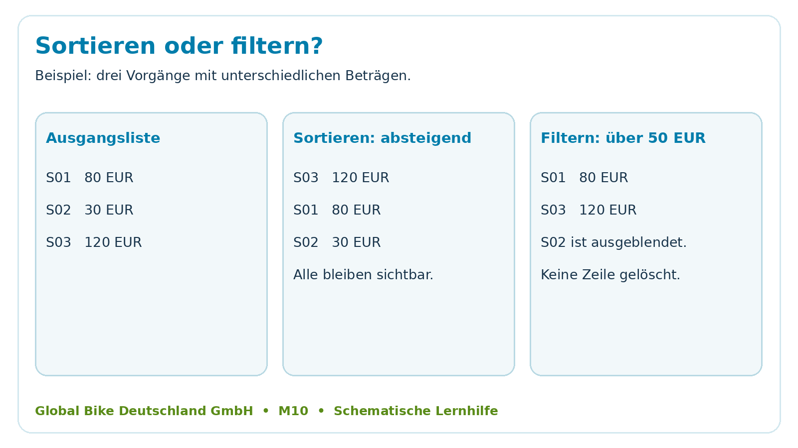

Ein Filter löscht keine Daten. Eine Sortierung verändert dagegen die Reihenfolge tatsächlich. Das Entfernen eines Filters stellt alle Zeilen wieder dar, macht aber eine Sortierung nicht rückgängig. Eine ursprüngliche Reihenfolge lässt sich beispielsweise über eine zuvor gespeicherte laufende Nummer wiederherstellen. IDs dürfen dabei nicht neu vergeben werden.

### 3. Alphabetische, numerische und chronologische Sortierung

Text wird alphabetisch, Zahlen werden nach ihrer Größe und echte Datumswerte zeitlich sortiert. Aufsteigend bedeutet A bis Z, klein nach groß oder alt nach neu. Absteigend bedeutet die umgekehrte Richtung.

| Merkmal | Aufsteigend | Absteigend |
| --- | --- | --- |
| Zuständigkeit | A bis Z | Z bis A |
| Nettobetrag | Kleinster zuerst | Größter zuerst |
| Fristende | Frühestes zuerst | Spätestes zuerst |
| Tagesdifferenz offener Aufgaben | Negativste zuerst | Größte zuerst |

Klick-Anleitung für eine Excel-Tabelle: Eine Zelle der gewünschten Spalte auswählen, Daten > Sortieren und Filtern > passende Sortierrichtung wählen. Alternativ den Pfeil in der Spaltenüberschrift öffnen und den entsprechenden Sortierbefehl auswählen. Die genaue Beschriftung hängt vom Datentyp und der Excel-Version ab. Ergebnis anhand der ersten und letzten Zeile prüfen.

Bei Zahlen, die als Text gespeichert sind, kann beispielsweise 100 vor 20 erscheinen. Ein Datumsformat allein wandelt Text nicht in echte Datumswerte um. M4 und M9 erläutern die Prüfung der Datentypen.

### 4. Sortieren nach mehreren Kriterien

Bei mehreren Sortierebenen bestimmt die erste Ebene die Hauptreihenfolge. Die zweite Ebene ordnet nur Datensätze mit gleichem Wert der ersten Ebene. Weitere Ebenen wirken entsprechend.

Beispiel: Die Verwaltung möchte Vorgänge zunächst nach Zuständigkeit gruppieren und innerhalb jeder Zuständigkeit nach Fristende ordnen.

Klick-Anleitung:

1. Eine Zelle innerhalb der vollständigen Tabelle auswählen.
2. Daten > Sortieren öffnen.
3. Bei einer normalen Liste den gesamten Datenbereich einschließlich Überschriften berücksichtigen; Daten haben Überschriften aktivieren.
4. Erste Ebene: Zuständigkeit, Zellwerte, A bis Z.
5. Ebene hinzufügen: Fristende, Zellwerte, älteste bis neueste.
6. Bei Bedarf eine weitere Ebene mit eindeutiger Vorgangs-ID ergänzen.
7. Mit OK bestätigen und prüfen, ob innerhalb jeder Zuständigkeit die Datumsreihenfolge stimmt.

Eine Sortierung nach Status in alphabetischer Reihenfolge ist keine automatische Dringlichkeitsreihenfolge. Für offene Aufgaben kann nach vorherigem Statusfilter das Fristende oder die Tagesdifferenz sortiert werden.

### 5. Zusammengehörige Datensätze erhalten

Eine Zeile bildet einen vollständigen Vorgang oder Kostenbeleg. Beim Sortieren müssen ID, Datum, Zuständigkeit, Status und alle zugehörigen Werte gemeinsam verschoben werden. Eine isoliert sortierte Datumsspalte kann falsche Zuordnungen erzeugen, obwohl die einzelnen Datumswerte korrekt aussehen.

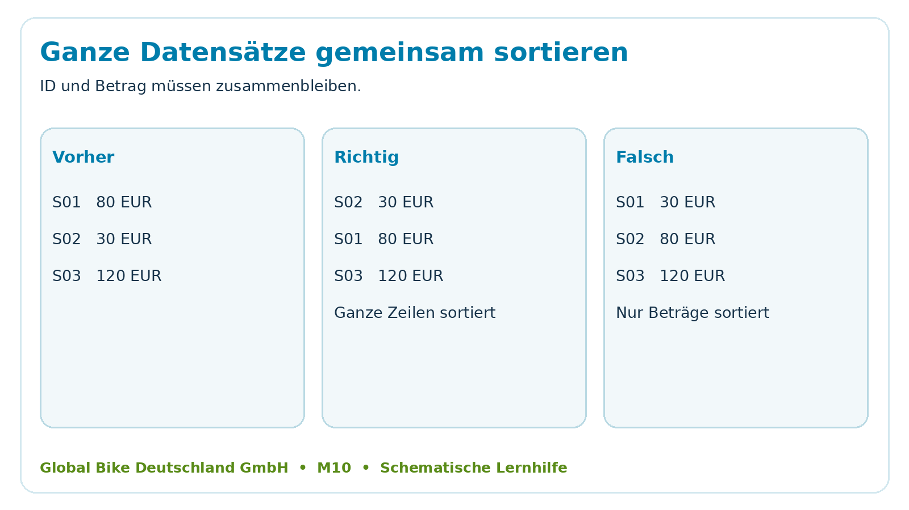

Bei einer normalen Liste kann Excel fragen, ob die Auswahl erweitert werden soll. Auswahl erweitern wählen, sofern die angrenzenden Spalten zum Datensatz gehören. Vorher sicherstellen, dass der vollständige Datenbereich erkannt wird. Eine formatierte Excel-Tabelle erleichtert das gemeinsame Sortieren. Summen, Stichtage und sonstige Parameter außerhalb der Datensätze halten. Keine verbundenen Zellen oder Leerzeilen innerhalb der Liste verwenden.

Nach dem Sortieren mindestens zwei IDs mit den ursprünglichen Angaben vergleichen. Formeln und Zuordnungen ebenfalls prüfen: Insbesondere Bezüge auf feste Positionen innerhalb eines sortierten Bereichs können nach der Sortierung eine andere fachliche Bedeutung haben. Ein [absoluter Zellbezug](#absoluter-zellbezug) fixiert eine Adresse, nicht die Identität eines Datensatzes.

### 6. Filter einrichten und verwenden

Klick-Anleitung für eine normale Liste:

1. Vollständigen Datenbereich mit eindeutigen Überschriften markieren.
2. Daten > Filter auswählen (alternativ Strg+Umschalt+L unter Windows).
3. Pfeil der gewünschten Spaltenüberschrift öffnen.
4. Auswahl Alle auswählen deaktivieren und benötigte Werte markieren.
5. Mit OK bestätigen.
6. Sichtbare Zeilen und Filtersymbol prüfen.

Formatierte Excel-Tabellen besitzen üblicherweise bereits Filterpfeile. Filter nicht unnötig erneut einschalten oder ausschalten.

Um einen einzelnen Filter zu entfernen, den betreffenden Pfeil öffnen und Filter löschen aus der betreffenden Spalte wählen. Daten > Löschen in der Gruppe Sortieren und Filtern entfernt die Filterkriterien des aktiven Bereichs, ohne die Daten zu löschen. Nicht mit dem Löschen von Zellinhalten verwechseln. Daten > Filter schaltet die Filterfunktion einer normalen Liste aus. Ausgeblendete Zeilen nicht versehentlich als fehlende Datensätze behandeln.

### 7. Text-, Zahlen- und Datumsfilter

| Filterart | Beispiel | Zweck |
| --- | --- | --- |
| Textfilter | Ist gleich Offen | Bearbeitungsstand auswählen |
| Textfilter | Enthält Ablage | Aufgaben mit passendem Text finden |
| Zahlenfilter | Kleiner als 0 | Negative Tagesdifferenzen finden |
| Zahlenfilter | Größer oder gleich 100 | Beträge ab 100 EUR auswählen |
| Datumsfilter | Vor 15.09.2027 | Frühere Datumswerte finden |
| Datumsfilter | Zwischen zwei Daten | Zeitraum auswählen |

Klick-Anleitung: Filterpfeil der Spalte öffnen, Textfilter, Zahlenfilter oder Datumsfilter wählen, Vergleichsbedingung auswählen, Vergleichswert eingeben und bestätigen. Die angebotene Filterart richtet sich nach den gespeicherten Datentypen. Bei Datumsfiltern kann Excel Werte zusätzlich nach Jahren und Monaten gruppieren. Für historische Auswertungen feste Datumsgrenzen verwenden, nicht relative Optionen wie Heute oder Diesen Monat.

Bei einem benutzerdefinierten Filter derselben Spalte können zwei Bedingungen mit UND oder ODER kombiniert werden. UND verlangt beide Bedingungen, ODER mindestens eine. Beispiel: Betrag größer oder gleich 50 UND kleiner oder gleich 100 schließt beide Grenzwerte ein. Bei Datumsgrenzen ebenfalls prüfen, ob die Grenze ein- oder ausgeschlossen ist.

### 8. Mehrere Filterkriterien kombinieren

Filter auf unterschiedlichen Spalten wirken gemeinsam als UND-Verknüpfung. Wer Status Offen und Zuständigkeit Verwaltung auswählt, sieht nur offene Vorgänge der Verwaltung. Wer innerhalb einer Werteliste derselben Spalte Offen und Erledigt auswählt, lässt beide Werte zu (ODER).

Beispiel: Eine offene Aufgabe mit negativer Tagesdifferenz ist überfällig. Eine erledigte Aufgabe mit negativer Differenz ist verspätet erledigt und darf nicht als noch überfällig behandelt werden. Deshalb genügt ein Zahlenfilter kleiner als null allein nicht.

Nach Änderung von Eingabewerten oder Formelergebnissen können Filterergebnisse veraltet sein. Daten > Erneut anwenden nutzen oder den Filter neu setzen und die sichtbaren Datensätze kontrollieren.

### 9. Offene und überfällige Vorgänge identifizieren

M9 erläutert die Berechnung der Tagesdifferenzen. Im Hauptfall gilt der feste [Stichtag](#stichtag) 01.07.2027; die Fristen werden nach der internen Kalendertagsregel aus M1 beurteilt. Für offene Aufgaben bedeutet eine negative Differenz überfällig, null heute fällig und ein positiver Wert zukünftig fällig.

Klick-Anleitung:

1. Vollständigkeit der Fristenliste und Plausibilität von Status und Erledigungsdatum prüfen.
2. Statusfilter auf Offen setzen.
3. Zahlenfilter in der Differenzspalte auf Kleiner als 0 setzen.
4. Nach Fristende aufsteigend sortieren, um die ältesten offenen Fristen zuerst zu sehen.
5. Für heute fällige Aufgaben den Zahlenfilter auf Gleich 0 ändern; für beide Gruppen zusammen Kleiner oder gleich 0 wählen.
6. Zuständigkeit bei Bedarf zusätzlich filtern.
7. Ergebnisse beurteilen, zuständige Stellen identifizieren und Filter anschließend zurücksetzen.

Eine bereits verspätet erledigte Aufgabe kann Anlass für eine Ursachenanalyse sein. Sie ist aber kein offener Bearbeitungsauftrag. Eine bevorstehende Frist kann wegen ihrer Auswirkungen wichtiger sein als eine ältere Frist. Prioritäten werden deshalb nicht allein aus der Sortierreihenfolge abgeleitet.

### 10. Rangfolgen erstellen

Eine Rangfolge kann durch absteigendes Sortieren sichtbar gemacht werden. Soll der Rang auch bei anderer Sortierreihenfolge erhalten bleiben, kann Excel ihn berechnen. Für die Kostenpositionen ist zunächst zu klären, welche Vergleichseinheit gemeint ist: einzelne Belege oder zusammengefasste Kostenarten. Für eine Rangfolge der Kostenarten müssen gleichartige Belege zunächst zusammengefasst werden. Einzelbelege und Kostenartensummen dürfen nicht vermischt werden.

Die Funktion RANG.GLEICH ist eine mögliche technische Umsetzung. Sie wird als Lernhilfe erläutert; die verbindliche Kompetenz ist die fachlich korrekte Rangfolge.

Syntax: =RANG.GLEICH(Zahl;Bezug;[Reihenfolge]). Reihenfolge 0 oder weggelassen bedeutet größter Wert erhält Rang 1; Reihenfolge 1 bedeutet kleinster Wert erhält Rang 1.

Beispiel: In B2:B6 stehen fünf Kostenartensummen. In C2 steht =RANG.GLEICH(B2;$B$2:$B$6;0). Der Vergleichsbereich bleibt beim Kopieren fest, der Einzelwert verändert sich zeilenweise.

Klick-Anleitung: Rangspalte ergänzen, [Formel](#formel) in erster Datenzeile eingeben, Enter drücken, Formel nach unten kopieren, Rang als ganze Zahl formatieren, anschließend Vergleichsbereich und Rang 1 prüfen. Bei Erweiterung einer normalen Liste den absoluten Vergleichsbereich erweitern. Eine Excel-Tabelle mit strukturierten Bezügen kann den Bereich automatisch erweitern; beispielsweise =RANG.GLEICH([@Kosten];Kostenliste[Kosten];0) in einer Tabelle namens Kostenliste mit Spalte Kosten.

### 11. Umgang mit gleichen Rangwerten

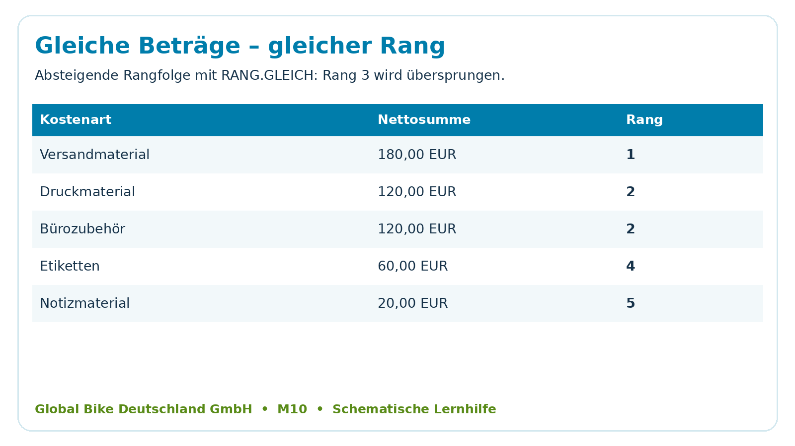

| Kostenart | Nettosumme | Rang absteigend |
| --- | --- | --- |
| Versandmaterial | 180,00 EUR | 1 |
| Druckmaterial | 120,00 EUR | 2 |
| Bürozubehör | 120,00 EUR | 2 |
| Etiketten | 60,00 EUR | 4 |
| Notizmaterial | 20,00 EUR | 5 |

Gleiche Werte erhalten bei RANG.GLEICH denselben Rang. Der nächste Rang wird entsprechend übersprungen. Eine laufende Nummer 1 bis 5 wäre hier keine korrekte Rangfolge nach Kostenhöhe. Für die Darstellung können gleichrangige Kostenarten zusätzlich alphabetisch sortiert werden; dadurch ändert sich ihr fachlicher Rang nicht. RANG.MITTELW ist eine andere mögliche Rangkonvention, aber nicht erforderlich. Keine willkürlichen Unterschiede bei gleichen Beträgen erfinden.

### 12. Auswirkungen von Filtern auf Berechnungen

[SUMME](#summe), MIN, MAX, MITTELWERT und RANG.GLEICH berücksichtigen weiterhin die Werte ihres angegebenen Bereichs, auch wenn Zeilen durch einen Filter ausgeblendet sind. Ein Filter verändert daher nicht automatisch den Gesamtwert oder die Rangposition. Für eine Auswertung nur sichtbarer Zeilen kann TEILERGEBNIS als freiwillige Vertiefung verwendet werden.

| Funktion | Beispiel | Wirkung |
| --- | --- | --- |
| SUMME | =SUMME(B2:B6) | Alle Werte des Bereichs |
| TEILERGEBNIS | =TEILERGEBNIS(9;B2:B6) | Durch Filter ausgeblendete Zeilen ausgeschlossen |
| TEILERGEBNIS | =TEILERGEBNIS(109;B2:B6) | Zusätzlich manuell ausgeblendete Zeilen ausgeschlossen |

Die Funktionen 9 und 109 stehen für Summen. Bei einer formatierten Tabelle kann über Tabellenentwurf > Ergebniszeile eine sichtbarkeitsabhängige Summe gewählt werden. Ergebniszeile und Gesamtwert eindeutig beschriften. Die Ergebniszeile nicht zusätzlich in den eigenen Summenbereich aufnehmen.

Beispiel aus Abschnitt 11: Gesamtsumme 500 EUR. Filter Nettosumme größer oder gleich 120 EUR: sichtbar sind 180, 120 und 120 EUR. SUMME bleibt 500 EUR; TEILERGEBNIS ergibt 420 EUR. Nach Entfernen des Filters beträgt auch das Teilergebnis wieder 500 EUR, sofern keine manuell ausgeblendeten Zeilen bei Funktion 109 vorliegen. Prozentuale Anteile am Gesamtbudget dürfen nicht versehentlich auf eine gefilterte Teilsumme bezogen werden.

### 13. Durchgängiges betriebliches Anwendungsbeispiel

Unabhängige Schulungsdaten, Stichtag 15.09.2027. Die Differenz ist bei offenen Aufgaben Fristende minus Stichtag, bei erledigten Aufgaben Fristende minus Abschlussdatum.

| ID | Aufgabe | Zuständigkeit | Fristende | Status | Erledigt am | Differenz |
| --- | --- | --- | --- | --- | --- | --- |
| S01 | Rückmeldung | Verkauf | 13.09.2027 | Offen | leer | −2 |
| S02 | Unterlagen prüfen | Verwaltung | 15.09.2027 | Offen | leer | 0 |
| S03 | Besprechung vorbereiten | Verwaltung | 17.09.2027 | Offen | leer | 2 |
| S04 | Kopien ablegen | Verwaltung | 12.09.2027 | Erledigt | 11.09.2027 | 1 |
| S05 | Liste aktualisieren | Verwaltung | 11.09.2027 | Erledigt | 13.09.2027 | −2 |
| S06 | Unterlagen versenden | Auftragsbearbeitung | 12.09.2027 | Erledigt | 12.09.2027 | 0 |
| S07 | Anfrage klären | Verkauf | 12.09.2027 | Offen | leer | −3 |
| S08 | Ablage prüfen | Verwaltung | 14.09.2027 | Offen | leer | −1 |

Auswertung A: Status Offen, Differenz kleiner als null, Fristende aufsteigend. Ergebnis S07, S01, S08. S05 ist ausgeschlossen, weil erledigt.

Auswertung B: Status Offen, Differenz kleiner oder gleich null, Zuständigkeit Verwaltung. Ergebnis S02 und S08; nach Fristende aufsteigend S08, S02.

Auswertung C: Alle Filter entfernen, Zuständigkeit A bis Z, innerhalb der Zuständigkeit Fristende aufsteigend. Reihenfolge S06, S07, S01, S05, S04, S08, S02, S03.

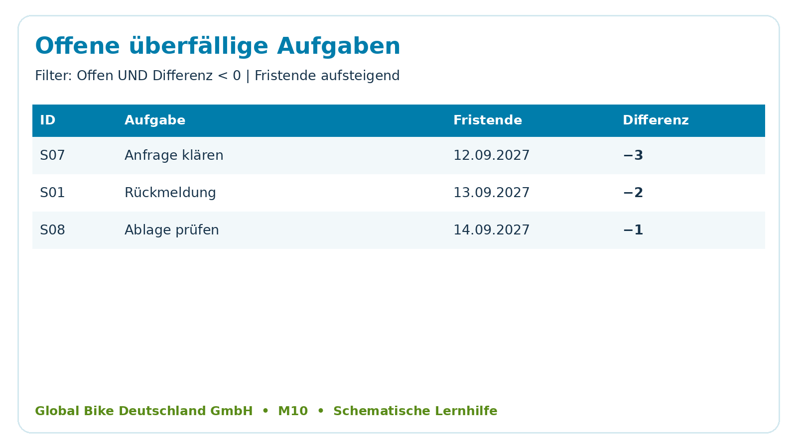

Betriebliche Beurteilung: Verkauf muss die beiden überfälligen offenen Rückmeldungen prüfen, Verwaltung die überfällige Ablageprüfung und die heute fällige Unterlagenprüfung. Die verspätete Listenaktualisierung kann separat untersucht werden. Die genaue Bearbeitungsreihenfolge ist mit den zuständigen Stellen unter Berücksichtigung der Auswirkungen abzustimmen.

Kostenbeispiel: Die fünf Kostenartensummen aus Abschnitt 11 werden absteigend sortiert und mit RANG.GLEICH ausgewertet. Versandmaterial hat den höchsten Anteil an den betrachteten Kosten. Das ist ein Anlass zur Prüfung des Bedarfs, aber kein Beweis für unnötige Ausgaben. Die beiden gleich hohen Kostenarten bleiben gleichrangig.

Funktionsprobe: In einer Kopie die Kosten für Notizmaterial von 20 auf 200 EUR ändern. Neue Gesamtsumme 680 EUR; Notizmaterial Rang 1, Versandmaterial Rang 2, Druckmaterial und Bürozubehör Rang 3, Etiketten Rang 5. Filter erneut anwenden, falls aktiv. Ursprüngliche Werte anschließend wiederherstellen.

### 14. Typische Fehler und deren Behebung

| Fehler | Abhilfe |
| --- | --- |
| Nur eine Spalte sortiert | Vollständige Datensätze gemeinsam sortieren |
| Überschrift als Datenzeile behandelt | Überschriftenoption prüfen |
| Zahlen als Text gespeichert | Datentyp korrigieren |
| Datumswerte alphabetisch sortiert | Echte Excel-Datumswerte verwenden |
| Summenzeile mitsortiert | Auswertungsbereich getrennt halten |
| Sortierebenen vertauscht | Hauptkriterium zuerst festlegen |
| Filter mit Löschen verwechselt | Filter zurücksetzen statt Zeilen löschen |
| Filterkriterien übersehen | Filtersymbole und sichtbare Zeilen prüfen |
| Erledigte verspätete Aufgabe als offen gewertet | Status zusätzlich filtern |
| Filter nach Datenänderung nicht aktualisiert | Erneut anwenden |
| Rangbereich wandert beim Kopieren | Vergleichsbereich absolut referenzieren |
| Gleiche Beträge erhalten willkürlich verschiedene Ränge | Rangkonvention beachten |
| Belege und Kostenartensummen vermischt | Vergleichseinheit festlegen |
| SUMME als sichtbare Teilsumme interpretiert | Gesamt- und Teilsumme unterscheiden |
| Neue Zeilen fehlen im Filter oder Rangbereich | Bereich erweitern und prüfen |
| Rang als automatische Sparentscheidung verstanden | Bedarf und betriebliche Folgen beurteilen |

### 15. Qualitätskontrolle und Wiederverwendbarkeit

Freiwillige Kontrolle: Sind die Überschriften eindeutig, Datentypen korrekt und IDs unverändert? Stimmen die zugehörigen Werte nach dem Sortieren? Sind alle Datensätze nach Entfernen der Filter wieder sichtbar? Sind Sortierebenen und Filterbedingungen fachlich begründet? Werden offene und erledigte Vorgänge korrekt unterschieden? Sind Rangrichtung, Vergleichseinheit und Gleichstände nachvollziehbar? Bleiben Gesamtsummen beim Filtern unverändert, sofern sie alle Daten umfassen sollen? Werden neue Zeilen berücksichtigt? Sind Formeln nach einer Sortierung noch fachlich korrekt?

Vor Weitergabe der [Arbeitsmappe](#arbeitsmappe) den vorgesehenen Filterzustand dokumentieren. Für eine vollständige Ausgangsansicht alle Filter zurücksetzen. Für eine gezielte Arbeitsansicht die aktiven Kriterien kenntlich machen. Funktionsproben nur in einer Kopie oder mit anschließender Wiederherstellung durchführen. Originaldaten aus M1 bleiben erhalten.

### 16. Freiwillige Selbstkontrolle

1. Was unterscheidet Sortieren und Filtern?
2. Werden ausgefilterte Zeilen gelöscht?
3. Wie werden echte Datumswerte vom frühesten zum spätesten sortiert?
4. Warum darf nicht nur die Datumsspalte sortiert werden?
5. Welche Ebene wirkt bei einer mehrstufigen Sortierung zuerst?
6. Wie lassen sich nur offene Vorgänge der Verwaltung anzeigen?
7. Welche Filterbedingungen finden offene überfällige Aufgaben?
8. Warum reicht eine negative Differenz allein nicht?
9. Was bedeutet UND bei zwei Filterkriterien?
10. Wie lässt sich ein Filter nach einer Datenänderung aktualisieren?
11. Welche Rangfolge ergibt sich für 90, 70, 70 und 40 bei absteigender Rangbildung mit RANG.GLEICH?
12. Warum wird der Vergleichsbereich beim Kopieren einer Rangformel absolut referenziert?
13. Welche Werte berücksichtigt SUMME bei einem Filter?
14. Was unterscheidet TEILERGEBNIS mit 9 und 109?
15. Warum ist der höchste Kostenrang nicht automatisch eine Sparentscheidung?
16. Was muss bei einer neu hinzugefügten Zeile überprüft werden?

**Kontrollhinweise**

1. Sortieren ändert die Reihenfolge, Filtern die sichtbare Auswahl.
2. Nein.
3. Aufsteigend, älteste bis neueste.
4. Sonst können Daten verschiedenen Vorgängen falsch zugeordnet werden.
5. Die erste Ebene.
6. Status Offen UND Zuständigkeit Verwaltung.
7. Status Offen UND Differenz kleiner als null.
8. Auch verspätet erledigte Aufgaben können negative Differenzen haben.
9. Beide Bedingungen müssen erfüllt sein.
10. Daten > Erneut anwenden oder Filter neu setzen.
11. 1, 2, 2, 4.
12. Damit alle Einzelwerte mit demselben Bereich verglichen werden.
13. Alle Werte des angegebenen Bereichs, auch ausgefilterte.
14. Beide ignorieren ausgefilterte Zeilen; 109 ignoriert zusätzlich manuell ausgeblendete Zeilen.
15. Bedarf, Alternativen und betriebliche Folgen müssen berücksichtigt werden.
16. Datenbereich, Filter, Formeln, Rangbereich und Auswertungen.

Keine zusätzliche Abgabe oder Bewertung.

### 17. Weiterführende Materialien

M3 erläutert Tabellenstruktur, M4 Datentypen, M6 Funktionen, M7 Zellbezüge, M8 Prozentanteile und M9 Fristen. M11 und M12 vertiefen grafische Auswertungen, M14 die Qualitätskontrolle. M10 bleibt während der gesamten Lernsituation verfügbar.

[Bearbeitbare Textfassung](material/m10.md)

## M11 – Diagrammtypen kennen, unterscheiden und begründet auswählen

[Digitale Fassung öffnen](material/m11.html)

Global Bike Deutschland GmbH – Verwaltung

### 1. Warum grafische Auswertungen?

In internen Besprechungen benötigt die Verwaltung schnell verständliche Informationen. Eine Tabelle liefert genaue Einzelwerte; ein Diagramm macht Unterschiede, Entwicklungen und Größenverhältnisse sichtbar. Beide Darstellungen ergänzen sich. Ein Diagramm ersetzt weder die Quelldaten noch die Prüfung der Berechnungen. Eine optisch ansprechende Grafik ist nur dann nützlich, wenn sie die betriebliche Frage korrekt beantwortet.

Die Beispiele in M11 sind eigenständige simulierte Schulungsdaten der Global Bike Deutschland GmbH, keine SAP-Daten. Die Ausgangsdaten aus M1 bleiben unverändert. Die Diagrammauswahl für das eigentliche Lernpaket bleibt offen.

### 2. Grundbegriffe

| Begriff | Bedeutung |
| --- | --- |
| Diagrammtyp | Grundform der grafischen Darstellung |
| Kategorie | Bezeichnung eines dargestellten Merkmals, etwa Kostenart |
| [Datenreihe](#datenreihe) | Zusammengehörige Werte, etwa monatliche Ausgaben |
| Datenpunkt | Einzelner Wert einer Datenreihe |
| Diagrammtitel | Aussage über Inhalt und Zeitraum |
| Achsentitel | Bezeichnung der dargestellten Größe und gegebenenfalls Einheit |
| Achsenbeschriftung | Kategorien oder Skalenwerte entlang einer Achse |
| Legende | Zuordnung von Farben oder Symbolen zu Datenreihen bzw. Kategorien |
| Datenbeschriftung | Wert oder Kategorie direkt am Datenpunkt |
| Skalierung | Wertebereich und Abstände der Zahlenachse |

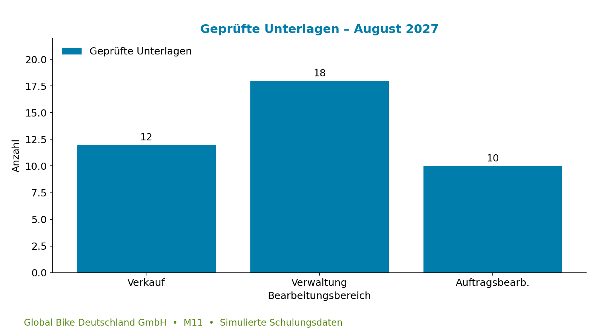

Bei Säulen- und Liniendiagrammen liegt die Kategorien- oder Zeitachse meist waagerecht, die Werteachse senkrecht. Beim Balkendiagramm ist dies umgekehrt. Ein Kreisdiagramm besitzt keine Achsen. Achsentitel werden dort nicht künstlich ergänzt; Kategorien und Anteile müssen dennoch eindeutig erkennbar sein.

### 3. Die vier grundlegenden Diagrammtypen

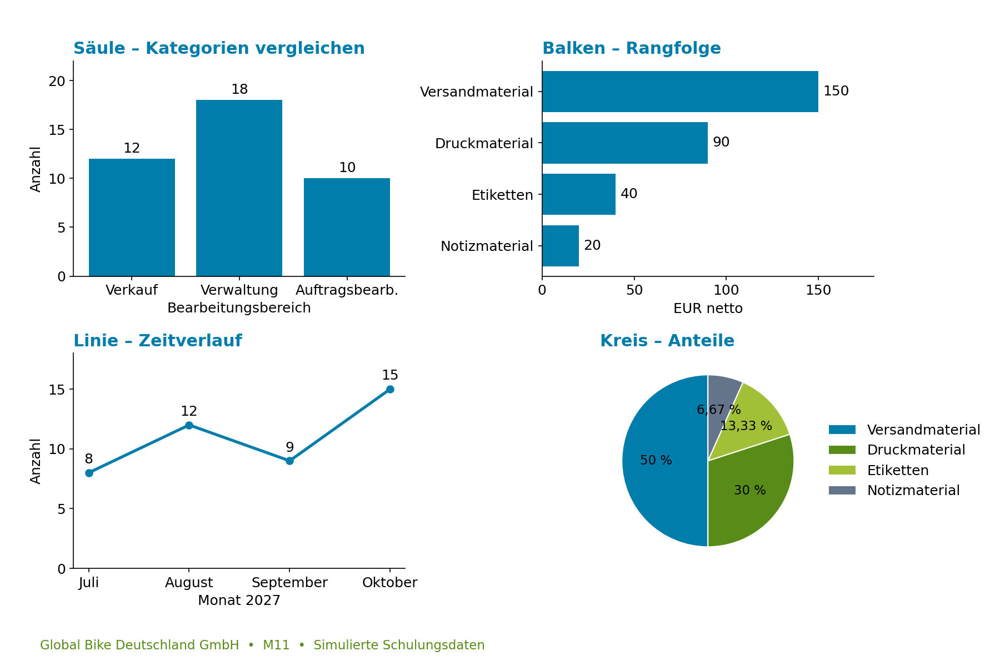

#### 3.1 Säulendiagramm

Senkrechte Säulen zeigen die Größe von Werten durch ihre Höhe. Die Säulen stehen nebeneinander; jede gehört zu einer Kategorie oder einem Zeitpunkt.

**Stärken:** Größenunterschiede sind schnell erkennbar; wenige Kategorien oder Zeitpunkte lassen sich gut vergleichen; gruppierte Säulen ermöglichen den Vergleich mehrerer Datenreihen gleicher Einheit.

**Grenzen:** Viele oder lange Kategorienamen erschweren die Lesbarkeit. Bei vielen Zeitpunkten wird die Entwicklung unübersichtlich. Eine abgeschnittene Werteachse kann Unterschiede übertreiben.

Schulungsbeispiel: In einer internen Dokumentenprüfung wurden im August 12, 18 und 10 Unterlagen in drei Bearbeitungsbereichen geprüft. Die Säulen zeigen den Mengenvergleich. Die Anzahl allein erlaubt keine Aussage über Arbeitsqualität oder Arbeitsbelastung.

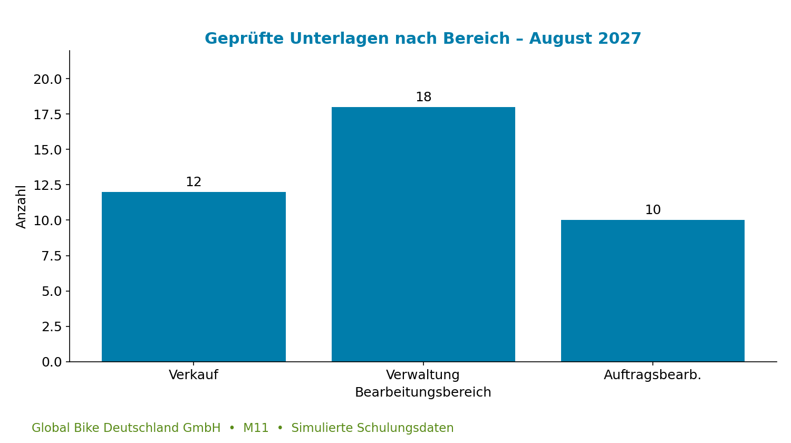

#### 3.2 Balkendiagramm

Waagerechte Balken zeigen die Größe eines Wertes durch ihre Länge. Kategorien stehen links, Werte auf der waagerechten Achse.

**Stärken:** Besonders lesbar bei langen Kategorienamen; geeignet für Rangfolgen und Größenvergleiche; absteigende Sortierung macht Unterschiede schnell sichtbar.

**Grenzen:** Zeitliche Entwicklungen sind weniger unmittelbar erkennbar; zu viele Balken erschweren die Übersicht. Auch hier muss die Längenskala grundsätzlich bei null beginnen.

Schulungsbeispiel: Vier Arten von Büroverbrauchsmaterial verursachen im August 150, 90, 40 und 20 EUR netto. Die Beträge können absteigend verglichen werden. Der größte Betrag ist nicht automatisch eine unnötige Ausgabe.

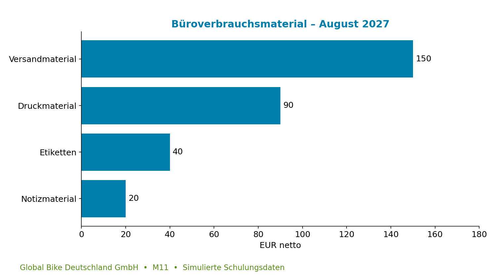

#### 3.3 Liniendiagramm

Datenpunkte werden in ihrer zeitlichen Reihenfolge durch Linien verbunden. Steigende, fallende und gleichbleibende Entwicklungen werden sichtbar.

**Stärken:** Trends und Schwankungen über mehrere Zeitpunkte; Vergleich mehrerer zeitlich ausgerichteter Datenreihen; kompakte Darstellung.

**Grenzen:** Ungeordnete Kategorien erhalten durch Verbindung eine irreführende Reihenfolge. Fehlende Werte sind nicht automatisch null. Bei unregelmäßigen Zeitabständen ist eine geeignete Datumsachse oder ein XY-Diagramm mit tatsächlichen Abständen erforderlich. Eine Linie zwischen Monatswerten beweist keine kontinuierlich gemessene Entwicklung zwischen diesen Punkten.

Schulungsbeispiel: In vier aufeinanderfolgenden Monaten wurden 8, 12, 9 und 15 interne Prüfungen abgeschlossen. Der letzte Wert ist der höchste; die Reihe steigt nicht durchgehend. Eine Prognose für den nächsten Monat ist daraus nicht gesichert.

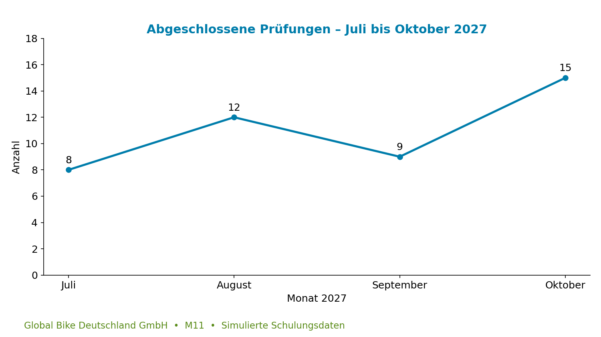

#### 3.4 Kreisdiagramm

Ein Kreis stellt ein Ganzes dar. Kreissektoren zeigen die Anteile einzelner Kategorien an diesem Ganzen. Der gesamte Kreis entspricht 100 Prozent.

**Stärken:** Wenige klar unterscheidbare Anteile sind leicht erkennbar; besonders geeignet für die Frage, welche Teile ein eindeutig definiertes Ganzes bilden.

**Grenzen:** Ähnliche Anteile sind schwer zu vergleichen; viele kleine Sektoren sind unübersichtlich. Negative Werte, mehrere unabhängige Gesamtheiten oder zeitliche Entwicklungen sind ungeeignet. Bei einer Gesamtsumme von null sind Anteile nicht definiert. Ein Kreisdiagramm zeigt normalerweise eine Datenreihe.

Schulungsbeispiel: Die vier Kostenarten aus Abschnitt 3.2 ergeben 300 EUR. Die Anteile betragen 50 %, 30 %, rund 13,33 % und rund 6,67 %. Das Diagramm zeigt Anteile an diesen 300 EUR, nicht an einem anderen Budget. Die Gesamtzeile darf nicht als zusätzlicher Sektor ausgewählt werden.

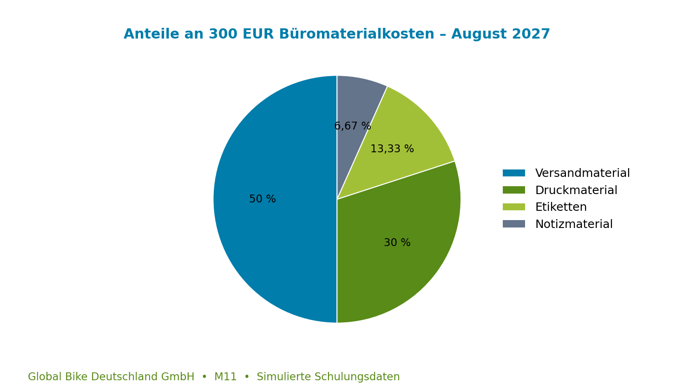

### 4. Vergleich der Einsatzmöglichkeiten

| Fragestellung | Geeignete Grundform | Begründung |
| --- | --- | --- |
| Welche Kategorien haben größere oder kleinere Werte? | Säulen oder Balken | Höhen bzw. Längen direkt vergleichbar |
| Wie sieht eine [Rangfolge](#rangfolge) mit langen Bezeichnungen aus? | Balken | Kategorien bleiben gut lesbar |
| Wie verändern sich Werte über die Zeit? | Linie, bei wenigen Zeitpunkten auch Säulen | Verlauf bzw. einzelne Zeitwerte erkennbar |
| Wie setzt sich ein Gesamtbetrag zusammen? | Kreis, alternativ Balken mit Anteilen | Teile eines definierten Ganzen |
| Wie lauten exakte Einzelwerte? | Tabelle, ergänzend Diagramm | Präzise Werte bleiben verfügbar |

Mehrere Diagrammtypen können fachlich geeignet sein. Die Wahl hängt von der Fragestellung, den Ausgangsdaten und der Zielgruppe ab. Ein Diagrammtyp ist nicht allein deshalb richtig, weil Excel ihn empfiehlt.

### 5. Entscheidungsweg

1. Aussageziel klären: Vergleich, Rangfolge, zeitliche Entwicklung oder Anteil?
2. Daten prüfen: Einheit, Zeitraum, Kategorien, Vollständigkeit, mögliche Summenzeilen.
3. Zielgruppe berücksichtigen: Welche Information muss in einer Besprechung schnell erkennbar sein?
4. Mindestens zwei grundsätzlich geeignete Darstellungen gedanklich vergleichen.
5. Diagrammtyp auswählen und begründen.
6. Prüfen, ob die Darstellung tatsächlich die gewünschte Aussage ermöglicht.

Begründungsstruktur: Aussageziel – Eigenschaften der Daten – Vorteil der gewählten Darstellung – Grenze einer Alternative. Eine bloße Aussage wie „Das sieht besser aus“ reicht nicht.

### 6. Daten für ein Diagramm vorbereiten

Die Datenquelle benötigt eindeutige Überschriften, zusammengehörige Kategorien und numerische Werte. Geldbeträge, Stückzahlen und Prozentwerte sind verschiedene Einheiten und dürfen nicht ohne sachliche Erklärung auf derselben Werteachse verglichen werden.

Beispiel für die unabhängigen August-Kosten:

| A: Kostenart | B: Betrag netto EUR | C: Anteil |
| --- | --- | --- |
| Versandmaterial | 150 | 50 % |
| Druckmaterial | 90 | 30 % |
| Etiketten | 40 | 13,33 % |
| Notizmaterial | 20 | 6,67 % |
| Gesamt | 300 | 100 % |

Bei Überschriften in Zeile 1 lautet B6 =SUMME(B2:B5) und C2 =B2/$B$6. C2 bis C5 kopieren und als Prozent formatieren. C6 kann mit =SUMME(C2:C5) kontrolliert werden. Die Prozentwerte intern nicht vorzeitig runden. Für ein Betragsdiagramm A1:B5 markieren, nicht die Gesamtzeile. Für ein Kreisdiagramm genügen ebenfalls die vier positiven Beträge; Excel berechnet die Sektoranteile aus ihrer Summe. Alternativ können die vier berechneten Anteile verwendet werden, nicht Beträge und Anteile zugleich.

Leere Werte bedeuten fehlende Information, nicht automatisch null. Vor der Darstellung klären, ob tatsächlich kein Vorgang vorliegt oder die Meldung fehlt. Bei gefilterten Daten prüfen, welche Zeilen im Diagramm erscheinen. Excel stellt ausgeblendete Zeilen standardmäßig häufig nicht dar; die Einstellung kann je nach Diagramm und Version geändert werden.

### 7. Klick-Anleitung: Diagrammtypen ausprobieren

Die folgenden Wege beziehen sich auf deutschsprachiges Desktop-Excel unter Windows. Menübezeichnungen können je nach Version abweichen. M12 vertieft die Gestaltung.

Allgemeiner Ablauf:

1. Geeignete Daten einschließlich Überschriften markieren.
2. Register Einfügen öffnen.
3. In der Gruppe Diagramme die gewünschte Diagrammfamilie auswählen.
4. Eine einfache 2D-Variante auswählen.
5. Kategorien, Werte und Datenreihen mit der Quelle vergleichen.
6. Diagrammtitel anpassen; erforderliche Achsentitel, Legende und Datenbeschriftungen ergänzen.
7. Ergebnis mit der betrieblichen Fragestellung vergleichen.

| Diagrammtyp | Klickweg nach Markierung |
| --- | --- |
| Säule | Einfügen > Säulen- oder Balkendiagramm einfügen > 2D-Säule > Gruppierte Säulen |
| Balken | Einfügen > Säulen- oder Balkendiagramm einfügen > 2D-Balken > Gruppierte Balken |
| Linie | Einfügen > Linien- oder Flächendiagramm einfügen > 2D-Linie > Linie mit Datenpunkten |
| Kreis | Einfügen > Kreis- oder Ringdiagramm einfügen > 2D-Kreis |

Für eine Vorschau kann auch Einfügen > Empfohlene Diagramme verwendet werden. Vorschläge fachlich prüfen.

### 8. Klick-Anleitung: Diagrammtyp ändern und Daten prüfen

Diagramm anklicken > Diagrammentwurf > Diagrammtyp ändern > gewünschte Familie und Untertyp auswählen > OK. Danach Datenzuordnung, Achsen, Legende und Beschriftungen erneut kontrollieren. Beim Wechsel zu einem Kreisdiagramm nur eine geeignete Datenreihe verwenden.

Wenn Kategorien und Datenreihen vertauscht sind: Diagrammentwurf > Daten auswählen > gegebenenfalls Zeile/Spalte wechseln. Im Dialog Datenquelle auswählen lassen sich Datenreihen und Kategorienbeschriftungen kontrollieren. Bei Kreisdiagrammen muss die Zuordnung der Kategorien zu den einzelnen Sektoren stimmen.

Für Diagrammelemente: Diagramm auswählen > Diagrammentwurf > Diagrammelement hinzufügen > Diagrammtitel, Achsentitel, Legende oder Datenbeschriftungen. Alternativ kann bei unterstützten Desktop-Versionen das Pluszeichen neben dem Diagramm verwendet werden. Bei einem Kreisdiagramm Datenbeschriftungen formatieren und Kategorie bzw. Prozentsatz auswählen. Achsentitel sind nur bei Diagrammen mit Achsen sinnvoll. Eine Legende ist bei mehreren Datenreihen besonders wichtig; bei eindeutig direkt beschrifteten Einzelreihen kann sie redundant sein. Die Schulbuchanforderung an eine Legende wird in der technischen Übung berücksichtigt.

### 9. Aussagekraft und irreführende Darstellungen

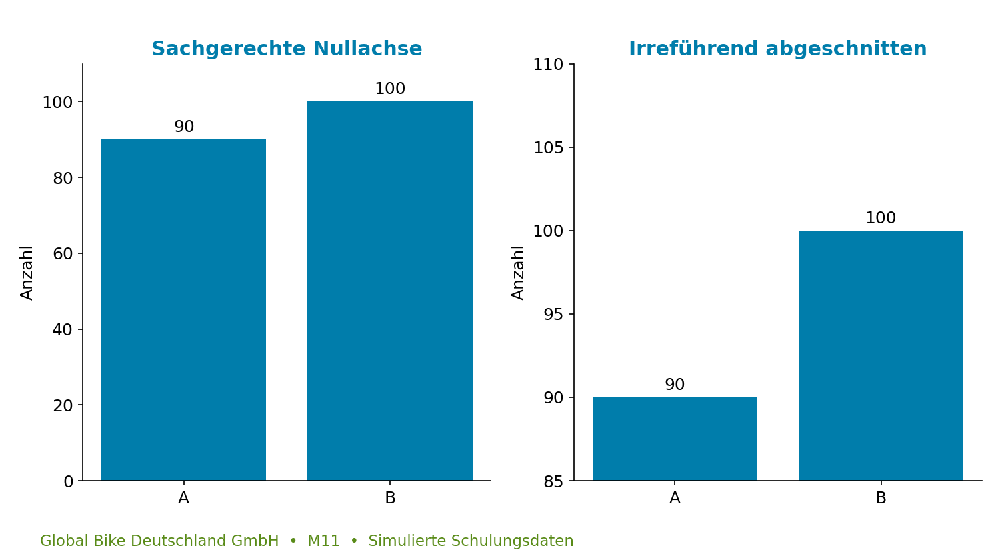

Die beiden Säulendiagramme zeigen dieselben Werte. Bei einer Achse ab 85 erscheinen 100 und 90 sehr unterschiedlich, obwohl 100 nur rund 11,11 % größer als 90 ist. Säulen und Balken sollten deshalb grundsätzlich bei null beginnen. Bei Liniendiagrammen kann eine begründete, klar beschriftete andere Skalierung sinnvoll sein, um kleine Veränderungen sichtbar zu machen.

Weitere Fehlerquellen: 3D-Effekte verzerren Größenverhältnisse; ungleiche Zeitabstände werden als gleich dargestellt; Farben suggerieren eine Bewertung ohne Begründung; Summen werden neben ihren Bestandteilen als zusätzliche Kategorien aufgenommen; unterschiedliche Einheiten werden vermischt; eine abgeschnittene Zeitreihe verschweigt den Kontext.

Farben sparsam verwenden. Beschriftungen, Symbole oder unterschiedliche Linienarten ergänzen Farben, damit die Aussage nicht ausschließlich von der Farbwahrnehmung abhängt. Titel und Einheiten müssen auch im Ausdruck verständlich sein.

### 10. Betriebliche Interpretation

Eine fachliche Auswertung unterscheidet Beobachtung, Erklärung und Empfehlung. Beobachtung: Der Wert im Oktober ist höher als im September. Erklärung: Die Ursache ist aus den vier Monatswerten allein nicht bekannt. Empfehlung: Die Verwaltung sollte bei Bedarf zusätzliche Informationen zur Aufgabenmenge und Bearbeitung einholen.

Bei Kostenanteilen gilt dasselbe: Ein hoher Anteil beschreibt die Zusammensetzung, nicht die Wirtschaftlichkeit. Für Einsparentscheidungen fehlen beispielsweise Bedarf, Preisalternativen und Folgen für den Betriebsablauf.

### 11. Freiwilliges Anwendungsbeispiel

Unabhängige Schulungsdaten: Für eine Besprechung werden die Zahlen interner Dokumentenprüfungen von Juli bis Oktober (8, 12, 9, 15) sowie die August-Kostenarten aus Abschnitt 6 betrachtet.

Freiwillige Erkundung: Die Monatswerte als Säulen und als Linie skizzieren oder in einer eigenen Übungsdatei darstellen. Die Kostenarten als Balken und Kreis darstellen. Jeweils vergleichen, welche Aussage schneller erkennbar ist. Die Werte bleiben bei einem Wechsel des Diagrammtyps gleich. Eine begründete Auswahl ist wichtiger als eine möglichst große Zahl von Diagrammen.

Kontrollhinweis: Für den zeitlichen Verlauf ist die Linie besonders anschaulich, für den Vergleich einzelner Monatswerte sind auch Säulen geeignet. Für die Rangfolge der Kostenarten sind Balken geeignet, für die Zusammensetzung der 300 EUR ein Kreis. Andere begründete Darstellungen sind möglich. Keine zusätzliche Abgabe.

### 12. Typische Fehler und Abhilfe

| Fehler | Abhilfe |
| --- | --- |
| Diagramm ohne konkrete Fragestellung | Aussageziel zuerst bestimmen |
| Gesamtzeile als Kreissektor | Nur Bestandteile markieren |
| Zeitwerte unsortiert | Chronologisch ordnen |
| Unverbundene Kategorien als Linie | Säulen oder Balken prüfen |
| Negative Beträge im Kreis | Andere Darstellung wählen |
| Fehlende Werte als null | Bedeutung klären |
| Abgeschnittene Säulenachse | Nullpunkt herstellen |
| Einheit fehlt | Titel oder Achsentitel ergänzen |
| Datenreihen vertauscht | Datenquelle kontrollieren |
| Zu viele Sektoren | Balken oder begründete Gruppierung prüfen |
| 3D-Effekte | Einfache 2D-Darstellung |
| Legende unverständlich | Aussagekräftige Reihenbezeichnungen |
| Filter unbemerkt aktiv | Sichtbare Daten und Quelle prüfen |
| Ursache aus Diagramm behauptet | Beobachtung und Erklärung trennen |

### 13. Qualitätskontrolle

Freiwillige Prüfhilfe: Stimmen alle dargestellten Werte mit der Quelle überein? Sind Zeitraum und Einheit erkennbar? Ist der Diagrammtyp begründet? Sind Kategorien, Achsen und Datenreihen eindeutig? Sind Anteile auf das richtige Ganze bezogen? Sind Skalierung und Zeitabstände sachgerecht? Bleibt die Darstellung auch ohne Farbe verständlich? Sind Beobachtungen von Vermutungen getrennt? Wird die Quelle bei Änderungen korrekt aktualisiert? Bleibt die [Arbeitsmappe](#arbeitsmappe) erweiterbar?

Die Anforderungen an Formeln und Wiederverwendbarkeit aus den Schulbuchseiten werden durch M5–M8 und M14 unterstützt. Die technische Gestaltung und die Druckaufbereitung werden in M12 und M13 vertieft.

### 14. Freiwillige Selbstkontrolle

1. Warum ergänzen Diagramme eine Tabelle?
2. Worin unterscheiden sich Säulen und Balken?
3. Welcher Typ ist für lange Kategorienamen oft geeignet?
4. Welche Eigenschaft macht eine Linie für Zeitreihen nützlich?
5. Warum ist eine Linie für ungeordnete Kostenarten ungeeignet?
6. Welche Voraussetzungen hat ein Kreisdiagramm?
7. Wie groß ist der Anteil von 90 EUR an 300 EUR?
8. Warum darf die Gesamtzeile nicht als Kreissektor erscheinen?
9. Was unterscheidet Achsentitel und Achsenbeschriftung?
10. Welche Aufgabe hat die Legende?
11. Warum sollten Säulen bei null beginnen?
12. Sind fehlende Monatswerte automatisch null?
13. Wo lässt sich ein Diagrammtyp nachträglich ändern?
14. Warum ist ein hoher Kostenanteil kein Beweis für Einsparpotenzial?
15. Welche Kriterien gehören in eine Diagrammbegründung?
16. Kann ein Säulendiagramm für Monatswerte ebenfalls sinnvoll sein?

**Kontrollhinweise**

1. Muster werden sichtbar, genaue Einzelwerte bleiben in der Tabelle.
2. Senkrechte Säulen, waagerechte Balken.
3. Balkendiagramm.
4. Zeitlich geordnete Punkte werden verbunden.
5. Die Verbindung suggeriert einen Verlauf ohne sachliche Reihenfolge.
6. Nichtnegative Bestandteile eines eindeutigen Ganzen mit positiver [Summe](#summe).
7. 30 %.
8. Das Ganze würde zusätzlich zu seinen Teilen gezählt.
9. Titel bezeichnet Größe und Einheit; Beschriftung zeigt Kategorien oder Skalenwerte.
10. Farben oder Symbole den Reihen bzw. Kategorien zuordnen.
11. Damit Längenverhältnisse nicht verzerrt werden.
12. Nein, fehlende Meldungen müssen geklärt werden.
13. Diagrammentwurf > Diagrammtyp ändern.
14. Bedarf und Alternativen sind nicht bekannt.
15. Aussageziel, Daten, Zielgruppe, Vorteil und Grenze einer Alternative.
16. Ja, besonders für den direkten Vergleich weniger Monatswerte.

Keine zusätzliche Abgabe oder Bewertung.

### 15. Weiterführende Materialien

M4 Zahlenformate, M6 Funktionen, M7 Zellbezüge, M8 Anteile, M10 [Sortieren](#sortieren) und Filtern. M12 Diagramme erstellen und gestalten, M13 Seitenlayout und Druck, M14 Qualitätskontrolle. M11 bleibt während der gesamten Lernsituation verfügbar.

[Bearbeitbare Textfassung](material/m11.md)

## M12 – Diagramme in Excel erstellen, gestalten und aktualisieren

[Digitale Fassung öffnen](material/m12.html)

Global Bike Deutschland GmbH – Verwaltung

### 1. Betrieblicher Nutzen

Für interne Besprechungen benötigt die Verwaltung verständliche, überprüfbare und wiederverwendbare Auswertungen. M11 unterstützt die Auswahl des Diagrammtyps. M12 erklärt die technische Umsetzung. Die verbindlichen Ausgangsdaten stehen in M1. Alle folgenden Beispiele sind davon unabhängige simulierte Schulungsdaten, keine SAP-Daten und keine Lösungen des Hauptfalls. Die Diagrammwahl für das Lernpaket bleibt offen.

Die Klickwege beziehen sich auf deutschsprachiges Desktop-Excel unter Windows. Je nach Version können Bezeichnungen und Symbole abweichen. Die Abbildungen sind schematische Lernhilfen, keine Originalscreenshots.

### 2. Eine geeignete Datenquelle vorbereiten

Beispiel: Die Verwaltung erfasst für eine separate interne Schulung die Anzahl geprüfter Dokumente in zwei Bearbeitungsbereichen.

| A: Monat | B: Verkauf | C: Verwaltung | D: Gesamt |
| --- | --- | --- | --- |
| Juli | 6 | 4 | 10 |
| August | 9 | 5 | 14 |
| September | 7 | 6 | 13 |
| Oktober | 10 | 8 | 18 |

Die Überschriften stehen in Zeile 1. In D2 steht =SUMME(B2:C2). Die Formel wird bis D5 kopiert. Die Werte in B und C sind Eingaben, D enthält berechnete Ergebnisse. Bei einer Änderung der Eingaben muss die Summe automatisch neu berechnet werden.

Für den Vergleich der Bereiche eignet sich A1:C5. Die Gesamtspalte wird nicht zusätzlich als gleichwertiger Bereich dargestellt. Für eine Darstellung der Gesamtentwicklung werden Monat und Gesamt ausgewählt. Die getrennten Bereiche A1:A5 und D1:D5 können bei gedrückter Strg-Taste markiert werden; falls Excel die Zuordnung nicht richtig erkennt, hilft der Dialog Daten auswählen. Alternativ kann eine zusammenhängende, formelbasierte Auswertungstabelle mit Monat und Gesamt angelegt werden.

Keine Leerzeilen, verbundenen Zellen oder Zwischensummen im ausgewählten Datenbereich. Überschriften müssen eindeutig sein. Zahlen dürfen nicht als Text gespeichert sein. Fehlende Werte sind nicht automatisch null. Bei gefilterten Listen ist zu prüfen, welche Werte tatsächlich dargestellt werden.

### 3. Klick-Anleitung: Säulendiagramm erstellen

1. Übungsdaten in ein separates Arbeitsblatt eingeben und Summenformeln ergänzen.
2. A1:C5 markieren.
3. Register Einfügen öffnen.
4. In der Gruppe Diagramme auf Säulen- oder Balkendiagramm einfügen klicken.
5. Unter 2D-Säule die Variante Gruppierte Säulen wählen.
6. Diagramm anklicken. Die kontextbezogenen Register Diagrammentwurf und Format erscheinen.
7. Diagrammtitel anklicken und einen aussagekräftigen Titel eingeben.
8. Kategorien, Datenreihen und Werte mit der Quelle vergleichen.
9. Diagramm an eine freie Stelle ziehen; Größe über die Eckpunkte verändern.
10. [Arbeitsmappe](#arbeitsmappe) speichern.

Erwartetes Ergebnis: vier Monatsgruppen mit je zwei Säulen. Die Reihen heißen Verkauf und Verwaltung. Die Höhen entsprechen den acht Eingabewerten. Die Werteachse beginnt bei null.

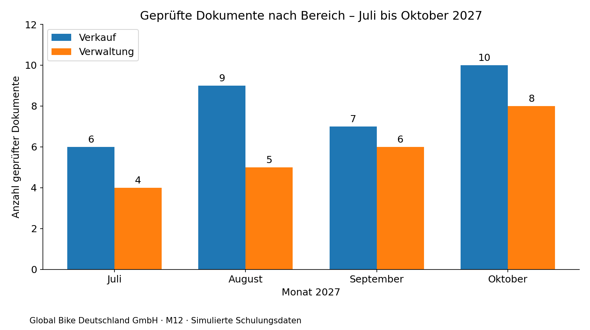

### 4. Klick-Anleitungen für weitere Diagrammtypen

#### Balken

Für eine [Rangfolge](#rangfolge) werden in einem unabhängigen Schulungsbeispiel drei Arten von Büroverbrauchsmaterial verglichen: Versandmaterial 120 EUR, Druckmaterial 80 EUR, Etiketten 40 EUR netto. Die Überschriften lauten Kostenart und Betrag netto EUR.

Daten samt Überschriften markieren > Einfügen > Säulen- oder Balkendiagramm einfügen > 2D-Balken > Gruppierte Balken. Die Kategorien stehen auf der senkrechten Achse. Wenn die größte Kategorie unten erscheint: Rechtsklick auf Kategorienachse > Achse formatieren > Kategorien in umgekehrter Reihenfolge. Anschließend die Position der Werteachse prüfen.

#### Linie

Für die Entwicklung der Gesamtzahl aus Abschnitt 2 Monat und Gesamt auswählen > Einfügen > Linien- oder Flächendiagramm einfügen > 2D-Linie > Linie mit Datenpunkten. Die vier Werte lauten 10, 14, 13 und 18. Zeitpunkte chronologisch anordnen. Die Linie zeigt keine durchgehend steigende Entwicklung.

#### Kreis

Für die Zusammensetzung der 240 EUR aus dem Balkenbeispiel die drei Kostenarten und Beträge einschließlich Überschriften markieren > Einfügen > Kreis- oder Ringdiagramm einfügen > 2D-Kreis. Die Gesamtzeile nicht markieren. Die Anteile betragen 50 %, rund 33,33 % und rund 16,67 %. Keine Achsentitel ergänzen, da ein Kreisdiagramm keine Achsen hat.

### 5. Diagrammtitel, Achsentitel und Legende

Ein guter Titel beantwortet, was dargestellt wird und auf welchen Zeitraum sich die Werte beziehen. Beispiel: Geprüfte Dokumente nach Bearbeitungsbereich – Juli bis Oktober 2027. Eine Überschrift wie Diagramm 1 ist nicht aussagekräftig.

Klickweg: Diagramm auswählen > Diagrammentwurf > Diagrammelement hinzufügen > Diagrammtitel > Über Diagramm. Titeltext anklicken und ersetzen.

Für Achsentitel: Diagrammentwurf > Diagrammelement hinzufügen > Achsentitel > Primär horizontal bzw. Primär vertikal. Textfelder anklicken und beschriften. Im Säulenbeispiel lautet die horizontale Achse Monat 2027, die vertikale Anzahl geprüfter Dokumente. Beim Balkendiagramm liegt die Werteachse horizontal.

Für die Legende: Diagrammentwurf > Diagrammelement hinzufügen > Legende > geeignete Position wählen, etwa unten. Die Legende darf keine Daten verdecken. Bei mehreren Reihen sind verständliche Reihenbezeichnungen erforderlich. Eine Legende mit Reihe1 und Reihe2 deutet auf fehlende oder falsch zugeordnete Überschriften hin. Bei einem Kreisdiagramm ordnet sie Kategorien den Sektoren zu.

### 6. Datenbeschriftungen und Zahlenformate

Diagramm auswählen > Diagrammentwurf > Diagrammelement hinzufügen > Datenbeschriftungen > geeignete Position. Bei Säulen eignen sich häufig Beschriftungen am äußeren Ende. Bei Linien können Werte oberhalb der Datenpunkte stehen. Bei vielen Werten kann eine Beschriftung jedes Punktes die Lesbarkeit verschlechtern.

Rechtsklick auf eine Datenbeschriftung > Datenbeschriftungen formatieren > Beschriftungsoptionen bzw. Zahl. Geldbeträge mit geeigneter Währungsdarstellung und Stückzahlen ohne unnötige Nachkommastellen anzeigen. Die Formatierung ändert nicht den gespeicherten Wert.

Beim Kreisdiagramm Datenbeschriftungen hinzufügen > Rechtsklick > Datenbeschriftungen formatieren > Prozentsatz aktivieren; bei Bedarf Kategoriename aktivieren und Wert deaktivieren. Prozentwerte mit sinnvoller Genauigkeit anzeigen. Rundungsbedingt können angezeigte Anteile von 100 % geringfügig abweichen.

### 7. Achsen und Skalierung

Rechtsklick auf die Werteachse > Achse formatieren > Achsenoptionen. Unter Grenzen können Minimum und Maximum eingestellt werden; unter Einheiten die Hauptintervalle. Bei Säulen und Balken grundsätzlich Minimum 0 verwenden. Das Maximum muss alle Werte einschließen. Automatische Grenzen sind bei veränderlichen Daten häufig sinnvoller als feste Obergrenzen.

Für das Säulenbeispiel ist ein Maximum von 12 mit Hauptintervall 2 für die ursprünglichen Einzelwerte möglich. Bei späteren größeren Werten muss eine feste Obergrenze angepasst oder auf Automatisch zurückgesetzt werden.

Bei Linien kann eine andere klar erkennbare Skalierung begründet sein. Zeitachsen müssen die zeitlichen Abstände sachgerecht abbilden. Für Monatsnamen als Text ist eine Kategorienachse mit gleichmäßigen Monatsabständen geeignet. Bei unregelmäßigen Datumsabständen echte Datumswerte und eine geeignete Datumsachse oder ein XY-Diagramm prüfen.

Rechtsklick auf Achse > Achse formatieren > Zahl: passendes Zahlenformat wählen. Gitternetzlinien über Diagrammelement hinzufügen sparsam einsetzen. Keine unnötige zweite Werteachse verwenden.

### 8. Datenreihen bearbeiten und Diagrammtyp wechseln

Diagramm anklicken > Diagrammentwurf > Daten auswählen. Im Dialog Datenquelle auswählen stehen die Legendeneinträge (Reihen) und horizontalen Achsenbeschriftungen.

- Bearbeiten einer Reihe: Namen und Wertebereich kontrollieren. Im Beispiel Verkauf: Name B1, Werte B2:B5.
- Hinzufügen: eine neue zusammengehörige [Datenreihe](#datenreihe) auswählen; Kategorien und Anzahl der Werte müssen passen.
- Entfernen: überflüssige Reihe auswählen und entfernen. Dadurch werden die Quelldaten nicht gelöscht.
- Horizontale Achsenbeschriftungen bearbeiten: A2:A5 für die vier Monate auswählen.
- Zeile/Spalte wechseln: wenn Excel Monate und Bearbeitungsbereiche vertauscht hat. Anschließend prüfen, ob die gewünschte Aussage wiedergegeben wird.

Diagrammentwurf > Diagrammtyp ändern > geeignete Familie und Untertyp > OK. Beim Wechsel zu einem Kreisdiagramm zuerst sicherstellen, dass nur eine geeignete Reihe mit Teilen eines Ganzen vorliegt. Ein Typwechsel ändert die Darstellung, nicht die zugrunde liegenden Zahlen.

### 9. Zweckmäßige Gestaltung

Diagramm auswählen > Diagrammentwurf > Diagrammformatvorlagen oder Farben ändern. Eine schlichte 2D-Darstellung bevorzugen. Farben müssen Reihen unterscheiden, dürfen aber keine unbegründete Bewertung suggerieren. Für dieselbe Datenreihe in mehreren Diagrammen möglichst dieselbe Farbe verwenden. Zusätzlich direkte Beschriftungen oder unterschiedliche Linienarten nutzen.

Einzelne Datenreihen formatieren: Reihe anklicken > Rechtsklick > Datenreihen formatieren > Füllung und Linie. Bei Linien können Markierungen und Stricharten ergänzt werden. Bei Säulen lässt sich die Abstandsbreite anpassen; Säulen sollen weder unnötig schmal sein noch miteinander verschmelzen.

Diagrammfläche und Zeichnungsfläche unterscheiden: Die Diagrammfläche umfasst das gesamte Objekt, die Zeichnungsfläche den Bereich der dargestellten Daten. Rechtsklick auf die jeweilige Fläche > formatieren. Dezenter Hintergrund, gut lesbare Schrift und ausreichender Kontrast unterstützen die Aussage. Keine 3D-Effekte, dekorativen Schatten oder unnötigen Rahmen.

### 10. Diagramme verschieben und für Besprechungen vorbereiten

Diagramm am Rand anklicken und ziehen. Eckpunkte zum Größenändern verwenden. Für ein eigenes Diagrammblatt: Diagrammentwurf > Diagramm verschieben > Neues Blatt > Namen vergeben. Alternativ als Objekt in einem vorhandenen Arbeitsblatt platzieren.

Für eine Besprechung sollen Tabelle und Diagramm gut lesbar sein. Erste Kontrolle über Datei > Drucken. Bei Bedarf Seitenlayout > Ausrichtung > Querformat und geeigneten [Druckbereich](#druckbereich) wählen. Nicht blind auf eine Seite verkleinern: Schrift und Beschriftungen müssen lesbar bleiben. M13 behandelt Druckbereich, Skalierung und Seitenaufteilung ausführlich.

Beim Kopieren in ein anderes Office-Dokument zwischen verknüpftem Diagramm, eingebettetem Diagramm und Bild unterscheiden. Ein Bild ist statisch. Verknüpfungen können bei verschobenen Dateien nicht mehr funktionieren. Für die wiederverwendbare Excel-Arbeitsmappe bleibt das ursprüngliche Diagramm erhalten.

### 11. Automatische Aktualisierung bestehender Werte

Ein Excel-Diagramm ist mit seinem Datenbereich verbunden. Änderungen innerhalb dieses Bereichs werden normalerweise automatisch dargestellt, sofern Formeln neu berechnet werden.

Freiwilliger Test in der separaten Übungsdatei: B3 (Verkauf im August) von 9 auf 11 ändern. D3 muss von 14 auf 16 steigen. Im Säulendiagramm muss die August-Säule Verkauf von 9 auf 11 steigen; im Diagramm der Gesamtentwicklung muss der Augustwert 16 erscheinen. Danach B3 wieder auf 9 setzen. Die Hauptfalldaten werden nicht verändert.

Wenn Formeln nicht aktualisiert werden: Formeln > Berechnungsoptionen > Automatisch prüfen. Gegebenenfalls F9 zur Neuberechnung verwenden. Wenn nur das Diagramm unverändert bleibt, Datenquelle, Filter und feste Achsengrenzen kontrollieren.

### 12. Neue Zeilen und wiederverwendbare Datenquellen

Eine Änderung vorhandener Werte ist nicht dasselbe wie eine Erweiterung des Datenbereichs. Ein Diagramm mit festem Bereich A1:C5 berücksichtigt eine neue Zeile 6 nicht zuverlässig automatisch.

Möglichkeit A: Diagramm auswählen > Diagrammentwurf > Daten auswählen > Datenbereich bzw. Reihen und Kategorien bis Zeile 6 erweitern. Auch die Summenformel muss bis D6 reichen.

Möglichkeit B: Ausgangsdaten A1:D5 markieren > Start > Als Tabelle formatieren (alternativ Strg+T) > Tabelle hat Überschriften aktivieren > OK. Ein Diagramm aus den benötigten Spalten dieser Excel-Tabelle erstellen. Unterhalb der Tabelle eine neue Zeile ergänzen. Excel-Tabellen erweitern sich bei entsprechender Einstellung normalerweise automatisch; berechnete Spalten übernehmen häufig die [Formel](#formel). Diagramme auf Basis dieser Tabelle können die Erweiterung automatisch übernehmen. Das Ergebnis muss geprüft werden, insbesondere bei getrennten Auswertungsbereichen.

Freiwilliger Erweiterungstest: November, Verkauf 8, Verwaltung 7. Erwartete [Summe](#summe) 15. November muss in der gewünschten Darstellung erscheinen. Falls nicht, Datenquelle und Tabellengröße kontrollieren. Anschließend Testzeile entfernen und ursprünglichen Zustand prüfen.

Eine Excel-Tabelle ist nicht automatisch eine fertige Auswertung: Bei Rohdaten mit vielen Einzelvorgängen sind zunächst geeignete Zusammenfassungen mit den bereits erlernten Funktionen erforderlich. Diagramme sollen auf nachvollziehbaren Auswertungswerten beruhen, nicht auf manuell nachgetragenen Ergebnissen.

### 13. Fehlersuche

| Beobachtung | Mögliche Ursache | Abhilfe |
| --- | --- | --- |
| Reihe1 statt Verkaufsbezeichnung | Überschrift nicht ausgewählt | Reihenname auf B1 beziehen |
| Monate fehlen | Kategorienbereich falsch | A2:A5 zuordnen |
| Gesamt erscheint als dritter Bereich | Zu großer Datenbereich | Gesamt aus Reihen entfernen |
| Diagramm bleibt nach Eingabe unverändert | Falsche Quelle oder manuelle Berechnung | Quelle und Berechnungsoptionen prüfen |
| Neue Zeile fehlt | Fester Bereich | Bereich erweitern oder Tabelle prüfen |
| Werte erscheinen als null | Zahl als Text oder fehlende Werte | Datentyp und Bedeutung prüfen |
| Linie unterbrochen | Leere Zelle | Fehlende Daten klären; Anzeigeoptionen prüfen |
| Balken abgeschnitten | Festes Maximum zu klein | Grenze erhöhen oder automatisch setzen |
| Anteile unplausibel | Gesamtzeile mit ausgewählt | Nur Bestandteile auswählen |
| Legende verdeckt Daten | Ungünstige Position | Legende verschieben |
| Beschriftungen überlappen | Zu viele Elemente | Größe, Position oder Auswahl anpassen |
| Filter verändert Grafik | Ausgeblendete Zeilen | Sichtbare Daten prüfen |
| Geldwerte ohne Einheit | Fehlender Titel oder Format | Einheit ergänzen |
| Grafik im Ausdruck unlesbar | Zu starke Skalierung | Layout und [Druckvorschau](#druckvorschau) prüfen |

Bei leeren oder ausgeblendeten Zellen: Diagrammentwurf > Daten auswählen > Ausgeblendete und leere Zellen. Verfügbare Optionen hängen vom Diagrammtyp und der Excel-Version ab. Fehlende Daten nicht ohne sachlichen Grund als null darstellen.

### 14. Freiwillige praktische Erkundung

In einer separaten Übungsdatei können die Daten aus Abschnitt 2 verwendet werden. Eine mögliche Erkundungsfolge: Formeln ergänzen, zwei Diagrammtypen vergleichen, Titel und Legende gestalten, einen Wert ändern, eine Zeile ergänzen und beide Änderungen rückgängig machen. Die Wahl des geeigneten Typs ist anhand des Aussageziels zu begründen. Für den Bereichsvergleich sind gruppierte Säulen plausibel; für die Gesamtentwicklung eine Linie. Andere fachlich begründete Darstellungen sind möglich.

Eine eigene kurze Klick-Anleitung kann als persönliche Gedächtnisstütze dienen. Sie enthält Ausgangsdaten, Menüfolge, erwartetes Ergebnis und Kontrolle. Keine zusätzliche Pflichtabgabe, keine KI und keine Bewertung.

### 15. Qualitätskontrolle vor der betrieblichen Nutzung

- Aussageziel und Diagrammtyp passen zusammen.
- Datenquelle, Zeitraum und Einheiten stimmen.
- Formeln berechnen die Werte nachvollziehbar.
- Kategorien und Datenreihen sind richtig zugeordnet.
- Titel, Achsentitel (falls vorhanden), Achsenbeschriftungen und Legende sind verständlich.
- Skalierung und Farben verzerren die Aussage nicht.
- Keine unbeabsichtigten Summenzeilen oder fehlenden Daten.
- Änderung eines Eingabewerts wirkt sich korrekt aus.
- Erweiterung um eine Zeile wurde geprüft.
- Teständerungen wurden rückgängig gemacht.
- Druckvorschau ist lesbar.
- Beobachtung, Erklärung und Empfehlung bleiben getrennt.

### 16. Freiwillige Selbstkontrolle

1. Welcher Bereich zeigt im Beispiel die beiden Bearbeitungsbereiche ohne Gesamt?
2. Welche Formel steht in D2?
3. Wie wird ein gruppiertes Säulendiagramm eingefügt?
4. Was bedeutet eine Legende?
5. Wo werden Achsentitel ergänzt?
6. Warum hat ein Kreisdiagramm keine Achsentitel?
7. Wie wird ein Prozentwert am Kreissektor angezeigt?
8. Warum beginnt die Werteachse bei Säulen grundsätzlich bei null?
9. Wo werden falsche Datenreihen korrigiert?
10. Ändert ein Diagrammtypwechsel die Quelldaten?
11. Welcher August-Gesamtwert entsteht bei B3 = 11?
12. Warum erscheint eine neue Zeile möglicherweise nicht?
13. Welche Tastenkombination erstellt aus einem markierten Bereich eine Excel-Tabelle?
14. Welche Summe ergibt November mit 8 und 7?
15. Warum ist ein festes Achsenmaximum bei wachsenden Daten riskant?
16. Was ist bei fehlenden Werten zu beachten?
17. Wie wird die Drucklesbarkeit vorab geprüft?
18. Warum muss nach einem Aktualisierungstest der Ausgangszustand wiederhergestellt werden?

#### Kontrollhinweise

1. A1:C5.
2. =SUMME(B2:C2).
3. Einfügen > Säulen- oder Balkendiagramm > Gruppierte Säulen.
4. Zuordnung von Reihen bzw. Kategorien zu Farben oder Symbolen.
5. Diagrammentwurf > Diagrammelement hinzufügen > Achsentitel.
6. Es zeigt Sektoren eines Ganzen, keine Werte entlang von Achsen.
7. Datenbeschriftungen formatieren > Prozentsatz.
8. Damit Höhenverhältnisse nicht verzerrt werden.
9. Diagrammentwurf > Daten auswählen.
10. Nein.
12. Der feste Datenbereich endet möglicherweise in Zeile 5.
13. Strg+T.
15. Größere Werte können abgeschnitten werden.
16. Bedeutung klären; nicht automatisch null einsetzen.
17. Datei > Drucken.
18. Damit die verbindliche Datengrundlage nicht unbeabsichtigt verändert wird.

### 17. Weiterführende Materialien

M11 unterstützt die begründete Diagrammauswahl. M3, M5–M8 und M10 unterstützen Datenstruktur, Berechnungen und Auswertungen. M13 vertieft Seitenlayout und Druck, M14 Qualitätskontrolle und Wiederverwendbarkeit. M12 bleibt während der gesamten Lernsituation verfügbar.

[Bearbeitbare Textfassung](material/m12.md)

## M13 – Seitenlayout und Druckaufbereitung in Excel

[Digitale Fassung öffnen](material/m13.html)

Global Bike Deutschland GmbH – Verwaltung

### 1. Betrieblicher Nutzen

Eine fachlich richtige Tabelle ist nicht automatisch eine geeignete Besprechungsunterlage. Abgeschnittene Spalten, fehlende Überschriften, unlesbare Zahlen und versehentlich mitgedruckte interne Notizen erschweren Entscheidungen. Die Druckaufbereitung stellt sicher, dass die benötigten Informationen vollständig, verständlich und adressatengerecht vorliegen.

Die bearbeitbare Excel-[Arbeitsmappe](#arbeitsmappe) bleibt die Grundlage. Ein PDF ist eine Momentaufnahme und ersetzt weder Formeln noch Filter oder aktualisierbare Diagramme. M13 ergänzt M3 und M12. Die verbindlichen Ausgangsdaten stehen weiterhin in M1. Alle Beispiele in M13 sind davon unabhängige simulierte Schulungsdaten der Global Bike Deutschland GmbH, keine SAP-Daten und keine Hauptfalllösungen.

Die Klickwege beziehen sich auf deutschsprachiges Desktop-Excel unter Windows. Menünamen können je nach Version und Druckertreiber abweichen. Die Abbildungen sind schematische Lernhilfen, keine Originalscreenshots.

### 2. Arbeitsblatt, Druckseite und PDF unterscheiden

| Begriff | Bedeutung |
| --- | --- |
| Arbeitsmappe | Excel-Datei mit einem oder mehreren Arbeitsblättern |
| Arbeitsblatt | Bearbeitungsfläche mit Zellen, Formeln und gegebenenfalls Diagrammen |
| [Druckbereich](#druckbereich) | Festgelegter Zellbereich, der ausgegeben werden soll |
| Papierformat | Abmessungen des Ausgabeblatts, beispielsweise A4 |
| Ausrichtung | Hochformat oder Querformat |
| Seitenrand | Abstand zwischen Papierkante und nutzbarem Inhalt |
| Skalierung | Verkleinerung oder Vergrößerung der Ausgabe, nicht der Zellwerte |
| Seitenumbruch | Grenze zwischen zwei Druckseiten |
| Drucktitel | Zeilen oder Spalten, die auf mehreren Druckseiten wiederholt werden |
| Kopf- und Fußzeile | Wiederkehrende Angaben oberhalb oder unterhalb des Seiteninhalts |
| [Druckvorschau](#druckvorschau) | Kontrolle der vorgesehenen Ausgabe vor dem Drucken |
| PDF | Datei mit festem Seitenlayout für die Weitergabe |

Die Normalansicht dient der Bearbeitung. Ansicht > Seitenlayout zeigt die Aufteilung auf Papierseiten und Kopf- und Fußzeilen. Ansicht > Umbruchvorschau zeigt die Seitenbegrenzungen. Die endgültige Kontrolle erfolgt über Datei > Drucken. Der Bildschirmzoom verändert nur die Anzeige, nicht die Druckgröße.

### 3. Unabhängiges Schulungsbeispiel vorbereiten

Die Verwaltung erstellt für eine interne Schulung eine Übersicht über Büroverbrauchsmaterial im Juli 2027. In einer neuen Übungsmappe steht in A1 der Titel Büroverbrauchsmaterial – Juli 2027. Zeile 2 bleibt frei. In Zeile 3 stehen die Überschriften.

| A: Datum | B: Material | C: Menge | D: Einzelpreis netto | E: Gesamt netto |
| --- | --- | --- | --- | --- |
| 05.07.2027 | Briefumschläge | 4 | 5,50 € | 22,00 € |
| 08.07.2027 | Etiketten | 3 | 8,00 € | 24,00 € |
| 12.07.2027 | Druckpapier | 5 | 6,40 € | 32,00 € |
| 19.07.2027 | Ordner | 2 | 7,50 € | 15,00 € |

Die Daten stehen in Zeilen 4 bis 7. E4 enthält =C4*D4, bis E7 kopiert. D8 enthält Gesamt netto, E8 =SUMME(E4:E7) mit Ergebnis 93,00 EUR. Die Datumsspalte erhält ein Datumsformat, D und E ein Währungsformat mit zwei Nachkommastellen. Spaltenbreiten so einstellen, dass Überschriften und Werte sichtbar sind. Für die Schulung kann in G3 eine Notiz stehen: Nur interne Testnotiz. Sie gehört nicht zur Besprechungsunterlage.

Ein optionales Diagramm zu Material und Gesamtbetrag kann nach M11 und M12 aus B3:B7 und E3:E7 erstellt und innerhalb A10:E21 platziert werden. Die Summenzeile bleibt aus der Diagrammquelle ausgeschlossen. Das Beispiel zeigt nur einen möglichen Aufbau, nicht die Gestaltung des Hauptfalls.

### 4. Klick-Anleitung: Druckbereich festlegen und ändern

1. Das gewünschte Arbeitsblatt aktivieren.
2. Für die reine Tabelle A1:E8 markieren.
3. Register Seitenlayout öffnen.
4. Druckbereich > Druckbereich festlegen wählen.
5. Datei > Drucken öffnen.
6. Kontrollieren, dass Titel, Überschriften, vier Datensätze und [Summe](#summe) erscheinen, nicht aber die Testnotiz in G3.
7. Mit dem Zurück-Pfeil zur Arbeitsmappe wechseln.
8. Soll das optionale Diagramm mit ausgegeben werden, A1:E21 markieren und den Druckbereich erneut festlegen. Das Diagramm vollständig innerhalb des Bereichs platzieren.
9. Druckvorschau erneut kontrollieren.

Druckbereich > Druckbereich aufheben entfernt die gespeicherte Einschränkung, nicht die Daten. Danach kann Excel wieder den gesamten verwendeten Bereich ausgeben. Druckbereich hinzufügen kann einen bestehenden Bereich erweitern; getrennte Bereiche werden normalerweise auf getrennten Seiten gedruckt. Für eine gemeinsame Seite ist ein zusammenhängender Bereich zweckmäßiger.

Der Druckbereich wird mit der Arbeitsmappe gespeichert. Neue Zeilen außerhalb eines festgelegten Bereichs werden nicht automatisch zuverlässig berücksichtigt. Nach Erweiterungen ist die Einstellung zu prüfen.

Eine einmalige Alternative: Zellen markieren > Datei > Drucken > unter Einstellungen Auswahl drucken. Das ist nicht dasselbe wie ein dauerhaft gespeicherter Druckbereich.

### 5. Papierformat, Ausrichtung und Seitenränder

#### Papierformat

Seitenlayout > Größe > A4 auswählen. A4 misst 210 × 297 mm. Das Papierformat muss zum Drucker und zur vorgesehenen PDF-Ausgabe passen. Bei abweichenden Einstellungen können Seitenumbrüche anders ausfallen.

#### Hoch- und Querformat

Seitenlayout > Ausrichtung > Hochformat oder Querformat. Hochformat bietet mehr Höhe, Querformat mehr Breite. Eine schmale Terminliste kann im Hochformat gut lesbar sein; eine breite Auswertung mit mehreren Spalten kann Querformat benötigen. Die Wahl hängt vom tatsächlichen Inhalt ab.

#### Seitenränder

Seitenlayout > Seitenränder > Normal, Breit oder Schmal wählen. Unter Benutzerdefinierte Seitenränder lassen sich Abstände einzeln einstellen. Im Dialog Seite einrichten, Register Seitenränder, kann die Ausgabe horizontal oder vertikal zentriert werden. Horizontales Zentrieren eignet sich häufig für eine kleine Tabelle; vertikales Zentrieren ist nicht immer sinnvoll.

Ränder dürfen nicht so klein sein, dass der Drucker Inhalte abschneidet. Kopf- und Fußzeilen benötigen ebenfalls Platz. Nach jeder Änderung die Vorschau kontrollieren.

### 6. Skalierung: eine Seite oder mehrere lesbare Seiten?

Die Schulungsanforderung einer einseitigen Tabelle ist bei überschaubaren Daten sinnvoll. Eine große Liste auf eine einzige Seite zu zwingen, kann sie unbrauchbar machen.

Klickweg: Seitenlayout > Gruppe An Format anpassen (je nach Version Skalierung). Breite und Höhe auswählen.

| Einstellung | Wirkung |
| --- | --- |
| Breite 1 Seite, Höhe 1 Seite | Gesamter Druckbereich wird auf eine Seite angepasst |
| Breite 1 Seite, Höhe Automatisch | Alle Spalten passen in die Breite; mehrere Seiten nach unten sind möglich |
| Breite und Höhe Automatisch | Keine feste Seitenzahl; Prozentmaßstab kann eingestellt werden |
| Skalierung 100 % | Ausgabe in ursprünglicher Druckgröße, sofern keine Anpassung aktiv ist |

Alternativ Datei > Drucken > Skalierungsmenü: Keine Skalierung, Blatt auf einer Seite darstellen, Alle Spalten auf einer Seite darstellen oder Alle Zeilen auf einer Seite darstellen. Die genaue Bezeichnung kann abweichen.

Für das kleine Beispiel zuerst A4 und passende Ausrichtung einstellen, dann die Vorschau betrachten. Nur bei Bedarf auf eine Seite skalieren. Für lange Listen ist eine Seite breit und automatisch viele Seiten hoch oft geeigneter. Bei unlesbarer Schrift zuerst unnötige Spalten aus der Ausgabe nehmen, Spaltenbreiten sinnvoll anpassen oder Querformat prüfen. Keine benötigten Daten aus der Arbeitsmappe löschen.

Skalierung verändert weder Zellwerte noch Formeln. Die angezeigte Prozentzahl ist abhängig von Druckbereich, Papierformat, Rändern und Druckertreiber. Es gibt keinen universell richtigen Prozentwert.

### 7. Seitenumbrüche kontrollieren

Ansicht > Umbruchvorschau. Blaue Linien markieren Seitenbegrenzungen; gestrichelte Linien stehen typischerweise für automatische, durchgezogene für manuelle Begrenzungen beziehungsweise den äußeren Druckbereich. Seitenzahlen dienen der Orientierung und werden nicht als solche mitgedruckt.

Manuellen horizontalen Umbruch einfügen: Zeile unterhalb der gewünschten Trennstelle markieren > Seitenlayout > Umbrüche > Seitenumbruch einfügen. Für einen vertikalen Umbruch die Spalte rechts der Trennstelle markieren. Wird eine einzelne Zelle gewählt, können beide Richtungen betroffen sein.

Umbruch entfernen: passende Zeile oder Spalte am manuellen Umbruch markieren > Seitenlayout > Umbrüche > Seitenumbruch entfernen. Alle manuellen Umbrüche lassen sich über Alle Seitenumbrüche zurücksetzen entfernen. Automatische Umbrüche entstehen weiterhin durch das Seitenlayout.

In der Umbruchvorschau können Grenzen verschoben werden. Dadurch können sich Skalierung oder Druckbereich ändern. Bei der Anpassung auf eine feste Seitenzahl kann Excel manuelle Umbrüche ignorieren. Für bewusst gesetzte Umbrüche daher die feste Seitenanpassung aufheben und einen geeigneten Prozentmaßstab verwenden. Anschließend Datei > Drucken prüfen.

### 8. Drucktitel bei mehrseitigen Listen

Eine Liste mit vielen Vorgängen benötigt auf jeder Seite verständliche Spaltenüberschriften. Drucktitel wiederholen vorhandene Zeilen oder Spalten, ohne die Daten zu duplizieren.

1. Arbeitsblatt aktivieren; gegebenenfalls Zellbearbeitung beenden und Blattgruppierung aufheben.
2. Seitenlayout > Drucktitel öffnen.
3. Im Dialog Seite einrichten das Register Blatt auswählen.
4. Bei Wiederholungszeilen oben in das Eingabefeld klicken.
5. Für die Beispielüberschrift Zeile 3 markieren. Der Bezug lautet $3:$3.
6. Bei Bedarf Wiederholungsspalten links festlegen, beispielsweise $A:$A bei horizontal verteilten Seiten.
7. OK wählen und in der Druckvorschau die zweite Seite kontrollieren.

Drucktitel sind nicht dasselbe wie Kopfzeilen. Sie enthalten tatsächliche Zellen des Arbeitsblatts. Ansicht > Fenster fixieren hält Überschriften am Bildschirm sichtbar, wiederholt sie aber nicht automatisch im Ausdruck. Bei einem einseitigen Dokument ist die Wiederholung meist nicht nötig.

### 9. Kopf- und Fußzeilen einrichten

Kopf- und Fußzeilen können betriebliche Dokumente eindeutig kennzeichnen. Geeignet sind Unternehmensname, Dokumentbezeichnung, Berichtszeitraum, Seitenzahl und gegebenenfalls ein freigegebener Bearbeitungsstand.

Klickweg: Einfügen > Kopf- und Fußzeile. Excel wechselt in die Seitenlayoutansicht. In den linken, mittleren oder rechten Abschnitt klicken. Text eingeben oder über das kontextbezogene Register Kopf- und Fußzeile die Felder Seitenzahl, Anzahl der Seiten, aktuelles Datum oder Blattname einfügen. Alternativ Seitenlayout > Dialogfeld Seite einrichten > Kopfzeile/Fußzeile > Benutzerdefinierte Kopfzeile beziehungsweise Fußzeile.

Beispiel Kopfzeile links: Global Bike Deutschland GmbH. Mitte: Verwaltung. Fußzeile links: Schulungsübersicht Juli 2027. Rechts: Seite [Seitenzahl] von [Anzahl der Seiten]. Die eckigen Klammern stehen hier für einzufügende Excel-Felder, nicht für wörtlich einzutippenden Text. Die Felder werden über die Schaltflächen eingefügt.

Das automatisch eingefügte aktuelle Datum ist das Ausgabedatum, nicht der Berichtszeitraum. Für einen festen Berichtszeitraum daher Text verwenden. Dateipfad oder Benutzername nur aufnehmen, wenn dies betrieblich erforderlich und freigegeben ist. Kopf- und Fußzeilen können für jedes Blatt unterschiedlich eingerichtet werden.

### 10. Gitternetzlinien, Überschriften und Diagramme

Gitternetzlinien auf dem Bildschirm sind nicht automatisch gedruckte Rahmen. Seitenlayout > Blattoptionen > Gitternetzlinien > Drucken aktiviert den Druck der Gitternetzlinien. Für eine professionelle Übersicht sind gezielt gesetzte Zellrahmen häufig übersichtlicher. Rahmen über Start > Rahmenlinien einstellen.

Die Excel-Zeilen- und Spaltenköpfe (1, 2, 3 und A, B, C) lassen sich unter Seitenlayout > Blattoptionen > Überschriften > Drucken einblenden. Für betriebliche Berichte werden sie normalerweise nicht benötigt. Fachliche Tabellenüberschriften müssen unabhängig davon vorhanden sein.

Für eine gemeinsame Ausgabe von Tabelle und Diagramm das Diagramm vollständig im Druckbereich positionieren. Falls es fehlt: Diagramm auswählen, über Rechtsklick auf die Diagrammfläche die Formatierungsoptionen und unter Größe und Eigenschaften die Einstellung Objekt drucken prüfen, sofern in der Version vorhanden. Vor dem Drucken eine Zelle anklicken, damit nicht versehentlich nur das ausgewählte Diagramm ausgegeben wird.

### 11. Druckvorschau und Ausgabeumfang

Datei > Drucken (Strg+P) öffnen. Drucker beziehungsweise Ausgabeziel, Seitenzahl, Papierformat, Ausrichtung, Ränder und Skalierung kontrollieren. Mit den Seitennavigationspfeilen jede Seite ansehen. Die Vorschau kann vergrößert werden; diese Vergrößerung verändert nicht die Druckgröße.

Unter Einstellungen unterscheiden:

- Aktive Blätter drucken: aktuell ausgewählte Arbeitsblätter; bei gruppierten Blättern können mehrere betroffen sein.
- Gesamte Arbeitsmappe drucken: alle für den Druck berücksichtigten Arbeitsblätter; nicht für eine einzelne Besprechungsunterlage verwenden, wenn andere Blätter nicht benötigt werden.
- Auswahl drucken: markierte Zellen beziehungsweise ausgewähltes Objekt.
- Druckbereiche ignorieren: nur bewusst verwenden, wenn die gespeicherten Bereiche nicht gelten sollen.

Bei gefilterten Listen werden ausgeblendete Zeilen normalerweise nicht gedruckt. Eine SUMME über den gesamten Bereich kann trotzdem auch ausgeblendete Werte enthalten. Daher prüfen, ob Überschrift, Filterzustand und berechnete Summen dieselbe Aussage treffen. Filter oder ausgeblendete Spalten sind keine Zugriffssicherung für eine weitergegebene Excel-Datei.

Erst nach vollständiger Vorschau und gegebenenfalls betrieblicher Freigabe den Druck auslösen. Für freiwillige Schulungsversuche genügt die Vorschau; Papierverbrauch ist nicht erforderlich.

### 12. Klick-Anleitung: PDF erstellen und prüfen

1. Excel-Arbeitsmappe im XLSX-Format speichern.
2. Gewünschtes Blatt aktivieren und Druckbereich sowie Layout prüfen.
3. Datei > Exportieren > PDF/XPS-Dokument erstellen > PDF/XPS erstellen wählen. Alternativ Datei > Speichern unter > Dateityp PDF.
4. Einen geeigneten Speicherort und einen eindeutigen Dateinamen wählen, beispielsweise GB_Schulung_Bueroverbrauch_Juli_2027.pdf.
5. Unter Optionen den gewünschten Ausgabeumfang prüfen, etwa aktive Blätter oder Auswahl. Gespeicherten Druckbereich nicht unbeabsichtigt ignorieren.
6. Für gut lesbare Ausgabe die Standardqualität wählen, sofern keine andere betriebliche Vorgabe gilt.
7. Veröffentlichen beziehungsweise Speichern wählen.
8. PDF separat öffnen. Seitenzahl, Titel, Zahlen, Einheiten, Diagramme, Seitenränder und Vollständigkeit kontrollieren.
9. Prüfen, dass keine ungewollten internen Notizen oder zusätzlichen Blätter enthalten sind.

Die PDF-Datei ist nicht automatisch vertraulich oder manipulationssicher. Sie enthält keine weiterrechenbaren Excel-Formeln. Für spätere Aktualisierungen die XLSX-Datei bearbeiten und eine neue PDF-Fassung erzeugen. Eine alte PDF-Datei aktualisiert sich nicht automatisch. Vor Weitergabe betriebliche Berechtigungen und Empfängerkreis prüfen. Im Unterricht werden keine echten externen Empfänger angeschrieben.

### 13. Wiederverwendbare Druckaufbereitung

Eine universell einsetzbare Tabelle soll nicht für jeden Bericht neu aufgebaut werden müssen. Formeln, Zahlenformate, Überschriften und Diagramme bleiben erhalten. Die Druckeinstellungen werden in der XLSX-Datei gespeichert. Bei neuen Zeilen oder Spalten können Druckbereich, Drucktitel, Seitenzahl und Skalierung jedoch Anpassungen benötigen.

Freiwilliger Test in einer Kopie der Schulungsmappe: Eine zusätzliche Materialposition vor der Summenzeile einfügen, beispielsweise 2 Packungen Klebeband zu je 3,25 EUR. Die neue Zeilensumme beträgt 6,50 EUR, die Gesamtsumme 99,50 EUR. Die Summenformel muss den neuen Datenbereich einschließen. Wenn die neue Zeile nicht in der Druckvorschau erscheint, Druckbereich und Seitenaufteilung prüfen. Ein vorhandenes Diagramm muss ebenfalls auf die neue Position geprüft werden. Anschließend die Testkopie schließen oder die ursprünglichen Werte wiederherstellen.

Für die spätere Nutzung können die ursprüngliche Arbeitsmappe und eine eindeutig benannte Arbeitskopie getrennt gespeichert werden. Keine Hauptfalldaten für einen Test verändern.

### 14. Typische Fehler erkennen und beheben

| Beobachtung | Mögliche Ursache | Abhilfe |
| --- | --- | --- |
| Letzte Spalte fehlt | Druckbereich zu klein | Druckbereich neu festlegen |
| Zusätzliche leere Seite | Formatierung außerhalb der Tabelle oder falscher Bereich | Druckbereich und Umbruchvorschau prüfen |
| Zahlen erscheinen als #### | Spalte zu schmal oder nicht darstellbarer Datumswert | Breite und [Zellwert](#zellwert) prüfen |
| Schrift extrem klein | Alles auf eine Seite skaliert | Breite 1, Höhe automatisch; Layout anpassen |
| Überschrift fehlt ab Seite 2 | Keine Drucktitel | Wiederholungszeilen festlegen |
| Seitenumbruch wird ignoriert | Feste Seitenanpassung aktiv | Prozentmaßstab statt fester Seitenzahl prüfen |
| Diagramm fehlt | Außerhalb des Bereichs oder Objekt drucken deaktiviert | Position und Eigenschaften prüfen |
| Nur Diagramm wird gedruckt | Diagramm ausgewählt | Zelle anklicken und Ausgabeumfang prüfen |
| Interne Notiz erscheint | Falscher Druckbereich | Bereich und PDF-Inhalt kontrollieren |
| Summe passt nicht zur gefilterten Liste | SUMME umfasst ausgeblendete Zeilen | Aussage und Berechnungsgrundlage prüfen |
| PDF enthält weitere Blätter | Gesamte Arbeitsmappe gewählt | Aktive Blätter oder Auswahl einstellen |
| PDF zeigt alte Werte | Nach Änderung nicht neu exportiert | XLSX neu berechnen und PDF neu erzeugen |
| Kopfzeile überlappt Inhalt | Ränder zu klein | Kopfzeilenabstand und Seitenränder anpassen |
| Vorschau unterscheidet sich je Drucker | Druckertreiber oder Papierformat | Zielgerät und Vorschau erneut prüfen |

### 15. Freiwillige praktische Erkundung

Die separate Schulungsmappe aus Abschnitt 3 kann für eine kurze Erkundung genutzt werden. Eine mögliche Reihenfolge ist: Druckbereich für die Tabelle festlegen, Hoch- und Querformat vergleichen, die lesbarere Einstellung begründen, Kopf- und Fußzeile ergänzen und eine PDF-Probeausgabe kontrollieren. Bei einer längeren Kopie der Liste können Drucktitel und Seitenumbrüche erprobt werden. Die zusätzlichen Testdaten sind keine betrieblichen Ist-Daten.

Eine persönliche Klick-Anleitung kann die gewählten Einstellungen und Kontrollschritte festhalten. Die Erkundung ist freiwillig, unbewertet und keine zusätzliche Pflichtabgabe. Die Lernenden entscheiden im Hauptfall selbst über die geeignete Ausgabeform ihres Lernpakets. Keine KI.

### 16. Qualitätskontrolle

- Richtige Arbeitsmappe und aktueller Datenstand.
- Benötigte Tabellen und Diagramme vollständig.
- Druckbereich enthält keine unbeabsichtigten Notizen.
- Papierformat und Ausrichtung passen zum Inhalt.
- Seitenränder und Skalierung ermöglichen gute Lesbarkeit.
- Keine abgeschnittenen Werte oder unnötigen Leerseiten.
- Überschriften bei mehrseitigen Listen wiederholt.
- Kopf- und Fußzeilen sachgerecht und ohne unnötige interne Angaben.
- Zahlen, Einheiten, Filterzustand und Summen stimmen überein.
- Alle Seiten in der Druckvorschau geprüft.
- PDF nach Export separat geöffnet und kontrolliert.
- Bearbeitbare XLSX-Datei erhalten; Teständerungen zurückgesetzt.

### 17. Freiwillige Selbstkontrolle

1. Worin unterscheiden sich Arbeitsblatt und Druckseite?
2. Welcher Bereich umfasst im Schulungsbeispiel die reine Tabelle?
3. Wie wird dieser Druckbereich gespeichert?
4. Wie wird ein Druckbereich aufgehoben?
5. Welche Maße hat A4?
6. Wann kann Querformat sinnvoll sein?
7. Welche Skalierung eignet sich häufig für lange, breite Listen?
8. Ändert der Bildschirmzoom die Druckgröße?
9. Wie wird ein manueller horizontaler Seitenumbruch eingefügt?
10. Was bedeutet $3:$3 bei Drucktiteln?
11. Wiederholt Fenster fixieren automatisch Überschriften im Druck?
12. Worin unterscheiden sich Drucktitel und Kopfzeilen?
13. Wie wird die Druckvorschau geöffnet?
14. Warum kann eine gefilterte Liste eine unerwartete SUMME zeigen?
15. Wie lässt sich vermeiden, dass weitere Arbeitsblätter im PDF erscheinen?
16. Aktualisiert sich ein bereits exportiertes PDF automatisch?
17. Wie hoch ist die Gesamtsumme im ursprünglichen Schulungsbeispiel?
18. Wie hoch ist sie nach Ergänzung der Klebebandposition?
19. Was ist nach Erweiterung einer Tabelle am Druckbereich zu prüfen?
20. Warum ersetzt ein PDF die XLSX-Datei nicht?

#### Kontrollhinweise

1. Arbeitsblatt ist die Bearbeitungsfläche, Druckseite die auf Papier beziehungsweise im PDF ausgegebene Fläche.
2. A1:E8.
3. Seitenlayout > Druckbereich > Druckbereich festlegen.
4. Seitenlayout > Druckbereich > Druckbereich aufheben.
5. 210 × 297 mm.
6. Bei breiten Tabellen, wenn dadurch mehr Spalten lesbar auf eine Seite passen.
7. Breite 1 Seite, Höhe Automatisch.
8. Nein.
9. Zeile unterhalb der Trennstelle markieren > Seitenlayout > Umbrüche > Seitenumbruch einfügen.
10. Zeile 3 wird oben auf den Druckseiten wiederholt.
11. Nein.
12. Drucktitel wiederholen Zellen; Kopfzeilen enthalten separate Seitenangaben.
13. Datei > Drucken oder Strg+P.
14. SUMME kann auch ausgeblendete Werte umfassen.
15. Gewünschtes Blatt aktivieren, Blattgruppierung prüfen und aktive Blätter beziehungsweise Auswahl als Umfang festlegen.
16. Nein, neu exportieren.
17. 93,00 EUR.
18. 99,50 EUR.
19. Ob die neuen Daten vollständig enthalten und lesbar sind.
20. PDF enthält eine feste Darstellung, keine bearbeitbaren Excel-Formeln.

### 18. Weiterführende Materialien

M3 unterstützt die Tabellenstruktur, M4 die Zahlenformate, M5–M8 die Berechnungen, M10 die Listenbearbeitung, M11 und M12 die Diagrammauswahl und -gestaltung. M14 vertieft die Qualitätskontrolle und Wiederverwendbarkeit. M13 bleibt während der gesamten Lernsituation verfügbar.

[Bearbeitbare Textfassung](material/m13.md)

## M14 – Qualitätskontrolle und Wiederverwendbarkeit von Excel-Arbeitsmappen

[Digitale Fassung öffnen](material/m14.html)

Global Bike Deutschland GmbH – Verwaltung

### 1. Warum Qualität im Büro wichtig ist

Emma Fuchs benötigt eine zuverlässige [Arbeitsmappe](#arbeitsmappe) für die Büroorganisation im Marktgebiet Nordwest. Eine ansprechend gestaltete Tabelle allein genügt nicht. Falsche Summen, übersehene Fristen oder unvollständige Diagramme können zu falschen betrieblichen Entscheidungen führen. Eine Arbeitsmappe muss deshalb fachlich richtig, technisch funktionsfähig, verständlich und erweiterbar sein.

M14 verbindet M2–M13. Die verbindlichen Daten und Regeln bleiben in M1: Auswertungszeitraum 01.01.–30.06.2027, [Stichtag](#stichtag) 01.07.2027, Halbjahresbudget 2.500 EUR netto, interne Fristen in Kalendertagen ohne Wochenendverschiebung. Keine Änderung dieser Vorgaben. Ostfriesland bleibt Marktgebiet, kein SAP-Standort.

Die folgenden Beispiele sind eigenständige simulierte Schulungsdaten der Global Bike Deutschland GmbH, keine SAP-Daten und keine Lösung des Hauptfalls. Klickwege beziehen sich auf deutschsprachiges Desktop-Excel unter Windows; je nach Version können Bezeichnungen abweichen.

### 2. Qualitätsmerkmale einer Arbeitsmappe

| Merkmal | Prüffrage |
| --- | --- |
| Richtigkeit | Stimmen Eingaben, Formeln und Ergebnisse? |
| Vollständigkeit | Sind alle benötigten Datensätze und Auswertungen enthalten? |
| Konsistenz | Stimmen Einheiten, Zeiträume und Bezugsgrößen überein? |
| Verständlichkeit | Sind Überschriften, Eingabefelder und Ergebnisse eindeutig? |
| Funktionsfähigkeit | Reagieren Berechnungen auf geänderte Eingaben? |
| Erweiterbarkeit | Werden neue Datensätze in Auswertungen berücksichtigt? |
| Lesbarkeit | Sind Tabellen, Diagramme und Druckausgaben verständlich? |
| Verantwortlicher Umgang | Bleiben Originaldaten erhalten und Informationen geschützt? |

Eine Prüfung umfasst Daten, Berechnungen, Auswertungen und Ausgabe. Ein korrekt wirkendes Ergebnis ist kein Beweis für eine richtige [Formel](#formel).

### 3. Originaldaten und Arbeitskopien

Die Datei M1_Rohdaten.xlsx ist die Ausgangsquelle. Sie bleibt unverändert. Die selbst entwickelte Arbeitsmappe enthält die aufbereiteten Daten und Auswertungen. Für Funktionstests wird eine zusätzliche Kopie verwendet.

Klick-Anleitung:

1. Datei > Speichern unter öffnen (bei Cloud-Dateien gegebenenfalls Kopie speichern).
2. Einen geeigneten Ordner wählen.
3. Einen eindeutigen Namen vergeben, etwa GB_Bueroorganisation_Test_2027.xlsx.
4. Dateityp Excel-Arbeitsmappe (*.xlsx) beibehalten.
5. Vor Änderungen den Dateinamen in der Titelleiste prüfen.
6. Nach dem Test die unveränderte Arbeitsfassung wieder öffnen. Testergebnisse nicht als betriebliche Ist-Daten übernehmen.

Eine CSV-Datei ist kein Ersatz für eine vollständige XLSX-Arbeitsmappe: Formeln, mehrere Blätter, Diagramme und Formatierungen bleiben dort nicht als Excel-Arbeitsmappe erhalten. Eine PDF-Datei ist eine Ausgabe, keine bearbeitbare Datenbasis.

### 4. Datenqualität kontrollieren

Vergleich mit der Ausgangsquelle: [Vorgangskennzeichen](#vorgangskennzeichen), Datumswerte, Beträge, Status und Zuständigkeiten stichprobenartig und bei kritischen Feldern vollständig prüfen. Fehlende Angaben nicht eigenmächtig ergänzen. Leere Erledigungsdaten bedeuten im Hauptfall nicht erledigt; leere Vorgangsreferenzen bedeuten eigenständige Aufgaben.

Klick-Anleitung für die Sichtkontrolle:

1. Datenblatt aktivieren und Überschriften prüfen.
2. Daten > Filter aktivieren, sofern nicht bereits als Tabelle eingerichtet.
3. Filterpfeil einer Spalte öffnen und auf leere oder unerwartete Einträge prüfen.
4. Filter wieder löschen, bevor eine vollständige Übersicht beurteilt wird.
5. Datums- und Betragszellen auswählen und über Strg+1 das Zahlenformat kontrollieren.
6. Bei Verdacht auf Text statt Zahl den tatsächlichen Zellinhalt und gegebenenfalls die Excel-Fehleranzeige prüfen.

Eine Zahl kann wie eine Währung aussehen und trotzdem als Text gespeichert sein. Umgekehrt verändert ein Währungsformat nicht den zugrunde liegenden Wert. Ein leeres Feld ist nicht automatisch null. Doppelte Beträge oder Datumswerte sind nicht automatisch doppelte Vorgänge. Daten > Duplikate entfernen löscht Datensätze; daher nur nach fachlicher Prüfung in einer Kopie verwenden. Eindeutige Vorgangskennzeichen sind geeigneter als ein bloßer Betragsvergleich.

Optionaler Prüfweg: Start > Bedingte Formatierung > Regeln zum Hervorheben von Zellen > Doppelte Werte auf eine Kennzeichenspalte anwenden. Markierungen sind Prüfhinweise, keine Löschanweisung.

### 5. Unabhängiges Schulungsbeispiel: Materialkosten

Eine neue Testmappe enthält in A1:E5 die folgende kleine Übersicht. Sie dient ausschließlich dem Erproben von Prüfmethoden.

| A Material | B Menge | C Einzelpreis netto | D Gesamt netto | E Anteil am Gesamt |
| --- | --- | --- | --- | --- |
| Versandtaschen | 4 | 12,50 € | 50,00 € | 50 % |
| Etiketten | 3 | 8,00 € | 24,00 € | 24 % |
| Ordner | 2 | 13,00 € | 26,00 € | 26 % |
| Gesamt |  |  | 100,00 € | 100 % |

In D2 steht =B2*C2, kopiert bis D4. D5 enthält =SUMME(D2:D4). E2 enthält =D2/$D$5, kopiert bis E4. E5 enthält =SUMME(E2:E4). D und C erhalten Währungsformat, E Prozentformat. Die Schulungsbezugsgröße ist 100 EUR, nicht das Halbjahresbudget aus M1.

In G1 steht Schulungsbudget, in G2 der unabhängige Testwert 125 EUR. G3 kann mit =G2-D5 den Restbetrag (25 EUR) berechnen; G4 mit =D5/G2 die Budgetauslastung (80 %). G4 als Prozent formatieren.

### 6. Formeln und Zellbezüge überprüfen

Eine Formel beginnt mit dem Gleichheitszeichen. Eingabewerte werden referenziert, nicht unnötig in Formeln festgeschrieben. =B2*C2 reagiert auf Änderungen; =4*12,5 enthält feste Zahlen und reagiert nicht auf die Zellen.

Klick-Anleitung:

1. Ergebniszelle D2 anklicken und Bearbeitungsleiste ansehen.
2. F2 drücken, um die Formel und farbig markierte Bezüge zu sehen.
3. Mit Esc ohne Änderung beenden.
4. D3 und D4 kontrollieren: relative Bezüge müssen zur jeweiligen Zeile passen.
5. E2 bis E4 prüfen: der Zähler ändert sich je Zeile, der Nenner $D$5 bleibt fest.
6. D5 prüfen: Der Summenbereich umfasst genau D2:D4, nicht die Summenzelle selbst.
7. Formeln > Formeln anzeigen wählen, um Formeln statt Ergebnisse zu sehen; erneut wählen, um zurückzukehren.

Eine Formel kann rechnerisch funktionieren, aber fachlich falsch sein. Beispiel =D2/$G$2 berechnet den Anteil am Schulungsbudget statt am Gesamtbetrag. Beide Ergebnisse sind mathematisch möglich, beantworten jedoch unterschiedliche Fragen.

### 7. Formelüberwachung und Fehlerprüfung

Formeln > Formelüberwachung > Spur zum Vorgänger zeigt Zellen, die in die ausgewählte Formel eingehen. Spur zum Nachfolger zeigt abhängige Formeln. Pfeile entfernen beendet die Darstellung.

Beispiel: D2 auswählen > Spur zum Vorgänger. B2 und C2 sind die Eingaben. D5 auswählen > Spur zum Nachfolger. Die Anteilsformeln und gegebenenfalls die Budgetauswertung hängen davon ab.

Formeln > Fehlerüberprüfung sucht nach bestimmten erkennbaren Problemen. Formeln > Formel auswerten zeigt bei geeigneten Formeln einzelne Berechnungsschritte. Diese Werkzeuge ersetzen keine fachliche Prüfung: Eine falsche Bezugsgröße oder ein unvollständiger, aber gültiger Summenbereich kann ohne Warnung bleiben.

### 8. Typische Fehler erkennen und beheben

| Anzeige oder Beobachtung | Ursache und Prüfung |
| --- | --- |
| #DIV/0! | Division durch null oder leere Bezugszelle; Nenner prüfen |
| #WERT! | Ungeeigneter Datentyp, etwa Text in einer Multiplikation; Eingaben prüfen |
| #BEZUG! | Ungültiger Zellbezug, etwa nach Löschen referenzierter Zellen; Quelle wiederherstellen oder Bezug fachlich korrigieren |
| #NAME? | Unbekannter Funktionsname oder Name; Schreibweise prüfen |
| #ZAHL! | Unzulässiger numerischer Wert oder Berechnungsbereich; Argumente prüfen |
| #NV | Gesuchter Wert nicht verfügbar; Quelle und Suchkriterium prüfen |
| #### | Häufig zu schmale Spalte, auch nicht darstellbare negative Datums-/Zeitwerte; Breite und Wert prüfen |
| Formel steht als Text in der Zelle | Textformat, führendes Apostroph oder Formeln-anzeigen-Modus prüfen |
| Ergebnis bleibt unverändert | Fester Zahlenwert statt Formel oder manuelle Berechnung; Formel und Berechnungsoptionen prüfen |
| Zirkelbezug | Formel verweist direkt oder indirekt auf sich selbst; Abhängigkeiten korrigieren |

Bei Textformat: Zelle auf Standard umstellen, anschließend F2 und Eingabetaste, sofern tatsächlich eine Formel eingegeben werden soll. Bei einem führenden Apostroph dieses gezielt entfernen. Keine Fehlermeldung pauschal durch null ersetzen. WENNFEHLER kann Fehler verdecken und ist hier keine notwendige Pflichtfunktion.

Formeln > Berechnungsoptionen > Automatisch prüfen. F9 löst eine Neuberechnung aus. Ein korrektes Ergebnis nach F9 allein beweist noch keine dauerhaft automatische Aktualisierung.

### 9. Plausibilitätskontrolle

Plausibilität bedeutet, ein Ergebnis auf fachliche Nachvollziehbarkeit zu prüfen. Dazu gehören Überschlagsrechnung, Gegenrechnung, Vergleich mit Ausgangsdaten und Prüfung der Einheit.

Im Schulungsbeispiel: 50 + 24 + 26 = 100 EUR. Die drei Anteile ergeben zusammen 100 %. 100 von 125 EUR sind 80 %, Rest 25 EUR. Gesamtbetrag plus Rest ergeben 125 EUR.

Ein Prozentwert kann über 100 % liegen, etwa bei Budgetüberschreitung. Das ist nicht automatisch ein Fehler. Bei Anteilen an einer vollständig und überschneidungsfrei aufgeteilten Gesamtheit sollte die [Summe](#summe) dagegen ungefähr 100 % ergeben; Rundungsabweichungen der Anzeige sind möglich.

Für den Hauptfall gelten die Bezugsgrößen und Fristregeln aus M1. Keine gesetzlichen Aufbewahrungsfristen aus den internen Simulationsfristen ableiten. Bei Fristen insbesondere Stichtag, Ausgangstag, Fälligkeit und Erledigungsdatum auseinanderhalten. Eine erledigte Aufgabe ist nicht allein deshalb rechtzeitig erledigt.

### 10. Funktionstest mit geänderten Eingaben

Ein Funktionstest prüft, ob die Arbeitsmappe auf Änderungen wie erwartet reagiert. Zuerst den erwarteten Wert bestimmen, dann ändern, beobachten und vergleichen.

| Test in der Schulungskopie | Erwartung |
| --- | --- |
| B2 von 4 auf 5 ändern | D2 = 62,50 EUR; D5 = 112,50 EUR |
| Dieselbe Änderung | G3 = 12,50 EUR; G4 = 90 % |
| Dieselbe Änderung | E2 rund 55,56 %, E3 rund 21,33 %, E4 rund 23,11 % |
| B2 auf 4 zurücksetzen | Ausgangssumme 100 EUR |
| G2 von 125 auf 80 ändern | G3 = −20 EUR; G4 = 125 % |
| G2 auf 125 zurücksetzen | Rest 25 EUR, Auslastung 80 % |
| G2 in der Testkopie auf 0 setzen | G4 zeigt bei einfacher Division #DIV/0!; Bezugsgröße fachlich klären |

Ein negativer Restbetrag kennzeichnet in diesem Beispiel eine Überschreitung. Der Nulltest ist absichtlich fehlerauslösend und darf nicht in der Arbeitsfassung verbleiben. Nach jedem unabhängigen Test Ausgangswerte wiederherstellen.

### 11. Neue Datensätze und wiederverwendbare Tabellen

Eine Excel-Tabelle kann sich beim Hinzufügen von Datensätzen erweitern. Eine normale formatierte Zellfläche ist nicht automatisch eine Excel-Tabelle. Auch bei einer Excel-Tabelle muss überprüft werden, ob Formeln, Diagramme und Druckbereiche tatsächlich mitwachsen.

Klick-Anleitung für eine separate Kopie des Beispiels:

1. Nur A1:E4 (Überschriften und Einzelpositionen) markieren; die separate Summenzeile nicht als Datensatz übernehmen.
2. Start > Als Tabelle formatieren oder Strg+T wählen.
3. Tabellenbereich und Tabelle hat Überschriften bestätigen.
4. Unter Tabellenentwurf einen verständlichen Tabellennamen vergeben, beispielsweise Schulung_Material.
5. Vor dem Erweiterungstest die separate Summenzeile und ihre Anteilsbezüge so anpassen, dass neue Datensätze nicht mit ihr kollidieren. Alternativ die Summenzeile über Tabellenentwurf > Ergebniszeile einrichten und die Bezugsformeln anschließend prüfen.
6. Neue Tabellenzeile über Rechtsklick in der Tabelle > Einfügen > Tabellenzeilen beziehungsweise durch Tab in der letzten Datenzelle ohne aktive Ergebniszeile ergänzen.
7. Als Testposition 2 Packungen Klebeband zu 5 EUR eingeben.
8. Prüfen, ob die neue Zeilensumme 10 EUR beträgt und die Gesamtsumme 110 EUR erreicht. Bei unverändertem Schulungsbudget 125 EUR beträgt der Rest 15 EUR und die Auslastung 88 %.
9. Prüfen, ob alle Anteilsformeln, Diagramme und Druckbereiche die neue Position korrekt berücksichtigen.

Bei strukturierten Tabellenbezügen kann beispielsweise =SUMME(Schulung_Material[Gesamt netto]) verwendet werden, wenn der Tabellenname und die Spaltenüberschrift exakt so lauten. Die Ergebniszeile einer Excel-Tabelle kann standardmäßig TEILERGEBNIS verwenden und auf Filter reagieren; eine Gesamtsumme über alle Datensätze ist davon zu unterscheiden. Strukturierte Bezüge sind eine ergänzende Lernhilfe, keine neue Pflichtkompetenz.

Eine Erweiterung ist erst erfolgreich, wenn die abhängigen Ergebnisse stimmen. Bei festen Zellbereichen kann eine Anpassung erforderlich sein. Neue Zeilen dürfen nicht versehentlich außerhalb der Datentabelle stehen.

### 12. Sortieren und Filtern kontrollieren

[Sortieren](#sortieren) verändert die Reihenfolge, Filtern die Sichtbarkeit. Beides darf die Zuordnung der Werte zu ihren Vorgängen nicht zerstören.

1. In eine Zelle der vollständigen Liste klicken.
2. Daten > Sortieren öffnen, Überschriften und Sortierspalte prüfen.
3. Bei einer Aufforderung zur Bereichserweiterung den zusammengehörigen Datenbereich einbeziehen.
4. Nach der Sortierung stichprobenartig prüfen, ob Kennzeichen, Datum, Betrag und Status zusammengehören.
5. Filter auf eine fachlich sinnvolle Kategorie setzen.
6. Prüfen, welche Datensätze sichtbar sind und ob die Auswertung alle oder nur sichtbare Datensätze meint.
7. Daten > Löschen in der Gruppe Sortieren und [Filtern](#filtern) verwenden, um Filterkriterien zu löschen; dies löscht keine Zellinhalte.

SUMME umfasst auch ausgeblendete Zeilen. Für eine bewusst auf sichtbare Zeilen beschränkte Summe kann beispielsweise =TEILERGEBNIS(109;D2:D4) verwendet werden; 109 ignoriert gefilterte und manuell ausgeblendete Zeilen. Diese Funktion ist eine freiwillige Vertiefung. Im Schulungsbeispiel ergeben Etiketten und Ordner zusammen 50 EUR, während die Gesamtsumme aller drei Positionen 100 EUR bleibt. Diagramme können gefilterte oder ausgeblendete Daten anders behandeln als die Gesamtsumme; deshalb die tatsächliche Anzeige kontrollieren.

### 13. Diagramme fachlich und technisch überprüfen

Ein Diagramm muss zur betrieblichen Fragestellung passen. Säulen oder Balken eignen sich häufig für Kategorienvergleiche, Linien für zeitliche Entwicklungen, Kreisdiagramme für wenige nichtnegative Anteile einer vollständigen Gesamtheit.

Klick-Anleitung:

1. Diagramm anklicken > Diagrammentwurf > Daten auswählen.
2. Datenbereich, Reihen und Kategorien prüfen. Im Schulungsbeispiel gehören die drei Einzelpositionen, nicht die Summenzeile, in einen Kategorienvergleich.
3. Diagrammentwurf > Diagrammtyp ändern, wenn die Darstellung nicht zur Frage passt.
4. Diagrammelemente hinzufügen: verständlicher Titel, Achsentitel und Einheiten bei Achsendiagrammen, Legende soweit erforderlich; beim Kreisdiagramm stattdessen geeignete Kategorien- oder Datenbeschriftungen.
5. Achsenskalierung prüfen. Bei Säulen und Balken ist ein Nullbeginn für unverzerrte Längenvergleiche in der Regel sinnvoll.
6. In der Testkopie einen Ausgangswert ändern und die Aktualisierung beobachten.
7. Nach Rücksetzen der Testwerte prüfen, ob das Diagramm wieder die Ausgangsdaten zeigt.

### 14. Druckaufbereitung und Weitergabe

M13 erläutert die Bedienung im Detail. Für die Abschlusskontrolle: Datei > Drucken, richtige Blätter, [Druckbereich](#druckbereich), Ausrichtung, Skalierung und Seitenzahl prüfen. Bei mehrseitigen Listen Drucktitel kontrollieren. Keine einseitige Ausgabe erzwingen, wenn dadurch die Schrift unlesbar wird. Ein optional exportiertes PDF separat öffnen und mit der aktuellen XLSX-Datei vergleichen. Vertrauliche Informationen nicht allein durch Ausblenden schützen.

Die Arbeitsmappe bleibt das bearbeitbare Handlungsergebnis beziehungsweise Bestandteil des gewählten Lernpakets. Eine PDF-Ausgabe ist keine zusätzliche Pflichtabgabe.

### 15. Eingaben und Formeln für andere Mitarbeitende verständlich machen

Eingabezellen und berechnete Zellen können durch eindeutige Überschriften, eine kurze Legende und zurückhaltende Formatierung unterschieden werden. Farben nicht als einziges Unterscheidungsmerkmal verwenden. Blattnamen sollen den Inhalt erkennen lassen. Einheiten, Stichtag und Bezugsgrößen müssen eindeutig sein.

Optionaler Schutz vor versehentlichen Änderungen:

1. In einer Testkopie die vorgesehenen Eingabezellen markieren.
2. Strg+1 > Schutz > Gesperrt deaktivieren.
3. Formelzellen gesperrt lassen beziehungsweise deren Einstellung prüfen.
4. Überprüfen > Blatt schützen wählen und nur benötigte Aktionen erlauben.
5. Eingabeänderung und Formeländerung testen.
6. Prüfen, ob Sortieren, Filtern und Erweitern weiterhin wie benötigt möglich sind.
7. Überprüfen > Blattschutz aufheben, wenn die Bearbeitung sonst behindert wird.

Die Einstellung Gesperrt wirkt erst bei aktivem Blattschutz. Blattschutz ist kein verlässlicher Schutz vertraulicher Daten und keine Verschlüsselung. Kein Passwort ohne vereinbarte betriebliche Regelung setzen. Schutzfunktionen sind optional; sie dürfen die Wiederverwendbarkeit und die Prüfung durch die Lehrkraft nicht behindern.

### 16. Freiwilliges Prüfprotokoll

Ein kurzes Protokoll unterstützt die selbstständige Fehlersuche. Es ist eine freiwillige Arbeitshilfe und keine zusätzliche Pflichtabgabe.

| Prüfgegenstand | Erwartung | Beobachtung | Maßnahme / erneut geprüft |
| --- | --- | --- | --- |
| Ausgangsdaten | Übereinstimmung mit Quelle |  |  |
| Formel und Zellbezug | Fachlich richtige Berechnung |  |  |
| Eingabeänderung | Erwartete Aktualisierung |  |  |
| Neue Zeile | Vollständige Auswertung |  |  |
| Filter und Diagramm | Passende Bezugsgröße |  |  |
| [Druckvorschau](#druckvorschau) | Lesbare vollständige Ausgabe |  |  |

Bei Abweichungen zunächst die Ursache suchen, dann gezielt korrigieren und erneut testen. Nicht mehrere unbekannte Änderungen gleichzeitig durchführen. Bei fehlenden betrieblichen Angaben Rücksprache mit der Lehrkraft halten.

### 17. Abschlusscheck für das gewählte Lernpaket

- Originaldaten erhalten; Arbeitsfassung eindeutig benannt.
- Daten vollständig und korrekt zugeordnet.
- Datums-, Währungs- und Prozentformate sachgerecht.
- Formeln und Funktionen statt fest eingetragener Ergebnisse verwendet.
- Relative und absolute Bezüge fachlich richtig.
- Summenbereiche und Bezugsgrößen vollständig.
- Ergebnisse durch Gegenrechnung oder Stichprobe plausibilisiert.
- Stichtag, Fristen und Status gemäß M1 berücksichtigt.
- Sortierung und Filter funktionieren ohne Zuordnungsfehler.
- Diagrammtyp, Datenquelle und Beschriftung passen zur Frage.
- Eingabeänderung in einer Kopie getestet.
- Erweiterbarkeit geprüft.
- Druckausgabe vollständig und lesbar, sofern vorgesehen.
- Keine Testwerte oder unbeabsichtigten internen Angaben in der Abgabefassung.
- Bearbeitbare XLSX-Datei und erforderliche Bestandteile des gewählten Lernpakets vorhanden.

Die Lernenden wählen geeignete Prüfmethoden selbstständig. Keine zusätzliche Präsentationspflicht, keine KI, keine neue Bewertung neben den vereinbarten Verfahren.

### 18. Freiwillige Selbstkontrolle

1. Warum bleibt die Rohdatendatei unverändert?
2. Worin unterscheiden sich [Zellwert](#zellwert) und Zahlenformat?
3. Warum ist ein leerer Erledigungstermin nicht automatisch null?
4. Wie lässt sich eine Formel in der Bearbeitungsleiste prüfen?
5. Was bedeutet $D$5?
6. Warum darf D5 nicht in seiner eigenen SUMME enthalten sein?
7. Was zeigt Spur zum Vorgänger?
8. Was bedeutet #DIV/0!?
9. Was kann #### bedeuten?
10. Warum ist ein Ergebnis ohne Fehlermeldung nicht automatisch richtig?
11. Wie wird automatische Berechnung kontrolliert?
12. Wie hoch ist die ursprüngliche Schulungssumme?
13. Welche Summe entsteht bei fünf Versandtaschen?
14. Welche [Budgetauslastung](#budgetauslastung) entsteht bei dieser Änderung?
15. Was bedeutet ein negativer Budgetrest?
16. Was ist nach Hinzufügen einer Tabellenzeile zu prüfen?
17. Was unterscheidet Sortieren von Filtern?
18. Warum kann SUMME mehr Werte enthalten als sichtbar sind?
19. Warum gehört die Summenzeile nicht in den Kategorienvergleich?
20. Warum genügt ein PDF nicht als bearbeitbare Arbeitsmappe?
21. Wann wirkt die Einstellung Gesperrt?
22. Warum ist Blattschutz keine Zugriffssicherung?
23. Warum werden Testwerte zurückgesetzt?
24. Was geschieht nach einer Fehlerkorrektur?

#### Kontrollhinweise

1. Sie bleibt unveränderte Vergleichsgrundlage.
2. Wert ist der gespeicherte Inhalt, Format seine Darstellung.
3. Im Hauptfall bedeutet leer nicht erledigt.
4. Zelle anklicken; Bearbeitungsleiste ansehen, gegebenenfalls F2 und Esc.
5. Absoluter Bezug auf Spalte D und Zeile 5.
6. Es entsteht ein Zirkelbezug.
7. Zellen, von denen die ausgewählte Formel abhängt.
8. Division durch null beziehungsweise leeren Nenner.
9. Zu schmale Spalte oder nicht darstellbarer Datums-/Zeitwert.
10. Auch gültige Formeln können fachlich falsche Bezüge enthalten.
11. Formeln > Berechnungsoptionen > Automatisch.
12. 100 EUR.
13. 112,50 EUR.
14. 90 %.
15. Budgetüberschreitung.
16. Formeln, Summen, Anteile, Diagramme und Druckbereich.
17. Reihenfolge ändern gegenüber Datensätze ausblenden.
18. SUMME berücksichtigt auch ausgeblendete Werte.
19. Sonst werden die Einzelwerte und ihre Summe gemeinsam dargestellt und die Aussage verzerrt.
20. Es enthält keine bearbeitbaren Excel-Formeln.
21. Bei aktivem Blattschutz.
22. Er verhindert vor allem versehentliche Bearbeitung, nicht zuverlässig unberechtigten Datenzugriff.
23. Damit die verbindlichen Ausgangsdaten und Ergebnisse erhalten bleiben.
24. Erneut prüfen und Ergebnis mit der Erwartung vergleichen.

### 19. Weiterführende Materialien

M2–M13 bleiben als Nachschlagewerke verfügbar. M15 dient dem freiwilligen Fachbegriff-Check. M16 kann durch die Lehrkraft getrennt zur fachlichen Nachbereitung bereitgestellt werden, M17 das Feedback. M14 ersetzt weder die Auswahl des Lernpakets noch die vereinbarten Arbeitsaufträge der vollständigen Handlung.

[Bearbeitbare Textfassung](material/m14.md)

## M2 – Excel-Grundlagen und Benutzeroberfläche

[Digitale Fassung öffnen](material/m2.html)

Global Bike Deutschland GmbH – Verwaltung

### 1. Warum Excel im Büro eingesetzt wird

In der Verwaltung werden Informationen regelmäßig ergänzt, gesucht und ausgewertet. Eine Textverarbeitung wie Word eignet sich besonders für Geschäftsbriefe und längere Texte. Excel eignet sich besonders für strukturierte Listen, wiederkehrende Berechnungen und grafische Auswertungen. Eine Excel-Datei kann beispielsweise eine Materialübersicht enthalten, deren Gesamtkosten sich nach einer Mengenänderung neu berechnen lassen, sofern passende Formeln vorhanden sind.

### 2. Aufbau einer Arbeitsmappe

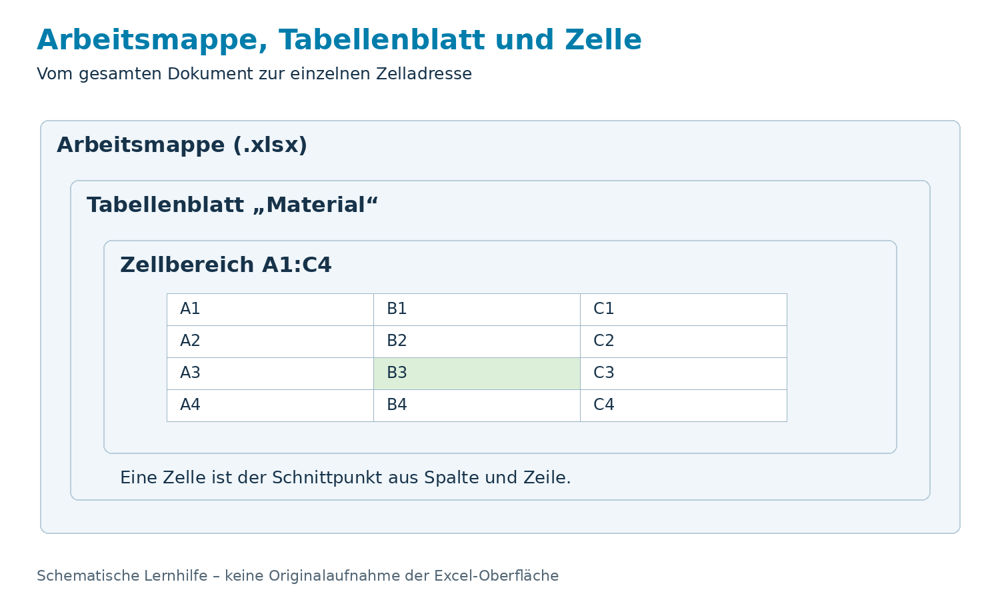

| Begriff | Bedeutung |
| --- | --- |
| [Arbeitsmappe](#arbeitsmappe) | Gesamte Excel-Datei mit einem oder mehreren Tabellenblättern |
| Tabellenblatt | Einzelne Arbeitsfläche innerhalb der Datei |
| Spalte | Senkrechter Bereich, bezeichnet mit Buchstaben, z. B. B |
| Zeile | Waagerechter Bereich, bezeichnet mit Zahlen, z. B. 3 |
| Zelle | Schnittpunkt einer Spalte und einer Zeile |
| [Zelladresse](#zelladresse) | Eindeutige Position innerhalb eines Blatts, z. B. B3 |
| Zellbereich | Gruppe von Zellen, z. B. A1:C4 (einschließlich der Randzellen) |
| Aktive Zelle | Aktuell ausgewählte Zelle, erkennbar am Auswahlrahmen |

B3 bedeutet Spalte B, Zeile 3. A1:C4 umfasst zwölf Zellen. Dieselbe Zelladresse kann auf verschiedenen Tabellenblättern vorkommen.

### 3. Orientierung auf dem Bildschirm

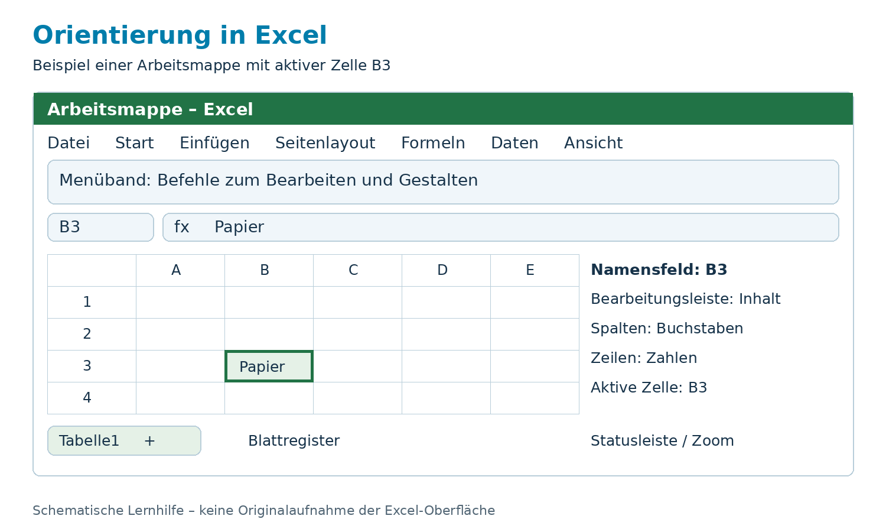

Die Abbildung ist eine schematische Orientierungshilfe, kein Screenshot. Die genaue Darstellung hängt von Excel-Version, Fenstergröße und Betriebssystem ab. Die Klickwege beziehen sich auf deutschsprachiges Excel für Windows (Desktop).

| Bereich | Aufgabe |
| --- | --- |
| Titelleiste | Zeigt unter anderem den Namen der Arbeitsmappe |
| Registerkarten | Ordnen Befehle nach Aufgabenbereichen |
| Menüband | Enthält die Befehle der gewählten Registerkarte |
| Namensfeld | Zeigt die Adresse der aktiven Zelle; ermöglicht den Sprung zu einer Adresse |
| Bearbeitungsleiste | Zeigt und bearbeitet den Inhalt oder die [Formel](#formel) einer Zelle |
| Blattregister | Wechsel zwischen Tabellenblättern |
| Pluszeichen am Blattregister | Neues Tabellenblatt anlegen |
| Statusleiste | Zeigt Statusinformationen und ggf. Kennzahlen zur Auswahl |
| Zoom | Verändert die Bildschirmdarstellung, nicht die Druckgröße |
| Bildlaufleisten | Verschieben den sichtbaren Ausschnitt |

Wichtige Registerkarten: Datei (Öffnen, Speichern, Drucken), Start (Bearbeiten, Formatieren), Einfügen (u. a. Diagramme), Seitenlayout (Druckgestaltung), Formeln (Funktionen), Daten ([Sortieren](#sortieren) und Filtern), Ansicht (Darstellung).

### 4. Eine Arbeitsmappe erstellen und speichern

1. Excel öffnen und „Leere Arbeitsmappe“ auswählen; alternativ Datei → Neu.
2. Eine Zelle anklicken, Inhalt eingeben und mit Enter bestätigen.
3. Datei → Speichern unter wählen. Je nach Version erscheint zunächst eine Speicherortauswahl; gegebenenfalls „Durchsuchen“ wählen.
4. Einen geeigneten Ordner und einen eindeutigen Namen wählen, beispielsweise GB_Materialuebersicht_Uebung.xlsx.
5. Dateityp „Excel-Arbeitsmappe (*.xlsx)“ prüfen und speichern.
6. Bei weiteren Änderungen Strg+S verwenden.
7. Die Datei schließen und über Datei → Öffnen erneut aufrufen. Prüfen, ob die richtige Datei geöffnet wurde.

„Speichern“ aktualisiert die aktuelle Datei. „Speichern unter“ ermöglicht eine neue Datei mit anderem Namen oder Speicherort. In manchen Microsoft-365-Umgebungen heißt der entsprechende Befehl „Kopie speichern“. Eine Kopie schützt die unveränderte Ausgangsdatei.

XLSX ist das übliche bearbeitbare Excel-Format. PDF dient vor allem der festen Darstellung, CSV enthält tabellarische Textdaten und bewahrt keine vollständige Excel-Arbeitsmappe mit mehreren Blättern und Formeln. Für den betrieblichen Arbeitsauftrag ist XLSX erforderlich.

### 5. Tabellenblätter organisieren

- Neues Blatt: Pluszeichen neben den Blattregistern anklicken.
- Umbenennen: Doppelklick auf den Blattnamen, neuen Namen eingeben, Enter.
- Reihenfolge ändern: Blattregister mit der Maus an die gewünschte Position ziehen.
- Kopieren: Rechtsklick auf Blattregister → Verschieben oder Kopieren → Kopie erstellen → OK.
- Löschen: Rechtsklick → Löschen. Vorher prüfen, ob das Blatt noch benötigt wird oder Formeln darauf verweisen. Das Löschen eines Blatts lässt sich nicht zuverlässig rückgängig machen.

Aussagekräftige Blattnamen helfen anderen Mitarbeitenden bei der Orientierung. Ein Blattname darf höchstens 31 Zeichen enthalten und keine der Zeichen : / \ ? * [ ].

### 6. Daten eingeben und bearbeiten

Excel unterscheidet unter anderem Texte, Zahlen, Datumswerte und Formeln. Formeln beginnen normalerweise mit einem Gleichheitszeichen. Die ausführliche Behandlung folgt in M4–M7.

| Handlung | Vorgehen |
| --- | --- |
| Eingeben | Zelle anklicken, tippen, Enter |
| Nach rechts wechseln | Tabulatortaste |
| Inhalt ersetzen | Zelle auswählen und neuen Inhalt eingeben |
| Inhalt gezielt bearbeiten | Doppelklick, F2 oder Bearbeitungsleiste |
| Eingabe abbrechen | Esc vor dem Bestätigen |
| Inhalt entfernen | Zelle markieren, Entf |
| Rückgängig | Strg+Z, soweit die Aktion rückgängig gemacht werden kann |
| Kopieren | Strg+C, Ziel auswählen, Strg+V |
| Ausschneiden | Strg+X, Ziel auswählen, Strg+V |

Entf entfernt den Zellinhalt, nicht die Zelle selbst. Das Löschen ganzer Zellen oder Zeilen kann andere Daten verschieben. Beim Einfügen können bestehende Inhalte überschrieben werden. Vor größeren Änderungen empfiehlt sich eine Arbeitskopie.

### 7. Zellen und Bereiche auswählen

Eine einzelne Zelle wird angeklickt. Einen zusammenhängenden Bereich markiert man durch Ziehen mit gedrückter Maustaste oder über das Namensfeld: A1:C4 eingeben und Enter drücken. Ganze Zeilen oder Spalten werden über ihre Überschriften markiert. Mit gedrückter Strg-Taste können getrennte Bereiche ausgewählt werden.

Das kleine Quadrat am unteren rechten Rand einer Zellmarkierung heißt Ausfüllkästchen. Durch Ziehen lassen sich Inhalte kopieren oder geeignete Datenreihen fortsetzen. Bei Formeln können sich Zellbezüge ändern; dies wird in M7 erklärt. Eine einzelne Zahl wird beim normalen Ziehen häufig kopiert. Zwei markierte Startwerte wie 1 und 2 ermöglichen eine fortlaufende Reihe.

### 8. Unabhängiges Anwendungsbeispiel: Materialübersicht

Die Verwaltung erfasst beispielhaft den Bestand einiger Besprechungsmaterialien. Diese Übungsdaten gehören nicht zu M1.

| Zeile | A – Material | B – Bestand | C – Einheit |
| --- | --- | --- | --- |
| 1 | Material | Bestand | Einheit |
| 2 | Notizblock | 8 | Stück |
| 3 | Stift | 15 | Stück |
| 4 | Mappe | 6 | Stück |

Die Überschriften stehen in Zeile 1. In B3 steht der Zahlenwert 15, in A3 der Text Stift. Der gesamte Datenbereich ist A1:C4.

Eine mögliche Vorgehensweise: Eine leere Arbeitsmappe öffnen, das erste Blatt „Besprechungsmaterial“ nennen, die drei Überschriften eingeben und anschließend die Daten zeilenweise erfassen. Die Datei unter einem eindeutigen Übungsnamen speichern. Bei einer Bestandsänderung wird nur der betreffende Wert geändert. Die Einheit bleibt in einer eigenen Spalte, damit der Bestand als Zahl weiterverarbeitet werden kann.

### 9. Typische Anfängerfehler

| Beobachtung | Mögliche Ursache und Abhilfe |
| --- | --- |
| Datei nicht auffindbar | Speicherort nicht beachtet; über Datei → Öffnen oder den Datei-Explorer suchen |
| Ausgangsdatei überschrieben | Vor der Bearbeitung eine Kopie anlegen |
| Falsches Blatt bearbeitet | Blattregister und Blattnamen prüfen |
| Eingabe in falscher Zelle | Aktive Zelladresse im Namensfeld kontrollieren |
| Zahl mit Einheit als Text eingegeben | Zahl und Einheit getrennt erfassen |
| Inhalt versehentlich ersetzt | Soweit möglich Strg+Z verwenden |
| Anzeige zu klein | Zoom anpassen; Druckeinstellungen bleiben davon getrennt |
| Datei als PDF statt XLSX gespeichert | Bearbeitbare XLSX-Datei sichern |

### 10. Freiwillige Selbstkontrolle

Die folgenden Fragen dienen ausschließlich der eigenen Orientierung. Es ist keine zusätzliche Abgabe erforderlich.

- Worin unterscheiden sich Arbeitsmappe und Tabellenblatt?
- Welche Zelle bezeichnet C5?
- Wie viele Zellen umfasst A1:B3?
- Wo lässt sich der Inhalt der aktiven Zelle bearbeiten?
- Wie kann eine Ausgangsdatei unverändert erhalten bleiben?
- Warum ist XLSX für die weitere Bearbeitung geeigneter als PDF?

**Kontrollhinweise:** Arbeitsmappe = Datei, Tabellenblatt = einzelne Arbeitsfläche. C5 = Spalte C, Zeile 5. A1:B3 = sechs Zellen. Bearbeitungsleiste oder direkte Zellbearbeitung. Eine Kopie unter neuem Namen speichern. XLSX erhält die bearbeitbare Arbeitsmappe einschließlich ihrer Formeln und Blätter.

### 11. Weiterführende Materialien

M3 vertieft Tabellenstruktur und Gestaltung; M4 die Datenformate; M5–M7 die Berechnungen und Zellbezüge; M13 die Druckaufbereitung. Die freiwillige Ü1 dient der praktischen Vertiefung. M1 bleibt die Grundlage des eigentlichen betrieblichen Arbeitsauftrags.

[Bearbeitbare Textfassung](material/m2.md)

## M3 – Tabellen erstellen, strukturieren und gestalten

[Digitale Fassung öffnen](material/m3.html)

Global Bike Deutschland GmbH – Verwaltung

### 1. Warum eine gute Tabellenstruktur wichtig ist

In der Verwaltung müssen Mitarbeitende Informationen schnell finden, ergänzen und auswerten können. Eine ansprechend gestaltete Liste ist nur dann nützlich, wenn ihre Daten eindeutig zugeordnet sind. Eine Tabelle mit unklaren Überschriften, leeren Zwischenzeilen oder mehreren Angaben in einer Zelle erschwert spätere Berechnungen und Filterungen. Gestaltung dient deshalb zuerst der Funktion, nicht der Dekoration.

### 2. Grundregeln einer sinnvollen Tabellenstruktur

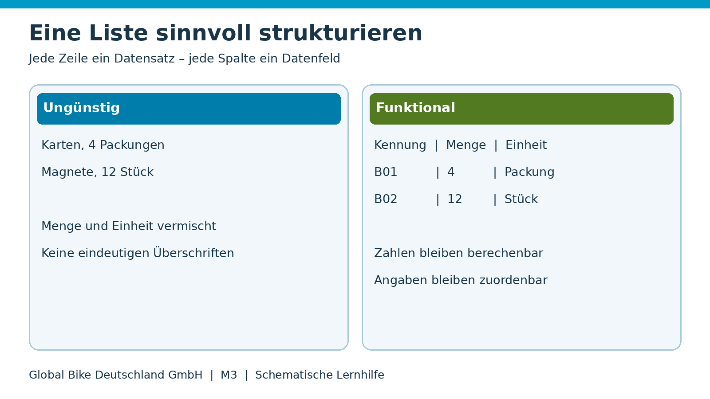

| Begriff | Bedeutung |
| --- | --- |
| Datensatz | Zusammengehörige Angaben zu einem Gegenstand oder Vorgang, meist eine Zeile |
| Datenfeld | Einzelne Eigenschaft eines Datensatzes, meist eine Spalte |
| Spaltenüberschrift | Eindeutige Bezeichnung des Datenfelds |
| Datenbereich | Zusammenhängender Bereich mit den zu verarbeitenden Daten |
| Excel-Tabelle | Speziell als Tabelle definierter Bereich mit eigenen Funktionen |

Eine Zeile enthält einen Datensatz. Eine Spalte enthält jeweils dieselbe Art von Information. Jede Spalte hat eine eindeutige Überschrift. Mengen und Einheiten werden bei Bedarf getrennt erfasst. Zahlen bleiben Zahlen; Einheiten gehören in die Überschrift oder in ein geeignetes Zahlenformat (M4). Keine Leerzeilen, Zwischensummen oder verbundenen Zellen innerhalb einer Datenliste. Eine Überschrift für das gesamte Blatt kann außerhalb des Datenbereichs stehen. Eine eindeutige Kennung erleichtert das Wiederfinden eines Datensatzes.

### 3. Daten erfassen und erweitern

**Klick-Anleitung: Eine Liste von Grund auf erstellen**

1. Eine leere [Arbeitsmappe](#arbeitsmappe) öffnen und unter einem geeigneten Namen speichern (M2).
2. Das Tabellenblatt sinnvoll benennen.
3. Die benötigten Spaltenüberschriften nebeneinander eingeben.
4. Die Angaben eines Datensatzes in derselben Zeile erfassen. Mit Tab zur nächsten Zelle wechseln.
5. Den nächsten Datensatz in der folgenden Zeile erfassen.
6. Eingaben anhand der Ausgangsunterlagen auf Vollständigkeit und Richtigkeit prüfen.

Um eine Zeile einzufügen, auf ihre Zeilennummer rechtsklicken und **Zellen einfügen** beziehungsweise **Einfügen** wählen. Eine neue Zeile erscheint oberhalb der markierten Zeile. Bei Spalten entsprechend den Spaltenbuchstaben verwenden; die neue Spalte erscheint links. Vor dem Löschen ganzer Zeilen oder Spalten prüfen, ob andere Daten betroffen sind. Die Entf-Taste löscht Inhalte, nicht die Zellen selbst. Rückgängig (Strg+Z) hilft bei versehentlichen Änderungen.

### 4. Schrift und Hervorhebungen

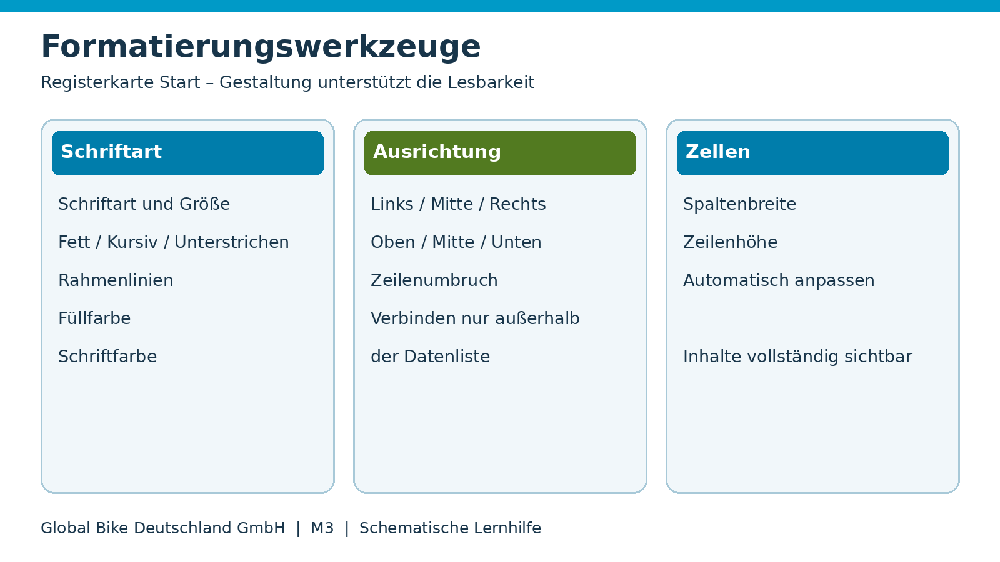

| Werkzeug | Zweck |
| --- | --- |
| Schriftart | Einheitliches, gut lesbares Schriftbild |
| Schriftgröße | Lesbarkeit und Hierarchie |
| Fett | Überschriften und wichtige Angaben hervorheben |
| Kursiv | Ergänzende Hinweise kennzeichnen |
| Unterstreichen | Gezielte Hervorhebung, sparsam verwenden |
| Schriftfarbe | Inhaltliche Unterscheidung unterstützen |

**Klick-Anleitung:** Zellen markieren → Registerkarte Start → Gruppe Schriftart → Schriftart und Größe auswählen oder gewünschte Hervorhebung anklicken. Eine einheitliche Schrift und deutlich erkennbare Überschriften erleichtern die Orientierung. Nicht jede Zelle benötigt eine Hervorhebung. Farben dürfen nicht das einzige Unterscheidungsmerkmal sein.

### 5. Ausrichtung und Textumbruch

Unter Start → Ausrichtung lassen sich Inhalte linksbündig, zentriert oder rechtsbündig sowie oben, mittig oder unten ausrichten. Text steht im Standardformat meist links, Zahlen rechts. Vergleichbare Zahlen sollten einheitlich ausgerichtet sein.

**Textumbruch:** Zelle markieren → Start → Ausrichtung → Zeilenumbruch. Längere Texte werden innerhalb der Spaltenbreite auf mehrere Zeilen verteilt. Bei Bedarf die Zeilenhöhe anpassen.

**Verbinden und zentrieren:** Mehrere Zellen markieren → Start → Ausrichtung → Verbinden und zentrieren. Dies kann für einen Titel außerhalb der Datenliste sinnvoll sein. Beim Verbinden bleibt bei mehreren gefüllten Zellen nur der Inhalt der linken oberen Zelle erhalten. Innerhalb von Datenlisten deshalb nicht verbinden: Sortieren, Filtern und die Zuordnung von Daten können dadurch beeinträchtigt werden.

### 6. Rahmen und Farben

Gitternetzlinien sind Orientierungslinien der Arbeitsfläche und nicht dasselbe wie bewusst gesetzte Rahmen. Rahmen können Überschriften, Datenbereiche und Ergebnisbereiche voneinander abgrenzen.

**Klick-Anleitung:** Bereich markieren → Start → Schriftart → Pfeil neben Rahmenlinien → passende Rahmenart wählen. Für eine Hintergrundfarbe den Pfeil neben Füllfarbe verwenden; für die Textfarbe den Pfeil neben Schriftfarbe. Rahmen und Farben sparsam und mit ausreichendem Kontrast einsetzen. Ein heller Hintergrund mit dunkler Schrift ist häufig gut lesbar. Die Bedeutung einer Farbe zusätzlich durch Text oder Überschriften kenntlich machen.

### 7. Spaltenbreite und Zeilenhöhe

Ist eine Spalte zu schmal, kann Text abgeschnitten erscheinen; Zahlen oder Datumswerte können als Rauten angezeigt werden. Die gespeicherten Werte sind dadurch nicht automatisch verändert. Rauten können bei Datumswerten auch andere Ursachen haben, etwa negative Datumswerte.

**Klick-Anleitung:** Maus auf die Grenze zwischen zwei Spaltenbuchstaben bewegen → bei verändertem Mauszeiger ziehen. Ein Doppelklick passt die Breite automatisch an den Inhalt an. Bei Zeilen entsprechend die Grenze zwischen Zeilennummern verwenden. Alternativ Start → Zellen → Format → Spaltenbreite oder Zeilenhöhe. Mehrere markierte Spalten lassen sich gemeinsam anpassen. Nach dem Textumbruch die Höhe kontrollieren.

### 8. Als Tabelle formatieren

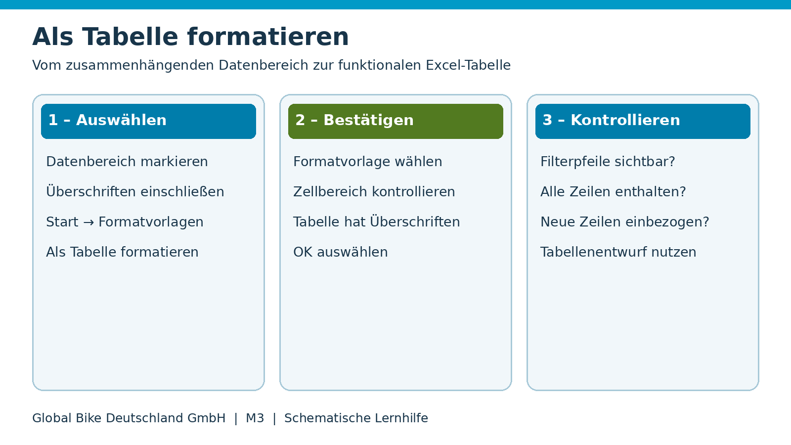

Eine normale Liste kann durch Schriftfarben und Rahmen gestaltet werden. Eine definierte Excel-Tabelle bietet zusätzlich Filterpfeile, Tabellenformatvorlagen und eine erleichterte Erweiterung. Beim Ergänzen direkt unterhalb der Tabelle wird der Bereich normalerweise automatisch erweitert; die tatsächliche Erweiterung ist zu prüfen.

**Klick-Anleitung**

1. In den zusammenhängenden Datenbereich klicken oder den vollständigen Bereich einschließlich Überschriften markieren.
2. Start → Formatvorlagen → Als Tabelle formatieren auswählen.
3. Eine gut lesbare Formatvorlage auswählen.
4. Im Dialog den vorgeschlagenen Zellbereich kontrollieren.
5. „Tabelle hat Überschriften“ aktivieren, wenn die erste Zeile bereits die Überschriften enthält.
6. Mit OK bestätigen.
7. Prüfen, ob alle Datensätze enthalten sind und Filterpfeile erscheinen.
8. Bei Bedarf über die kontextabhängige Registerkarte Tabellenentwurf einen aussagekräftigen Tabellennamen vergeben (ohne Leerzeichen, z. B. Materialliste).

Alternativ kann über Einfügen → Tabelle eine Excel-Tabelle erstellt werden. Die Formatvorlage lässt sich später ändern. Über Tabellenentwurf → In Bereich konvertieren kann die Tabellenfunktion wieder aufgehoben werden; die optische Formatierung kann dabei erhalten bleiben. Die Filter- und Sortierfunktionen werden in M10 vertieft.

### 9. Unabhängiges betriebliches Beispiel

Für eine interne Besprechung bei Global Bike werden wiederverwendbare Präsentationshilfen erfasst. Die folgenden Angaben sind eigenständige didaktische Beispieldaten, keine SAP-Stammdaten und keine Daten aus M1.

| Kennung | Gegenstand | Menge | Einheit | Zustand |
| --- | --- | --- | --- | --- |
| B01 | Moderationskarten | 4 | Packung | Nutzbar |
| B02 | Magnetstreifen | 12 | Stück | Nutzbar |
| B03 | Präsentationsmappe | 3 | Stück | Prüfen |
| B04 | Tischaufsteller | 6 | Stück | Nutzbar |

Die Kennung ermöglicht eine eindeutige Zuordnung. Die Menge bleibt numerisch, die Einheit steht separat. Die Zustandsangabe ist einheitlich formuliert. Dadurch kann später nach Zustand gefiltert werden. Eine gut lesbare Überschrift und angepasste Spaltenbreiten unterstützen die Nutzung. Eine zusätzliche Zeile mit einem neuen Gegenstand kann unterhalb ergänzt werden. Das Beispiel zeigt Strukturprinzipien, nicht die Lösung des betrieblichen Arbeitsauftrags.

### 10. Typische Fehler und ihre Behebung

| Fehler | Folge | Abhilfe |
| --- | --- | --- |
| Mehrere Angaben in einer Zelle | Einzelinformationen schwer filterbar | Angaben auf getrennte Spalten verteilen |
| Fehlende oder doppelte Überschriften | Datenfelder nicht eindeutig | Eindeutige Überschriften vergeben |
| Leerzeilen mitten in der Liste | Automatische Bereichserkennung kann unvollständig sein | Zusammenhängenden Datenbereich herstellen |
| Verbundene Zellen in der Liste | Sortierung und Bearbeitung erschwert | Zellverbund aufheben und Daten eindeutig zuordnen |
| Menge als Text mit Einheit | Berechnungen erschwert | Zahl und Einheit trennen |
| Zu schmale Spalten | Inhalte nicht vollständig sichtbar | Breite anpassen oder Textumbruch nutzen |
| Zu viele Farben | Wichtige Angaben gehen unter | Einheitliches, sparsames Farbschema |
| Nur ein Teilbereich als Tabelle definiert | Datensätze fehlen bei Auswertungen | Tabellenbereich kontrollieren und erweitern |
| Neue Daten außerhalb der Tabelle | Filter erfassen sie möglicherweise nicht | Tabellengrenze prüfen und bei Bedarf Größe ändern |
| Ganze Zeile versehentlich gelöscht | Andere Inhalte können verloren gehen | Rückgängig nutzen, künftig Auswahl prüfen |

### 11. Freiwillige Selbstkontrolle

Die Fragen dienen der eigenen Orientierung und sind keine Pflichtabgabe.

- Worin unterscheiden sich Datensatz und Datenfeld?
- Warum sollten Mengen und Einheiten getrennt erfasst werden?
- Weshalb sind verbundene Zellen innerhalb einer Datenliste ungünstig?
- Wie lässt sich ein längerer Text in einer schmalen Spalte lesbar darstellen?
- Was unterscheidet eine formatierte Liste von einer definierten Excel-Tabelle?
- Was ist beim Ergänzen neuer Datensätze zu kontrollieren?

**Kontrollhinweise:** Ein Datensatz umfasst zusammengehörige Angaben, ein Datenfeld eine Eigenschaft. Getrennte Mengen bleiben berechenbar. Zellverbünde erschweren die eindeutige Zuordnung und Sortierung. Textumbruch und angepasste Zeilenhöhe verbessern die Lesbarkeit. Eine definierte Tabelle besitzt zusätzliche Tabellenfunktionen. Neue Datensätze müssen innerhalb des tatsächlichen Tabellenbereichs liegen.

### 12. Weiterführende Materialien

M4 vertieft Zahlen- und Datumsformate, M5–M8 Berechnungen, M10 [Sortieren](#sortieren) und Filtern, M13 Druckaufbereitung und M14 Qualitätskontrolle. Ü2 bietet später eine freiwillige praktische Vertiefung. M1 bleibt die Grundlage des eigentlichen betrieblichen Arbeitsauftrags.

[Bearbeitbare Textfassung](material/m3.md)

## M4 – Zahlen-, Datums-, Währungs- und Prozentformate

[Digitale Fassung öffnen](material/m4.html)

Global Bike Deutschland GmbH – Verwaltung

### 1. Warum Zahlenformate wichtig sind

In der Verwaltung werden Mengen, Geldbeträge, Termine und prozentuale Anteile verarbeitet. Eine Zahl ohne erkennbare Bedeutung kann zu Fehlentscheidungen führen. Ein einheitliches Format erleichtert das Lesen und Vergleichen. Zahlen müssen dabei weiterhin für Berechnungen verfügbar bleiben. Die Formatierung ersetzt weder eine korrekte Eingabe noch eine [Formel](#formel).

### 2. Zellwert und Zellformat

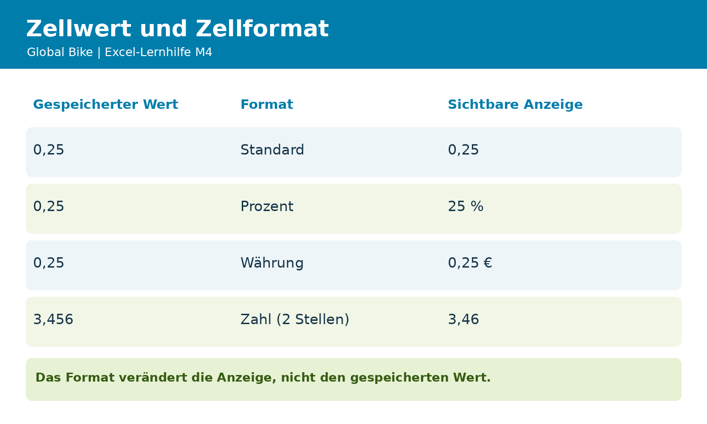

Excel speichert einen Wert und zeigt ihn entsprechend dem gewählten Format an. Der Wert 0,25 erscheint beispielsweise als 25 % im Prozentformat oder als 0,25 € im Währungsformat. Eine Formatänderung rechnet den Wert nicht um. Die Bearbeitungsleiste hilft bei der Kontrolle; bei Formeln zeigt sie die Formel statt des Ergebnisses.

Die Anzeige von zwei Dezimalstellen rundet nur die Darstellung. Aus 3,456 wird sichtbar 3,46; intern bleibt 3,456 erhalten. Wenn ein tatsächlich gerundeter Rechenwert benötigt wird, ist eine entsprechende Berechnung erforderlich (M5).

### 3. Standard-, Zahlen- und Textformat

| Format | Verwendung | Beispiel |
| --- | --- | --- |
| Standard | Allgemeine Eingabe ohne festgelegte Darstellung | 1250,5 |
| Zahl | Mengen und messbare Größen | 1.250,50 |
| Text | Kennungen, die nicht berechnet werden | 0042 |
| Währung | Geldbeträge | 1.250,50 € |
| Prozent | Anteile und Quoten | 25 % |
| Datum | Termine und Fristen | 15.03.2027 |
| Uhrzeit | Uhrzeiten | 09:30 |

Eine Kennung mit führenden Nullen ist keine Rechengröße. Vor der Eingabe das Textformat wählen oder ein Apostroph voranstellen, etwa '0042. Das Apostroph wird nicht als Teil der sichtbaren Kennung angezeigt. Bereits verlorene führende Nullen werden durch nachträgliches Textformat nicht wiederhergestellt. Zahlen, mit denen gerechnet werden soll, nicht als Text erfassen.

### 4. Dezimalstellen und Tausendertrennzeichen

**Klick-Anleitung: Zahlen übersichtlich darstellen**

1. Zellen markieren.
2. Registerkarte **Start** öffnen.
3. In der Gruppe **Zahl** das Format **Zahl** auswählen.
4. Mit den Schaltflächen für Dezimalstellen die gewünschte Anzahl einstellen.
5. Für das Tausendertrennzeichen Strg+1 drücken, Kategorie Zahl wählen und das Kontrollkästchen für das Tausendertrennzeichen aktivieren.
6. Anzeige und Werte kontrollieren.

In einer üblichen deutschen Excel-Konfiguration ist das Komma das Dezimaltrennzeichen und der Punkt das Tausendertrennzeichen. Regionale Einstellungen können abweichen. Stückzahlen benötigen meist keine Nachkommastellen, Messwerte je nach Genauigkeit unterschiedliche Anzahlen. Keine Einheiten als Text an berechenbare Zahlen anhängen; stattdessen die Spaltenüberschrift nutzen.

### 5. Währungs- und Buchhaltungsformat

Beide Formate zeigen Geldbeträge mit Währungssymbol an. Das Buchhaltungsformat richtet Symbole und Dezimalstellen spaltenweise aus und stellt Nullwerte häufig als Strich dar. Das Währungsformat zeigt das Symbol in unmittelbarer Nähe zum Betrag. Beide Formate ändern weder die Währung rechnerisch noch den gespeicherten Betrag.

**Klick-Anleitung: Eurobeträge formatieren**

1. Betragszellen markieren.
2. Strg+1 drücken.
3. Unter **Zahlen** die Kategorie **Währung** oder **Buchhaltung** wählen.
4. Euro als Symbol und zwei Dezimalstellen einstellen.
5. Mit OK bestätigen und die Anzeige prüfen.

Beispiel: Die Eingabe 18,5 wird als 18,50 € angezeigt. Ob ein Betrag netto oder brutto ist, ergibt sich aus dem fachlichen Zusammenhang und der Spaltenüberschrift, nicht aus dem Format.

### 6. Prozentformat

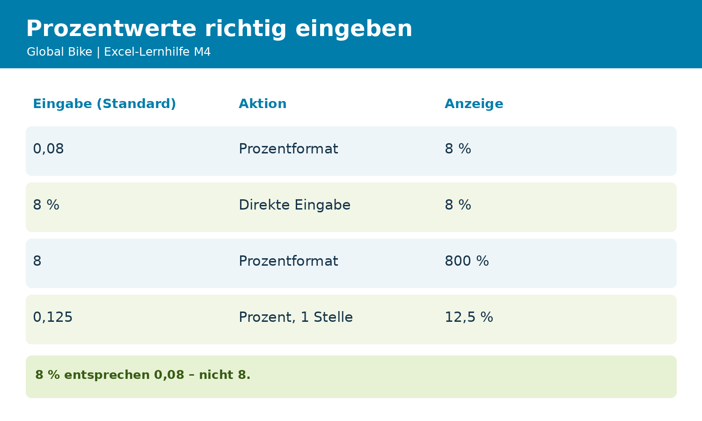

Prozent bedeutet von hundert. 8 % entsprechen dem Zahlenwert 0,08. Wird eine bereits als Zahl eingegebene 8 nachträglich als Prozent formatiert, erscheint 800 %. Sicher ist die direkte Eingabe 8 % oder die Eingabe 0,08 mit anschließender Prozentformatierung.

**Klick-Anleitung**

1. In einer Zelle mit Standardformat 0,08 eingeben.
2. Zelle markieren und unter **Start – Zahl** auf das Prozentzeichen klicken.
3. Bei Bedarf Dezimalstellen einstellen.
4. Kontrollieren, ob 8 % angezeigt werden.

Ein Anteil von 1/4 entspricht 0,25 beziehungsweise 25 %. Die Berechnung von Anteilen mit Zellbezügen wird in M8 vertieft. Prozentformat allein berechnet keinen Anteil.

### 7. Datums- und Uhrzeitformat

Excel speichert erkannte Datumsangaben als fortlaufende Zahlen und Uhrzeiten als Tagesbruchteile. Dadurch lassen sich Termine [sortieren](#sortieren) und Zeitabstände berechnen. Eine als Text gespeicherte Datumsangabe kann dagegen bei Berechnungen und Sortierungen Probleme verursachen.

**Klick-Anleitung: Datum und Uhrzeit darstellen**

1. In eine Zelle mit Standardformat 15.03.2027 eingeben.
2. Zelle markieren und Strg+1 drücken.
3. Kategorie **Datum** wählen und eine Darstellung mit vierstelliger Jahreszahl auswählen.
4. Alternativ unter **Benutzerdefiniert** den Typ TT.MM.JJJJ verwenden (deutschsprachiges Excel).
5. Für Uhrzeiten beispielsweise 09:30 eingeben und das Uhrzeitformat auswählen.
6. Ergebnis kontrollieren.

Ein Datum kann auch als 15. März 2027 erscheinen. Der zugrunde liegende Tag bleibt derselbe. Eine Uhrzeit von 12:00 entspricht einem halben Tag. Datumsformate berechnen keine Fristen; die betrieblichen Fristenregeln werden in M9 behandelt. Bei #### zunächst die Spaltenbreite prüfen; auch negative Datums- oder Zeitwerte können diese Anzeige verursachen.

### 8. Zahlenformate auswählen und verändern

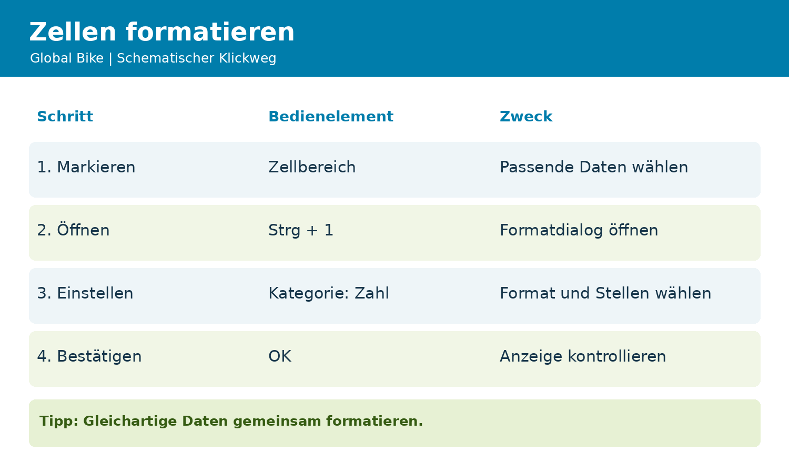

Für häufige Formate genügt das Auswahlfeld in Start – Zahl. Der Dialog **Zellen formatieren** bietet weitere Einstellungen. Mehrere gleichartige Zellen können gemeinsam formatiert werden. Unterschiedliche Datenarten sollten getrennt markiert werden. Beim Kopieren können Formate mit übernommen werden; über Inhalte einfügen – Werte lassen sich Werte ohne Quellformat übertragen. Über Start – Löschen – Formate löschen kann die Formatierung zurückgesetzt werden, ohne die Inhalte zu entfernen.

### 9. Unabhängiges betriebliches Anwendungsbeispiel

Die Verwaltung von Global Bike erfasst testweise Informationen zu einer internen Schulung. Diese Beispieldaten sind unabhängig von M1 und keine SAP-Daten.

| Angabe | Eingabe | Geeignete Anzeige |
| --- | --- | --- |
| Schulungskennung | '0042 | 0042 |
| Schulungstag | 15.03.2027 | 15.03.2027 |
| Beginn | 09:30 | 09:30 |
| Teilnehmerzahl | 12 | 12 |
| Kosten je Unterlage | 3,5 | 3,50 € |
| Anteil digitaler Unterlagen | 0,75 | 75 % |
| Materialgewicht in kg | 1,256 | 1,26 |

Zur freiwilligen Erprobung können diese Angaben in einer separaten [Arbeitsmappe](#arbeitsmappe) eingegeben und unterschiedlich formatiert werden. Besonders aufschlussreich ist der Vergleich der Anzeige von 0,75 im Standard- und Prozentformat. Das Beispiel ist keine Vorlage für die M1-Arbeitsmappe und muss nicht abgegeben werden.

### 10. Typische Fehler und deren Behebung

| Beobachtung | Ursache oder Prüfung | Abhilfe |
| --- | --- | --- |
| 800 % statt 8 % | Wert 8 statt 0,08 | Wert korrigieren |
| 0042 wird zu 42 | Kennung als Zahl erkannt | Textformat vor Eingabe, Kennung neu erfassen |
| Geldbetrag nicht berechenbar | Betrag als Text gespeichert | Als Zahl neu erfassen oder gezielt in Zahl umwandeln |
| #### | Spalte zu schmal oder negativer Datumswert | Breite und Wert prüfen |
| Datum wird nicht chronologisch sortiert | Datumswerte möglicherweise Text | Datentyp prüfen und echte Datumswerte erfassen |
| 3,46 statt 3,456 | Anzeige auf zwei Stellen begrenzt | Dezimalstellen erhöhen |
| Euro statt Dollar | Falsches Währungssymbol | Format ändern; keine automatische Umrechnung |
| Datum erscheint als Zahl | Zahlenformat statt Datum | Datumsformat wählen |
| Mengen zeigen Eurozeichen | Falsches Format für ganze Spalte | Mengenbereich als Zahl formatieren |
| Summen wirken um Cent abweichend | Angezeigte und gespeicherte Genauigkeit unterscheiden sich | Rechenwerte prüfen; Rundungsregeln beachten |

Bei importierten Zahlen als Text kann Excel eine Warnung mit der Option **In eine Zahl umwandeln** anbieten. Diese nur für tatsächliche Rechengrößen verwenden, nicht für Kennungen. Eine bloße Änderung des Zahlenformats wandelt vorhandenen Text nicht zuverlässig in Zahlen um.

### 11. Freiwillige Selbstkontrolle

- Welcher Zahlenwert entspricht 12 %?
- Warum erscheint nach Prozentformatierung der Zahl 12 der Wert 1.200 %?
- Welches Format eignet sich für eine Kennung 0007?
- Wird der gespeicherte Wert 4,567 durch die Anzeige 4,57 verändert?
- Warum sollten Termine als echte Datumswerte erfasst werden?
- Was ist bei der Anzeige #### zuerst zu prüfen?
- Kann ein Währungsformat Euro in Dollar umrechnen?
- Woran lässt sich erkennen, ob ein Betrag netto oder brutto ist?

**Kontrollhinweise:** 0,12; das Prozentformat zeigt den Wert mal hundert mit Prozentzeichen; Textformat vor Eingabe; nein, nur die Anzeige ändert sich; damit Datumsberechnungen und chronologische Sortierung möglich sind; Spaltenbreite, gegebenenfalls negativer Datumswert; nein; an der fachlichen Bezeichnung und den betrieblichen Angaben.

### 12. Weiterführende Materialien

M5 vertieft Formeln und Grundrechenarten, M6 Funktionen, M7 Zellbezüge, M8 prozentuale Anteile, M9 Termine und Fristen, M10 Sortieren und [Filtern](#filtern). M13 behandelt die Druckaufbereitung, M14 die Qualitätskontrolle. M4 bleibt während der gesamten Lernsituation als Nachschlagewerk verfügbar.

[Bearbeitbare Textfassung](material/m4.md)

## M5 – Formeln und Grundrechenarten in Excel

[Digitale Fassung öffnen](material/m5.html)

Global Bike Deutschland GmbH – Verwaltung

### 1. Warum automatische Berechnungen wichtig sind

In der Verwaltung ändern sich Mengen, Preise und Termine. Eine manuell eingetragene [Summe](#summe) bleibt unverändert, wenn sich eine Ausgangszahl ändert. Eine [Formel](#formel) berechnet das Ergebnis dagegen aus den aktuellen Ausgangswerten. Das spart Arbeit und reduziert Übertragungsfehler. Eine falsche Formel kann allerdings viele falsche Ergebnisse erzeugen. Deshalb gehört die Kontrolle zur Arbeit mit Excel.

### 2. Werte, Formeln und Funktionen

| Begriff | Bedeutung | Beispiel |
| --- | --- | --- |
| Wert | Direkt eingegebene Information | 12 |
| Formel | Rechenvorschrift, die mit einem Gleichheitszeichen beginnt | =12*4 |
| Zellbezug | Verweis auf den Inhalt einer Zelle | =B2 |
| Funktion | Vorgefertigte Rechenvorschrift innerhalb einer Formel | =SUMME(B2:B5) |

Eine Formel steht in der Zelle, obwohl dort normalerweise ihr Ergebnis angezeigt wird. Die Bearbeitungsleiste zeigt die eigentliche Formel. Funktionen werden in M6 vertieft.

### 3. Aufbau einer Formel

Das Gleichheitszeichen signalisiert Excel, dass eine Berechnung folgen soll. Danach stehen Zahlen, Zellbezüge, Operatoren oder Funktionen. In =B2*C2 verweist B2 auf Spalte B, Zeile 2; C2 auf Spalte C, Zeile 2. Das Sternchen bedeutet Multiplikation. Die Ergebniszelle darf nicht auf sich selbst verweisen.

### 4. Die vier Grundrechenarten

| Rechenart | Operator | Beispiel | Ergebnis |
| --- | --- | --- | --- |
| Addition | + | =18+7 | 25 |
| Subtraktion | - | =18-7 | 11 |
| Multiplikation | * | =18*7 | 126 |
| Division | / | =18/6 | 3 |

Excel verwendet für die Multiplikation das Sternchen und für die Division den Schrägstrich. Ein handschriftliches Malzeichen oder ein Doppelpunkt ist dafür ungeeignet. Der Doppelpunkt kennzeichnet in Zellbezügen einen zusammenhängenden Bereich, etwa B2:B5.

Im Büro werden beispielsweise Teilbeträge addiert, Restbudgets durch Subtraktion ermittelt, Mengen mit Einzelpreisen multipliziert und Gesamtkosten durch Stückzahlen dividiert.

### 5. Rechenregeln und Klammern

Multiplikation und Division werden vor Addition und Subtraktion ausgeführt. Gleichrangige Grundrechenarten werden von links nach rechts verarbeitet. Klammern verändern die Reihenfolge.

- =10+4*3 ergibt 22.
- =(10+4)*3 ergibt 42.
- =24/6*2 ergibt 8.
- =24/(6*2) ergibt 2.

Klammern müssen paarweise vorhanden sein. Eine verständliche Formel ist wichtiger als eine möglichst kurze Formel. Bei komplexeren Rechnungen können Zwischenergebnisse in eigenen Zellen sinnvoll sein.

### 6. Mit Zellbezügen rechnen

Eine Formel wie =6*8 funktioniert, ist aber für wechselnde Eingaben ungeeignet. Steht die Menge in B2 und der Einzelpreis in C2, lautet die passende Formel =B2*C2. Bei einer Änderung der Menge oder des Preises bleibt die Formel unverändert und das Ergebnis wird neu berechnet.

Eingabewerte und Berechnungsergebnisse sollten getrennt und eindeutig beschriftet sein. Wiederkehrende Berechnungen lassen sich kopieren. Dabei ändern sich normale Zellbezüge passend zur neuen Position: Aus =B2*C2 wird eine Zeile tiefer =B3*C3. Feste Zellbezüge mit Dollarzeichen werden in M7 ausführlich behandelt.

### 7. Formeln eingeben, bearbeiten und kopieren

**Klick-Anleitung: Formel erstellen**

1. Die vorgesehene Ergebniszelle anklicken.
2. Das Gleichheitszeichen eingeben.
3. Die erste benötigte Zelle anklicken oder ihre Adresse eingeben.
4. Den Rechenoperator eingeben.
5. Die zweite benötigte Zelle anklicken oder ihre Adresse eingeben.
6. Mit Enter bestätigen.
7. Ergebnis und Formel in der Bearbeitungsleiste kontrollieren.

**Klick-Anleitung: Formel korrigieren**

1. Ergebniszelle auswählen.
2. In die Bearbeitungsleiste klicken oder F2 drücken.
3. Den fehlerhaften Bestandteil ändern.
4. Mit Enter bestätigen; mit Esc lässt sich eine noch nicht bestätigte Änderung abbrechen.

**Klick-Anleitung: Formel nach unten übertragen**

1. Zelle mit der geprüften Formel auswählen.
2. Das kleine Ausfüllkästchen unten rechts an der Zellmarkierung greifen.
3. Bis zur letzten benötigten Zeile nach unten ziehen.
4. Eine kopierte Formel anklicken und ihre Zellbezüge kontrollieren.

Alternativ kann die Formel mit Strg+C kopiert und mit Strg+V eingefügt werden. Dabei werden relative Bezüge ebenfalls angepasst. Nicht versehentlich nur Werte einfügen.

### 8. Automatische Neuberechnung

Excel berechnet Formeln normalerweise automatisch neu. Eine Funktionsprüfung gelingt durch vorübergehendes Ändern eines Eingabewerts. Das Ergebnis muss sich passend ändern. Anschließend den ursprünglichen Wert wiederherstellen.

Wenn sich Ergebnisse nicht aktualisieren, unter **Formeln – Berechnungsoptionen** prüfen, ob **Automatisch** eingestellt ist. F9 stößt eine Neuberechnung an. Auch als Text gespeicherte Formeln oder falsche Zellbezüge können die Ursache sein.

### 9. Rundung und Dezimalstellen

Wie in M4 erläutert, verändert die Anzeige von zwei Nachkommastellen nicht den gespeicherten Rechenwert. Für eine tatsächliche Rundung auf Cent kann die Funktion RUNDEN verwendet werden.

=RUNDEN(10/3;2) ergibt 3,33. Die 2 bezeichnet die Anzahl der Nachkommastellen. Das Semikolon trennt in der üblichen deutschen Excel-Konfiguration die Funktionsargumente.

Bei kaufmännischen Berechnungen ist entscheidend, an welcher Stelle gerundet werden soll. Drei einzeln auf 3,33 gerundete Beträge ergeben 9,99; eine ungerundete Berechnung von drei Dritteln von 10 ergibt 10. Die betriebliche Rundungsregel bestimmt, welcher Rechenweg anzuwenden ist. Nicht wahllos Zwischenergebnisse runden.

### 10. Unabhängiges betriebliches Anwendungsbeispiel

Für eine interne Schulung der Global Bike Deutschland GmbH werden beispielhaft Schulungsunterlagen kalkuliert. Die Daten gehören nicht zum Arbeitsauftrag M1.

| Zeile | A – Position | B – Menge | C – Einzelpreis | D – Gesamtpreis |
| --- | --- | --- | --- | --- |
| 2 | Schulungshefte | 12 | 4,50 € | 54,00 € |
| 3 | Namensschilder | 12 | 1,25 € | 15,00 € |
| 4 | Moderationskarten | 3 | 6,80 € | 20,40 € |

Die Überschriften stehen in Zeile 1. In D2 steht =B2*C2, in D3 =B3*C3, in D4 =B4*C4. Die Preise werden als Währung formatiert.

| Zelle | Inhalt oder Formel | Ergebnis |
| --- | --- | --- |
| D5 | =D2+D3+D4 | 89,40 € |
| D6 | Eingabewert: genehmigter Betrag | 120,00 € |
| D7 | =D6-D5 | 30,60 € |
| B8 | Eingabewert: Teilnehmende | 12 |
| D8 | =D5/B8 | 7,45 € |

Die Bezeichnungen für die Auswertungen stehen in Spalte A. Der genehmigte Betrag und die Teilnehmerzahl sind Eingabewerte, keine Ergebnisse. Wenn B2 auf 14 geändert wird, ergeben sich in D2 63,00 €, in D5 98,40 €, in D7 21,60 € und in D8 8,20 €. Die Teilnehmerzahl bleibt bei dieser Kontrolländerung unverändert. Anschließend B2 wieder auf 12 setzen.

Dieses Beispiel zeigt alle vier Grundrechenarten und die Abhängigkeit der Ergebnisse von den Eingaben. Die Addition mehrerer Zellen wird in M6 durch SUMME vereinfacht.

### 11. Typische Fehler und deren Behebung

| Beobachtung | Mögliche Ursache | Kontrolle und Behebung |
| --- | --- | --- |
| Formel erscheint als Text | Textformat oder vorangestelltes Apostroph | Standardformat wählen, Apostroph entfernen, Formel erneut bestätigen |
| Ergebnis bleibt gleich | Fest eingetragene Zahl statt Formel | Bearbeitungsleiste prüfen, Formel einsetzen |
| Falsches Produkt | Falscher Zellbezug | Adressen mit Überschriften vergleichen |
| Formel wird nicht akzeptiert | Falscher Operator oder fehlende Klammer | Syntax und Klammerpaare prüfen |
| #DIV/0! | Division durch null oder leere Bezugszelle | Nenner prüfen; fehlende Eingabe klären |
| #WERT! | Ungeeigneter Datentyp, etwa Text statt Zahl | Eingabewerte und Formate prüfen |
| #BEZUG! | Ungültiger Zellbezug, etwa nach Löschen einer Spalte | Richtigen Bezug wiederherstellen |
| #NAME? | Unbekannter Funktionsname oder nicht definierter Name | Schreibweise und Sprache prüfen |
| #### | Spalte zu schmal, gegebenenfalls negativer Datumswert | Spalte verbreitern und Wert prüfen |
| Zirkelbezug | Formel hängt direkt oder indirekt von sich selbst ab | Abhängigkeiten prüfen und korrigieren |
| Unerwartete Centabweichung | Anzeige gerundet, Rechenwert nicht | Rundungsregel und tatsächliche Werte prüfen |

Fehlermeldungen nicht durch beliebige Zahlen oder leere Texte verdecken. Zuerst die Ursache klären. Ein scheinbar plausibles Ergebnis ist kein Beweis für eine richtige Formel.

### 12. Freiwillige Selbstkontrolle

Die folgenden Fragen können zur eigenen Überprüfung genutzt werden. Es ist keine zusätzliche Abgabe erforderlich.

1. Womit beginnt eine Formel?
2. Welche Formel multipliziert B4 mit C4?
3. Was ergibt =8+2*5?
4. Was ergibt =(8+2)*5?
5. Wie verändert sich =B4*C4, wenn sie eine Zeile nach unten kopiert wird?
6. Warum ist eine Formel einem fest eingetragenen Ergebnis vorzuziehen?
7. Was bedeutet #DIV/0!?
8. Was unterscheidet das Zahlenformat mit zwei Dezimalstellen von RUNDEN?
9. Wie lässt sich prüfen, ob eine Berechnung auf geänderte Eingaben reagiert?

**Kontrollhinweise**

1. Mit =.
2. =B4*C4.
5. =B5*C5.
6. Das Ergebnis wird bei geänderten Eingaben automatisch neu berechnet, sofern die automatische Berechnung aktiv ist.
7. Es wird durch null oder einen als null behandelten leeren Bezug dividiert.
8. Das Format verändert die Anzeige; RUNDEN verändert das berechnete Ergebnis.
9. Einen Eingabewert testweise ändern, erwartetes und tatsächliches Ergebnis vergleichen und den ursprünglichen Wert wiederherstellen.

### 13. Weiterführende Materialien

M6 vertieft SUMME, [MIN](#min), MAX und MITTELWERT. M7 behandelt relative und absolute Zellbezüge, M8 prozentuale Anteile und M9 Datums- und Fristenberechnungen. M14 greift die Funktionsprüfung und Wiederverwendbarkeit auf. M5 bleibt während der gesamten Lernsituation als Nachschlagewerk verfügbar.

[Bearbeitbare Textfassung](material/m5.md)

## M6 – Excel-Funktionen: SUMME, MIN, MAX und MITTELWERT

[Digitale Fassung öffnen](material/m6.html)

Global Bike Deutschland GmbH – Verwaltung

### 1. Bedeutung von Excel-Funktionen im Büroalltag

In der Verwaltung müssen regelmäßig größere Zahlenmengen ausgewertet werden. Wie hoch sind die Gesamtausgaben? Welche Ausgabe ist besonders hoch? Wie viel wird durchschnittlich ausgegeben? Excel bietet fertige Rechenvorschriften, mit denen solche Fragen schnell beantwortet werden können. Die Ergebnisse ändern sich bei automatischer Berechnung, wenn sich die einbezogenen Ausgangswerte ändern. Die Auswahl des richtigen Datenbereichs und die Interpretation bleiben Aufgabe der Mitarbeitenden.

### 2. Formeln und Funktionen

Eine [Formel](#formel) ist eine Rechenvorschrift. Eine Funktion ist eine vorgefertigte Rechenvorschrift, die innerhalb einer Formel verwendet werden kann. =B2+B3+B4 und =SUMME(B2:B4) liefern bei drei numerischen Werten dieselbe Summe. Die zweite Schreibweise ist bei langen zusammenhängenden Listen übersichtlicher.

### 3. Aufbau einer Funktion

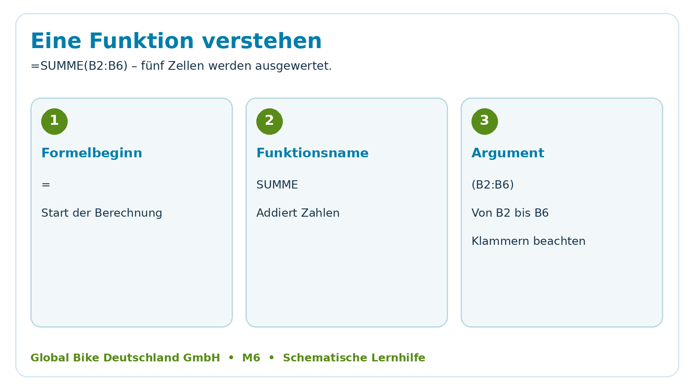

Die Formel =SUMME(B2:B6) beginnt mit dem Gleichheitszeichen. SUMME ist der Funktionsname. In Klammern steht das Argument, hier ein Zellbereich. Der Doppelpunkt bedeutet „von ... bis einschließlich“. B2:B6 umfasst fünf Zellen. Mehrere getrennte Argumente werden in der üblichen deutschen Excel-Konfiguration durch Semikolon getrennt, etwa =SUMME(B2:B6;D2:D6). Ein rechteckiger Bereich wie B2:D6 umfasst alle Zellen der drei Spalten und fünf Zeilen.

Die Ergebniszelle muss außerhalb des eigenen ausgewerteten Bereichs liegen. Überschriften und bereits berechnete Summen sollen nicht versehentlich in den Bereich aufgenommen werden.

### 4. SUMME – Gesamtwerte berechnen

[SUMME](#summe) addiert die numerischen Werte eines Bereichs. Beispielsweise ergibt =SUMME(B2:B5) bei 40, 60, 20 und 80 den Wert 200. Im Büro lassen sich damit Ausgaben, Stückzahlen oder Bearbeitungszeiten zusammenfassen. Nur Werte mit sinnvoll vergleichbaren Einheiten addieren.

**Klick-Anleitung**

1. Die Ergebniszelle außerhalb des Datenbereichs auswählen.
2. =SUMME( eingeben.
3. Den gewünschten Bereich mit der Maus markieren.
4. Die schließende Klammer eingeben und Enter drücken.
5. Den Bereich in der Bearbeitungsleiste und das Ergebnis kontrollieren.

### 5. MIN – kleinsten Wert ermitteln

=MIN(B2:B5) ergibt bei denselben vier Werten 20. MIN liefert den kleinsten numerischen Wert, nicht den Namen der zugehörigen Position. Um die Position zu finden, kann der Wert in der Liste gesucht oder die Liste sortiert werden (M10). Bei mehreren gleichen Minimalwerten sind alle betreffenden Positionen zu berücksichtigen.

**Klick-Anleitung:** Ergebniszelle wählen, =MIN( eingeben, Datenbereich markieren, Klammer schließen, Enter drücken und Ergebnis mit den Ausgangsdaten vergleichen.

### 6. MAX – größten Wert ermitteln

=MAX(B2:B5) ergibt 80. MAX eignet sich beispielsweise zur Ermittlung des höchsten Einzelbetrags oder der längsten Bearbeitungsdauer. Der größte Betrag ist nicht automatisch die wichtigste Aufgabe. Weitere betriebliche Kriterien können entscheidend sein.

**Klick-Anleitung:** Ergebniszelle wählen, =MAX( eingeben, Datenbereich markieren, Klammer schließen, Enter drücken und Ergebnis kontrollieren.

### 7. MITTELWERT – Durchschnitt berechnen

[MITTELWERT](#mittelwert) addiert die numerischen Werte und teilt die Summe durch deren Anzahl. =MITTELWERT(B2:B5) ergibt bei den vier Beispielwerten 50, denn 200 geteilt durch 4 ergibt 50. Der Durchschnitt muss nicht als einzelner Wert in der Liste vorkommen.

**Klick-Anleitung:** Ergebniszelle wählen, =MITTELWERT( eingeben, Datenbereich markieren, Klammer schließen und Enter drücken. Zur Kontrolle die Summe durch die Anzahl der numerischen Werte teilen.

Ein Durchschnitt pro Vorgang ist etwas anderes als ein Durchschnitt pro Monat. Die Bezugsgröße muss zur Fragestellung passen. Bei unterschiedlich großen Gruppen ist der einfache Durchschnitt ihrer Durchschnittswerte nicht zwangsläufig der Gesamtdurchschnitt.

### 8. AutoSumme und Funktionsassistent

**Klick-Anleitung: AutoSumme**

1. Die Zelle unmittelbar unter einer Zahlenliste auswählen.
2. Im Register Start in der Gruppe Bearbeiten auf AutoSumme (Σ) klicken.
3. Den von Excel vorgeschlagenen Bereich überprüfen und bei Bedarf ändern.
4. Mit Enter bestätigen.
5. Die Formel in der Bearbeitungsleiste kontrollieren.

Über den kleinen Pfeil neben AutoSumme lassen sich auch Mittelwert, [Max](#max) und [Min](#min) auswählen. Die Menübezeichnungen können je nach Excel-Version leicht abweichen. Excel kann bei Lücken einen unvollständigen Bereich vorschlagen.

**Klick-Anleitung: Funktionsassistent**

1. Ergebniszelle auswählen und auf fx neben der Bearbeitungsleiste klicken.
2. Den gewünschten Funktionsnamen suchen und auswählen.
3. Im Argumentfenster den Datenbereich eintragen oder markieren.
4. Die Vorschau prüfen und mit OK bestätigen.

Die direkte Eingabe einer Funktion ist gleichwertig. Der Funktionsassistent hilft besonders beim Kennenlernen der Argumente.

### 9. Leere Zellen, Nullwerte und Text

| Zellinhalt im Bereich | SUMME | MIN/MAX | MITTELWERT |
| --- | --- | --- | --- |
| Zahl | Wird addiert | Wird verglichen | Wird einbezogen |
| Zahl 0 | Wird addiert | Wird verglichen | Wird mitgezählt |
| Leere Zelle | Wird ignoriert | Wird ignoriert | Wird ignoriert |
| Text, auch als Text gespeicherte Zahl | Wird ignoriert | Wird ignoriert | Wird ignoriert |

Diese Regeln gelten für Werte innerhalb referenzierter Zellbereiche. Fehlerwerte können die Auswertung mit einem Fehler abbrechen. Direkt eingegebene Funktionsargumente können sich anders verhalten.

Beispiel: B2 enthält 40, B3 ist leer, B4 enthält 0, B5 enthält 80. SUMME ergibt 120, MIN 0, MAX 80 und MITTELWERT 40 (120 geteilt durch drei). Wird B3 mit 0 gefüllt, ergibt MITTELWERT 30. Eine fehlende Angabe darf deshalb nicht ohne sachlichen Grund durch null ersetzt werden.

Enthält der Bereich überhaupt keine Zahlen, liefern SUMME, MIN und MAX null, MITTELWERT dagegen #DIV/0!. Eine angezeigte Null ist dann kein Nachweis eines tatsächlich vorhandenen Messwerts.

### 10. Unabhängiges betriebliches Anwendungsbeispiel

Für eine interne Schulungsreihe der Global Bike Deutschland GmbH werden beispielhaft die Nettokosten von sechs Schulungsterminen ausgewertet. Die Daten sind didaktisch simuliert und gehören nicht zu M1.

| Zeile | A – Schulungstermin | B – Kosten netto |
| --- | --- | --- |
| 2 | Termin 1 | 120,00 € |
| 3 | Termin 2 | 180,00 € |
| 4 | Termin 3 | 90,00 € |
| 5 | Termin 4 | 150,00 € |
| 6 | Termin 5 | 210,00 € |
| 7 | Termin 6 | 150,00 € |

Die Überschriften stehen in Zeile 1. Die Auswertungsbezeichnungen stehen in A9:A12.

| Ergebniszelle | Formel | Kontrollwert |
| --- | --- | --- |
| B9 – Gesamtkosten | =SUMME(B2:B7) | 900,00 € |
| B10 – niedrigste Kosten | =MIN(B2:B7) | 90,00 € |
| B11 – höchste Kosten | =MAX(B2:B7) | 210,00 € |
| B12 – Durchschnitt | =MITTELWERT(B2:B7) | 150,00 € |

Die Ergebniszellen werden als Währung mit zwei Nachkommastellen formatiert. Die Summe lässt sich durch Addition prüfen; der Durchschnitt ergibt sich aus 900 geteilt durch 6.

**Funktionsprüfung:** Wird B6 vorübergehend von 210 auf 270 geändert, steigen die Gesamtkosten auf 960 und der Durchschnitt auf 160. MAX ergibt 270; MIN bleibt 90. Anschließend den ursprünglichen Wert wiederherstellen.

Bei einem zusätzlichen Termin in Zeile 8 muss geprüft werden, ob die Formeln den neuen Wert einbeziehen. Ein fester Bereich B2:B7 umfasst Zeile 8 nicht automatisch. Eine als Excel-Tabelle formatierte Liste kann mit strukturierten Bezügen automatisch erweitert werden; auch dann ist eine Funktionsprüfung sinnvoll. Die Ergebniszellen bleiben außerhalb der Datenliste.

### 11. Kaufmännische Interpretation

Die Gesamtkosten zeigen den gesamten Aufwand der sechs Termine. MIN und MAX zeigen die Spannweite der Einzelkosten. Der teuerste Termin kostet 120 Euro mehr als der günstigste. Der Durchschnitt von 150 Euro beschreibt die mittleren Kosten pro Termin, nicht die Kosten pro teilnehmender Person.

Aus den Beträgen allein lässt sich nicht ableiten, dass der teuerste Termin unwirtschaftlich war. Dazu wären beispielsweise Teilnehmerzahl, Dauer und Leistungsumfang erforderlich. Die Verwaltung kann zunächst die Ursachen der Unterschiede prüfen und erst dann eine begründete Empfehlung abgeben.

Beim [Filtern](#filtern) einer Liste berechnen die vier hier behandelten Standardfunktionen weiterhin die Werte des angegebenen Bereichs einschließlich ausgefilterter Zeilen. Eine Auswertung ausschließlich sichtbarer Zeilen benötigt andere Verfahren; diese sind nicht Gegenstand von M6.

### 12. Typische Fehler und deren Behebung

| Fehler | Kontrolle und Behebung |
| --- | --- |
| Erste oder letzte Datenzeile fehlt | Bereich in der Bearbeitungsleiste prüfen |
| Gesamtsumme wird erneut mitaddiert | Nur Ausgangsdaten einbeziehen |
| Ergebniszelle liegt im eigenen Bereich | Zirkelbezug durch getrennte Ergebniszelle vermeiden |
| Falscher Funktionsname | Deutsche Schreibweise prüfen |
| Doppelpunkt und Semikolon verwechselt | Zusammenhängende Bereiche mit Doppelpunkt angeben |
| Zahl als Text gespeichert | Datentyp prüfen und Zahl korrekt konvertieren |
| Fehlender Wert als null eingetragen | Fehlende Angabe klären; nicht erfinden |
| Durchschnitt mit falscher Bezugsgröße | Anzahl und Einheit der einbezogenen Werte prüfen |
| Neue Zeile fehlt in der Auswertung | Bereich erweitern und testen |
| Gefilterte Zeilen werden mitgerechnet | Umfang der Auswertung klären |
| MIN/MAX liefert nur einen Betrag | Zugehörige Positionen anhand der Liste ermitteln |
| Fehlerwert in Ausgangsdaten | Ursache der fehlerhaften Eingabe oder Formel beheben |

### 13. Freiwillige Selbstkontrolle

Unabhängige Übungswerte in C2:C6: 30, 50, 0, leer, 80.

1. Welche Funktion berechnet die Gesamtsumme?
2. Wie lautet die Formel für den kleinsten Wert?
3. Welches Ergebnis liefert MAX?
4. Wie hoch ist der Durchschnitt?
5. Wie ändert sich der Durchschnitt, wenn die leere Zelle mit null gefüllt wird?
6. Was bedeutet der Doppelpunkt in C2:C6?
7. Warum darf eine Summenzelle nicht im eigenen Summenbereich liegen?
8. Liefert MAX auch die Bezeichnung der teuersten Position?
9. Was muss nach dem Ergänzen einer neuen Datenzeile geprüft werden?
10. Berechnet SUMME nach dem Filtern automatisch nur sichtbare Zeilen?

**Kontrollhinweise**

1. =SUMME(C2:C6) ergibt 160.
2. =MIN(C2:C6) ergibt 0.
4. 40 (160 geteilt durch vier numerische Werte).
5. 32 (160 geteilt durch fünf).
6. Alle Zellen von C2 bis einschließlich C6.
7. Es entsteht ein Zirkelbezug.
8. Nein, nur den größten numerischen Wert.
9. Ob der neue Wert im Funktionsbereich enthalten ist.
10. Nein, SUMME berücksichtigt weiterhin den angegebenen Bereich.

Die Selbstkontrolle ist freiwillig und erfordert keine zusätzliche Abgabe.

### 14. Weiterführende Materialien

M7 vertieft relative und absolute Zellbezüge. M8 behandelt prozentuale Anteile, M10 [Sortieren](#sortieren) und Filtern, M11 und M12 die grafische Auswertung und M14 die Funktionsprüfung. M6 bleibt während der gesamten Lernsituation als Nachschlagewerk verfügbar.

[Bearbeitbare Textfassung](material/m6.md)

## M7 – Relative und absolute Zellbezüge in Excel

[Digitale Fassung öffnen](material/m7.html)

Global Bike Deutschland GmbH – Verwaltung

### 1. Bedeutung von Zellbezügen im Büroalltag

In einer betrieblichen Tabelle werden häufig viele gleichartige Berechnungen benötigt. Beispielsweise werden Mengen mit Einzelpreisen multipliziert oder einzelne Kostenbeträge mit einem gemeinsamen Planungszuschlag berechnet. Statt jede [Formel](#formel) neu zu schreiben, lässt sie sich kopieren. Excel passt dabei relative Zellbezüge an. Manche Werte, etwa ein zentral hinterlegter Prozentsatz, sollen dagegen bei jeder Berechnung aus derselben Zelle stammen. Dafür werden absolute Zellbezüge verwendet. Die richtige Wahl verhindert Fehler und macht Arbeitsmappen wiederverwendbar.

### 2. Aufbau einer Zelladresse

B4 bezeichnet die Zelle in Spalte B und Zeile 4. In einer Formel verweist B4 auf deren Inhalt. Ein Dollarzeichen vor dem Spaltenbuchstaben fixiert die Spalte beim Kopieren; ein Dollarzeichen vor der Zeilennummer fixiert die Zeile. $B$4 fixiert beides. Das Dollarzeichen ist hier kein Währungssymbol. Ein absoluter Bezug schützt den Zellinhalt nicht vor Änderungen.

### 3. Relative Zellbezüge

Relative Bezüge sind der Normalfall. Sie enthalten keine Dollarzeichen. Beim Kopieren einer Formel bleiben die Abstände zwischen Formelzelle und Bezugszellen erhalten.

| Formelzelle | Formel |
| --- | --- |
| D2 | =B2*C2 |
| D3 (eine Zeile tiefer) | =B3*C3 |
| D4 (zwei Zeilen tiefer) | =B4*C4 |
| E2 (eine Spalte weiter rechts) | =C2*D2 |

Die letzte Zeile zeigt nur die technische Veränderung beim Kopieren nach rechts. Ob diese Formel fachlich sinnvoll ist, hängt von den Spalteninhalten ab. Relative Bezüge eignen sich besonders für zeilenweise Berechnungen mit jeweils eigenen Eingabewerten.

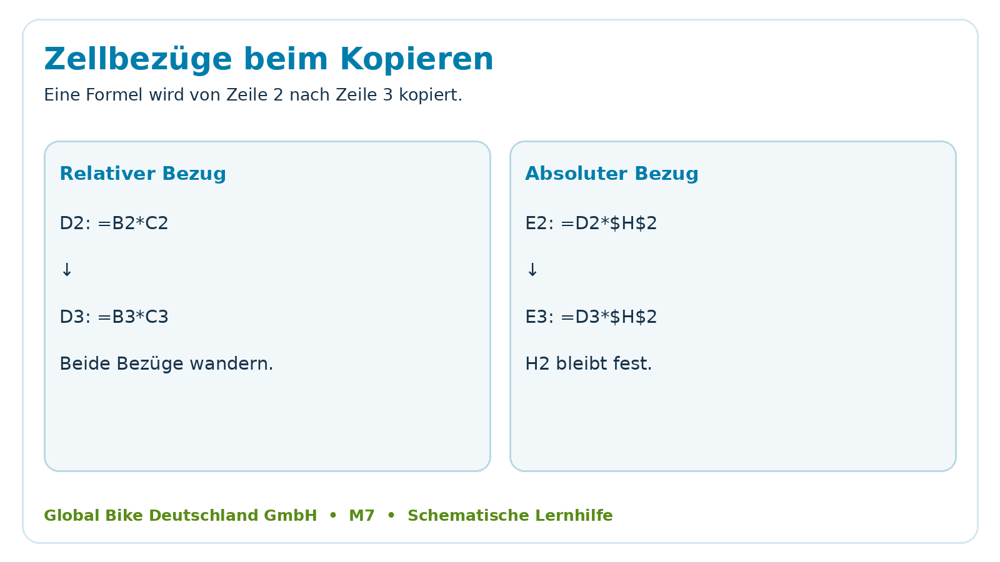

### 4. Absolute Zellbezüge

Ein absoluter Bezug bleibt beim Kopieren in andere Zellen unverändert. Steht ein gemeinsamer Zuschlagssatz in H2, kann die Formel =D2*$H$2 verwendet werden. Beim Kopieren nach unten entsteht =D3*$H$2. D2 wird angepasst, H2 bleibt fest.

Wird der Inhalt von H2 geändert, rechnen alle darauf bezogenen Formeln mit dem neuen Wert, sofern die automatische Berechnung aktiv ist. Absolut bedeutet also nicht, dass der Wert unveränderlich ist. Die Fixierung gilt für das Kopieren von Formeln, nicht für jede denkbare Änderung der Tabellenstruktur. Beim Einfügen, Löschen oder Verschieben von Zellen können sich auch absolute Adressen ändern.

### 5. Relative und absolute Zellbezüge im Vergleich

| Merkmal | Relativ | Absolut |
| --- | --- | --- |
| Schreibweise | B2 | $B$2 |
| Eine Zeile tiefer kopiert | B3 | $B$2 |
| Eine Spalte weiter kopiert | C2 | $B$2 |
| Typischer Zweck | Unterschiedliche Werte je Datensatz | Gemeinsamer Satz oder Bezugswert |

Entscheidend ist die fachliche Frage: Soll die nächste Formel den Wert aus der nächsten Zeile verwenden oder weiterhin denselben zentralen Wert? Nicht alle Bezüge einer Formel müssen gleichartig sein.

### 6. Bedeutung des Dollarzeichens

$H$2 besteht aus einem fixierten Spaltenbuchstaben H und einer fixierten Zeile 2. Die Zeichen stehen jeweils unmittelbar vor dem zu fixierenden Bestandteil. Ein absoluter Bezug ist keine fest eingetragene Zahl: =D2*0,08 enthält einen festen Zahlenwert, während =D2*$H$2 auf eine veränderbare Eingabezelle verweist. Die zweite Variante erleichtert die zentrale Pflege eines gemeinsamen Satzes.

### 7. Klick-Anleitung: F4-Taste verwenden

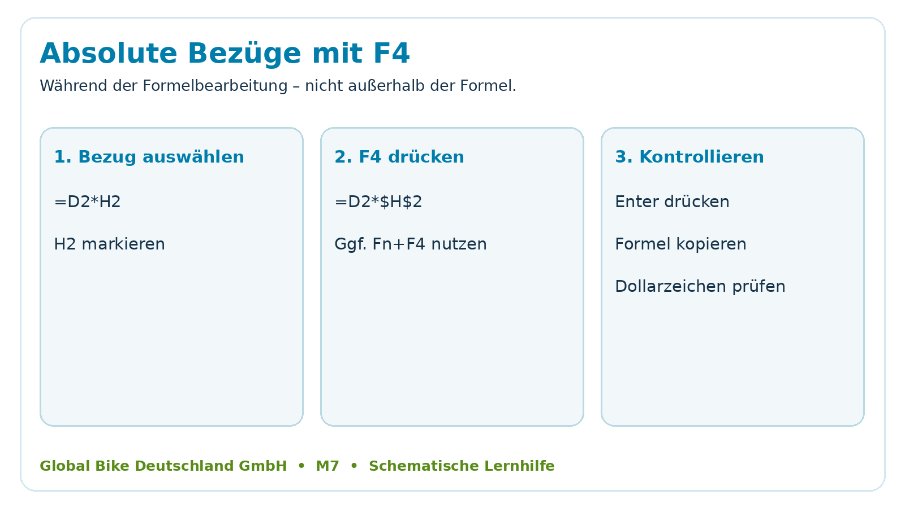

1. Ergebniszelle auswählen und eine Formel beginnen, beispielsweise =D2*H2.
2. Vor dem Bestätigen den Bezug H2 in der Bearbeitungsleiste markieren oder den Cursor in diesen Bezug setzen.
3. F4 drücken. Aus H2 wird $H$2.
4. Die Dollarzeichen kontrollieren und Enter drücken.
5. Die Formelzelle erneut auswählen und den Bezug in der Bearbeitungsleiste prüfen.

Beim wiederholten Drücken von F4 wechselt Excel normalerweise zwischen H2, $H$2, H$2, $H2 und wieder H2. Auf manchen Notebooks ist Fn+F4 erforderlich. Außerhalb der Formelbearbeitung hat F4 eine andere Funktion. Falls die Tastenkombination nicht funktioniert, können die Dollarzeichen direkt eingegeben werden. Die Anleitung bezieht sich auf Desktop-Excel für Windows.

### 8. Klick-Anleitung: Formeln kopieren und überprüfen

1. Die erste Formel vollständig eingeben und mit Enter bestätigen.
2. Die Ergebniszelle anklicken.
3. Das Ausfüllkästchen unten rechts an der Zellmarkierung bis zur letzten Datenzeile ziehen.
4. Die erste, eine mittlere und die letzte kopierte Formel in der Bearbeitungsleiste prüfen.
5. Kontrollieren, ob die relativen Bezüge mitwandern und die absoluten Bezüge unverändert bleiben.
6. Mindestens ein Ergebnis unabhängig nachrechnen.

Alternativ lässt sich die Formel mit Strg+C und Strg+V kopieren. Beim Einfügen ausschließlich als Werte geht die Formel verloren. Das Ausschneiden und Verschieben ist nicht dasselbe wie Kopieren.

### 9. Unabhängiges betriebliches Beispiel: Büromaterialkosten

Für eine interne Schulung der Global Bike Deutschland GmbH werden beispielhafte Nettokosten mit einem einheitlichen Planungszuschlag kalkuliert. Die Werte sind didaktisch simuliert und gehören nicht zum Hauptfall M1. Der Zuschlag ist eine interne Planungsgröße, keine Steuer und kein tatsächlich angefallener Aufwand.

In H1 steht „Planungszuschlag“, in H2 wird 8 % als numerischer Prozentwert eingetragen. Die Überschriften der folgenden Liste stehen in Zeile 1.

| Zeile | A – Material | B – Menge | C – Einzelpreis netto | D – Grundbetrag | E – Zuschlag | F – Planbetrag |
| --- | --- | --- | --- | --- | --- | --- |
| 2 | Schreibblöcke | 10 | 3,50 € | 35,00 € | 2,80 € | 37,80 € |
| 3 | Ordner | 6 | 4,00 € | 24,00 € | 1,92 € | 25,92 € |
| 4 | Stifte | 20 | 1,20 € | 24,00 € | 1,92 € | 25,92 € |

In D2 steht =B2*C2, in E2 =D2*$H$2 und in F2 =D2+E2. Die drei Formeln werden bis Zeile 4 kopiert. In E4 muss anschließend =D4*$H$2 stehen.

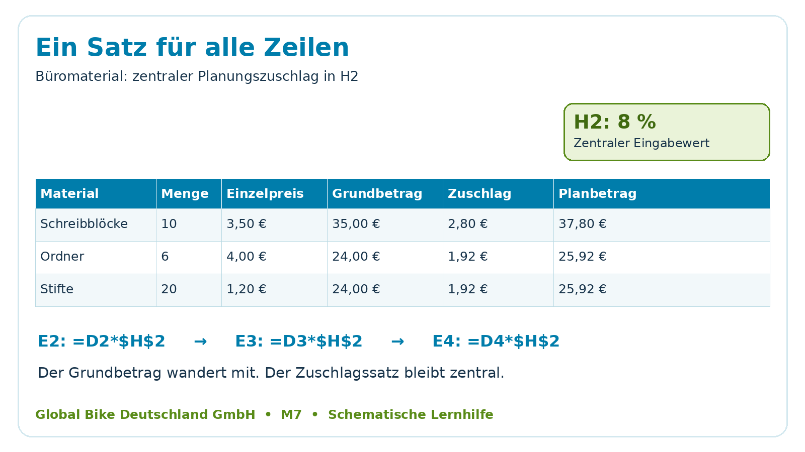

Die Grundbeträge ergeben zusammen 83,00 €, die Zuschläge 6,64 € und die Planbeträge 89,64 €. Wird H2 testweise auf 10 % geändert, ergeben sich Zuschläge von 3,50 €, 2,40 € und 2,40 €. Der neue Gesamtplanbetrag beträgt 91,30 €. Anschließend den ursprünglichen Satz wiederherstellen. Alle Beträge sind hier ohne zusätzliche Rundungsschritte centgenau. Bei anderen Daten ist die betriebliche Rundungsregel zu beachten (M5).

### 10. Unabhängiges Beispiel: Prozentuale Anteile

Eine zweite, separate Beispieltabelle enthält drei simulierte Schulungskosten: B2 = 60 €, B3 = 90 €, B4 = 150 €. In B5 steht =SUMME(B2:B4) mit dem Ergebnis 300 €. In C2 steht =B2/$B$5. Die Formel wird bis C4 kopiert und die Ergebnisse werden als Prozentwerte formatiert.

| Zelle | Formel | Ergebnis |
| --- | --- | --- |
| C2 | =B2/$B$5 | 20 % |
| C3 | =B3/$B$5 | 30 % |
| C4 | =B4/$B$5 | 50 % |

Der Zähler verändert sich, der Nenner bleibt gleich. Die Anteile ergeben zusammen 100 %. Bei einem Gesamtbetrag von null ist die Division nicht definiert. Der Fehler #DIV/0! muss fachlich geklärt werden. Nicht zusätzlich mit 100 multiplizieren, wenn das Prozentformat verwendet wird. M8 vertieft die Berechnung und Interpretation von Anteilen.

### 11. Freiwillige Vertiefung: gemischte Zellbezüge

Gemischte Bezüge fixieren nur eine Koordinate. $B2 hält die Spalte B fest, B$2 die Zeile 2. Diese Schreibweisen sind bei zweidimensionalen Berechnungstabellen hilfreich.

| Ausgangsbezug | Eine Zeile tiefer | Eine Spalte weiter rechts |
| --- | --- | --- |
| B2 | B3 | C2 |
| $B$2 | $B$2 | $B$2 |
| $B2 | $B3 | $B2 |
| B$2 | B$2 | C$2 |

Beispiel: Stehen Mengen in A2:A4 und verschiedene Einzelpreise in B1:D1, kann in B2 die Formel =$A2*B$1 stehen. Beim Kopieren nach rechts und unten werden jeweils die passende Menge und der passende Preis verwendet. Diese Vertiefung ist freiwillig und kein zusätzlicher verbindlicher Prüfungsinhalt.

### 12. Typische Fehler und deren Behebung

| Beobachtung | Ursache und Abhilfe |
| --- | --- |
| Zuschlag verschwindet nach dem Kopieren | Satzbezug wandert in eine leere Zelle; absoluten Bezug prüfen |
| Alle Zeilen nutzen dieselbe Menge | Mengenbezug versehentlich fixiert; Dollarzeichen entfernen |
| Bezug bleibt nur in einer Richtung fest | Gemischten statt absoluten Bezug verwendet; beide Dollarzeichen prüfen |
| Prozentbetrag ist hundertmal zu hoch | Prozentwert falsch eingegeben oder zusätzlich mit 100 multipliziert |
| F4 wiederholt eine Aktion | Formelbearbeitung nicht aktiv; Bezug zuerst auswählen |
| Formel reagiert nicht auf Satzänderung | Satz als Zahl in Formel eingetragen oder Berechnung nicht automatisch |
| #DIV/0! | Gesamtwert null oder leer; Datengrundlage klären |
| #BEZUG! | Bezugszelle gelöscht; gültigen Bezug wiederherstellen |
| Ergebnis korrekt, Formel aber falsch | Zufällig gleiche Ausgangswerte; mit unterschiedlichen Werten testen |
| Kopierte Zelle enthält nur Zahl | Als Werte eingefügt; Formel erneut kopieren |
| Neue Datenzeile fehlt | Formel oder Summenbereich nicht erweitert; Funktionsprüfung durchführen |

### 13. Funktionsprüfung und Wiederverwendbarkeit

Eine verlässliche [Arbeitsmappe](#arbeitsmappe) trennt Eingaben, Berechnungen und Auswertungen. Gemeinsame Bezugsgrößen werden eindeutig beschriftet. Eine zentrale Eingabezelle vermeidet widersprüchliche Sätze in verschiedenen Formeln.

Zur freiwilligen Kontrolle kann eine Kopie der Arbeitsmappe genutzt werden: Einen zeilenbezogenen Eingabewert verändern und prüfen, ob die betroffenen Ergebnisse reagieren. Danach einen zentralen Satz verändern und prüfen, ob alle davon abhängigen Zeilen reagieren. Ursprüngliche Werte wiederherstellen. Bei einer zusätzlichen Zeile die Formeln und Auswertungsbereiche kontrollieren. Ein plausibles Ergebnis allein genügt nicht; auch die Formel muss stimmen.

### 14. Freiwillige Selbstkontrolle

1. Was bezeichnet die Adresse C7?
2. Wie verändert sich =B2*C2 beim Kopieren eine Zeile nach unten?
3. Wie wird H2 vollständig fixiert?
4. Wie lautet =D2*$H$2 zwei Zeilen tiefer?
5. Bleibt der Inhalt einer absolut referenzierten Zelle unveränderlich?
6. Welchen Vorteil hat ein zentral hinterlegter Prozentsatz gegenüber einer Zahl in jeder Formel?
7. Welche Formel berechnet den Anteil von B3 an der Gesamtsumme in B8 mit kopierfähigem Nenner?
8. Was ist zu prüfen, wenn F4 nicht die erwarteten Dollarzeichen setzt?
9. Warum sollten kopierte Formeln mit unterschiedlichen Eingabewerten getestet werden?
10. Was ist bei einer neu ergänzten Datenzeile zu kontrollieren?

**Kontrollhinweise**

1. Spalte C, Zeile 7.
2. =B3*C3.
3. $H$2.
4. =D4*$H$2.
5. Nein, die Adresse bleibt beim Kopieren fest; der Inhalt kann geändert werden.
6. Eine zentrale Änderung wirkt auf alle abhängigen Formeln.
7. =B3/$B$8, anschließend Prozentformat wählen.
8. Formelbearbeitung, ausgewählten Bezug und gegebenenfalls Fn-Taste prüfen; alternativ Dollarzeichen eingeben.
9. Gleiche Eingabewerte können falsche Bezüge verdecken.
10. Ob die benötigten Formeln vorhanden sind und die Auswertungsbereiche die neue Zeile umfassen.

Keine zusätzliche Abgabe oder Bewertung.

### 15. Weiterführende Materialien

M5 behandelt Formeln und Grundrechenarten, M6 die grundlegenden Funktionen. M8 vertieft prozentuale Anteile, M9 die Datums- und Fristenberechnung, M14 die Qualitätskontrolle und Wiederverwendbarkeit. M7 bleibt während der gesamten Lernsituation verfügbar.

[Bearbeitbare Textfassung](material/m7.md)

## M8 – Prozentuale Anteile in Excel berechnen und interpretieren

[Digitale Fassung öffnen](material/m8.html)

Global Bike Deutschland GmbH – Verwaltung

### 1. Bedeutung der Prozentrechnung im Büroalltag

Absolute Zahlen zeigen Beträge oder Mengen. Prozentwerte zeigen, wie groß diese im Verhältnis zu einer Bezugsgröße sind. In der Verwaltung helfen sie beispielsweise bei der Überwachung von Kostenbudgets, der Auswertung erledigter Vorgänge und dem Vergleich verschiedener Kostenarten. Ein Prozentwert ist nur aussagekräftig, wenn klar ist, worauf er sich bezieht. 75 % eines kleinen Budgets können weniger Euro sein als 30 % eines großen Budgets.

### 2. Grundwert, Prozentwert und Prozentsatz

Der Grundwert G ist die Bezugsgröße (100 %). Der Prozentwert W ist der betrachtete Teil in derselben Einheit wie der Grundwert. Der Prozentsatz p beschreibt das Verhältnis W/G. In Excel wird beispielsweise 25 % intern als 0,25 gespeichert.

Beispiel: Von einem internen Schulungsbudget von 800 € wurden 200 € ausgegeben. 800 € sind der Grundwert, 200 € der Prozentwert und 25 % der Prozentsatz. Der verbleibende Betrag beträgt 600 €, entsprechend 75 % des Budgets. Die Bezugsgröße bleibt in beiden Anteilsberechnungen das ursprüngliche Budget.

### 3. Die drei Grundformeln der Prozentrechnung

| Gesucht | Berechnung | Excel-Beispiel |
| --- | --- | --- |
| Prozentwert W | G × p | =B2*C2 |
| Prozentsatz p | W / G | =D2/B2 |
| Grundwert G | W / p | =D2/C2 |

In einer unabhängigen Beispielzeile steht B2 für 800 €, C2 für 25 % und D2 für 200 €. Die Formeln zeigen drei alternative Berechnungen, je nachdem, welcher Wert fehlt. Sie dürfen nicht gleichzeitig so in die drei Eingabezellen eingetragen werden, weil sonst ein Zirkelbezug entsteht. Bei der Division darf der Nenner nicht null sein.

Ein Prozentsatz von 25 % entspricht 25/100. Wird der Satz als Prozentwert in Excel eingegeben, ist keine zusätzliche Division durch 100 notwendig.

### 4. Prozentwerte in Excel eingeben und formatieren

Excel unterscheidet [Zellwert](#zellwert) und Anzeige (M4). Die Eingabe 25% speichert den numerischen Wert 0,25. Auch die Eingabe 0,25 mit anschließender Prozentformatierung zeigt 25 %. Wer dagegen die Zahl 25 eingibt und anschließend das Prozentformat zuweist, erhält 2500 %.

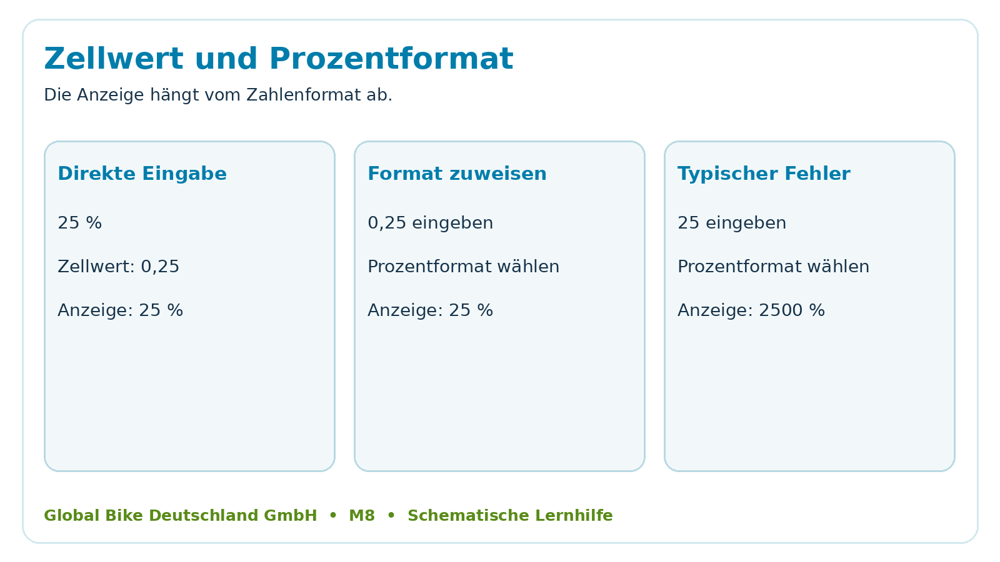

Klick-Anleitung (deutschsprachiges Desktop-Excel für Windows):

1. Ergebniszelle oder zusammenhängenden Ergebnisbereich markieren.
2. Registerkarte Start öffnen.
3. In der Gruppe Zahl auf das Prozentzeichen klicken.
4. Mit Dezimalstelle hinzufügen bzw. entfernen die gewünschte Genauigkeit einstellen.
5. In der Bearbeitungsleiste den zugrunde liegenden Wert oder die [Formel](#formel) prüfen.

Alternativ Strg+1 drücken, Kategorie Prozent wählen, Dezimalstellen festlegen und bestätigen. Geldbeträge bleiben im Währungsformat, Mengen im Zahlenformat. Prozentformatierung verändert normalerweise nur die Anzeige, nicht den zugrunde liegenden Wert.

### 5. Prozentuale Anteile an einer Gesamtsumme

Bei einer Kostenstruktur ist die [Summe](#summe) aller berücksichtigten Einzelkosten der Grundwert. Jeder Einzelbetrag wird durch diese Gesamtsumme geteilt. Bei vollständigen, überschneidungsfreien Kategorien mit nichtnegativen Beträgen und positiver Gesamtsumme ergeben die Anteile zusammen 100 %. Zwischensummen dürfen nicht erneut als Einzelpositionen einbezogen werden.

Bei einer gefilterten Liste muss vorab feststehen, ob sich die Anteile auf alle Daten oder nur auf die sichtbare Teilmenge beziehen sollen. SUMME berücksichtigt auch ausgefilterte Zeilen. Eine gefilterte Ansicht ändert deshalb nicht automatisch die Bezugsgröße. Für Auswertungen ausschließlich sichtbarer Zeilen kann ergänzend TEILERGEBNIS verwendet werden; diese Funktion ist hier kein verbindlicher Lerninhalt.

### 6. Relative und absolute Zellbezüge anwenden

Bei mehreren Anteilen verändert sich der Zähler je Zeile, der Nenner bleibt gleich. Steht die Gesamtsumme in B6, lautet eine erste Formel =B2/$B$6. Beim Kopieren nach unten wird daraus =B3/$B$6. Die Dollarzeichen fixieren die Adresse beim Kopieren (M7), nicht den Wert der Gesamtsumme. Ändert sich ein Einzelbetrag, müssen sich Gesamtsumme und davon abhängige Anteile bei automatischer Berechnung entsprechend aktualisieren.

### 7. Klick-Anleitung zur Anteilsberechnung

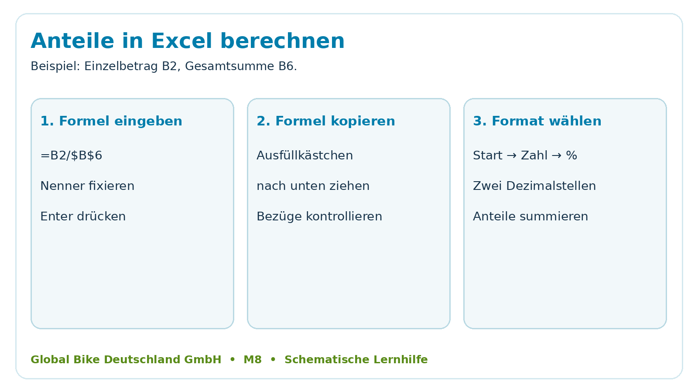

1. Einzelbeträge in einer zusammenhängenden Spalte erfassen und als Währung formatieren.
2. Unterhalb der Einzelbeträge die Summe mit SUMME berechnen.
3. Erste Ergebniszelle in der Anteilsspalte anklicken.
4. Gleichheitszeichen eingeben, erste Betragszelle anklicken, Schrägstrich eingeben und Summenzelle anklicken.
5. Den Bezug auf die Summenzelle mit F4 oder manuell durch zwei Dollarzeichen fixieren.
6. Enter drücken und die Formel am Ausfüllkästchen bis zur letzten Einzelposition kopieren.
7. Anteilsspalte markieren und das Prozentformat mit zwei Dezimalstellen wählen.
8. Die Summe der Anteile berechnen und die erste sowie letzte Formel prüfen.

Die Summenzeile wird nicht als weitere Einzelposition in die Anteilsberechnung kopiert. Eine Kontrolle von 100 % ersetzt nicht die Prüfung der Datengrundlage.

### 8. Unabhängiges betriebliches Beispiel: Kostenstruktur

Für eine interne Schulung der Global Bike Deutschland GmbH liegen folgende simulierte Nettokosten vor. Sie sind unabhängig vom Hauptfall M1 und keine SAP-Daten.

| Zeile | A – Kostenart | B – Betrag | C – Anteil |
| --- | --- | --- | --- |
| 2 | Schulungsunterlagen | 120,00 € | 20,00 % |
| 3 | Raumausstattung | 180,00 € | 30,00 % |
| 4 | Technische Ausstattung | 240,00 € | 40,00 % |
| 5 | Verbrauchsmaterial | 60,00 € | 10,00 % |
| 6 | Gesamt | 600,00 € | 100,00 % |

B6: =SUMME(B2:B5); C2: =B2/$B$6; C3 bis C5 durch Kopieren; C6: =SUMME(C2:C5).

Technische Ausstattung hat mit 40 % den größten Anteil. Daraus folgt nicht automatisch, dass diese Kosten unangemessen sind. Vor einer Einsparentscheidung sind Bedarf, Qualität und mögliche Alternativen zu prüfen.

Funktionsprobe: B2 vorübergehend von 120 € auf 180 € ändern. Die Gesamtsumme steigt auf 660 €. Der Anteil der Schulungsunterlagen beträgt rund 27,27 %, der technischen Ausstattung rund 36,36 %. Auch unveränderte Einzelbeträge können einen anderen Anteil erhalten, weil sich der Grundwert geändert hat. Anschließend den ursprünglichen Wert wiederherstellen.

### 9. Unabhängiges betriebliches Beispiel: Budgetüberwachung

Für eine separate interne Schulungsmaßnahme stehen 1.200 € netto zur Verfügung. B2 enthält das Budget, B3 die bisherigen Ausgaben von 900 €.

| Zelle | Bedeutung | Formel bzw. Eingabe | Ergebnis |
| --- | --- | --- | --- |
| B2 | Budget | Eingabe | 1.200,00 € |
| B3 | Ausgaben | Eingabe | 900,00 € |
| B4 | [Restbudget](#restbudget) | =B2-B3 | 300,00 € |
| B5 | [Budgetauslastung](#budgetauslastung) | =B3/B2 | 75,00 % |
| B6 | Verbleibender Budgetanteil | =B4/B2 | 25,00 % |

B5 und B6 als Prozent formatieren. Die Ausgaben können in einer späteren [Arbeitsmappe](#arbeitsmappe) aus einer Summe von Einzelpositionen stammen. Bei 1.350 € Ausgaben beträgt die Auslastung 112,50 %, das Restbudget −150 € und der verbleibende Anteil −12,50 %. Negative Restwerte dürfen nicht einfach auf null gesetzt werden, weil dadurch eine Überschreitung verborgen würde. Eine Budgetauslastung von 75 % bedeutet nicht automatisch, dass 25 % frei ausgegeben werden dürfen: Bereits geplante oder zugesagte Ausgaben und interne Freigaben sind zu beachten.

### 10. Freiwillige Vertiefung: Veränderungen und Prozentpunkte

Ein Anteil am Gesamtwert ist etwas anderes als eine Veränderung gegenüber einem früheren Wert. Steigen simulierte Monatskosten von 200 € (B2) auf 250 € (B3), beträgt die absolute Veränderung =B3-B2 = 50 €. Die relative Veränderung =(B3-B2)/B2 beträgt 25 %. Der alte Wert ist der Grundwert. Bei einem alten Wert von null ist diese Veränderungsrate nicht definiert.

Steigt eine Erledigungsquote von 60 % auf 75 %, beträgt die Differenz 15 Prozentpunkte. Relativ zur alten Quote ist dies eine Steigerung von 25 %. Beide Aussagen sind richtig, beschreiben aber unterschiedliche Größen. Prozentpunkte sind kein zusätzlicher verbindlicher Prüfungsinhalt.

### 11. Rundung und Nachkommastellen

Drei gleich große Anteile von jeweils einem Drittel werden mit zwei Dezimalstellen als 33,33 % angezeigt. Die sichtbaren Zahlen ergeben 99,99 %, während die Summe der ungerundeten Zellwerte als 100,00 % angezeigt wird. Das ist eine Anzeigeabweichung und kein Rechenfehler.

Mit den ungerundeten Werten weiterrechnen. Nur wenn eine fachliche Rundungsregel eine tatsächliche Rundung verlangt, ist beispielsweise =RUNDEN(C2;4) für einen als Dezimalbruch gespeicherten Prozentsatz mit zwei Prozent-Nachkommastellen geeignet. Eine solche Rundung kann die Summe verändern. Nicht eigenmächtig einen Anteil anpassen, nur damit die Anzeige 100 % ergibt.

### 12. Kaufmännische Interpretation

Eine aussagekräftige Auswertung nennt den betrachteten Wert, die Bezugsgröße, den Zeitraum und die Bedeutung für den Arbeitsauftrag. Prozentwerte können Prioritäten sichtbar machen, ersetzen aber keine Entscheidung über notwendige Ausgaben. Eine hohe Erledigungsquote kann einzelne dringende offene Vorgänge verdecken. Eine geringe Budgetauslastung kann auf noch nicht erfasste Kosten zurückgehen.

Bei Vergleichen müssen Zeitraum, Einheit und Abgrenzung zusammenpassen. Ein Nettobudget darf nicht mit Bruttoausgaben verglichen werden. Fehlende Angaben sind nicht automatisch null. Empfehlungen müssen sich auf überprüfte Daten stützen und Unsicherheiten kenntlich machen.

### 13. Typische Fehler und deren Behebung

| Beobachtung | Ursache und Abhilfe |
| --- | --- |
| 2500 % statt 25 % | Zahl 25 statt 0,25 bzw. 25 % eingegeben |
| Anteil hundertmal zu groß | Zusätzlich mit 100 multipliziert und Prozentformat verwendet |
| Anteil verändert sich unerwartet beim Kopieren | Nenner nicht absolut referenziert |
| Alle Anteile gleich | Zähler versehentlich fixiert |
| Summe der Anteile deutlich über 100 % | Zwischensumme doppelt erfasst oder falscher Grundwert |
| Summe deutlich unter 100 % | Positionen fehlen oder Grundwert passt nicht zur Auswahl |
| 99,99 % statt 100 % in sichtbaren Einzelwerten | Anzeige-Rundung prüfen |
| #DIV/0! | Nenner null oder leer; Ursache klären, nicht als 0 % ausgeben |
| #WERT! | Text statt Zahl in Berechnungszellen; Datentyp prüfen |
| Budgetüberschreitung bleibt unsichtbar | Negative Restwerte unterdrückt |
| Gefilterte Anteile ergeben nicht 100 % | Bezugsgröße umfasst weiterhin alle Daten |
| Anteil wird als Veränderungsrate bezeichnet | Bezugsgröße und Fragestellung unterscheiden |

### 14. Qualitätskontrolle und Wiederverwendbarkeit

Freiwillige Kontrolle an einer Kopie: Sind alle Beträge numerisch und in derselben Einheit? Ist der Grundwert eindeutig bezeichnet? Stimmen Summenbereiche und Zellbezüge? Sind Prozentwerte als solche formatiert? Reagieren die Formeln auf Änderungen? Werden neue Datenzeilen in die Berechnung einbezogen? Ist bei [Filtern](#filtern) die Bezugsgröße weiterhin nachvollziehbar? Sind fehlende Werte und Budgetüberschreitungen sichtbar? Lassen sich die Aussagen aus den Zahlen begründen?

Einzelne Ergebnisse unabhängig nachrechnen. Bei einer neuen Datenzeile prüfen, ob die Summenformel und die Anteilsformeln erweitert wurden. Die ursprünglichen Testwerte wiederherstellen. Die Arbeitsmappe soll ohne erneute Eingabe aller Formeln nutzbar bleiben.

### 15. Freiwillige Selbstkontrolle

1. Was ist der Grundwert bei einer Budgetauslastung?
2. Wie wird ein Anteil von 45 € an 180 € berechnet?
3. Welcher Zellwert entspricht 12,5 %?
4. Welche Formel berechnet den Anteil von B3 an der Gesamtsumme B9 kopierfähig?
5. Wie lautet diese Formel eine Zeile tiefer?
6. Ein Budget beträgt 500 €, die Ausgaben 350 €. Wie hoch sind Restbetrag und Auslastung?
7. Wie hoch ist die Auslastung bei 550 € Ausgaben und 500 € Budget?
8. Warum können drei angezeigte Drittel zusammen 99,99 % ergeben?
9. Was bedeutet #DIV/0! bei einer Anteilsberechnung?
10. Warum kann der Anteil eines unveränderten Betrags sinken?
11. Bedeutet der größte Kostenanteil automatisch, dass dort eingespart werden sollte?
12. Verändert ein Filter automatisch den durch SUMME berechneten Grundwert?

**Kontrollhinweise**

1. Das gesamte verfügbare Budget.
2. 45/180 = 0,25 = 25 %.
3. 0,125.
4. =B3/$B$9.
5. =B4/$B$9.
6. 150 € Restbetrag, 70 % Auslastung.
7. 110 %; das Budget ist um 50 € überschritten.
8. Durch die Rundung der Anzeige auf zwei Dezimalstellen.
9. Der Nenner ist null oder leer; eine Quote ist so nicht definiert.
10. Weil der Gesamtbetrag steigen kann.
11. Nein; Bedarf, Alternativen und betriebliche Folgen müssen geprüft werden.
12. Nein, SUMME berücksichtigt auch ausgefilterte Zeilen.

Keine zusätzliche Abgabe oder Bewertung.

### 16. Weiterführende Materialien

M4 erläutert Zahlenformate, M5 Formeln und Grundrechenarten, M6 SUMME und weitere Funktionen, M7 Zellbezüge. M9 vertieft Postorganisation, Termine und Fristen. M11 und M12 behandeln Diagramme, M14 die Qualitätskontrolle. M8 bleibt während der gesamten Lernsituation verfügbar.

[Bearbeitbare Textfassung](material/m8.md)

## M9 – Postorganisation, Termine und Fristen mit Excel

[Digitale Fassung öffnen](material/m9.html)

Global Bike Deutschland GmbH – Verwaltung

### 1. Bedeutung der digitalen Büroorganisation

Eine zuverlässige Büroorganisation sorgt dafür, dass Anfragen, Bestellungen, interne Mitteilungen und Aufgaben nicht verloren gehen. Eine gemeinsame Excel-Übersicht macht sichtbar, was eingegangen ist, wer zuständig ist, was bereits erledigt wurde und wo Handlungsbedarf besteht. Sie unterstützt die Abstimmung zwischen Verwaltung, Verkauf und Auftragsbearbeitung. Eine Tabelle ersetzt weder die tatsächliche Bearbeitung noch die Kommunikation mit den zuständigen Mitarbeitenden.

### 2. Posteingang und Postausgang

Zum Posteingang gehören beispielsweise empfangene Kundenanfragen und Bestellungen, zum Postausgang versandte Angebote und Antworten. Auch interne Mitteilungen können in einer betrieblichen Postübersicht erfasst werden. Die Richtung wird aus Sicht des dokumentierenden Bereichs angegeben. Das Datum bezeichnet den tatsächlichen Ein- oder Ausgang, nicht automatisch das Datum auf dem Schreiben.

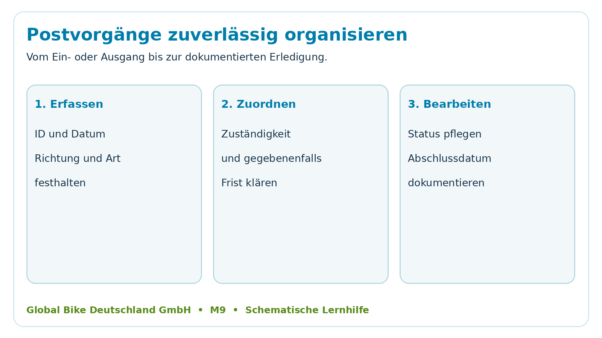

Ein Vorgang wird erfasst, eindeutig gekennzeichnet, einer zuständigen Stelle zugeordnet, bearbeitet und mit seinem tatsächlichen Erledigungsdatum dokumentiert. Bei der Weiterleitung bleiben die Zuständigkeit und der Bearbeitungsstand nachvollziehbar. Eine versandte Nachricht ist nicht automatisch ein abgeschlossener Geschäftsvorgang.

### 3. Aufbau betrieblicher Postlisten

| Feld | Bedeutung |
| --- | --- |
| Vorgangs-ID | Eindeutige Kennzeichnung, beispielsweise S01 |
| Datum | Tatsächlicher Ein- oder Ausgang |
| Richtung | Eingang oder Ausgang |
| Vorgangsart | Beispielsweise Kundenanfrage |
| Zuständigkeit | Verantwortlicher betrieblicher Bereich |
| Status | Offen oder Erledigt |
| Erledigt am | Tatsächliches Abschlussdatum; bei offenen Vorgängen leer |

Eine Zeile enthält einen Postvorgang, eine Spalte ein Merkmal. Überschriften sind eindeutig, Datumswerte echte Excel-Daten und Statusangaben einheitlich. Keine Leerzeilen innerhalb des Datenbereichs, keine verbundenen Zellen in der Liste. Vorgangs-IDs sind Text und bleiben auch beim [Sortieren](#sortieren) mit ihren vollständigen Zeilen verbunden.

Postliste und Fristenliste erfüllen unterschiedliche Zwecke. Eine Fristenliste kann auch eigenständige Aufgaben ohne Postreferenz enthalten. Eine Postreferenz verbindet eine Aufgabe mit einem Vorgang, ohne dass die Aufgabe selbst als zusätzlicher Postvorgang gezählt wird. Nicht jeder Postvorgang benötigt eine eigene Frist. Die Ausgangsdaten M1 bleiben unverändert.

### 4. Termine und Fristen unterscheiden

Ein Termin bezeichnet einen bestimmten Zeitpunkt, beispielsweise eine Besprechung am 15. September um 10 Uhr. Eine Frist bezeichnet einen Zeitraum, innerhalb dessen etwas erledigt werden soll. Das Fristende ist das Datum, bis zu dem die Aufgabe erledigt sein muss. Eine Besprechung kann einen festen Termin und zusätzlich eine Vorbereitungsfrist haben.

| Begriff | Beispiel (unabhängiger Schulungsfall) |
| --- | --- |
| Ausgangsdatum | 08.09.2027 |
| Fristdauer | 5 Kalendertage |
| Fristende | 13.09.2027 |
| Termin | Besprechung am 15.09.2027 |

Im Hauptfall M1 gelten Kalendertage, der Ausgangstag zählt nicht mit, Wochenenden und Feiertage führen nicht zur Verschiebung. Das ist eine interne Simulationsregel und keine allgemeine Regel für gesetzliche oder vertragliche Fristen.

### 5. Datumswerte in Excel verstehen

Excel speichert ein Datum als fortlaufende Zahl. Dadurch können Tage addiert und Datumswerte voneinander abgezogen werden. Das Datumsformat bestimmt die Anzeige. Ein als Text gespeichertes Datum kann Berechnungen und Sortierungen stören.

Klick-Anleitung: Zellen markieren, Strg+1 drücken, Kategorie Datum oder Benutzerdefiniert wählen, beispielsweise TT.MM.JJJJ einstellen, bestätigen. Ein Datum wie 08.09.2027 in der deutschen Excel-Umgebung eingeben. Zur Kontrolle kann in einer freien Zelle =ISTZAHL(B2) verwendet werden: WAHR zeigt einen numerischen Wert, beweist aber noch nicht, dass das richtige Datum eingegeben wurde. Diese Prüffunktion ist eine freiwillige Hilfe.

Bei importierten Textdaten zunächst eine Kopie anlegen. Über Daten > Text in Spalten kann bei einer einzelnen Datumsspalte im letzten Schritt das Datenformat Datum mit Reihenfolge TMJ gewählt werden. Zielbereich und Vorschau prüfen, damit keine Nachbarspalten überschrieben werden. Alternativ einzelne Werte korrekt neu eingeben. Die Originaldaten nicht überschreiben. Bei einer Anzeige ##### zuerst die Spaltenbreite prüfen.

### 6. Fälligkeitsdaten berechnen

Steht in B2 das Ausgangsdatum und in C2 die Fristdauer in ganzen Kalendertagen, berechnet =B2+C2 das Fristende. Das Ergebnis als Datum formatieren. Die Fristdauer bleibt eine Zahl, nicht ein Datum.

Beispiel: 08.09.2027 plus 5 Tage ergibt 13.09.2027. Der 09.09. ist Tag 1, der 13.09. Tag 5. Auch Samstag und Sonntag zählen mit. Ein Monatswechsel wird automatisch berücksichtigt: 28.09.2027 plus 5 Tage ergibt 03.10.2027. Es wird kein zusätzlicher Tag addiert. Bei fehlendem Ausgangsdatum oder fehlender Fristdauer zuerst die Daten klären; leere Zellen können sonst wie null behandelt werden. Eine Fristdauer von null ist nur bei ausdrücklich vorgegebener taggleicher Fälligkeit sinnvoll.

### 7. Einen zentralen Stichtag verwenden

Ein [Stichtag](#stichtag) ist das Datum, auf das sich die Auswertung bezieht. Für eine historische Auswertung muss er fest bleiben. In M1 ist der Stichtag 01.07.2027. Das unabhängige Schulungsbeispiel in diesem Material verwendet dagegen 15.09.2027.

Ein zentraler Stichtag in K2 kann in allen Berechnungen mit $K$2 angesprochen werden. Der Bezug bleibt beim Kopieren unverändert, der Zellwert kann bei einer neuen Auswertung angepasst werden. =HEUTE() liefert dagegen das aktuelle Systemdatum und verändert eine historische Auswertung bei späterem Öffnen. Deshalb ist HEUTE für den festen Hauptfall nicht geeignet.

### 8. Verbleibende und überschrittene Fristen berechnen

Bei offenen Aufgaben ergibt sich die Anzahl verbleibender Kalendertage aus Fristende minus Stichtag. Steht das Fristende in D2, lautet die [Formel](#formel) =D2-$K$2. Ergebnis als Zahl mit null Dezimalstellen formatieren.

| Ergebnis | Bedeutung bei offenen Aufgaben |
| --- | --- |
| positiv | Frist liegt in der Zukunft |
| null | Heute fällig |
| negativ | Frist überschritten; Betrag zeigt überfällige Tage |

Bei erledigten Aufgaben ist dagegen das Erledigungsdatum maßgeblich. Die Differenz Fristende minus Erledigungsdatum zeigt, wie viele Tage vor dem Fristende die Aufgabe abgeschlossen wurde; null bedeutet am Fristende, ein negativer Wert verspätet. Ein erledigter Vorgang ist nicht weiterhin offen oder überfällig.

### 9. Offene und erledigte Vorgänge beurteilen

Zuerst den Bearbeitungsstatus prüfen. Bei offenen Aufgaben ohne Erledigungsdatum das Fristende mit dem Stichtag vergleichen. Bei erledigten Aufgaben das Fristende mit dem tatsächlichen Abschlussdatum vergleichen. Widersprüche, etwa Status Erledigt ohne Abschlussdatum, müssen geklärt werden. Ein Abschlussdatum nach dem Stichtag passt nicht zu einem bereits erledigten Vorgang in einer historischen Stichtagsauswertung.

Die Beurteilung kann anhand der berechneten Differenzen und einer dokumentierten Entscheidung erfolgen. Eine automatische Klassifikation mit WENN ist eine freiwillige Vertiefung, keine zusätzliche verbindliche Fachkompetenz. Für bereits geprüfte, vollständige Daten im Beispiel aus Abschnitt 13 ist folgende Formel in H2 möglich:

=WENN(E2="Erledigt";WENN(G2>=0;"Fristgerecht erledigt";"Verspätet erledigt");WENN(G2<0;"Überfällig";WENN(G2=0;"Heute fällig";"Noch offen")))

Die Formel setzt voraus, dass E nur die gültigen Statuswerte Offen und Erledigt enthält und G korrekt berechnet wurde. Sie ist keine Datenvalidierung. Bei widersprüchlichen oder fehlenden Eingaben darf keine scheinbar sichere Einstufung erfolgen.

### 10. Klick-Anleitungen zur Fristenüberwachung

**A – Postliste vorbereiten**

1. Neue [Arbeitsmappe](#arbeitsmappe) oder Kopie öffnen und Tabellenblatt sinnvoll benennen.
2. Überschriften für die benötigten Merkmale eintragen.
3. Daten zeilenweise übernehmen, IDs als Text und Datumsfelder als Datum formatieren.
4. Den Datenbereich markieren und über Start > Als Tabelle formatieren eine übersichtliche Tabelle anlegen. Die Option Tabelle hat Überschriften bestätigen.
5. Prüfen, ob jede ID eindeutig ist und alle Angaben einer Zeile zusammengehören.

**B – Fristende und Tagesdifferenz**

1. Ausgangsdatum und Fristdauer in getrennten Spalten erfassen.
2. Eine Spalte Fristende ergänzen. In der ersten Datenzeile die Additionsformel eingeben.
3. Enter drücken, Ergebnis als Datum formatieren und Formel über das Ausfüllkästchen nach unten kopieren. In einer formatierten Excel-Tabelle kann die Formel automatisch übernommen werden.
4. Den Stichtag außerhalb des Datenbereichs mit Beschriftung erfassen.
5. In einer weiteren Spalte für offene Aufgaben das Fristende minus den absolut referenzierten Stichtag berechnen.
6. Für erledigte Aufgaben stattdessen das Erledigungsdatum abziehen. Die jeweilige Formel anhand des Status auswählen. Bei einer späteren Statusänderung muss auch die Formel angepasst werden, sofern keine automatische Logik verwendet wird.
7. Differenzen als ganze Zahlen formatieren. Erste und letzte Formel sowie einen Monatswechsel kontrollieren.

**C – Handlungsbedarf sichtbar machen**

1. Die Spalte Fristenbeurteilung ergänzen und die Ergebnisse anhand der Entscheidungslogik eintragen.
2. Über den Filterpfeil dieser Spalte gezielt Überfällig oder Heute fällig auswählen. M10 erläutert Sortieren und [Filtern](#filtern) ausführlich.
3. Bei Bedarf über Start > Bedingte Formatierung > Regeln zum Hervorheben von Zellen > Textinhalt Regeln für die Bezeichnungen anlegen, beispielsweise Überfällig rot, Heute fällig gelb.
4. Textbezeichnungen beibehalten: Farbe allein ist nicht ausreichend. Erledigte Aufgaben nicht als offene Fälle markieren.
5. Filter wieder aufheben und kontrollieren, ob alle Datensätze vorhanden sind.

Manuelle Beurteilungen müssen nach einer Änderung von Stichtag, Frist oder Status erneut überprüft werden. Wer die freiwillige automatische Variante nutzt, prüft die Eingabedaten und testet die Formel für jeden Statusfall.

### 11. Interne Ablagefristen

Interne Ablagefristen legen fest, bis wann Unterlagen betrieblich geordnet und abgelegt werden sollen. Beispiele sind die Ablage von Angebotskopien oder Monatsunterlagen. Das Fristende wird aus der internen Vorgabe berechnet. Die Ablage muss tatsächlich erfolgt sein, bevor der Vorgang als erledigt gekennzeichnet wird.

Gesetzliche Aufbewahrungsfristen regeln dagegen, wie lange bestimmte Unterlagen aufzubewahren sind. Das Ende einer internen Ablagefrist ist keine Erlaubnis zur Vernichtung. M1 enthält ausschließlich interne Ablagefristen; gesetzliche Fristberechnungen sind nicht Gegenstand dieser Lernsituation.

### 12. Betriebliche Prioritäten setzen

Überfällige offene Aufgaben benötigen eine zeitnahe Prüfung. Heute fällige Aufgaben müssen ebenfalls berücksichtigt werden. Zukünftige Fristen sind einzuplanen. Innerhalb dieser Gruppen spielen Dringlichkeit, Auswirkungen auf Kunden, Abhängigkeiten und Zuständigkeit eine Rolle. Die älteste Frist ist nicht in jedem Fall automatisch die wichtigste Aufgabe.

Bei einer drohenden oder eingetretenen Überschreitung die zuständige Stelle informieren, Ursache klären und das weitere Vorgehen abstimmen. Fristen nicht eigenmächtig verlängern oder Erledigungsdaten erfinden. Die Tabelle liefert die Entscheidungsgrundlage, die Entscheidung bleibt eine betriebliche Aufgabe.

### 13. Durchgängiges betriebliches Anwendungsbeispiel

Unabhängige simulierte Schulungsdaten der Global Bike Deutschland GmbH, keine SAP-Daten und keine Lösung zu M1. Stichtag in K2: 15.09.2027.

| Zeile | A – Aufgabe | B – Ausgang | C – Tage | D – Fristende | E – Status | F – Erledigt am | G – Differenz | H – Beurteilung |
| --- | --- | --- | --- | --- | --- | --- | --- | --- |
| 2 | Rückmeldung | 08.09.2027 | 5 | 13.09.2027 | Offen | leer | −2 | Überfällig |
| 3 | Unterlagen prüfen | 10.09.2027 | 5 | 15.09.2027 | Offen | leer | 0 | Heute fällig |
| 4 | Besprechung vorbereiten | 12.09.2027 | 5 | 17.09.2027 | Offen | leer | 2 | Noch offen |
| 5 | Kopien ablegen | 08.09.2027 | 4 | 12.09.2027 | Erledigt | 11.09.2027 | 1 | Fristgerecht erledigt |
| 6 | Liste aktualisieren | 07.09.2027 | 4 | 11.09.2027 | Erledigt | 13.09.2027 | −2 | Verspätet erledigt |
| 7 | Unterlagen versenden | 09.09.2027 | 3 | 12.09.2027 | Erledigt | 12.09.2027 | 0 | Fristgerecht erledigt |

D2: =B2+C2, bis D7 kopieren. G2: =D2-$K$2, bis G4 kopieren. G5: =D5-F5, bis G7 kopieren. Für eine automatische Auswahl der Differenzformel bei geprüften Daten kann freiwillig =WENN(E2="Erledigt";D2-F2;D2-$K$2) in G2 eingesetzt und nach unten kopiert werden. H anhand der Entscheidungslogik beurteilen oder freiwillig die Formel aus Abschnitt 9 verwenden.

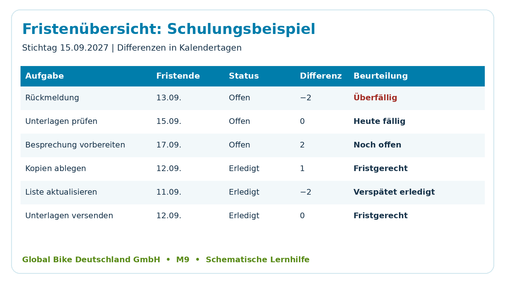

Die Rückmeldung ist überfällig, die Unterlagenprüfung heute fällig. Beide benötigen Aufmerksamkeit. Die Besprechungsvorbereitung ist einzuplanen. Die verspätete Listenaktualisierung ist bereits erledigt; hier geht es um die Ursachenanalyse, nicht um eine erneute Bearbeitung.

Funktionsprobe in einer Kopie: Stichtag auf 17.09.2027 ändern. Die offenen Differenzen werden −4, −2 und 0. Die Differenzen der erledigten Aufgaben bleiben 1, −2 und 0. Manuelle Beurteilungen aktualisieren. Anschließend den ursprünglichen Stichtag wiederherstellen.

### 14. Typische Fehler und deren Behebung

| Fehler | Abhilfe |
| --- | --- |
| Datum als Text gespeichert | Datentyp prüfen und korrekt umwandeln |
| Fristdauer als Datum angezeigt | Zahlenformat mit null Dezimalstellen wählen |
| Fristende um einen Tag verschoben | Ausgangstag gemäß interner Regel nicht mitzählen |
| Wochenende übersprungen | Kalendertage statt Arbeitstage verwenden |
| Stichtag wandert beim Kopieren | Absoluten Bezug verwenden |
| Historische Auswertung verändert sich täglich | Festen Stichtag statt HEUTE verwenden |
| Negative Tagesdifferenz als Datum angezeigt | Zahlenformat verwenden |
| Erledigte Aufgabe als überfällig eingestuft | Erledigungsdatum statt Stichtag vergleichen |
| Status und Abschlussdatum widersprechen sich | Originalangaben prüfen, nicht raten |
| Leeres Datum erzeugt scheinbar gültiges Ergebnis | Eingaben vor Berechnung auf Vollständigkeit prüfen |
| Nur eine Spalte sortiert | Gesamten zusammenhängenden Datenbereich sortieren |
| Farbe ohne Textbezeichnung | Eindeutige Statusbezeichnung ergänzen |
| Ablagefrist als Löschfrist verstanden | Interne Ablage und gesetzliche Aufbewahrung unterscheiden |
| Neue Zeile ohne Formel | Berechnungsbereich erweitern und testen |

### 15. Qualitätskontrolle und Wiederverwendbarkeit

Freiwillige Kontrolle: Sind IDs eindeutig, Datumswerte numerisch und plausibel, Fristdauern ganze Kalendertage und Statusangaben einheitlich? Sind offene Abschlussdaten leer und erledigte Abschlussdaten vorhanden? Liegt ein Abschluss nicht vor dem Ausgangsdatum oder nach dem Stichtag? Sind Fristende und Differenz korrekt formatiert? Ist der Stichtag zentral und absolut referenziert? Bleiben erledigte Differenzen bei einer Stichtagsänderung stabil? Werden neue Zeilen vollständig berücksichtigt? Sind manuelle Beurteilungen nach Änderungen aktualisiert? Bleiben Originaldaten erhalten?

Mindestens einen offenen, einen heute fälligen, einen überfälligen und einen erledigten Fall in einer Kopie prüfen. Einen Monatswechsel testen. Nach der Funktionsprobe Ausgangswerte wiederherstellen. Die Arbeitsmappe muss nachvollziehbar und für weitere Mitarbeitende nutzbar bleiben.

### 16. Freiwillige Selbstkontrolle

1. Was unterscheidet Posteingang und Postausgang?
2. Warum braucht jeder Postvorgang eine eindeutige ID?
3. Was unterscheidet Termin und Frist?
4. Wie lautet das Fristende bei 28.09.2027 plus fünf Kalendertagen?
5. Welche Formel berechnet das Fristende aus B3 und C3?
6. Warum ist HEUTE für eine historische Auswertung ungeeignet?
7. Wie lautet die kopierfähige Differenzformel für eine offene Aufgabe mit Fristende D3 und Stichtag K2?
8. Was bedeutet eine Differenz von −3 bei einer offenen Aufgabe?
9. Was bedeutet eine Differenz von null bei einer offenen Aufgabe?
10. Fristende 20.09., erledigt am 18.09.: Welche Differenz und Beurteilung ergeben sich?
11. Fristende 20.09., erledigt am 22.09.: Ist die Aufgabe noch überfällig?
12. Warum darf eine erledigte Aufgabe ohne Abschlussdatum nicht automatisch beurteilt werden?
13. Darf nach Ablauf einer internen Ablagefrist eine Unterlage vernichtet werden?
14. Warum reicht die Farbe Rot nicht als einzige Kennzeichnung?
15. Was ist bei einer Änderung des Stichtags mit manuell eingetragenen Beurteilungen zu tun?

**Kontrollhinweise**

1. Empfangene gegenüber versandten Vorgängen aus Sicht des dokumentierenden Bereichs.
2. Damit Vorgänge eindeutig zugeordnet und wiedergefunden werden.
3. Termin: bestimmter Zeitpunkt; Frist: Zeitraum bis zur Erledigung.
4. 03.10.2027.
5. =B3+C3.
6. HEUTE liefert das aktuelle Systemdatum statt des festgelegten Auswertungsdatums.
7. =D3-$K$2.
8. Drei Kalendertage überfällig.
9. Heute fällig.
10. +2, fristgerecht erledigt.
11. Nein, sie ist verspätet erledigt; Differenz −2.
12. Der tatsächliche Abschlusszeitpunkt fehlt.
13. Nein, die interne Ablagefrist ist keine Lösch- oder Aufbewahrungsfrist.
14. Text ist eindeutiger und auch ohne Farbwahrnehmung verständlich.
15. Erneut anhand der aktualisierten Differenzen prüfen und anpassen.

Keine zusätzliche Abgabe oder Bewertung.

### 17. Weiterführende Materialien

M3 unterstützt die Tabellenstruktur, M4 die Datumsformate, M5 die Formelerstellung und M7 die absoluten Zellbezüge. M10 vertieft Sortieren, Filtern und Rangfolgen. M14 behandelt die Qualitätskontrolle und Wiederverwendbarkeit. M9 bleibt während der gesamten Lernsituation verfügbar.

[Bearbeitbare Textfassung](material/m9.md)

## Ü1 · Ü1 – Sicher in Excel starten

[Digitale Fassung öffnen](material/ue1.html)

Global Bike Deutschland GmbH · Verwaltung · Freiwillige Übung · Keine KI

[Excel-Arbeitsdatei herunterladen](material/UE1_Arbeitsdatei.xlsx)

### 1. Betriebliche Ausgangssituation

Die Verwaltung bereitet interne Besprechungen zur Marktbearbeitung in der Region Nordwest vor. Eine Materialnotiz soll in eine bearbeitbare, aktualisierbare Excel-[Arbeitsmappe](#arbeitsmappe) überführt werden. Die folgenden Daten sind simuliert und unabhängig von M1.

### 2. Das trainieren Sie

Excel-Oberfläche, Zelladressen, Zellbereiche, Eingabe und Bearbeitung, Ausfüllkästchen, Blattorganisation, Speichern und Wiederöffnen (M2, F1).

### 3. Ausgangsdaten

Stand: 15.03.2027. Materialnotiz:

| Material | Bestand | Einheit |
| --- | --- | --- |
| Moderationskarten | 32 | Stück |
| Klemmbretter | 7 | Stück |
| Namensschilder | 18 | Stück |
| Whiteboardmarker | 9 | Stück |
| Haftnotizblöcke | 14 | Stück |

### 4. Praktische Arbeitsaufträge

1. Öffnen Sie UE1_Arbeitsdatei.xlsx. Speichern Sie eine Arbeitskopie als GB_UE1_Materialbestand.xlsx. Die Ausgangsdatei bleibt unverändert.
2. Orientieren Sie sich: Finden Sie Menüband, Namensfeld, Bearbeitungsleiste, Blattregister und Zoom. Wählen Sie B3 über das Namensfeld. Erklären Sie sich selbst, was die Adresse bedeutet.
3. Benennen Sie Tabelle1 in Materialbestand um. Erfassen Sie in A1:D1 die Überschriften Nr., Material, Bestand, Einheit. Übernehmen Sie die Materialnotiz in B2:D6. Erfassen Sie die Bestände als Zahlen ohne Einheit.
4. Geben Sie in A2 und A3 die Startwerte 1 und 2 ein. Markieren Sie beide und setzen Sie die Reihe bis A6 mit dem Ausfüllkästchen fort.
5. Eine interne Nachmeldung korrigiert den Bestand der Whiteboardmarker auf 11 Stück. Ändern Sie nur den betreffenden Bestand. Kopieren Sie den Inhalt von D2 nach D6. Schreiben Sie testweise in F2 das Wort Probe und entfernen Sie es anschließend mit Entf. Prüfen Sie, dass die Materialdaten unverändert geblieben sind.
6. Legen Sie ein zweites Blatt Hinweise an. Erfassen Sie dort in A1:B3 die Angaben Stand / 15.03.2027, Zweck / Interne Besprechungen, Datenbasis / Simulierte Übungsdaten. Ordnen Sie Materialbestand vor Hinweise an. Passen Sie bei Bedarf die Spaltenbreiten an.
7. Markieren Sie A1:D6 über das Namensfeld. Wie viele Zellen umfasst der Bereich? Prüfen Sie die aktive Zelle und wechseln Sie zwischen den beiden Blättern. Speichern Sie, schließen Sie die Datei und öffnen Sie Ihre Arbeitskopie erneut.
8. Führen Sie die Selbstkontrolle durch. Vergleichen Sie erst danach mit der separaten Musterlösung. Eine Abgabe ist nicht erforderlich.

### 5. Hilfen bei Bedarf

M2 Abschnitte 2–7 und 9. Die folgenden Abbildungen sind schematische Lernhilfen, keine Screenshots. 

#### Klick-Anleitungen (Excel für Windows, deutsch)

| Ziel | Klickweg |
| --- | --- |
| Arbeitskopie | Datei → Speichern unter (ggf. Kopie speichern) → Ordner → Name → Excel-Arbeitsmappe (*.xlsx) → Speichern |
| [Zelladresse](#zelladresse) | Namensfeld links der Bearbeitungsleiste → B3 eingeben → Enter |
| Blatt umbenennen | Doppelklick auf Blattregister → Name → Enter |
| Eingabe | Zelle anklicken → Inhalt tippen → Enter; Tab wechselt nach rechts |
| [Datenreihe](#datenreihe) | Zwei Startwerte markieren → kleines Quadrat unten rechts bis Zielzeile ziehen |
| Inhalt ändern | Zelle auswählen → neuen Wert eingeben oder F2 → Enter |
| Kopieren | Quellzelle → Strg+C → Zielzelle → Strg+V |
| Inhalt löschen | Zelle auswählen → Entf (nicht ganze Zeile löschen) |
| Neues Blatt | Plus neben Blattregistern → Doppelklick auf neuen Namen |
| Blatt verschieben | Blattregister an gewünschte Position ziehen |
| Spaltenbreite | Doppelklick auf rechte Grenze der Spaltenüberschrift |
| Bereich markieren | Namensfeld → A1:D6 → Enter |
| Wiederöffnen | Strg+S → Datei schließen → Datei → Öffnen → eigene Kopie auswählen |

Je nach Version können Befehlsnamen abweichen. Bei einer unerwarteten Änderung Strg+Z nutzen, soweit möglich. Die Originaldatei nicht überschreiben.

### 6. Selbstkontrolle

- Meine Arbeitskopie hat die Endung .xlsx und lässt sich erneut öffnen.
- Beide Blätter sind vorhanden, sinnvoll benannt und richtig angeordnet.
- Die Materialliste enthält fünf vollständige Datensätze und vier Überschriften.
- Nummern laufen von 1 bis 5; Bestände sind Zahlen, Einheiten stehen getrennt.
- Die Nachmeldung ist berücksichtigt, die übrigen Bestände sind unverändert.
- F2 ist leer; die Hinweise sind vollständig.
- Ich kann Namensfeld, Bearbeitungsleiste und Ausfüllkästchen zeigen.
- Ich kann erklären, warum XLSX statt PDF für die Weiterbearbeitung geeignet ist.

Funktionstest: Ändern Sie testweise einen Bestand, speichern Sie und öffnen Sie die Datei erneut. Stellen Sie anschließend den ursprünglichen Übungswert wieder her und speichern Sie erneut.

### 7. Freiwillige Vertiefung

Erstellen Sie eine Kopie des Blatts Materialbestand über Rechtsklick → Verschieben oder Kopieren → Kopie erstellen. Benennen Sie sie Testkopie. Ergänzen Sie dort einen selbst gewählten simulierten Materialdatensatz und setzen Sie die Nummerierung fort. Prüfen Sie, dass das ursprüngliche Blatt unverändert bleibt. Die Vertiefung gehört nicht zur Musterlösung und ist keine Pflicht.

Freiwilliger Übungscheck · fünf Fragen

**Eine Kollegin möchte die Datei später bearbeiten und beide Tabellenblätter behalten. Welches Vorgehen ist geeignet?**

- Einen Screenshot speichern
- Als XLSX-Arbeitskopie speichern
- Die Ausgangsdatei überschreiben
- Als CSV speichern und die XLSX löschen
- Nur als PDF exportieren
- Nur den Dateinamen ohne Speichern ändern

**Sie möchten direkt zur Zelle D7 wechseln. Welches Bedienelement ist dafür geeignet?**

- Druckvorschau
- Blattregister
- Namensfeld
- Statusleiste
- Titelleiste
- Zoomregler

**In A2 steht 1, in A3 steht 2. Wie setzen Sie die Reihe bis A6 zuverlässig fort?**

- Den Zoom erhöhen
- Beide Zellen markieren und das Ausfüllkästchen bis A6 ziehen
- Die Spaltenüberschrift A ziehen
- Nur A2 markieren und normal ziehen
- A2 und A3 löschen
- Die Datei als CSV speichern

**Sie möchten einen versehentlich eingegebenen Text entfernen, ohne andere Zellen zu verschieben. Was tun Sie?**

- Arbeitsmappe schließen ohne Speichern
- Ganze Spalte löschen
- Tabellenblatt löschen
- Zellen löschen und nach links verschieben
- Ganze Zeile löschen
- Zelle markieren und Entf drücken

**Ein zweites Blatt soll für Hinweise eingerichtet werden. Wie gehen Sie vor?**

- Eine zweite Zeile einfügen
- Eine neue Spalte einfügen
- Die Titelleiste umbenennen
- Plus am Blattregister anklicken und das neue Blatt umbenennen
- Den Namen im Namensfeld ändern
- Die Datei als PDF speichern

[Bearbeitbare Textfassung](material/ue1.md)

## Ü10 · Ü10 – Den richtigen Diagrammtyp auswählen

[Digitale Fassung öffnen](material/ue10.html)

Global Bike Deutschland GmbH · Verwaltung · Löppt · freiwillig · unbenotet · keine KI

### Ausgangssituation

Emma Fuchs benötigt vier unterschiedliche grafische Aussagen für eine interne Abstimmung. Alle Daten sind simulierte Schulungsdaten, keine SAP-Daten oder Hauptfalllösung. Ü12–Ü14 nutzen bewusst dieselbe Kostenbasis für aufeinander aufbauende Qualitätsaufgaben.

### Das trainieren Sie

F10; Materialien M11.

### Arbeitsdatei

UE10_Arbeitsdatei.xlsx öffnen und Arbeitskopie speichern. Blaue Felder sind Eingaben, grüne Felder vorhandene Formeln. Fehlende Ergebnisse selbst ergänzen.

### Arbeitsaufträge

1. Untersuchen Sie die vier Blätter und formulieren Sie je eine betriebliche Frage.
2. Wählen Sie für Vergleich, Verlauf, Anteile und [Rangfolge](#rangfolge) jeweils einen passenden Diagrammtyp. Begründen Sie die Wahl und nennen Sie eine ungeeignete Alternative.
3. Markieren Sie Daten mit Überschriften → Einfügen → passenden 2D-Diagrammtyp wählen. Keine Summenzeilen als Kategorie verwenden.
4. Prüfen Sie Achsen, Einheit, Zeitreihenfolge und bei Anteilen das vollständige Ganze. Vermeiden Sie 3D und abgeschnittene Größenachsen.
5. Ändern Sie testweise einen Wert und vergleichen Sie die Aussage; stellen Sie ihn wieder her.

### Hilfen bei Bedarf

### Selbstkontrolle

- Alle Arbeitsaufträge bearbeitet.
- Daten und Bezugsgrößen geprüft.
- Ergebnisse und Änderungstests nachvollziehbar.
- Ausgangswerte wiederhergestellt und Datei gespeichert.

### Freiwillige Vertiefung

Eine zusätzliche plausible Eingabe in einer Testkopie verändern, Ergebnis vorhersagen und prüfen. Keine Pflichtabgabe.

[Excel-Arbeitsdatei herunterladen](material/UE10_Arbeitsdatei.xlsx)

Freiwilliger Übungscheck · fünf Fragen

**Welcher Typ eignet sich besonders für einen zeitlichen Verlauf?**

- Ring ohne Zeitangabe
- Kreis mit Summenzeile
- Balken mit alphabetischer Zeitfolge
- Linie
- 3D-Kreis
- Kreis

**Welcher Typ eignet sich für lange Kategorienamen?**

- Ring
- 3D-Säule
- Linie ohne Kategorien
- Punkt ohne Beschriftung
- Kreis ohne Legende
- Balken

**Wann ist ein Kreis sinnvoll?**

- Negative Anteile
- Summen zusätzlich zu Teilen
- Unterschiedliche Einheiten
- Unvollständige unbekannte Gesamtmenge
- Unabhängige Zeitreihen
- Teile eines vollständigen Ganzen

**Wo beginnt eine Größenachse bei Säulen grundsätzlich?**

- Null
- Beim größten Wert
- Beim Mittelwert
- Beliebig
- Bei 100
- Beim kleinsten Wert

**Was zeigt 12,17,15,21 über vier Monate?**

- Eine sichere Prognose
- Anstieg mit zwischenzeitlichem Rückgang
- Stetigen Anstieg
- Konstanz
- Eine Ursache des Anstiegs
- Stetigen Rückgang

[Bearbeitbare Textfassung](material/ue10.md)

## Ü11 · Ü11 – Diagramme für eine interne Besprechung erstellen

[Digitale Fassung öffnen](material/ue11.html)

Global Bike Deutschland GmbH · Verwaltung · Löppt · freiwillig · unbenotet · keine KI

### Ausgangssituation

Für eine interne Besprechung sollen geprüfte Unterlagen und Kostenanteile grafisch aufbereitet werden. Alle Daten sind simulierte Schulungsdaten, keine SAP-Daten oder Hauptfalllösung. Ü12–Ü14 nutzen bewusst dieselbe Kostenbasis für aufeinander aufbauende Qualitätsaufgaben.

### Das trainieren Sie

F11; Materialien M6, M8, M11, M12.

### Arbeitsdatei

UE11_Arbeitsdatei.xlsx öffnen und Arbeitskopie speichern. Blaue Felder sind Eingaben, grüne Felder vorhandene Formeln. Fehlende Ergebnisse selbst ergänzen.

### Arbeitsaufträge

1. Berechnen Sie Monate!D2:D5 mit [SUMME](#summe) und Kosten!B5 sowie C2:C5 mit Anteilen und absolutem Nenner.
2. Markieren Sie Monate A1:C5 → Einfügen → gruppierte 2D-Säulen. Gesamt nicht als dritte Bereichsreihe darstellen.
3. Markieren Sie Kosten A1:B4 → Einfügen → 2D-Kreis. Diagrammentwurf → Diagrammelement hinzufügen → Datenbeschriftungen → Prozent; Kategorien über Legende kennzeichnen.
4. Ergänzen Sie Titel, Einheit, Zeitraum und sinnvolle Legende; platzieren Sie Diagramme neben der Tabelle. Prüfen Sie Daten auswählen und Achsenformat.
5. Ändern Sie Monate B2 auf 10 und Kosten B2 auf 150; kontrollieren Sie Summen, Anteile und Diagramme; stellen Sie Werte wieder her.

### Hilfen bei Bedarf

### Selbstkontrolle

- Alle Arbeitsaufträge bearbeitet.
- Daten und Bezugsgrößen geprüft.
- Ergebnisse und Änderungstests nachvollziehbar.
- Ausgangswerte wiederhergestellt und Datei gespeichert.

### Freiwillige Vertiefung

Eine zusätzliche plausible Eingabe in einer Testkopie verändern, Ergebnis vorhersagen und prüfen. Keine Pflichtabgabe.

[Excel-Arbeitsdatei herunterladen](material/UE11_Arbeitsdatei.xlsx)

Freiwilliger Übungscheck · fünf Fragen

**Welche Quelle eignet sich für den Vergleich zweier Bereiche?**

- Gesamt zusätzlich als dritter Bereich
- Leere Zellen
- Nur Gesamt
- Monat und beide Bereichsspalten
- Nur letzte Zeile
- Nur Überschriften

**Was gehört nicht als zusätzlicher Teil in ein Kreisdiagramm?**

- Versandkosten
- Einzelbeträge
- Die Gesamtsumme
- Ordnerkosten
- Kategoriebezeichnungen
- Papierkosten

**Wo prüft man die Diagrammquelle?**

- Überprüfen – Rechtschreibung
- Seitenlayout – Ränder
- Ansicht – Zoom
- Datei – Drucken
- Start – Schriftart
- Diagrammentwurf – Daten auswählen

**Was muss nach Änderung eines Quellwertes geprüft werden?**

- Nur Schriftfarbe
- Nur Papierformat
- Nur Zoom
- Nur Dateiname
- Nur Legende
- Formeln und Diagrammwerte

**Welche Beschriftung ist für Kosten sinnvoll?**

- EUR netto und Zeitraum
- Ohne Einheit
- Nur Nummer
- Nur Farbe
- Nur Dateiendung
- Nur Firmenlogo

[Bearbeitbare Textfassung](material/ue11.md)

## Ü12 · Ü12 – Tabellen und Diagramme druckfertig aufbereiten

[Digitale Fassung öffnen](material/ue12.html)

Global Bike Deutschland GmbH · Verwaltung · Löppt · freiwillig · unbenotet · keine KI

### Ausgangssituation

Eine Besprechungsunterlage soll vollständig und ohne interne Testnotiz ausgegeben werden. Alle Daten sind simulierte Schulungsdaten, keine SAP-Daten oder Hauptfalllösung. Ü12–Ü14 nutzen bewusst dieselbe Kostenbasis für aufeinander aufbauende Qualitätsaufgaben.

### Das trainieren Sie

F12; Materialien M3, M12, M13.

### Arbeitsdatei

UE12_Arbeitsdatei.xlsx öffnen und Arbeitskopie speichern. Blaue Felder sind Eingaben, grüne Felder vorhandene Formeln. Fehlende Ergebnisse selbst ergänzen.

### Arbeitsaufträge

1. Berechnen Sie Einzelkosten, Gesamtsumme, Anteile, [Restbudget](#restbudget) und Auslastung. Formatieren Sie Geld und Prozentwerte.
2. Erstellen Sie ein Säulendiagramm aus Material und Gesamt netto ohne Summenzeile; platzieren Sie es in A12:E28.
3. Markieren Sie A1:E28 → Seitenlayout → [Druckbereich](#druckbereich) festlegen. G1 ausschließen. A4, Querformat, schmale Ränder, Breite 1 Seite, Höhe 1 Seite einstellen.
4. Fügen Sie eine Fußzeile mit Unternehmen und Zeitraum hinzu. Datei → Drucken: Vollständigkeit, Lesbarkeit, Seitenzahl und Diagramm prüfen; bei Bedarf Spaltenbreiten oder Diagrammgröße ändern.
5. Datei → Exportieren → PDF/XPS erstellen; aktive Tabelle und Druckbereich prüfen. PDF öffnen und mit XLSX vergleichen. Keine Pflichtabgabe.

### Hilfen bei Bedarf

### Selbstkontrolle

- Alle Arbeitsaufträge bearbeitet.
- Daten und Bezugsgrößen geprüft.
- Ergebnisse und Änderungstests nachvollziehbar.
- Ausgangswerte wiederhergestellt und Datei gespeichert.

### Freiwillige Vertiefung

Eine zusätzliche plausible Eingabe in einer Testkopie verändern, Ergebnis vorhersagen und prüfen. Keine Pflichtabgabe.

[Excel-Arbeitsdatei herunterladen](material/UE12_Arbeitsdatei.xlsx)

Freiwilliger Übungscheck · fünf Fragen

**Was bestimmt die auszugebenden Zellen?**

- Dateiname
- Zellschutz
- Bildschirmzoom
- Filterpfeil
- Druckbereich
- Schriftfarbe

**Wie prüft man die tatsächliche Seitenaufteilung?**

- Formeln – AutoSumme
- Daten – Sortieren
- Start – Kopieren
- Datei – Drucken
- Überprüfen – Sprache
- Einfügen – Symbol

**Was verändert Druckskalierung?**

- Budget
- Ausgabegröße, nicht Zellwerte
- Formelergebnisse
- Datumswerte
- Dateityp
- Zellbezüge

**Was ist ein PDF?**

- Automatische Datenquelle
- Ersatz für XLSX
- Makro
- Momentaufnahme der Ausgabe
- Filterliste
- Bearbeitbare Formelmappe

**Was tun bei unlesbarer Einseitenausgabe?**

- Nur Zoom erhöhen
- Layout und Größe anpassen und erneut prüfen
- Schrift weiter verkleinern ohne Prüfung
- Summen entfernen
- Spalten löschen
- Notizen mitdrucken

[Bearbeitbare Textfassung](material/ue12.md)

## Ü13 · Ü13 – Eine fehlerhafte Excel-Arbeitsmappe überprüfen

[Digitale Fassung öffnen](material/ue13.html)

Global Bike Deutschland GmbH · Verwaltung · Löppt · freiwillig · unbenotet · keine KI

### Ausgangssituation

Emma Fuchs erhält eine fehlerhafte [Arbeitsmappe](#arbeitsmappe). Vor Weitergabe müssen Daten, Formeln, Diagramm und Ausgabe geprüft werden. Alle Daten sind simulierte Schulungsdaten, keine SAP-Daten oder Hauptfalllösung. Ü12–Ü14 nutzen bewusst dieselbe Kostenbasis für aufeinander aufbauende Qualitätsaufgaben.

### Das trainieren Sie

F13; Materialien M3–M14.

### Arbeitsdatei

UE13_Arbeitsdatei.xlsx öffnen und Arbeitskopie speichern. Blaue Felder sind Eingaben, grüne Felder vorhandene Formeln. Fehlende Ergebnisse selbst ergänzen.

### Arbeitsaufträge

1. Speichern Sie eine Testkopie. Sollwerte der Eingaben: Mengen 6,8,5,3; Preise 4,50/7,50/6/4 €. Prüfen Sie Typen und Formate.
2. Formeln → Formeln anzeigen. Prüfen Sie jede Zeilenberechnung, [Summe](#summe), Anteilsbezüge und [Restbudget](#restbudget). Korrigieren Sie die Fehler, auch wenn ein Ergebnis zufällig stimmt.
3. Prüfen Sie Diagrammentwurf → Daten auswählen: alle vier Kostenarten, keine Summenzeile. Stellen Sie einen geeigneten [Druckbereich](#druckbereich) ein.
4. Testen Sie Menge B2=8 (Summe 138 €), Budget B8=100 (Rest −29 € bei ursprünglichen Mengen) und eine neue Zeile in einer Kopie; passen Sie Summen, Nenner und Diagrammquelle an. Stellen Sie Ausgangswerte wieder her.
5. Dokumentieren Sie je Fehler Fundstelle, Ursache, Korrektur und Testresultat. Prüfen Sie die gespeicherte Datei erneut.

### Hilfen bei Bedarf

### Selbstkontrolle

- Alle Arbeitsaufträge bearbeitet.
- Daten und Bezugsgrößen geprüft.
- Ergebnisse und Änderungstests nachvollziehbar.
- Ausgangswerte wiederhergestellt und Datei gespeichert.

### Freiwillige Vertiefung

Eine zusätzliche plausible Eingabe in einer Testkopie verändern, Ergebnis vorhersagen und prüfen. Keine Pflichtabgabe.

[Excel-Arbeitsdatei herunterladen](material/UE13_Arbeitsdatei.xlsx)

Freiwilliger Übungscheck · fünf Fragen

**Warum ist ein richtig wirkender Festwert problematisch?**

- Er ist immer Text
- Er ist immer größer
- Er erzeugt stets #WERT!
- Er ist automatisch geschützt
- Er reagiert nicht auf Eingabeänderungen
- Er ändert den Druckbereich

**Welche Prüfung entdeckt eine fehlende Summenzeile im Bereich?**

- Legende löschen
- Formelbereich mit Quelldaten vergleichen
- Datei umbenennen
- Schriftfarbe ändern
- Zoom erhöhen
- Papierformat ändern

**Wie testet man Änderungen sicher?**

- Durch Erfinden von Ist-Werten
- Durch Löschen der Daten
- In einer Testkopie
- Im unveränderten Original
- Nur im PDF
- Ohne Wiederherstellung

**Was ist bei einer neuen Datenzeile zu prüfen?**

- Nur Kopfzeile
- Nur Dateiname
- Nur Passwort
- Nur Zoom
- Formeln und Diagrammquelle erfassen sie
- Nur Farbe

**Wie behandelt man einen Preis als Text?**

- Fehler ausblenden
- Als null ersetzen
- Budget erhöhen
- Nur Währungsformat setzen
- Zeile löschen
- Datentyp und belegten Wert prüfen und korrigieren

[Bearbeitbare Textfassung](material/ue13.md)

## Ü14 · Ü14 – Eine vollständige Büroübersicht erstellen

[Digitale Fassung öffnen](material/ue14.html)

Global Bike Deutschland GmbH · Verwaltung · Löppt · freiwillig · unbenotet · keine KI

### Ausgangssituation

Für eine eigenständige interne November-Abstimmung benötigt Emma Fuchs eine vernetzte Büroübersicht mit Post, Fristen, Terminen und Kosten. Alle Daten sind simulierte Schulungsdaten, keine SAP-Daten oder Hauptfalllösung. Ü12–Ü14 nutzen bewusst dieselbe Kostenbasis für aufeinander aufbauende Qualitätsaufgaben.

### Das trainieren Sie

F1–F13; Materialien M1–M14.

### Arbeitsdatei

UE14_Arbeitsdatei.xlsx öffnen und Arbeitskopie speichern. Blaue Felder sind Eingaben, grüne Felder vorhandene Formeln. Fehlende Ergebnisse selbst ergänzen.

### Arbeitsaufträge

1. Planen Sie eine übersichtliche [Arbeitsmappe](#arbeitsmappe). Prüfen Sie Post-IDs, Referenzen, Datumswerte und Zuständigkeit (fehlende Zuständigkeiten als Klärungsbedarf notieren, nicht erfinden).
2. Berechnen Sie Fristenden und Differenzen im Blatt Fristen mit [Stichtag](#stichtag) B6; beurteilen Sie offene und erledigte Aufgaben. Ausgangstag zählt nicht, Kalendertage ohne Verschiebung.
3. Berechnen Sie Kosten, Anteile, Budgetrest und Auslastung. [Sortieren](#sortieren) Sie eine Kopie nach Kosten und filtern Sie offene Postvorgänge; prüfen Sie vollständige Zeilen.
4. Wählen und erstellen Sie ein geeignetes Kostendiagramm. Begründen Sie die Wahl. Bereiten Sie die Kostenübersicht als einseitige A4-Ausgabe vor und exportieren Sie freiwillig PDF.
5. Formulieren Sie eine kurze Empfehlung zu Fristen, Terminen und Budget. Testen Sie Stichtag 14.11. und Menge B2=8 getrennt; stellen Sie Ausgangswerte wieder her. Prüfen Sie die gesamte Mappe anhand M14.

### Hilfen bei Bedarf

### Selbstkontrolle

- Alle Arbeitsaufträge bearbeitet.
- Daten und Bezugsgrößen geprüft.
- Ergebnisse und Änderungstests nachvollziehbar.
- Ausgangswerte wiederhergestellt und Datei gespeichert.

### Freiwillige Vertiefung

Eine zusätzliche plausible Eingabe in einer Testkopie verändern, Ergebnis vorhersagen und prüfen. Keine Pflichtabgabe.

[Excel-Arbeitsdatei herunterladen](material/UE14_Arbeitsdatei.xlsx)

[Bearbeitbare Textfassung](material/ue14.md)

## Ü2 · Ü2 – Eine professionelle Büromaterialliste erstellen

[Digitale Fassung öffnen](material/ue2.html)

Global Bike Deutschland GmbH · Verwaltung · Löppt · freiwillig · keine KI

[Excel-Arbeitsdatei herunterladen](material/UE2_Arbeitsdatei.xlsx)

### 1. Betriebliche Ausgangssituation

Emma Fuchs benötigt für die organisatorische Unterstützung der Marktbearbeitung Nordwest eine übersichtliche, erweiterbare Büromaterialliste. Die Materialnotizen sind bisher nicht in einzelne Datenfelder aufgeteilt. Die Angaben sind simulierte Übungsdaten, keine SAP-Stammdaten und keine Daten des Hauptfalls M1.

### 2. Das trainieren Sie

F2: Tabellen strukturieren und gestalten; F1: Dateien und Blätter organisieren. M2 und M3. Eine Zeile pro Datensatz, eine Spalte pro Datenfeld, eindeutige Überschriften, Zahlen als Zahlen, keine Leerzeilen oder Zellverbünde im Datenbereich.

### 3. Arbeitsdatei und Ausgangsdaten

Öffnen Sie UE2_Arbeitsdatei.xlsx. Das Blatt Rohnotizen enthält acht Materialnotizen (Stand 22.03.2027); Tabelle1 ist leer. Bewahren Sie die Rohnotizen unverändert auf.

- BM01: 12 Paket Kopierpapier A4; Papier; Nachbestellung prüfen
- BM02: 80 Stück Briefumschläge C5; Versand; Verfügbar
- BM03: 16 Stück Aktenordner breit; Ablage; Verfügbar
- BM04: 45 Stück Heftstreifen; Ablage; Verfügbar
- BM05: 3 Packung Versandetiketten; Versand; Nachbestellung prüfen
- BM06: 24 Stück Kugelschreiber blau; Schreibwaren; Verfügbar
- BM07: 50 Stück Klarsichthüllen A4; Ablage; Verfügbar
- BM08: 8 Stück Notizbücher A5; Schreibwaren; Verfügbar

### 4. Arbeitsaufträge

1. Speichern Sie eine Arbeitskopie als GB_UE2_Bueromaterial.xlsx. Benennen Sie Tabelle1 in Bueromaterial um.
2. Überlegen Sie, welche einzelnen Angaben in jeder Notiz enthalten sind. Legen Sie in A4:F4 sechs eindeutige Spaltenüberschriften an: Kennung, Material, Menge, Einheit, Kategorie, Hinweis.
3. Übertragen Sie alle acht Datensätze in A5:F12. Trennen Sie Mengen und Einheiten. Behalten Sie Kennungen und Hinweise exakt bei. Prüfen Sie jede Zeile anhand der Rohnotizen.
4. Gestalten Sie oberhalb der Liste einen Titel in A1 und einen Standhinweis in A2. Optional dürfen Sie A1:F1 verbinden, sofern B1:F1 leer sind. Innerhalb der Datenliste dürfen keine Zellen verbunden werden.
5. Wählen Sie eine einheitliche gut lesbare Schrift (z. B. Calibri 11). Heben Sie Titel und Spaltenüberschriften durch Größe, Fettdruck und kontrastreiche Farben hervor. Verwenden Sie Rahmen sparsam. Probieren Sie an einer Kopie Kursivschrift und Unterstreichen aus und entscheiden Sie, ob diese die Lesbarkeit verbessern. Kennzeichnen Sie Hinweise durch Text, nicht allein durch Farbe.
6. Richten Sie Text links und Mengen einheitlich rechts aus. Passen Sie Spaltenbreiten an. Aktivieren Sie für die Hinweisspalte den Zeilenumbruch und kontrollieren Sie die Zeilenhöhe. Kein Inhalt darf abgeschnitten sein.
7. Markieren Sie A4:F12 und erstellen Sie über Als Tabelle formatieren eine funktionale Excel-Tabelle mit Überschriften. Wählen Sie eine lesbare Formatvorlage. Benennen Sie die Tabelle Bueromaterialliste. Kontrollieren Sie alle sechs Filterpfeile und acht Datensätze.
8. Eine weitere Materialnotiz trifft ein: BM09 – Trennblätter A4 – 20 Stück – Ablage – Verfügbar. Ergänzen Sie sie direkt unter der Tabelle in Zeile 13. Kontrollieren Sie über Tabellenentwurf → Tabellengröße ändern, ob A4:F13 erfasst ist. Erweitern Sie den Bereich bei Bedarf.
9. Prüfen Sie die Lesbarkeit und Datenzuordnung. Speichern, schließen und öffnen Sie die Arbeitskopie erneut. Führen Sie die Selbstkontrolle durch und vergleichen Sie anschließend mit der separaten Lösung. Keine Abgabe erforderlich.

### 5. Hilfen bei Bedarf

M2 (Dateiverwaltung, Zellbereiche), M3 Abschnitte 2–8 und 10.

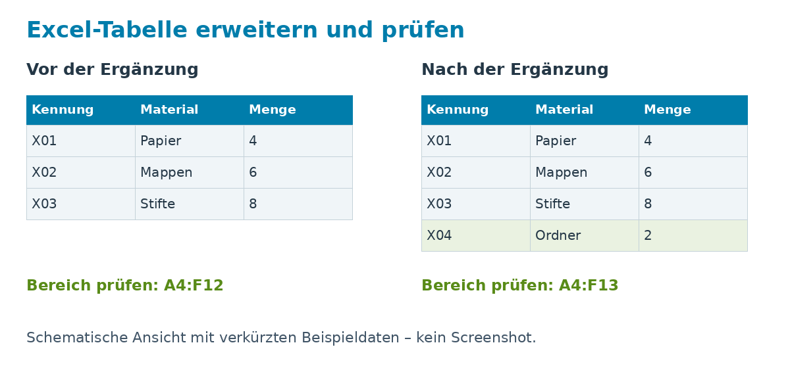

Die Abbildungen sind schematische Lernhilfen, keine Screenshots.

| Ziel | Klickweg in Excel für Windows (deutsch) |
| --- | --- |
| Arbeitskopie | Datei → Speichern unter bzw. Kopie speichern → XLSX |
| Blattname | Doppelklick auf Blattregister → Name → Enter |
| Datenbereich markieren | Namensfeld → A4:F12 → Enter |
| Schriftart und Größe | Start → Schriftart → Auswahlfelder |
| Fett, kursiv, unterstrichen | Start → Schriftart → entsprechendes Symbol |
| Schrift- und Füllfarbe | Start → Schriftart → Schriftfarbe bzw. Füllfarbe |
| Rahmen | Start → Schriftart → Pfeil neben Rahmenlinien |
| Ausrichtung | Start → Ausrichtung → links/rechts/zentriert |
| Zeilenumbruch | Start → Ausrichtung → Zeilenumbruch |
| Spaltenbreite | Grenze zwischen Spaltenbuchstaben ziehen oder doppelklicken |
| Zeilenhöhe | Grenze zwischen Zeilennummern ziehen oder doppelklicken |
| Titel verbinden (optional) | A1:F1 markieren, nur A1 gefüllt → Start → Verbinden und zentrieren |
| Funktionale Tabelle | A4:F12 → Start → Als Tabelle formatieren → Vorlage → Tabelle hat Überschriften → OK |
| Tabellenname | In Tabelle klicken → Tabellenentwurf → Tabellenname |
| Bereich prüfen | Tabellenentwurf → Tabellengröße ändern → Bereich prüfen bzw. A4:F13 einstellen |
| Speichern | Strg+S → schließen → Datei → Öffnen |

Versionsabhängige Abweichungen sind möglich. Strg+Z hilft bei versehentlichen Änderungen. Bei der Formatvorlage können manuelle Füllfarben die Streifen überdecken; bei Bedarf Füllung im Datenbereich entfernen.

### 6. Selbstkontrolle

- Originaldatei und Rohnotizen sind unverändert.
- Sechs eindeutige Überschriften und neun vollständige Datensätze.
- Jede Kennung kommt einmal vor; Mengen sind numerisch, Einheiten getrennt.
- Keine leeren Zwischenzeilen oder verbundenen Zellen innerhalb A4:F13.
- Titel und Kopfzeile sind klar unterscheidbar, Farben kontrastreich.
- Texte vollständig sichtbar, Mengen einheitlich ausgerichtet.
- Hinweise sind auch ohne Farbe verständlich.
- Excel-Tabelle besitzt sechs Filterpfeile und umfasst A4:F13.
- Arbeitskopie lässt sich erneut öffnen.

Funktionstest: In einer Testkopie einen weiteren simulierten Datensatz direkt unterhalb ergänzen, Tabellengrenze prüfen und Testkopie anschließend schließen. Die eigentliche Arbeitskopie bleibt bei neun Datensätzen.

### 7. Freiwillige Vertiefung

Erstellen Sie eine Blattkopie. Vergleichen Sie zwei gut lesbare Tabellenformatvorlagen. Begründen Sie Ihre Wahl anhand von Kontrast, Übersichtlichkeit und Erweiterbarkeit. Fixieren Sie optional die Kopfzeile über Ansicht → Fenster fixieren, nachdem A5 ausgewählt wurde. Keine zusätzliche Pflichtabgabe.

Freiwilliger Übungscheck · fünf Fragen

**In einer Zelle steht „12 Paket“. Wie sollte die Angabe für eine später auswertbare Liste erfasst werden?**

- Menge und Einheit in verbundenen Zellen
- 12 Paket als Text in Menge
- 12 Paket nur als Zellkommentar
- 12 als Text und Einheit weglassen
- Paket als Spaltenüberschrift für alle Materialien
- 12 als Zahl in Menge, Paket in Einheit

**Ein langer Hinweis wird abgeschnitten. Wie lässt sich der Text innerhalb einer begrenzten Spaltenbreite vollständig anzeigen?**

- Schriftfarbe ändern
- Zelle mit der nächsten Datenzeile verbinden
- Zeilenumbruch aktivieren und Zeilenhöhe prüfen
- Nur den Zoom verkleinern
- Menge als Text formatieren
- Hinweis kürzen und Originalinformation löschen

**Die Liste soll später gefiltert und erweitert werden. Welche Struktur ist geeignet?**

- Eine Leerzeile nach jedem Material
- Doppelte Überschriften für verschiedene Datenfelder
- Mehrere Materialien in einer Zelle
- Verbundene Zellen in der Datenspalte
- Zwischensummen zwischen den Datensätzen
- Eine Zeile pro Datensatz, eindeutige Überschriften, keine Leerzeilen

**Eine Liste hat blaue Überschriften und Rahmen, aber keine Tabellenfunktionen. Wie wird daraus eine definierte Excel-Tabelle?**

- Alle Zellen verbinden
- Nur die Spaltenbreite ändern
- Die Datei als PDF speichern
- Nur die Schrift fett setzen
- Datenbereich markieren und Als Tabelle formatieren mit Überschriften wählen
- Gitternetzlinien ausblenden

**BM09 wurde unterhalb der Tabelle ergänzt. Wie stellen Sie sicher, dass der neue Datensatz bei späteren Filtern berücksichtigt wird?**

- Die Kennung löschen
- Nur die neue Zeile blau färben
- Die Arbeitsmappe umbenennen
- Tabellenbereich prüfen und bei Bedarf bis zur neuen Zeile erweitern
- Eine Leerzeile vor BM09 einfügen
- Den Zoom erhöhen

[Bearbeitbare Textfassung](material/ue2.md)

## Ü3 · Ü3 – Betriebliche Daten richtig formatieren

[Digitale Fassung öffnen](material/ue3.html)

Global Bike Deutschland GmbH · Verwaltung · Löppt · freiwillig · keine KI

### Ausgangssituation

Emma Fuchs organisiert interne Informationsveranstaltungen zur Marktbearbeitung Nordwest. Die Liste enthält uneinheitliche Darstellungen und einige fehlerhafte Eingaben. Sie soll für die spätere Weiterverarbeitung zuverlässig nutzbar sein. Alle Angaben sind simulierte Übungsdaten, unabhängig von M1 und SAP.

### Lernziele

F3: Zahlen, Text, Währung, Prozent, Datum und Uhrzeit fachgerecht formatieren; [Zellwert](#zellwert) und Darstellung unterscheiden; Eingabefehler korrigieren. F2: lesbare Tabellenstruktur erhalten. M3 und M4.

### Verbindliche betriebliche Kontrollnotiz

| Kennung | Veranstaltung | Datum | Beginn | Teilnehmende | Kosten netto | Anteil digital | Gewicht kg |
| --- | --- | --- | --- | --- | --- | --- | --- |
| 0041 | Vertriebsinformation | 06.04.2027 | 09:30 | 24 | 1.250,50 € | 75 % | 3,456 |
| 0042 | Kundenservice-Austausch | 08.04.2027 | 10:15 | 18 | 875,25 € | 80 % | 2,125 |
| 0043 | Sortimentsbesprechung | 12.04.2027 | 13:00 | 32 | 1.480,00 € | 62,5 % | 4,789 |
| 0044 | Marketing-Abstimmung | 15.04.2027 | 08:45 | 16 | 0,00 € | 50 % | 1,256 |

Die Kontrollnotiz enthält die fachlich richtigen Angaben. Gewichte sind mit drei Nachkommastellen erfasst; die fertige Übersicht soll zwei anzeigen, ohne die Werte zu verändern.

### Praktische Arbeitsaufträge

1. Öffnen Sie UE3_Arbeitsdatei.xlsx und speichern Sie eine Kopie als GB_UE3_Veranstaltungen.xlsx. Original nicht überschreiben. Prüfen Sie die Blätter Veranstaltungen und Formatlabor.
2. Vergleichen Sie A4:H7 mit der Kontrollnotiz. Untersuchen Sie die Bearbeitungsleiste und das aktuelle Format. Notieren Sie für sich, welche Fehler nur die Anzeige und welche den Wert oder Datentyp betreffen.
3. Formatieren Sie A4:A7 als Text. Erfassen Sie die verlorene Kennung in A4 erneut anhand der Kontrollnotiz. Prüfen Sie alle führenden Nullen. Ändern Sie keine bereits richtigen Kennungen.
4. Stellen Sie C4:C7 als Datum mit vierstelliger Jahreszahl und D4:D7 als Uhrzeit (Stunden:Minuten) dar. C5 ist Text: erfassen Sie das Datum erneut in einer Zelle mit Standardformat, kontrollieren Sie die Erkennung und wählen Sie das Datumsformat. Die übrigen Datums- und Zeitwerte sind bereits numerisch gespeichert.
5. Formatieren Sie E4:E7 als Zahl ohne Nachkommastellen. F4:F7 sollen Eurobeträge mit zwei Nachkommastellen und Tausendertrennzeichen anzeigen. F5 enthält Text: erfassen Sie den Betrag ohne Währungssymbol als Zahl neu und formatieren Sie ihn anschließend. Netto bleibt durch die Überschrift eindeutig.
6. Formatieren Sie G4:G7 als Prozent mit einer Nachkommastelle. Vergleichen Sie G5 mit der Kontrollnotiz und korrigieren Sie den zugrunde liegenden Wert. Prozentformat allein berechnet keinen Anteil.
7. Stellen Sie H4:H7 mit zwei Nachkommastellen dar. Prüfen Sie in der Bearbeitungsleiste, dass die ursprünglichen drei Nachkommastellen erhalten sind. Erhöhen Sie testweise die Anzeige auf drei Stellen und stellen Sie danach zwei wieder her.
8. Bearbeiten Sie das Formatlabor gemäß der folgenden Versuchsanleitung. Schreiben Sie Ihre Beobachtungen in Spalte D.
9. Prüfen Sie Spaltenbreiten und Lesbarkeit. Bei Rauten zunächst Breite prüfen; bei Datum/Zeit gegebenenfalls auch negative Werte. Speichern, schließen und öffnen Sie die Arbeitskopie erneut. Führen Sie die Selbstkontrolle durch und vergleichen Sie danach mit der separaten Lösung. Keine Abgabe.

### Formatlabor

| Zeile | Auftrag |
| --- | --- |
| 3 | B3 Standard, C3 Prozent ohne Nachkommastellen. Vergleichen Sie Anzeige und Bearbeitungsleiste. |
| 4 | B4 Zahl mit zwei, C4 mit drei Nachkommastellen. Vergleichen Sie gespeicherte Werte. |
| 5 | B5 Währung Euro, C5 Buchhaltung Euro, jeweils zwei Nachkommastellen. Vergleichen Sie Symbolposition und Ausrichtung. |
| 6 | Wiederholen Sie den Vergleich mit Nullbeträgen. |
| 7 | B7 und C7 Prozent ohne Nachkommastellen. Erklären Sie die unterschiedliche Anzeige. |
| 8 | B8 Standard, C8 Text. Erklären Sie den Unterschied zwischen Zahl und Kennung. |
| 9 | B9 Standard, C9 Datum. Erklären Sie, warum die Anzeigen verschieden sind, obwohl der Tag identisch ist. |

### Visuelle Lernhilfen

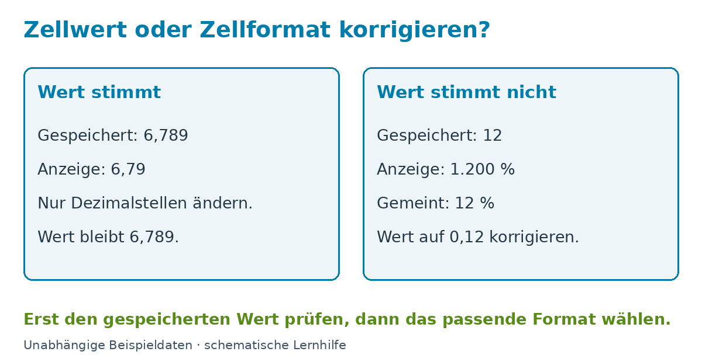

Alle Grafiken sind schematisch, keine Original-Screenshots.

### Klick-Anleitungen (Excel Windows, deutsch)

| Ziel | Vorgehen |
| --- | --- |
| Arbeitskopie | Datei → Speichern unter/Kopie speichern → XLSX |
| Zellwert prüfen | Zelle auswählen → Bearbeitungsleiste betrachten; bei Datum/Zeit kann Excel eine lesbare Darstellung zeigen |
| Formatdialog | Bereich markieren → Strg+1 → Zahlen |
| Textkennung | Kategorie Text → OK → fehlende Kennung erneut eingeben; alternativ Apostroph voranstellen |
| Zahl | Kategorie Zahl → Dezimalstellen 0 oder 2 → ggf. Tausendertrennzeichen aktivieren |
| Währung | Kategorie Währung → Symbol € → zwei Dezimalstellen |
| Buchhaltung | Kategorie Buchhaltung → Symbol € → zwei Dezimalstellen |
| Prozent | Standardzelle: 0,08 oder 8 % eingeben → Prozentformat → Dezimalstellen einstellen |
| Datum | Standardzelle: Datum eingeben → Strg+1 → Datum bzw. benutzerdefiniert TT.MM.JJJJ |
| Uhrzeit | Standardzelle: 09:30 eingeben → Strg+1 → Uhrzeit bzw. hh:mm (deutsche Oberfläche: ggf. hh:mm) |
| Text in Zahl korrigieren | Standardformat wählen → korrekten numerischen Wert neu eingeben; ggf. Warnsymbol → In eine Zahl umwandeln, nur bei Rechengrößen |
| Dezimalstellen ändern | Start → Zahl → Dezimalstellen hinzufügen/entfernen |
| Spaltenbreite | Doppelklick auf Grenze zwischen Spaltenbuchstaben |
| Formate zurücksetzen | Start → Löschen → Formate löschen (entfernt auch andere Zellgestaltung); alternativ Standardformat |
| Werte ohne Quellformat kopieren | Kopieren → Start → Einfügen → Inhalte einfügen → Werte |
| Speichern | Strg+S → schließen → Datei → Öffnen |

Regionale Einstellungen und Excel-Versionen können abweichen. In deutscher Standardkonfiguration Dezimalkomma verwenden. Währungssymbol ändert keine Währung rechnerisch.

### Selbstkontrolle

- Vier Kennungen vollständig mit führenden Nullen als Text.
- Vier echte Datumswerte und vier echte Uhrzeitwerte.
- Teilnehmerzahlen ohne Nachkommastellen.
- Alle Kosten numerisch, Euro mit zwei Nachkommastellen.
- Prozentwerte entsprechen der Kontrollnotiz; G5 ist korrigiert.
- Gewichte zeigen zwei Stellen, ursprüngliche Genauigkeit bleibt erhalten.
- Alle sieben Laborversuche bearbeitet und erklärt.
- Keine abgeschnittenen Angaben oder Rauten.
- Original unverändert, Arbeitskopie erneut geöffnet.

Funktionstest: In einer Testkopie G5 auf Standard stellen: der Wert muss 0,8 sein. H4 auf drei Dezimalstellen stellen: 3,456 muss erscheinen. Testkopie schließen; fertige [Arbeitsmappe](#arbeitsmappe) unverändert lassen.

### Freiwillige Vertiefung

Vergleichen Sie in einer Testkopie die Anzeige eines Datums im Standardformat, kurzen Datum und langen Datum. Vergleichen Sie außerdem eine numerische Kennung mit benutzerdefiniertem Format 0000 und eine echte Textkennung. Beide können gleich aussehen, sind aber unterschiedliche Datentypen. Keine zusätzliche Abgabe.

[Excel-Arbeitsdatei herunterladen](material/UE3_Arbeitsdatei.xlsx)

Freiwilliger Übungscheck · fünf Fragen

**Ein Gewicht von 3,456 kg wird mit zwei Dezimalstellen als 3,46 angezeigt. Welcher Wert bleibt gespeichert?**

- 3,46
- 3,456
- 3,45
- 3,456 %
- Der Wert wird als Text gespeichert
- 346

**Ein Anteil von 80 % wurde als Zahl 80 eingegeben. Nach Prozentformatierung erscheint 8.000 %. Was ist zu tun?**

- Das Währungsformat wählen
- Den Wert auf 0,8 korrigieren und Prozentformat beibehalten
- Nur eine Dezimalstelle einstellen
- Den Wert auf 8 ändern
- Die Zahl als Text 80 speichern
- Die Spalte verbreitern

**Die Kennung 0041 erscheint als 41. Wie wird sie als echte Textkennung wiederhergestellt?**

- Zwei Dezimalstellen einstellen
- Die Zahl mit 100 multiplizieren
- Die Spalte verbreitern
- Währungsformat verwenden
- Nur das vorhandene Zahlenformat auf Text ändern
- Textformat vor der erneuten Eingabe von 0041 wählen

**Ein importierter Betrag steht als Text „875,25 €“ in einer Zelle. Er soll später berechnet werden. Welches Vorgehen ist zuverlässig?**

- Den Betrag numerisch neu eingeben und anschließend als Euro formatieren
- Ein Apostroph vor den Betrag setzen
- Den Text fett darstellen
- Das Prozentformat anwenden
- Die Zelle mit der Überschrift verbinden
- Nur Währungsformat auswählen

**Ein echtes Datum erscheint nach Wechsel zum Standardformat als fortlaufende Zahl. Was erklärt dies?**

- Excel speichert Datumswerte als fortlaufende Zahlen; das Datumsformat ändert die Anzeige
- Die Spaltenbreite hat den gespeicherten Wert geändert
- Excel hat den Tag mit 100 multipliziert
- Das Datum wurde automatisch in Text umgewandelt
- Die Zahl ist immer ein Fehlercode
- Das Datum wurde gelöscht

[Bearbeitbare Textfassung](material/ue3.md)

## Ü4 · Ü4 – Bürokosten automatisch berechnen

[Digitale Fassung öffnen](material/ue4.html)

Global Bike Deutschland GmbH · Verwaltung · Löppt · freiwillig · keine KI

### Ausgangssituation

Emma Fuchs benötigt für eine interne Informationsveranstaltung zur Marktbearbeitung Nordwest eine wiederverwendbare Kostenkalkulation. Mengen und Preise können sich ändern. Alle Angaben sind simulierte Übungsdaten, unabhängig von M1 und SAP.

### Lernziele

F4: Formeln und Grundrechenarten mit Zellbezügen anwenden, Rechenregeln beachten, Ergebnisse und Neuberechnung prüfen. F2/F3: Struktur und Zahlenformate erhalten. M4/M5.

### Ausgangsdaten

| Position | Menge | Einzelpreis netto |
| --- | --- | --- |
| Infomappen | 20 | 3,75 € |
| Namensschilder | 20 | 1,20 € |
| Notizblöcke | 15 | 2,40 € |
| Versandtaschen | 10 | 1,50 € |

Genehmigter Betrag: 200 € netto; Teilnehmende: 20. Keine Umsatzsteuerberechnung. Alle Einzelpreise sind centgenau.

### Arbeitsaufträge

1. Öffnen Sie UE4_Arbeitsdatei.xlsx und speichern Sie eine Kopie als GB_UE4_Buerokosten.xlsx. Prüfen Sie die drei Tabellenblätter. Eingaben und Ergebnisse sind getrennt; grüne Ergebnisfelder im Blatt Kosten sind zu bearbeiten.
2. Berechnen Sie in D4 den Gesamtpreis der Infomappen mit einer [Formel](#formel) aus Menge und Einzelpreis. Beginnen Sie mit dem Gleichheitszeichen, wählen Sie die passenden Zellbezüge und den Multiplikationsoperator. Kontrollieren Sie das Ergebnis durch Überschlagsrechnung.
3. Übertragen Sie die Formel mit dem Ausfüllkästchen bis D7. Prüfen Sie die Formel in D7 auf die richtigen Zeilenbezüge. Keine fest eingetragenen Ergebnisse.
4. Addieren Sie in D8 die vier Gesamtpreise mit dem Plusoperator. Ermitteln Sie in D10 den verbleibenden Betrag aus genehmigtem Betrag und Gesamtkosten. Berechnen Sie in D12 die Kosten je Person. Verwenden Sie ausschließlich Zellbezüge. [SUMME](#summe) wird erst in Ü5 vertieft.
5. Prüfen Sie die Formate: Mengen und Teilnehmende als ganze Zahlen, Preise und Ergebnisse als Euro mit zwei Nachkommastellen. Verändern Sie die gespeicherten Werte nicht durch bloße Anzeigerundung. Kosten je Person sind eine rechnerische Kennzahl, keine tatsächliche Einzelabrechnung.
6. Bearbeiten Sie Rechenlabor E3:E6. Verwenden Sie die Werte in B:D und die im Auftrag beschriebene Reihenfolge. Notieren Sie zunächst Ihre erwarteten Ergebnisse auf einem Notizzettel, vergleichen Sie dann mit Excel. Erklären Sie, warum Klammern die Ergebnisse verändern.
7. Bearbeiten Sie Fehlerlabor D3:D7. Prüfen Sie jede Ergebniszelle in der Bearbeitungsleiste. Dokumentieren Sie Ursache und Abhilfe in E3:E7. Kontrollnotiz: In Zeile 6 ist der richtige Teiler 6; in Zeile 7 beträgt der Preis 3 € netto. Alle übrigen Eingaben sind richtig. Korrigieren Sie nur die Fehlerursache. Keine Fehlermeldung durch einen Festwert verdecken.
8. Führen Sie im Blatt Kosten einen Funktionstest durch: Ändern Sie B4 von 20 auf 24. Berechnen Sie vorher die erwarteten Änderungen in D4, D8, D10 und D12. Vergleichen Sie mit Excel und stellen Sie B4 auf 20 zurück. Ändern Sie danach C7 von 1,50 auf 2,00 und prüfen Sie erneut; stellen Sie C7 zurück. Wenn Ergebnisse unverändert bleiben, prüfen Sie Formel, Bezug und Berechnungsoptionen.
9. Speichern, schließen und öffnen Sie die Arbeitskopie erneut. Führen Sie die Selbstkontrolle durch und vergleichen Sie anschließend mit der separaten Musterlösung. Keine Abgabe erforderlich.

### Lernhilfen

Schematische Lernhilfen, keine Screenshots.

### Klick-Anleitungen (Excel Windows, deutsch)

| Ziel | Klickweg |
| --- | --- |
| Arbeitskopie | Datei → Speichern unter/Kopie speichern → XLSX |
| Formel erstellen | Ergebniszelle anklicken → = eingeben → erste Bezugszelle anklicken → Operator → zweite Bezugszelle → Enter |
| Formel prüfen | Ergebniszelle anklicken → Bearbeitungsleiste |
| Formel korrigieren | F2 oder Bearbeitungsleiste → ändern → Enter; Esc bricht unbestätigte Änderung ab |
| Formel kopieren | Geprüfte Zelle markieren → Ausfüllkästchen unten rechts nach unten ziehen |
| Kopierte Bezüge prüfen | Letzte Ergebniszelle anklicken → Bearbeitungsleiste |
| Klammern setzen | F2 → paarweise Klammern ergänzen → Enter |
| Währung | Bereich markieren → Strg+1 → Währung → Euro → zwei Dezimalstellen |
| Ganzzahl | Strg+1 → Zahl → null Dezimalstellen |
| Textformel korrigieren | Standardformat wählen → ggf. Apostroph entfernen → F2 → Enter; nötigenfalls Formel neu eingeben |
| Textbetrag korrigieren | Standardformat wählen → numerischen Betrag neu eingeben |
| Automatische Berechnung | Formeln → Berechnungsoptionen → Automatisch |
| Neuberechnung anstoßen | F9 |
| Formeln anzeigen | Formeln → Formeln anzeigen; anschließend wieder ausschalten |
| Eingabe zurücksetzen | Ursprünglichen Wert erneut eingeben; ggf. Strg+Z unmittelbar nach Änderung |
| Speichern | Strg+S |

Versionsabhängige Abweichungen möglich. Multiplikation * und Division /; Doppelpunkt bezeichnet einen Bereich, kein Divisionszeichen.

### Fehlerdiagnose

Bei #DIV/0! Nenner prüfen; bei #WERT! Datentypen prüfen; bei #BEZUG! ungültige Referenz wiederherstellen; bei #NAME? Schreibweise prüfen. Bei Zirkelbezug darf die Formel nicht von ihrer eigenen Ergebniszelle abhängen. Bei Rauten Spaltenbreite und ggf. Datumswerte prüfen. Fehlende Klammern oder falsche Operatoren können bereits bei Eingabe abgewiesen werden.

### Selbstkontrolle

- Original unverändert; Arbeitskopie gespeichert.
- D4:D7 enthalten Formeln mit passenden Zeilenbezügen.
- D8, D10 und D12 enthalten Formeln, keine Festwerte.
- Alle vier Grundrechenarten korrekt eingesetzt.
- Rechenlabor vollständig und Klammerwirkung erklärt.
- Fehlerlabor vollständig korrigiert und Ursachen dokumentiert.
- Geldbeträge mit zwei Dezimalstellen, Mengen ganzzahlig.
- Beide Funktionstests erfolgreich; Ausgangswerte wiederhergestellt.
- Keine Fehleranzeigen; Datei erneut geöffnet.

### Freiwillige Vertiefung

In einer Testkopie den genehmigten Betrag auf 100 € setzen und den negativen Restbetrag erklären. Anschließend den ursprünglichen Betrag wiederherstellen. Optional in einer freien Zelle 10/3 als Formel berechnen, zwei Dezimalstellen anzeigen und mit =RUNDEN(10/3;2) vergleichen. Keine zusätzliche Pflichtabgabe.

[Excel-Arbeitsdatei herunterladen](material/UE4_Arbeitsdatei.xlsx)

Freiwilliger Übungscheck · fünf Fragen

**Menge steht in B4, Einzelpreis in C4. Welche Formel bleibt bei Änderungen beider Eingaben nutzbar?**

- =B4-C4
- =B4+C4
- =20*3,75
- 75
- =B4*C4
- =B4/C4

**Welche Formel ergibt mit den Zahlen 12, 3 und 4 den Wert 60?**

- =12+3+4
- =12+(3*4)
- =12+3*4
- =12*(3+4)
- =(12+3)*4
- =12*3+4

**Die Formel =B4*C4 wird eine Zeile nach unten kopiert. Welche Formel entsteht bei normalen relativen Bezügen?**

- =B3*C3
- =B5*C4
- =B5*C5
- =C4*D4
- =B4*C5
- =B4*C4

**Eine Kostenformel zeigt #DIV/0!. Welche Prüfung ist zuerst sinnvoll?**

- Währungsformat ändern
- Multiplikationszeichen ergänzen, ohne den Rechenweg zu prüfen
- Die Ergebniszelle mit 0 überschreiben
- Die Formel als Text formatieren
- Spalte verbreitern
- Den Nenner auf null oder fehlende Eingabe prüfen

**Nach einer Mengenänderung bleibt der Gesamtpreis unverändert. Welche Vorgehensweise ist geeignet?**

- Zwei Nachkommastellen entfernen
- Den alten Gesamtpreis erneut als Zahl eingeben
- Die Ergebniszelle mit der Mengenangabe verbinden
- Die Menge als Text formatieren
- Nur die Schriftfarbe ändern
- Formel, Zellbezüge und automatische Berechnung prüfen

[Bearbeitbare Textfassung](material/ue4.md)

## Ü5 · Ü5 – Betriebliche Kosten mit Excel-Funktionen auswerten

[Digitale Fassung öffnen](material/ue5.html)

Global Bike Deutschland GmbH · Verwaltung · Löppt · freiwillig · unbenotet · keine KI · keine Pflichtabgabe

### Ausgangssituation

Emma Fuchs benötigt für eine interne Besprechung zur Marktbearbeitung Nordwest eine Auswertung der Nettokosten von sechs Informationsveranstaltungen. Die Übersicht soll Änderungen berücksichtigen und eine sachgerechte Einschätzung ermöglichen. Eigenständige simulierte Übungsdaten, keine SAP-Änderung, unabhängig von M1.

### Kompetenzen

F5: [SUMME](#summe), MIN, MAX und MITTELWERT auswählen, korrekt anwenden und interpretieren; F4 mitgeübt (Formeln und Zellbezüge). Zahlenformate aus M4 wiederholen. Zuordnung gemäß bestätigter Übungsübersicht, kein wörtliches Kompetenzzitat.

### Ausgangsdaten

| Termin | Material netto | Organisation netto |
| --- | --- | --- |
| 1 | 80 € | 40 € |
| 2 | 110 € | 70 € |
| 3 | 60 € | 30 € |
| 4 | 95 € | 55 € |
| 5 | 140 € | 100 € |
| 6 | 100 € | 80 € |

### Arbeitsaufträge

1. Öffnen Sie UE5_Arbeitsdatei.xlsx und speichern Sie eine Arbeitskopie GB_UE5_Kostenauswertung.xlsx. Erkunden Sie die drei Blätter Kosten, Funktionslabor und Fehlerlabor. Grüne Felder sind Ergebnis- bzw. Bearbeitungsfelder.
2. Berechnen Sie in Kosten D4 die Gesamtkosten des ersten Termins durch Addition der beiden Kostenarten mit Zellbezügen. Übertragen Sie die [Formel](#formel) bis D9. Prüfen Sie die letzte Formel. Kontrollieren Sie die Währungsdarstellung mit zwei Dezimalstellen.
3. Wählen Sie für jede Fragestellung in A13:A16 die passende Funktion. Ermitteln Sie in B13 die Gesamtkosten mit AutoSumme. Achtung: Die Ergebniszelle liegt nicht unmittelbar unter der Datenliste. Ersetzen Sie den vorgeschlagenen Bereich durch D4:D9. Prüfen Sie die Bearbeitungsleiste. Alternativ geben Sie die Funktion direkt ein.
4. Berechnen Sie in B14 und B15 den niedrigsten und höchsten Gesamtbetrag. Verwenden Sie mindestens einmal den Funktionsassistenten fx. Ermitteln Sie in B16 den Durchschnitt pro Termin durch direkte Funktionseingabe. Alle vier Funktionen beziehen sich auf dieselben sechs Gesamtbeträge. Keine Ergebniszelle oder Überschrift einbeziehen.
5. Prüfen Sie die Summe durch Addition und den Durchschnitt durch Division durch sechs. Suchen Sie in der Liste die zu [MIN](#min) und MAX gehörenden Termine. Formulieren Sie eine kurze Notiz: Wie hoch ist der Unterschied? Warum reicht der höchste Betrag allein nicht für ein Urteil über Wirtschaftlichkeit? Welche weiteren Angaben wären erforderlich?
6. Bearbeiten Sie im Funktionslabor E4:E7 mit den vier Funktionen für B4:B8. B5 ist eine noch fehlende Angabe, B6 ist eine bestätigte Null, B8 enthält Text. Ermitteln Sie vorab die Anzahl der numerischen Werte. Vergleichen Sie Ihre Erwartung mit Excel. Testen Sie nacheinander: B5 vorübergehend 0; danach B5 wieder leeren; B8 vorübergehend numerisch 60 (nur als Simulation einer bestätigten Korrektur); danach ursprünglichen Text wiederherstellen. Notieren Sie die vier Ergebnisse jedes Tests. Fehlende Angaben nicht eigenmächtig als Null erfassen.
7. Prüfen Sie im Fehlerlabor B11:B14 die vorhandenen Formeln. Korrigieren Sie jede Formel anhand des Auftrags in Spalte A. Dokumentieren Sie Ursache in C und Korrektur in D. Die Kontrollsumme in B8 ist keine zusätzliche Ausgabe. Prüfen Sie auch Ergebnisse, die keinen Fehlercode anzeigen.
8. Funktionstest im Blatt Kosten: Ändern Sie C8 von 100 auf 160. Sagen Sie die Änderung aller vier Kennzahlen voraus, vergleichen Sie mit Excel und stellen Sie 100 wieder her. Prüfen Sie anschließend in einer Testkopie eine zusätzliche Veranstaltung in Zeile 10 (Material 70 €, Organisation 50 €). Berechnen Sie D10, erweitern Sie alle vier Auswertungsbereiche und prüfen Sie die Ergebnisse. Verwerfen Sie die Testkopie oder stellen Sie alle Ausgangswerte und Bereiche wieder her.
9. Speichern Sie Ihre Arbeitskopie, schließen und öffnen Sie sie erneut. Nutzen Sie die Selbstkontrolle und erst danach die separate Musterlösung. Keine Abgabe.

### Lernhilfen

Schematische Lernhilfen, keine Excel-Screenshots.

### Klick-Anleitungen (Excel Windows, deutsch)

| Ziel | Vorgehen |
| --- | --- |
| Arbeitskopie | Datei → Speichern unter/Kopie speichern → XLSX |
| Addition | D4 auswählen → =B4+C4 → Enter |
| Formel übertragen | Ausfüllkästchen bis D9 ziehen → letzte Formel prüfen |
| SUMME direkt | Ergebniszelle → =SUMME( → Bereich markieren → ) → Enter |
| AutoSumme | Ergebniszelle → Start → Bearbeiten → Σ AutoSumme → vorgeschlagenen Bereich durch gewünschten ersetzen → Enter |
| MIN | Ergebniszelle → =MIN( → Bereich markieren → ) → Enter |
| [MAX](#max) | Ergebniszelle → =MAX( → Bereich markieren → ) → Enter |
| [MITTELWERT](#mittelwert) | Ergebniszelle → =MITTELWERT( → Bereich markieren → ) → Enter |
| Funktionsassistent | Ergebniszelle → fx → Funktion suchen → Argumentbereich markieren → Vorschau → OK |
| Weitere AutoSumme-Funktionen | Pfeil neben Σ → Mittelwert, Min oder Max → Bereich prüfen → Enter |
| Bereich korrigieren | Ergebniszelle → F2 → Bereichsadresse ändern → Enter |
| Mehrere Argumente | In deutscher Standardkonfiguration Semikolon zwischen getrennten Argumenten, Doppelpunkt innerhalb eines zusammenhängenden Bereichs |
| Währung | Strg+1 → Währung → Euro → zwei Nachkommastellen |
| Textzahl korrigieren | Eingabe fachlich prüfen → Standardformat → Zahl neu eingeben |
| Zelle leeren | Zelle markieren → Entf (Inhalt löschen, nicht Zeile löschen) |
| Neuberechnung | Formeln → Berechnungsoptionen → Automatisch; F9 stößt Berechnung an |
| Speichern | Strg+S |

Menübezeichnungen können je nach Version abweichen.

### Fachliche Hinweise

Eine Funktion ist eine vorgefertigte Rechenvorschrift innerhalb einer Formel. Beispiel =SUMME(C2:C5): Gleichheitszeichen, Name, öffnende Klammer, Argument (vier Zellen einschließlich beider Grenzen), schließende Klammer. Ein getrenntes Argument wird in der üblichen deutschen Konfiguration mit Semikolon angeschlossen. MIN/MAX geben Beträge, keine Namen zurück. Bei Gleichständen alle zugehörigen Positionen nennen. Bei referenzierten Bereichen ignorieren die vier Funktionen leere Zellen und Text; numerische Null zählt. Fehlerwerte können die Auswertung abbrechen. Ohne numerische Werte liefern SUMME/MIN/MAX null, MITTELWERT #DIV/0!. Die vier Funktionen berücksichtigen auch ausgefilterte Zeilen. Feste Bereiche schließen neue Zeilen nicht zwangsläufig ein.

### Selbstkontrolle

- Arbeitskopie gespeichert, Original unverändert.
- Sechs Gesamtbeträge sind Formeln mit passenden Bezügen.
- Alle vier Funktionen verwenden D4:D9.
- AutoSumme-Bereich kontrolliert.
- Funktionsassistent mindestens einmal verwendet.
- Durchschnitt als Kosten je Termin erklärt.
- MIN/MAX zu den richtigen Terminen zugeordnet.
- Funktionslabor: Null, leer und Text unterschieden.
- Vier Fehlerfälle korrigiert und dokumentiert.
- Beide Funktionstests erfolgreich, Ausgangszustand wiederhergestellt.
- Währungsformate und erneutes Öffnen geprüft.

### Freiwillige Vertiefung

Ermitteln Sie in einer freien Zelle die Summe der beiden Kostenarten über zwei getrennte Bereiche mit =SUMME(B4:B9;C4:C9). Vergleichen Sie mit B13. Erklären Sie, weshalb eine zusätzliche Summierung von D4:D9 die Kosten doppelt zählen würde.

[Excel-Arbeitsdatei herunterladen](material/UE5_Arbeitsdatei.xlsx)

Freiwilliger Übungscheck · fünf Fragen

**Die sechs Gesamtbeträge stehen in D4:D9. Welche Formel berechnet die Gesamtkosten?**

- =MITTELWERT(D4:D9)
- =SUMME(D4;D9)
- =SUMME(D4:D9)
- =SUMME(B4:D9)
- =MAX(D4:D9)
- =MIN(D4:D9)

**Welche Funktion liefert den höchsten Gesamtbetrag der sechs Termine?**

- SUMME
- MIN
- Division der Summe durch sechs
- MITTELWERT
- MAX
- Addition der ersten und letzten Zelle

**Ein Bereich enthält 40, eine leere Zelle, 0 und 80. Was ergibt MITTELWERT?**

- 60
- 30
- 40
- 0
- 80
- 120

**AutoSumme schlägt D4:D8 vor, die Daten reichen bis D9. Was ist zu tun?**

- D9 löschen
- Ergebniszelle zusätzlich einbeziehen
- Vorschlag unverändert übernehmen
- Ergebnis als Festwert eingeben
- Bereich auf D4:D9 korrigieren und bestätigen
- D9 als Text formatieren

**MIN ergibt 90 €, MAX 240 €. Welche Aussage ist fachlich begründet?**

- Der teuerste Termin ist unwirtschaftlich.
- MAX liefert automatisch den Namen des Termins.
- Der günstigste Termin war am erfolgreichsten.
- Die Gesamtkosten betragen 330 €.
- Der Durchschnitt beträgt zwingend 165 €.
- Die Differenz beträgt 150 €; für ein Wirtschaftlichkeitsurteil fehlen weitere Angaben.

[Bearbeitbare Textfassung](material/ue5.md)

## Ü6 · Ü6 – Relative und absolute Zellbezüge

[Digitale Fassung öffnen](material/ue6.html)

Global Bike Deutschland GmbH · Verwaltung · Löppt · freiwillig · unbenotet · keine KI

### Ausgangssituation

Emma Fuchs plant 2027 Informationsmaßnahmen für die Region Nordwest. Auf vier unterschiedliche Nettokostenpositionen soll ein einheitlicher interner Planungszuschlag von 10 % gerechnet werden. Der Zuschlag ist eine simulierte Planungsreserve, keine Steuer und keine SAP-Kondition. Die Verwaltung benötigt eine Kalkulation, die bei einer zentralen Satzänderung alle Positionen aktualisiert. Zusätzlich sollen die Anteile an den gesamten Plankosten sichtbar werden. Die Daten sind unabhängig von M1.

### Arbeitsaufträge

1. Öffnen Sie UE6_Arbeitsdatei.xlsx und speichern Sie eine Kopie als GB_UE6_Kalkulation.xlsx. Erkunden Sie Kalkulation, Bezugslabor und die freiwillige Vertiefung. Identifizieren Sie B2 als zentrale Eingabe und B4:B7 als zeilenbezogene Grundkosten.
2. Berechnen Sie in C4 den Zuschlag aus Grundkosten und Satz. Geben Sie zunächst beide Bezüge relativ ein. Kopieren Sie die [Formel](#formel) probeweise nach C5. Vergleichen Sie die Bearbeitungsleiste beider Zellen. Erklären Sie, warum die zweite Formel nicht mehr auf den Satz zeigt. Löschen Sie die Probeformel in C5.
3. Bearbeiten Sie C4 mit F2. Markieren Sie ausschließlich den Bezug auf B2 und drücken Sie F4, bis beide Dollarzeichen erscheinen. Alternativ tippen Sie die Dollarzeichen. Bestätigen Sie und ziehen Sie das Ausfüllkästchen bis C7. Prüfen Sie erste und letzte Formel. Der Grundkostenbezug muss wandern, der Satzbezug muss fest bleiben.
4. Berechnen Sie D4 aus Grundkosten und Zuschlag mit relativen Bezügen. Kopieren Sie bis D7. Berechnen Sie in B8:D8 die jeweiligen Spaltensummen mit [SUMME](#summe). Kontrollieren Sie die Bereiche; die Summenzeile darf nicht in sich selbst eingehen.
5. Berechnen Sie in E4 den Anteil der Plankosten der ersten Position an der Gesamtsumme D8. Fixieren Sie ausschließlich den Nenner vollständig. Kopieren Sie bis E7 und addieren Sie die Anteile in E8. Wählen Sie zwei Prozent-Nachkommastellen. Multiplizieren Sie nicht zusätzlich mit 100. Erklären Sie, weshalb die Summe der Anteile bei vollständiger Datengrundlage 100 % beträgt.
6. Bearbeiten Sie das Bezugslabor: Untersuchen Sie C4:C7 und notieren Sie in D4:D7 jeweils Ursache und Korrektur. Alle vier Beträge sollen mit dem zentralen Satz B2 des Laborblatts berechnet werden. C4 simuliert einen verrutschten Bezug auf eine leere Zelle; C5 fixiert den falschen Grundbetrag; C6 enthält einen Festwert; C7 verweist auf eine falsche Zelle. Korrigieren Sie die Formeln, nicht die richtigen Eingaben. Ändern Sie anschließend den Laborsatz auf 25 %, prüfen Sie alle Ergebnisse und stellen Sie 20 % wieder her.
7. Testen Sie die Kalkulation: Ändern Sie B2 von 10 % auf 15 %. Sagen Sie voraus, welche Ergebnisse sich ändern und welche Anteile gleich bleiben. Prüfen Sie Excel und stellen Sie 10 % wieder her. Ändern Sie danach B4 von 120 auf 160 Euro. Prüfen Sie Zuschlag, Plankosten, Gesamtsumme und alle Anteile. Stellen Sie 120 Euro wieder her.
8. Erklären Sie in zwei bis drei Sätzen den Unterschied zwischen einer festen Adresse und einem unveränderlichen Wert. Erläutern Sie, warum eine zentrale Eingabe besser als ein in jeder Formel eingetragener Satz ist. Prüfen Sie die automatische Berechnung, speichern und öffnen Sie die Datei erneut.
9. Nutzen Sie die Selbstkontrolle und erst danach die separate Musterlösung. Keine Abgabe erforderlich.

### Lernhilfen

### Klick-Anleitungen – Excel Desktop Windows, deutsch

| Ziel | Vorgehen |
| --- | --- |
| Arbeitskopie | Datei → Speichern unter → XLSX |
| Formel eingeben | C4 anklicken → = → B4 anklicken → * → B2 anklicken → Enter |
| Formel prüfen | Zelle anklicken → Bearbeitungsleiste |
| Bezug fixieren | F2 → Bezug B2 auswählen → F4 bis *B*2 → Enter |
| F4-Zyklus | B2 → *B*2 → B$2 → $B2 → B2 |
| Alternative | Dollarzeichen manuell in der Bearbeitungsleiste eingeben |
| Notebook | ggf. Fn+F4; außerhalb der Formelbearbeitung kann F4 eine Aktion wiederholen |
| Kopieren | Ausfüllkästchen unten rechts bis letzte Datenzeile ziehen |
| Kopie prüfen | Letzte Zelle anklicken → Formel mit erster vergleichen |
| SUMME | Ergebniszelle → Start → AutoSumme → Bereich prüfen → Enter |
| Anteil | = → Einzelbetrag anklicken → / → Gesamtsumme anklicken → Nenner fixieren → Enter |
| Prozent | Strg+1 → Prozent → zwei Dezimalstellen |
| Währung | Strg+1 → Währung → Euro → zwei Dezimalstellen |
| Berechnung | Formeln → Berechnungsoptionen → Automatisch |
| Neuberechnung | F9 |
| Formeln sichtbar | Formeln → Formeln anzeigen → danach ausschalten |
| Speichern | Strg+S |

### Fehlerdiagnose

Wandernder Satzbezug: beide Dollarzeichen prüfen. Gleiche Grundbeträge: versehentlich fixierten Zeilenbezug lösen. Festwert: durch zentralen Bezug ersetzen. #BEZUG!: gültige Adresse wiederherstellen. #DIV/0!: Gesamtsumme prüfen; keine erfundene Nullquote. 100-fach zu hoher Zuschlag: Prozent-Eingabe prüfen. Bei unverändertem Ergebnis Formel und Berechnungsoption prüfen. Bei neu ergänzten Zeilen Formeln und Summenbereiche kontrollieren. Feste Adressen beziehen sich auf das Kopieren, nicht auf unveränderliche Zellinhalte.

### Selbstkontrolle

- Arbeitskopie gespeichert, Original unverändert.
- Satz B2 numerisch als Prozent gespeichert.
- C4:C7 verwenden relative Grundkosten und absolut fixierten Satz.
- D4:D7 berechnen Plankosten mit relativen Bezügen.
- Summenbereiche vollständig, keine Zirkelbezüge.
- E4:E7 verwenden den festen Nenner D8.
- Anteile ergeben insgesamt 100 %; Geld- und Prozentformate stimmen.
- Vier Fehlerfälle korrigiert und begründet.
- Beide Kalkulationstests und Labortest erfolgreich; Eingaben wiederhergestellt.
- Unterschied zwischen Adresse und Wert erklärt; Datei erneut geöffnet.

### Freiwillige Vertiefung – gemischte Zellbezüge

Im Blatt Vertiefung stehen Mengen in A3:A5 und Preise in B2:D2. Erstellen Sie in B3 eine Formel, die beim Kopieren nach rechts die Mengenspalte und beim Kopieren nach unten die Preiszeile festhält. Übertragen Sie nach rechts und unten. Prüfen Sie D5 und ändern Sie probeweise C2 von 3 auf 4 Euro. Stellen Sie den Ausgangswert wieder her. Keine zusätzliche Prüfungsanforderung.

[Excel-Arbeitsdatei herunterladen](material/UE6_Arbeitsdatei.xlsx)

Freiwilliger Übungscheck · fünf Fragen

**Welche Formel berechnet in C4 den Zuschlag aus B4 und dem zentralen Satz B2 kopierfähig?**

- =$B$4*$B$2
- =B4/$B$2
- =B4*10%
- =B4*$B$2
- =B4+$B$2
- =B4*B2

**Wie lautet =D4/$D$8 zwei Zeilen tiefer kopiert?**

- =D6/$D$8
- =D6/D10
- =F4/$D$8
- =D4/$D$8
- =D6/$D$10
- =D5/$D$8

**Was bewirkt F4 beim ausgewählten relativen Bezug B2 in der Formelbearbeitung beim ersten Wechsel?**

- B$2
- $B$2
- Die Zahl in B2 wird gesperrt
- $B2
- B2*4
- B3

**Warum ist ein zentraler Satz besser als 10 % in jeder Formel?**

- Alle Ergebnisse bleiben gleich.
- Die Grundkosten werden unveränderlich.
- Der Satz wird automatisch fachlich genehmigt.
- Die Datei benötigt keine Kontrolle mehr.
- Die Formeln werden automatisch geschützt.
- Eine Änderung der Eingabezelle aktualisiert alle abhängigen Formeln.

**Nach dem Kopieren nutzen alle Zuschläge denselben Grundbetrag. Welche Korrektur ist sinnvoll?**

- Grundkostenbezug relativ, Satzbezug absolut setzen.
- Nur das Währungsformat ändern.
- Beide Bezüge relativ setzen.
- Alle Ergebnisse als Zahlen eintragen.
- Den zentralen Satz löschen.
- Beide Bezüge absolut setzen.

[Bearbeitbare Textfassung](material/ue6.md)

## Ü7 · Ü7 – Ein Bürobudget überwachen

[Digitale Fassung öffnen](material/ue7.html)

Global Bike Deutschland GmbH · Verwaltung · Löppt · freiwillig · unbenotet · keine KI

### Ausgangssituation

Emma Fuchs benötigt eine Übersicht über die erfassten Nettoausgaben für die Büroorganisation im Marktgebiet Nordwest im ersten Quartal 2027. Für diese eigenständige Übung stehen 1.200 € Nettobudget zur Verfügung. Erfasst sind Papier und Druck (300 €), Versandmaterial (240 €), Ordnungsmaterial (180 €) und Informationsmaterial (180 €). Noch nicht erfasste oder zugesagte Ausgaben sind nicht bekannt. Die Übersicht soll Änderungen automatisch berücksichtigen und Überschreitungen sichtbar machen. Es handelt sich um simulierte Übungsdaten, nicht um M1 oder SAP-Stammdaten.

### Arbeitsaufträge

1. Öffnen Sie UE7_Arbeitsdatei.xlsx. Speichern Sie eine Arbeitskopie unter GB_UE7_Budget.xlsx. Erkunden Sie die Blätter Budget und Prozentlabor. Unterscheiden Sie blaue Eingaben und grüne Bearbeitungsfelder.
2. Bearbeiten Sie im Prozentlabor die drei Grundaufgaben: In Zeile 4 fehlt der Prozentwert, in Zeile 5 der Prozentsatz, in Zeile 6 der Grundwert. Bestimmen Sie jeweils die passende Rechenoperation und erstellen Sie eine [Formel](#formel) mit Zellbezügen. Erklären Sie, weshalb ein Prozentsatz von 15 % als 0,15 gespeichert wird. Nutzen Sie bei Bedarf M8.
3. Ermitteln Sie im Budgetblatt B9 mit [SUMME](#summe) aus B5:B8. Prüfen Sie den Bereich und rechnen Sie die Summe unabhängig nach. Ermitteln Sie in C5 den Anteil der ersten Kostenart an den gesamten Ausgaben. Fixieren Sie den gemeinsamen Nenner und kopieren Sie die Formel bis C8. Addieren Sie die Anteile in C9. Erklären Sie den Unterschied zwischen dem Grundwert der Kostenanteile und dem Grundwert der [Budgetauslastung](#budgetauslastung).
4. Berechnen Sie in B11 die Budgetauslastung, in B12 das [Restbudget](#restbudget) und in B13 den verbleibenden Budgetanteil. Verwenden Sie Zellbezüge statt Festwerte. Formatieren Sie Geldbeträge mit zwei Nachkommastellen und Quoten als Prozent mit zwei Nachkommastellen. Multiplizieren Sie nicht zusätzlich mit 100.
5. Tragen Sie in B14 eine kurze Statusaussage ein: Rest vorhanden, ausgeschöpft oder überschritten. Aktualisieren Sie diese Aussage bei jedem Test. Freiwillig: automatisieren Sie den Status mit WENN (kein verbindlicher neuer Prüfungsinhalt). Negative Restbeträge dürfen nicht verborgen werden.
6. Ermitteln Sie die größte Kostenposition. Formulieren Sie für Emma Fuchs eine kurze interne Einschätzung mit Zeitraum, Budget, erfassten Ausgaben, Auslastung, Restbetrag und einer begründeten Empfehlung. Berücksichtigen Sie, dass unbekannte Verpflichtungen und Freigaben eine Aussage über frei verfügbares Geld begrenzen.
7. Führen Sie die Änderungstests einzeln durch und stellen Sie jeweils die Ausgangswerte wieder her: a) Budget B2 auf 1.000 €; b) Papier und Druck B5 auf 600 € (Budget exakt ausgeschöpft); c) B5 auf 700 € (Überschreitung). Sagen Sie jeweils vorher voraus, welche Quoten sich ändern. Prüfen Sie Formeln, Status und negative Restwerte. d) Optional: Budget vorübergehend auf null setzen. Erklären Sie #DIV/0! und stellen Sie 1.200 € wieder her. Keine Nullquote erfinden.
8. Bearbeiten Sie den Rundungstest im Prozentlabor: Summieren Sie B9:B11 in B12, berechnen Sie die drei Anteile mit absolutem Nenner und summieren Sie diese in C12. Stellen Sie zwei Prozent-Nachkommastellen ein. Vergleichen Sie die Summe der sichtbaren Einzelwerte mit dem Ergebnis der Summenformel. Erhöhen Sie die Anzeige auf vier Nachkommastellen und erklären Sie die Abweichung. Rechnen Sie mit ungerundeten Zellwerten weiter.
9. Prüfen Sie die [Arbeitsmappe](#arbeitsmappe) anhand der Selbstkontrolle. Stellen Sie alle Ausgangswerte wieder her, speichern und öffnen Sie die Datei erneut. Nutzen Sie erst danach die getrennte Musterlösung. Keine Abgabe erforderlich.

### Lernhilfen

### Klick-Anleitungen – Excel Desktop Windows, deutsch

| Ziel | Vorgehen |
| --- | --- |
| Arbeitskopie | Datei → Speichern unter → XLSX |
| Prozent eingeben | Zelle auswählen → 15% eingeben → Enter |
| Prozentwert | Ergebniszelle → = → Grundwert anklicken → * → Prozentsatz anklicken → Enter |
| Prozentsatz | Ergebniszelle → = → Prozentwert anklicken → / → Grundwert anklicken → Enter |
| Grundwert | Ergebniszelle → = → Prozentwert anklicken → / → Prozentsatz anklicken → Enter |
| Summe | B9 → Start → AutoSumme → B5:B8 prüfen → Enter |
| Anteil | C5 → = → B5 anklicken → / → B9 anklicken → F4 bis beide Dollarzeichen erscheinen → Enter |
| Formel kopieren | Ausfüllkästchen von C5 bis C8 ziehen |
| Formel prüfen | Letzte Zelle anklicken → Bearbeitungsleiste |
| Restbudget | B12 → = → Budget anklicken → - → Gesamtausgaben anklicken → Enter |
| Prozentformat | Zellen markieren → Strg+1 → Prozent → 2 Dezimalstellen |
| Währung | Strg+1 → Währung → Euro → 2 Dezimalstellen |
| Dezimalstellen | Start → Zahl → Dezimalstelle hinzufügen/entfernen |
| Automatische Berechnung | Formeln → Berechnungsoptionen → Automatisch |
| Neuberechnung | F9 |
| Formeln anzeigen | Formeln → Formeln anzeigen; danach ausschalten |
| Speichern | Strg+S |

### Fehlerdiagnose

2500 % statt 25 %: Eingabewert prüfen. Hundertfacher Anteil: Multiplikation mit 100 entfernen, wenn Prozentformat verwendet wird. Wandernder Nenner: Dollarzeichen prüfen. Gleiche Anteile trotz verschiedener Kosten: Zähler nicht fixieren. Summe deutlich über 100 %: doppelte Positionen oder falsche Bezugsgröße prüfen. 99,99 %: Anzeige-Rundung untersuchen. #DIV/0!: Grundwert null oder leer, Quote nicht definiert. #WERT!: Text statt Zahl prüfen. Negativer Rest: Überschreitung sichtbar lassen. Netto und Brutto nicht mischen. Fehlende Angaben nicht als null interpretieren.

### Selbstkontrolle

- Arbeitskopie gespeichert; Original unverändert.
- Drei Grundaufgaben mit Zellbezügen berechnet.
- Gesamtausgaben vollständig summiert.
- Kostenanteile mit festem Nenner berechnet.
- Budgetauslastung und Restanteil beziehen sich auf das Budget.
- Restbudget und Status stimmen überein.
- Geld- und Prozentformate stimmen; keine zusätzliche Multiplikation mit 100.
- Drei Änderungstests durchgeführt und Ausgangswerte wiederhergestellt.
- Rundungsabweichung erklärt, keine Anteile künstlich angepasst.
- Kaufmännische Empfehlung berücksichtigt unbekannte Verpflichtungen.
- Datei gespeichert und erneut geöffnet.

[Excel-Arbeitsdatei herunterladen](material/UE7_Arbeitsdatei.xlsx)

Freiwilliger Übungscheck · fünf Fragen

**Welche Bezugsgröße ist für die Budgetauslastung maßgeblich?**

- Das Restbudget
- Der kleinste Einzelbetrag
- Die größte Kostenposition
- Die Summe der Kostenanteile
- Die Anzahl der Kostenarten
- Das verfügbare Budget

**In B5 steht eine Ausgabe, in B9 die Summe aller Ausgaben. Welche Formel ist nach unten kopierfähig?**

- =B5*$B$9
- =B5/$B$9*100
- =B5/$B$9
- =B5/B9
- =B5/$B$2
- =$B$5/$B$9

**Ein Budget von 800 € ist mit 920 € belastet. Welche Aussage stimmt?**

- 87 % Auslastung, 120 € Rest
- 15 % Auslastung, −120 € Rest
- 115 % Auslastung, −120 € Rest
- 120 % Auslastung, −15 € Rest
- 100 % Auslastung, 120 € Rest
- 115 % Auslastung, 0 € Rest

**Drei gleich große Anteile werden als 33,33 % angezeigt. Warum ergibt SUMME trotzdem 100 %?**

- Das Prozentformat verändert den gespeicherten Wert auf 33,33.
- Excel erhöht den letzten Anteil automatisch.
- Die Summe ist grundsätzlich falsch.
- Prozentwerte werden immer auf 100 % begrenzt.
- Excel summiert die ungerundeten Zellwerte.
- SUMME ignoriert die letzte Zelle.

**Die Auslastung beträgt 75 %. Welche Empfehlung ist kaufmännisch begründet?**

- 25 % als sichere Einsparung verbuchen.
- Die größte Kostenposition automatisch streichen.
- Restbetrag ermitteln und offene Verpflichtungen sowie Freigaben prüfen.
- Das Budget ohne Prüfung erhöhen.
- Alle noch fehlenden Kosten als null erfassen.
- Den gesamten Rest sofort ausgeben.

[Bearbeitbare Textfassung](material/ue7.md)

## Ü8 · Ü8 – Posteingänge, Termine und Fristen organisieren

[Digitale Fassung öffnen](material/ue8.html)

Global Bike Deutschland GmbH · Verwaltung · Löppt · freiwillig · unbenotet · keine KI

### Ausgangssituation

Emma Fuchs benötigt zum 12.10.2027 eine Übersicht über Post und interne Aufgaben im Marktgebiet Nordwest. Kundenrückmeldungen, Unterlagen und Besprechungen müssen abgestimmt werden. Die drei Tabellenblätter enthalten eigenständige simulierte Daten, keine SAP-Daten und keine Lösung zu M1. Eine Postreferenz verbindet eine Aufgabe mit einem Postvorgang; eigenständige Aufgaben haben keine Referenz. Nicht jede versandte Nachricht bedeutet einen abgeschlossenen Geschäftsvorgang.

### Das trainieren Sie

Post erfassen, Termine und Fristen unterscheiden, echte Datumswerte verwenden, Kalendertage addieren, zentrale Stichtage fixieren, Differenzen interpretieren und Prioritäten begründen.

### Arbeitsaufträge

1. Öffnen Sie UE8_Arbeitsdatei.xlsx und speichern Sie eine Kopie. Prüfen Sie die drei Blätter Postliste, Fristen und Termine. Blau kennzeichnet Eingaben, Grün Ergebnisse. Prüfen Sie IDs, Richtungen, Zuständigkeiten und die tatsächlichen Ein-/Ausgangsdaten. Zählen Sie Eingänge und Ausgänge getrennt. Prüfen Sie die Referenzen; eine Aufgabe ist kein zusätzlicher Postvorgang.
2. Prüfen Sie Datumsformate und leere Abschlussdaten. Erfassen Sie freiwillig in einer Kopie einen zusätzlichen Posteingang mit eigener ID, tatsächlichem Datum, Zuständigkeit und Status; erweitern Sie den Filterbereich. Entfernen Sie die Testzeile anschließend. IDs sind Text. Offene Aufgaben haben kein Abschlussdatum; erledigte Aufgaben benötigen ein plausibles Datum zwischen Ausgang und [Stichtag](#stichtag). Widersprüche zuerst klären.
3. Vergleichen Sie die Termine T081 und T082 mit den zugehörigen Vorbereitungsaufgaben. Erläutern Sie den Unterschied zwischen einem festen Termin mit Uhrzeit und dem letzten zulässigen Erledigungstag.
4. Berechnen Sie im Blatt Fristen in I4 das Fristende aus Ausgangsdatum und Fristdauer. Kopieren Sie bis I10. Verwenden Sie Kalendertage: Ausgangstag zählt nicht, Wochenenden und Feiertage verschieben nichts. Formatieren Sie I als Datum und F als ganze Zahl. Prüfen Sie besonders den Monatswechsel in F086. Es handelt sich um interne Regeln, nicht gesetzliche Fristen.
5. Berechnen Sie in J4:J10 die Tagesdifferenz. Bei offenen Aufgaben ziehen Sie den zentralen Stichtag B1 vom Fristende ab; fixieren Sie B1 mit Dollarzeichen. Bei erledigten Aufgaben ziehen Sie stattdessen das tatsächliche Abschlussdatum ab. Wählen Sie die [Formel](#formel) je Zeile nach Status. Formatieren Sie J als ganze Zahl. Negative Werte bedeuten bei offenen Aufgaben überfällige Tage, bei erledigten Aufgaben verspäteten Abschluss. Null bedeutet heute fällig bzw. am Fristende erledigt.
6. Tragen Sie in K die Beurteilung ein: Überfällig, Heute fällig, Noch offen, Fristgerecht erledigt oder Verspätet erledigt. Prüfen Sie vorher die Eingaben. Freiwillig können Sie die Differenz und Beurteilung mit WENN automatisieren (M9); die manuelle Beurteilung ist gleichwertig. Bei Änderungen müssen manuelle Angaben und gegebenenfalls die Differenzformel aktualisiert werden.
7. Formulieren Sie eine kurze interne Empfehlung an Emma Fuchs: Welche offenen Aufgaben benötigen sofortige Abstimmung, welche sind einzuplanen, welche verspätet erledigten Aufgaben erfordern Ursachenklärung? Berücksichtigen Sie Kundenwirkung, Zuständigkeit und Abhängigkeiten. Fristen nicht eigenmächtig ändern. Erklären Sie, warum interne Ablagefristen keine Löschfristen sind.
8. Führen Sie in einer Kopie drei Tests durch, jeweils mit Wiederherstellung: a) B1 auf 15.10.2027 ändern; vergleichen Sie offene und erledigte Differenzen. b) Fristdauer F4 von 5 auf 8 ändern; prüfen Sie F081. c) F082 als Erledigt mit Abschlussdatum 12.10.2027 erfassen; passen Sie bei manueller Variante die Differenzformel an. Aktualisieren Sie K. Freiwillig: widersprüchlichen Status ohne Abschlussdatum erkennen und vor Berechnung korrigieren. Keine erfundenen Abschlussdaten im Original.
9. Prüfen Sie die [Arbeitsmappe](#arbeitsmappe), stellen Sie alle Ausgangswerte wieder her, speichern und öffnen Sie erneut. Vergleichen Sie erst dann mit der getrennten Musterlösung. Keine Abgabe.

### Hilfen bei Bedarf

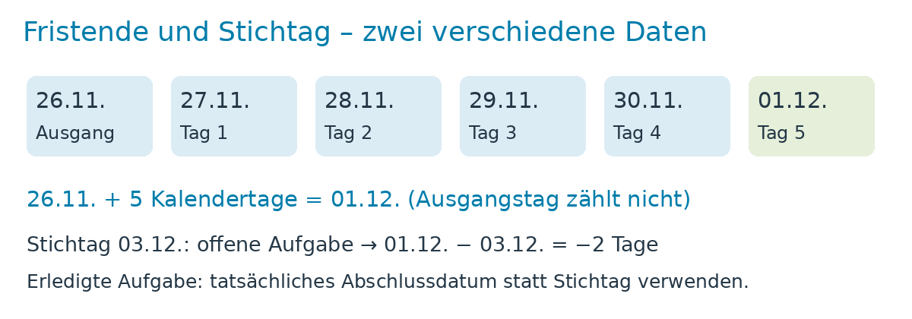

### Klick-Anleitungen (Excel Desktop Windows, deutsch)

| Ziel | Vorgehen |
| --- | --- |
| Arbeitskopie | Datei → Speichern unter → XLSX |
| Datum | Zelle markieren → Strg+1 → Benutzerdefiniert → TT.MM.JJJJ |
| Datum eingeben | z. B. 12.10.2027 → Enter |
| Textdatum prüfen | freiwillig ISTZAHL in freier Zelle; plausibles Datum zusätzlich prüfen |
| Textdatum korrigieren | Kopie → Daten → Text in Spalten → Datum TMJ → Zielbereich prüfen |
| Uhrzeit | Strg+1 → Uhrzeit bzw. hh:mm |
| Tage | Strg+1 → Zahl → 0 Dezimalstellen |
| Fristende | I4 → = → E4 anklicken → + → F4 anklicken → Enter |
| Kopieren | Ausfüllkästchen bis I10 ziehen |
| Stichtag fixieren | J4 → = → I4 → - → B1 → F4-Taste bis *B*1 → Enter |
| Erledigte Aufgabe | Fristende minus Abschlussdatum der jeweiligen Zeile |
| Formel kontrollieren | Zelle anklicken → Bearbeitungsleiste |
| Status sichtbar machen | Start → Bedingte Formatierung → Textinhalt; Textbezeichnung beibehalten |
| Filter | Filterpfeil in K → gewünschte Beurteilung → anschließend Filter löschen |
| Berechnung | Formeln → Berechnungsoptionen → Automatisch; F9 |
| Speichern | Strg+S |

### Fehlerdiagnose

###### kann auf zu schmale Spalten oder negative Datumswerte hinweisen; Differenzen als Zahl formatieren. Textdatum: Datentyp korrigieren. Frist um einen Tag falsch: Ausgangstag nicht mitzählen. Wochenende übersprungen: Kalendertage verwenden. Wandernder Stichtag: *B*1 prüfen. HEUTE() verändert historische Auswertung. Erledigte Aufgabe als überfällig: Abschlussdatum statt Stichtag verwenden. Leere oder widersprüchliche Angaben zuerst klären. Nur ganze Zeilen sortieren. Farbe allein genügt nicht.

### Selbstkontrolle

- Postliste, Fristen und Termine getrennt und Referenzen geprüft.
- IDs eindeutig; echte Datumswerte und richtige Formate.
- Fristenden mit Kalendertagen berechnet, Monatswechsel geprüft.
- Stichtag absolut referenziert.
- Offene und erledigte Differenzen richtig berechnet.
- Fünf Beurteilungen fachlich unterschieden.
- Prioritäten mit Zuständigkeit und Kundenwirkung begründet.
- Drei Änderungstests durchgeführt; Ausgangswerte wiederhergestellt.
- Interne Ablagefrist nicht als Löschfrist verstanden.
- Datei gespeichert und erneut geöffnet.

[Excel-Arbeitsdatei herunterladen](material/UE8_Arbeitsdatei.xlsx)

Freiwilliger Übungscheck · fünf Fragen

**Eine interne Frist beginnt am 28.11. und dauert fünf Kalendertage. Wann endet sie?**

- 30.11.
- 01.12.
- 03.12.
- 05.12.
- 04.12.
- 02.12.

**Welche Formel berechnet für offene Aufgaben die Tagesdifferenz kopierfähig, wenn I4 das Fristende und B1 den Stichtag enthält?**

- =I4-B1
- =$I$4-$B$1
- =$I$4-B1
- =I4+$B$1
- =$B$1-I4
- =I4-$B$1

**Eine Aufgabe war am 08.10. fällig und wurde am 10.10. erledigt. Stichtag ist 12.10. Welche Beurteilung stimmt?**

- Fristgerecht erledigt, +2 Tage
- Überfällig, −4 Tage
- Verspätet erledigt, −4 Tage
- Verspätet erledigt, −2 Tage
- Noch offen, +4 Tage
- Heute fällig, 0 Tage

**Welche Aussage zur Postreferenz ist richtig?**

- Eine Aufgabe kann ohne Postreferenz bestehen.
- Jeder Postausgang beendet alle Aufgaben.
- Eine leere Referenz bedeutet immer einen Datenfehler.
- Jeder Postvorgang braucht zwingend eine Frist.
- Eine Postreferenz ersetzt die Aufgaben-ID.
- Jede Aufgabe ist ein zusätzlicher Posteingang.

**Eine Kundenrückmeldung ist überfällig. Was ist kaufmännisch sinnvoll?**

- Nur die älteste Aufgabe unabhängig von Folgen bearbeiten.
- Vorgang löschen.
- Frist ohne Rücksprache verlängern.
- Aufgabe als erledigt markieren, sobald eine Erinnerung versandt ist.
- Zuständige Stelle informieren und weiteres Vorgehen abstimmen.
- Abschlussdatum rückwirkend eintragen.

[Bearbeitbare Textfassung](material/ue8.md)

## Ü9 · Ü9 – Betriebliche Listen sortieren und filtern

[Digitale Fassung öffnen](material/ue9.html)

Global Bike Deutschland GmbH · Verwaltung · Löppt · freiwillig · unbenotet · keine KI

### Ausgangssituation

Emma Fuchs benötigt eine geordnete Übersicht über sechs Kostenbelege und offene Vorgänge. Alle Daten sind simulierte Schulungsdaten, keine SAP-Daten oder Hauptfalllösung. Ü12–Ü14 nutzen bewusst dieselbe Kostenbasis für aufeinander aufbauende Qualitätsaufgaben.

### Das trainieren Sie

F9; Materialien M6, M9, M10.

### Arbeitsdatei

UE9_Arbeitsdatei.xlsx öffnen und Arbeitskopie speichern. Blaue Felder sind Eingaben, grüne Felder vorhandene Formeln. Fehlende Ergebnisse selbst ergänzen.

### Arbeitsaufträge

1. [Sortieren](#sortieren) Sie das Blatt Liste nach Kosten absteigend, bei Gleichstand nach ID aufsteigend; bei weiterem Gleichstand nach Datum aufsteigend. Prüfen Sie die Zuordnung aller Zeilen.
2. Sortieren Sie das Blatt Sortierung nach Bereich A–Z, dann Datum älteste zuerst, dann ID. Daten → Sortieren → Ebene hinzufügen; Überschriften aktivieren.
3. [Filtern](#filtern) Sie das Blatt Filter nach Verkauf UND Offen. Daten → Filter → Textauswahl. Testen Sie zusätzlich Kosten größer 90 und Datum ab 05.11.; löschen Sie anschließend die Zusatzfilter.
4. Berechnen Sie Rang in F2:F7 mit RANG.GLEICH oder RANG (absteigend, absoluter Vergleichsbereich). Berechnen Sie im Blatt Filter die Gesamtsumme und freiwillig die sichtbare [Summe](#summe) mit TEILERGEBNIS(109;E2:E7).
5. Erklären Sie gleiche Rangplätze, ausgeblendete Zeilen und die Grenzen einer Kostenpriorisierung. Löschen Sie Filter testweise und stellen Sie den kombinierten Filter wieder her.

### Hilfen bei Bedarf

### Selbstkontrolle

- Alle Arbeitsaufträge bearbeitet.
- Daten und Bezugsgrößen geprüft.
- Ergebnisse und Änderungstests nachvollziehbar.
- Ausgangswerte wiederhergestellt und Datei gespeichert.

### Freiwillige Vertiefung

Eine zusätzliche plausible Eingabe in einer Testkopie verändern, Ergebnis vorhersagen und prüfen. Keine Pflichtabgabe.

[Excel-Arbeitsdatei herunterladen](material/UE9_Arbeitsdatei.xlsx)

Freiwilliger Übungscheck · fünf Fragen

**Was muss beim Sortieren zusammenbleiben?**

- Nur die ID
- Die vollständige Datenzeile
- Nur die erste Zeile
- Nur die Datumsspalte
- Nur der Betrag
- Nur sichtbare Überschriften

**Wie wirken zwei Filter in verschiedenen Spalten?**

- Sie löschen Daten
- Nur der letzte gilt
- Immer ODER
- Beide Bedingungen müssen erfüllt sein
- Sie sortieren automatisch
- Sie ändern Beträge

**Welche Ränge ergeben 120,120,100?**

- 1,1,3
- 1,2,3
- 3,3,1
- 0,0,1
- 1,1,2
- 2,2,3

**Welche Funktion summiert nur sichtbare Werte einschließlich Ausschluss manuell ausgeblendeter Zeilen?**

- MITTELWERT
- RANG
- SUMME
- TEILERGEBNIS(109;Bereich)
- MAX
- MIN

**Was bedeutet eine ausgeblendete Filterzeile?**

- Sie wird automatisch archiviert
- Sie bleibt in der Liste erhalten
- Ihr Wert ist null
- Ihre ID ändert sich
- Sie ist gelöscht
- Sie ist erledigt

[Bearbeitbare Textfassung](material/ue9.md)

## Orientierung · Excel für Büroaufgaben

[Digitale Fassung öffnen](material/ueberblick.html)

Für die Durchführung gelten die Aufträge dieser Lernsituation. Bewerten erfolgt am Produkt per Peer-Check, Reflektieren über das qualitative Feedback zum Unterricht.

[Bearbeitbare Textfassung](material/ueberblick.md)

## Freiwillige praktische Übungen

[Digitale Fassung öffnen](material/uebungen.html)

Wähle nach Bedarf. Jede Übung enthält einen eigenen Bürofall und eine bearbeitbare Arbeitsdatei.

- [Ü1 – Sicher in Excel starten](#ue1) · [Arbeitsdatei (XLSX)](material/UE1_Arbeitsdatei.xlsx)
- [Ü2 – Eine professionelle Büromaterialliste erstellen](#ue2) · [Arbeitsdatei (XLSX)](material/UE2_Arbeitsdatei.xlsx)
- [Ü3 – Betriebliche Daten richtig formatieren](#ue3) · [Arbeitsdatei (XLSX)](material/UE3_Arbeitsdatei.xlsx)
- [Ü4 – Bürokosten automatisch berechnen](#ue4) · [Arbeitsdatei (XLSX)](material/UE4_Arbeitsdatei.xlsx)
- [Ü5 – Betriebliche Kosten mit Excel-Funktionen auswerten](#ue5) · [Arbeitsdatei (XLSX)](material/UE5_Arbeitsdatei.xlsx)
- [Ü6 – Relative und absolute Zellbezüge](#ue6) · [Arbeitsdatei (XLSX)](material/UE6_Arbeitsdatei.xlsx)
- [Ü7 – Ein Bürobudget überwachen](#ue7) · [Arbeitsdatei (XLSX)](material/UE7_Arbeitsdatei.xlsx)
- [Ü8 – Posteingänge, Termine und Fristen organisieren](#ue8) · [Arbeitsdatei (XLSX)](material/UE8_Arbeitsdatei.xlsx)
- [Ü9 – Betriebliche Listen sortieren und filtern](#ue9) · [Arbeitsdatei (XLSX)](material/UE9_Arbeitsdatei.xlsx)
- [Ü10 – Den richtigen Diagrammtyp auswählen](#ue10) · [Arbeitsdatei (XLSX)](material/UE10_Arbeitsdatei.xlsx)
- [Ü11 – Diagramme für eine interne Besprechung erstellen](#ue11) · [Arbeitsdatei (XLSX)](material/UE11_Arbeitsdatei.xlsx)
- [Ü12 – Tabellen und Diagramme druckfertig aufbereiten](#ue12) · [Arbeitsdatei (XLSX)](material/UE12_Arbeitsdatei.xlsx)
- [Ü13 – Eine fehlerhafte Excel-Arbeitsmappe überprüfen](#ue13) · [Arbeitsdatei (XLSX)](material/UE13_Arbeitsdatei.xlsx)
- [Ü14 – Eine vollständige Büroübersicht erstellen](#ue14) · [Arbeitsdatei (XLSX)](material/UE14_Arbeitsdatei.xlsx)

[Bearbeitbare Textfassung](material/uebungen.md)

## Lernpakete – verbindliche Wahl in Phase 3

[Digitale Fassung öffnen](material/wege.html)

### Gemeinsamer fachlicher Kern

Alle Lernpakete enthalten eine eigenständig erstellte, bearbeitbare XLSX-[Arbeitsmappe](#arbeitsmappe) auf Grundlage sämtlicher Daten aus M1 sowie eine einseitige druckgerechte Besprechungsübersicht und eine kurze begründete Empfehlung. Die Übersicht darf in der Arbeitsmappe liegen. Keine SAP-Daten verändern. Keine KI. Die folgenden Anforderungen gelten für jedes Paket:

- Postvorgänge vollständig und eindeutig erfassen, offene und erledigte Vorgänge unterscheiden; Termine und interne Fristen übersichtlich organisieren, Referenzen erhalten.
- Fristenden, Tagesdifferenzen und Beurteilungen anhand der internen Regeln und des zentralen Stichtags berechnen; offene, fällige, überfällige und erledigte Aufgaben gezielt auffindbar machen.
- Kosten je Beleg, Gesamtkosten, Minimum, Maximum, Durchschnitt der Belegkosten, Kostenanteile je Beleg und zusammengefasst nach Kostenposition, [Budgetauslastung](#budgetauslastung), Restbudget und durchschnittliche Ausgaben je Postvorgang berechnen. Bezugsgrößen eindeutig benennen; Rangfolge der zusammengefassten Kostenpositionen mit gleichen Rangplätzen darstellen.
- D4 als eigenständige Vergleichsdaten verwenden: Monatsmeldungen mit D1 und D3 abgleichen, Abweichungen gegebenenfalls kennzeichnen, nicht doppelt addieren. Monatsentwicklung der Vorgänge und Kosten grafisch auswerten; Diagrammtypen begründen, Einheiten und Zeiträume angeben.
- Geeignete Zahlen- und Datumsformate, relative und absolute Zellbezüge, Sortierung und Filter einsetzen. Eingaben und Ergebnisse unterscheiden. Datei nachvollziehbar benennen und strukturieren.
- In einer Kopie mindestens eine Kostenänderung, eine Stichtagsänderung und eine zusätzliche Datenzeile prüfen; Formeln, Bezugsbereiche und Diagramme kontrollieren. Ausgangswerte wiederherstellen. [Druckvorschau](#druckvorschau) und Lesbarkeit der einseitigen Besprechungsübersicht prüfen.
- Aus den Ergebnissen begründete Empfehlungen zu Fristen, Budget und Büroorganisation ableiten. Keine fehlenden Geschäftsdaten erfinden.

### Lernpaket A – Analytische Büroübersicht

Entwickeln Sie die Arbeitsmappe ausgehend von den Datenbeziehungen und den Informationsbedürfnissen der Verwaltung. Strukturieren Sie die Auswertungen so, dass Emma Fuchs Kennzahlen, Fristen und Abweichungen systematisch nachvollziehen kann. Stellen Sie Ihre begründete Empfehlung in einer kompakten, zahlenorientierten Besprechungsübersicht dar. Planen Sie selbst, welche Teilaufgaben aufeinander aufbauen und wie Sie die Berechnungen kontrollieren.

### Lernpaket B – Visuell gestaltete Büroübersicht

Entwickeln Sie die Arbeitsmappe ausgehend von einer selbst entworfenen, übersichtlichen Informationsdarstellung für die interne Besprechung. Leiten Sie daraus ab, welche Tabellen, Berechnungen und Datenbeziehungen benötigt werden. Gestalten Sie die Besprechungsübersicht so, dass wesentliche Entwicklungen und Handlungsbedarfe verständlich sichtbar werden. Begründen Sie Ihre Gestaltung und Empfehlung anhand der Daten.

### Lernpaket C – Vernetzte Büroübersicht

Entwickeln Sie die Arbeitsmappe ausgehend von den betrieblichen Abläufen und dem Zusammenspiel der Zuständigkeiten. Stellen Sie die Beziehungen zwischen Post, Fristen, Kosten und Monatsmeldungen nachvollziehbar dar. Gestalten Sie eine Besprechungsübersicht, die Emma Fuchs bei der Abstimmung von Prioritäten und nächsten Schritten unterstützt. Begründen Sie Ihre Empfehlung anhand der Auswertungen und prüfen Sie die Folgen von Änderungen.

[Bearbeitbare Textfassung](material/wege.md)

## M15 – Fachbegriffssammlung M1–M14

[Digitale Fassung öffnen](material/wortliste.html)

Fachbegriffe und Bedienbegriffe, einschließlich ausdrücklich gekennzeichneter Vertiefungen. Synonyme und Schreibvarianten werden zusammengefasst; keine Sammlung jedes gewöhnlichen Wortes.

### Büroorganisation (M1,M9; Grundlagen)

| Begriff | Bedeutung |
| --- | --- |
| Geschäftsvorgang | Zusammengehöriger betrieblicher Bearbeitungsfall |
| [Vorgangskennzeichen](#vorgangskennzeichen) | Eindeutige Kennung eines Bearbeitungsfalls |
| Zuständigkeit | Für die Bearbeitung verantwortlicher Bereich |
| Status | Aktueller Bearbeitungsstand |
| Auswertungszeitraum | Zeitspanne, deren Daten betrachtet werden |

### Postorganisation (M1,M9; Grundlagen)

| Begriff | Bedeutung |
| --- | --- |
| Posteingang | Eingehende betriebliche Nachrichten und Dokumente |
| Postausgang | Versandte betriebliche Nachrichten und Dokumente |
| Vorgangsart | Inhaltliche Kategorie eines Geschäftsvorgangs |
| Erledigungsdatum | Tag des tatsächlichen Abschlusses einer Aufgabe |
| Vorgangsreferenz | Verweis auf einen zugehörigen Geschäftsvorgang |

### Budget und Kosten (M1,M8; Grundlagen)

| Begriff | Bedeutung |
| --- | --- |
| Budget | Vorgegebener finanzieller Rahmen |
| Nettobetrag | Geldbetrag ohne Umsatzsteuer |
| Kostenart | Kategorie gleichartiger Ausgaben |
| [Restbudget](#restbudget) | Budget abzüglich tatsächlicher Ausgaben |
| [Budgetauslastung](#budgetauslastung) | Verhältnis der Ausgaben zum Budget |

### Datei und Tabellenblatt (M2; Grundlagen)

| Begriff | Bedeutung |
| --- | --- |
| [Arbeitsmappe](#arbeitsmappe) | Excel-Datei mit mindestens einem Arbeitsblatt |
| Arbeitsblatt | Einzelne Bearbeitungsfläche innerhalb einer Excel-Datei |
| Zeile | Waagerechte Anordnung von Zellen |
| Spalte | Senkrechte Anordnung von Zellen |
| Zelle | Einzelfeld am Schnittpunkt einer Zeile und Spalte |

### Orientierung (M2,M7; Grundlagen)

| Begriff | Bedeutung |
| --- | --- |
| [Zelladresse](#zelladresse) | Kennung aus Spaltenbuchstaben und Zeilennummer |
| Zellbereich | Gruppe von Zellen, etwa A1:B5 |
| Aktive Zelle | Momentan ausgewähltes Einzelfeld |
| Namensfeld | Anzeige oder Eingabefeld für Zelladresse oder Bereichsnamen |
| Bearbeitungsleiste | Anzeige und Bearbeitung des tatsächlichen Zellinhalts |

### Benutzeroberfläche (M2; Grundlagen)

| Begriff | Bedeutung |
| --- | --- |
| Menüband | Bereich mit nach Aufgaben geordneten Befehlen |
| Registerkarte | Thematische Unterteilung des Menübandes |
| Blattregister | Auswahlfeld für ein Arbeitsblatt |
| Statusleiste | Unterer Fensterbereich mit Zustandsinformationen |
| Ausfüllkästchen | Kleines Feld am Auswahlrand zum Kopieren oder Fortsetzen |

### Datei und Datenstruktur (M2,M3; Grundlagen)

| Begriff | Bedeutung |
| --- | --- |
| XLSX | Dateiformat einer regulären Excel-Arbeitsmappe |
| Überschrift | Bezeichnung des Inhalts einer Spalte |
| Datensatz | Zusammengehörige Angaben zu einem einzelnen Fall |
| Datenfeld | Einzelnes Merkmal eines Datensatzes |
| Excel-Tabelle | Als Tabellenobjekt eingerichteter Datenbereich mit eigenen Tabellenfunktionen |

### Schriftgestaltung (M3; Grundlagen)

| Begriff | Bedeutung |
| --- | --- |
| Schriftart | Gestalt der verwendeten Schriftzeichen |
| Schriftgröße | Größe der Schriftzeichen |
| Fettdruck | Darstellung mit verstärkter Strichstärke |
| Kursiv | Geneigte Schriftgestaltung |
| Unterstreichen | Linie unmittelbar unter dem Text |

### Zellgestaltung (M3; Grundlagen)

| Begriff | Bedeutung |
| --- | --- |
| Ausrichtung | Position des Inhalts innerhalb einer Zelle |
| Textumbruch | Anzeige eines längeren Zelltexts auf mehreren Zeilen |
| Rahmenlinie | Linie an ausgewählten Zellgrenzen |
| Füllfarbe | Hintergrundfarbe einer Zelle |
| Schriftfarbe | Farbe der Schriftzeichen |

### Tabellenlayout (M3; Grundlagen)

| Begriff | Bedeutung |
| --- | --- |
| Spaltenbreite | Waagerechte Abmessung einer Spalte |
| Zeilenhöhe | Senkrechte Abmessung einer Zeile |
| AutoAnpassen | Anpassung der Abmessung an den Zellinhalt |
| Zellen verbinden | Mehrere Zellen zu einer Anzeigezelle zusammenfassen |
| Tabellenformatvorlage | Vordefiniertes Gestaltungsmuster für ein Tabellenobjekt |

### Wert und Format (M4; Grundlagen)

| Begriff | Bedeutung |
| --- | --- |
| [Zellwert](#zellwert) | Tatsächlich gespeicherter Inhalt beziehungsweise berechneter Wert |
| Zahlenformat | Regel für die Darstellung numerischer Werte |
| Standardformat | Allgemeine Anzeige ohne festgelegte spezielle Zahlenform |
| Textformat | Format, das neu eingegebene Inhalte als Text behandelt |
| Zahlenformat Zahl | Numerische Anzeige mit einstellbaren Dezimalstellen |

### Spezielle Zahlenformate (M4; Grundlagen)

| Begriff | Bedeutung |
| --- | --- |
| Währungsformat | Darstellung eines Betrags mit Währungssymbol |
| Buchhaltungsformat | Ausgerichtete Darstellung von Währungssymbolen und Beträgen |
| Prozentformat | Anzeige des gespeicherten Dezimalwerts multipliziert mit 100 und ergänzt um das Prozentzeichen |
| Datumsformat | Darstellung eines Datumswerts als Kalenderdatum |
| Uhrzeitformat | Darstellung eines Zeitwerts als Uhrzeit |

### Zahlenpräzision (M4,M5; Grundlagen)

| Begriff | Bedeutung |
| --- | --- |
| Dezimalstelle | Stelle rechts vom Dezimaltrennzeichen |
| Tausendertrennzeichen | Zeichen zur Gruppierung großer Zahlen |
| Anzeigerundung | Verkürzte Darstellung ohne Änderung des gespeicherten Werts |
| RUNDEN | Funktion zur rechnerischen Rundung auf eine angegebene Stellenzahl |
| Nullwert | Numerischer Wert 0, nicht gleichbedeutend mit fehlender Eingabe |

### Rechnen in Excel (M5; Grundlagen)

| Begriff | Bedeutung |
| --- | --- |
| [Formel](#formel) | Mit Gleichheitszeichen beginnender Berechnungsausdruck |
| Funktion | Vordefinierte Berechnung mit festgelegter Syntax |
| Operator | Zeichen für eine Rechenoperation |
| Zellbezug | Verweis auf den Inhalt einer anderen Zelle oder eines Bereichs |
| Neuberechnung | Erneute Ermittlung der Ergebnisse abhängiger Formeln |

### Rechenzeichen (M5; Grundlagen)

| Begriff | Bedeutung |
| --- | --- |
| + | Addition zweier Werte |
| - | Subtraktion eines Werts von einem anderen |
| * | Multiplikation zweier Werte |
| / | Division eines Werts durch einen anderen |
| () | Klammern zur Festlegung der Berechnungsreihenfolge |

### Grundfunktionen (M6; Grundlagen)

| Begriff | Bedeutung |
| --- | --- |
| [SUMME](#summe) | Addiert numerische Werte |
| [MIN](#min) | Ermittelt den kleinsten numerischen Wert |
| [MAX](#max) | Ermittelt den größten numerischen Wert |
| [MITTELWERT](#mittelwert) | Ermittelt das arithmetische Mittel numerischer Werte |
| AutoSumme | Bedienbefehl zum schnellen Einfügen einer Summenfunktion |

### Funktionsaufbau (M6,M7; Grundlagen)

| Begriff | Bedeutung |
| --- | --- |
| Funktionsname | Bezeichnung der aufzurufenden vordefinierten Berechnung |
| Argument | Eingabewert oder Bezug innerhalb einer Funktion |
| Doppelpunkt | Zeichen für einen zusammenhängenden Zellbereich |
| Semikolon | Übliches Argumenttrennzeichen im deutschen Excel |
| Funktionsassistent | Dialog zur Auswahl und Eingabe von Funktionen |

### Zellbezüge (M7; Grundlagen)

| Begriff | Bedeutung |
| --- | --- |
| [Relativer Zellbezug](#relativer-zellbezug) | Beim Kopieren entsprechend der Verschiebung angepasster Bezug |
| [Absoluter Zellbezug](#absoluter-zellbezug) | Beim Kopieren in Spalte und Zeile festgehaltener Bezug |
| Dollarzeichen | Kennzeichnet einen festgehaltenen Teil einer Zelladresse |
| F4 | Wechselt beim Bearbeiten eines Zellbezugs zwischen Bezugsarten |
| Formelkopie | Übertragung eines Berechnungsausdrucks in eine andere Zelle |

### Prozentrechnung (M8; Grundlagen)

| Begriff | Bedeutung |
| --- | --- |
| Grundwert | Gesamtheit, die 100 Prozent entspricht |
| Prozentwert | Teilbetrag oder Teilmenge der Gesamtheit |
| Prozentsatz | Verhältnis des Teils zum Ganzen in Prozent |
| Bezugsgröße | Wert, auf den eine Verhältnisrechnung bezogen wird |
| Gesamtsumme | Summe aller zur betrachteten Gesamtheit gehörenden Werte |

### Termine und Fristen (M9; Grundlagen)

| Begriff | Bedeutung |
| --- | --- |
| Termin | Festgelegter Zeitpunkt oder Kalendertag |
| Frist | Zeitraum, innerhalb dessen etwas geschehen soll |
| Fälligkeitsdatum | Letzter vorgesehener Tag für die Erledigung |
| [Stichtag](#stichtag) | Festgelegtes Datum für die Beurteilung eines Sachstands |
| Kalendertage | Alle Tage einschließlich Wochenenden und Feiertagen |

### Fristenüberwachung (M9; Grundlagen)

| Begriff | Bedeutung |
| --- | --- |
| Offener Vorgang | Noch nicht abgeschlossener Bearbeitungsfall |
| Überfällig | Offen und Fälligkeitsdatum liegt vor dem Stichtag |
| Heute fällig | Offen und Fälligkeitsdatum entspricht dem Stichtag |
| Rechtzeitig erledigt | Abschluss spätestens am Fälligkeitsdatum |
| Verspätet erledigt | Abschluss nach dem Fälligkeitsdatum |

### Büroplanung (M9; Grundlagen)

| Begriff | Bedeutung |
| --- | --- |
| Interne Ablagefrist | Betrieblich festgelegter Zeitraum für die Ablage, keine gesetzliche Aufbewahrungsfrist |
| Resttage | Differenz zwischen Fälligkeit und Stichtag bei offenen Aufgaben |
| Priorität | Dringlichkeit oder Bedeutung einer Aufgabe für die Bearbeitungsreihenfolge |
| Ausgangsdatum | Datum, von dem eine Fristberechnung ausgeht |
| Fristdauer | Anzahl der für die Frist vorgesehenen Tage |

### Sortieren und Filtern (M10; Grundlagen)

| Begriff | Bedeutung |
| --- | --- |
| [Sortieren](#sortieren) | Ändert die Reihenfolge der Datensätze |
| [Filtern](#filtern) | Blendet nicht passende Datensätze vorübergehend aus |
| Aufsteigend | Reihenfolge vom kleineren zum größeren Wert beziehungsweise A bis Z |
| Absteigend | Reihenfolge vom größeren zum kleineren Wert beziehungsweise Z bis A |
| Sortierkriterium | Merkmal, nach dem die Reihenfolge bestimmt wird |

### Filter und Rangfolge (M10; Grundlagen)

| Begriff | Bedeutung |
| --- | --- |
| Textfilter | Auswahl anhand von Textmerkmalen |
| Zahlenfilter | Auswahl anhand numerischer Bedingungen |
| Datumsfilter | Auswahl anhand zeitlicher Bedingungen |
| [Rangfolge](#rangfolge) | Geordnete Platzierung anhand eines Vergleichsmerkmals |
| Gleichrang | Mehrere Fälle mit demselben maßgeblichen Rangwert |

### Diagrammtypen (M11; Grundlagen)

| Begriff | Bedeutung |
| --- | --- |
| Säulendiagramm | Vergleich durch senkrechte Rechtecke |
| Balkendiagramm | Vergleich durch waagerechte Rechtecke |
| Liniendiagramm | Darstellung geordneter Werte durch verbundene Punkte |
| Kreisdiagramm | Darstellung nichtnegativer Teile eines Ganzen durch Kreissektoren |
| Diagrammtyp | Grundform der grafischen Darstellung |

### Diagrammdaten (M11,M12; Grundlagen)

| Begriff | Bedeutung |
| --- | --- |
| Datenquelle | Zellbereich oder Tabelle, aus der die Grafik ihre Werte erhält |
| [Datenreihe](#datenreihe) | Zusammengehörige Folge dargestellter Werte |
| Kategorie | Bezeichnung einer dargestellten Gruppe oder eines Zeitabschnitts |
| Datenpunkt | Einzelner dargestellter Wert einer Reihe |
| Legende | Erklärt die Zuordnung grafischer Kennzeichen zu Reihen oder Kategorien |

### Diagrammbeschriftung (M11,M12; Grundlagen)

| Begriff | Bedeutung |
| --- | --- |
| Diagrammtitel | Überschrift zur Aussage der gesamten Grafik |
| Achsentitel | Bezeichnung der Größe oder Einheit einer Achse |
| Achsenbeschriftung | Einzelne Werte oder Kategorien entlang einer Achse |
| Datenbeschriftung | Direkt an einem grafischen Element angezeigte Information |
| Werteachse | Achse mit der numerischen Skala |

### Aussage und Gestaltung (M11,M12; Grundlagen)

| Begriff | Bedeutung |
| --- | --- |
| Kategorienachse | Achse mit den Bezeichnungen der dargestellten Gruppen |
| Achsenskalierung | Einteilung und Wertebereich einer Achse |
| Nullpunkt | Skalenwert null als Bezug für unverzerrte Längenvergleiche |
| Zeitreihe | Chronologisch geordnete Folge von Beobachtungen |
| Aussageziel | Information, die eine grafische Auswertung vermitteln soll |

### Diagrammprüfung (M11,M12; Grundlagen)

| Begriff | Bedeutung |
| --- | --- |
| Beobachtung | Unmittelbar aus Daten erkennbare Feststellung |
| Erklärung | Begründung einer Beobachtung, die zusätzliche Belege erfordern kann |
| Empfehlung | Aus der Auswertung abgeleiteter Handlungsvorschlag |
| Summenzeile | Zeile mit zusammengefassten Einzelwerten |
| Zeile/Spalte wechseln | Befehl zur Änderung der Zuordnung von Kategorien und Datenreihen |

### Drucklayout (M13; Grundlagen)

| Begriff | Bedeutung |
| --- | --- |
| [Druckbereich](#druckbereich) | Festgelegter Zellbereich für die Ausgabe |
| Papierformat | Abmessungen des Ausgabeblatts, etwa A4 |
| Hochformat | Seitenausrichtung mit größerer Höhe als Breite |
| Querformat | Seitenausrichtung mit größerer Breite als Höhe |
| Seitenrand | Abstand zwischen Papierkante und nutzbarem Inhalt |

### Druckaufbereitung (M13; Grundlagen)

| Begriff | Bedeutung |
| --- | --- |
| Skalierung | Veränderung der Ausgabegröße ohne Änderung der Zellwerte |
| Seitenumbruch | Grenze zwischen zwei Druckseiten |
| Drucktitel | Auf mehreren Druckseiten wiederholte Zeilen oder Spalten |
| Kopfzeile | Wiederkehrende Angabe oberhalb des Seiteninhalts |
| Fußzeile | Wiederkehrende Angabe unterhalb des Seiteninhalts |

### Ausgabe (M13; Grundlagen)

| Begriff | Bedeutung |
| --- | --- |
| [Druckvorschau](#druckvorschau) | Anzeige der geplanten Druckausgabe vor dem Drucken |
| PDF | Dateiformat für die Weitergabe mit festem Seitenlayout |
| Gitternetzlinien | Visuelle Hilfslinien zwischen Zellen |
| Ausgabeumfang | Auswahl der zu druckenden Blätter oder Bereiche |
| Umbruchvorschau | Ansicht zur Kontrolle der Aufteilung auf Druckseiten |

### Qualitätskontrolle (M14; Grundlagen)

| Begriff | Bedeutung |
| --- | --- |
| Originaldaten | Unveränderte Ausgangsinformationen als Vergleichsgrundlage |
| Arbeitsfassung | Bearbeitete betriebliche Datei für die weitere Nutzung |
| Testkopie | Separate Datei für gefahrlose Änderungen zu Prüfzwecken |
| Plausibilitätskontrolle | Prüfung auf fachlich nachvollziehbare Ergebnisse |
| Funktionstest | Vergleich erwarteter und tatsächlicher Reaktion auf eine Änderung |

### Formelüberwachung (M14; Grundlagen)

| Begriff | Bedeutung |
| --- | --- |
| Spur zum Vorgänger | Zeigt Zellen, von denen die gewählte Formel abhängt |
| Spur zum Nachfolger | Zeigt Formeln, die von der gewählten Zelle abhängen |
| Fehlerüberprüfung | Sucht nach bestimmten erkennbaren Formelproblemen |
| Formel auswerten | Zeigt einzelne Berechnungsschritte einer Formel |
| Zirkelbezug | Direkter oder indirekter Rückbezug einer Formel auf sich selbst |

### Fehlermeldungen I (M14; Grundlagen)

| Begriff | Bedeutung |
| --- | --- |
| #DIV/0! | Division durch null oder einen leeren Nenner |
| #WERT! | Ungeeigneter Datentyp in einer Berechnung |
| #BEZUG! | Ungültige Zellreferenz |
| #NAME? | Nicht erkannter Name oder Funktionsname |
| #ZAHL! | Unzulässiger numerischer Wert oder Berechnungsbereich |

### Fehlermeldungen II und Prüfung (M14; Grundlagen)

| Begriff | Bedeutung |
| --- | --- |
| #NV | Gesuchter Wert ist nicht verfügbar |
| #### | Wert passt nicht in die Spalte oder Datums-/Zeitwert ist nicht darstellbar |
| Automatische Berechnung | Abhängige Formeln werden bei Änderungen selbstständig neu berechnet |
| Gegenrechnung | Kontrolle durch einen unabhängigen Rechenweg |
| Prüfprotokoll | Dokumentation von Erwartung, Beobachtung und Korrektur |

### Wiederverwendbarkeit (M14; Grundlagen)

| Begriff | Bedeutung |
| --- | --- |
| Eingabezelle | Für veränderbare Ausgangswerte vorgesehene Zelle |
| Formelzelle | Zelle mit einem Berechnungsausdruck |
| Erweiterbarkeit | Möglichkeit, weitere Datensätze korrekt einzubeziehen |
| Konsistenz | Übereinstimmung von Einheiten, Zeiträumen und Bezugsgrößen |
| Wiederverwendbarkeit | Eignung einer Arbeitsmappe für spätere Bearbeitungsfälle und Änderungen |

### Bedienung und Formatierung (M2,M3; Grundlagen)

| Begriff | Bedeutung |
| --- | --- |
| Doppelklick | Zweimaliges rasches Anklicken mit der Maus |
| Markieren | Auswählen von Zellen oder Objekten zur Bearbeitung |
| Kopieren | Übertragen einer Kopie unter Erhalt des Originals |
| Einfügen | Übernehmen eines kopierten Inhalts oder neuen Elements |
| Formatierung | Gestaltung der Anzeige von Zellinhalten |

### Rechenregeln und Werte (M5,M6; Grundlagen)

| Begriff | Bedeutung |
| --- | --- |
| Gleichheitszeichen | Kennzeichnet am Anfang einer Eingabe eine Formel |
| Punkt vor Strich | Multiplikation und Division vor Addition und Subtraktion |
| Leere Zelle | Feld ohne eingegebenen Inhalt |
| Durchschnitt | Summe numerischer Werte geteilt durch deren Anzahl |
| Reihenfolge der Rechenoperationen | Festgelegte Abfolge, in der ein Ausdruck berechnet wird |

### Qualitätsmerkmale (M14; Grundlagen)

| Begriff | Bedeutung |
| --- | --- |
| Richtigkeit | Daten und Ergebnisse stimmen fachlich |
| Vollständigkeit | Alle benötigten Informationen sind enthalten |
| Verständlichkeit | Inhalte und Bedeutungen sind eindeutig erkennbar |
| Funktionsfähigkeit | Berechnungen reagieren wie vorgesehen auf Änderungen |
| Lesbarkeit | Darstellung ist ohne unnötige Schwierigkeiten erfassbar |

### Vertiefung: Bezüge und Veränderungen (M7,M8; Vertiefung)

| Begriff | Bedeutung |
| --- | --- |
| Gemischter Zellbezug | Nur Spalte oder nur Zeile ist beim Kopieren festgehalten |
| Prozentpunkt | Einheit für die Differenz zweier Prozentsätze |
| Relative Veränderung | Änderung im Verhältnis zum Ausgangswert |
| Ausgangswert | Ursprünglicher Wert vor einer Veränderung |
| Veränderungsbetrag | Differenz zwischen neuem und ursprünglichem Wert |

### Vertiefung: Tabellen und Schutz (M10,M14; Vertiefung)

| Begriff | Bedeutung |
| --- | --- |
| TEILERGEBNIS | Funktion für zusammengefasste Werte, die gefilterte Zeilen auslässt |
| Strukturierter Tabellenbezug | Verweis über Tabellen- und Spaltennamen |
| Ergebniszeile | Besondere Tabellenzeile für zusammengefasste Werte |
| Blattschutz | Schutz vor bestimmten versehentlichen Bearbeitungen |
| Gesperrt | Zelleigenschaft, die bei aktivem Blattschutz wirksam wird |

### Vertiefung: weitere Prüfmittel (M14; Vertiefung)

| Begriff | Bedeutung |
| --- | --- |
| WENNFEHLER | Funktion mit Ersatzwert für einen Fehlerfall |
| Bedingte Formatierung | Automatische Gestaltung anhand festgelegter Bedingungen |
| CSV | Textdateiformat für getrennte Datenfelder ohne vollständige Excel-Mappenstruktur |
| Duplikat | Mehrfach vorhandener Eintrag, dessen fachliche Gleichheit geprüft werden muss |
| Verschlüsselung | Technische Umwandlung von Daten zum Schutz vor unbefugtem Lesen |

[Bearbeitbare Textfassung](material/wortliste.md)

## Materialübersicht und Quellen

[Digitale Fassung öffnen](materialien.html)

Wähle eine Unterlage für deinen nächsten Arbeitsschritt.

#### [M1 – Betrieblicher Arbeitsauftrag und Ausgangsdaten](#m1)

Betrieblicher Auftrag, Fristregeln und vier Datenbereiche mit der Original-Arbeitsmappe.

#### [M2 – Excel-Grundlagen und Benutzeroberfläche](#m2)

Fachmaterial mit Anwendungsbeispielen und Abbildungen.

#### [M3 – Tabellen erstellen, strukturieren und gestalten](#m3)

Fachmaterial mit Anwendungsbeispielen und Abbildungen.

#### [M4 – Zahlen-, Datums-, Währungs- und Prozentformate](#m4)

Fachmaterial mit Anwendungsbeispielen und Abbildungen.

#### [M5 – Formeln und Grundrechenarten in Excel](#m5)

Fachmaterial mit Anwendungsbeispielen und Abbildungen.

#### [M6 – Excel-Funktionen: SUMME, MIN, MAX und MITTELWERT](#m6)

Fachmaterial mit Anwendungsbeispielen und Abbildungen.

#### [M7 – Relative und absolute Zellbezüge in Excel](#m7)

Fachmaterial mit Anwendungsbeispielen und Abbildungen.

#### [M8 – Prozentuale Anteile in Excel berechnen und interpretieren](#m8)

Fachmaterial mit Anwendungsbeispielen und Abbildungen.

#### [M9 – Postorganisation, Termine und Fristen mit Excel](#m9)

Fachmaterial mit Anwendungsbeispielen und Abbildungen.

#### [M10 – Sortieren, Filtern und Rangfolgen mit Excel](#m10)

Fachmaterial mit Anwendungsbeispielen und Abbildungen.

#### [M11 – Diagrammtypen kennen, unterscheiden und begründet auswählen](#m11)

Fachmaterial mit Anwendungsbeispielen und Abbildungen.

#### [M12 – Diagramme in Excel erstellen, gestalten und aktualisieren](#m12)

Fachmaterial mit Anwendungsbeispielen und Abbildungen.

#### [M13 – Seitenlayout und Druckaufbereitung in Excel](#m13)

Fachmaterial mit Anwendungsbeispielen und Abbildungen.

#### [M14 – Qualitätskontrolle und Wiederverwendbarkeit von Excel-Arbeitsmappen](#m14)

Fachmaterial mit Anwendungsbeispielen und Abbildungen.

#### [Ü1–Ü14 · Übungen in Excel](#uebungen)

Vierzehn freiwillige praktische Übungen mit je einer Original-XLSX-Arbeitsdatei.

#### [M15 · Fachwortschatz Excel](#wortliste)

Vollständige Begriffssammlung aus dem Board zum Nachschlagen.

#### [Arbeitsaufträge A, B und C](#wege)

Der vollständige gemeinsame Auftrag und die drei unterschiedlichen Arbeitszugänge.

#### [Einstieg · Originalgrafiken](#ueberblick)

Zwei illustrierte Einstiegsübersichten zum Fall der Verwaltung.

## Peer-Check · LS 2.6a

[Digitale Fassung öffnen](peer-check.html)

Prüfen Sie das zugeteilte Handlungsprodukt anhand der gemeinsamen fachlichen Kriterien. Eine Fundstelle kann eine Textzeile, ein Bildausschnitt oder eine Zeitmarke in der Übergabe sein.

Was möchten Sie festhalten?

 (Meine Rückmeldung zu einer fremden Arbeit / Meine Entscheidung nach Erhalt der Rückmeldung)

### Peer-Rückmeldung zur zugeteilten Arbeit

Nutzen Sie diese Fragen beim Lesen, Betrachten oder Anhören.

- D1–D4 sind mit Bezügen und Einheiten erhalten. Monatsmeldungen D4 werden mit D1/D3 abgeglichen und bleiben als eigenständige Vergleichsdaten erkennbar.
- Offene, erledigte, heute fällige und überfällige Aufgaben sind am Stichtag unterscheidbar. Fristenden und Tagesdifferenzen entsprechen den Regeln aus M1.
- Belegkosten, Summen, MIN, MAX und MITTELWERT, Kostenanteile je Beleg und Kostenposition, Rangfolge mit gleichen Rangplätzen, Budgetauslastung, Restbudget und Ausgaben je Postvorgang verwenden die passenden Bezugsgrößen.
- Beschriftete Diagramme zeigen die monatliche Entwicklung der Vorgänge und Kosten. Die einseitige Druckansicht enthält belegte Prioritäten und Empfehlungen zu Fristen, Budget und Büroorganisation.
- Drei Änderungen in einer Kopie wurden geprüft: Kostenwert ändern, Stichtag ändern und Datenzeile ergänzen. Berechnungen und Diagramme reagieren wie vorgesehen; die Abgabedatei enthält die Ausgangswerte.

Welches Produkt prüfen Sie und auf welche Fundstelle beziehen Sie sich?

Welche Stelle ist fachlich gelungen und wem hilft sie bei der Weiterarbeit und warum?

Wo bleibt eine Frage offen? Welchen konkreten Änderungsvorschlag machen Sie für diese Stelle?

**Rückmeldung weitergeben.** Übertragen Sie Ihren Text in die zugeteilte Arbeit in der Moodle-Aktivität „Peer-Feedback“ und geben Sie ihn dort ab. Ohne Moodle geben Sie den Bogen mit dem vereinbarten Arbeitscode an die Lehrkraft zur Rückgabe an die einreichende Person. Setzen Sie Ihren Namen als rückmeldende Person auf den Ausdruck oder die Textdatei.

Die Eingaben bleiben im geöffneten Bogen. Laden Sie die gewählte Ansicht vor dem Verlassen als Textdatei herunter, wenn Sie sie behalten möchten.

## Glossar zur Kundenanfrage

[Digitale Fassung öffnen](ls-glossar.html)

Begriffsblatt zum Nachschlagen und zur Vorbereitung auf den Fachbegriffscheck.

[Zurück zum Material](#materialien)

### Vorgangskennzeichen

Eindeutige Kennung eines Bearbeitungsfalls

M1: Die Kennung verbindet die Postzeile mit einer zugehörigen Frist.

### Budgetauslastung

Verhältnis der Ausgaben zum Budget

M8: Beziehe alle Nettoausgaben auf 2.500 Euro.

### Restbudget

Budget abzüglich tatsächlicher Ausgaben

M8: Ziehe die tatsächlichen Nettoausgaben vom Halbjahresbudget ab.

### Arbeitsmappe

Excel-Datei mit mindestens einem Arbeitsblatt

M2: In einer Datei bleiben Datengrundlage und Besprechungsübersicht miteinander verbunden.

### Zelladresse

Kennung aus Spaltenbuchstaben und Zeilennummer

M2: Eine Adresse identifiziert die konkrete Eingabe zu einem Beleg.

### Zellwert

Tatsächlich gespeicherter Inhalt beziehungsweise berechneter Wert

M4: Ein angezeigtes Prozentformat ändert die zugrunde liegende Zahl nicht.

### Formel

Mit Gleichheitszeichen beginnender Berechnungsausdruck

M5: Menge und Einzelpreis liefern rechnerisch die Kosten je Beleg.

### SUMME

Addiert numerische Werte

M6: Die Funktion fasst die Belegkosten zum Gesamtbetrag zusammen.

### MIN

Ermittelt den kleinsten numerischen Wert

M6: Ermittle den kleinsten Belegbetrag.

### MAX

Ermittelt den größten numerischen Wert

M6: Ermittle den höchsten Belegbetrag.

### MITTELWERT

Ermittelt das arithmetische Mittel numerischer Werte

M6: Ermittle den Mittelwert der Belegbeträge; die Zahl der Postvorgänge ist eine andere Bezugsgröße.

### Relativer Zellbezug

Beim Kopieren entsprechend der Verschiebung angepasster Bezug

M7: Beim Kopieren der Kostenformel muss der Bezug auf die nächste Belegzeile wechseln.

### Absoluter Zellbezug

Beim Kopieren in Spalte und Zeile festgehaltener Bezug

M7: Beim Kopieren einer Formel bleibt der Bezug auf den zentralen Stichtag gleich.

### Stichtag

Festgelegtes Datum für die Beurteilung eines Sachstands

M9: Für alle Fristbeurteilungen gilt der 1. Juli 2027.

### Sortieren

Ändert die Reihenfolge der Datensätze

M10: Beim Sortieren nach Kosten müssen alle Angaben einer Zeile zusammenbleiben.

### Filtern

Blendet nicht passende Datensätze vorübergehend aus

M10: Blende nur offene Vorgänge ein, um die Bearbeitung vorzubereiten.

### Rangfolge

Geordnete Platzierung anhand eines Vergleichsmerkmals

M10: Gleiche Kostenpositionen benötigen bei identischen Summen denselben Rang.

### Datenreihe

Zusammengehörige Folge dargestellter Werte

M12: Die Monatskosten bilden eine eigene Folge zusammengehöriger Werte.

### Druckbereich

Festgelegter Zellbereich für die Ausgabe

M13: Die Besprechungsseite soll auf einem Blatt lesbar bleiben.

### Druckvorschau

Anzeige der geplanten Druckausgabe vor dem Drucken

M13: Kontrolliere vor der Abgabe Umbrüche und Lesbarkeit.

## Lehrkraftmaterial und Moodle

Die Lehrkraft erhält die Erwartungshinweise und Unterlagen separat. Die Aktivität *Peer-Feedback* und das abschließende *Feedback* werden im jeweiligen Moodle-Kurs eingerichtet. Für das Peer-Feedback gelten die fallbezogenen Kriterien unter „Bewerten“.
