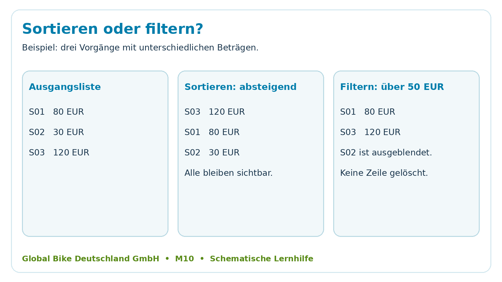
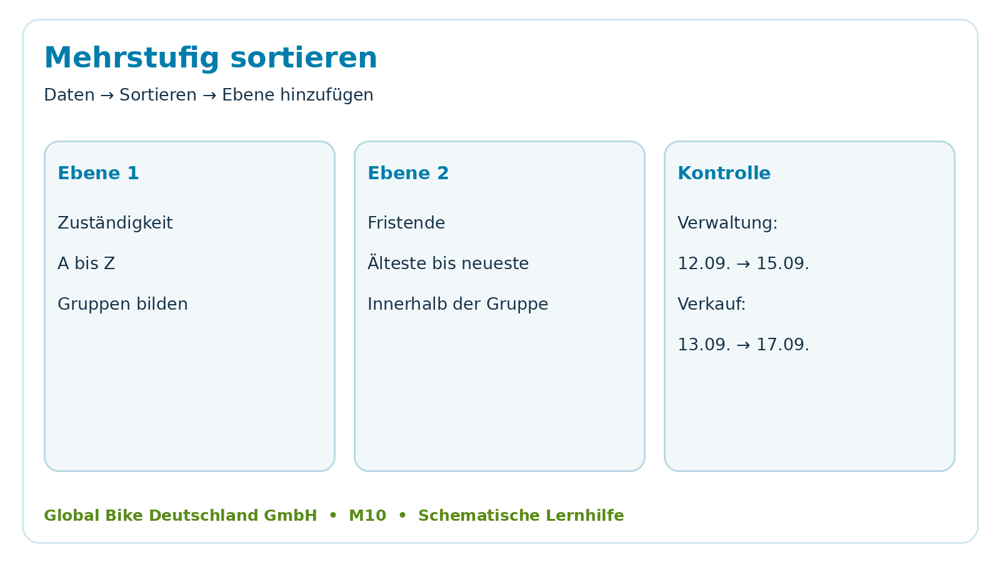
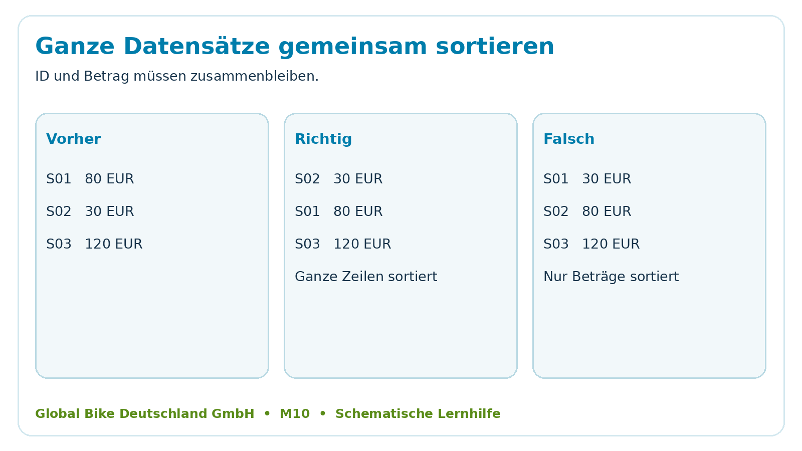
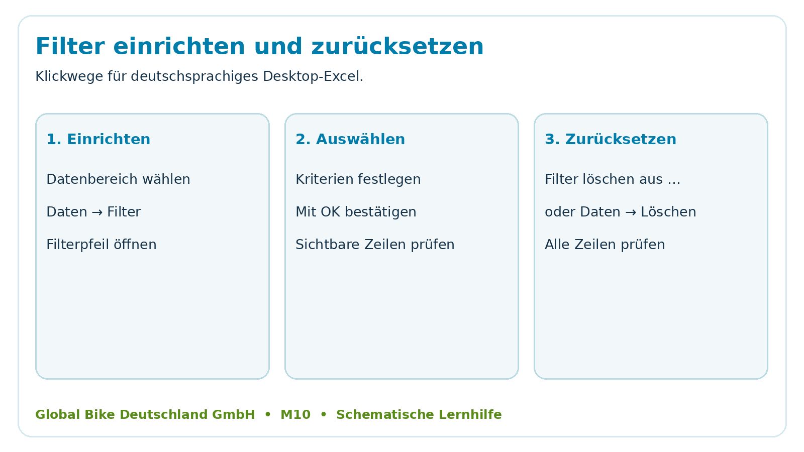
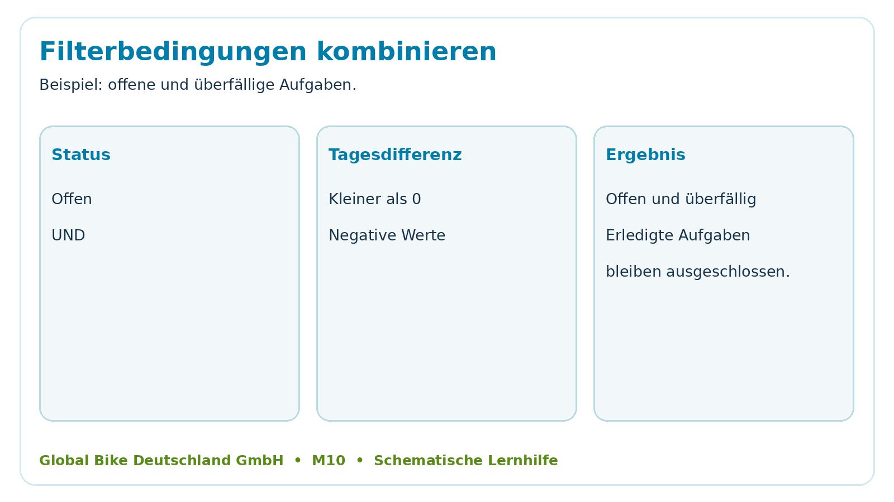
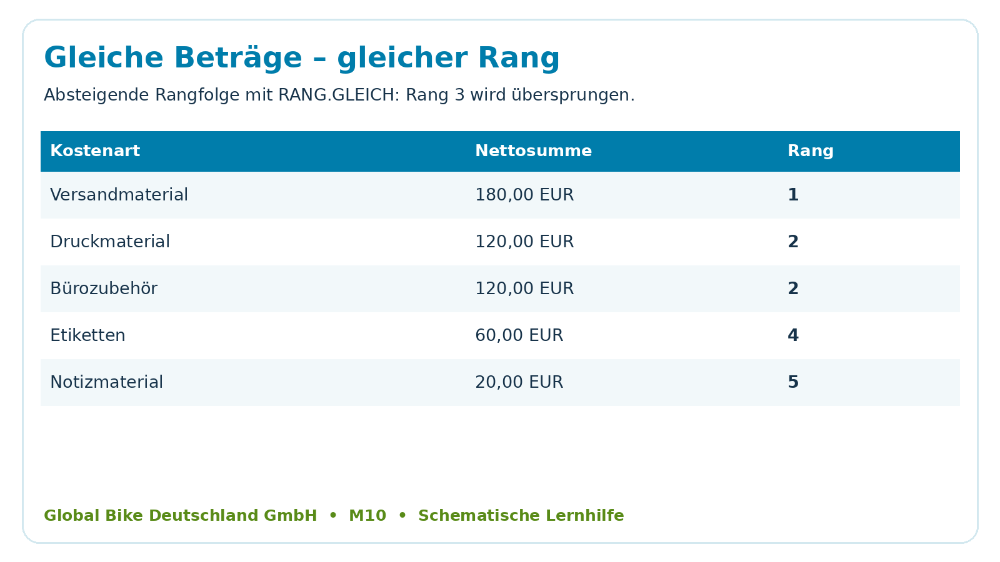
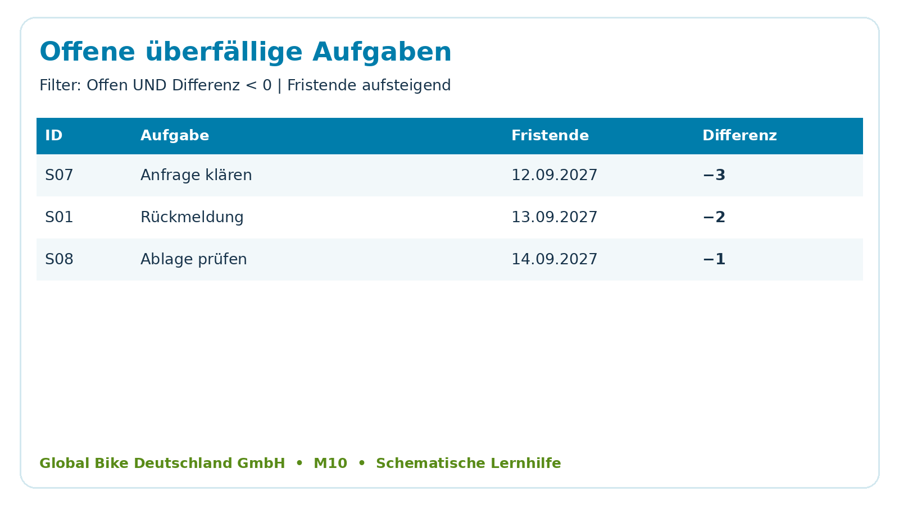

# M10 – Sortieren, Filtern und Rangfolgen mit Excel

Global Bike Deutschland GmbH – Verwaltung

## 1. Bedeutung für die betriebliche Büroorganisation

Eine umfangreiche Liste ist erst dann eine zuverlässige Arbeitsgrundlage, wenn die benötigten Informationen schnell auffindbar sind. In der Verwaltung müssen beispielsweise offene Geschäftsvorgänge gefunden, Fristen nach Dringlichkeit geordnet und Büroausgaben verglichen werden. Sortieren und Filtern unterstützen diese Aufgaben, ohne dass die Daten erneut erfasst werden müssen. Eine Rangfolge zeigt die Position eines Wertes im Vergleich zu anderen Werten. Sie ersetzt keine kaufmännische Beurteilung.

M1 liefert die verbindlichen Ausgangsdaten. Die folgenden Beispiele sind davon unabhängige simulierte Schulungsdaten der Global Bike Deutschland GmbH, keine SAP-Daten und keine Hauptfalllösungen.

## 2. Unterschied zwischen Sortieren und Filtern

| Verfahren | Wirkung                                         | Betrieblicher Nutzen         |
|-----------|-------------------------------------------------|------------------------------|
| Sortieren | Ändert die Reihenfolge ganzer Datensätze        | Fristen zeitlich ordnen      |
| Filtern   | Blendet nicht passende Zeilen vorübergehend aus | Nur offene Vorgänge anzeigen |
| Rangfolge | Ordnet Werten eine Vergleichsposition zu        | Kostenpositionen vergleichen |

Ein Filter löscht keine Daten. Eine Sortierung verändert dagegen die Reihenfolge tatsächlich. Das Entfernen eines Filters stellt alle Zeilen wieder dar, macht aber eine Sortierung nicht rückgängig. Eine ursprüngliche Reihenfolge lässt sich beispielsweise über eine zuvor gespeicherte laufende Nummer wiederherstellen. IDs dürfen dabei nicht neu vergeben werden.

## 3. Alphabetische, numerische und chronologische Sortierung

Text wird alphabetisch, Zahlen werden nach ihrer Größe und echte Datumswerte zeitlich sortiert. Aufsteigend bedeutet A bis Z, klein nach groß oder alt nach neu. Absteigend bedeutet die umgekehrte Richtung.

| Merkmal                         | Aufsteigend       | Absteigend       |
|---------------------------------|-------------------|------------------|
| Zuständigkeit                   | A bis Z           | Z bis A          |
| Nettobetrag                     | Kleinster zuerst  | Größter zuerst   |
| Fristende                       | Frühestes zuerst  | Spätestes zuerst |
| Tagesdifferenz offener Aufgaben | Negativste zuerst | Größte zuerst    |

Klick-Anleitung für eine Excel-Tabelle: Eine Zelle der gewünschten Spalte auswählen, Daten \> Sortieren und Filtern \> passende Sortierrichtung wählen. Alternativ den Pfeil in der Spaltenüberschrift öffnen und den entsprechenden Sortierbefehl auswählen. Die genaue Beschriftung hängt vom Datentyp und der Excel-Version ab. Ergebnis anhand der ersten und letzten Zeile prüfen.

Bei Zahlen, die als Text gespeichert sind, kann beispielsweise 100 vor 20 erscheinen. Ein Datumsformat allein wandelt Text nicht in echte Datumswerte um. M4 und M9 erläutern die Prüfung der Datentypen.

## 4. Sortieren nach mehreren Kriterien

Bei mehreren Sortierebenen bestimmt die erste Ebene die Hauptreihenfolge. Die zweite Ebene ordnet nur Datensätze mit gleichem Wert der ersten Ebene. Weitere Ebenen wirken entsprechend.

Beispiel: Die Verwaltung möchte Vorgänge zunächst nach Zuständigkeit gruppieren und innerhalb jeder Zuständigkeit nach Fristende ordnen.

Klick-Anleitung:

1.  Eine Zelle innerhalb der vollständigen Tabelle auswählen.
2.  Daten \> Sortieren öffnen.
3.  Bei einer normalen Liste den gesamten Datenbereich einschließlich Überschriften berücksichtigen; Daten haben Überschriften aktivieren.
4.  Erste Ebene: Zuständigkeit, Zellwerte, A bis Z.
5.  Ebene hinzufügen: Fristende, Zellwerte, älteste bis neueste.
6.  Bei Bedarf eine weitere Ebene mit eindeutiger Vorgangs-ID ergänzen.
7.  Mit OK bestätigen und prüfen, ob innerhalb jeder Zuständigkeit die Datumsreihenfolge stimmt.

Eine Sortierung nach Status in alphabetischer Reihenfolge ist keine automatische Dringlichkeitsreihenfolge. Für offene Aufgaben kann nach vorherigem Statusfilter das Fristende oder die Tagesdifferenz sortiert werden.

## 5. Zusammengehörige Datensätze erhalten

Eine Zeile bildet einen vollständigen Vorgang oder Kostenbeleg. Beim Sortieren müssen ID, Datum, Zuständigkeit, Status und alle zugehörigen Werte gemeinsam verschoben werden. Eine isoliert sortierte Datumsspalte kann falsche Zuordnungen erzeugen, obwohl die einzelnen Datumswerte korrekt aussehen.

Bei einer normalen Liste kann Excel fragen, ob die Auswahl erweitert werden soll. Auswahl erweitern wählen, sofern die angrenzenden Spalten zum Datensatz gehören. Vorher sicherstellen, dass der vollständige Datenbereich erkannt wird. Eine formatierte Excel-Tabelle erleichtert das gemeinsame Sortieren. Summen, Stichtage und sonstige Parameter außerhalb der Datensätze halten. Keine verbundenen Zellen oder Leerzeilen innerhalb der Liste verwenden.

Nach dem Sortieren mindestens zwei IDs mit den ursprünglichen Angaben vergleichen. Formeln und Zuordnungen ebenfalls prüfen: Insbesondere Bezüge auf feste Positionen innerhalb eines sortierten Bereichs können nach der Sortierung eine andere fachliche Bedeutung haben. Ein absoluter Zellbezug fixiert eine Adresse, nicht die Identität eines Datensatzes.

## 6. Filter einrichten und verwenden

Klick-Anleitung für eine normale Liste:

1.  Vollständigen Datenbereich mit eindeutigen Überschriften markieren.
2.  Daten \> Filter auswählen (alternativ Strg+Umschalt+L unter Windows).
3.  Pfeil der gewünschten Spaltenüberschrift öffnen.
4.  Auswahl Alle auswählen deaktivieren und benötigte Werte markieren.
5.  Mit OK bestätigen.
6.  Sichtbare Zeilen und Filtersymbol prüfen.

Formatierte Excel-Tabellen besitzen üblicherweise bereits Filterpfeile. Filter nicht unnötig erneut einschalten oder ausschalten.

Um einen einzelnen Filter zu entfernen, den betreffenden Pfeil öffnen und Filter löschen aus der betreffenden Spalte wählen. Daten \> Löschen in der Gruppe Sortieren und Filtern entfernt die Filterkriterien des aktiven Bereichs, ohne die Daten zu löschen. Nicht mit dem Löschen von Zellinhalten verwechseln. Daten \> Filter schaltet die Filterfunktion einer normalen Liste aus. Ausgeblendete Zeilen nicht versehentlich als fehlende Datensätze behandeln.

## 7. Text-, Zahlen- und Datumsfilter

| Filterart    | Beispiel               | Zweck                              |
|--------------|------------------------|------------------------------------|
| Textfilter   | Ist gleich Offen       | Bearbeitungsstand auswählen        |
| Textfilter   | Enthält Ablage         | Aufgaben mit passendem Text finden |
| Zahlenfilter | Kleiner als 0          | Negative Tagesdifferenzen finden   |
| Zahlenfilter | Größer oder gleich 100 | Beträge ab 100 EUR auswählen       |
| Datumsfilter | Vor 15.09.2027         | Frühere Datumswerte finden         |
| Datumsfilter | Zwischen zwei Daten    | Zeitraum auswählen                 |

Klick-Anleitung: Filterpfeil der Spalte öffnen, Textfilter, Zahlenfilter oder Datumsfilter wählen, Vergleichsbedingung auswählen, Vergleichswert eingeben und bestätigen. Die angebotene Filterart richtet sich nach den gespeicherten Datentypen. Bei Datumsfiltern kann Excel Werte zusätzlich nach Jahren und Monaten gruppieren. Für historische Auswertungen feste Datumsgrenzen verwenden, nicht relative Optionen wie Heute oder Diesen Monat.

Bei einem benutzerdefinierten Filter derselben Spalte können zwei Bedingungen mit UND oder ODER kombiniert werden. UND verlangt beide Bedingungen, ODER mindestens eine. Beispiel: Betrag größer oder gleich 50 UND kleiner oder gleich 100 schließt beide Grenzwerte ein. Bei Datumsgrenzen ebenfalls prüfen, ob die Grenze ein- oder ausgeschlossen ist.

## 8. Mehrere Filterkriterien kombinieren

Filter auf unterschiedlichen Spalten wirken gemeinsam als UND-Verknüpfung. Wer Status Offen und Zuständigkeit Verwaltung auswählt, sieht nur offene Vorgänge der Verwaltung. Wer innerhalb einer Werteliste derselben Spalte Offen und Erledigt auswählt, lässt beide Werte zu (ODER).

Beispiel: Eine offene Aufgabe mit negativer Tagesdifferenz ist überfällig. Eine erledigte Aufgabe mit negativer Differenz ist verspätet erledigt und darf nicht als noch überfällig behandelt werden. Deshalb genügt ein Zahlenfilter kleiner als null allein nicht.

Nach Änderung von Eingabewerten oder Formelergebnissen können Filterergebnisse veraltet sein. Daten \> Erneut anwenden nutzen oder den Filter neu setzen und die sichtbaren Datensätze kontrollieren.

## 9. Offene und überfällige Vorgänge identifizieren

M9 erläutert die Berechnung der Tagesdifferenzen. Im Hauptfall gilt der feste Stichtag 01.07.2027; die Fristen werden nach der internen Kalendertagsregel aus M1 beurteilt. Für offene Aufgaben bedeutet eine negative Differenz überfällig, null heute fällig und ein positiver Wert zukünftig fällig.

Klick-Anleitung:

1.  Vollständigkeit der Fristenliste und Plausibilität von Status und Erledigungsdatum prüfen.
2.  Statusfilter auf Offen setzen.
3.  Zahlenfilter in der Differenzspalte auf Kleiner als 0 setzen.
4.  Nach Fristende aufsteigend sortieren, um die ältesten offenen Fristen zuerst zu sehen.
5.  Für heute fällige Aufgaben den Zahlenfilter auf Gleich 0 ändern; für beide Gruppen zusammen Kleiner oder gleich 0 wählen.
6.  Zuständigkeit bei Bedarf zusätzlich filtern.
7.  Ergebnisse beurteilen, zuständige Stellen identifizieren und Filter anschließend zurücksetzen.

Eine bereits verspätet erledigte Aufgabe kann Anlass für eine Ursachenanalyse sein. Sie ist aber kein offener Bearbeitungsauftrag. Eine bevorstehende Frist kann wegen ihrer Auswirkungen wichtiger sein als eine ältere Frist. Prioritäten werden deshalb nicht allein aus der Sortierreihenfolge abgeleitet.

## 10. Rangfolgen erstellen

Eine Rangfolge kann durch absteigendes Sortieren sichtbar gemacht werden. Soll der Rang auch bei anderer Sortierreihenfolge erhalten bleiben, kann Excel ihn berechnen. Für die Kostenpositionen ist zunächst zu klären, welche Vergleichseinheit gemeint ist: einzelne Belege oder zusammengefasste Kostenarten. Für eine Rangfolge der Kostenarten müssen gleichartige Belege zunächst zusammengefasst werden. Einzelbelege und Kostenartensummen dürfen nicht vermischt werden.

Die Funktion RANG.GLEICH ist eine mögliche technische Umsetzung. Sie wird als Lernhilfe erläutert; die verbindliche Kompetenz ist die fachlich korrekte Rangfolge.

Syntax: `=RANG.GLEICH(Zahl;Bezug;[Reihenfolge])`. Reihenfolge 0 oder weggelassen bedeutet größter Wert erhält Rang 1; Reihenfolge 1 bedeutet kleinster Wert erhält Rang 1.

Beispiel: In B2:B6 stehen fünf Kostenartensummen. In C2 steht `=RANG.GLEICH(B2;$B$2:$B$6;0)`. Der Vergleichsbereich bleibt beim Kopieren fest, der Einzelwert verändert sich zeilenweise.

Klick-Anleitung: Rangspalte ergänzen, Formel in erster Datenzeile eingeben, Enter drücken, Formel nach unten kopieren, Rang als ganze Zahl formatieren, anschließend Vergleichsbereich und Rang 1 prüfen. Bei Erweiterung einer normalen Liste den absoluten Vergleichsbereich erweitern. Eine Excel-Tabelle mit strukturierten Bezügen kann den Bereich automatisch erweitern; beispielsweise `=RANG.GLEICH([@Kosten];Kostenliste[Kosten];0)` in einer Tabelle namens Kostenliste mit Spalte Kosten.

## 11. Umgang mit gleichen Rangwerten

| Kostenart       | Nettosumme | Rang absteigend |
|-----------------|-----------:|----------------:|
| Versandmaterial | 180,00 EUR |               1 |
| Druckmaterial   | 120,00 EUR |               2 |
| Bürozubehör     | 120,00 EUR |               2 |
| Etiketten       |  60,00 EUR |               4 |
| Notizmaterial   |  20,00 EUR |               5 |

Gleiche Werte erhalten bei RANG.GLEICH denselben Rang. Der nächste Rang wird entsprechend übersprungen. Eine laufende Nummer 1 bis 5 wäre hier keine korrekte Rangfolge nach Kostenhöhe. Für die Darstellung können gleichrangige Kostenarten zusätzlich alphabetisch sortiert werden; dadurch ändert sich ihr fachlicher Rang nicht. RANG.MITTELW ist eine andere mögliche Rangkonvention, aber nicht erforderlich. Keine willkürlichen Unterschiede bei gleichen Beträgen erfinden.

## 12. Auswirkungen von Filtern auf Berechnungen

SUMME, MIN, MAX, MITTELWERT und RANG.GLEICH berücksichtigen weiterhin die Werte ihres angegebenen Bereichs, auch wenn Zeilen durch einen Filter ausgeblendet sind. Ein Filter verändert daher nicht automatisch den Gesamtwert oder die Rangposition. Für eine Auswertung nur sichtbarer Zeilen kann TEILERGEBNIS als freiwillige Vertiefung verwendet werden.

| Funktion     | Beispiel                   | Wirkung                                                |
|--------------|----------------------------|--------------------------------------------------------|
| SUMME        | `=SUMME(B2:B6)`            | Alle Werte des Bereichs                                |
| TEILERGEBNIS | `=TEILERGEBNIS(9;B2:B6)`   | Durch Filter ausgeblendete Zeilen ausgeschlossen       |
| TEILERGEBNIS | `=TEILERGEBNIS(109;B2:B6)` | Zusätzlich manuell ausgeblendete Zeilen ausgeschlossen |

Die Funktionen 9 und 109 stehen für Summen. Bei einer formatierten Tabelle kann über Tabellenentwurf \> Ergebniszeile eine sichtbarkeitsabhängige Summe gewählt werden. Ergebniszeile und Gesamtwert eindeutig beschriften. Die Ergebniszeile nicht zusätzlich in den eigenen Summenbereich aufnehmen.

Beispiel aus Abschnitt 11: Gesamtsumme 500 EUR. Filter Nettosumme größer oder gleich 120 EUR: sichtbar sind 180, 120 und 120 EUR. SUMME bleibt 500 EUR; TEILERGEBNIS ergibt 420 EUR. Nach Entfernen des Filters beträgt auch das Teilergebnis wieder 500 EUR, sofern keine manuell ausgeblendeten Zeilen bei Funktion 109 vorliegen. Prozentuale Anteile am Gesamtbudget dürfen nicht versehentlich auf eine gefilterte Teilsumme bezogen werden.

## 13. Durchgängiges betriebliches Anwendungsbeispiel

Unabhängige Schulungsdaten, Stichtag 15.09.2027. Die Differenz ist bei offenen Aufgaben Fristende minus Stichtag, bei erledigten Aufgaben Fristende minus Abschlussdatum.

| ID  | Aufgabe                 | Zuständigkeit       | Fristende  | Status   | Erledigt am | Differenz |
|-----|-------------------------|---------------------|------------|----------|-------------|----------:|
| S01 | Rückmeldung             | Verkauf             | 13.09.2027 | Offen    | leer        |        −2 |
| S02 | Unterlagen prüfen       | Verwaltung          | 15.09.2027 | Offen    | leer        |         0 |
| S03 | Besprechung vorbereiten | Verwaltung          | 17.09.2027 | Offen    | leer        |         2 |
| S04 | Kopien ablegen          | Verwaltung          | 12.09.2027 | Erledigt | 11.09.2027  |         1 |
| S05 | Liste aktualisieren     | Verwaltung          | 11.09.2027 | Erledigt | 13.09.2027  |        −2 |
| S06 | Unterlagen versenden    | Auftragsbearbeitung | 12.09.2027 | Erledigt | 12.09.2027  |         0 |
| S07 | Anfrage klären          | Verkauf             | 12.09.2027 | Offen    | leer        |        −3 |
| S08 | Ablage prüfen           | Verwaltung          | 14.09.2027 | Offen    | leer        |        −1 |

Auswertung A: Status Offen, Differenz kleiner als null, Fristende aufsteigend. Ergebnis S07, S01, S08. S05 ist ausgeschlossen, weil erledigt.

Auswertung B: Status Offen, Differenz kleiner oder gleich null, Zuständigkeit Verwaltung. Ergebnis S02 und S08; nach Fristende aufsteigend S08, S02.

Auswertung C: Alle Filter entfernen, Zuständigkeit A bis Z, innerhalb der Zuständigkeit Fristende aufsteigend. Reihenfolge S06, S07, S01, S05, S04, S08, S02, S03.

Betriebliche Beurteilung: Verkauf muss die beiden überfälligen offenen Rückmeldungen prüfen, Verwaltung die überfällige Ablageprüfung und die heute fällige Unterlagenprüfung. Die verspätete Listenaktualisierung kann separat untersucht werden. Die genaue Bearbeitungsreihenfolge ist mit den zuständigen Stellen unter Berücksichtigung der Auswirkungen abzustimmen.

Kostenbeispiel: Die fünf Kostenartensummen aus Abschnitt 11 werden absteigend sortiert und mit RANG.GLEICH ausgewertet. Versandmaterial hat den höchsten Anteil an den betrachteten Kosten. Das ist ein Anlass zur Prüfung des Bedarfs, aber kein Beweis für unnötige Ausgaben. Die beiden gleich hohen Kostenarten bleiben gleichrangig.

Funktionsprobe: In einer Kopie die Kosten für Notizmaterial von 20 auf 200 EUR ändern. Neue Gesamtsumme 680 EUR; Notizmaterial Rang 1, Versandmaterial Rang 2, Druckmaterial und Bürozubehör Rang 3, Etiketten Rang 5. Filter erneut anwenden, falls aktiv. Ursprüngliche Werte anschließend wiederherstellen.

## 14. Typische Fehler und deren Behebung

| Fehler                                                  | Abhilfe                                     |
|---------------------------------------------------------|---------------------------------------------|
| Nur eine Spalte sortiert                                | Vollständige Datensätze gemeinsam sortieren |
| Überschrift als Datenzeile behandelt                    | Überschriftenoption prüfen                  |
| Zahlen als Text gespeichert                             | Datentyp korrigieren                        |
| Datumswerte alphabetisch sortiert                       | Echte Excel-Datumswerte verwenden           |
| Summenzeile mitsortiert                                 | Auswertungsbereich getrennt halten          |
| Sortierebenen vertauscht                                | Hauptkriterium zuerst festlegen             |
| Filter mit Löschen verwechselt                          | Filter zurücksetzen statt Zeilen löschen    |
| Filterkriterien übersehen                               | Filtersymbole und sichtbare Zeilen prüfen   |
| Erledigte verspätete Aufgabe als offen gewertet         | Status zusätzlich filtern                   |
| Filter nach Datenänderung nicht aktualisiert            | Erneut anwenden                             |
| Rangbereich wandert beim Kopieren                       | Vergleichsbereich absolut referenzieren     |
| Gleiche Beträge erhalten willkürlich verschiedene Ränge | Rangkonvention beachten                     |
| Belege und Kostenartensummen vermischt                  | Vergleichseinheit festlegen                 |
| SUMME als sichtbare Teilsumme interpretiert             | Gesamt- und Teilsumme unterscheiden         |
| Neue Zeilen fehlen im Filter oder Rangbereich           | Bereich erweitern und prüfen                |
| Rang als automatische Sparentscheidung verstanden       | Bedarf und betriebliche Folgen beurteilen   |

## 15. Qualitätskontrolle und Wiederverwendbarkeit

Freiwillige Kontrolle: Sind die Überschriften eindeutig, Datentypen korrekt und IDs unverändert? Stimmen die zugehörigen Werte nach dem Sortieren? Sind alle Datensätze nach Entfernen der Filter wieder sichtbar? Sind Sortierebenen und Filterbedingungen fachlich begründet? Werden offene und erledigte Vorgänge korrekt unterschieden? Sind Rangrichtung, Vergleichseinheit und Gleichstände nachvollziehbar? Bleiben Gesamtsummen beim Filtern unverändert, sofern sie alle Daten umfassen sollen? Werden neue Zeilen berücksichtigt? Sind Formeln nach einer Sortierung noch fachlich korrekt?

Vor Weitergabe der Arbeitsmappe den vorgesehenen Filterzustand dokumentieren. Für eine vollständige Ausgangsansicht alle Filter zurücksetzen. Für eine gezielte Arbeitsansicht die aktiven Kriterien kenntlich machen. Funktionsproben nur in einer Kopie oder mit anschließender Wiederherstellung durchführen. Originaldaten aus M1 bleiben erhalten.

## 16. Freiwillige Selbstkontrolle

1.  Was unterscheidet Sortieren und Filtern?
2.  Werden ausgefilterte Zeilen gelöscht?
3.  Wie werden echte Datumswerte vom frühesten zum spätesten sortiert?
4.  Warum darf nicht nur die Datumsspalte sortiert werden?
5.  Welche Ebene wirkt bei einer mehrstufigen Sortierung zuerst?
6.  Wie lassen sich nur offene Vorgänge der Verwaltung anzeigen?
7.  Welche Filterbedingungen finden offene überfällige Aufgaben?
8.  Warum reicht eine negative Differenz allein nicht?
9.  Was bedeutet UND bei zwei Filterkriterien?
10. Wie lässt sich ein Filter nach einer Datenänderung aktualisieren?
11. Welche Rangfolge ergibt sich für 90, 70, 70 und 40 bei absteigender Rangbildung mit RANG.GLEICH?
12. Warum wird der Vergleichsbereich beim Kopieren einer Rangformel absolut referenziert?
13. Welche Werte berücksichtigt SUMME bei einem Filter?
14. Was unterscheidet TEILERGEBNIS mit 9 und 109?
15. Warum ist der höchste Kostenrang nicht automatisch eine Sparentscheidung?
16. Was muss bei einer neu hinzugefügten Zeile überprüft werden?

**Kontrollhinweise**

1.  Sortieren ändert die Reihenfolge, Filtern die sichtbare Auswahl.
2.  Nein.
3.  Aufsteigend, älteste bis neueste.
4.  Sonst können Daten verschiedenen Vorgängen falsch zugeordnet werden.
5.  Die erste Ebene.
6.  Status Offen UND Zuständigkeit Verwaltung.
7.  Status Offen UND Differenz kleiner als null.
8.  Auch verspätet erledigte Aufgaben können negative Differenzen haben.
9.  Beide Bedingungen müssen erfüllt sein.
10. Daten \> Erneut anwenden oder Filter neu setzen.
11. 1, 2, 2, 4.
12. Damit alle Einzelwerte mit demselben Bereich verglichen werden.
13. Alle Werte des angegebenen Bereichs, auch ausgefilterte.
14. Beide ignorieren ausgefilterte Zeilen; 109 ignoriert zusätzlich manuell ausgeblendete Zeilen.
15. Bedarf, Alternativen und betriebliche Folgen müssen berücksichtigt werden.
16. Datenbereich, Filter, Formeln, Rangbereich und Auswertungen.

Keine zusätzliche Abgabe oder Bewertung.

## 17. Weiterführende Materialien

M3 erläutert Tabellenstruktur, M4 Datentypen, M6 Funktionen, M7 Zellbezüge, M8 Prozentanteile und M9 Fristen. M11 und M12 vertiefen grafische Auswertungen, M14 die Qualitätskontrolle. M10 bleibt während der gesamten Lernsituation verfügbar.
