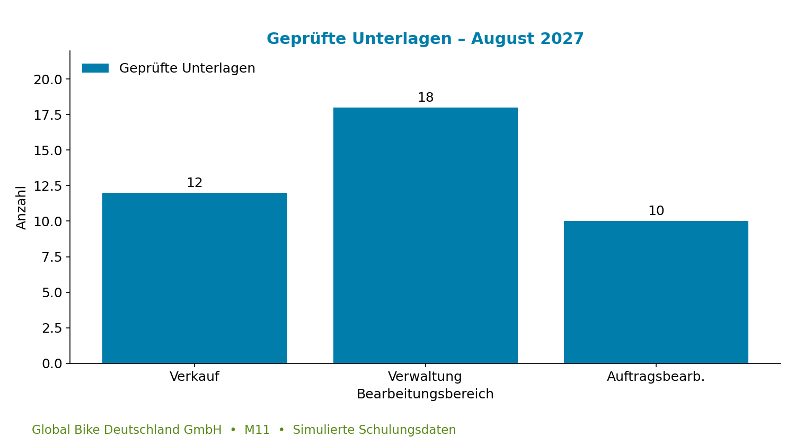
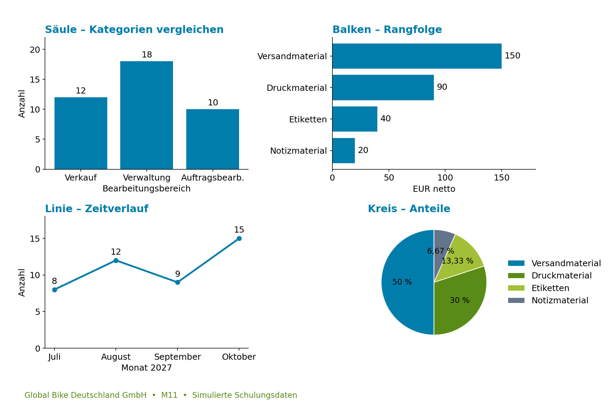
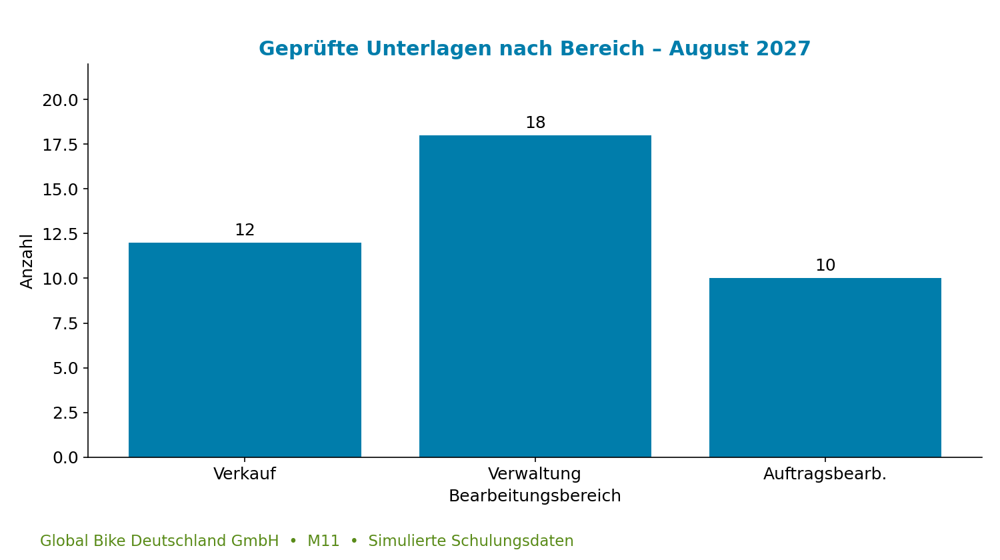
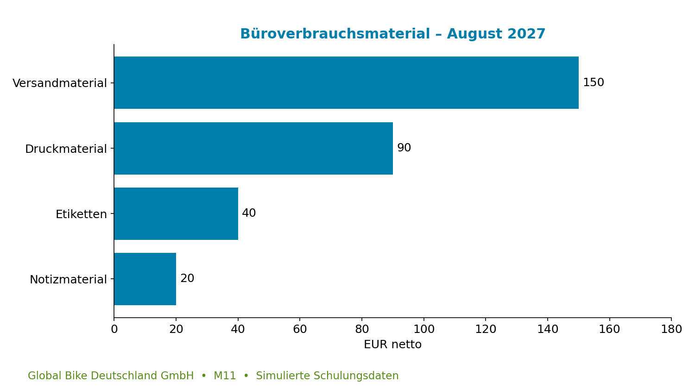
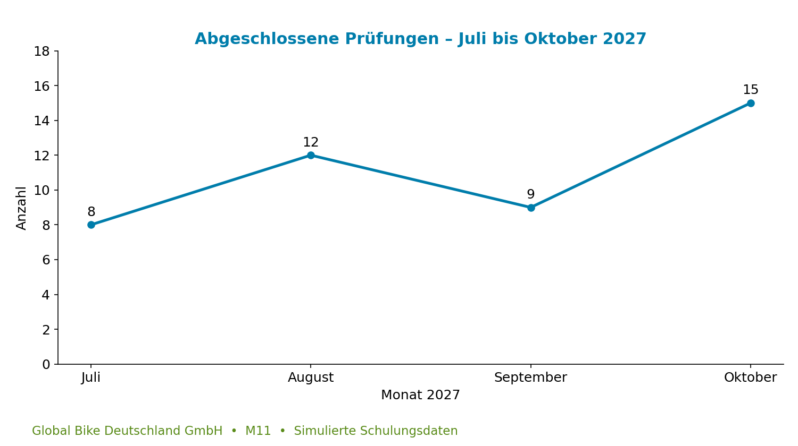
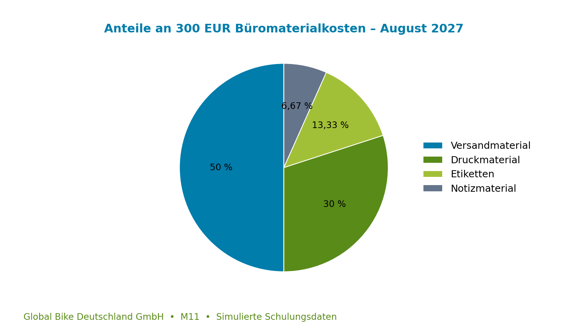
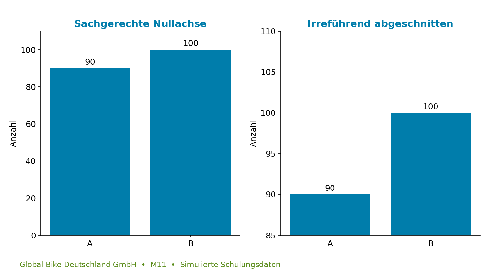

# M11 – Diagrammtypen kennen, unterscheiden und begründet auswählen

Global Bike Deutschland GmbH – Verwaltung

## 1. Warum grafische Auswertungen?

In internen Besprechungen benötigt die Verwaltung schnell verständliche Informationen. Eine Tabelle liefert genaue Einzelwerte; ein Diagramm macht Unterschiede, Entwicklungen und Größenverhältnisse sichtbar. Beide Darstellungen ergänzen sich. Ein Diagramm ersetzt weder die Quelldaten noch die Prüfung der Berechnungen. Eine optisch ansprechende Grafik ist nur dann nützlich, wenn sie die betriebliche Frage korrekt beantwortet.

Die Beispiele in M11 sind eigenständige simulierte Schulungsdaten der Global Bike Deutschland GmbH, keine SAP-Daten. Die Ausgangsdaten aus M1 bleiben unverändert. Die Diagrammauswahl für das eigentliche Lernpaket bleibt offen.

## 2. Grundbegriffe

| Begriff            | Bedeutung                                                         |
|--------------------|-------------------------------------------------------------------|
| Diagrammtyp        | Grundform der grafischen Darstellung                              |
| Kategorie          | Bezeichnung eines dargestellten Merkmals, etwa Kostenart          |
| Datenreihe         | Zusammengehörige Werte, etwa monatliche Ausgaben                  |
| Datenpunkt         | Einzelner Wert einer Datenreihe                                   |
| Diagrammtitel      | Aussage über Inhalt und Zeitraum                                  |
| Achsentitel        | Bezeichnung der dargestellten Größe und gegebenenfalls Einheit    |
| Achsenbeschriftung | Kategorien oder Skalenwerte entlang einer Achse                   |
| Legende            | Zuordnung von Farben oder Symbolen zu Datenreihen bzw. Kategorien |
| Datenbeschriftung  | Wert oder Kategorie direkt am Datenpunkt                          |
| Skalierung         | Wertebereich und Abstände der Zahlenachse                         |

Bei Säulen- und Liniendiagrammen liegt die Kategorien- oder Zeitachse meist waagerecht, die Werteachse senkrecht. Beim Balkendiagramm ist dies umgekehrt. Ein Kreisdiagramm besitzt keine Achsen. Achsentitel werden dort nicht künstlich ergänzt; Kategorien und Anteile müssen dennoch eindeutig erkennbar sein.

## 3. Die vier grundlegenden Diagrammtypen

### 3.1 Säulendiagramm

Senkrechte Säulen zeigen die Größe von Werten durch ihre Höhe. Die Säulen stehen nebeneinander; jede gehört zu einer Kategorie oder einem Zeitpunkt.

**Stärken:** Größenunterschiede sind schnell erkennbar; wenige Kategorien oder Zeitpunkte lassen sich gut vergleichen; gruppierte Säulen ermöglichen den Vergleich mehrerer Datenreihen gleicher Einheit.

**Grenzen:** Viele oder lange Kategorienamen erschweren die Lesbarkeit. Bei vielen Zeitpunkten wird die Entwicklung unübersichtlich. Eine abgeschnittene Werteachse kann Unterschiede übertreiben.

Schulungsbeispiel: In einer internen Dokumentenprüfung wurden im August 12, 18 und 10 Unterlagen in drei Bearbeitungsbereichen geprüft. Die Säulen zeigen den Mengenvergleich. Die Anzahl allein erlaubt keine Aussage über Arbeitsqualität oder Arbeitsbelastung.

### 3.2 Balkendiagramm

Waagerechte Balken zeigen die Größe eines Wertes durch ihre Länge. Kategorien stehen links, Werte auf der waagerechten Achse.

**Stärken:** Besonders lesbar bei langen Kategorienamen; geeignet für Rangfolgen und Größenvergleiche; absteigende Sortierung macht Unterschiede schnell sichtbar.

**Grenzen:** Zeitliche Entwicklungen sind weniger unmittelbar erkennbar; zu viele Balken erschweren die Übersicht. Auch hier muss die Längenskala grundsätzlich bei null beginnen.

Schulungsbeispiel: Vier Arten von Büroverbrauchsmaterial verursachen im August 150, 90, 40 und 20 EUR netto. Die Beträge können absteigend verglichen werden. Der größte Betrag ist nicht automatisch eine unnötige Ausgabe.

### 3.3 Liniendiagramm

Datenpunkte werden in ihrer zeitlichen Reihenfolge durch Linien verbunden. Steigende, fallende und gleichbleibende Entwicklungen werden sichtbar.

**Stärken:** Trends und Schwankungen über mehrere Zeitpunkte; Vergleich mehrerer zeitlich ausgerichteter Datenreihen; kompakte Darstellung.

**Grenzen:** Ungeordnete Kategorien erhalten durch Verbindung eine irreführende Reihenfolge. Fehlende Werte sind nicht automatisch null. Bei unregelmäßigen Zeitabständen ist eine geeignete Datumsachse oder ein XY-Diagramm mit tatsächlichen Abständen erforderlich. Eine Linie zwischen Monatswerten beweist keine kontinuierlich gemessene Entwicklung zwischen diesen Punkten.

Schulungsbeispiel: In vier aufeinanderfolgenden Monaten wurden 8, 12, 9 und 15 interne Prüfungen abgeschlossen. Der letzte Wert ist der höchste; die Reihe steigt nicht durchgehend. Eine Prognose für den nächsten Monat ist daraus nicht gesichert.

### 3.4 Kreisdiagramm

Ein Kreis stellt ein Ganzes dar. Kreissektoren zeigen die Anteile einzelner Kategorien an diesem Ganzen. Der gesamte Kreis entspricht 100 Prozent.

**Stärken:** Wenige klar unterscheidbare Anteile sind leicht erkennbar; besonders geeignet für die Frage, welche Teile ein eindeutig definiertes Ganzes bilden.

**Grenzen:** Ähnliche Anteile sind schwer zu vergleichen; viele kleine Sektoren sind unübersichtlich. Negative Werte, mehrere unabhängige Gesamtheiten oder zeitliche Entwicklungen sind ungeeignet. Bei einer Gesamtsumme von null sind Anteile nicht definiert. Ein Kreisdiagramm zeigt normalerweise eine Datenreihe.

Schulungsbeispiel: Die vier Kostenarten aus Abschnitt 3.2 ergeben 300 EUR. Die Anteile betragen 50 %, 30 %, rund 13,33 % und rund 6,67 %. Das Diagramm zeigt Anteile an diesen 300 EUR, nicht an einem anderen Budget. Die Gesamtzeile darf nicht als zusätzlicher Sektor ausgewählt werden.

## 4. Vergleich der Einsatzmöglichkeiten

| Fragestellung                                          | Geeignete Grundform                        | Begründung                                |
|--------------------------------------------------------|--------------------------------------------|-------------------------------------------|
| Welche Kategorien haben größere oder kleinere Werte?   | Säulen oder Balken                         | Höhen bzw. Längen direkt vergleichbar     |
| Wie sieht eine Rangfolge mit langen Bezeichnungen aus? | Balken                                     | Kategorien bleiben gut lesbar             |
| Wie verändern sich Werte über die Zeit?                | Linie, bei wenigen Zeitpunkten auch Säulen | Verlauf bzw. einzelne Zeitwerte erkennbar |
| Wie setzt sich ein Gesamtbetrag zusammen?              | Kreis, alternativ Balken mit Anteilen      | Teile eines definierten Ganzen            |
| Wie lauten exakte Einzelwerte?                         | Tabelle, ergänzend Diagramm                | Präzise Werte bleiben verfügbar           |

Mehrere Diagrammtypen können fachlich geeignet sein. Die Wahl hängt von der Fragestellung, den Ausgangsdaten und der Zielgruppe ab. Ein Diagrammtyp ist nicht allein deshalb richtig, weil Excel ihn empfiehlt.

## 5. Entscheidungsweg

1.  Aussageziel klären: Vergleich, Rangfolge, zeitliche Entwicklung oder Anteil?
2.  Daten prüfen: Einheit, Zeitraum, Kategorien, Vollständigkeit, mögliche Summenzeilen.
3.  Zielgruppe berücksichtigen: Welche Information muss in einer Besprechung schnell erkennbar sein?
4.  Mindestens zwei grundsätzlich geeignete Darstellungen gedanklich vergleichen.
5.  Diagrammtyp auswählen und begründen.
6.  Prüfen, ob die Darstellung tatsächlich die gewünschte Aussage ermöglicht.

Begründungsstruktur: Aussageziel – Eigenschaften der Daten – Vorteil der gewählten Darstellung – Grenze einer Alternative. Eine bloße Aussage wie „Das sieht besser aus“ reicht nicht.

## 6. Daten für ein Diagramm vorbereiten

Die Datenquelle benötigt eindeutige Überschriften, zusammengehörige Kategorien und numerische Werte. Geldbeträge, Stückzahlen und Prozentwerte sind verschiedene Einheiten und dürfen nicht ohne sachliche Erklärung auf derselben Werteachse verglichen werden.

Beispiel für die unabhängigen August-Kosten:

| A: Kostenart    | B: Betrag netto EUR | C: Anteil |
|-----------------|--------------------:|----------:|
| Versandmaterial |                 150 |      50 % |
| Druckmaterial   |                  90 |      30 % |
| Etiketten       |                  40 |   13,33 % |
| Notizmaterial   |                  20 |    6,67 % |
| Gesamt          |                 300 |     100 % |

Bei Überschriften in Zeile 1 lautet B6 `=SUMME(B2:B5)` und C2 `=B2/$B$6`. C2 bis C5 kopieren und als Prozent formatieren. C6 kann mit `=SUMME(C2:C5)` kontrolliert werden. Die Prozentwerte intern nicht vorzeitig runden. Für ein Betragsdiagramm A1:B5 markieren, nicht die Gesamtzeile. Für ein Kreisdiagramm genügen ebenfalls die vier positiven Beträge; Excel berechnet die Sektoranteile aus ihrer Summe. Alternativ können die vier berechneten Anteile verwendet werden, nicht Beträge und Anteile zugleich.

Leere Werte bedeuten fehlende Information, nicht automatisch null. Vor der Darstellung klären, ob tatsächlich kein Vorgang vorliegt oder die Meldung fehlt. Bei gefilterten Daten prüfen, welche Zeilen im Diagramm erscheinen. Excel stellt ausgeblendete Zeilen standardmäßig häufig nicht dar; die Einstellung kann je nach Diagramm und Version geändert werden.

## 7. Klick-Anleitung: Diagrammtypen ausprobieren

Die folgenden Wege beziehen sich auf deutschsprachiges Desktop-Excel unter Windows. Menübezeichnungen können je nach Version abweichen. M12 vertieft die Gestaltung.

Allgemeiner Ablauf:

1.  Geeignete Daten einschließlich Überschriften markieren.
2.  Register Einfügen öffnen.
3.  In der Gruppe Diagramme die gewünschte Diagrammfamilie auswählen.
4.  Eine einfache 2D-Variante auswählen.
5.  Kategorien, Werte und Datenreihen mit der Quelle vergleichen.
6.  Diagrammtitel anpassen; erforderliche Achsentitel, Legende und Datenbeschriftungen ergänzen.
7.  Ergebnis mit der betrieblichen Fragestellung vergleichen.

| Diagrammtyp | Klickweg nach Markierung                                                                |
|-------------|-----------------------------------------------------------------------------------------|
| Säule       | Einfügen \> Säulen- oder Balkendiagramm einfügen \> 2D-Säule \> Gruppierte Säulen       |
| Balken      | Einfügen \> Säulen- oder Balkendiagramm einfügen \> 2D-Balken \> Gruppierte Balken      |
| Linie       | Einfügen \> Linien- oder Flächendiagramm einfügen \> 2D-Linie \> Linie mit Datenpunkten |
| Kreis       | Einfügen \> Kreis- oder Ringdiagramm einfügen \> 2D-Kreis                               |

Für eine Vorschau kann auch Einfügen \> Empfohlene Diagramme verwendet werden. Vorschläge fachlich prüfen.

## 8. Klick-Anleitung: Diagrammtyp ändern und Daten prüfen

Diagramm anklicken \> Diagrammentwurf \> Diagrammtyp ändern \> gewünschte Familie und Untertyp auswählen \> OK. Danach Datenzuordnung, Achsen, Legende und Beschriftungen erneut kontrollieren. Beim Wechsel zu einem Kreisdiagramm nur eine geeignete Datenreihe verwenden.

Wenn Kategorien und Datenreihen vertauscht sind: Diagrammentwurf \> Daten auswählen \> gegebenenfalls Zeile/Spalte wechseln. Im Dialog Datenquelle auswählen lassen sich Datenreihen und Kategorienbeschriftungen kontrollieren. Bei Kreisdiagrammen muss die Zuordnung der Kategorien zu den einzelnen Sektoren stimmen.

Für Diagrammelemente: Diagramm auswählen \> Diagrammentwurf \> Diagrammelement hinzufügen \> Diagrammtitel, Achsentitel, Legende oder Datenbeschriftungen. Alternativ kann bei unterstützten Desktop-Versionen das Pluszeichen neben dem Diagramm verwendet werden. Bei einem Kreisdiagramm Datenbeschriftungen formatieren und Kategorie bzw. Prozentsatz auswählen. Achsentitel sind nur bei Diagrammen mit Achsen sinnvoll. Eine Legende ist bei mehreren Datenreihen besonders wichtig; bei eindeutig direkt beschrifteten Einzelreihen kann sie redundant sein. Die Schulbuchanforderung an eine Legende wird in der technischen Übung berücksichtigt.

## 9. Aussagekraft und irreführende Darstellungen

Die beiden Säulendiagramme zeigen dieselben Werte. Bei einer Achse ab 85 erscheinen 100 und 90 sehr unterschiedlich, obwohl 100 nur rund 11,11 % größer als 90 ist. Säulen und Balken sollten deshalb grundsätzlich bei null beginnen. Bei Liniendiagrammen kann eine begründete, klar beschriftete andere Skalierung sinnvoll sein, um kleine Veränderungen sichtbar zu machen.

Weitere Fehlerquellen: 3D-Effekte verzerren Größenverhältnisse; ungleiche Zeitabstände werden als gleich dargestellt; Farben suggerieren eine Bewertung ohne Begründung; Summen werden neben ihren Bestandteilen als zusätzliche Kategorien aufgenommen; unterschiedliche Einheiten werden vermischt; eine abgeschnittene Zeitreihe verschweigt den Kontext.

Farben sparsam verwenden. Beschriftungen, Symbole oder unterschiedliche Linienarten ergänzen Farben, damit die Aussage nicht ausschließlich von der Farbwahrnehmung abhängt. Titel und Einheiten müssen auch im Ausdruck verständlich sein.

## 10. Betriebliche Interpretation

Eine fachliche Auswertung unterscheidet Beobachtung, Erklärung und Empfehlung. Beobachtung: Der Wert im Oktober ist höher als im September. Erklärung: Die Ursache ist aus den vier Monatswerten allein nicht bekannt. Empfehlung: Die Verwaltung sollte bei Bedarf zusätzliche Informationen zur Aufgabenmenge und Bearbeitung einholen.

Bei Kostenanteilen gilt dasselbe: Ein hoher Anteil beschreibt die Zusammensetzung, nicht die Wirtschaftlichkeit. Für Einsparentscheidungen fehlen beispielsweise Bedarf, Preisalternativen und Folgen für den Betriebsablauf.

## 11. Freiwilliges Anwendungsbeispiel

Unabhängige Schulungsdaten: Für eine Besprechung werden die Zahlen interner Dokumentenprüfungen von Juli bis Oktober (8, 12, 9, 15) sowie die August-Kostenarten aus Abschnitt 6 betrachtet.

Freiwillige Erkundung: Die Monatswerte als Säulen und als Linie skizzieren oder in einer eigenen Übungsdatei darstellen. Die Kostenarten als Balken und Kreis darstellen. Jeweils vergleichen, welche Aussage schneller erkennbar ist. Die Werte bleiben bei einem Wechsel des Diagrammtyps gleich. Eine begründete Auswahl ist wichtiger als eine möglichst große Zahl von Diagrammen.

Kontrollhinweis: Für den zeitlichen Verlauf ist die Linie besonders anschaulich, für den Vergleich einzelner Monatswerte sind auch Säulen geeignet. Für die Rangfolge der Kostenarten sind Balken geeignet, für die Zusammensetzung der 300 EUR ein Kreis. Andere begründete Darstellungen sind möglich. Keine zusätzliche Abgabe.

## 12. Typische Fehler und Abhilfe

| Fehler                               | Abhilfe                                   |
|--------------------------------------|-------------------------------------------|
| Diagramm ohne konkrete Fragestellung | Aussageziel zuerst bestimmen              |
| Gesamtzeile als Kreissektor          | Nur Bestandteile markieren                |
| Zeitwerte unsortiert                 | Chronologisch ordnen                      |
| Unverbundene Kategorien als Linie    | Säulen oder Balken prüfen                 |
| Negative Beträge im Kreis            | Andere Darstellung wählen                 |
| Fehlende Werte als null              | Bedeutung klären                          |
| Abgeschnittene Säulenachse           | Nullpunkt herstellen                      |
| Einheit fehlt                        | Titel oder Achsentitel ergänzen           |
| Datenreihen vertauscht               | Datenquelle kontrollieren                 |
| Zu viele Sektoren                    | Balken oder begründete Gruppierung prüfen |
| 3D-Effekte                           | Einfache 2D-Darstellung                   |
| Legende unverständlich               | Aussagekräftige Reihenbezeichnungen       |
| Filter unbemerkt aktiv               | Sichtbare Daten und Quelle prüfen         |
| Ursache aus Diagramm behauptet       | Beobachtung und Erklärung trennen         |

## 13. Qualitätskontrolle

Freiwillige Prüfhilfe: Stimmen alle dargestellten Werte mit der Quelle überein? Sind Zeitraum und Einheit erkennbar? Ist der Diagrammtyp begründet? Sind Kategorien, Achsen und Datenreihen eindeutig? Sind Anteile auf das richtige Ganze bezogen? Sind Skalierung und Zeitabstände sachgerecht? Bleibt die Darstellung auch ohne Farbe verständlich? Sind Beobachtungen von Vermutungen getrennt? Wird die Quelle bei Änderungen korrekt aktualisiert? Bleibt die Arbeitsmappe erweiterbar?

Die Anforderungen an Formeln und Wiederverwendbarkeit aus den Schulbuchseiten werden durch M5–M8 und M14 unterstützt. Die technische Gestaltung und die Druckaufbereitung werden in M12 und M13 vertieft.

## 14. Freiwillige Selbstkontrolle

1.  Warum ergänzen Diagramme eine Tabelle?
2.  Worin unterscheiden sich Säulen und Balken?
3.  Welcher Typ ist für lange Kategorienamen oft geeignet?
4.  Welche Eigenschaft macht eine Linie für Zeitreihen nützlich?
5.  Warum ist eine Linie für ungeordnete Kostenarten ungeeignet?
6.  Welche Voraussetzungen hat ein Kreisdiagramm?
7.  Wie groß ist der Anteil von 90 EUR an 300 EUR?
8.  Warum darf die Gesamtzeile nicht als Kreissektor erscheinen?
9.  Was unterscheidet Achsentitel und Achsenbeschriftung?
10. Welche Aufgabe hat die Legende?
11. Warum sollten Säulen bei null beginnen?
12. Sind fehlende Monatswerte automatisch null?
13. Wo lässt sich ein Diagrammtyp nachträglich ändern?
14. Warum ist ein hoher Kostenanteil kein Beweis für Einsparpotenzial?
15. Welche Kriterien gehören in eine Diagrammbegründung?
16. Kann ein Säulendiagramm für Monatswerte ebenfalls sinnvoll sein?

**Kontrollhinweise**

1.  Muster werden sichtbar, genaue Einzelwerte bleiben in der Tabelle.
2.  Senkrechte Säulen, waagerechte Balken.
3.  Balkendiagramm.
4.  Zeitlich geordnete Punkte werden verbunden.
5.  Die Verbindung suggeriert einen Verlauf ohne sachliche Reihenfolge.
6.  Nichtnegative Bestandteile eines eindeutigen Ganzen mit positiver Summe.
7.  30 %.
8.  Das Ganze würde zusätzlich zu seinen Teilen gezählt.
9.  Titel bezeichnet Größe und Einheit; Beschriftung zeigt Kategorien oder Skalenwerte.
10. Farben oder Symbole den Reihen bzw. Kategorien zuordnen.
11. Damit Längenverhältnisse nicht verzerrt werden.
12. Nein, fehlende Meldungen müssen geklärt werden.
13. Diagrammentwurf \> Diagrammtyp ändern.
14. Bedarf und Alternativen sind nicht bekannt.
15. Aussageziel, Daten, Zielgruppe, Vorteil und Grenze einer Alternative.
16. Ja, besonders für den direkten Vergleich weniger Monatswerte.

Keine zusätzliche Abgabe oder Bewertung.

## 15. Weiterführende Materialien

M4 Zahlenformate, M6 Funktionen, M7 Zellbezüge, M8 Anteile, M10 Sortieren und Filtern. M12 Diagramme erstellen und gestalten, M13 Seitenlayout und Druck, M14 Qualitätskontrolle. M11 bleibt während der gesamten Lernsituation verfügbar.
