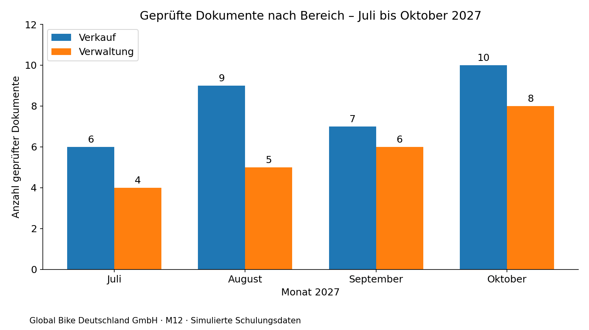

# M12 – Diagramme in Excel erstellen, gestalten und aktualisieren

Global Bike Deutschland GmbH – Verwaltung

## 1. Betrieblicher Nutzen

Für interne Besprechungen benötigt die Verwaltung verständliche, überprüfbare und wiederverwendbare Auswertungen. M11 unterstützt die Auswahl des Diagrammtyps. M12 erklärt die technische Umsetzung. Die verbindlichen Ausgangsdaten stehen in M1. Alle folgenden Beispiele sind davon unabhängige simulierte Schulungsdaten, keine SAP-Daten und keine Lösungen des Hauptfalls. Die Diagrammwahl für das Lernpaket bleibt offen.

Die Klickwege beziehen sich auf deutschsprachiges Desktop-Excel unter Windows. Je nach Version können Bezeichnungen und Symbole abweichen. Die Abbildungen sind schematische Lernhilfen, keine Originalscreenshots.

## 2. Eine geeignete Datenquelle vorbereiten

Beispiel: Die Verwaltung erfasst für eine separate interne Schulung die Anzahl geprüfter Dokumente in zwei Bearbeitungsbereichen.

| A: Monat  | B: Verkauf | C: Verwaltung | D: Gesamt |
|-----------|-----------:|--------------:|----------:|
| Juli      |          6 |             4 |        10 |
| August    |          9 |             5 |        14 |
| September |          7 |             6 |        13 |
| Oktober   |         10 |             8 |        18 |

Die Überschriften stehen in Zeile 1. In D2 steht `=SUMME(B2:C2)`. Die Formel wird bis D5 kopiert. Die Werte in B und C sind Eingaben, D enthält berechnete Ergebnisse. Bei einer Änderung der Eingaben muss die Summe automatisch neu berechnet werden.

Für den Vergleich der Bereiche eignet sich A1:C5. Die Gesamtspalte wird nicht zusätzlich als gleichwertiger Bereich dargestellt. Für eine Darstellung der Gesamtentwicklung werden Monat und Gesamt ausgewählt. Die getrennten Bereiche A1:A5 und D1:D5 können bei gedrückter Strg-Taste markiert werden; falls Excel die Zuordnung nicht richtig erkennt, hilft der Dialog Daten auswählen. Alternativ kann eine zusammenhängende, formelbasierte Auswertungstabelle mit Monat und Gesamt angelegt werden.

Keine Leerzeilen, verbundenen Zellen oder Zwischensummen im ausgewählten Datenbereich. Überschriften müssen eindeutig sein. Zahlen dürfen nicht als Text gespeichert sein. Fehlende Werte sind nicht automatisch null. Bei gefilterten Listen ist zu prüfen, welche Werte tatsächlich dargestellt werden.

## 3. Klick-Anleitung: Säulendiagramm erstellen

1.  Übungsdaten in ein separates Arbeitsblatt eingeben und Summenformeln ergänzen.
2.  A1:C5 markieren.
3.  Register Einfügen öffnen.
4.  In der Gruppe Diagramme auf Säulen- oder Balkendiagramm einfügen klicken.
5.  Unter 2D-Säule die Variante Gruppierte Säulen wählen.
6.  Diagramm anklicken. Die kontextbezogenen Register Diagrammentwurf und Format erscheinen.
7.  Diagrammtitel anklicken und einen aussagekräftigen Titel eingeben.
8.  Kategorien, Datenreihen und Werte mit der Quelle vergleichen.
9.  Diagramm an eine freie Stelle ziehen; Größe über die Eckpunkte verändern.
10. Arbeitsmappe speichern.

Erwartetes Ergebnis: vier Monatsgruppen mit je zwei Säulen. Die Reihen heißen Verkauf und Verwaltung. Die Höhen entsprechen den acht Eingabewerten. Die Werteachse beginnt bei null.

## 4. Klick-Anleitungen für weitere Diagrammtypen

### Balken

Für eine Rangfolge werden in einem unabhängigen Schulungsbeispiel drei Arten von Büroverbrauchsmaterial verglichen: Versandmaterial 120 EUR, Druckmaterial 80 EUR, Etiketten 40 EUR netto. Die Überschriften lauten Kostenart und Betrag netto EUR.

Daten samt Überschriften markieren \> Einfügen \> Säulen- oder Balkendiagramm einfügen \> 2D-Balken \> Gruppierte Balken. Die Kategorien stehen auf der senkrechten Achse. Wenn die größte Kategorie unten erscheint: Rechtsklick auf Kategorienachse \> Achse formatieren \> Kategorien in umgekehrter Reihenfolge. Anschließend die Position der Werteachse prüfen.

### Linie

Für die Entwicklung der Gesamtzahl aus Abschnitt 2 Monat und Gesamt auswählen \> Einfügen \> Linien- oder Flächendiagramm einfügen \> 2D-Linie \> Linie mit Datenpunkten. Die vier Werte lauten 10, 14, 13 und 18. Zeitpunkte chronologisch anordnen. Die Linie zeigt keine durchgehend steigende Entwicklung.

### Kreis

Für die Zusammensetzung der 240 EUR aus dem Balkenbeispiel die drei Kostenarten und Beträge einschließlich Überschriften markieren \> Einfügen \> Kreis- oder Ringdiagramm einfügen \> 2D-Kreis. Die Gesamtzeile nicht markieren. Die Anteile betragen 50 %, rund 33,33 % und rund 16,67 %. Keine Achsentitel ergänzen, da ein Kreisdiagramm keine Achsen hat.

## 5. Diagrammtitel, Achsentitel und Legende

Ein guter Titel beantwortet, was dargestellt wird und auf welchen Zeitraum sich die Werte beziehen. Beispiel: Geprüfte Dokumente nach Bearbeitungsbereich – Juli bis Oktober 2027. Eine Überschrift wie Diagramm 1 ist nicht aussagekräftig.

Klickweg: Diagramm auswählen \> Diagrammentwurf \> Diagrammelement hinzufügen \> Diagrammtitel \> Über Diagramm. Titeltext anklicken und ersetzen.

Für Achsentitel: Diagrammentwurf \> Diagrammelement hinzufügen \> Achsentitel \> Primär horizontal bzw. Primär vertikal. Textfelder anklicken und beschriften. Im Säulenbeispiel lautet die horizontale Achse Monat 2027, die vertikale Anzahl geprüfter Dokumente. Beim Balkendiagramm liegt die Werteachse horizontal.

Für die Legende: Diagrammentwurf \> Diagrammelement hinzufügen \> Legende \> geeignete Position wählen, etwa unten. Die Legende darf keine Daten verdecken. Bei mehreren Reihen sind verständliche Reihenbezeichnungen erforderlich. Eine Legende mit Reihe1 und Reihe2 deutet auf fehlende oder falsch zugeordnete Überschriften hin. Bei einem Kreisdiagramm ordnet sie Kategorien den Sektoren zu.

## 6. Datenbeschriftungen und Zahlenformate

Diagramm auswählen \> Diagrammentwurf \> Diagrammelement hinzufügen \> Datenbeschriftungen \> geeignete Position. Bei Säulen eignen sich häufig Beschriftungen am äußeren Ende. Bei Linien können Werte oberhalb der Datenpunkte stehen. Bei vielen Werten kann eine Beschriftung jedes Punktes die Lesbarkeit verschlechtern.

Rechtsklick auf eine Datenbeschriftung \> Datenbeschriftungen formatieren \> Beschriftungsoptionen bzw. Zahl. Geldbeträge mit geeigneter Währungsdarstellung und Stückzahlen ohne unnötige Nachkommastellen anzeigen. Die Formatierung ändert nicht den gespeicherten Wert.

Beim Kreisdiagramm Datenbeschriftungen hinzufügen \> Rechtsklick \> Datenbeschriftungen formatieren \> Prozentsatz aktivieren; bei Bedarf Kategoriename aktivieren und Wert deaktivieren. Prozentwerte mit sinnvoller Genauigkeit anzeigen. Rundungsbedingt können angezeigte Anteile von 100 % geringfügig abweichen.

## 7. Achsen und Skalierung

Rechtsklick auf die Werteachse \> Achse formatieren \> Achsenoptionen. Unter Grenzen können Minimum und Maximum eingestellt werden; unter Einheiten die Hauptintervalle. Bei Säulen und Balken grundsätzlich Minimum 0 verwenden. Das Maximum muss alle Werte einschließen. Automatische Grenzen sind bei veränderlichen Daten häufig sinnvoller als feste Obergrenzen.

Für das Säulenbeispiel ist ein Maximum von 12 mit Hauptintervall 2 für die ursprünglichen Einzelwerte möglich. Bei späteren größeren Werten muss eine feste Obergrenze angepasst oder auf Automatisch zurückgesetzt werden.

Bei Linien kann eine andere klar erkennbare Skalierung begründet sein. Zeitachsen müssen die zeitlichen Abstände sachgerecht abbilden. Für Monatsnamen als Text ist eine Kategorienachse mit gleichmäßigen Monatsabständen geeignet. Bei unregelmäßigen Datumsabständen echte Datumswerte und eine geeignete Datumsachse oder ein XY-Diagramm prüfen.

Rechtsklick auf Achse \> Achse formatieren \> Zahl: passendes Zahlenformat wählen. Gitternetzlinien über Diagrammelement hinzufügen sparsam einsetzen. Keine unnötige zweite Werteachse verwenden.

## 8. Datenreihen bearbeiten und Diagrammtyp wechseln

Diagramm anklicken \> Diagrammentwurf \> Daten auswählen. Im Dialog Datenquelle auswählen stehen die Legendeneinträge (Reihen) und horizontalen Achsenbeschriftungen.

- Bearbeiten einer Reihe: Namen und Wertebereich kontrollieren. Im Beispiel Verkauf: Name B1, Werte B2:B5.
- Hinzufügen: eine neue zusammengehörige Datenreihe auswählen; Kategorien und Anzahl der Werte müssen passen.
- Entfernen: überflüssige Reihe auswählen und entfernen. Dadurch werden die Quelldaten nicht gelöscht.
- Horizontale Achsenbeschriftungen bearbeiten: A2:A5 für die vier Monate auswählen.
- Zeile/Spalte wechseln: wenn Excel Monate und Bearbeitungsbereiche vertauscht hat. Anschließend prüfen, ob die gewünschte Aussage wiedergegeben wird.

Diagrammentwurf \> Diagrammtyp ändern \> geeignete Familie und Untertyp \> OK. Beim Wechsel zu einem Kreisdiagramm zuerst sicherstellen, dass nur eine geeignete Reihe mit Teilen eines Ganzen vorliegt. Ein Typwechsel ändert die Darstellung, nicht die zugrunde liegenden Zahlen.

## 9. Zweckmäßige Gestaltung

Diagramm auswählen \> Diagrammentwurf \> Diagrammformatvorlagen oder Farben ändern. Eine schlichte 2D-Darstellung bevorzugen. Farben müssen Reihen unterscheiden, dürfen aber keine unbegründete Bewertung suggerieren. Für dieselbe Datenreihe in mehreren Diagrammen möglichst dieselbe Farbe verwenden. Zusätzlich direkte Beschriftungen oder unterschiedliche Linienarten nutzen.

Einzelne Datenreihen formatieren: Reihe anklicken \> Rechtsklick \> Datenreihen formatieren \> Füllung und Linie. Bei Linien können Markierungen und Stricharten ergänzt werden. Bei Säulen lässt sich die Abstandsbreite anpassen; Säulen sollen weder unnötig schmal sein noch miteinander verschmelzen.

Diagrammfläche und Zeichnungsfläche unterscheiden: Die Diagrammfläche umfasst das gesamte Objekt, die Zeichnungsfläche den Bereich der dargestellten Daten. Rechtsklick auf die jeweilige Fläche \> formatieren. Dezenter Hintergrund, gut lesbare Schrift und ausreichender Kontrast unterstützen die Aussage. Keine 3D-Effekte, dekorativen Schatten oder unnötigen Rahmen.

## 10. Diagramme verschieben und für Besprechungen vorbereiten

Diagramm am Rand anklicken und ziehen. Eckpunkte zum Größenändern verwenden. Für ein eigenes Diagrammblatt: Diagrammentwurf \> Diagramm verschieben \> Neues Blatt \> Namen vergeben. Alternativ als Objekt in einem vorhandenen Arbeitsblatt platzieren.

Für eine Besprechung sollen Tabelle und Diagramm gut lesbar sein. Erste Kontrolle über Datei \> Drucken. Bei Bedarf Seitenlayout \> Ausrichtung \> Querformat und geeigneten Druckbereich wählen. Nicht blind auf eine Seite verkleinern: Schrift und Beschriftungen müssen lesbar bleiben. M13 behandelt Druckbereich, Skalierung und Seitenaufteilung ausführlich.

Beim Kopieren in ein anderes Office-Dokument zwischen verknüpftem Diagramm, eingebettetem Diagramm und Bild unterscheiden. Ein Bild ist statisch. Verknüpfungen können bei verschobenen Dateien nicht mehr funktionieren. Für die wiederverwendbare Excel-Arbeitsmappe bleibt das ursprüngliche Diagramm erhalten.

## 11. Automatische Aktualisierung bestehender Werte

Ein Excel-Diagramm ist mit seinem Datenbereich verbunden. Änderungen innerhalb dieses Bereichs werden normalerweise automatisch dargestellt, sofern Formeln neu berechnet werden.

Freiwilliger Test in der separaten Übungsdatei: B3 (Verkauf im August) von 9 auf 11 ändern. D3 muss von 14 auf 16 steigen. Im Säulendiagramm muss die August-Säule Verkauf von 9 auf 11 steigen; im Diagramm der Gesamtentwicklung muss der Augustwert 16 erscheinen. Danach B3 wieder auf 9 setzen. Die Hauptfalldaten werden nicht verändert.

Wenn Formeln nicht aktualisiert werden: Formeln \> Berechnungsoptionen \> Automatisch prüfen. Gegebenenfalls F9 zur Neuberechnung verwenden. Wenn nur das Diagramm unverändert bleibt, Datenquelle, Filter und feste Achsengrenzen kontrollieren.

## 12. Neue Zeilen und wiederverwendbare Datenquellen

Eine Änderung vorhandener Werte ist nicht dasselbe wie eine Erweiterung des Datenbereichs. Ein Diagramm mit festem Bereich A1:C5 berücksichtigt eine neue Zeile 6 nicht zuverlässig automatisch.

Möglichkeit A: Diagramm auswählen \> Diagrammentwurf \> Daten auswählen \> Datenbereich bzw. Reihen und Kategorien bis Zeile 6 erweitern. Auch die Summenformel muss bis D6 reichen.

Möglichkeit B: Ausgangsdaten A1:D5 markieren \> Start \> Als Tabelle formatieren (alternativ Strg+T) \> Tabelle hat Überschriften aktivieren \> OK. Ein Diagramm aus den benötigten Spalten dieser Excel-Tabelle erstellen. Unterhalb der Tabelle eine neue Zeile ergänzen. Excel-Tabellen erweitern sich bei entsprechender Einstellung normalerweise automatisch; berechnete Spalten übernehmen häufig die Formel. Diagramme auf Basis dieser Tabelle können die Erweiterung automatisch übernehmen. Das Ergebnis muss geprüft werden, insbesondere bei getrennten Auswertungsbereichen.

Freiwilliger Erweiterungstest: November, Verkauf 8, Verwaltung 7. Erwartete Summe 15. November muss in der gewünschten Darstellung erscheinen. Falls nicht, Datenquelle und Tabellengröße kontrollieren. Anschließend Testzeile entfernen und ursprünglichen Zustand prüfen.

Eine Excel-Tabelle ist nicht automatisch eine fertige Auswertung: Bei Rohdaten mit vielen Einzelvorgängen sind zunächst geeignete Zusammenfassungen mit den bereits erlernten Funktionen erforderlich. Diagramme sollen auf nachvollziehbaren Auswertungswerten beruhen, nicht auf manuell nachgetragenen Ergebnissen.

## 13. Fehlersuche

| Beobachtung                              | Mögliche Ursache                        | Abhilfe                                       |
|------------------------------------------|-----------------------------------------|-----------------------------------------------|
| Reihe1 statt Verkaufsbezeichnung         | Überschrift nicht ausgewählt            | Reihenname auf B1 beziehen                    |
| Monate fehlen                            | Kategorienbereich falsch                | A2:A5 zuordnen                                |
| Gesamt erscheint als dritter Bereich     | Zu großer Datenbereich                  | Gesamt aus Reihen entfernen                   |
| Diagramm bleibt nach Eingabe unverändert | Falsche Quelle oder manuelle Berechnung | Quelle und Berechnungsoptionen prüfen         |
| Neue Zeile fehlt                         | Fester Bereich                          | Bereich erweitern oder Tabelle prüfen         |
| Werte erscheinen als null                | Zahl als Text oder fehlende Werte       | Datentyp und Bedeutung prüfen                 |
| Linie unterbrochen                       | Leere Zelle                             | Fehlende Daten klären; Anzeigeoptionen prüfen |
| Balken abgeschnitten                     | Festes Maximum zu klein                 | Grenze erhöhen oder automatisch setzen        |
| Anteile unplausibel                      | Gesamtzeile mit ausgewählt              | Nur Bestandteile auswählen                    |
| Legende verdeckt Daten                   | Ungünstige Position                     | Legende verschieben                           |
| Beschriftungen überlappen                | Zu viele Elemente                       | Größe, Position oder Auswahl anpassen         |
| Filter verändert Grafik                  | Ausgeblendete Zeilen                    | Sichtbare Daten prüfen                        |
| Geldwerte ohne Einheit                   | Fehlender Titel oder Format             | Einheit ergänzen                              |
| Grafik im Ausdruck unlesbar              | Zu starke Skalierung                    | Layout und Druckvorschau prüfen               |

Bei leeren oder ausgeblendeten Zellen: Diagrammentwurf \> Daten auswählen \> Ausgeblendete und leere Zellen. Verfügbare Optionen hängen vom Diagrammtyp und der Excel-Version ab. Fehlende Daten nicht ohne sachlichen Grund als null darstellen.

## 14. Freiwillige praktische Erkundung

In einer separaten Übungsdatei können die Daten aus Abschnitt 2 verwendet werden. Eine mögliche Erkundungsfolge: Formeln ergänzen, zwei Diagrammtypen vergleichen, Titel und Legende gestalten, einen Wert ändern, eine Zeile ergänzen und beide Änderungen rückgängig machen. Die Wahl des geeigneten Typs ist anhand des Aussageziels zu begründen. Für den Bereichsvergleich sind gruppierte Säulen plausibel; für die Gesamtentwicklung eine Linie. Andere fachlich begründete Darstellungen sind möglich.

Eine eigene kurze Klick-Anleitung kann als persönliche Gedächtnisstütze dienen. Sie enthält Ausgangsdaten, Menüfolge, erwartetes Ergebnis und Kontrolle. Keine zusätzliche Pflichtabgabe, keine KI und keine Bewertung.

## 15. Qualitätskontrolle vor der betrieblichen Nutzung

- [ ] Aussageziel und Diagrammtyp passen zusammen.
- [ ] Datenquelle, Zeitraum und Einheiten stimmen.
- [ ] Formeln berechnen die Werte nachvollziehbar.
- [ ] Kategorien und Datenreihen sind richtig zugeordnet.
- [ ] Titel, Achsentitel (falls vorhanden), Achsenbeschriftungen und Legende sind verständlich.
- [ ] Skalierung und Farben verzerren die Aussage nicht.
- [ ] Keine unbeabsichtigten Summenzeilen oder fehlenden Daten.
- [ ] Änderung eines Eingabewerts wirkt sich korrekt aus.
- [ ] Erweiterung um eine Zeile wurde geprüft.
- [ ] Teständerungen wurden rückgängig gemacht.
- [ ] Druckvorschau ist lesbar.
- [ ] Beobachtung, Erklärung und Empfehlung bleiben getrennt.

## 16. Freiwillige Selbstkontrolle

1.  Welcher Bereich zeigt im Beispiel die beiden Bearbeitungsbereiche ohne Gesamt?
2.  Welche Formel steht in D2?
3.  Wie wird ein gruppiertes Säulendiagramm eingefügt?
4.  Was bedeutet eine Legende?
5.  Wo werden Achsentitel ergänzt?
6.  Warum hat ein Kreisdiagramm keine Achsentitel?
7.  Wie wird ein Prozentwert am Kreissektor angezeigt?
8.  Warum beginnt die Werteachse bei Säulen grundsätzlich bei null?
9.  Wo werden falsche Datenreihen korrigiert?
10. Ändert ein Diagrammtypwechsel die Quelldaten?
11. Welcher August-Gesamtwert entsteht bei B3 = 11?
12. Warum erscheint eine neue Zeile möglicherweise nicht?
13. Welche Tastenkombination erstellt aus einem markierten Bereich eine Excel-Tabelle?
14. Welche Summe ergibt November mit 8 und 7?
15. Warum ist ein festes Achsenmaximum bei wachsenden Daten riskant?
16. Was ist bei fehlenden Werten zu beachten?
17. Wie wird die Drucklesbarkeit vorab geprüft?
18. Warum muss nach einem Aktualisierungstest der Ausgangszustand wiederhergestellt werden?

### Kontrollhinweise

1.  A1:C5.
2.  `=SUMME(B2:C2)`.
3.  Einfügen \> Säulen- oder Balkendiagramm \> Gruppierte Säulen.
4.  Zuordnung von Reihen bzw. Kategorien zu Farben oder Symbolen.
5.  Diagrammentwurf \> Diagrammelement hinzufügen \> Achsentitel.
6.  Es zeigt Sektoren eines Ganzen, keine Werte entlang von Achsen.
7.  Datenbeschriftungen formatieren \> Prozentsatz.
8.  Damit Höhenverhältnisse nicht verzerrt werden.
9.  Diagrammentwurf \> Daten auswählen.
10. Nein.
11. 16. 
12. Der feste Datenbereich endet möglicherweise in Zeile 5.
13. Strg+T.
14. 15. 
15. Größere Werte können abgeschnitten werden.
16. Bedeutung klären; nicht automatisch null einsetzen.
17. Datei \> Drucken.
18. Damit die verbindliche Datengrundlage nicht unbeabsichtigt verändert wird.

## 17. Weiterführende Materialien

M11 unterstützt die begründete Diagrammauswahl. M3, M5–M8 und M10 unterstützen Datenstruktur, Berechnungen und Auswertungen. M13 vertieft Seitenlayout und Druck, M14 Qualitätskontrolle und Wiederverwendbarkeit. M12 bleibt während der gesamten Lernsituation verfügbar.
