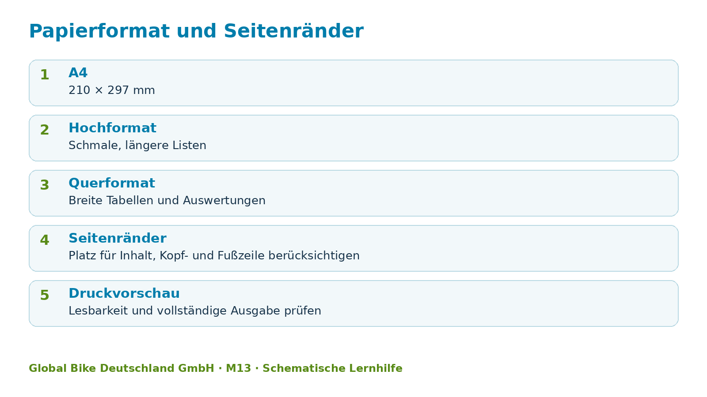
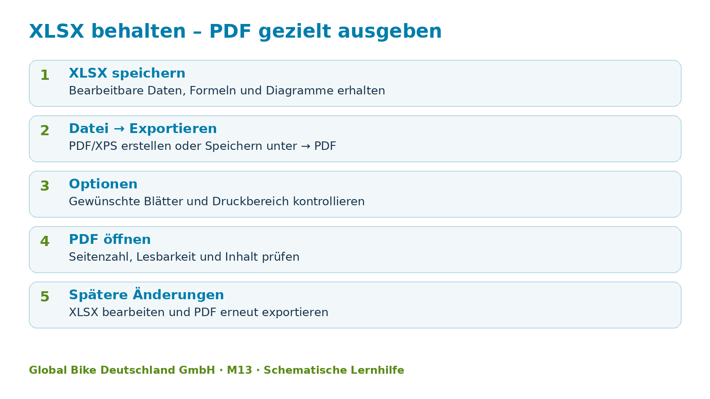

# M13 – Seitenlayout und Druckaufbereitung in Excel

Global Bike Deutschland GmbH – Verwaltung

## 1. Betrieblicher Nutzen

Eine fachlich richtige Tabelle ist nicht automatisch eine geeignete Besprechungsunterlage. Abgeschnittene Spalten, fehlende Überschriften, unlesbare Zahlen und versehentlich mitgedruckte interne Notizen erschweren Entscheidungen. Die Druckaufbereitung stellt sicher, dass die benötigten Informationen vollständig, verständlich und adressatengerecht vorliegen.

Die bearbeitbare Excel-Arbeitsmappe bleibt die Grundlage. Ein PDF ist eine Momentaufnahme und ersetzt weder Formeln noch Filter oder aktualisierbare Diagramme. M13 ergänzt M3 und M12. Die verbindlichen Ausgangsdaten stehen weiterhin in M1. Alle Beispiele in M13 sind davon unabhängige simulierte Schulungsdaten der Global Bike Deutschland GmbH, keine SAP-Daten und keine Hauptfalllösungen.

Die Klickwege beziehen sich auf deutschsprachiges Desktop-Excel unter Windows. Menünamen können je nach Version und Druckertreiber abweichen. Die Abbildungen sind schematische Lernhilfen, keine Originalscreenshots.

## 2. Arbeitsblatt, Druckseite und PDF unterscheiden

| Begriff            | Bedeutung                                                            |
|--------------------|----------------------------------------------------------------------|
| Arbeitsmappe       | Excel-Datei mit einem oder mehreren Arbeitsblättern                  |
| Arbeitsblatt       | Bearbeitungsfläche mit Zellen, Formeln und gegebenenfalls Diagrammen |
| Druckbereich       | Festgelegter Zellbereich, der ausgegeben werden soll                 |
| Papierformat       | Abmessungen des Ausgabeblatts, beispielsweise A4                     |
| Ausrichtung        | Hochformat oder Querformat                                           |
| Seitenrand         | Abstand zwischen Papierkante und nutzbarem Inhalt                    |
| Skalierung         | Verkleinerung oder Vergrößerung der Ausgabe, nicht der Zellwerte     |
| Seitenumbruch      | Grenze zwischen zwei Druckseiten                                     |
| Drucktitel         | Zeilen oder Spalten, die auf mehreren Druckseiten wiederholt werden  |
| Kopf- und Fußzeile | Wiederkehrende Angaben oberhalb oder unterhalb des Seiteninhalts     |
| Druckvorschau      | Kontrolle der vorgesehenen Ausgabe vor dem Drucken                   |
| PDF                | Datei mit festem Seitenlayout für die Weitergabe                     |

Die Normalansicht dient der Bearbeitung. Ansicht \> Seitenlayout zeigt die Aufteilung auf Papierseiten und Kopf- und Fußzeilen. Ansicht \> Umbruchvorschau zeigt die Seitenbegrenzungen. Die endgültige Kontrolle erfolgt über Datei \> Drucken. Der Bildschirmzoom verändert nur die Anzeige, nicht die Druckgröße.

## 3. Unabhängiges Schulungsbeispiel vorbereiten

Die Verwaltung erstellt für eine interne Schulung eine Übersicht über Büroverbrauchsmaterial im Juli 2027. In einer neuen Übungsmappe steht in A1 der Titel Büroverbrauchsmaterial – Juli 2027. Zeile 2 bleibt frei. In Zeile 3 stehen die Überschriften.

| A: Datum   | B: Material    | C: Menge | D: Einzelpreis netto | E: Gesamt netto |
|------------|----------------|---------:|---------------------:|----------------:|
| 05.07.2027 | Briefumschläge |        4 |               5,50 € |         22,00 € |
| 08.07.2027 | Etiketten      |        3 |               8,00 € |         24,00 € |
| 12.07.2027 | Druckpapier    |        5 |               6,40 € |         32,00 € |
| 19.07.2027 | Ordner         |        2 |               7,50 € |         15,00 € |

Die Daten stehen in Zeilen 4 bis 7. E4 enthält `=C4*D4`, bis E7 kopiert. D8 enthält Gesamt netto, E8 `=SUMME(E4:E7)` mit Ergebnis 93,00 EUR. Die Datumsspalte erhält ein Datumsformat, D und E ein Währungsformat mit zwei Nachkommastellen. Spaltenbreiten so einstellen, dass Überschriften und Werte sichtbar sind. Für die Schulung kann in G3 eine Notiz stehen: Nur interne Testnotiz. Sie gehört nicht zur Besprechungsunterlage.

Ein optionales Diagramm zu Material und Gesamtbetrag kann nach M11 und M12 aus B3:B7 und E3:E7 erstellt und innerhalb A10:E21 platziert werden. Die Summenzeile bleibt aus der Diagrammquelle ausgeschlossen. Das Beispiel zeigt nur einen möglichen Aufbau, nicht die Gestaltung des Hauptfalls.

## 4. Klick-Anleitung: Druckbereich festlegen und ändern

1.  Das gewünschte Arbeitsblatt aktivieren.
2.  Für die reine Tabelle A1:E8 markieren.
3.  Register Seitenlayout öffnen.
4.  Druckbereich \> Druckbereich festlegen wählen.
5.  Datei \> Drucken öffnen.
6.  Kontrollieren, dass Titel, Überschriften, vier Datensätze und Summe erscheinen, nicht aber die Testnotiz in G3.
7.  Mit dem Zurück-Pfeil zur Arbeitsmappe wechseln.
8.  Soll das optionale Diagramm mit ausgegeben werden, A1:E21 markieren und den Druckbereich erneut festlegen. Das Diagramm vollständig innerhalb des Bereichs platzieren.
9.  Druckvorschau erneut kontrollieren.

Druckbereich \> Druckbereich aufheben entfernt die gespeicherte Einschränkung, nicht die Daten. Danach kann Excel wieder den gesamten verwendeten Bereich ausgeben. Druckbereich hinzufügen kann einen bestehenden Bereich erweitern; getrennte Bereiche werden normalerweise auf getrennten Seiten gedruckt. Für eine gemeinsame Seite ist ein zusammenhängender Bereich zweckmäßiger.

Der Druckbereich wird mit der Arbeitsmappe gespeichert. Neue Zeilen außerhalb eines festgelegten Bereichs werden nicht automatisch zuverlässig berücksichtigt. Nach Erweiterungen ist die Einstellung zu prüfen.

Eine einmalige Alternative: Zellen markieren \> Datei \> Drucken \> unter Einstellungen Auswahl drucken. Das ist nicht dasselbe wie ein dauerhaft gespeicherter Druckbereich.

## 5. Papierformat, Ausrichtung und Seitenränder

### Papierformat

Seitenlayout \> Größe \> A4 auswählen. A4 misst 210 × 297 mm. Das Papierformat muss zum Drucker und zur vorgesehenen PDF-Ausgabe passen. Bei abweichenden Einstellungen können Seitenumbrüche anders ausfallen.

### Hoch- und Querformat

Seitenlayout \> Ausrichtung \> Hochformat oder Querformat. Hochformat bietet mehr Höhe, Querformat mehr Breite. Eine schmale Terminliste kann im Hochformat gut lesbar sein; eine breite Auswertung mit mehreren Spalten kann Querformat benötigen. Die Wahl hängt vom tatsächlichen Inhalt ab.

### Seitenränder

Seitenlayout \> Seitenränder \> Normal, Breit oder Schmal wählen. Unter Benutzerdefinierte Seitenränder lassen sich Abstände einzeln einstellen. Im Dialog Seite einrichten, Register Seitenränder, kann die Ausgabe horizontal oder vertikal zentriert werden. Horizontales Zentrieren eignet sich häufig für eine kleine Tabelle; vertikales Zentrieren ist nicht immer sinnvoll.

Ränder dürfen nicht so klein sein, dass der Drucker Inhalte abschneidet. Kopf- und Fußzeilen benötigen ebenfalls Platz. Nach jeder Änderung die Vorschau kontrollieren.

## 6. Skalierung: eine Seite oder mehrere lesbare Seiten?

Die Schulungsanforderung einer einseitigen Tabelle ist bei überschaubaren Daten sinnvoll. Eine große Liste auf eine einzige Seite zu zwingen, kann sie unbrauchbar machen.

Klickweg: Seitenlayout \> Gruppe An Format anpassen (je nach Version Skalierung). Breite und Höhe auswählen.

| Einstellung                      | Wirkung                                                                   |
|----------------------------------|---------------------------------------------------------------------------|
| Breite 1 Seite, Höhe 1 Seite     | Gesamter Druckbereich wird auf eine Seite angepasst                       |
| Breite 1 Seite, Höhe Automatisch | Alle Spalten passen in die Breite; mehrere Seiten nach unten sind möglich |
| Breite und Höhe Automatisch      | Keine feste Seitenzahl; Prozentmaßstab kann eingestellt werden            |
| Skalierung 100 %                 | Ausgabe in ursprünglicher Druckgröße, sofern keine Anpassung aktiv ist    |

Alternativ Datei \> Drucken \> Skalierungsmenü: Keine Skalierung, Blatt auf einer Seite darstellen, Alle Spalten auf einer Seite darstellen oder Alle Zeilen auf einer Seite darstellen. Die genaue Bezeichnung kann abweichen.

Für das kleine Beispiel zuerst A4 und passende Ausrichtung einstellen, dann die Vorschau betrachten. Nur bei Bedarf auf eine Seite skalieren. Für lange Listen ist eine Seite breit und automatisch viele Seiten hoch oft geeigneter. Bei unlesbarer Schrift zuerst unnötige Spalten aus der Ausgabe nehmen, Spaltenbreiten sinnvoll anpassen oder Querformat prüfen. Keine benötigten Daten aus der Arbeitsmappe löschen.

Skalierung verändert weder Zellwerte noch Formeln. Die angezeigte Prozentzahl ist abhängig von Druckbereich, Papierformat, Rändern und Druckertreiber. Es gibt keinen universell richtigen Prozentwert.

## 7. Seitenumbrüche kontrollieren

Ansicht \> Umbruchvorschau. Blaue Linien markieren Seitenbegrenzungen; gestrichelte Linien stehen typischerweise für automatische, durchgezogene für manuelle Begrenzungen beziehungsweise den äußeren Druckbereich. Seitenzahlen dienen der Orientierung und werden nicht als solche mitgedruckt.

Manuellen horizontalen Umbruch einfügen: Zeile unterhalb der gewünschten Trennstelle markieren \> Seitenlayout \> Umbrüche \> Seitenumbruch einfügen. Für einen vertikalen Umbruch die Spalte rechts der Trennstelle markieren. Wird eine einzelne Zelle gewählt, können beide Richtungen betroffen sein.

Umbruch entfernen: passende Zeile oder Spalte am manuellen Umbruch markieren \> Seitenlayout \> Umbrüche \> Seitenumbruch entfernen. Alle manuellen Umbrüche lassen sich über Alle Seitenumbrüche zurücksetzen entfernen. Automatische Umbrüche entstehen weiterhin durch das Seitenlayout.

In der Umbruchvorschau können Grenzen verschoben werden. Dadurch können sich Skalierung oder Druckbereich ändern. Bei der Anpassung auf eine feste Seitenzahl kann Excel manuelle Umbrüche ignorieren. Für bewusst gesetzte Umbrüche daher die feste Seitenanpassung aufheben und einen geeigneten Prozentmaßstab verwenden. Anschließend Datei \> Drucken prüfen.

## 8. Drucktitel bei mehrseitigen Listen

Eine Liste mit vielen Vorgängen benötigt auf jeder Seite verständliche Spaltenüberschriften. Drucktitel wiederholen vorhandene Zeilen oder Spalten, ohne die Daten zu duplizieren.

1.  Arbeitsblatt aktivieren; gegebenenfalls Zellbearbeitung beenden und Blattgruppierung aufheben.
2.  Seitenlayout \> Drucktitel öffnen.
3.  Im Dialog Seite einrichten das Register Blatt auswählen.
4.  Bei Wiederholungszeilen oben in das Eingabefeld klicken.
5.  Für die Beispielüberschrift Zeile 3 markieren. Der Bezug lautet `$3:$3`.
6.  Bei Bedarf Wiederholungsspalten links festlegen, beispielsweise `$A:$A` bei horizontal verteilten Seiten.
7.  OK wählen und in der Druckvorschau die zweite Seite kontrollieren.

Drucktitel sind nicht dasselbe wie Kopfzeilen. Sie enthalten tatsächliche Zellen des Arbeitsblatts. Ansicht \> Fenster fixieren hält Überschriften am Bildschirm sichtbar, wiederholt sie aber nicht automatisch im Ausdruck. Bei einem einseitigen Dokument ist die Wiederholung meist nicht nötig.

## 9. Kopf- und Fußzeilen einrichten

Kopf- und Fußzeilen können betriebliche Dokumente eindeutig kennzeichnen. Geeignet sind Unternehmensname, Dokumentbezeichnung, Berichtszeitraum, Seitenzahl und gegebenenfalls ein freigegebener Bearbeitungsstand.

Klickweg: Einfügen \> Kopf- und Fußzeile. Excel wechselt in die Seitenlayoutansicht. In den linken, mittleren oder rechten Abschnitt klicken. Text eingeben oder über das kontextbezogene Register Kopf- und Fußzeile die Felder Seitenzahl, Anzahl der Seiten, aktuelles Datum oder Blattname einfügen. Alternativ Seitenlayout \> Dialogfeld Seite einrichten \> Kopfzeile/Fußzeile \> Benutzerdefinierte Kopfzeile beziehungsweise Fußzeile.

Beispiel Kopfzeile links: Global Bike Deutschland GmbH. Mitte: Verwaltung. Fußzeile links: Schulungsübersicht Juli 2027. Rechts: Seite \[Seitenzahl\] von \[Anzahl der Seiten\]. Die eckigen Klammern stehen hier für einzufügende Excel-Felder, nicht für wörtlich einzutippenden Text. Die Felder werden über die Schaltflächen eingefügt.

Das automatisch eingefügte aktuelle Datum ist das Ausgabedatum, nicht der Berichtszeitraum. Für einen festen Berichtszeitraum daher Text verwenden. Dateipfad oder Benutzername nur aufnehmen, wenn dies betrieblich erforderlich und freigegeben ist. Kopf- und Fußzeilen können für jedes Blatt unterschiedlich eingerichtet werden.

## 10. Gitternetzlinien, Überschriften und Diagramme

Gitternetzlinien auf dem Bildschirm sind nicht automatisch gedruckte Rahmen. Seitenlayout \> Blattoptionen \> Gitternetzlinien \> Drucken aktiviert den Druck der Gitternetzlinien. Für eine professionelle Übersicht sind gezielt gesetzte Zellrahmen häufig übersichtlicher. Rahmen über Start \> Rahmenlinien einstellen.

Die Excel-Zeilen- und Spaltenköpfe (1, 2, 3 und A, B, C) lassen sich unter Seitenlayout \> Blattoptionen \> Überschriften \> Drucken einblenden. Für betriebliche Berichte werden sie normalerweise nicht benötigt. Fachliche Tabellenüberschriften müssen unabhängig davon vorhanden sein.

Für eine gemeinsame Ausgabe von Tabelle und Diagramm das Diagramm vollständig im Druckbereich positionieren. Falls es fehlt: Diagramm auswählen, über Rechtsklick auf die Diagrammfläche die Formatierungsoptionen und unter Größe und Eigenschaften die Einstellung Objekt drucken prüfen, sofern in der Version vorhanden. Vor dem Drucken eine Zelle anklicken, damit nicht versehentlich nur das ausgewählte Diagramm ausgegeben wird.

## 11. Druckvorschau und Ausgabeumfang

Datei \> Drucken (Strg+P) öffnen. Drucker beziehungsweise Ausgabeziel, Seitenzahl, Papierformat, Ausrichtung, Ränder und Skalierung kontrollieren. Mit den Seitennavigationspfeilen jede Seite ansehen. Die Vorschau kann vergrößert werden; diese Vergrößerung verändert nicht die Druckgröße.

Unter Einstellungen unterscheiden:

- Aktive Blätter drucken: aktuell ausgewählte Arbeitsblätter; bei gruppierten Blättern können mehrere betroffen sein.
- Gesamte Arbeitsmappe drucken: alle für den Druck berücksichtigten Arbeitsblätter; nicht für eine einzelne Besprechungsunterlage verwenden, wenn andere Blätter nicht benötigt werden.
- Auswahl drucken: markierte Zellen beziehungsweise ausgewähltes Objekt.
- Druckbereiche ignorieren: nur bewusst verwenden, wenn die gespeicherten Bereiche nicht gelten sollen.

Bei gefilterten Listen werden ausgeblendete Zeilen normalerweise nicht gedruckt. Eine SUMME über den gesamten Bereich kann trotzdem auch ausgeblendete Werte enthalten. Daher prüfen, ob Überschrift, Filterzustand und berechnete Summen dieselbe Aussage treffen. Filter oder ausgeblendete Spalten sind keine Zugriffssicherung für eine weitergegebene Excel-Datei.

Erst nach vollständiger Vorschau und gegebenenfalls betrieblicher Freigabe den Druck auslösen. Für freiwillige Schulungsversuche genügt die Vorschau; Papierverbrauch ist nicht erforderlich.

## 12. Klick-Anleitung: PDF erstellen und prüfen

1.  Excel-Arbeitsmappe im XLSX-Format speichern.
2.  Gewünschtes Blatt aktivieren und Druckbereich sowie Layout prüfen.
3.  Datei \> Exportieren \> PDF/XPS-Dokument erstellen \> PDF/XPS erstellen wählen. Alternativ Datei \> Speichern unter \> Dateityp PDF.
4.  Einen geeigneten Speicherort und einen eindeutigen Dateinamen wählen, beispielsweise GB_Schulung_Bueroverbrauch_Juli_2027.pdf.
5.  Unter Optionen den gewünschten Ausgabeumfang prüfen, etwa aktive Blätter oder Auswahl. Gespeicherten Druckbereich nicht unbeabsichtigt ignorieren.
6.  Für gut lesbare Ausgabe die Standardqualität wählen, sofern keine andere betriebliche Vorgabe gilt.
7.  Veröffentlichen beziehungsweise Speichern wählen.
8.  PDF separat öffnen. Seitenzahl, Titel, Zahlen, Einheiten, Diagramme, Seitenränder und Vollständigkeit kontrollieren.
9.  Prüfen, dass keine ungewollten internen Notizen oder zusätzlichen Blätter enthalten sind.

Die PDF-Datei ist nicht automatisch vertraulich oder manipulationssicher. Sie enthält keine weiterrechenbaren Excel-Formeln. Für spätere Aktualisierungen die XLSX-Datei bearbeiten und eine neue PDF-Fassung erzeugen. Eine alte PDF-Datei aktualisiert sich nicht automatisch. Vor Weitergabe betriebliche Berechtigungen und Empfängerkreis prüfen. Im Unterricht werden keine echten externen Empfänger angeschrieben.

## 13. Wiederverwendbare Druckaufbereitung

Eine universell einsetzbare Tabelle soll nicht für jeden Bericht neu aufgebaut werden müssen. Formeln, Zahlenformate, Überschriften und Diagramme bleiben erhalten. Die Druckeinstellungen werden in der XLSX-Datei gespeichert. Bei neuen Zeilen oder Spalten können Druckbereich, Drucktitel, Seitenzahl und Skalierung jedoch Anpassungen benötigen.

Freiwilliger Test in einer Kopie der Schulungsmappe: Eine zusätzliche Materialposition vor der Summenzeile einfügen, beispielsweise 2 Packungen Klebeband zu je 3,25 EUR. Die neue Zeilensumme beträgt 6,50 EUR, die Gesamtsumme 99,50 EUR. Die Summenformel muss den neuen Datenbereich einschließen. Wenn die neue Zeile nicht in der Druckvorschau erscheint, Druckbereich und Seitenaufteilung prüfen. Ein vorhandenes Diagramm muss ebenfalls auf die neue Position geprüft werden. Anschließend die Testkopie schließen oder die ursprünglichen Werte wiederherstellen.

Für die spätere Nutzung können die ursprüngliche Arbeitsmappe und eine eindeutig benannte Arbeitskopie getrennt gespeichert werden. Keine Hauptfalldaten für einen Test verändern.

## 14. Typische Fehler erkennen und beheben

| Beobachtung                             | Mögliche Ursache                                         | Abhilfe                                       |
|-----------------------------------------|----------------------------------------------------------|-----------------------------------------------|
| Letzte Spalte fehlt                     | Druckbereich zu klein                                    | Druckbereich neu festlegen                    |
| Zusätzliche leere Seite                 | Formatierung außerhalb der Tabelle oder falscher Bereich | Druckbereich und Umbruchvorschau prüfen       |
| Zahlen erscheinen als \####             | Spalte zu schmal oder nicht darstellbarer Datumswert     | Breite und Zellwert prüfen                    |
| Schrift extrem klein                    | Alles auf eine Seite skaliert                            | Breite 1, Höhe automatisch; Layout anpassen   |
| Überschrift fehlt ab Seite 2            | Keine Drucktitel                                         | Wiederholungszeilen festlegen                 |
| Seitenumbruch wird ignoriert            | Feste Seitenanpassung aktiv                              | Prozentmaßstab statt fester Seitenzahl prüfen |
| Diagramm fehlt                          | Außerhalb des Bereichs oder Objekt drucken deaktiviert   | Position und Eigenschaften prüfen             |
| Nur Diagramm wird gedruckt              | Diagramm ausgewählt                                      | Zelle anklicken und Ausgabeumfang prüfen      |
| Interne Notiz erscheint                 | Falscher Druckbereich                                    | Bereich und PDF-Inhalt kontrollieren          |
| Summe passt nicht zur gefilterten Liste | SUMME umfasst ausgeblendete Zeilen                       | Aussage und Berechnungsgrundlage prüfen       |
| PDF enthält weitere Blätter             | Gesamte Arbeitsmappe gewählt                             | Aktive Blätter oder Auswahl einstellen        |
| PDF zeigt alte Werte                    | Nach Änderung nicht neu exportiert                       | XLSX neu berechnen und PDF neu erzeugen       |
| Kopfzeile überlappt Inhalt              | Ränder zu klein                                          | Kopfzeilenabstand und Seitenränder anpassen   |
| Vorschau unterscheidet sich je Drucker  | Druckertreiber oder Papierformat                         | Zielgerät und Vorschau erneut prüfen          |

## 15. Freiwillige praktische Erkundung

Die separate Schulungsmappe aus Abschnitt 3 kann für eine kurze Erkundung genutzt werden. Eine mögliche Reihenfolge ist: Druckbereich für die Tabelle festlegen, Hoch- und Querformat vergleichen, die lesbarere Einstellung begründen, Kopf- und Fußzeile ergänzen und eine PDF-Probeausgabe kontrollieren. Bei einer längeren Kopie der Liste können Drucktitel und Seitenumbrüche erprobt werden. Die zusätzlichen Testdaten sind keine betrieblichen Ist-Daten.

Eine persönliche Klick-Anleitung kann die gewählten Einstellungen und Kontrollschritte festhalten. Die Erkundung ist freiwillig, unbewertet und keine zusätzliche Pflichtabgabe. Die Lernenden entscheiden im Hauptfall selbst über die geeignete Ausgabeform ihres Lernpakets. Keine KI.

## 16. Qualitätskontrolle

- [ ] Richtige Arbeitsmappe und aktueller Datenstand.
- [ ] Benötigte Tabellen und Diagramme vollständig.
- [ ] Druckbereich enthält keine unbeabsichtigten Notizen.
- [ ] Papierformat und Ausrichtung passen zum Inhalt.
- [ ] Seitenränder und Skalierung ermöglichen gute Lesbarkeit.
- [ ] Keine abgeschnittenen Werte oder unnötigen Leerseiten.
- [ ] Überschriften bei mehrseitigen Listen wiederholt.
- [ ] Kopf- und Fußzeilen sachgerecht und ohne unnötige interne Angaben.
- [ ] Zahlen, Einheiten, Filterzustand und Summen stimmen überein.
- [ ] Alle Seiten in der Druckvorschau geprüft.
- [ ] PDF nach Export separat geöffnet und kontrolliert.
- [ ] Bearbeitbare XLSX-Datei erhalten; Teständerungen zurückgesetzt.

## 17. Freiwillige Selbstkontrolle

1.  Worin unterscheiden sich Arbeitsblatt und Druckseite?
2.  Welcher Bereich umfasst im Schulungsbeispiel die reine Tabelle?
3.  Wie wird dieser Druckbereich gespeichert?
4.  Wie wird ein Druckbereich aufgehoben?
5.  Welche Maße hat A4?
6.  Wann kann Querformat sinnvoll sein?
7.  Welche Skalierung eignet sich häufig für lange, breite Listen?
8.  Ändert der Bildschirmzoom die Druckgröße?
9.  Wie wird ein manueller horizontaler Seitenumbruch eingefügt?
10. Was bedeutet `$3:$3` bei Drucktiteln?
11. Wiederholt Fenster fixieren automatisch Überschriften im Druck?
12. Worin unterscheiden sich Drucktitel und Kopfzeilen?
13. Wie wird die Druckvorschau geöffnet?
14. Warum kann eine gefilterte Liste eine unerwartete SUMME zeigen?
15. Wie lässt sich vermeiden, dass weitere Arbeitsblätter im PDF erscheinen?
16. Aktualisiert sich ein bereits exportiertes PDF automatisch?
17. Wie hoch ist die Gesamtsumme im ursprünglichen Schulungsbeispiel?
18. Wie hoch ist sie nach Ergänzung der Klebebandposition?
19. Was ist nach Erweiterung einer Tabelle am Druckbereich zu prüfen?
20. Warum ersetzt ein PDF die XLSX-Datei nicht?

### Kontrollhinweise

1.  Arbeitsblatt ist die Bearbeitungsfläche, Druckseite die auf Papier beziehungsweise im PDF ausgegebene Fläche.
2.  A1:E8.
3.  Seitenlayout \> Druckbereich \> Druckbereich festlegen.
4.  Seitenlayout \> Druckbereich \> Druckbereich aufheben.
5.  210 × 297 mm.
6.  Bei breiten Tabellen, wenn dadurch mehr Spalten lesbar auf eine Seite passen.
7.  Breite 1 Seite, Höhe Automatisch.
8.  Nein.
9.  Zeile unterhalb der Trennstelle markieren \> Seitenlayout \> Umbrüche \> Seitenumbruch einfügen.
10. Zeile 3 wird oben auf den Druckseiten wiederholt.
11. Nein.
12. Drucktitel wiederholen Zellen; Kopfzeilen enthalten separate Seitenangaben.
13. Datei \> Drucken oder Strg+P.
14. SUMME kann auch ausgeblendete Werte umfassen.
15. Gewünschtes Blatt aktivieren, Blattgruppierung prüfen und aktive Blätter beziehungsweise Auswahl als Umfang festlegen.
16. Nein, neu exportieren.
17. 93,00 EUR.
18. 99,50 EUR.
19. Ob die neuen Daten vollständig enthalten und lesbar sind.
20. PDF enthält eine feste Darstellung, keine bearbeitbaren Excel-Formeln.

## 18. Weiterführende Materialien

M3 unterstützt die Tabellenstruktur, M4 die Zahlenformate, M5–M8 die Berechnungen, M10 die Listenbearbeitung, M11 und M12 die Diagrammauswahl und -gestaltung. M14 vertieft die Qualitätskontrolle und Wiederverwendbarkeit. M13 bleibt während der gesamten Lernsituation verfügbar.
