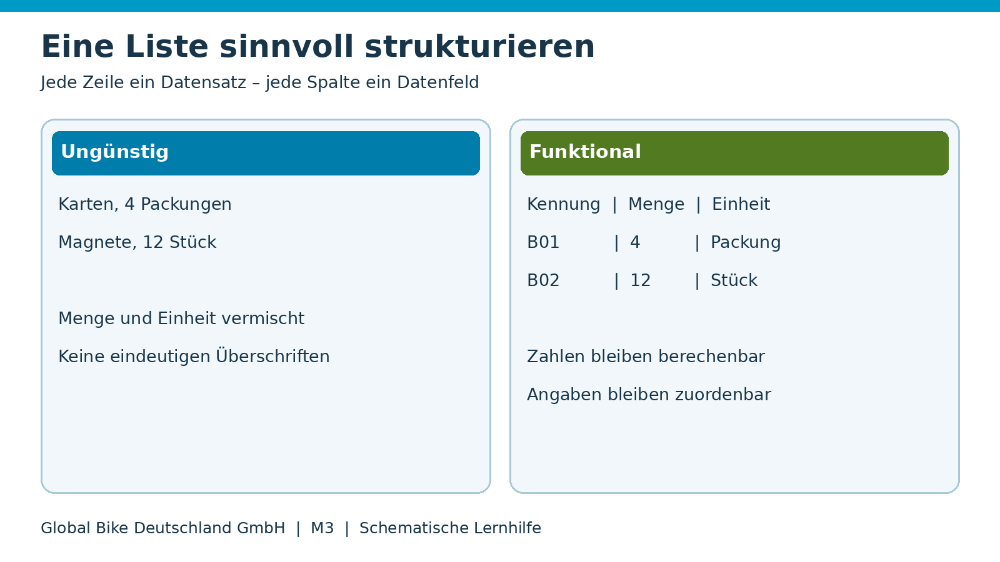
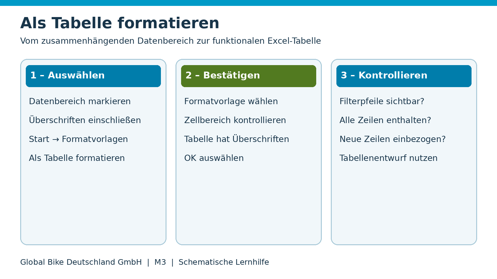

# M3 – Tabellen erstellen, strukturieren und gestalten

Global Bike Deutschland GmbH – Verwaltung

## 1. Warum eine gute Tabellenstruktur wichtig ist

In der Verwaltung müssen Mitarbeitende Informationen schnell finden, ergänzen und auswerten können. Eine ansprechend gestaltete Liste ist nur dann nützlich, wenn ihre Daten eindeutig zugeordnet sind. Eine Tabelle mit unklaren Überschriften, leeren Zwischenzeilen oder mehreren Angaben in einer Zelle erschwert spätere Berechnungen und Filterungen. Gestaltung dient deshalb zuerst der Funktion, nicht der Dekoration.

## 2. Grundregeln einer sinnvollen Tabellenstruktur

| Begriff            | Bedeutung                                                                   |
|--------------------|-----------------------------------------------------------------------------|
| Datensatz          | Zusammengehörige Angaben zu einem Gegenstand oder Vorgang, meist eine Zeile |
| Datenfeld          | Einzelne Eigenschaft eines Datensatzes, meist eine Spalte                   |
| Spaltenüberschrift | Eindeutige Bezeichnung des Datenfelds                                       |
| Datenbereich       | Zusammenhängender Bereich mit den zu verarbeitenden Daten                   |
| Excel-Tabelle      | Speziell als Tabelle definierter Bereich mit eigenen Funktionen             |

Eine Zeile enthält einen Datensatz. Eine Spalte enthält jeweils dieselbe Art von Information. Jede Spalte hat eine eindeutige Überschrift. Mengen und Einheiten werden bei Bedarf getrennt erfasst. Zahlen bleiben Zahlen; Einheiten gehören in die Überschrift oder in ein geeignetes Zahlenformat (M4). Keine Leerzeilen, Zwischensummen oder verbundenen Zellen innerhalb einer Datenliste. Eine Überschrift für das gesamte Blatt kann außerhalb des Datenbereichs stehen. Eine eindeutige Kennung erleichtert das Wiederfinden eines Datensatzes.

## 3. Daten erfassen und erweitern

**Klick-Anleitung: Eine Liste von Grund auf erstellen**

1.  Eine leere Arbeitsmappe öffnen und unter einem geeigneten Namen speichern (M2).
2.  Das Tabellenblatt sinnvoll benennen.
3.  Die benötigten Spaltenüberschriften nebeneinander eingeben.
4.  Die Angaben eines Datensatzes in derselben Zeile erfassen. Mit Tab zur nächsten Zelle wechseln.
5.  Den nächsten Datensatz in der folgenden Zeile erfassen.
6.  Eingaben anhand der Ausgangsunterlagen auf Vollständigkeit und Richtigkeit prüfen.

Um eine Zeile einzufügen, auf ihre Zeilennummer rechtsklicken und **Zellen einfügen** beziehungsweise **Einfügen** wählen. Eine neue Zeile erscheint oberhalb der markierten Zeile. Bei Spalten entsprechend den Spaltenbuchstaben verwenden; die neue Spalte erscheint links. Vor dem Löschen ganzer Zeilen oder Spalten prüfen, ob andere Daten betroffen sind. Die Entf-Taste löscht Inhalte, nicht die Zellen selbst. Rückgängig (Strg+Z) hilft bei versehentlichen Änderungen.

## 4. Schrift und Hervorhebungen

| Werkzeug       | Zweck                                          |
|----------------|------------------------------------------------|
| Schriftart     | Einheitliches, gut lesbares Schriftbild        |
| Schriftgröße   | Lesbarkeit und Hierarchie                      |
| Fett           | Überschriften und wichtige Angaben hervorheben |
| Kursiv         | Ergänzende Hinweise kennzeichnen               |
| Unterstreichen | Gezielte Hervorhebung, sparsam verwenden       |
| Schriftfarbe   | Inhaltliche Unterscheidung unterstützen        |

**Klick-Anleitung:** Zellen markieren → Registerkarte Start → Gruppe Schriftart → Schriftart und Größe auswählen oder gewünschte Hervorhebung anklicken. Eine einheitliche Schrift und deutlich erkennbare Überschriften erleichtern die Orientierung. Nicht jede Zelle benötigt eine Hervorhebung. Farben dürfen nicht das einzige Unterscheidungsmerkmal sein.

## 5. Ausrichtung und Textumbruch

Unter Start → Ausrichtung lassen sich Inhalte linksbündig, zentriert oder rechtsbündig sowie oben, mittig oder unten ausrichten. Text steht im Standardformat meist links, Zahlen rechts. Vergleichbare Zahlen sollten einheitlich ausgerichtet sein.

**Textumbruch:** Zelle markieren → Start → Ausrichtung → Zeilenumbruch. Längere Texte werden innerhalb der Spaltenbreite auf mehrere Zeilen verteilt. Bei Bedarf die Zeilenhöhe anpassen.

**Verbinden und zentrieren:** Mehrere Zellen markieren → Start → Ausrichtung → Verbinden und zentrieren. Dies kann für einen Titel außerhalb der Datenliste sinnvoll sein. Beim Verbinden bleibt bei mehreren gefüllten Zellen nur der Inhalt der linken oberen Zelle erhalten. Innerhalb von Datenlisten deshalb nicht verbinden: Sortieren, Filtern und die Zuordnung von Daten können dadurch beeinträchtigt werden.

## 6. Rahmen und Farben

Gitternetzlinien sind Orientierungslinien der Arbeitsfläche und nicht dasselbe wie bewusst gesetzte Rahmen. Rahmen können Überschriften, Datenbereiche und Ergebnisbereiche voneinander abgrenzen.

**Klick-Anleitung:** Bereich markieren → Start → Schriftart → Pfeil neben Rahmenlinien → passende Rahmenart wählen. Für eine Hintergrundfarbe den Pfeil neben Füllfarbe verwenden; für die Textfarbe den Pfeil neben Schriftfarbe. Rahmen und Farben sparsam und mit ausreichendem Kontrast einsetzen. Ein heller Hintergrund mit dunkler Schrift ist häufig gut lesbar. Die Bedeutung einer Farbe zusätzlich durch Text oder Überschriften kenntlich machen.

## 7. Spaltenbreite und Zeilenhöhe

Ist eine Spalte zu schmal, kann Text abgeschnitten erscheinen; Zahlen oder Datumswerte können als Rauten angezeigt werden. Die gespeicherten Werte sind dadurch nicht automatisch verändert. Rauten können bei Datumswerten auch andere Ursachen haben, etwa negative Datumswerte.

**Klick-Anleitung:** Maus auf die Grenze zwischen zwei Spaltenbuchstaben bewegen → bei verändertem Mauszeiger ziehen. Ein Doppelklick passt die Breite automatisch an den Inhalt an. Bei Zeilen entsprechend die Grenze zwischen Zeilennummern verwenden. Alternativ Start → Zellen → Format → Spaltenbreite oder Zeilenhöhe. Mehrere markierte Spalten lassen sich gemeinsam anpassen. Nach dem Textumbruch die Höhe kontrollieren.

## 8. Als Tabelle formatieren

Eine normale Liste kann durch Schriftfarben und Rahmen gestaltet werden. Eine definierte Excel-Tabelle bietet zusätzlich Filterpfeile, Tabellenformatvorlagen und eine erleichterte Erweiterung. Beim Ergänzen direkt unterhalb der Tabelle wird der Bereich normalerweise automatisch erweitert; die tatsächliche Erweiterung ist zu prüfen.

**Klick-Anleitung**

1.  In den zusammenhängenden Datenbereich klicken oder den vollständigen Bereich einschließlich Überschriften markieren.
2.  Start → Formatvorlagen → Als Tabelle formatieren auswählen.
3.  Eine gut lesbare Formatvorlage auswählen.
4.  Im Dialog den vorgeschlagenen Zellbereich kontrollieren.
5.  „Tabelle hat Überschriften“ aktivieren, wenn die erste Zeile bereits die Überschriften enthält.
6.  Mit OK bestätigen.
7.  Prüfen, ob alle Datensätze enthalten sind und Filterpfeile erscheinen.
8.  Bei Bedarf über die kontextabhängige Registerkarte Tabellenentwurf einen aussagekräftigen Tabellennamen vergeben (ohne Leerzeichen, z. B. Materialliste).

Alternativ kann über Einfügen → Tabelle eine Excel-Tabelle erstellt werden. Die Formatvorlage lässt sich später ändern. Über Tabellenentwurf → In Bereich konvertieren kann die Tabellenfunktion wieder aufgehoben werden; die optische Formatierung kann dabei erhalten bleiben. Die Filter- und Sortierfunktionen werden in M10 vertieft.

## 9. Unabhängiges betriebliches Beispiel

Für eine interne Besprechung bei Global Bike werden wiederverwendbare Präsentationshilfen erfasst. Die folgenden Angaben sind eigenständige didaktische Beispieldaten, keine SAP-Stammdaten und keine Daten aus M1.

| Kennung | Gegenstand         | Menge | Einheit | Zustand |
|---------|--------------------|------:|---------|---------|
| B01     | Moderationskarten  |     4 | Packung | Nutzbar |
| B02     | Magnetstreifen     |    12 | Stück   | Nutzbar |
| B03     | Präsentationsmappe |     3 | Stück   | Prüfen  |
| B04     | Tischaufsteller    |     6 | Stück   | Nutzbar |

Die Kennung ermöglicht eine eindeutige Zuordnung. Die Menge bleibt numerisch, die Einheit steht separat. Die Zustandsangabe ist einheitlich formuliert. Dadurch kann später nach Zustand gefiltert werden. Eine gut lesbare Überschrift und angepasste Spaltenbreiten unterstützen die Nutzung. Eine zusätzliche Zeile mit einem neuen Gegenstand kann unterhalb ergänzt werden. Das Beispiel zeigt Strukturprinzipien, nicht die Lösung des betrieblichen Arbeitsauftrags.

## 10. Typische Fehler und ihre Behebung

| Fehler                                    | Folge                                                  | Abhilfe                                           |
|-------------------------------------------|--------------------------------------------------------|---------------------------------------------------|
| Mehrere Angaben in einer Zelle            | Einzelinformationen schwer filterbar                   | Angaben auf getrennte Spalten verteilen           |
| Fehlende oder doppelte Überschriften      | Datenfelder nicht eindeutig                            | Eindeutige Überschriften vergeben                 |
| Leerzeilen mitten in der Liste            | Automatische Bereichserkennung kann unvollständig sein | Zusammenhängenden Datenbereich herstellen         |
| Verbundene Zellen in der Liste            | Sortierung und Bearbeitung erschwert                   | Zellverbund aufheben und Daten eindeutig zuordnen |
| Menge als Text mit Einheit                | Berechnungen erschwert                                 | Zahl und Einheit trennen                          |
| Zu schmale Spalten                        | Inhalte nicht vollständig sichtbar                     | Breite anpassen oder Textumbruch nutzen           |
| Zu viele Farben                           | Wichtige Angaben gehen unter                           | Einheitliches, sparsames Farbschema               |
| Nur ein Teilbereich als Tabelle definiert | Datensätze fehlen bei Auswertungen                     | Tabellenbereich kontrollieren und erweitern       |
| Neue Daten außerhalb der Tabelle          | Filter erfassen sie möglicherweise nicht               | Tabellengrenze prüfen und bei Bedarf Größe ändern |
| Ganze Zeile versehentlich gelöscht        | Andere Inhalte können verloren gehen                   | Rückgängig nutzen, künftig Auswahl prüfen         |

## 11. Freiwillige Selbstkontrolle

Die Fragen dienen der eigenen Orientierung und sind keine Pflichtabgabe.

- Worin unterscheiden sich Datensatz und Datenfeld?
- Warum sollten Mengen und Einheiten getrennt erfasst werden?
- Weshalb sind verbundene Zellen innerhalb einer Datenliste ungünstig?
- Wie lässt sich ein längerer Text in einer schmalen Spalte lesbar darstellen?
- Was unterscheidet eine formatierte Liste von einer definierten Excel-Tabelle?
- Was ist beim Ergänzen neuer Datensätze zu kontrollieren?

**Kontrollhinweise:** Ein Datensatz umfasst zusammengehörige Angaben, ein Datenfeld eine Eigenschaft. Getrennte Mengen bleiben berechenbar. Zellverbünde erschweren die eindeutige Zuordnung und Sortierung. Textumbruch und angepasste Zeilenhöhe verbessern die Lesbarkeit. Eine definierte Tabelle besitzt zusätzliche Tabellenfunktionen. Neue Datensätze müssen innerhalb des tatsächlichen Tabellenbereichs liegen.

## 12. Weiterführende Materialien

M4 vertieft Zahlen- und Datumsformate, M5–M8 Berechnungen, M10 Sortieren und Filtern, M13 Druckaufbereitung und M14 Qualitätskontrolle. Ü2 bietet später eine freiwillige praktische Vertiefung. M1 bleibt die Grundlage des eigentlichen betrieblichen Arbeitsauftrags.
