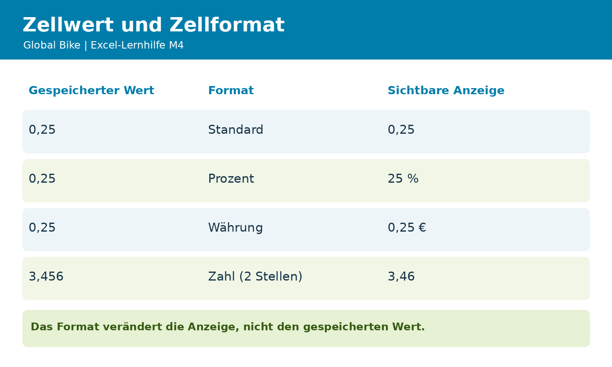
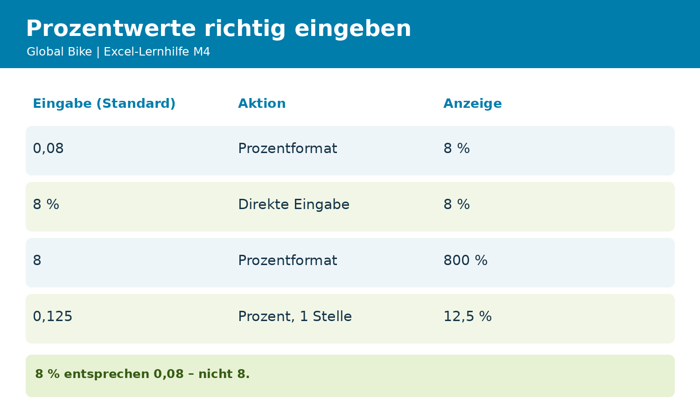
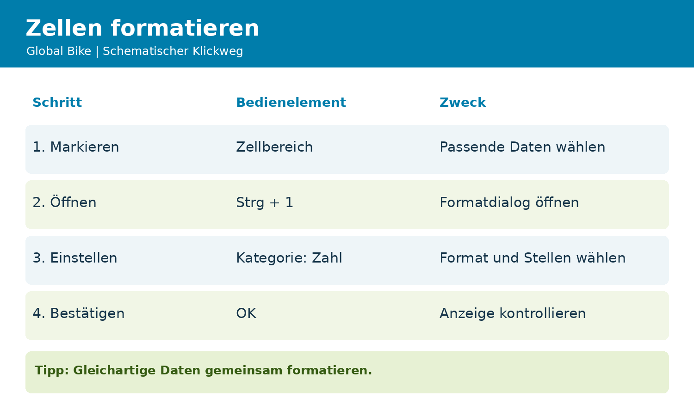

# M4 – Zahlen-, Datums-, Währungs- und Prozentformate

Global Bike Deutschland GmbH – Verwaltung

## 1. Warum Zahlenformate wichtig sind

In der Verwaltung werden Mengen, Geldbeträge, Termine und prozentuale Anteile verarbeitet. Eine Zahl ohne erkennbare Bedeutung kann zu Fehlentscheidungen führen. Ein einheitliches Format erleichtert das Lesen und Vergleichen. Zahlen müssen dabei weiterhin für Berechnungen verfügbar bleiben. Die Formatierung ersetzt weder eine korrekte Eingabe noch eine Formel.

## 2. Zellwert und Zellformat

Excel speichert einen Wert und zeigt ihn entsprechend dem gewählten Format an. Der Wert 0,25 erscheint beispielsweise als 25 % im Prozentformat oder als 0,25 € im Währungsformat. Eine Formatänderung rechnet den Wert nicht um. Die Bearbeitungsleiste hilft bei der Kontrolle; bei Formeln zeigt sie die Formel statt des Ergebnisses.

Die Anzeige von zwei Dezimalstellen rundet nur die Darstellung. Aus 3,456 wird sichtbar 3,46; intern bleibt 3,456 erhalten. Wenn ein tatsächlich gerundeter Rechenwert benötigt wird, ist eine entsprechende Berechnung erforderlich (M5).

## 3. Standard-, Zahlen- und Textformat

| Format   | Verwendung                                      | Beispiel   |
|----------|-------------------------------------------------|------------|
| Standard | Allgemeine Eingabe ohne festgelegte Darstellung | 1250,5     |
| Zahl     | Mengen und messbare Größen                      | 1.250,50   |
| Text     | Kennungen, die nicht berechnet werden           | 0042       |
| Währung  | Geldbeträge                                     | 1.250,50 € |
| Prozent  | Anteile und Quoten                              | 25 %       |
| Datum    | Termine und Fristen                             | 15.03.2027 |
| Uhrzeit  | Uhrzeiten                                       | 09:30      |

Eine Kennung mit führenden Nullen ist keine Rechengröße. Vor der Eingabe das Textformat wählen oder ein Apostroph voranstellen, etwa '0042. Das Apostroph wird nicht als Teil der sichtbaren Kennung angezeigt. Bereits verlorene führende Nullen werden durch nachträgliches Textformat nicht wiederhergestellt. Zahlen, mit denen gerechnet werden soll, nicht als Text erfassen.

## 4. Dezimalstellen und Tausendertrennzeichen

**Klick-Anleitung: Zahlen übersichtlich darstellen**

1.  Zellen markieren.
2.  Registerkarte **Start** öffnen.
3.  In der Gruppe **Zahl** das Format **Zahl** auswählen.
4.  Mit den Schaltflächen für Dezimalstellen die gewünschte Anzahl einstellen.
5.  Für das Tausendertrennzeichen Strg+1 drücken, Kategorie Zahl wählen und das Kontrollkästchen für das Tausendertrennzeichen aktivieren.
6.  Anzeige und Werte kontrollieren.

In einer üblichen deutschen Excel-Konfiguration ist das Komma das Dezimaltrennzeichen und der Punkt das Tausendertrennzeichen. Regionale Einstellungen können abweichen. Stückzahlen benötigen meist keine Nachkommastellen, Messwerte je nach Genauigkeit unterschiedliche Anzahlen. Keine Einheiten als Text an berechenbare Zahlen anhängen; stattdessen die Spaltenüberschrift nutzen.

## 5. Währungs- und Buchhaltungsformat

Beide Formate zeigen Geldbeträge mit Währungssymbol an. Das Buchhaltungsformat richtet Symbole und Dezimalstellen spaltenweise aus und stellt Nullwerte häufig als Strich dar. Das Währungsformat zeigt das Symbol in unmittelbarer Nähe zum Betrag. Beide Formate ändern weder die Währung rechnerisch noch den gespeicherten Betrag.

**Klick-Anleitung: Eurobeträge formatieren**

1.  Betragszellen markieren.
2.  Strg+1 drücken.
3.  Unter **Zahlen** die Kategorie **Währung** oder **Buchhaltung** wählen.
4.  Euro als Symbol und zwei Dezimalstellen einstellen.
5.  Mit OK bestätigen und die Anzeige prüfen.

Beispiel: Die Eingabe 18,5 wird als 18,50 € angezeigt. Ob ein Betrag netto oder brutto ist, ergibt sich aus dem fachlichen Zusammenhang und der Spaltenüberschrift, nicht aus dem Format.

## 6. Prozentformat

Prozent bedeutet von hundert. 8 % entsprechen dem Zahlenwert 0,08. Wird eine bereits als Zahl eingegebene 8 nachträglich als Prozent formatiert, erscheint 800 %. Sicher ist die direkte Eingabe 8 % oder die Eingabe 0,08 mit anschließender Prozentformatierung.

**Klick-Anleitung**

1.  In einer Zelle mit Standardformat 0,08 eingeben.
2.  Zelle markieren und unter **Start – Zahl** auf das Prozentzeichen klicken.
3.  Bei Bedarf Dezimalstellen einstellen.
4.  Kontrollieren, ob 8 % angezeigt werden.

Ein Anteil von 1/4 entspricht 0,25 beziehungsweise 25 %. Die Berechnung von Anteilen mit Zellbezügen wird in M8 vertieft. Prozentformat allein berechnet keinen Anteil.

## 7. Datums- und Uhrzeitformat

Excel speichert erkannte Datumsangaben als fortlaufende Zahlen und Uhrzeiten als Tagesbruchteile. Dadurch lassen sich Termine sortieren und Zeitabstände berechnen. Eine als Text gespeicherte Datumsangabe kann dagegen bei Berechnungen und Sortierungen Probleme verursachen.

**Klick-Anleitung: Datum und Uhrzeit darstellen**

1.  In eine Zelle mit Standardformat 15.03.2027 eingeben.
2.  Zelle markieren und Strg+1 drücken.
3.  Kategorie **Datum** wählen und eine Darstellung mit vierstelliger Jahreszahl auswählen.
4.  Alternativ unter **Benutzerdefiniert** den Typ TT.MM.JJJJ verwenden (deutschsprachiges Excel).
5.  Für Uhrzeiten beispielsweise 09:30 eingeben und das Uhrzeitformat auswählen.
6.  Ergebnis kontrollieren.

Ein Datum kann auch als 15. März 2027 erscheinen. Der zugrunde liegende Tag bleibt derselbe. Eine Uhrzeit von 12:00 entspricht einem halben Tag. Datumsformate berechnen keine Fristen; die betrieblichen Fristenregeln werden in M9 behandelt. Bei \#### zunächst die Spaltenbreite prüfen; auch negative Datums- oder Zeitwerte können diese Anzeige verursachen.

## 8. Zahlenformate auswählen und verändern

Für häufige Formate genügt das Auswahlfeld in Start – Zahl. Der Dialog **Zellen formatieren** bietet weitere Einstellungen. Mehrere gleichartige Zellen können gemeinsam formatiert werden. Unterschiedliche Datenarten sollten getrennt markiert werden. Beim Kopieren können Formate mit übernommen werden; über Inhalte einfügen – Werte lassen sich Werte ohne Quellformat übertragen. Über Start – Löschen – Formate löschen kann die Formatierung zurückgesetzt werden, ohne die Inhalte zu entfernen.

## 9. Unabhängiges betriebliches Anwendungsbeispiel

Die Verwaltung von Global Bike erfasst testweise Informationen zu einer internen Schulung. Diese Beispieldaten sind unabhängig von M1 und keine SAP-Daten.

| Angabe                      | Eingabe    | Geeignete Anzeige |
|-----------------------------|------------|-------------------|
| Schulungskennung            | '0042      | 0042              |
| Schulungstag                | 15.03.2027 | 15.03.2027        |
| Beginn                      | 09:30      | 09:30             |
| Teilnehmerzahl              | 12         | 12                |
| Kosten je Unterlage         | 3,5        | 3,50 €            |
| Anteil digitaler Unterlagen | 0,75       | 75 %              |
| Materialgewicht in kg       | 1,256      | 1,26              |

Zur freiwilligen Erprobung können diese Angaben in einer separaten Arbeitsmappe eingegeben und unterschiedlich formatiert werden. Besonders aufschlussreich ist der Vergleich der Anzeige von 0,75 im Standard- und Prozentformat. Das Beispiel ist keine Vorlage für die M1-Arbeitsmappe und muss nicht abgegeben werden.

## 10. Typische Fehler und deren Behebung

| Beobachtung                             | Ursache oder Prüfung                                       | Abhilfe                                              |
|-----------------------------------------|------------------------------------------------------------|------------------------------------------------------|
| 800 % statt 8 %                         | Wert 8 statt 0,08                                          | Wert korrigieren                                     |
| 0042 wird zu 42                         | Kennung als Zahl erkannt                                   | Textformat vor Eingabe, Kennung neu erfassen         |
| Geldbetrag nicht berechenbar            | Betrag als Text gespeichert                                | Als Zahl neu erfassen oder gezielt in Zahl umwandeln |
| \####                                   | Spalte zu schmal oder negativer Datumswert                 | Breite und Wert prüfen                               |
| Datum wird nicht chronologisch sortiert | Datumswerte möglicherweise Text                            | Datentyp prüfen und echte Datumswerte erfassen       |
| 3,46 statt 3,456                        | Anzeige auf zwei Stellen begrenzt                          | Dezimalstellen erhöhen                               |
| Euro statt Dollar                       | Falsches Währungssymbol                                    | Format ändern; keine automatische Umrechnung         |
| Datum erscheint als Zahl                | Zahlenformat statt Datum                                   | Datumsformat wählen                                  |
| Mengen zeigen Eurozeichen               | Falsches Format für ganze Spalte                           | Mengenbereich als Zahl formatieren                   |
| Summen wirken um Cent abweichend        | Angezeigte und gespeicherte Genauigkeit unterscheiden sich | Rechenwerte prüfen; Rundungsregeln beachten          |

Bei importierten Zahlen als Text kann Excel eine Warnung mit der Option **In eine Zahl umwandeln** anbieten. Diese nur für tatsächliche Rechengrößen verwenden, nicht für Kennungen. Eine bloße Änderung des Zahlenformats wandelt vorhandenen Text nicht zuverlässig in Zahlen um.

## 11. Freiwillige Selbstkontrolle

- Welcher Zahlenwert entspricht 12 %?
- Warum erscheint nach Prozentformatierung der Zahl 12 der Wert 1.200 %?
- Welches Format eignet sich für eine Kennung 0007?
- Wird der gespeicherte Wert 4,567 durch die Anzeige 4,57 verändert?
- Warum sollten Termine als echte Datumswerte erfasst werden?
- Was ist bei der Anzeige \#### zuerst zu prüfen?
- Kann ein Währungsformat Euro in Dollar umrechnen?
- Woran lässt sich erkennen, ob ein Betrag netto oder brutto ist?

**Kontrollhinweise:** 0,12; das Prozentformat zeigt den Wert mal hundert mit Prozentzeichen; Textformat vor Eingabe; nein, nur die Anzeige ändert sich; damit Datumsberechnungen und chronologische Sortierung möglich sind; Spaltenbreite, gegebenenfalls negativer Datumswert; nein; an der fachlichen Bezeichnung und den betrieblichen Angaben.

## 12. Weiterführende Materialien

M5 vertieft Formeln und Grundrechenarten, M6 Funktionen, M7 Zellbezüge, M8 prozentuale Anteile, M9 Termine und Fristen, M10 Sortieren und Filtern. M13 behandelt die Druckaufbereitung, M14 die Qualitätskontrolle. M4 bleibt während der gesamten Lernsituation als Nachschlagewerk verfügbar.
