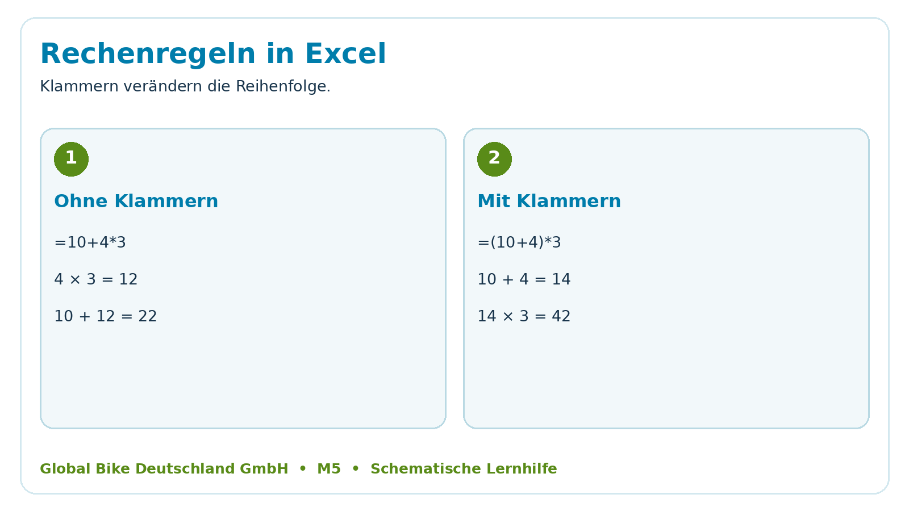

# M5 – Formeln und Grundrechenarten in Excel

Global Bike Deutschland GmbH – Verwaltung

## 1. Warum automatische Berechnungen wichtig sind

In der Verwaltung ändern sich Mengen, Preise und Termine. Eine manuell eingetragene Summe bleibt unverändert, wenn sich eine Ausgangszahl ändert. Eine Formel berechnet das Ergebnis dagegen aus den aktuellen Ausgangswerten. Das spart Arbeit und reduziert Übertragungsfehler. Eine falsche Formel kann allerdings viele falsche Ergebnisse erzeugen. Deshalb gehört die Kontrolle zur Arbeit mit Excel.

## 2. Werte, Formeln und Funktionen

| Begriff   | Bedeutung                                                  | Beispiel        |
|-----------|------------------------------------------------------------|-----------------|
| Wert      | Direkt eingegebene Information                             | 12              |
| Formel    | Rechenvorschrift, die mit einem Gleichheitszeichen beginnt | `=12*4`         |
| Zellbezug | Verweis auf den Inhalt einer Zelle                         | `=B2`           |
| Funktion  | Vorgefertigte Rechenvorschrift innerhalb einer Formel      | `=SUMME(B2:B5)` |

Eine Formel steht in der Zelle, obwohl dort normalerweise ihr Ergebnis angezeigt wird. Die Bearbeitungsleiste zeigt die eigentliche Formel. Funktionen werden in M6 vertieft.

## 3. Aufbau einer Formel

Das Gleichheitszeichen signalisiert Excel, dass eine Berechnung folgen soll. Danach stehen Zahlen, Zellbezüge, Operatoren oder Funktionen. In `=B2*C2` verweist B2 auf Spalte B, Zeile 2; C2 auf Spalte C, Zeile 2. Das Sternchen bedeutet Multiplikation. Die Ergebniszelle darf nicht auf sich selbst verweisen.

## 4. Die vier Grundrechenarten

| Rechenart      | Operator | Beispiel | Ergebnis |
|----------------|----------|----------|---------:|
| Addition       | \+       | `=18+7`  |       25 |
| Subtraktion    | \-       | `=18-7`  |       11 |
| Multiplikation | \*       | `=18*7`  |      126 |
| Division       | /        | `=18/6`  |        3 |

Excel verwendet für die Multiplikation das Sternchen und für die Division den Schrägstrich. Ein handschriftliches Malzeichen oder ein Doppelpunkt ist dafür ungeeignet. Der Doppelpunkt kennzeichnet in Zellbezügen einen zusammenhängenden Bereich, etwa B2:B5.

Im Büro werden beispielsweise Teilbeträge addiert, Restbudgets durch Subtraktion ermittelt, Mengen mit Einzelpreisen multipliziert und Gesamtkosten durch Stückzahlen dividiert.

## 5. Rechenregeln und Klammern

Multiplikation und Division werden vor Addition und Subtraktion ausgeführt. Gleichrangige Grundrechenarten werden von links nach rechts verarbeitet. Klammern verändern die Reihenfolge.

- `=10+4*3` ergibt 22.
- `=(10+4)*3` ergibt 42.
- `=24/6*2` ergibt 8.
- `=24/(6*2)` ergibt 2.

Klammern müssen paarweise vorhanden sein. Eine verständliche Formel ist wichtiger als eine möglichst kurze Formel. Bei komplexeren Rechnungen können Zwischenergebnisse in eigenen Zellen sinnvoll sein.

## 6. Mit Zellbezügen rechnen

Eine Formel wie `=6*8` funktioniert, ist aber für wechselnde Eingaben ungeeignet. Steht die Menge in B2 und der Einzelpreis in C2, lautet die passende Formel `=B2*C2`. Bei einer Änderung der Menge oder des Preises bleibt die Formel unverändert und das Ergebnis wird neu berechnet.

Eingabewerte und Berechnungsergebnisse sollten getrennt und eindeutig beschriftet sein. Wiederkehrende Berechnungen lassen sich kopieren. Dabei ändern sich normale Zellbezüge passend zur neuen Position: Aus `=B2*C2` wird eine Zeile tiefer `=B3*C3`. Feste Zellbezüge mit Dollarzeichen werden in M7 ausführlich behandelt.

## 7. Formeln eingeben, bearbeiten und kopieren

**Klick-Anleitung: Formel erstellen**

1.  Die vorgesehene Ergebniszelle anklicken.
2.  Das Gleichheitszeichen eingeben.
3.  Die erste benötigte Zelle anklicken oder ihre Adresse eingeben.
4.  Den Rechenoperator eingeben.
5.  Die zweite benötigte Zelle anklicken oder ihre Adresse eingeben.
6.  Mit Enter bestätigen.
7.  Ergebnis und Formel in der Bearbeitungsleiste kontrollieren.

**Klick-Anleitung: Formel korrigieren**

1.  Ergebniszelle auswählen.
2.  In die Bearbeitungsleiste klicken oder F2 drücken.
3.  Den fehlerhaften Bestandteil ändern.
4.  Mit Enter bestätigen; mit Esc lässt sich eine noch nicht bestätigte Änderung abbrechen.

**Klick-Anleitung: Formel nach unten übertragen**

1.  Zelle mit der geprüften Formel auswählen.
2.  Das kleine Ausfüllkästchen unten rechts an der Zellmarkierung greifen.
3.  Bis zur letzten benötigten Zeile nach unten ziehen.
4.  Eine kopierte Formel anklicken und ihre Zellbezüge kontrollieren.

Alternativ kann die Formel mit Strg+C kopiert und mit Strg+V eingefügt werden. Dabei werden relative Bezüge ebenfalls angepasst. Nicht versehentlich nur Werte einfügen.

## 8. Automatische Neuberechnung

Excel berechnet Formeln normalerweise automatisch neu. Eine Funktionsprüfung gelingt durch vorübergehendes Ändern eines Eingabewerts. Das Ergebnis muss sich passend ändern. Anschließend den ursprünglichen Wert wiederherstellen.

Wenn sich Ergebnisse nicht aktualisieren, unter **Formeln – Berechnungsoptionen** prüfen, ob **Automatisch** eingestellt ist. F9 stößt eine Neuberechnung an. Auch als Text gespeicherte Formeln oder falsche Zellbezüge können die Ursache sein.

## 9. Rundung und Dezimalstellen

Wie in M4 erläutert, verändert die Anzeige von zwei Nachkommastellen nicht den gespeicherten Rechenwert. Für eine tatsächliche Rundung auf Cent kann die Funktion RUNDEN verwendet werden.

`=RUNDEN(10/3;2)` ergibt 3,33. Die 2 bezeichnet die Anzahl der Nachkommastellen. Das Semikolon trennt in der üblichen deutschen Excel-Konfiguration die Funktionsargumente.

Bei kaufmännischen Berechnungen ist entscheidend, an welcher Stelle gerundet werden soll. Drei einzeln auf 3,33 gerundete Beträge ergeben 9,99; eine ungerundete Berechnung von drei Dritteln von 10 ergibt 10. Die betriebliche Rundungsregel bestimmt, welcher Rechenweg anzuwenden ist. Nicht wahllos Zwischenergebnisse runden.

## 10. Unabhängiges betriebliches Anwendungsbeispiel

Für eine interne Schulung der Global Bike Deutschland GmbH werden beispielhaft Schulungsunterlagen kalkuliert. Die Daten gehören nicht zum Arbeitsauftrag M1.

| Zeile | A – Position      | B – Menge | C – Einzelpreis | D – Gesamtpreis |
|-------|-------------------|----------:|----------------:|----------------:|
| 2     | Schulungshefte    |        12 |          4,50 € |         54,00 € |
| 3     | Namensschilder    |        12 |          1,25 € |         15,00 € |
| 4     | Moderationskarten |         3 |          6,80 € |         20,40 € |

Die Überschriften stehen in Zeile 1. In D2 steht `=B2*C2`, in D3 `=B3*C3`, in D4 `=B4*C4`. Die Preise werden als Währung formatiert.

| Zelle | Inhalt oder Formel              | Ergebnis |
|-------|---------------------------------|---------:|
| D5    | `=D2+D3+D4`                     |  89,40 € |
| D6    | Eingabewert: genehmigter Betrag | 120,00 € |
| D7    | `=D6-D5`                        |  30,60 € |
| B8    | Eingabewert: Teilnehmende       |       12 |
| D8    | `=D5/B8`                        |   7,45 € |

Die Bezeichnungen für die Auswertungen stehen in Spalte A. Der genehmigte Betrag und die Teilnehmerzahl sind Eingabewerte, keine Ergebnisse. Wenn B2 auf 14 geändert wird, ergeben sich in D2 63,00 €, in D5 98,40 €, in D7 21,60 € und in D8 8,20 €. Die Teilnehmerzahl bleibt bei dieser Kontrolländerung unverändert. Anschließend B2 wieder auf 12 setzen.

Dieses Beispiel zeigt alle vier Grundrechenarten und die Abhängigkeit der Ergebnisse von den Eingaben. Die Addition mehrerer Zellen wird in M6 durch SUMME vereinfacht.

## 11. Typische Fehler und deren Behebung

| Beobachtung                  | Mögliche Ursache                                      | Kontrolle und Behebung                                               |
|------------------------------|-------------------------------------------------------|----------------------------------------------------------------------|
| Formel erscheint als Text    | Textformat oder vorangestelltes Apostroph             | Standardformat wählen, Apostroph entfernen, Formel erneut bestätigen |
| Ergebnis bleibt gleich       | Fest eingetragene Zahl statt Formel                   | Bearbeitungsleiste prüfen, Formel einsetzen                          |
| Falsches Produkt             | Falscher Zellbezug                                    | Adressen mit Überschriften vergleichen                               |
| Formel wird nicht akzeptiert | Falscher Operator oder fehlende Klammer               | Syntax und Klammerpaare prüfen                                       |
| \#DIV/0!                     | Division durch null oder leere Bezugszelle            | Nenner prüfen; fehlende Eingabe klären                               |
| \#WERT!                      | Ungeeigneter Datentyp, etwa Text statt Zahl           | Eingabewerte und Formate prüfen                                      |
| \#BEZUG!                     | Ungültiger Zellbezug, etwa nach Löschen einer Spalte  | Richtigen Bezug wiederherstellen                                     |
| \#NAME?                      | Unbekannter Funktionsname oder nicht definierter Name | Schreibweise und Sprache prüfen                                      |
| \####                        | Spalte zu schmal, gegebenenfalls negativer Datumswert | Spalte verbreitern und Wert prüfen                                   |
| Zirkelbezug                  | Formel hängt direkt oder indirekt von sich selbst ab  | Abhängigkeiten prüfen und korrigieren                                |
| Unerwartete Centabweichung   | Anzeige gerundet, Rechenwert nicht                    | Rundungsregel und tatsächliche Werte prüfen                          |

Fehlermeldungen nicht durch beliebige Zahlen oder leere Texte verdecken. Zuerst die Ursache klären. Ein scheinbar plausibles Ergebnis ist kein Beweis für eine richtige Formel.

## 12. Freiwillige Selbstkontrolle

Die folgenden Fragen können zur eigenen Überprüfung genutzt werden. Es ist keine zusätzliche Abgabe erforderlich.

1.  Womit beginnt eine Formel?
2.  Welche Formel multipliziert B4 mit C4?
3.  Was ergibt `=8+2*5`?
4.  Was ergibt `=(8+2)*5`?
5.  Wie verändert sich `=B4*C4`, wenn sie eine Zeile nach unten kopiert wird?
6.  Warum ist eine Formel einem fest eingetragenen Ergebnis vorzuziehen?
7.  Was bedeutet \#DIV/0!?
8.  Was unterscheidet das Zahlenformat mit zwei Dezimalstellen von RUNDEN?
9.  Wie lässt sich prüfen, ob eine Berechnung auf geänderte Eingaben reagiert?

**Kontrollhinweise**

1.  Mit `=`.
2.  `=B4*C4`.
3.  18. 
4.  50. 
5.  `=B5*C5`.
6.  Das Ergebnis wird bei geänderten Eingaben automatisch neu berechnet, sofern die automatische Berechnung aktiv ist.
7.  Es wird durch null oder einen als null behandelten leeren Bezug dividiert.
8.  Das Format verändert die Anzeige; RUNDEN verändert das berechnete Ergebnis.
9.  Einen Eingabewert testweise ändern, erwartetes und tatsächliches Ergebnis vergleichen und den ursprünglichen Wert wiederherstellen.

## 13. Weiterführende Materialien

M6 vertieft SUMME, MIN, MAX und MITTELWERT. M7 behandelt relative und absolute Zellbezüge, M8 prozentuale Anteile und M9 Datums- und Fristenberechnungen. M14 greift die Funktionsprüfung und Wiederverwendbarkeit auf. M5 bleibt während der gesamten Lernsituation als Nachschlagewerk verfügbar.
