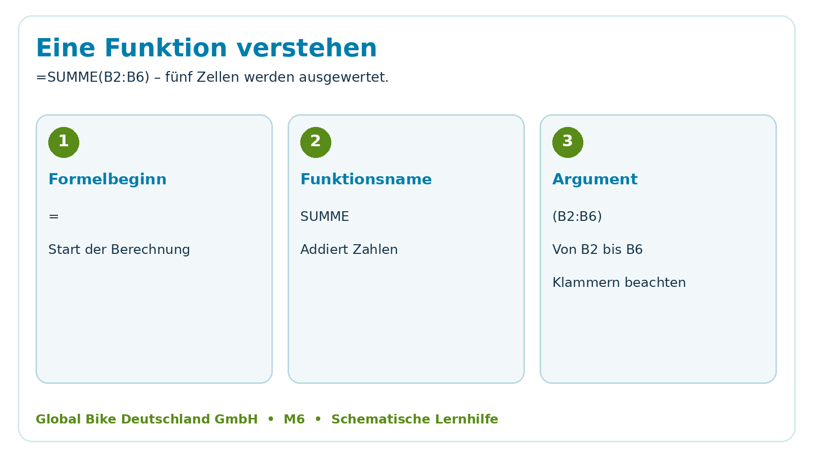
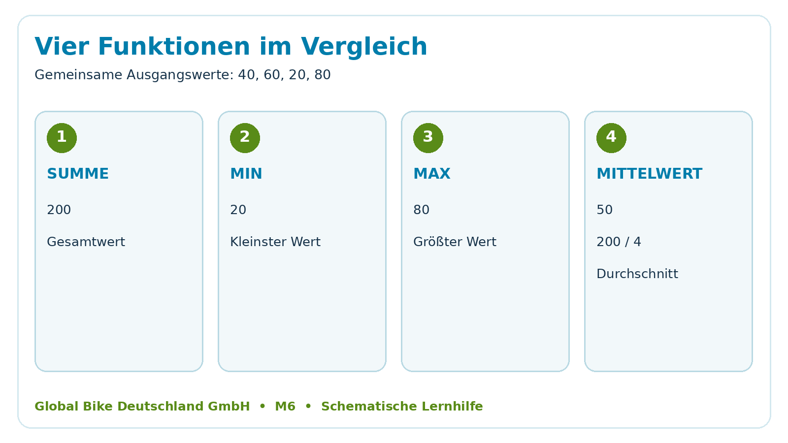

# M6 – Excel-Funktionen: SUMME, MIN, MAX und MITTELWERT

Global Bike Deutschland GmbH – Verwaltung

## 1. Bedeutung von Excel-Funktionen im Büroalltag

In der Verwaltung müssen regelmäßig größere Zahlenmengen ausgewertet werden. Wie hoch sind die Gesamtausgaben? Welche Ausgabe ist besonders hoch? Wie viel wird durchschnittlich ausgegeben? Excel bietet fertige Rechenvorschriften, mit denen solche Fragen schnell beantwortet werden können. Die Ergebnisse ändern sich bei automatischer Berechnung, wenn sich die einbezogenen Ausgangswerte ändern. Die Auswahl des richtigen Datenbereichs und die Interpretation bleiben Aufgabe der Mitarbeitenden.

## 2. Formeln und Funktionen

Eine Formel ist eine Rechenvorschrift. Eine Funktion ist eine vorgefertigte Rechenvorschrift, die innerhalb einer Formel verwendet werden kann. `=B2+B3+B4` und `=SUMME(B2:B4)` liefern bei drei numerischen Werten dieselbe Summe. Die zweite Schreibweise ist bei langen zusammenhängenden Listen übersichtlicher.

## 3. Aufbau einer Funktion

Die Formel `=SUMME(B2:B6)` beginnt mit dem Gleichheitszeichen. SUMME ist der Funktionsname. In Klammern steht das Argument, hier ein Zellbereich. Der Doppelpunkt bedeutet „von ... bis einschließlich“. B2:B6 umfasst fünf Zellen. Mehrere getrennte Argumente werden in der üblichen deutschen Excel-Konfiguration durch Semikolon getrennt, etwa `=SUMME(B2:B6;D2:D6)`. Ein rechteckiger Bereich wie B2:D6 umfasst alle Zellen der drei Spalten und fünf Zeilen.

Die Ergebniszelle muss außerhalb des eigenen ausgewerteten Bereichs liegen. Überschriften und bereits berechnete Summen sollen nicht versehentlich in den Bereich aufgenommen werden.

## 4. SUMME – Gesamtwerte berechnen

SUMME addiert die numerischen Werte eines Bereichs. Beispielsweise ergibt `=SUMME(B2:B5)` bei 40, 60, 20 und 80 den Wert 200. Im Büro lassen sich damit Ausgaben, Stückzahlen oder Bearbeitungszeiten zusammenfassen. Nur Werte mit sinnvoll vergleichbaren Einheiten addieren.

**Klick-Anleitung**

1.  Die Ergebniszelle außerhalb des Datenbereichs auswählen.
2.  `=SUMME(` eingeben.
3.  Den gewünschten Bereich mit der Maus markieren.
4.  Die schließende Klammer eingeben und Enter drücken.
5.  Den Bereich in der Bearbeitungsleiste und das Ergebnis kontrollieren.

## 5. MIN – kleinsten Wert ermitteln

`=MIN(B2:B5)` ergibt bei denselben vier Werten 20. MIN liefert den kleinsten numerischen Wert, nicht den Namen der zugehörigen Position. Um die Position zu finden, kann der Wert in der Liste gesucht oder die Liste sortiert werden (M10). Bei mehreren gleichen Minimalwerten sind alle betreffenden Positionen zu berücksichtigen.

**Klick-Anleitung:** Ergebniszelle wählen, `=MIN(` eingeben, Datenbereich markieren, Klammer schließen, Enter drücken und Ergebnis mit den Ausgangsdaten vergleichen.

## 6. MAX – größten Wert ermitteln

`=MAX(B2:B5)` ergibt 80. MAX eignet sich beispielsweise zur Ermittlung des höchsten Einzelbetrags oder der längsten Bearbeitungsdauer. Der größte Betrag ist nicht automatisch die wichtigste Aufgabe. Weitere betriebliche Kriterien können entscheidend sein.

**Klick-Anleitung:** Ergebniszelle wählen, `=MAX(` eingeben, Datenbereich markieren, Klammer schließen, Enter drücken und Ergebnis kontrollieren.

## 7. MITTELWERT – Durchschnitt berechnen

MITTELWERT addiert die numerischen Werte und teilt die Summe durch deren Anzahl. `=MITTELWERT(B2:B5)` ergibt bei den vier Beispielwerten 50, denn 200 geteilt durch 4 ergibt 50. Der Durchschnitt muss nicht als einzelner Wert in der Liste vorkommen.

**Klick-Anleitung:** Ergebniszelle wählen, `=MITTELWERT(` eingeben, Datenbereich markieren, Klammer schließen und Enter drücken. Zur Kontrolle die Summe durch die Anzahl der numerischen Werte teilen.

Ein Durchschnitt pro Vorgang ist etwas anderes als ein Durchschnitt pro Monat. Die Bezugsgröße muss zur Fragestellung passen. Bei unterschiedlich großen Gruppen ist der einfache Durchschnitt ihrer Durchschnittswerte nicht zwangsläufig der Gesamtdurchschnitt.

## 8. AutoSumme und Funktionsassistent

**Klick-Anleitung: AutoSumme**

1.  Die Zelle unmittelbar unter einer Zahlenliste auswählen.
2.  Im Register Start in der Gruppe Bearbeiten auf AutoSumme (Σ) klicken.
3.  Den von Excel vorgeschlagenen Bereich überprüfen und bei Bedarf ändern.
4.  Mit Enter bestätigen.
5.  Die Formel in der Bearbeitungsleiste kontrollieren.

Über den kleinen Pfeil neben AutoSumme lassen sich auch Mittelwert, Max und Min auswählen. Die Menübezeichnungen können je nach Excel-Version leicht abweichen. Excel kann bei Lücken einen unvollständigen Bereich vorschlagen.

**Klick-Anleitung: Funktionsassistent**

1.  Ergebniszelle auswählen und auf fx neben der Bearbeitungsleiste klicken.
2.  Den gewünschten Funktionsnamen suchen und auswählen.
3.  Im Argumentfenster den Datenbereich eintragen oder markieren.
4.  Die Vorschau prüfen und mit OK bestätigen.

Die direkte Eingabe einer Funktion ist gleichwertig. Der Funktionsassistent hilft besonders beim Kennenlernen der Argumente.

## 9. Leere Zellen, Nullwerte und Text

| Zellinhalt im Bereich                 | SUMME          | MIN/MAX         | MITTELWERT      |
|---------------------------------------|----------------|-----------------|-----------------|
| Zahl                                  | Wird addiert   | Wird verglichen | Wird einbezogen |
| Zahl 0                                | Wird addiert   | Wird verglichen | Wird mitgezählt |
| Leere Zelle                           | Wird ignoriert | Wird ignoriert  | Wird ignoriert  |
| Text, auch als Text gespeicherte Zahl | Wird ignoriert | Wird ignoriert  | Wird ignoriert  |

Diese Regeln gelten für Werte innerhalb referenzierter Zellbereiche. Fehlerwerte können die Auswertung mit einem Fehler abbrechen. Direkt eingegebene Funktionsargumente können sich anders verhalten.

Beispiel: B2 enthält 40, B3 ist leer, B4 enthält 0, B5 enthält 80. SUMME ergibt 120, MIN 0, MAX 80 und MITTELWERT 40 (120 geteilt durch drei). Wird B3 mit 0 gefüllt, ergibt MITTELWERT 30. Eine fehlende Angabe darf deshalb nicht ohne sachlichen Grund durch null ersetzt werden.

Enthält der Bereich überhaupt keine Zahlen, liefern SUMME, MIN und MAX null, MITTELWERT dagegen \#DIV/0!. Eine angezeigte Null ist dann kein Nachweis eines tatsächlich vorhandenen Messwerts.

## 10. Unabhängiges betriebliches Anwendungsbeispiel

Für eine interne Schulungsreihe der Global Bike Deutschland GmbH werden beispielhaft die Nettokosten von sechs Schulungsterminen ausgewertet. Die Daten sind didaktisch simuliert und gehören nicht zu M1.

| Zeile | A – Schulungstermin | B – Kosten netto |
|-------|---------------------|-----------------:|
| 2     | Termin 1            |         120,00 € |
| 3     | Termin 2            |         180,00 € |
| 4     | Termin 3            |          90,00 € |
| 5     | Termin 4            |         150,00 € |
| 6     | Termin 5            |         210,00 € |
| 7     | Termin 6            |         150,00 € |

Die Überschriften stehen in Zeile 1. Die Auswertungsbezeichnungen stehen in A9:A12.

| Ergebniszelle           | Formel               | Kontrollwert |
|-------------------------|----------------------|-------------:|
| B9 – Gesamtkosten       | `=SUMME(B2:B7)`      |     900,00 € |
| B10 – niedrigste Kosten | `=MIN(B2:B7)`        |      90,00 € |
| B11 – höchste Kosten    | `=MAX(B2:B7)`        |     210,00 € |
| B12 – Durchschnitt      | `=MITTELWERT(B2:B7)` |     150,00 € |

Die Ergebniszellen werden als Währung mit zwei Nachkommastellen formatiert. Die Summe lässt sich durch Addition prüfen; der Durchschnitt ergibt sich aus 900 geteilt durch 6.

**Funktionsprüfung:** Wird B6 vorübergehend von 210 auf 270 geändert, steigen die Gesamtkosten auf 960 und der Durchschnitt auf 160. MAX ergibt 270; MIN bleibt 90. Anschließend den ursprünglichen Wert wiederherstellen.

Bei einem zusätzlichen Termin in Zeile 8 muss geprüft werden, ob die Formeln den neuen Wert einbeziehen. Ein fester Bereich B2:B7 umfasst Zeile 8 nicht automatisch. Eine als Excel-Tabelle formatierte Liste kann mit strukturierten Bezügen automatisch erweitert werden; auch dann ist eine Funktionsprüfung sinnvoll. Die Ergebniszellen bleiben außerhalb der Datenliste.

## 11. Kaufmännische Interpretation

Die Gesamtkosten zeigen den gesamten Aufwand der sechs Termine. MIN und MAX zeigen die Spannweite der Einzelkosten. Der teuerste Termin kostet 120 Euro mehr als der günstigste. Der Durchschnitt von 150 Euro beschreibt die mittleren Kosten pro Termin, nicht die Kosten pro teilnehmender Person.

Aus den Beträgen allein lässt sich nicht ableiten, dass der teuerste Termin unwirtschaftlich war. Dazu wären beispielsweise Teilnehmerzahl, Dauer und Leistungsumfang erforderlich. Die Verwaltung kann zunächst die Ursachen der Unterschiede prüfen und erst dann eine begründete Empfehlung abgeben.

Beim Filtern einer Liste berechnen die vier hier behandelten Standardfunktionen weiterhin die Werte des angegebenen Bereichs einschließlich ausgefilterter Zeilen. Eine Auswertung ausschließlich sichtbarer Zeilen benötigt andere Verfahren; diese sind nicht Gegenstand von M6.

## 12. Typische Fehler und deren Behebung

| Fehler                                 | Kontrolle und Behebung                               |
|----------------------------------------|------------------------------------------------------|
| Erste oder letzte Datenzeile fehlt     | Bereich in der Bearbeitungsleiste prüfen             |
| Gesamtsumme wird erneut mitaddiert     | Nur Ausgangsdaten einbeziehen                        |
| Ergebniszelle liegt im eigenen Bereich | Zirkelbezug durch getrennte Ergebniszelle vermeiden  |
| Falscher Funktionsname                 | Deutsche Schreibweise prüfen                         |
| Doppelpunkt und Semikolon verwechselt  | Zusammenhängende Bereiche mit Doppelpunkt angeben    |
| Zahl als Text gespeichert              | Datentyp prüfen und Zahl korrekt konvertieren        |
| Fehlender Wert als null eingetragen    | Fehlende Angabe klären; nicht erfinden               |
| Durchschnitt mit falscher Bezugsgröße  | Anzahl und Einheit der einbezogenen Werte prüfen     |
| Neue Zeile fehlt in der Auswertung     | Bereich erweitern und testen                         |
| Gefilterte Zeilen werden mitgerechnet  | Umfang der Auswertung klären                         |
| MIN/MAX liefert nur einen Betrag       | Zugehörige Positionen anhand der Liste ermitteln     |
| Fehlerwert in Ausgangsdaten            | Ursache der fehlerhaften Eingabe oder Formel beheben |

## 13. Freiwillige Selbstkontrolle

Unabhängige Übungswerte in C2:C6: 30, 50, 0, leer, 80.

1.  Welche Funktion berechnet die Gesamtsumme?
2.  Wie lautet die Formel für den kleinsten Wert?
3.  Welches Ergebnis liefert MAX?
4.  Wie hoch ist der Durchschnitt?
5.  Wie ändert sich der Durchschnitt, wenn die leere Zelle mit null gefüllt wird?
6.  Was bedeutet der Doppelpunkt in C2:C6?
7.  Warum darf eine Summenzelle nicht im eigenen Summenbereich liegen?
8.  Liefert MAX auch die Bezeichnung der teuersten Position?
9.  Was muss nach dem Ergänzen einer neuen Datenzeile geprüft werden?
10. Berechnet SUMME nach dem Filtern automatisch nur sichtbare Zeilen?

**Kontrollhinweise**

1.  `=SUMME(C2:C6)` ergibt 160.
2.  `=MIN(C2:C6)` ergibt 0.
3.  80. 
4.  40 (160 geteilt durch vier numerische Werte).
5.  32 (160 geteilt durch fünf).
6.  Alle Zellen von C2 bis einschließlich C6.
7.  Es entsteht ein Zirkelbezug.
8.  Nein, nur den größten numerischen Wert.
9.  Ob der neue Wert im Funktionsbereich enthalten ist.
10. Nein, SUMME berücksichtigt weiterhin den angegebenen Bereich.

Die Selbstkontrolle ist freiwillig und erfordert keine zusätzliche Abgabe.

## 14. Weiterführende Materialien

M7 vertieft relative und absolute Zellbezüge. M8 behandelt prozentuale Anteile, M10 Sortieren und Filtern, M11 und M12 die grafische Auswertung und M14 die Funktionsprüfung. M6 bleibt während der gesamten Lernsituation als Nachschlagewerk verfügbar.
