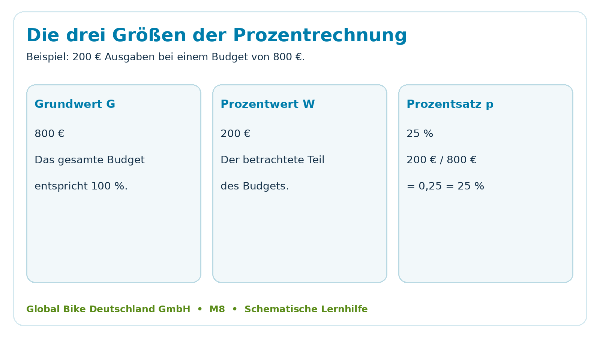
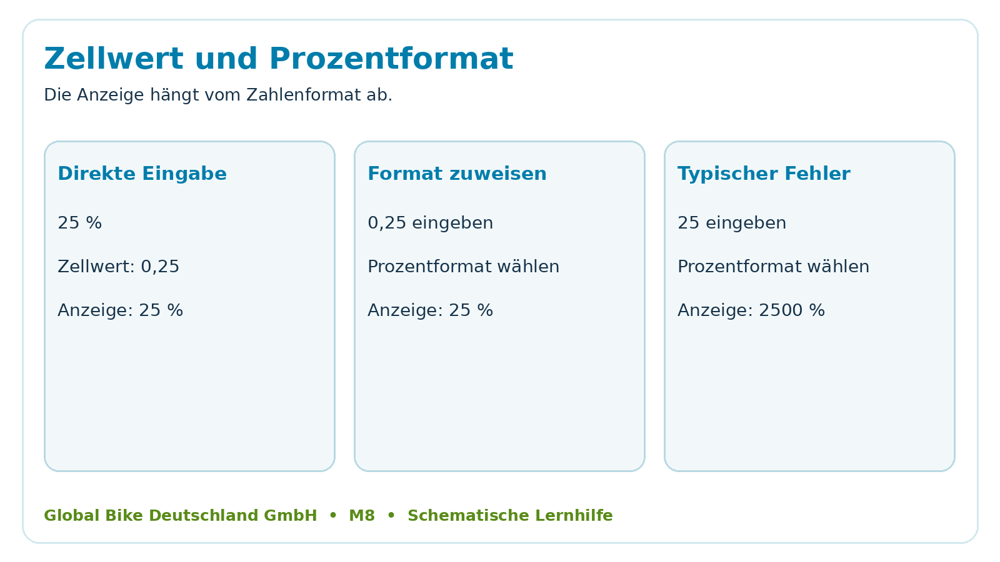
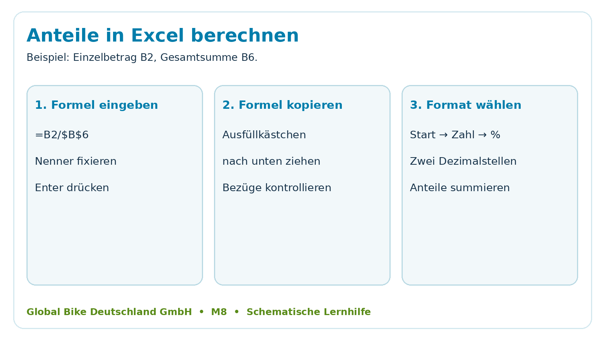
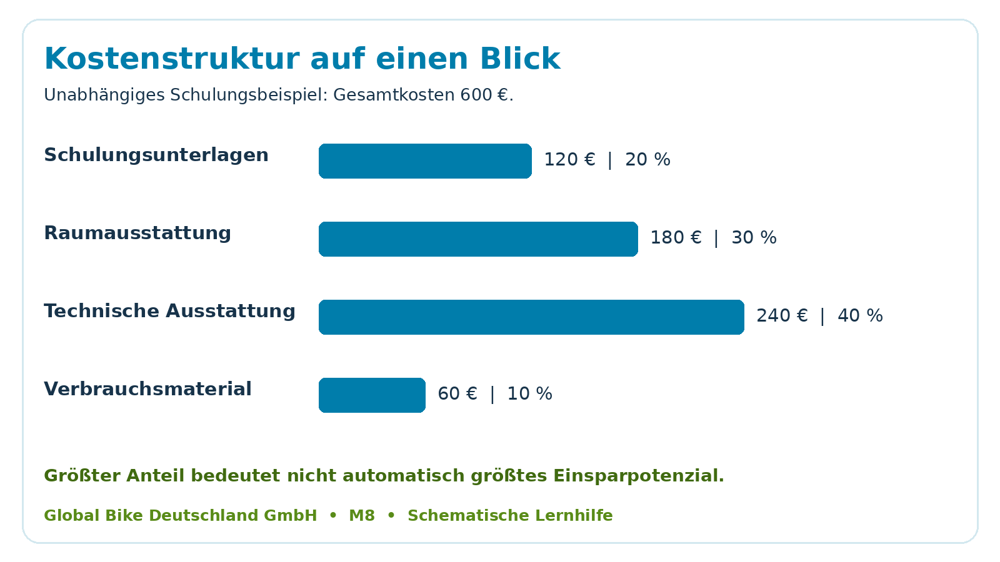
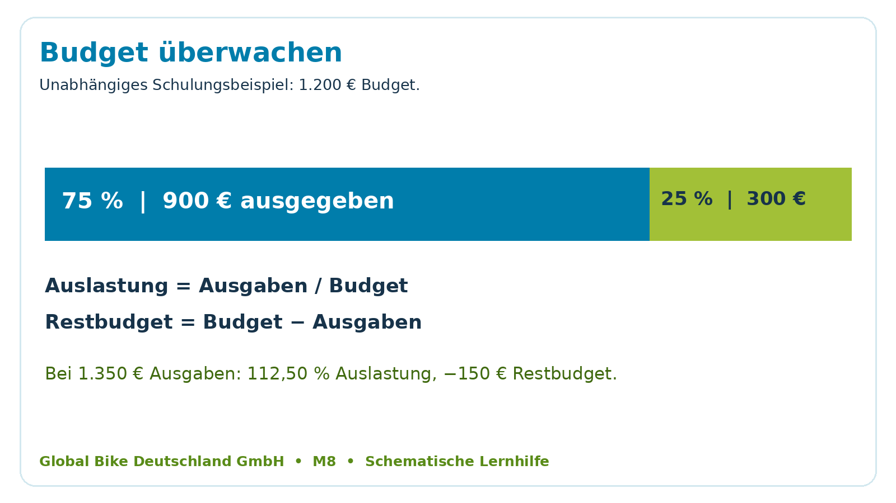

# M8 – Prozentuale Anteile in Excel berechnen und interpretieren

Global Bike Deutschland GmbH – Verwaltung

## 1. Bedeutung der Prozentrechnung im Büroalltag

Absolute Zahlen zeigen Beträge oder Mengen. Prozentwerte zeigen, wie groß diese im Verhältnis zu einer Bezugsgröße sind. In der Verwaltung helfen sie beispielsweise bei der Überwachung von Kostenbudgets, der Auswertung erledigter Vorgänge und dem Vergleich verschiedener Kostenarten. Ein Prozentwert ist nur aussagekräftig, wenn klar ist, worauf er sich bezieht. 75 % eines kleinen Budgets können weniger Euro sein als 30 % eines großen Budgets.

## 2. Grundwert, Prozentwert und Prozentsatz

Der Grundwert G ist die Bezugsgröße (100 %). Der Prozentwert W ist der betrachtete Teil in derselben Einheit wie der Grundwert. Der Prozentsatz p beschreibt das Verhältnis W/G. In Excel wird beispielsweise 25 % intern als 0,25 gespeichert.

Beispiel: Von einem internen Schulungsbudget von 800 € wurden 200 € ausgegeben. 800 € sind der Grundwert, 200 € der Prozentwert und 25 % der Prozentsatz. Der verbleibende Betrag beträgt 600 €, entsprechend 75 % des Budgets. Die Bezugsgröße bleibt in beiden Anteilsberechnungen das ursprüngliche Budget.

## 3. Die drei Grundformeln der Prozentrechnung

| Gesucht       | Berechnung | Excel-Beispiel |
|---------------|------------|----------------|
| Prozentwert W | G × p      | `=B2*C2`       |
| Prozentsatz p | W / G      | `=D2/B2`       |
| Grundwert G   | W / p      | `=D2/C2`       |

In einer unabhängigen Beispielzeile steht B2 für 800 €, C2 für 25 % und D2 für 200 €. Die Formeln zeigen drei alternative Berechnungen, je nachdem, welcher Wert fehlt. Sie dürfen nicht gleichzeitig so in die drei Eingabezellen eingetragen werden, weil sonst ein Zirkelbezug entsteht. Bei der Division darf der Nenner nicht null sein.

Ein Prozentsatz von 25 % entspricht 25/100. Wird der Satz als Prozentwert in Excel eingegeben, ist keine zusätzliche Division durch 100 notwendig.

## 4. Prozentwerte in Excel eingeben und formatieren

Excel unterscheidet Zellwert und Anzeige (M4). Die Eingabe `25%` speichert den numerischen Wert 0,25. Auch die Eingabe `0,25` mit anschließender Prozentformatierung zeigt 25 %. Wer dagegen die Zahl 25 eingibt und anschließend das Prozentformat zuweist, erhält 2500 %.

Klick-Anleitung (deutschsprachiges Desktop-Excel für Windows):

1.  Ergebniszelle oder zusammenhängenden Ergebnisbereich markieren.
2.  Registerkarte Start öffnen.
3.  In der Gruppe Zahl auf das Prozentzeichen klicken.
4.  Mit Dezimalstelle hinzufügen bzw. entfernen die gewünschte Genauigkeit einstellen.
5.  In der Bearbeitungsleiste den zugrunde liegenden Wert oder die Formel prüfen.

Alternativ Strg+1 drücken, Kategorie Prozent wählen, Dezimalstellen festlegen und bestätigen. Geldbeträge bleiben im Währungsformat, Mengen im Zahlenformat. Prozentformatierung verändert normalerweise nur die Anzeige, nicht den zugrunde liegenden Wert.

## 5. Prozentuale Anteile an einer Gesamtsumme

Bei einer Kostenstruktur ist die Summe aller berücksichtigten Einzelkosten der Grundwert. Jeder Einzelbetrag wird durch diese Gesamtsumme geteilt. Bei vollständigen, überschneidungsfreien Kategorien mit nichtnegativen Beträgen und positiver Gesamtsumme ergeben die Anteile zusammen 100 %. Zwischensummen dürfen nicht erneut als Einzelpositionen einbezogen werden.

Bei einer gefilterten Liste muss vorab feststehen, ob sich die Anteile auf alle Daten oder nur auf die sichtbare Teilmenge beziehen sollen. SUMME berücksichtigt auch ausgefilterte Zeilen. Eine gefilterte Ansicht ändert deshalb nicht automatisch die Bezugsgröße. Für Auswertungen ausschließlich sichtbarer Zeilen kann ergänzend TEILERGEBNIS verwendet werden; diese Funktion ist hier kein verbindlicher Lerninhalt.

## 6. Relative und absolute Zellbezüge anwenden

Bei mehreren Anteilen verändert sich der Zähler je Zeile, der Nenner bleibt gleich. Steht die Gesamtsumme in B6, lautet eine erste Formel `=B2/$B$6`. Beim Kopieren nach unten wird daraus `=B3/$B$6`. Die Dollarzeichen fixieren die Adresse beim Kopieren (M7), nicht den Wert der Gesamtsumme. Ändert sich ein Einzelbetrag, müssen sich Gesamtsumme und davon abhängige Anteile bei automatischer Berechnung entsprechend aktualisieren.

## 7. Klick-Anleitung zur Anteilsberechnung

1.  Einzelbeträge in einer zusammenhängenden Spalte erfassen und als Währung formatieren.
2.  Unterhalb der Einzelbeträge die Summe mit SUMME berechnen.
3.  Erste Ergebniszelle in der Anteilsspalte anklicken.
4.  Gleichheitszeichen eingeben, erste Betragszelle anklicken, Schrägstrich eingeben und Summenzelle anklicken.
5.  Den Bezug auf die Summenzelle mit F4 oder manuell durch zwei Dollarzeichen fixieren.
6.  Enter drücken und die Formel am Ausfüllkästchen bis zur letzten Einzelposition kopieren.
7.  Anteilsspalte markieren und das Prozentformat mit zwei Dezimalstellen wählen.
8.  Die Summe der Anteile berechnen und die erste sowie letzte Formel prüfen.

Die Summenzeile wird nicht als weitere Einzelposition in die Anteilsberechnung kopiert. Eine Kontrolle von 100 % ersetzt nicht die Prüfung der Datengrundlage.

## 8. Unabhängiges betriebliches Beispiel: Kostenstruktur

Für eine interne Schulung der Global Bike Deutschland GmbH liegen folgende simulierte Nettokosten vor. Sie sind unabhängig vom Hauptfall M1 und keine SAP-Daten.

| Zeile | A – Kostenart          | B – Betrag | C – Anteil |
|-------|------------------------|-----------:|-----------:|
| 2     | Schulungsunterlagen    |   120,00 € |    20,00 % |
| 3     | Raumausstattung        |   180,00 € |    30,00 % |
| 4     | Technische Ausstattung |   240,00 € |    40,00 % |
| 5     | Verbrauchsmaterial     |    60,00 € |    10,00 % |
| 6     | Gesamt                 |   600,00 € |   100,00 % |

B6: `=SUMME(B2:B5)`; C2: `=B2/$B$6`; C3 bis C5 durch Kopieren; C6: `=SUMME(C2:C5)`.

Technische Ausstattung hat mit 40 % den größten Anteil. Daraus folgt nicht automatisch, dass diese Kosten unangemessen sind. Vor einer Einsparentscheidung sind Bedarf, Qualität und mögliche Alternativen zu prüfen.

Funktionsprobe: B2 vorübergehend von 120 € auf 180 € ändern. Die Gesamtsumme steigt auf 660 €. Der Anteil der Schulungsunterlagen beträgt rund 27,27 %, der technischen Ausstattung rund 36,36 %. Auch unveränderte Einzelbeträge können einen anderen Anteil erhalten, weil sich der Grundwert geändert hat. Anschließend den ursprünglichen Wert wiederherstellen.

## 9. Unabhängiges betriebliches Beispiel: Budgetüberwachung

Für eine separate interne Schulungsmaßnahme stehen 1.200 € netto zur Verfügung. B2 enthält das Budget, B3 die bisherigen Ausgaben von 900 €.

| Zelle | Bedeutung                  | Formel bzw. Eingabe |   Ergebnis |
|-------|----------------------------|---------------------|-----------:|
| B2    | Budget                     | Eingabe             | 1.200,00 € |
| B3    | Ausgaben                   | Eingabe             |   900,00 € |
| B4    | Restbudget                 | `=B2-B3`            |   300,00 € |
| B5    | Budgetauslastung           | `=B3/B2`            |    75,00 % |
| B6    | Verbleibender Budgetanteil | `=B4/B2`            |    25,00 % |

B5 und B6 als Prozent formatieren. Die Ausgaben können in einer späteren Arbeitsmappe aus einer Summe von Einzelpositionen stammen. Bei 1.350 € Ausgaben beträgt die Auslastung 112,50 %, das Restbudget −150 € und der verbleibende Anteil −12,50 %. Negative Restwerte dürfen nicht einfach auf null gesetzt werden, weil dadurch eine Überschreitung verborgen würde. Eine Budgetauslastung von 75 % bedeutet nicht automatisch, dass 25 % frei ausgegeben werden dürfen: Bereits geplante oder zugesagte Ausgaben und interne Freigaben sind zu beachten.

## 10. Freiwillige Vertiefung: Veränderungen und Prozentpunkte

Ein Anteil am Gesamtwert ist etwas anderes als eine Veränderung gegenüber einem früheren Wert. Steigen simulierte Monatskosten von 200 € (B2) auf 250 € (B3), beträgt die absolute Veränderung `=B3-B2` = 50 €. Die relative Veränderung `=(B3-B2)/B2` beträgt 25 %. Der alte Wert ist der Grundwert. Bei einem alten Wert von null ist diese Veränderungsrate nicht definiert.

Steigt eine Erledigungsquote von 60 % auf 75 %, beträgt die Differenz 15 Prozentpunkte. Relativ zur alten Quote ist dies eine Steigerung von 25 %. Beide Aussagen sind richtig, beschreiben aber unterschiedliche Größen. Prozentpunkte sind kein zusätzlicher verbindlicher Prüfungsinhalt.

## 11. Rundung und Nachkommastellen

Drei gleich große Anteile von jeweils einem Drittel werden mit zwei Dezimalstellen als 33,33 % angezeigt. Die sichtbaren Zahlen ergeben 99,99 %, während die Summe der ungerundeten Zellwerte als 100,00 % angezeigt wird. Das ist eine Anzeigeabweichung und kein Rechenfehler.

Mit den ungerundeten Werten weiterrechnen. Nur wenn eine fachliche Rundungsregel eine tatsächliche Rundung verlangt, ist beispielsweise `=RUNDEN(C2;4)` für einen als Dezimalbruch gespeicherten Prozentsatz mit zwei Prozent-Nachkommastellen geeignet. Eine solche Rundung kann die Summe verändern. Nicht eigenmächtig einen Anteil anpassen, nur damit die Anzeige 100 % ergibt.

## 12. Kaufmännische Interpretation

Eine aussagekräftige Auswertung nennt den betrachteten Wert, die Bezugsgröße, den Zeitraum und die Bedeutung für den Arbeitsauftrag. Prozentwerte können Prioritäten sichtbar machen, ersetzen aber keine Entscheidung über notwendige Ausgaben. Eine hohe Erledigungsquote kann einzelne dringende offene Vorgänge verdecken. Eine geringe Budgetauslastung kann auf noch nicht erfasste Kosten zurückgehen.

Bei Vergleichen müssen Zeitraum, Einheit und Abgrenzung zusammenpassen. Ein Nettobudget darf nicht mit Bruttoausgaben verglichen werden. Fehlende Angaben sind nicht automatisch null. Empfehlungen müssen sich auf überprüfte Daten stützen und Unsicherheiten kenntlich machen.

## 13. Typische Fehler und deren Behebung

| Beobachtung                                    | Ursache und Abhilfe                                           |
|------------------------------------------------|---------------------------------------------------------------|
| 2500 % statt 25 %                              | Zahl 25 statt 0,25 bzw. 25 % eingegeben                       |
| Anteil hundertmal zu groß                      | Zusätzlich mit 100 multipliziert und Prozentformat verwendet  |
| Anteil verändert sich unerwartet beim Kopieren | Nenner nicht absolut referenziert                             |
| Alle Anteile gleich                            | Zähler versehentlich fixiert                                  |
| Summe der Anteile deutlich über 100 %          | Zwischensumme doppelt erfasst oder falscher Grundwert         |
| Summe deutlich unter 100 %                     | Positionen fehlen oder Grundwert passt nicht zur Auswahl      |
| 99,99 % statt 100 % in sichtbaren Einzelwerten | Anzeige-Rundung prüfen                                        |
| \#DIV/0!                                       | Nenner null oder leer; Ursache klären, nicht als 0 % ausgeben |
| \#WERT!                                        | Text statt Zahl in Berechnungszellen; Datentyp prüfen         |
| Budgetüberschreitung bleibt unsichtbar         | Negative Restwerte unterdrückt                                |
| Gefilterte Anteile ergeben nicht 100 %         | Bezugsgröße umfasst weiterhin alle Daten                      |
| Anteil wird als Veränderungsrate bezeichnet    | Bezugsgröße und Fragestellung unterscheiden                   |

## 14. Qualitätskontrolle und Wiederverwendbarkeit

Freiwillige Kontrolle an einer Kopie: Sind alle Beträge numerisch und in derselben Einheit? Ist der Grundwert eindeutig bezeichnet? Stimmen Summenbereiche und Zellbezüge? Sind Prozentwerte als solche formatiert? Reagieren die Formeln auf Änderungen? Werden neue Datenzeilen in die Berechnung einbezogen? Ist bei Filtern die Bezugsgröße weiterhin nachvollziehbar? Sind fehlende Werte und Budgetüberschreitungen sichtbar? Lassen sich die Aussagen aus den Zahlen begründen?

Einzelne Ergebnisse unabhängig nachrechnen. Bei einer neuen Datenzeile prüfen, ob die Summenformel und die Anteilsformeln erweitert wurden. Die ursprünglichen Testwerte wiederherstellen. Die Arbeitsmappe soll ohne erneute Eingabe aller Formeln nutzbar bleiben.

## 15. Freiwillige Selbstkontrolle

1.  Was ist der Grundwert bei einer Budgetauslastung?
2.  Wie wird ein Anteil von 45 € an 180 € berechnet?
3.  Welcher Zellwert entspricht 12,5 %?
4.  Welche Formel berechnet den Anteil von B3 an der Gesamtsumme B9 kopierfähig?
5.  Wie lautet diese Formel eine Zeile tiefer?
6.  Ein Budget beträgt 500 €, die Ausgaben 350 €. Wie hoch sind Restbetrag und Auslastung?
7.  Wie hoch ist die Auslastung bei 550 € Ausgaben und 500 € Budget?
8.  Warum können drei angezeigte Drittel zusammen 99,99 % ergeben?
9.  Was bedeutet \#DIV/0! bei einer Anteilsberechnung?
10. Warum kann der Anteil eines unveränderten Betrags sinken?
11. Bedeutet der größte Kostenanteil automatisch, dass dort eingespart werden sollte?
12. Verändert ein Filter automatisch den durch SUMME berechneten Grundwert?

**Kontrollhinweise**

1.  Das gesamte verfügbare Budget.
2.  45/180 = 0,25 = 25 %.
3.  0,125.
4.  `=B3/$B$9`.
5.  `=B4/$B$9`.
6.  150 € Restbetrag, 70 % Auslastung.
7.  110 %; das Budget ist um 50 € überschritten.
8.  Durch die Rundung der Anzeige auf zwei Dezimalstellen.
9.  Der Nenner ist null oder leer; eine Quote ist so nicht definiert.
10. Weil der Gesamtbetrag steigen kann.
11. Nein; Bedarf, Alternativen und betriebliche Folgen müssen geprüft werden.
12. Nein, SUMME berücksichtigt auch ausgefilterte Zeilen.

Keine zusätzliche Abgabe oder Bewertung.

## 16. Weiterführende Materialien

M4 erläutert Zahlenformate, M5 Formeln und Grundrechenarten, M6 SUMME und weitere Funktionen, M7 Zellbezüge. M9 vertieft Postorganisation, Termine und Fristen. M11 und M12 behandeln Diagramme, M14 die Qualitätskontrolle. M8 bleibt während der gesamten Lernsituation verfügbar.
