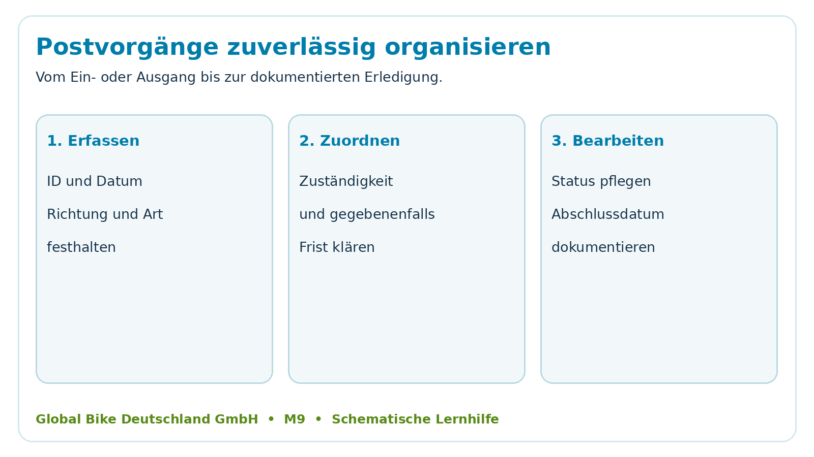
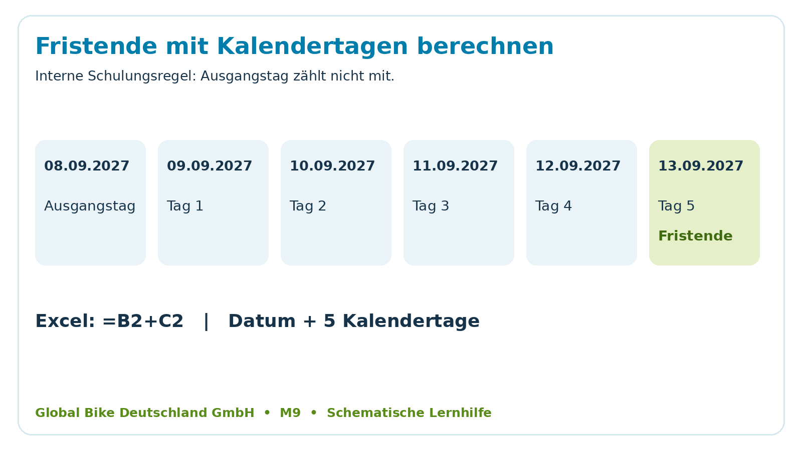
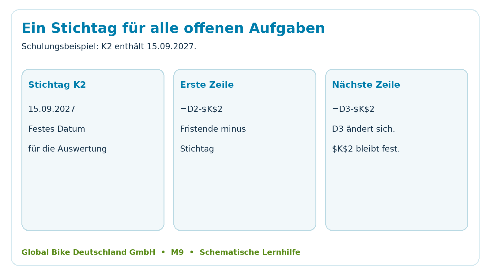
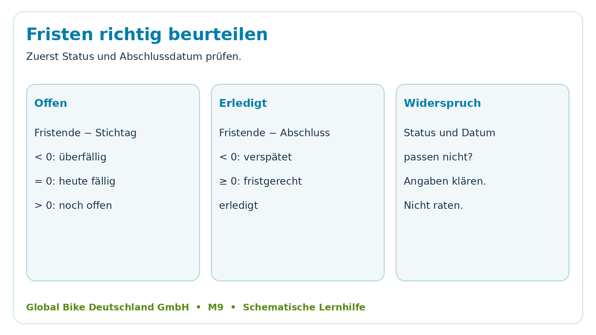
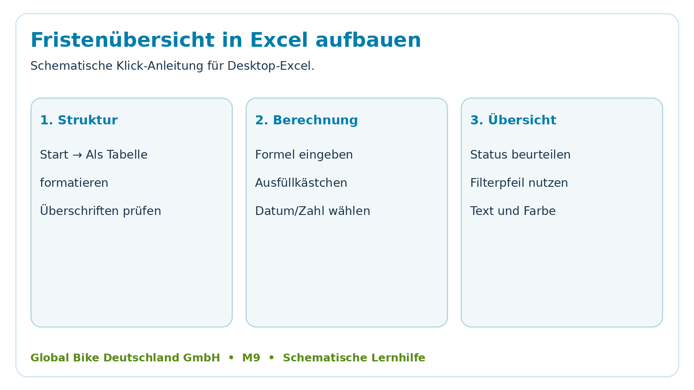
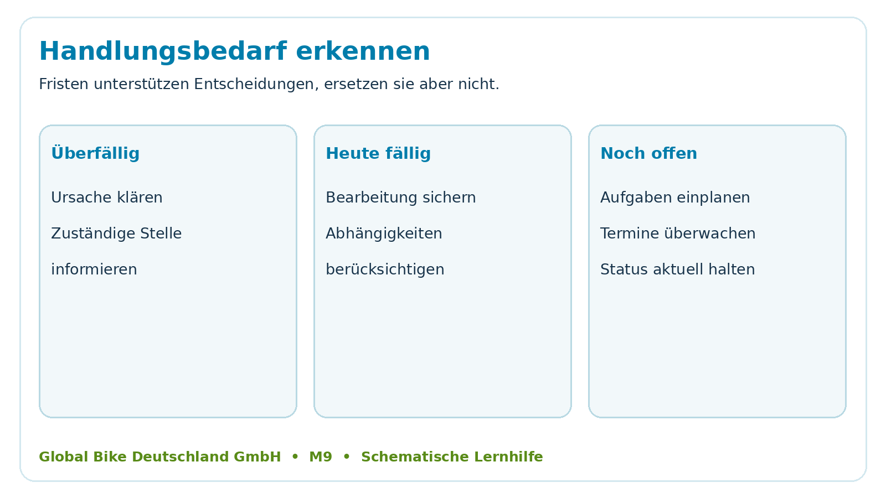
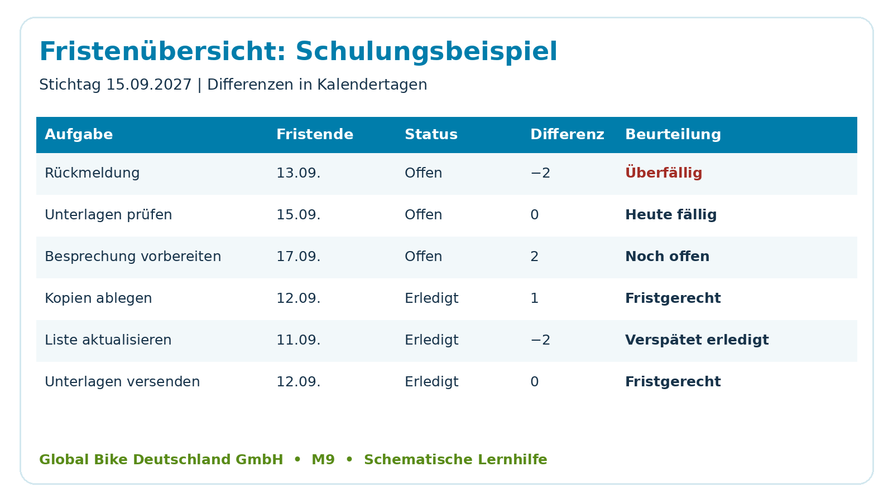

# M9 – Postorganisation, Termine und Fristen mit Excel

Global Bike Deutschland GmbH – Verwaltung

## 1. Bedeutung der digitalen Büroorganisation

Eine zuverlässige Büroorganisation sorgt dafür, dass Anfragen, Bestellungen, interne Mitteilungen und Aufgaben nicht verloren gehen. Eine gemeinsame Excel-Übersicht macht sichtbar, was eingegangen ist, wer zuständig ist, was bereits erledigt wurde und wo Handlungsbedarf besteht. Sie unterstützt die Abstimmung zwischen Verwaltung, Verkauf und Auftragsbearbeitung. Eine Tabelle ersetzt weder die tatsächliche Bearbeitung noch die Kommunikation mit den zuständigen Mitarbeitenden.

## 2. Posteingang und Postausgang

Zum Posteingang gehören beispielsweise empfangene Kundenanfragen und Bestellungen, zum Postausgang versandte Angebote und Antworten. Auch interne Mitteilungen können in einer betrieblichen Postübersicht erfasst werden. Die Richtung wird aus Sicht des dokumentierenden Bereichs angegeben. Das Datum bezeichnet den tatsächlichen Ein- oder Ausgang, nicht automatisch das Datum auf dem Schreiben.

Ein Vorgang wird erfasst, eindeutig gekennzeichnet, einer zuständigen Stelle zugeordnet, bearbeitet und mit seinem tatsächlichen Erledigungsdatum dokumentiert. Bei der Weiterleitung bleiben die Zuständigkeit und der Bearbeitungsstand nachvollziehbar. Eine versandte Nachricht ist nicht automatisch ein abgeschlossener Geschäftsvorgang.

## 3. Aufbau betrieblicher Postlisten

| Feld          | Bedeutung                                                |
|---------------|----------------------------------------------------------|
| Vorgangs-ID   | Eindeutige Kennzeichnung, beispielsweise S01             |
| Datum         | Tatsächlicher Ein- oder Ausgang                          |
| Richtung      | Eingang oder Ausgang                                     |
| Vorgangsart   | Beispielsweise Kundenanfrage                             |
| Zuständigkeit | Verantwortlicher betrieblicher Bereich                   |
| Status        | Offen oder Erledigt                                      |
| Erledigt am   | Tatsächliches Abschlussdatum; bei offenen Vorgängen leer |

Eine Zeile enthält einen Postvorgang, eine Spalte ein Merkmal. Überschriften sind eindeutig, Datumswerte echte Excel-Daten und Statusangaben einheitlich. Keine Leerzeilen innerhalb des Datenbereichs, keine verbundenen Zellen in der Liste. Vorgangs-IDs sind Text und bleiben auch beim Sortieren mit ihren vollständigen Zeilen verbunden.

Postliste und Fristenliste erfüllen unterschiedliche Zwecke. Eine Fristenliste kann auch eigenständige Aufgaben ohne Postreferenz enthalten. Eine Postreferenz verbindet eine Aufgabe mit einem Vorgang, ohne dass die Aufgabe selbst als zusätzlicher Postvorgang gezählt wird. Nicht jeder Postvorgang benötigt eine eigene Frist. Die Ausgangsdaten M1 bleiben unverändert.

## 4. Termine und Fristen unterscheiden

Ein Termin bezeichnet einen bestimmten Zeitpunkt, beispielsweise eine Besprechung am 15. September um 10 Uhr. Eine Frist bezeichnet einen Zeitraum, innerhalb dessen etwas erledigt werden soll. Das Fristende ist das Datum, bis zu dem die Aufgabe erledigt sein muss. Eine Besprechung kann einen festen Termin und zusätzlich eine Vorbereitungsfrist haben.

| Begriff       | Beispiel (unabhängiger Schulungsfall) |
|---------------|---------------------------------------|
| Ausgangsdatum | 08.09.2027                            |
| Fristdauer    | 5 Kalendertage                        |
| Fristende     | 13.09.2027                            |
| Termin        | Besprechung am 15.09.2027             |

Im Hauptfall M1 gelten Kalendertage, der Ausgangstag zählt nicht mit, Wochenenden und Feiertage führen nicht zur Verschiebung. Das ist eine interne Simulationsregel und keine allgemeine Regel für gesetzliche oder vertragliche Fristen.

## 5. Datumswerte in Excel verstehen

Excel speichert ein Datum als fortlaufende Zahl. Dadurch können Tage addiert und Datumswerte voneinander abgezogen werden. Das Datumsformat bestimmt die Anzeige. Ein als Text gespeichertes Datum kann Berechnungen und Sortierungen stören.

Klick-Anleitung: Zellen markieren, Strg+1 drücken, Kategorie Datum oder Benutzerdefiniert wählen, beispielsweise TT.MM.JJJJ einstellen, bestätigen. Ein Datum wie 08.09.2027 in der deutschen Excel-Umgebung eingeben. Zur Kontrolle kann in einer freien Zelle `=ISTZAHL(B2)` verwendet werden: WAHR zeigt einen numerischen Wert, beweist aber noch nicht, dass das richtige Datum eingegeben wurde. Diese Prüffunktion ist eine freiwillige Hilfe.

Bei importierten Textdaten zunächst eine Kopie anlegen. Über Daten \> Text in Spalten kann bei einer einzelnen Datumsspalte im letzten Schritt das Datenformat Datum mit Reihenfolge TMJ gewählt werden. Zielbereich und Vorschau prüfen, damit keine Nachbarspalten überschrieben werden. Alternativ einzelne Werte korrekt neu eingeben. Die Originaldaten nicht überschreiben. Bei einer Anzeige \##### zuerst die Spaltenbreite prüfen.

## 6. Fälligkeitsdaten berechnen

Steht in B2 das Ausgangsdatum und in C2 die Fristdauer in ganzen Kalendertagen, berechnet `=B2+C2` das Fristende. Das Ergebnis als Datum formatieren. Die Fristdauer bleibt eine Zahl, nicht ein Datum.

Beispiel: 08.09.2027 plus 5 Tage ergibt 13.09.2027. Der 09.09. ist Tag 1, der 13.09. Tag 5. Auch Samstag und Sonntag zählen mit. Ein Monatswechsel wird automatisch berücksichtigt: 28.09.2027 plus 5 Tage ergibt 03.10.2027. Es wird kein zusätzlicher Tag addiert. Bei fehlendem Ausgangsdatum oder fehlender Fristdauer zuerst die Daten klären; leere Zellen können sonst wie null behandelt werden. Eine Fristdauer von null ist nur bei ausdrücklich vorgegebener taggleicher Fälligkeit sinnvoll.

## 7. Einen zentralen Stichtag verwenden

Ein Stichtag ist das Datum, auf das sich die Auswertung bezieht. Für eine historische Auswertung muss er fest bleiben. In M1 ist der Stichtag 01.07.2027. Das unabhängige Schulungsbeispiel in diesem Material verwendet dagegen 15.09.2027.

Ein zentraler Stichtag in K2 kann in allen Berechnungen mit `$K$2` angesprochen werden. Der Bezug bleibt beim Kopieren unverändert, der Zellwert kann bei einer neuen Auswertung angepasst werden. `=HEUTE()` liefert dagegen das aktuelle Systemdatum und verändert eine historische Auswertung bei späterem Öffnen. Deshalb ist HEUTE für den festen Hauptfall nicht geeignet.

## 8. Verbleibende und überschrittene Fristen berechnen

Bei offenen Aufgaben ergibt sich die Anzahl verbleibender Kalendertage aus Fristende minus Stichtag. Steht das Fristende in D2, lautet die Formel `=D2-$K$2`. Ergebnis als Zahl mit null Dezimalstellen formatieren.

| Ergebnis | Bedeutung bei offenen Aufgaben                     |
|----------|----------------------------------------------------|
| positiv  | Frist liegt in der Zukunft                         |
| null     | Heute fällig                                       |
| negativ  | Frist überschritten; Betrag zeigt überfällige Tage |

Bei erledigten Aufgaben ist dagegen das Erledigungsdatum maßgeblich. Die Differenz Fristende minus Erledigungsdatum zeigt, wie viele Tage vor dem Fristende die Aufgabe abgeschlossen wurde; null bedeutet am Fristende, ein negativer Wert verspätet. Ein erledigter Vorgang ist nicht weiterhin offen oder überfällig.

## 9. Offene und erledigte Vorgänge beurteilen

Zuerst den Bearbeitungsstatus prüfen. Bei offenen Aufgaben ohne Erledigungsdatum das Fristende mit dem Stichtag vergleichen. Bei erledigten Aufgaben das Fristende mit dem tatsächlichen Abschlussdatum vergleichen. Widersprüche, etwa Status Erledigt ohne Abschlussdatum, müssen geklärt werden. Ein Abschlussdatum nach dem Stichtag passt nicht zu einem bereits erledigten Vorgang in einer historischen Stichtagsauswertung.

Die Beurteilung kann anhand der berechneten Differenzen und einer dokumentierten Entscheidung erfolgen. Eine automatische Klassifikation mit WENN ist eine freiwillige Vertiefung, keine zusätzliche verbindliche Fachkompetenz. Für bereits geprüfte, vollständige Daten im Beispiel aus Abschnitt 13 ist folgende Formel in H2 möglich:

`=WENN(E2="Erledigt";WENN(G2>=0;"Fristgerecht erledigt";"Verspätet erledigt");WENN(G2<0;"Überfällig";WENN(G2=0;"Heute fällig";"Noch offen")))`

Die Formel setzt voraus, dass E nur die gültigen Statuswerte Offen und Erledigt enthält und G korrekt berechnet wurde. Sie ist keine Datenvalidierung. Bei widersprüchlichen oder fehlenden Eingaben darf keine scheinbar sichere Einstufung erfolgen.

## 10. Klick-Anleitungen zur Fristenüberwachung

**A – Postliste vorbereiten**

1.  Neue Arbeitsmappe oder Kopie öffnen und Tabellenblatt sinnvoll benennen.
2.  Überschriften für die benötigten Merkmale eintragen.
3.  Daten zeilenweise übernehmen, IDs als Text und Datumsfelder als Datum formatieren.
4.  Den Datenbereich markieren und über Start \> Als Tabelle formatieren eine übersichtliche Tabelle anlegen. Die Option Tabelle hat Überschriften bestätigen.
5.  Prüfen, ob jede ID eindeutig ist und alle Angaben einer Zeile zusammengehören.

**B – Fristende und Tagesdifferenz**

1.  Ausgangsdatum und Fristdauer in getrennten Spalten erfassen.
2.  Eine Spalte Fristende ergänzen. In der ersten Datenzeile die Additionsformel eingeben.
3.  Enter drücken, Ergebnis als Datum formatieren und Formel über das Ausfüllkästchen nach unten kopieren. In einer formatierten Excel-Tabelle kann die Formel automatisch übernommen werden.
4.  Den Stichtag außerhalb des Datenbereichs mit Beschriftung erfassen.
5.  In einer weiteren Spalte für offene Aufgaben das Fristende minus den absolut referenzierten Stichtag berechnen.
6.  Für erledigte Aufgaben stattdessen das Erledigungsdatum abziehen. Die jeweilige Formel anhand des Status auswählen. Bei einer späteren Statusänderung muss auch die Formel angepasst werden, sofern keine automatische Logik verwendet wird.
7.  Differenzen als ganze Zahlen formatieren. Erste und letzte Formel sowie einen Monatswechsel kontrollieren.

**C – Handlungsbedarf sichtbar machen**

1.  Die Spalte Fristenbeurteilung ergänzen und die Ergebnisse anhand der Entscheidungslogik eintragen.
2.  Über den Filterpfeil dieser Spalte gezielt Überfällig oder Heute fällig auswählen. M10 erläutert Sortieren und Filtern ausführlich.
3.  Bei Bedarf über Start \> Bedingte Formatierung \> Regeln zum Hervorheben von Zellen \> Textinhalt Regeln für die Bezeichnungen anlegen, beispielsweise Überfällig rot, Heute fällig gelb.
4.  Textbezeichnungen beibehalten: Farbe allein ist nicht ausreichend. Erledigte Aufgaben nicht als offene Fälle markieren.
5.  Filter wieder aufheben und kontrollieren, ob alle Datensätze vorhanden sind.

Manuelle Beurteilungen müssen nach einer Änderung von Stichtag, Frist oder Status erneut überprüft werden. Wer die freiwillige automatische Variante nutzt, prüft die Eingabedaten und testet die Formel für jeden Statusfall.

## 11. Interne Ablagefristen

Interne Ablagefristen legen fest, bis wann Unterlagen betrieblich geordnet und abgelegt werden sollen. Beispiele sind die Ablage von Angebotskopien oder Monatsunterlagen. Das Fristende wird aus der internen Vorgabe berechnet. Die Ablage muss tatsächlich erfolgt sein, bevor der Vorgang als erledigt gekennzeichnet wird.

Gesetzliche Aufbewahrungsfristen regeln dagegen, wie lange bestimmte Unterlagen aufzubewahren sind. Das Ende einer internen Ablagefrist ist keine Erlaubnis zur Vernichtung. M1 enthält ausschließlich interne Ablagefristen; gesetzliche Fristberechnungen sind nicht Gegenstand dieser Lernsituation.

## 12. Betriebliche Prioritäten setzen

Überfällige offene Aufgaben benötigen eine zeitnahe Prüfung. Heute fällige Aufgaben müssen ebenfalls berücksichtigt werden. Zukünftige Fristen sind einzuplanen. Innerhalb dieser Gruppen spielen Dringlichkeit, Auswirkungen auf Kunden, Abhängigkeiten und Zuständigkeit eine Rolle. Die älteste Frist ist nicht in jedem Fall automatisch die wichtigste Aufgabe.

Bei einer drohenden oder eingetretenen Überschreitung die zuständige Stelle informieren, Ursache klären und das weitere Vorgehen abstimmen. Fristen nicht eigenmächtig verlängern oder Erledigungsdaten erfinden. Die Tabelle liefert die Entscheidungsgrundlage, die Entscheidung bleibt eine betriebliche Aufgabe.

## 13. Durchgängiges betriebliches Anwendungsbeispiel

Unabhängige simulierte Schulungsdaten der Global Bike Deutschland GmbH, keine SAP-Daten und keine Lösung zu M1. Stichtag in K2: 15.09.2027.

| Zeile | A – Aufgabe             | B – Ausgang | C – Tage | D – Fristende | E – Status | F – Erledigt am | G – Differenz | H – Beurteilung       |
|-------|-------------------------|-------------|---------:|---------------|------------|-----------------|--------------:|-----------------------|
| 2     | Rückmeldung             | 08.09.2027  |        5 | 13.09.2027    | Offen      | leer            |            −2 | Überfällig            |
| 3     | Unterlagen prüfen       | 10.09.2027  |        5 | 15.09.2027    | Offen      | leer            |             0 | Heute fällig          |
| 4     | Besprechung vorbereiten | 12.09.2027  |        5 | 17.09.2027    | Offen      | leer            |             2 | Noch offen            |
| 5     | Kopien ablegen          | 08.09.2027  |        4 | 12.09.2027    | Erledigt   | 11.09.2027      |             1 | Fristgerecht erledigt |
| 6     | Liste aktualisieren     | 07.09.2027  |        4 | 11.09.2027    | Erledigt   | 13.09.2027      |            −2 | Verspätet erledigt    |
| 7     | Unterlagen versenden    | 09.09.2027  |        3 | 12.09.2027    | Erledigt   | 12.09.2027      |             0 | Fristgerecht erledigt |

D2: `=B2+C2`, bis D7 kopieren. G2: `=D2-$K$2`, bis G4 kopieren. G5: `=D5-F5`, bis G7 kopieren. Für eine automatische Auswahl der Differenzformel bei geprüften Daten kann freiwillig `=WENN(E2="Erledigt";D2-F2;D2-$K$2)` in G2 eingesetzt und nach unten kopiert werden. H anhand der Entscheidungslogik beurteilen oder freiwillig die Formel aus Abschnitt 9 verwenden.

Die Rückmeldung ist überfällig, die Unterlagenprüfung heute fällig. Beide benötigen Aufmerksamkeit. Die Besprechungsvorbereitung ist einzuplanen. Die verspätete Listenaktualisierung ist bereits erledigt; hier geht es um die Ursachenanalyse, nicht um eine erneute Bearbeitung.

Funktionsprobe in einer Kopie: Stichtag auf 17.09.2027 ändern. Die offenen Differenzen werden −4, −2 und 0. Die Differenzen der erledigten Aufgaben bleiben 1, −2 und 0. Manuelle Beurteilungen aktualisieren. Anschließend den ursprünglichen Stichtag wiederherstellen.

## 14. Typische Fehler und deren Behebung

| Fehler                                           | Abhilfe                                                   |
|--------------------------------------------------|-----------------------------------------------------------|
| Datum als Text gespeichert                       | Datentyp prüfen und korrekt umwandeln                     |
| Fristdauer als Datum angezeigt                   | Zahlenformat mit null Dezimalstellen wählen               |
| Fristende um einen Tag verschoben                | Ausgangstag gemäß interner Regel nicht mitzählen          |
| Wochenende übersprungen                          | Kalendertage statt Arbeitstage verwenden                  |
| Stichtag wandert beim Kopieren                   | Absoluten Bezug verwenden                                 |
| Historische Auswertung verändert sich täglich    | Festen Stichtag statt HEUTE verwenden                     |
| Negative Tagesdifferenz als Datum angezeigt      | Zahlenformat verwenden                                    |
| Erledigte Aufgabe als überfällig eingestuft      | Erledigungsdatum statt Stichtag vergleichen               |
| Status und Abschlussdatum widersprechen sich     | Originalangaben prüfen, nicht raten                       |
| Leeres Datum erzeugt scheinbar gültiges Ergebnis | Eingaben vor Berechnung auf Vollständigkeit prüfen        |
| Nur eine Spalte sortiert                         | Gesamten zusammenhängenden Datenbereich sortieren         |
| Farbe ohne Textbezeichnung                       | Eindeutige Statusbezeichnung ergänzen                     |
| Ablagefrist als Löschfrist verstanden            | Interne Ablage und gesetzliche Aufbewahrung unterscheiden |
| Neue Zeile ohne Formel                           | Berechnungsbereich erweitern und testen                   |

## 15. Qualitätskontrolle und Wiederverwendbarkeit

Freiwillige Kontrolle: Sind IDs eindeutig, Datumswerte numerisch und plausibel, Fristdauern ganze Kalendertage und Statusangaben einheitlich? Sind offene Abschlussdaten leer und erledigte Abschlussdaten vorhanden? Liegt ein Abschluss nicht vor dem Ausgangsdatum oder nach dem Stichtag? Sind Fristende und Differenz korrekt formatiert? Ist der Stichtag zentral und absolut referenziert? Bleiben erledigte Differenzen bei einer Stichtagsänderung stabil? Werden neue Zeilen vollständig berücksichtigt? Sind manuelle Beurteilungen nach Änderungen aktualisiert? Bleiben Originaldaten erhalten?

Mindestens einen offenen, einen heute fälligen, einen überfälligen und einen erledigten Fall in einer Kopie prüfen. Einen Monatswechsel testen. Nach der Funktionsprobe Ausgangswerte wiederherstellen. Die Arbeitsmappe muss nachvollziehbar und für weitere Mitarbeitende nutzbar bleiben.

## 16. Freiwillige Selbstkontrolle

1.  Was unterscheidet Posteingang und Postausgang?
2.  Warum braucht jeder Postvorgang eine eindeutige ID?
3.  Was unterscheidet Termin und Frist?
4.  Wie lautet das Fristende bei 28.09.2027 plus fünf Kalendertagen?
5.  Welche Formel berechnet das Fristende aus B3 und C3?
6.  Warum ist HEUTE für eine historische Auswertung ungeeignet?
7.  Wie lautet die kopierfähige Differenzformel für eine offene Aufgabe mit Fristende D3 und Stichtag K2?
8.  Was bedeutet eine Differenz von −3 bei einer offenen Aufgabe?
9.  Was bedeutet eine Differenz von null bei einer offenen Aufgabe?
10. Fristende 20.09., erledigt am 18.09.: Welche Differenz und Beurteilung ergeben sich?
11. Fristende 20.09., erledigt am 22.09.: Ist die Aufgabe noch überfällig?
12. Warum darf eine erledigte Aufgabe ohne Abschlussdatum nicht automatisch beurteilt werden?
13. Darf nach Ablauf einer internen Ablagefrist eine Unterlage vernichtet werden?
14. Warum reicht die Farbe Rot nicht als einzige Kennzeichnung?
15. Was ist bei einer Änderung des Stichtags mit manuell eingetragenen Beurteilungen zu tun?

**Kontrollhinweise**

1.  Empfangene gegenüber versandten Vorgängen aus Sicht des dokumentierenden Bereichs.
2.  Damit Vorgänge eindeutig zugeordnet und wiedergefunden werden.
3.  Termin: bestimmter Zeitpunkt; Frist: Zeitraum bis zur Erledigung.
4.  03.10.2027.
5.  `=B3+C3`.
6.  HEUTE liefert das aktuelle Systemdatum statt des festgelegten Auswertungsdatums.
7.  `=D3-$K$2`.
8.  Drei Kalendertage überfällig.
9.  Heute fällig.
10. +2, fristgerecht erledigt.
11. Nein, sie ist verspätet erledigt; Differenz −2.
12. Der tatsächliche Abschlusszeitpunkt fehlt.
13. Nein, die interne Ablagefrist ist keine Lösch- oder Aufbewahrungsfrist.
14. Text ist eindeutiger und auch ohne Farbwahrnehmung verständlich.
15. Erneut anhand der aktualisierten Differenzen prüfen und anpassen.

Keine zusätzliche Abgabe oder Bewertung.

## 17. Weiterführende Materialien

M3 unterstützt die Tabellenstruktur, M4 die Datumsformate, M5 die Formelerstellung und M7 die absoluten Zellbezüge. M10 vertieft Sortieren, Filtern und Rangfolgen. M14 behandelt die Qualitätskontrolle und Wiederverwendbarkeit. M9 bleibt während der gesamten Lernsituation verfügbar.
