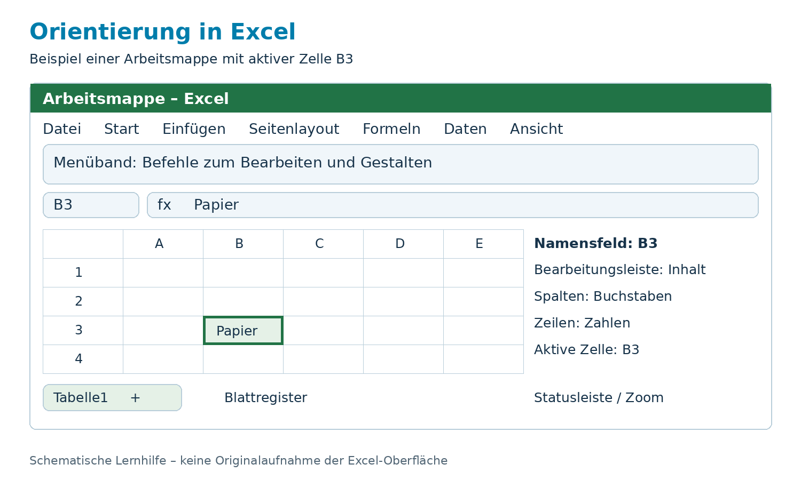
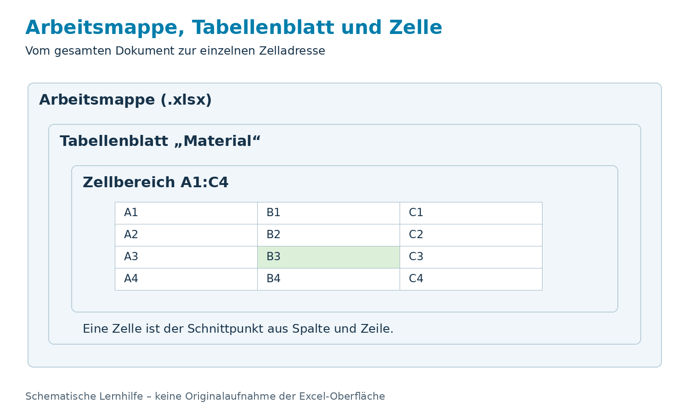

# Ü1 – Sicher in Excel starten

Global Bike Deutschland GmbH · Verwaltung · Freiwillige Übung · Keine KI

[Excel-Arbeitsdatei herunterladen](UE1_Arbeitsdatei.xlsx)

## 1. Betriebliche Ausgangssituation

Die Verwaltung bereitet interne Besprechungen zur Marktbearbeitung in der Region Nordwest vor. Eine Materialnotiz soll in eine bearbeitbare, aktualisierbare Excel-Arbeitsmappe überführt werden. Die folgenden Daten sind simuliert und unabhängig von M1.

## 2. Das trainieren Sie

Excel-Oberfläche, Zelladressen, Zellbereiche, Eingabe und Bearbeitung, Ausfüllkästchen, Blattorganisation, Speichern und Wiederöffnen (M2, F1).

## 3. Ausgangsdaten

Stand: 15.03.2027. Materialnotiz:

| Material | Bestand | Einheit |
|---|---:|---|
| Moderationskarten | 32 | Stück |
| Klemmbretter | 7 | Stück |
| Namensschilder | 18 | Stück |
| Whiteboardmarker | 9 | Stück |
| Haftnotizblöcke | 14 | Stück |

## 4. Praktische Arbeitsaufträge

1.  Öffnen Sie UE1_Arbeitsdatei.xlsx. Speichern Sie eine Arbeitskopie als GB_UE1_Materialbestand.xlsx. Die Ausgangsdatei bleibt unverändert.
2.  Orientieren Sie sich: Finden Sie Menüband, Namensfeld, Bearbeitungsleiste, Blattregister und Zoom. Wählen Sie B3 über das Namensfeld. Erklären Sie sich selbst, was die Adresse bedeutet.
3.  Benennen Sie Tabelle1 in Materialbestand um. Erfassen Sie in A1:D1 die Überschriften Nr., Material, Bestand, Einheit. Übernehmen Sie die Materialnotiz in B2:D6. Erfassen Sie die Bestände als Zahlen ohne Einheit.
4.  Geben Sie in A2 und A3 die Startwerte 1 und 2 ein. Markieren Sie beide und setzen Sie die Reihe bis A6 mit dem Ausfüllkästchen fort.
5.  Eine interne Nachmeldung korrigiert den Bestand der Whiteboardmarker auf 11 Stück. Ändern Sie nur den betreffenden Bestand. Kopieren Sie den Inhalt von D2 nach D6. Schreiben Sie testweise in F2 das Wort Probe und entfernen Sie es anschließend mit Entf. Prüfen Sie, dass die Materialdaten unverändert geblieben sind.
6.  Legen Sie ein zweites Blatt Hinweise an. Erfassen Sie dort in A1:B3 die Angaben Stand / 15.03.2027, Zweck / Interne Besprechungen, Datenbasis / Simulierte Übungsdaten. Ordnen Sie Materialbestand vor Hinweise an. Passen Sie bei Bedarf die Spaltenbreiten an.
7.  Markieren Sie A1:D6 über das Namensfeld. Wie viele Zellen umfasst der Bereich? Prüfen Sie die aktive Zelle und wechseln Sie zwischen den beiden Blättern. Speichern Sie, schließen Sie die Datei und öffnen Sie Ihre Arbeitskopie erneut.
8.  Führen Sie die Selbstkontrolle durch. Vergleichen Sie erst danach mit der separaten Musterlösung. Eine Abgabe ist nicht erforderlich.

## 5. Hilfen bei Bedarf

M2 Abschnitte 2–7 und 9. Die folgenden Abbildungen sind schematische Lernhilfen, keine Screenshots.   

### Klick-Anleitungen (Excel für Windows, deutsch)

| Ziel              | Klickweg                                                                                                  |
|-------------------|-----------------------------------------------------------------------------------------------------------|
| Arbeitskopie      | Datei → Speichern unter (ggf. Kopie speichern) → Ordner → Name → Excel-Arbeitsmappe (\*.xlsx) → Speichern |
| Zelladresse       | Namensfeld links der Bearbeitungsleiste → B3 eingeben → Enter                                             |
| Blatt umbenennen  | Doppelklick auf Blattregister → Name → Enter                                                              |
| Eingabe           | Zelle anklicken → Inhalt tippen → Enter; Tab wechselt nach rechts                                         |
| Datenreihe        | Zwei Startwerte markieren → kleines Quadrat unten rechts bis Zielzeile ziehen                             |
| Inhalt ändern     | Zelle auswählen → neuen Wert eingeben oder F2 → Enter                                                     |
| Kopieren          | Quellzelle → Strg+C → Zielzelle → Strg+V                                                                  |
| Inhalt löschen    | Zelle auswählen → Entf (nicht ganze Zeile löschen)                                                        |
| Neues Blatt       | Plus neben Blattregistern → Doppelklick auf neuen Namen                                                   |
| Blatt verschieben | Blattregister an gewünschte Position ziehen                                                               |
| Spaltenbreite     | Doppelklick auf rechte Grenze der Spaltenüberschrift                                                      |
| Bereich markieren | Namensfeld → A1:D6 → Enter                                                                                |
| Wiederöffnen      | Strg+S → Datei schließen → Datei → Öffnen → eigene Kopie auswählen                                        |

Je nach Version können Befehlsnamen abweichen. Bei einer unerwarteten Änderung Strg+Z nutzen, soweit möglich. Die Originaldatei nicht überschreiben.

## 6. Selbstkontrolle

- [ ] Meine Arbeitskopie hat die Endung .xlsx und lässt sich erneut öffnen.
- [ ] Beide Blätter sind vorhanden, sinnvoll benannt und richtig angeordnet.
- [ ] Die Materialliste enthält fünf vollständige Datensätze und vier Überschriften.
- [ ] Nummern laufen von 1 bis 5; Bestände sind Zahlen, Einheiten stehen getrennt.
- [ ] Die Nachmeldung ist berücksichtigt, die übrigen Bestände sind unverändert.
- [ ] F2 ist leer; die Hinweise sind vollständig.
- [ ] Ich kann Namensfeld, Bearbeitungsleiste und Ausfüllkästchen zeigen.
- [ ] Ich kann erklären, warum XLSX statt PDF für die Weiterbearbeitung geeignet ist.

Funktionstest: Ändern Sie testweise einen Bestand, speichern Sie und öffnen Sie die Datei erneut. Stellen Sie anschließend den ursprünglichen Übungswert wieder her und speichern Sie erneut.

## 7. Freiwillige Vertiefung

Erstellen Sie eine Kopie des Blatts Materialbestand über Rechtsklick → Verschieben oder Kopieren → Kopie erstellen. Benennen Sie sie Testkopie. Ergänzen Sie dort einen selbst gewählten simulierten Materialdatensatz und setzen Sie die Nummerierung fort. Prüfen Sie, dass das ursprüngliche Blatt unverändert bleibt. Die Vertiefung gehört nicht zur Musterlösung und ist keine Pflicht.
