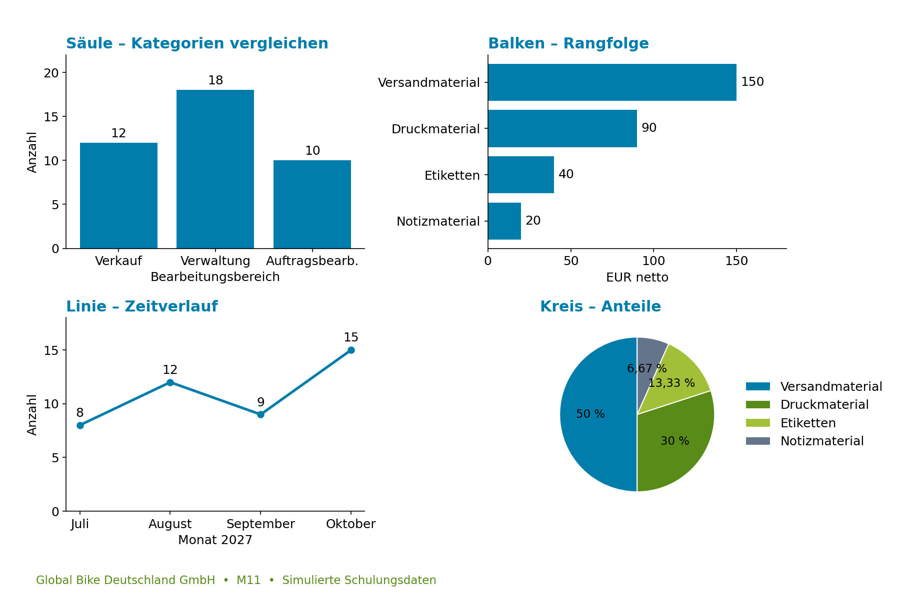
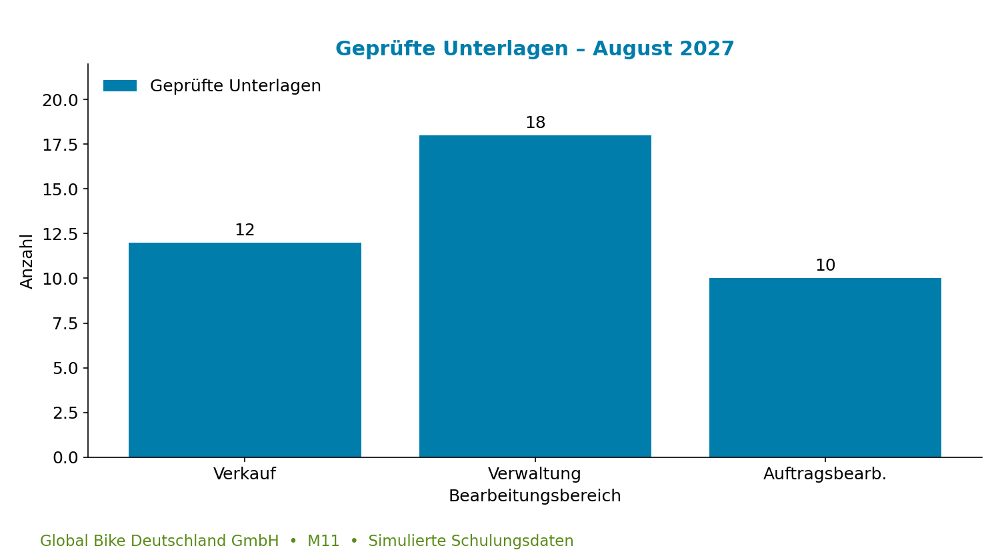

# Ü10 – Den richtigen Diagrammtyp auswählen

Global Bike Deutschland GmbH · Verwaltung · Löppt · freiwillig · unbenotet · keine KI

## Ausgangssituation

Emma Fuchs benötigt vier unterschiedliche grafische Aussagen für eine interne Abstimmung. Alle Daten sind simulierte Schulungsdaten, keine SAP-Daten oder Hauptfalllösung. Ü12–Ü14 nutzen bewusst dieselbe Kostenbasis für aufeinander aufbauende Qualitätsaufgaben.

## Das trainieren Sie

F10; Materialien M11.

## Arbeitsdatei

UE10_Arbeitsdatei.xlsx öffnen und Arbeitskopie speichern. Blaue Felder sind Eingaben, grüne Felder vorhandene Formeln. Fehlende Ergebnisse selbst ergänzen.

## Arbeitsaufträge

1.  Untersuchen Sie die vier Blätter und formulieren Sie je eine betriebliche Frage.
2.  Wählen Sie für Vergleich, Verlauf, Anteile und Rangfolge jeweils einen passenden Diagrammtyp. Begründen Sie die Wahl und nennen Sie eine ungeeignete Alternative.
3.  Markieren Sie Daten mit Überschriften → Einfügen → passenden 2D-Diagrammtyp wählen. Keine Summenzeilen als Kategorie verwenden.
4.  Prüfen Sie Achsen, Einheit, Zeitreihenfolge und bei Anteilen das vollständige Ganze. Vermeiden Sie 3D und abgeschnittene Größenachsen.
5.  Ändern Sie testweise einen Wert und vergleichen Sie die Aussage; stellen Sie ihn wieder her.

## Hilfen bei Bedarf

## Selbstkontrolle

- [ ] Alle Arbeitsaufträge bearbeitet.
- [ ] Daten und Bezugsgrößen geprüft.
- [ ] Ergebnisse und Änderungstests nachvollziehbar.
- [ ] Ausgangswerte wiederhergestellt und Datei gespeichert.

## Freiwillige Vertiefung

Eine zusätzliche plausible Eingabe in einer Testkopie verändern, Ergebnis vorhersagen und prüfen. Keine Pflichtabgabe.

[Excel-Arbeitsdatei herunterladen](UE10_Arbeitsdatei.xlsx)
