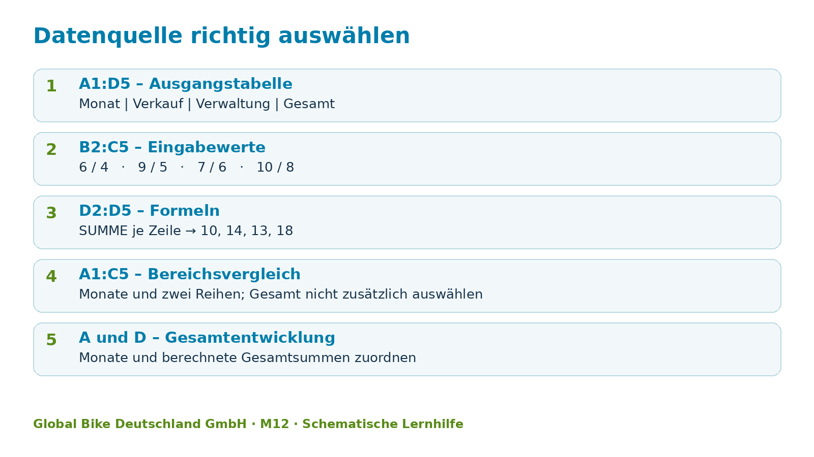
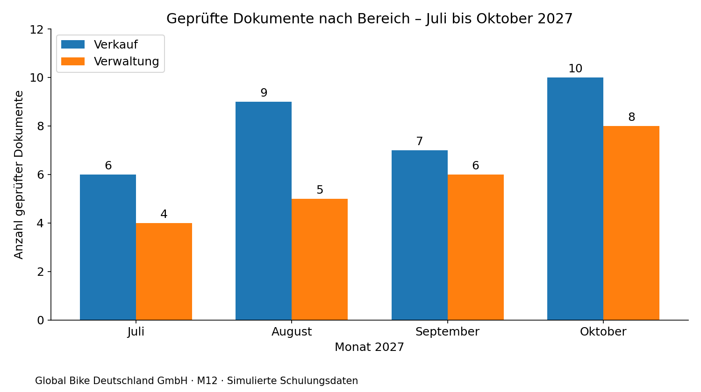

# Ü11 – Diagramme für eine interne Besprechung erstellen

Global Bike Deutschland GmbH · Verwaltung · Löppt · freiwillig · unbenotet · keine KI

## Ausgangssituation

Für eine interne Besprechung sollen geprüfte Unterlagen und Kostenanteile grafisch aufbereitet werden. Alle Daten sind simulierte Schulungsdaten, keine SAP-Daten oder Hauptfalllösung. Ü12–Ü14 nutzen bewusst dieselbe Kostenbasis für aufeinander aufbauende Qualitätsaufgaben.

## Das trainieren Sie

F11; Materialien M6, M8, M11, M12.

## Arbeitsdatei

UE11_Arbeitsdatei.xlsx öffnen und Arbeitskopie speichern. Blaue Felder sind Eingaben, grüne Felder vorhandene Formeln. Fehlende Ergebnisse selbst ergänzen.

## Arbeitsaufträge

1.  Berechnen Sie Monate!D2:D5 mit SUMME und Kosten!B5 sowie C2:C5 mit Anteilen und absolutem Nenner.
2.  Markieren Sie Monate A1:C5 → Einfügen → gruppierte 2D-Säulen. Gesamt nicht als dritte Bereichsreihe darstellen.
3.  Markieren Sie Kosten A1:B4 → Einfügen → 2D-Kreis. Diagrammentwurf → Diagrammelement hinzufügen → Datenbeschriftungen → Prozent; Kategorien über Legende kennzeichnen.
4.  Ergänzen Sie Titel, Einheit, Zeitraum und sinnvolle Legende; platzieren Sie Diagramme neben der Tabelle. Prüfen Sie Daten auswählen und Achsenformat.
5.  Ändern Sie Monate B2 auf 10 und Kosten B2 auf 150; kontrollieren Sie Summen, Anteile und Diagramme; stellen Sie Werte wieder her.

## Hilfen bei Bedarf

## Selbstkontrolle

- [ ] Alle Arbeitsaufträge bearbeitet.
- [ ] Daten und Bezugsgrößen geprüft.
- [ ] Ergebnisse und Änderungstests nachvollziehbar.
- [ ] Ausgangswerte wiederhergestellt und Datei gespeichert.

## Freiwillige Vertiefung

Eine zusätzliche plausible Eingabe in einer Testkopie verändern, Ergebnis vorhersagen und prüfen. Keine Pflichtabgabe.

[Excel-Arbeitsdatei herunterladen](UE11_Arbeitsdatei.xlsx)
