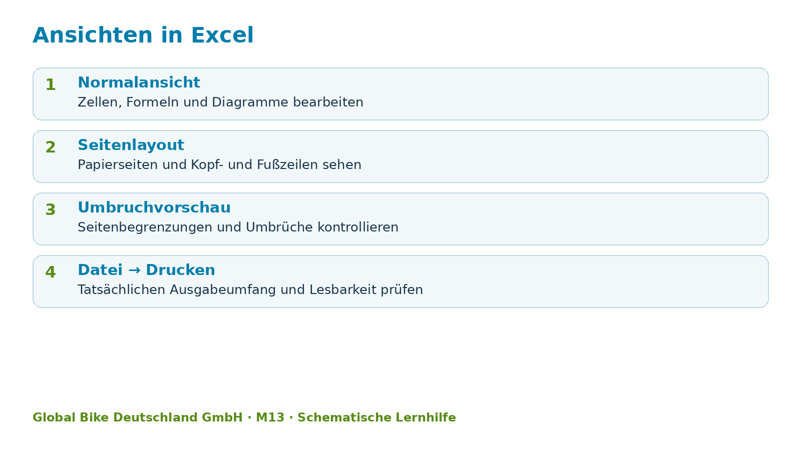
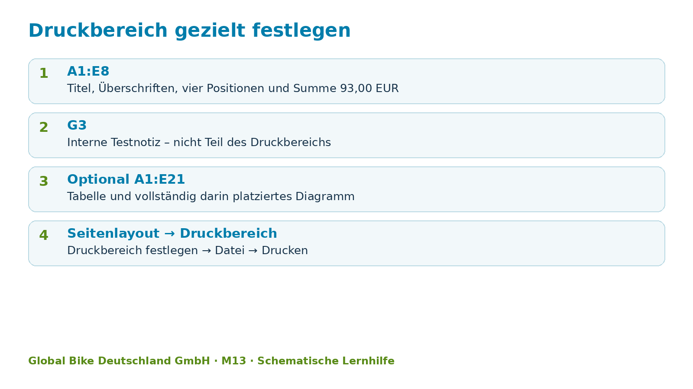

# Ü12 – Tabellen und Diagramme druckfertig aufbereiten

Global Bike Deutschland GmbH · Verwaltung · Löppt · freiwillig · unbenotet · keine KI

## Ausgangssituation

Eine Besprechungsunterlage soll vollständig und ohne interne Testnotiz ausgegeben werden. Alle Daten sind simulierte Schulungsdaten, keine SAP-Daten oder Hauptfalllösung. Ü12–Ü14 nutzen bewusst dieselbe Kostenbasis für aufeinander aufbauende Qualitätsaufgaben.

## Das trainieren Sie

F12; Materialien M3, M12, M13.

## Arbeitsdatei

UE12_Arbeitsdatei.xlsx öffnen und Arbeitskopie speichern. Blaue Felder sind Eingaben, grüne Felder vorhandene Formeln. Fehlende Ergebnisse selbst ergänzen.

## Arbeitsaufträge

1.  Berechnen Sie Einzelkosten, Gesamtsumme, Anteile, Restbudget und Auslastung. Formatieren Sie Geld und Prozentwerte.
2.  Erstellen Sie ein Säulendiagramm aus Material und Gesamt netto ohne Summenzeile; platzieren Sie es in A12:E28.
3.  Markieren Sie A1:E28 → Seitenlayout → Druckbereich festlegen. G1 ausschließen. A4, Querformat, schmale Ränder, Breite 1 Seite, Höhe 1 Seite einstellen.
4.  Fügen Sie eine Fußzeile mit Unternehmen und Zeitraum hinzu. Datei → Drucken: Vollständigkeit, Lesbarkeit, Seitenzahl und Diagramm prüfen; bei Bedarf Spaltenbreiten oder Diagrammgröße ändern.
5.  Datei → Exportieren → PDF/XPS erstellen; aktive Tabelle und Druckbereich prüfen. PDF öffnen und mit XLSX vergleichen. Keine Pflichtabgabe.

## Hilfen bei Bedarf

## Selbstkontrolle

- [ ] Alle Arbeitsaufträge bearbeitet.
- [ ] Daten und Bezugsgrößen geprüft.
- [ ] Ergebnisse und Änderungstests nachvollziehbar.
- [ ] Ausgangswerte wiederhergestellt und Datei gespeichert.

## Freiwillige Vertiefung

Eine zusätzliche plausible Eingabe in einer Testkopie verändern, Ergebnis vorhersagen und prüfen. Keine Pflichtabgabe.

[Excel-Arbeitsdatei herunterladen](UE12_Arbeitsdatei.xlsx)
