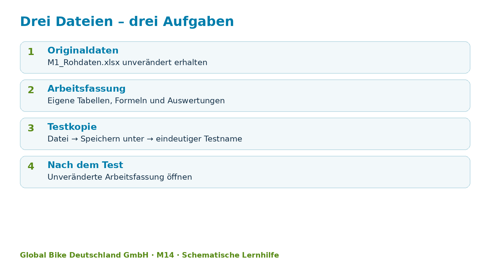

# Ü13 – Eine fehlerhafte Excel-Arbeitsmappe überprüfen

Global Bike Deutschland GmbH · Verwaltung · Löppt · freiwillig · unbenotet · keine KI

## Ausgangssituation

Emma Fuchs erhält eine fehlerhafte Arbeitsmappe. Vor Weitergabe müssen Daten, Formeln, Diagramm und Ausgabe geprüft werden. Alle Daten sind simulierte Schulungsdaten, keine SAP-Daten oder Hauptfalllösung. Ü12–Ü14 nutzen bewusst dieselbe Kostenbasis für aufeinander aufbauende Qualitätsaufgaben.

## Das trainieren Sie

F13; Materialien M3–M14.

## Arbeitsdatei

UE13_Arbeitsdatei.xlsx öffnen und Arbeitskopie speichern. Blaue Felder sind Eingaben, grüne Felder vorhandene Formeln. Fehlende Ergebnisse selbst ergänzen.

## Arbeitsaufträge

1.  Speichern Sie eine Testkopie. Sollwerte der Eingaben: Mengen 6,8,5,3; Preise 4,50/7,50/6/4 €. Prüfen Sie Typen und Formate.
2.  Formeln → Formeln anzeigen. Prüfen Sie jede Zeilenberechnung, Summe, Anteilsbezüge und Restbudget. Korrigieren Sie die Fehler, auch wenn ein Ergebnis zufällig stimmt.
3.  Prüfen Sie Diagrammentwurf → Daten auswählen: alle vier Kostenarten, keine Summenzeile. Stellen Sie einen geeigneten Druckbereich ein.
4.  Testen Sie Menge B2=8 (Summe 138 €), Budget B8=100 (Rest −29 € bei ursprünglichen Mengen) und eine neue Zeile in einer Kopie; passen Sie Summen, Nenner und Diagrammquelle an. Stellen Sie Ausgangswerte wieder her.
5.  Dokumentieren Sie je Fehler Fundstelle, Ursache, Korrektur und Testresultat. Prüfen Sie die gespeicherte Datei erneut.

## Hilfen bei Bedarf

## Selbstkontrolle

- [ ] Alle Arbeitsaufträge bearbeitet.
- [ ] Daten und Bezugsgrößen geprüft.
- [ ] Ergebnisse und Änderungstests nachvollziehbar.
- [ ] Ausgangswerte wiederhergestellt und Datei gespeichert.

## Freiwillige Vertiefung

Eine zusätzliche plausible Eingabe in einer Testkopie verändern, Ergebnis vorhersagen und prüfen. Keine Pflichtabgabe.

[Excel-Arbeitsdatei herunterladen](UE13_Arbeitsdatei.xlsx)
