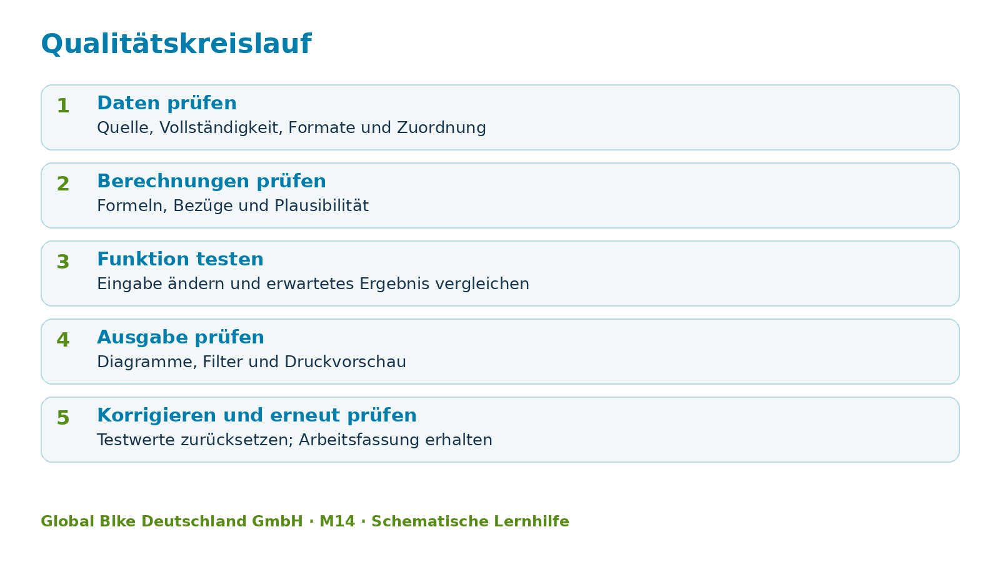
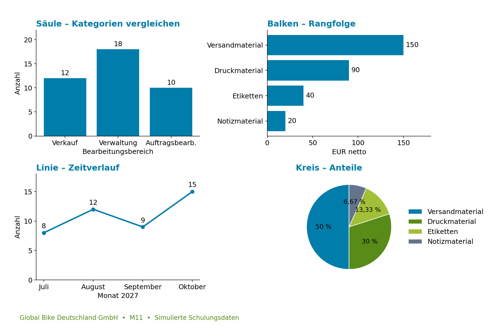
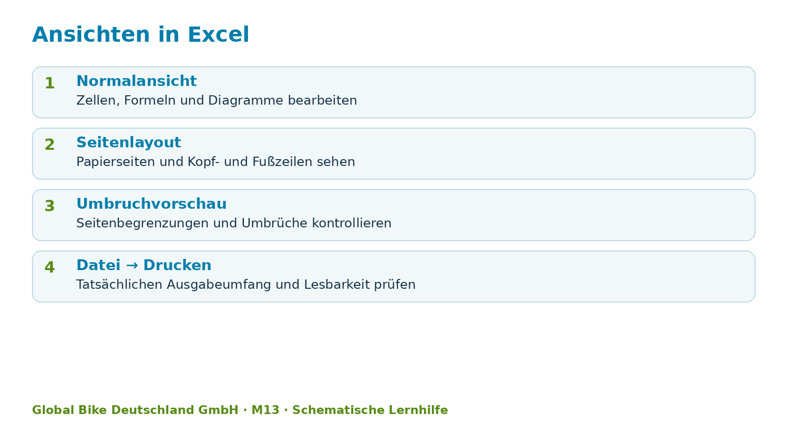

# Ü14 – Eine vollständige Büroübersicht erstellen

Global Bike Deutschland GmbH · Verwaltung · Löppt · freiwillig · unbenotet · keine KI

## Ausgangssituation

Für eine eigenständige interne November-Abstimmung benötigt Emma Fuchs eine vernetzte Büroübersicht mit Post, Fristen, Terminen und Kosten. Alle Daten sind simulierte Schulungsdaten, keine SAP-Daten oder Hauptfalllösung. Ü12–Ü14 nutzen bewusst dieselbe Kostenbasis für aufeinander aufbauende Qualitätsaufgaben.

## Das trainieren Sie

F1–F13; Materialien M1–M14.

## Arbeitsdatei

UE14_Arbeitsdatei.xlsx öffnen und Arbeitskopie speichern. Blaue Felder sind Eingaben, grüne Felder vorhandene Formeln. Fehlende Ergebnisse selbst ergänzen.

## Arbeitsaufträge

1.  Planen Sie eine übersichtliche Arbeitsmappe. Prüfen Sie Post-IDs, Referenzen, Datumswerte und Zuständigkeit (fehlende Zuständigkeiten als Klärungsbedarf notieren, nicht erfinden).
2.  Berechnen Sie Fristenden und Differenzen im Blatt Fristen mit Stichtag B6; beurteilen Sie offene und erledigte Aufgaben. Ausgangstag zählt nicht, Kalendertage ohne Verschiebung.
3.  Berechnen Sie Kosten, Anteile, Budgetrest und Auslastung. Sortieren Sie eine Kopie nach Kosten und filtern Sie offene Postvorgänge; prüfen Sie vollständige Zeilen.
4.  Wählen und erstellen Sie ein geeignetes Kostendiagramm. Begründen Sie die Wahl. Bereiten Sie die Kostenübersicht als einseitige A4-Ausgabe vor und exportieren Sie freiwillig PDF.
5.  Formulieren Sie eine kurze Empfehlung zu Fristen, Terminen und Budget. Testen Sie Stichtag 14.11. und Menge B2=8 getrennt; stellen Sie Ausgangswerte wieder her. Prüfen Sie die gesamte Mappe anhand M14.

## Hilfen bei Bedarf

## Selbstkontrolle

- [ ] Alle Arbeitsaufträge bearbeitet.
- [ ] Daten und Bezugsgrößen geprüft.
- [ ] Ergebnisse und Änderungstests nachvollziehbar.
- [ ] Ausgangswerte wiederhergestellt und Datei gespeichert.

## Freiwillige Vertiefung

Eine zusätzliche plausible Eingabe in einer Testkopie verändern, Ergebnis vorhersagen und prüfen. Keine Pflichtabgabe.

[Excel-Arbeitsdatei herunterladen](UE14_Arbeitsdatei.xlsx)
