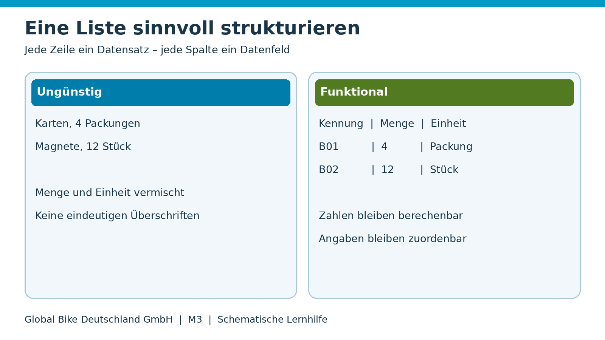
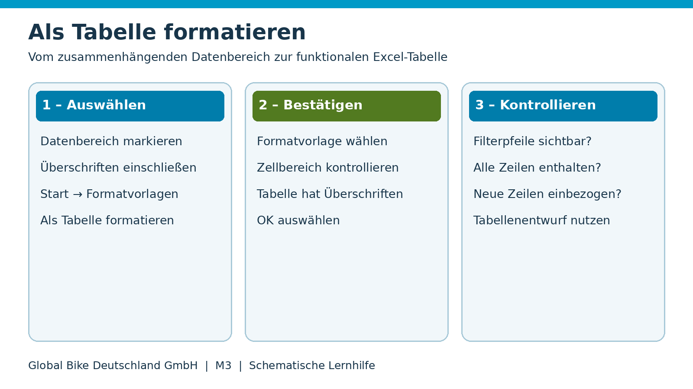
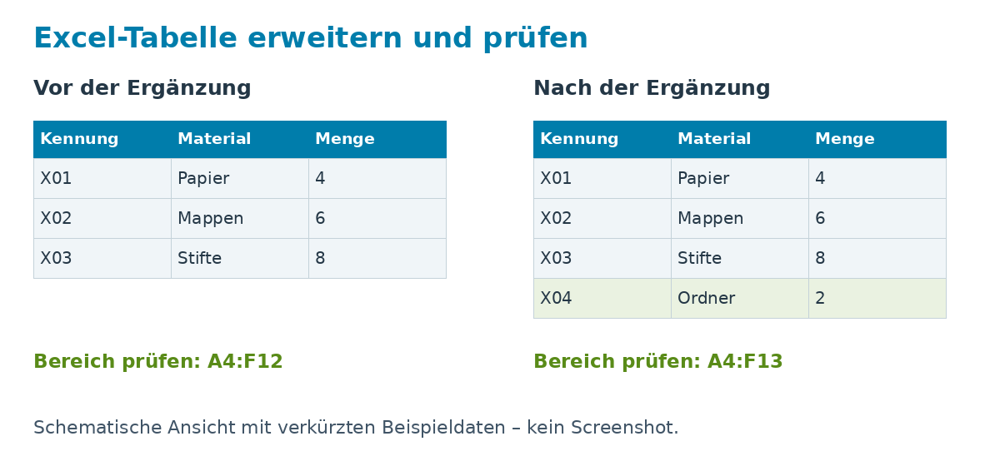

# Ü2 – Eine professionelle Büromaterialliste erstellen

Global Bike Deutschland GmbH · Verwaltung · Löppt · freiwillig · keine KI

[Excel-Arbeitsdatei herunterladen](UE2_Arbeitsdatei.xlsx)

## 1. Betriebliche Ausgangssituation

Emma Fuchs benötigt für die organisatorische Unterstützung der Marktbearbeitung Nordwest eine übersichtliche, erweiterbare Büromaterialliste. Die Materialnotizen sind bisher nicht in einzelne Datenfelder aufgeteilt. Die Angaben sind simulierte Übungsdaten, keine SAP-Stammdaten und keine Daten des Hauptfalls M1.

## 2. Das trainieren Sie

F2: Tabellen strukturieren und gestalten; F1: Dateien und Blätter organisieren. M2 und M3. Eine Zeile pro Datensatz, eine Spalte pro Datenfeld, eindeutige Überschriften, Zahlen als Zahlen, keine Leerzeilen oder Zellverbünde im Datenbereich.

## 3. Arbeitsdatei und Ausgangsdaten

Öffnen Sie UE2_Arbeitsdatei.xlsx. Das Blatt Rohnotizen enthält acht Materialnotizen (Stand 22.03.2027); Tabelle1 ist leer. Bewahren Sie die Rohnotizen unverändert auf.

- BM01: 12 Paket Kopierpapier A4; Papier; Nachbestellung prüfen
- BM02: 80 Stück Briefumschläge C5; Versand; Verfügbar
- BM03: 16 Stück Aktenordner breit; Ablage; Verfügbar
- BM04: 45 Stück Heftstreifen; Ablage; Verfügbar
- BM05: 3 Packung Versandetiketten; Versand; Nachbestellung prüfen
- BM06: 24 Stück Kugelschreiber blau; Schreibwaren; Verfügbar
- BM07: 50 Stück Klarsichthüllen A4; Ablage; Verfügbar
- BM08: 8 Stück Notizbücher A5; Schreibwaren; Verfügbar

## 4. Arbeitsaufträge

1.  Speichern Sie eine Arbeitskopie als GB_UE2_Bueromaterial.xlsx. Benennen Sie Tabelle1 in Bueromaterial um.
2.  Überlegen Sie, welche einzelnen Angaben in jeder Notiz enthalten sind. Legen Sie in A4:F4 sechs eindeutige Spaltenüberschriften an: Kennung, Material, Menge, Einheit, Kategorie, Hinweis.
3.  Übertragen Sie alle acht Datensätze in A5:F12. Trennen Sie Mengen und Einheiten. Behalten Sie Kennungen und Hinweise exakt bei. Prüfen Sie jede Zeile anhand der Rohnotizen.
4.  Gestalten Sie oberhalb der Liste einen Titel in A1 und einen Standhinweis in A2. Optional dürfen Sie A1:F1 verbinden, sofern B1:F1 leer sind. Innerhalb der Datenliste dürfen keine Zellen verbunden werden.
5.  Wählen Sie eine einheitliche gut lesbare Schrift (z. B. Calibri 11). Heben Sie Titel und Spaltenüberschriften durch Größe, Fettdruck und kontrastreiche Farben hervor. Verwenden Sie Rahmen sparsam. Probieren Sie an einer Kopie Kursivschrift und Unterstreichen aus und entscheiden Sie, ob diese die Lesbarkeit verbessern. Kennzeichnen Sie Hinweise durch Text, nicht allein durch Farbe.
6.  Richten Sie Text links und Mengen einheitlich rechts aus. Passen Sie Spaltenbreiten an. Aktivieren Sie für die Hinweisspalte den Zeilenumbruch und kontrollieren Sie die Zeilenhöhe. Kein Inhalt darf abgeschnitten sein.
7.  Markieren Sie A4:F12 und erstellen Sie über Als Tabelle formatieren eine funktionale Excel-Tabelle mit Überschriften. Wählen Sie eine lesbare Formatvorlage. Benennen Sie die Tabelle Bueromaterialliste. Kontrollieren Sie alle sechs Filterpfeile und acht Datensätze.
8.  Eine weitere Materialnotiz trifft ein: BM09 – Trennblätter A4 – 20 Stück – Ablage – Verfügbar. Ergänzen Sie sie direkt unter der Tabelle in Zeile 13. Kontrollieren Sie über Tabellenentwurf → Tabellengröße ändern, ob A4:F13 erfasst ist. Erweitern Sie den Bereich bei Bedarf.
9.  Prüfen Sie die Lesbarkeit und Datenzuordnung. Speichern, schließen und öffnen Sie die Arbeitskopie erneut. Führen Sie die Selbstkontrolle durch und vergleichen Sie anschließend mit der separaten Lösung. Keine Abgabe erforderlich.

## 5. Hilfen bei Bedarf

M2 (Dateiverwaltung, Zellbereiche), M3 Abschnitte 2–8 und 10.

   

Die Abbildungen sind schematische Lernhilfen, keine Screenshots.

| Ziel                        | Klickweg in Excel für Windows (deutsch)                                             |
|-----------------------------|-------------------------------------------------------------------------------------|
| Arbeitskopie                | Datei → Speichern unter bzw. Kopie speichern → XLSX                                 |
| Blattname                   | Doppelklick auf Blattregister → Name → Enter                                        |
| Datenbereich markieren      | Namensfeld → A4:F12 → Enter                                                         |
| Schriftart und Größe        | Start → Schriftart → Auswahlfelder                                                  |
| Fett, kursiv, unterstrichen | Start → Schriftart → entsprechendes Symbol                                          |
| Schrift- und Füllfarbe      | Start → Schriftart → Schriftfarbe bzw. Füllfarbe                                    |
| Rahmen                      | Start → Schriftart → Pfeil neben Rahmenlinien                                       |
| Ausrichtung                 | Start → Ausrichtung → links/rechts/zentriert                                        |
| Zeilenumbruch               | Start → Ausrichtung → Zeilenumbruch                                                 |
| Spaltenbreite               | Grenze zwischen Spaltenbuchstaben ziehen oder doppelklicken                         |
| Zeilenhöhe                  | Grenze zwischen Zeilennummern ziehen oder doppelklicken                             |
| Titel verbinden (optional)  | A1:F1 markieren, nur A1 gefüllt → Start → Verbinden und zentrieren                  |
| Funktionale Tabelle         | A4:F12 → Start → Als Tabelle formatieren → Vorlage → Tabelle hat Überschriften → OK |
| Tabellenname                | In Tabelle klicken → Tabellenentwurf → Tabellenname                                 |
| Bereich prüfen              | Tabellenentwurf → Tabellengröße ändern → Bereich prüfen bzw. A4:F13 einstellen      |
| Speichern                   | Strg+S → schließen → Datei → Öffnen                                                 |

Versionsabhängige Abweichungen sind möglich. Strg+Z hilft bei versehentlichen Änderungen. Bei der Formatvorlage können manuelle Füllfarben die Streifen überdecken; bei Bedarf Füllung im Datenbereich entfernen.

## 6. Selbstkontrolle

- [ ] Originaldatei und Rohnotizen sind unverändert.
- [ ] Sechs eindeutige Überschriften und neun vollständige Datensätze.
- [ ] Jede Kennung kommt einmal vor; Mengen sind numerisch, Einheiten getrennt.
- [ ] Keine leeren Zwischenzeilen oder verbundenen Zellen innerhalb A4:F13.
- [ ] Titel und Kopfzeile sind klar unterscheidbar, Farben kontrastreich.
- [ ] Texte vollständig sichtbar, Mengen einheitlich ausgerichtet.
- [ ] Hinweise sind auch ohne Farbe verständlich.
- [ ] Excel-Tabelle besitzt sechs Filterpfeile und umfasst A4:F13.
- [ ] Arbeitskopie lässt sich erneut öffnen.

Funktionstest: In einer Testkopie einen weiteren simulierten Datensatz direkt unterhalb ergänzen, Tabellengrenze prüfen und Testkopie anschließend schließen. Die eigentliche Arbeitskopie bleibt bei neun Datensätzen.

## 7. Freiwillige Vertiefung

Erstellen Sie eine Blattkopie. Vergleichen Sie zwei gut lesbare Tabellenformatvorlagen. Begründen Sie Ihre Wahl anhand von Kontrast, Übersichtlichkeit und Erweiterbarkeit. Fixieren Sie optional die Kopfzeile über Ansicht → Fenster fixieren, nachdem A5 ausgewählt wurde. Keine zusätzliche Pflichtabgabe.
