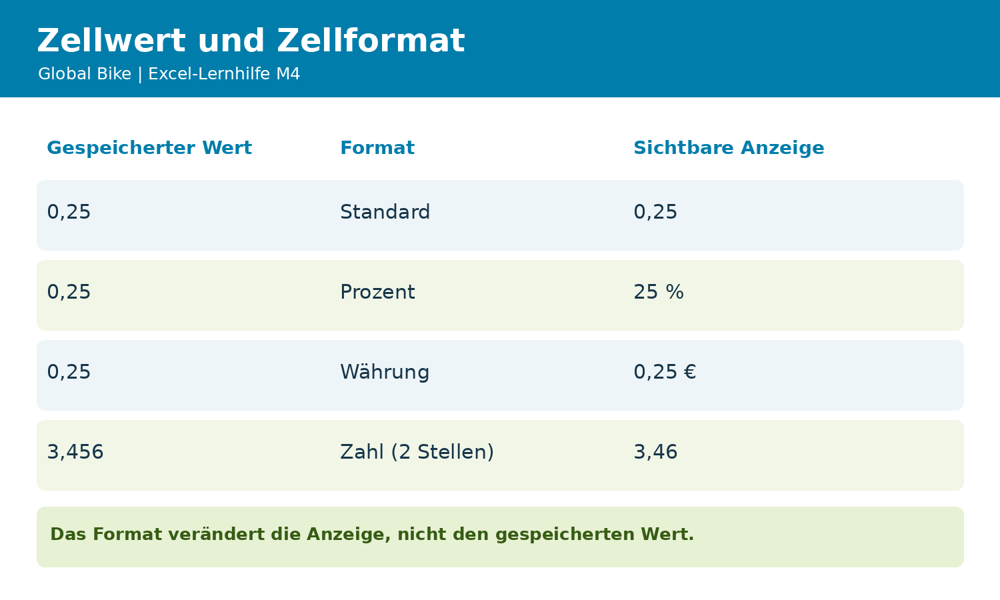
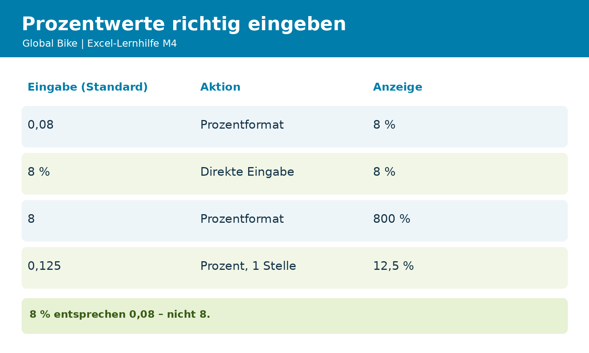
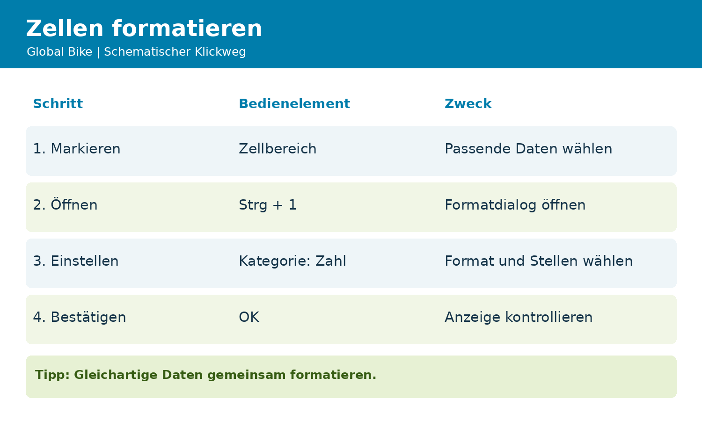
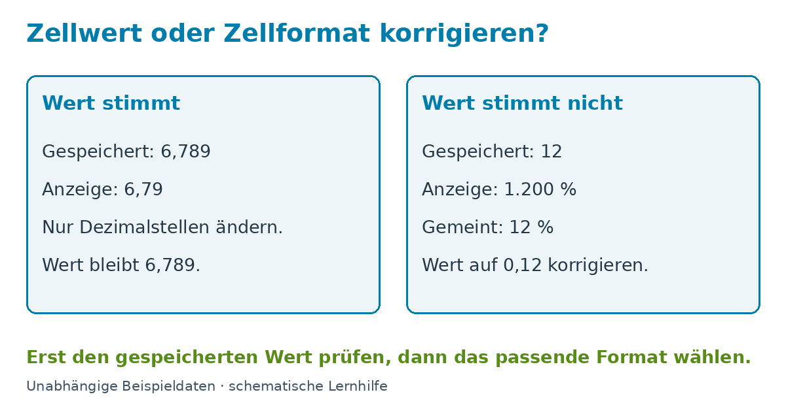

# Ü3 – Betriebliche Daten richtig formatieren

Global Bike Deutschland GmbH · Verwaltung · Löppt · freiwillig · keine KI

## Ausgangssituation

Emma Fuchs organisiert interne Informationsveranstaltungen zur Marktbearbeitung Nordwest. Die Liste enthält uneinheitliche Darstellungen und einige fehlerhafte Eingaben. Sie soll für die spätere Weiterverarbeitung zuverlässig nutzbar sein. Alle Angaben sind simulierte Übungsdaten, unabhängig von M1 und SAP.

## Lernziele

F3: Zahlen, Text, Währung, Prozent, Datum und Uhrzeit fachgerecht formatieren; Zellwert und Darstellung unterscheiden; Eingabefehler korrigieren. F2: lesbare Tabellenstruktur erhalten. M3 und M4.

## Verbindliche betriebliche Kontrollnotiz

| Kennung | Veranstaltung           | Datum      | Beginn | Teilnehmende | Kosten netto | Anteil digital | Gewicht kg |
|---------|-------------------------|------------|--------|-------------:|-------------:|---------------:|-----------:|
| 0041    | Vertriebsinformation    | 06.04.2027 | 09:30  |           24 |   1.250,50 € |           75 % |      3,456 |
| 0042    | Kundenservice-Austausch | 08.04.2027 | 10:15  |           18 |     875,25 € |           80 % |      2,125 |
| 0043    | Sortimentsbesprechung   | 12.04.2027 | 13:00  |           32 |   1.480,00 € |         62,5 % |      4,789 |
| 0044    | Marketing-Abstimmung    | 15.04.2027 | 08:45  |           16 |       0,00 € |           50 % |      1,256 |

Die Kontrollnotiz enthält die fachlich richtigen Angaben. Gewichte sind mit drei Nachkommastellen erfasst; die fertige Übersicht soll zwei anzeigen, ohne die Werte zu verändern.

## Praktische Arbeitsaufträge

1.  Öffnen Sie UE3_Arbeitsdatei.xlsx und speichern Sie eine Kopie als GB_UE3_Veranstaltungen.xlsx. Original nicht überschreiben. Prüfen Sie die Blätter Veranstaltungen und Formatlabor.
2.  Vergleichen Sie A4:H7 mit der Kontrollnotiz. Untersuchen Sie die Bearbeitungsleiste und das aktuelle Format. Notieren Sie für sich, welche Fehler nur die Anzeige und welche den Wert oder Datentyp betreffen.
3.  Formatieren Sie A4:A7 als Text. Erfassen Sie die verlorene Kennung in A4 erneut anhand der Kontrollnotiz. Prüfen Sie alle führenden Nullen. Ändern Sie keine bereits richtigen Kennungen.
4.  Stellen Sie C4:C7 als Datum mit vierstelliger Jahreszahl und D4:D7 als Uhrzeit (Stunden:Minuten) dar. C5 ist Text: erfassen Sie das Datum erneut in einer Zelle mit Standardformat, kontrollieren Sie die Erkennung und wählen Sie das Datumsformat. Die übrigen Datums- und Zeitwerte sind bereits numerisch gespeichert.
5.  Formatieren Sie E4:E7 als Zahl ohne Nachkommastellen. F4:F7 sollen Eurobeträge mit zwei Nachkommastellen und Tausendertrennzeichen anzeigen. F5 enthält Text: erfassen Sie den Betrag ohne Währungssymbol als Zahl neu und formatieren Sie ihn anschließend. Netto bleibt durch die Überschrift eindeutig.
6.  Formatieren Sie G4:G7 als Prozent mit einer Nachkommastelle. Vergleichen Sie G5 mit der Kontrollnotiz und korrigieren Sie den zugrunde liegenden Wert. Prozentformat allein berechnet keinen Anteil.
7.  Stellen Sie H4:H7 mit zwei Nachkommastellen dar. Prüfen Sie in der Bearbeitungsleiste, dass die ursprünglichen drei Nachkommastellen erhalten sind. Erhöhen Sie testweise die Anzeige auf drei Stellen und stellen Sie danach zwei wieder her.
8.  Bearbeiten Sie das Formatlabor gemäß der folgenden Versuchsanleitung. Schreiben Sie Ihre Beobachtungen in Spalte D.
9.  Prüfen Sie Spaltenbreiten und Lesbarkeit. Bei Rauten zunächst Breite prüfen; bei Datum/Zeit gegebenenfalls auch negative Werte. Speichern, schließen und öffnen Sie die Arbeitskopie erneut. Führen Sie die Selbstkontrolle durch und vergleichen Sie danach mit der separaten Lösung. Keine Abgabe.

## Formatlabor

| Zeile | Auftrag                                                                                                              |
|-------|----------------------------------------------------------------------------------------------------------------------|
| 3     | B3 Standard, C3 Prozent ohne Nachkommastellen. Vergleichen Sie Anzeige und Bearbeitungsleiste.                       |
| 4     | B4 Zahl mit zwei, C4 mit drei Nachkommastellen. Vergleichen Sie gespeicherte Werte.                                  |
| 5     | B5 Währung Euro, C5 Buchhaltung Euro, jeweils zwei Nachkommastellen. Vergleichen Sie Symbolposition und Ausrichtung. |
| 6     | Wiederholen Sie den Vergleich mit Nullbeträgen.                                                                      |
| 7     | B7 und C7 Prozent ohne Nachkommastellen. Erklären Sie die unterschiedliche Anzeige.                                  |
| 8     | B8 Standard, C8 Text. Erklären Sie den Unterschied zwischen Zahl und Kennung.                                        |
| 9     | B9 Standard, C9 Datum. Erklären Sie, warum die Anzeigen verschieden sind, obwohl der Tag identisch ist.              |

## Visuelle Lernhilfen

Alle Grafiken sind schematisch, keine Original-Screenshots.

## Klick-Anleitungen (Excel Windows, deutsch)

| Ziel                            | Vorgehen                                                                                                                        |
|---------------------------------|---------------------------------------------------------------------------------------------------------------------------------|
| Arbeitskopie                    | Datei → Speichern unter/Kopie speichern → XLSX                                                                                  |
| Zellwert prüfen                 | Zelle auswählen → Bearbeitungsleiste betrachten; bei Datum/Zeit kann Excel eine lesbare Darstellung zeigen                      |
| Formatdialog                    | Bereich markieren → Strg+1 → Zahlen                                                                                             |
| Textkennung                     | Kategorie Text → OK → fehlende Kennung erneut eingeben; alternativ Apostroph voranstellen                                       |
| Zahl                            | Kategorie Zahl → Dezimalstellen 0 oder 2 → ggf. Tausendertrennzeichen aktivieren                                                |
| Währung                         | Kategorie Währung → Symbol € → zwei Dezimalstellen                                                                              |
| Buchhaltung                     | Kategorie Buchhaltung → Symbol € → zwei Dezimalstellen                                                                          |
| Prozent                         | Standardzelle: 0,08 oder 8 % eingeben → Prozentformat → Dezimalstellen einstellen                                               |
| Datum                           | Standardzelle: Datum eingeben → Strg+1 → Datum bzw. benutzerdefiniert TT.MM.JJJJ                                                |
| Uhrzeit                         | Standardzelle: 09:30 eingeben → Strg+1 → Uhrzeit bzw. hh:mm (deutsche Oberfläche: ggf. hh:mm)                                   |
| Text in Zahl korrigieren        | Standardformat wählen → korrekten numerischen Wert neu eingeben; ggf. Warnsymbol → In eine Zahl umwandeln, nur bei Rechengrößen |
| Dezimalstellen ändern           | Start → Zahl → Dezimalstellen hinzufügen/entfernen                                                                              |
| Spaltenbreite                   | Doppelklick auf Grenze zwischen Spaltenbuchstaben                                                                               |
| Formate zurücksetzen            | Start → Löschen → Formate löschen (entfernt auch andere Zellgestaltung); alternativ Standardformat                              |
| Werte ohne Quellformat kopieren | Kopieren → Start → Einfügen → Inhalte einfügen → Werte                                                                          |
| Speichern                       | Strg+S → schließen → Datei → Öffnen                                                                                             |

Regionale Einstellungen und Excel-Versionen können abweichen. In deutscher Standardkonfiguration Dezimalkomma verwenden. Währungssymbol ändert keine Währung rechnerisch.

## Selbstkontrolle

- [ ] Vier Kennungen vollständig mit führenden Nullen als Text.
- [ ] Vier echte Datumswerte und vier echte Uhrzeitwerte.
- [ ] Teilnehmerzahlen ohne Nachkommastellen.
- [ ] Alle Kosten numerisch, Euro mit zwei Nachkommastellen.
- [ ] Prozentwerte entsprechen der Kontrollnotiz; G5 ist korrigiert.
- [ ] Gewichte zeigen zwei Stellen, ursprüngliche Genauigkeit bleibt erhalten.
- [ ] Alle sieben Laborversuche bearbeitet und erklärt.
- [ ] Keine abgeschnittenen Angaben oder Rauten.
- [ ] Original unverändert, Arbeitskopie erneut geöffnet.

Funktionstest: In einer Testkopie G5 auf Standard stellen: der Wert muss 0,8 sein. H4 auf drei Dezimalstellen stellen: 3,456 muss erscheinen. Testkopie schließen; fertige Arbeitsmappe unverändert lassen.

## Freiwillige Vertiefung

Vergleichen Sie in einer Testkopie die Anzeige eines Datums im Standardformat, kurzen Datum und langen Datum. Vergleichen Sie außerdem eine numerische Kennung mit benutzerdefiniertem Format 0000 und eine echte Textkennung. Beide können gleich aussehen, sind aber unterschiedliche Datentypen. Keine zusätzliche Abgabe.

[Excel-Arbeitsdatei herunterladen](UE3_Arbeitsdatei.xlsx)
