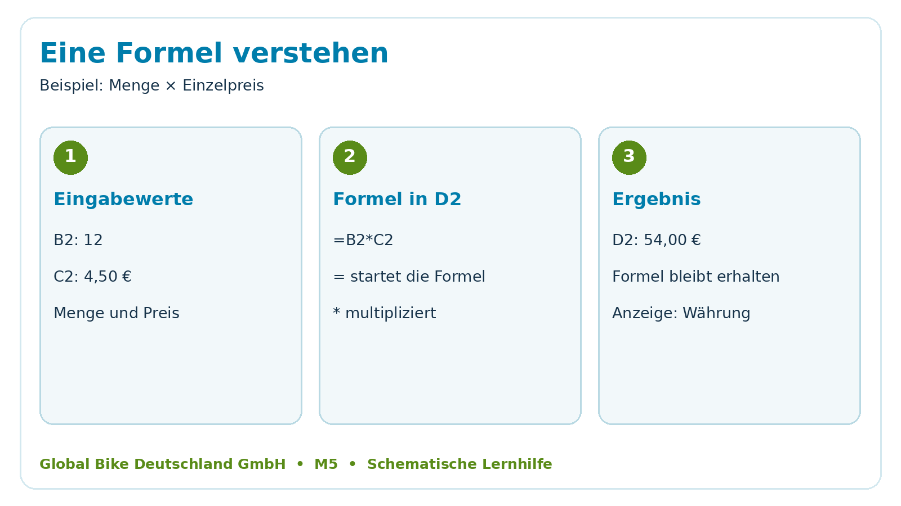
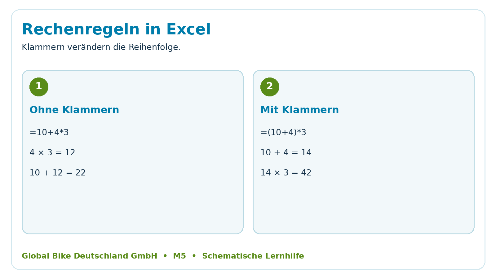
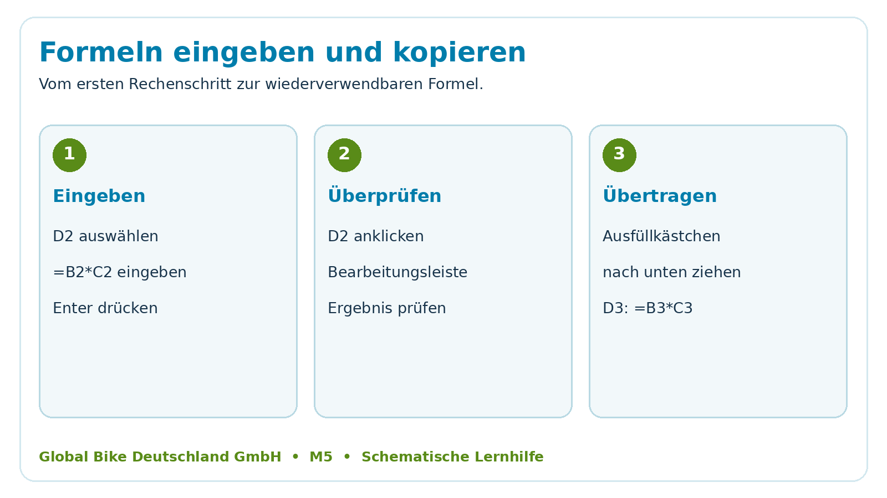
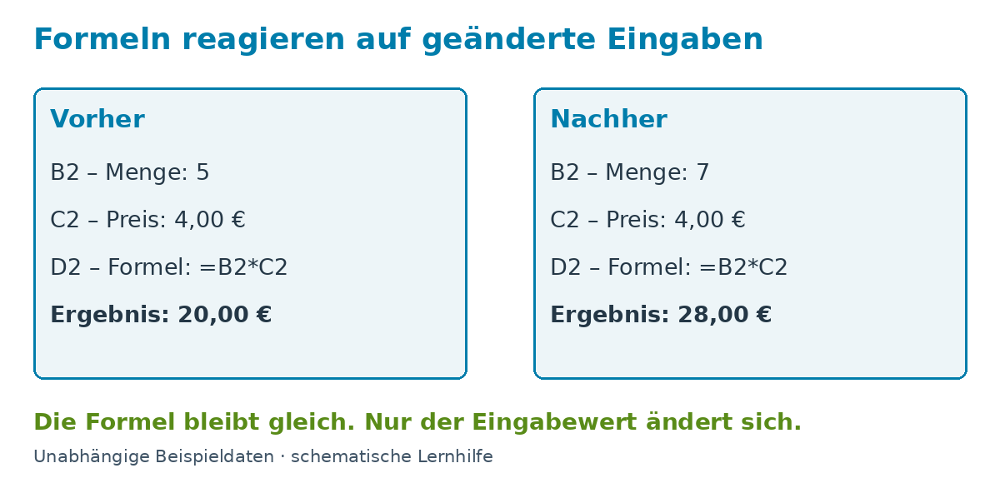

# Ü4 – Bürokosten automatisch berechnen

Global Bike Deutschland GmbH · Verwaltung · Löppt · freiwillig · keine KI

## Ausgangssituation

Emma Fuchs benötigt für eine interne Informationsveranstaltung zur Marktbearbeitung Nordwest eine wiederverwendbare Kostenkalkulation. Mengen und Preise können sich ändern. Alle Angaben sind simulierte Übungsdaten, unabhängig von M1 und SAP.

## Lernziele

F4: Formeln und Grundrechenarten mit Zellbezügen anwenden, Rechenregeln beachten, Ergebnisse und Neuberechnung prüfen. F2/F3: Struktur und Zahlenformate erhalten. M4/M5.

## Ausgangsdaten

| Position       | Menge | Einzelpreis netto |
|----------------|------:|------------------:|
| Infomappen     |    20 |            3,75 € |
| Namensschilder |    20 |            1,20 € |
| Notizblöcke    |    15 |            2,40 € |
| Versandtaschen |    10 |            1,50 € |

Genehmigter Betrag: 200 € netto; Teilnehmende: 20. Keine Umsatzsteuerberechnung. Alle Einzelpreise sind centgenau.

## Arbeitsaufträge

1.  Öffnen Sie UE4_Arbeitsdatei.xlsx und speichern Sie eine Kopie als GB_UE4_Buerokosten.xlsx. Prüfen Sie die drei Tabellenblätter. Eingaben und Ergebnisse sind getrennt; grüne Ergebnisfelder im Blatt Kosten sind zu bearbeiten.
2.  Berechnen Sie in D4 den Gesamtpreis der Infomappen mit einer Formel aus Menge und Einzelpreis. Beginnen Sie mit dem Gleichheitszeichen, wählen Sie die passenden Zellbezüge und den Multiplikationsoperator. Kontrollieren Sie das Ergebnis durch Überschlagsrechnung.
3.  Übertragen Sie die Formel mit dem Ausfüllkästchen bis D7. Prüfen Sie die Formel in D7 auf die richtigen Zeilenbezüge. Keine fest eingetragenen Ergebnisse.
4.  Addieren Sie in D8 die vier Gesamtpreise mit dem Plusoperator. Ermitteln Sie in D10 den verbleibenden Betrag aus genehmigtem Betrag und Gesamtkosten. Berechnen Sie in D12 die Kosten je Person. Verwenden Sie ausschließlich Zellbezüge. SUMME wird erst in Ü5 vertieft.
5.  Prüfen Sie die Formate: Mengen und Teilnehmende als ganze Zahlen, Preise und Ergebnisse als Euro mit zwei Nachkommastellen. Verändern Sie die gespeicherten Werte nicht durch bloße Anzeigerundung. Kosten je Person sind eine rechnerische Kennzahl, keine tatsächliche Einzelabrechnung.
6.  Bearbeiten Sie Rechenlabor E3:E6. Verwenden Sie die Werte in B:D und die im Auftrag beschriebene Reihenfolge. Notieren Sie zunächst Ihre erwarteten Ergebnisse auf einem Notizzettel, vergleichen Sie dann mit Excel. Erklären Sie, warum Klammern die Ergebnisse verändern.
7.  Bearbeiten Sie Fehlerlabor D3:D7. Prüfen Sie jede Ergebniszelle in der Bearbeitungsleiste. Dokumentieren Sie Ursache und Abhilfe in E3:E7. Kontrollnotiz: In Zeile 6 ist der richtige Teiler 6; in Zeile 7 beträgt der Preis 3 € netto. Alle übrigen Eingaben sind richtig. Korrigieren Sie nur die Fehlerursache. Keine Fehlermeldung durch einen Festwert verdecken.
8.  Führen Sie im Blatt Kosten einen Funktionstest durch: Ändern Sie B4 von 20 auf 24. Berechnen Sie vorher die erwarteten Änderungen in D4, D8, D10 und D12. Vergleichen Sie mit Excel und stellen Sie B4 auf 20 zurück. Ändern Sie danach C7 von 1,50 auf 2,00 und prüfen Sie erneut; stellen Sie C7 zurück. Wenn Ergebnisse unverändert bleiben, prüfen Sie Formel, Bezug und Berechnungsoptionen.
9.  Speichern, schließen und öffnen Sie die Arbeitskopie erneut. Führen Sie die Selbstkontrolle durch und vergleichen Sie anschließend mit der separaten Musterlösung. Keine Abgabe erforderlich.

## Lernhilfen

Schematische Lernhilfen, keine Screenshots.

## Klick-Anleitungen (Excel Windows, deutsch)

| Ziel                    | Klickweg                                                                                                   |
|-------------------------|------------------------------------------------------------------------------------------------------------|
| Arbeitskopie            | Datei → Speichern unter/Kopie speichern → XLSX                                                             |
| Formel erstellen        | Ergebniszelle anklicken → = eingeben → erste Bezugszelle anklicken → Operator → zweite Bezugszelle → Enter |
| Formel prüfen           | Ergebniszelle anklicken → Bearbeitungsleiste                                                               |
| Formel korrigieren      | F2 oder Bearbeitungsleiste → ändern → Enter; Esc bricht unbestätigte Änderung ab                           |
| Formel kopieren         | Geprüfte Zelle markieren → Ausfüllkästchen unten rechts nach unten ziehen                                  |
| Kopierte Bezüge prüfen  | Letzte Ergebniszelle anklicken → Bearbeitungsleiste                                                        |
| Klammern setzen         | F2 → paarweise Klammern ergänzen → Enter                                                                   |
| Währung                 | Bereich markieren → Strg+1 → Währung → Euro → zwei Dezimalstellen                                          |
| Ganzzahl                | Strg+1 → Zahl → null Dezimalstellen                                                                        |
| Textformel korrigieren  | Standardformat wählen → ggf. Apostroph entfernen → F2 → Enter; nötigenfalls Formel neu eingeben            |
| Textbetrag korrigieren  | Standardformat wählen → numerischen Betrag neu eingeben                                                    |
| Automatische Berechnung | Formeln → Berechnungsoptionen → Automatisch                                                                |
| Neuberechnung anstoßen  | F9                                                                                                         |
| Formeln anzeigen        | Formeln → Formeln anzeigen; anschließend wieder ausschalten                                                |
| Eingabe zurücksetzen    | Ursprünglichen Wert erneut eingeben; ggf. Strg+Z unmittelbar nach Änderung                                 |
| Speichern               | Strg+S                                                                                                     |

Versionsabhängige Abweichungen möglich. Multiplikation \* und Division /; Doppelpunkt bezeichnet einen Bereich, kein Divisionszeichen.

## Fehlerdiagnose

Bei \#DIV/0! Nenner prüfen; bei \#WERT! Datentypen prüfen; bei \#BEZUG! ungültige Referenz wiederherstellen; bei \#NAME? Schreibweise prüfen. Bei Zirkelbezug darf die Formel nicht von ihrer eigenen Ergebniszelle abhängen. Bei Rauten Spaltenbreite und ggf. Datumswerte prüfen. Fehlende Klammern oder falsche Operatoren können bereits bei Eingabe abgewiesen werden.

## Selbstkontrolle

- [ ] Original unverändert; Arbeitskopie gespeichert.
- [ ] D4:D7 enthalten Formeln mit passenden Zeilenbezügen.
- [ ] D8, D10 und D12 enthalten Formeln, keine Festwerte.
- [ ] Alle vier Grundrechenarten korrekt eingesetzt.
- [ ] Rechenlabor vollständig und Klammerwirkung erklärt.
- [ ] Fehlerlabor vollständig korrigiert und Ursachen dokumentiert.
- [ ] Geldbeträge mit zwei Dezimalstellen, Mengen ganzzahlig.
- [ ] Beide Funktionstests erfolgreich; Ausgangswerte wiederhergestellt.
- [ ] Keine Fehleranzeigen; Datei erneut geöffnet.

## Freiwillige Vertiefung

In einer Testkopie den genehmigten Betrag auf 100 € setzen und den negativen Restbetrag erklären. Anschließend den ursprünglichen Betrag wiederherstellen. Optional in einer freien Zelle 10/3 als Formel berechnen, zwei Dezimalstellen anzeigen und mit =RUNDEN(10/3;2) vergleichen. Keine zusätzliche Pflichtabgabe.

[Excel-Arbeitsdatei herunterladen](UE4_Arbeitsdatei.xlsx)
