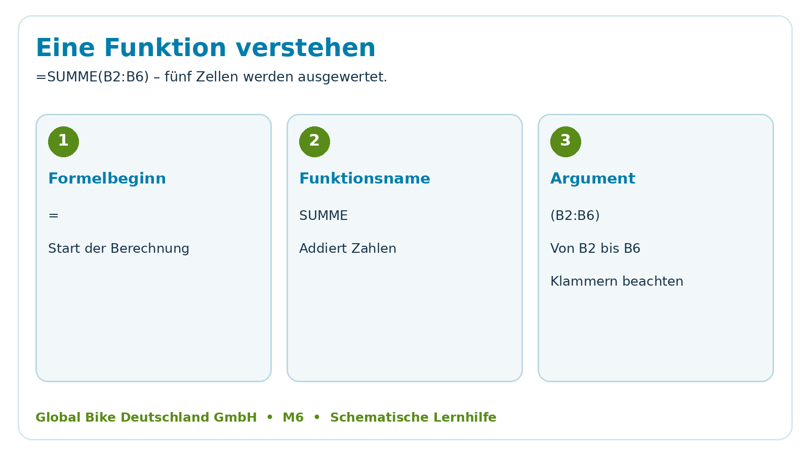
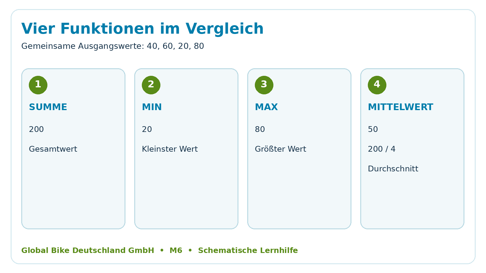
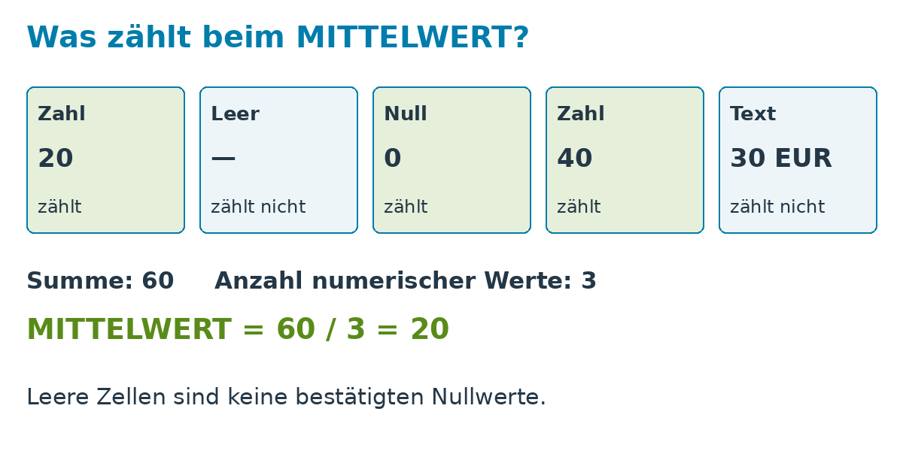

# Ü5 – Betriebliche Kosten mit Excel-Funktionen auswerten

Global Bike Deutschland GmbH · Verwaltung · Löppt · freiwillig · unbenotet · keine KI · keine Pflichtabgabe

## Ausgangssituation

Emma Fuchs benötigt für eine interne Besprechung zur Marktbearbeitung Nordwest eine Auswertung der Nettokosten von sechs Informationsveranstaltungen. Die Übersicht soll Änderungen berücksichtigen und eine sachgerechte Einschätzung ermöglichen. Eigenständige simulierte Übungsdaten, keine SAP-Änderung, unabhängig von M1.

## Kompetenzen

F5: SUMME, MIN, MAX und MITTELWERT auswählen, korrekt anwenden und interpretieren; F4 mitgeübt (Formeln und Zellbezüge). Zahlenformate aus M4 wiederholen. Zuordnung gemäß bestätigter Übungsübersicht, kein wörtliches Kompetenzzitat.

## Ausgangsdaten

| Termin | Material netto | Organisation netto |
|--------|---------------:|-------------------:|
| 1      |           80 € |               40 € |
| 2      |          110 € |               70 € |
| 3      |           60 € |               30 € |
| 4      |           95 € |               55 € |
| 5      |          140 € |              100 € |
| 6      |          100 € |               80 € |

## Arbeitsaufträge

1.  Öffnen Sie UE5_Arbeitsdatei.xlsx und speichern Sie eine Arbeitskopie GB_UE5_Kostenauswertung.xlsx. Erkunden Sie die drei Blätter Kosten, Funktionslabor und Fehlerlabor. Grüne Felder sind Ergebnis- bzw. Bearbeitungsfelder.
2.  Berechnen Sie in Kosten D4 die Gesamtkosten des ersten Termins durch Addition der beiden Kostenarten mit Zellbezügen. Übertragen Sie die Formel bis D9. Prüfen Sie die letzte Formel. Kontrollieren Sie die Währungsdarstellung mit zwei Dezimalstellen.
3.  Wählen Sie für jede Fragestellung in A13:A16 die passende Funktion. Ermitteln Sie in B13 die Gesamtkosten mit AutoSumme. Achtung: Die Ergebniszelle liegt nicht unmittelbar unter der Datenliste. Ersetzen Sie den vorgeschlagenen Bereich durch D4:D9. Prüfen Sie die Bearbeitungsleiste. Alternativ geben Sie die Funktion direkt ein.
4.  Berechnen Sie in B14 und B15 den niedrigsten und höchsten Gesamtbetrag. Verwenden Sie mindestens einmal den Funktionsassistenten fx. Ermitteln Sie in B16 den Durchschnitt pro Termin durch direkte Funktionseingabe. Alle vier Funktionen beziehen sich auf dieselben sechs Gesamtbeträge. Keine Ergebniszelle oder Überschrift einbeziehen.
5.  Prüfen Sie die Summe durch Addition und den Durchschnitt durch Division durch sechs. Suchen Sie in der Liste die zu MIN und MAX gehörenden Termine. Formulieren Sie eine kurze Notiz: Wie hoch ist der Unterschied? Warum reicht der höchste Betrag allein nicht für ein Urteil über Wirtschaftlichkeit? Welche weiteren Angaben wären erforderlich?
6.  Bearbeiten Sie im Funktionslabor E4:E7 mit den vier Funktionen für B4:B8. B5 ist eine noch fehlende Angabe, B6 ist eine bestätigte Null, B8 enthält Text. Ermitteln Sie vorab die Anzahl der numerischen Werte. Vergleichen Sie Ihre Erwartung mit Excel. Testen Sie nacheinander: B5 vorübergehend 0; danach B5 wieder leeren; B8 vorübergehend numerisch 60 (nur als Simulation einer bestätigten Korrektur); danach ursprünglichen Text wiederherstellen. Notieren Sie die vier Ergebnisse jedes Tests. Fehlende Angaben nicht eigenmächtig als Null erfassen.
7.  Prüfen Sie im Fehlerlabor B11:B14 die vorhandenen Formeln. Korrigieren Sie jede Formel anhand des Auftrags in Spalte A. Dokumentieren Sie Ursache in C und Korrektur in D. Die Kontrollsumme in B8 ist keine zusätzliche Ausgabe. Prüfen Sie auch Ergebnisse, die keinen Fehlercode anzeigen.
8.  Funktionstest im Blatt Kosten: Ändern Sie C8 von 100 auf 160. Sagen Sie die Änderung aller vier Kennzahlen voraus, vergleichen Sie mit Excel und stellen Sie 100 wieder her. Prüfen Sie anschließend in einer Testkopie eine zusätzliche Veranstaltung in Zeile 10 (Material 70 €, Organisation 50 €). Berechnen Sie D10, erweitern Sie alle vier Auswertungsbereiche und prüfen Sie die Ergebnisse. Verwerfen Sie die Testkopie oder stellen Sie alle Ausgangswerte und Bereiche wieder her.
9.  Speichern Sie Ihre Arbeitskopie, schließen und öffnen Sie sie erneut. Nutzen Sie die Selbstkontrolle und erst danach die separate Musterlösung. Keine Abgabe.

## Lernhilfen

Schematische Lernhilfen, keine Excel-Screenshots.

## Klick-Anleitungen (Excel Windows, deutsch)

| Ziel                         | Vorgehen                                                                                                                            |
|------------------------------|-------------------------------------------------------------------------------------------------------------------------------------|
| Arbeitskopie                 | Datei → Speichern unter/Kopie speichern → XLSX                                                                                      |
| Addition                     | D4 auswählen → =B4+C4 → Enter                                                                                                       |
| Formel übertragen            | Ausfüllkästchen bis D9 ziehen → letzte Formel prüfen                                                                                |
| SUMME direkt                 | Ergebniszelle → =SUMME( → Bereich markieren → ) → Enter                                                                             |
| AutoSumme                    | Ergebniszelle → Start → Bearbeiten → Σ AutoSumme → vorgeschlagenen Bereich durch gewünschten ersetzen → Enter                       |
| MIN                          | Ergebniszelle → =MIN( → Bereich markieren → ) → Enter                                                                               |
| MAX                          | Ergebniszelle → =MAX( → Bereich markieren → ) → Enter                                                                               |
| MITTELWERT                   | Ergebniszelle → =MITTELWERT( → Bereich markieren → ) → Enter                                                                        |
| Funktionsassistent           | Ergebniszelle → fx → Funktion suchen → Argumentbereich markieren → Vorschau → OK                                                    |
| Weitere AutoSumme-Funktionen | Pfeil neben Σ → Mittelwert, Min oder Max → Bereich prüfen → Enter                                                                   |
| Bereich korrigieren          | Ergebniszelle → F2 → Bereichsadresse ändern → Enter                                                                                 |
| Mehrere Argumente            | In deutscher Standardkonfiguration Semikolon zwischen getrennten Argumenten, Doppelpunkt innerhalb eines zusammenhängenden Bereichs |
| Währung                      | Strg+1 → Währung → Euro → zwei Nachkommastellen                                                                                     |
| Textzahl korrigieren         | Eingabe fachlich prüfen → Standardformat → Zahl neu eingeben                                                                        |
| Zelle leeren                 | Zelle markieren → Entf (Inhalt löschen, nicht Zeile löschen)                                                                        |
| Neuberechnung                | Formeln → Berechnungsoptionen → Automatisch; F9 stößt Berechnung an                                                                 |
| Speichern                    | Strg+S                                                                                                                              |

Menübezeichnungen können je nach Version abweichen.

## Fachliche Hinweise

Eine Funktion ist eine vorgefertigte Rechenvorschrift innerhalb einer Formel. Beispiel =SUMME(C2:C5): Gleichheitszeichen, Name, öffnende Klammer, Argument (vier Zellen einschließlich beider Grenzen), schließende Klammer. Ein getrenntes Argument wird in der üblichen deutschen Konfiguration mit Semikolon angeschlossen. MIN/MAX geben Beträge, keine Namen zurück. Bei Gleichständen alle zugehörigen Positionen nennen. Bei referenzierten Bereichen ignorieren die vier Funktionen leere Zellen und Text; numerische Null zählt. Fehlerwerte können die Auswertung abbrechen. Ohne numerische Werte liefern SUMME/MIN/MAX null, MITTELWERT \#DIV/0!. Die vier Funktionen berücksichtigen auch ausgefilterte Zeilen. Feste Bereiche schließen neue Zeilen nicht zwangsläufig ein.

## Selbstkontrolle

- [ ] Arbeitskopie gespeichert, Original unverändert.
- [ ] Sechs Gesamtbeträge sind Formeln mit passenden Bezügen.
- [ ] Alle vier Funktionen verwenden D4:D9.
- [ ] AutoSumme-Bereich kontrolliert.
- [ ] Funktionsassistent mindestens einmal verwendet.
- [ ] Durchschnitt als Kosten je Termin erklärt.
- [ ] MIN/MAX zu den richtigen Terminen zugeordnet.
- [ ] Funktionslabor: Null, leer und Text unterschieden.
- [ ] Vier Fehlerfälle korrigiert und dokumentiert.
- [ ] Beide Funktionstests erfolgreich, Ausgangszustand wiederhergestellt.
- [ ] Währungsformate und erneutes Öffnen geprüft.

## Freiwillige Vertiefung

Ermitteln Sie in einer freien Zelle die Summe der beiden Kostenarten über zwei getrennte Bereiche mit =SUMME(B4:B9;C4:C9). Vergleichen Sie mit B13. Erklären Sie, weshalb eine zusätzliche Summierung von D4:D9 die Kosten doppelt zählen würde.

[Excel-Arbeitsdatei herunterladen](UE5_Arbeitsdatei.xlsx)
