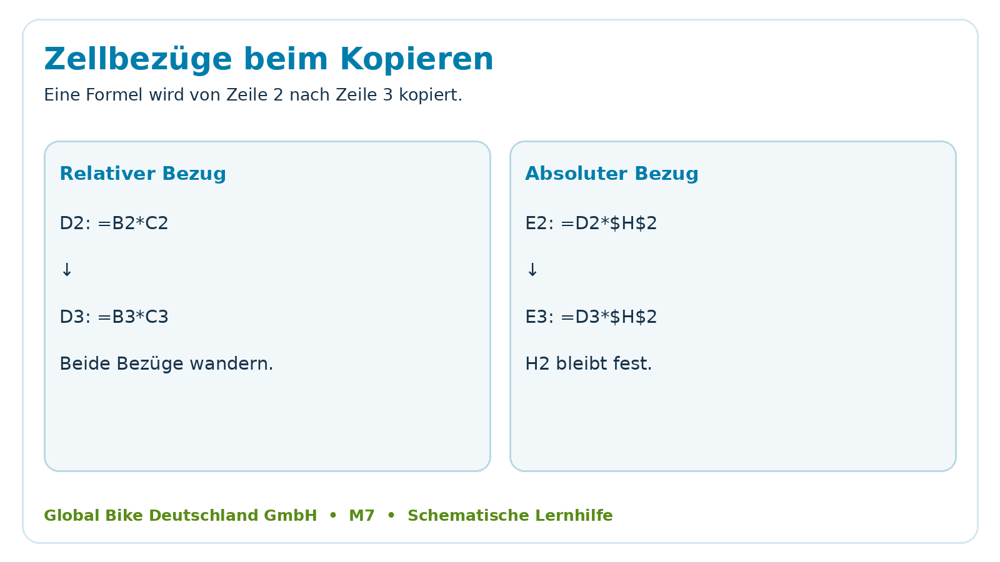
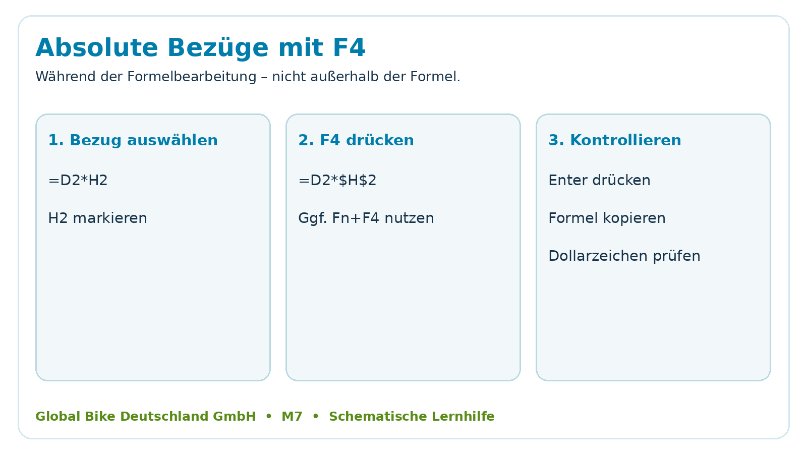
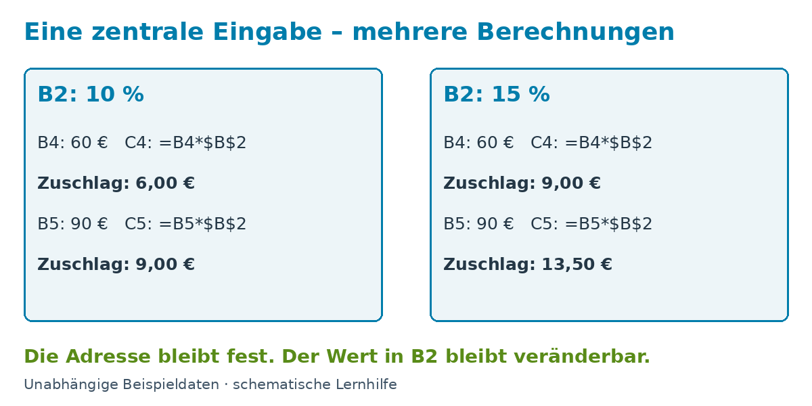

# Ü6 – Relative und absolute Zellbezüge

Global Bike Deutschland GmbH · Verwaltung · Löppt · freiwillig · unbenotet · keine KI

## Ausgangssituation

Emma Fuchs plant 2027 Informationsmaßnahmen für die Region Nordwest. Auf vier unterschiedliche Nettokostenpositionen soll ein einheitlicher interner Planungszuschlag von 10 % gerechnet werden. Der Zuschlag ist eine simulierte Planungsreserve, keine Steuer und keine SAP-Kondition. Die Verwaltung benötigt eine Kalkulation, die bei einer zentralen Satzänderung alle Positionen aktualisiert. Zusätzlich sollen die Anteile an den gesamten Plankosten sichtbar werden. Die Daten sind unabhängig von M1.

## Arbeitsaufträge

1.  Öffnen Sie UE6_Arbeitsdatei.xlsx und speichern Sie eine Kopie als GB_UE6_Kalkulation.xlsx. Erkunden Sie Kalkulation, Bezugslabor und die freiwillige Vertiefung. Identifizieren Sie B2 als zentrale Eingabe und B4:B7 als zeilenbezogene Grundkosten.
2.  Berechnen Sie in C4 den Zuschlag aus Grundkosten und Satz. Geben Sie zunächst beide Bezüge relativ ein. Kopieren Sie die Formel probeweise nach C5. Vergleichen Sie die Bearbeitungsleiste beider Zellen. Erklären Sie, warum die zweite Formel nicht mehr auf den Satz zeigt. Löschen Sie die Probeformel in C5.
3.  Bearbeiten Sie C4 mit F2. Markieren Sie ausschließlich den Bezug auf B2 und drücken Sie F4, bis beide Dollarzeichen erscheinen. Alternativ tippen Sie die Dollarzeichen. Bestätigen Sie und ziehen Sie das Ausfüllkästchen bis C7. Prüfen Sie erste und letzte Formel. Der Grundkostenbezug muss wandern, der Satzbezug muss fest bleiben.
4.  Berechnen Sie D4 aus Grundkosten und Zuschlag mit relativen Bezügen. Kopieren Sie bis D7. Berechnen Sie in B8:D8 die jeweiligen Spaltensummen mit SUMME. Kontrollieren Sie die Bereiche; die Summenzeile darf nicht in sich selbst eingehen.
5.  Berechnen Sie in E4 den Anteil der Plankosten der ersten Position an der Gesamtsumme D8. Fixieren Sie ausschließlich den Nenner vollständig. Kopieren Sie bis E7 und addieren Sie die Anteile in E8. Wählen Sie zwei Prozent-Nachkommastellen. Multiplizieren Sie nicht zusätzlich mit 100. Erklären Sie, weshalb die Summe der Anteile bei vollständiger Datengrundlage 100 % beträgt.
6.  Bearbeiten Sie das Bezugslabor: Untersuchen Sie C4:C7 und notieren Sie in D4:D7 jeweils Ursache und Korrektur. Alle vier Beträge sollen mit dem zentralen Satz B2 des Laborblatts berechnet werden. C4 simuliert einen verrutschten Bezug auf eine leere Zelle; C5 fixiert den falschen Grundbetrag; C6 enthält einen Festwert; C7 verweist auf eine falsche Zelle. Korrigieren Sie die Formeln, nicht die richtigen Eingaben. Ändern Sie anschließend den Laborsatz auf 25 %, prüfen Sie alle Ergebnisse und stellen Sie 20 % wieder her.
7.  Testen Sie die Kalkulation: Ändern Sie B2 von 10 % auf 15 %. Sagen Sie voraus, welche Ergebnisse sich ändern und welche Anteile gleich bleiben. Prüfen Sie Excel und stellen Sie 10 % wieder her. Ändern Sie danach B4 von 120 auf 160 Euro. Prüfen Sie Zuschlag, Plankosten, Gesamtsumme und alle Anteile. Stellen Sie 120 Euro wieder her.
8.  Erklären Sie in zwei bis drei Sätzen den Unterschied zwischen einer festen Adresse und einem unveränderlichen Wert. Erläutern Sie, warum eine zentrale Eingabe besser als ein in jeder Formel eingetragener Satz ist. Prüfen Sie die automatische Berechnung, speichern und öffnen Sie die Datei erneut.
9.  Nutzen Sie die Selbstkontrolle und erst danach die separate Musterlösung. Keine Abgabe erforderlich.

## Lernhilfen

   

## Klick-Anleitungen – Excel Desktop Windows, deutsch

| Ziel             | Vorgehen                                                                         |
|------------------|----------------------------------------------------------------------------------|
| Arbeitskopie     | Datei → Speichern unter → XLSX                                                   |
| Formel eingeben  | C4 anklicken → = → B4 anklicken → \* → B2 anklicken → Enter                      |
| Formel prüfen    | Zelle anklicken → Bearbeitungsleiste                                             |
| Bezug fixieren   | F2 → Bezug B2 auswählen → F4 bis $B$2 → Enter                            |
| F4-Zyklus        | B2 → $B$2 → B\$2 → \$B2 → B2                                             |
| Alternative      | Dollarzeichen manuell in der Bearbeitungsleiste eingeben                         |
| Notebook         | ggf. Fn+F4; außerhalb der Formelbearbeitung kann F4 eine Aktion wiederholen      |
| Kopieren         | Ausfüllkästchen unten rechts bis letzte Datenzeile ziehen                        |
| Kopie prüfen     | Letzte Zelle anklicken → Formel mit erster vergleichen                           |
| SUMME            | Ergebniszelle → Start → AutoSumme → Bereich prüfen → Enter                       |
| Anteil           | = → Einzelbetrag anklicken → / → Gesamtsumme anklicken → Nenner fixieren → Enter |
| Prozent          | Strg+1 → Prozent → zwei Dezimalstellen                                           |
| Währung          | Strg+1 → Währung → Euro → zwei Dezimalstellen                                    |
| Berechnung       | Formeln → Berechnungsoptionen → Automatisch                                      |
| Neuberechnung    | F9                                                                               |
| Formeln sichtbar | Formeln → Formeln anzeigen → danach ausschalten                                  |
| Speichern        | Strg+S                                                                           |

## Fehlerdiagnose

Wandernder Satzbezug: beide Dollarzeichen prüfen. Gleiche Grundbeträge: versehentlich fixierten Zeilenbezug lösen. Festwert: durch zentralen Bezug ersetzen. \#BEZUG!: gültige Adresse wiederherstellen. \#DIV/0!: Gesamtsumme prüfen; keine erfundene Nullquote. 100-fach zu hoher Zuschlag: Prozent-Eingabe prüfen. Bei unverändertem Ergebnis Formel und Berechnungsoption prüfen. Bei neu ergänzten Zeilen Formeln und Summenbereiche kontrollieren. Feste Adressen beziehen sich auf das Kopieren, nicht auf unveränderliche Zellinhalte.

## Selbstkontrolle

- [ ] Arbeitskopie gespeichert, Original unverändert.
- [ ] Satz B2 numerisch als Prozent gespeichert.
- [ ] C4:C7 verwenden relative Grundkosten und absolut fixierten Satz.
- [ ] D4:D7 berechnen Plankosten mit relativen Bezügen.
- [ ] Summenbereiche vollständig, keine Zirkelbezüge.
- [ ] E4:E7 verwenden den festen Nenner D8.
- [ ] Anteile ergeben insgesamt 100 %; Geld- und Prozentformate stimmen.
- [ ] Vier Fehlerfälle korrigiert und begründet.
- [ ] Beide Kalkulationstests und Labortest erfolgreich; Eingaben wiederhergestellt.
- [ ] Unterschied zwischen Adresse und Wert erklärt; Datei erneut geöffnet.

## Freiwillige Vertiefung – gemischte Zellbezüge

Im Blatt Vertiefung stehen Mengen in A3:A5 und Preise in B2:D2. Erstellen Sie in B3 eine Formel, die beim Kopieren nach rechts die Mengenspalte und beim Kopieren nach unten die Preiszeile festhält. Übertragen Sie nach rechts und unten. Prüfen Sie D5 und ändern Sie probeweise C2 von 3 auf 4 Euro. Stellen Sie den Ausgangswert wieder her. Keine zusätzliche Prüfungsanforderung.

[Excel-Arbeitsdatei herunterladen](UE6_Arbeitsdatei.xlsx)
