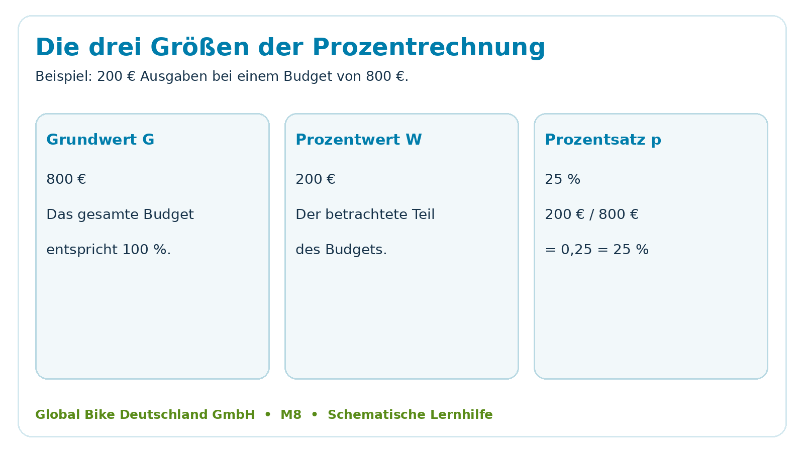
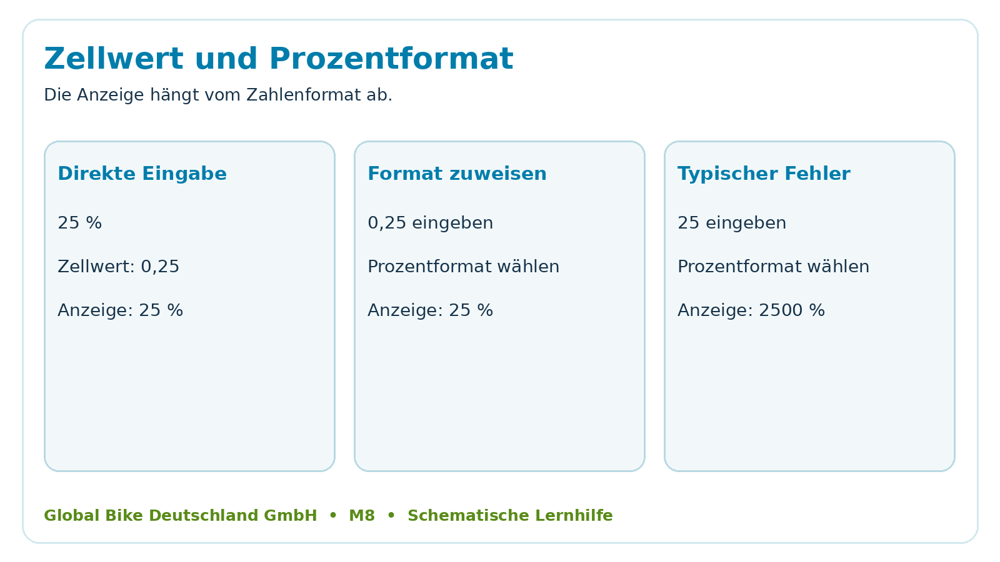
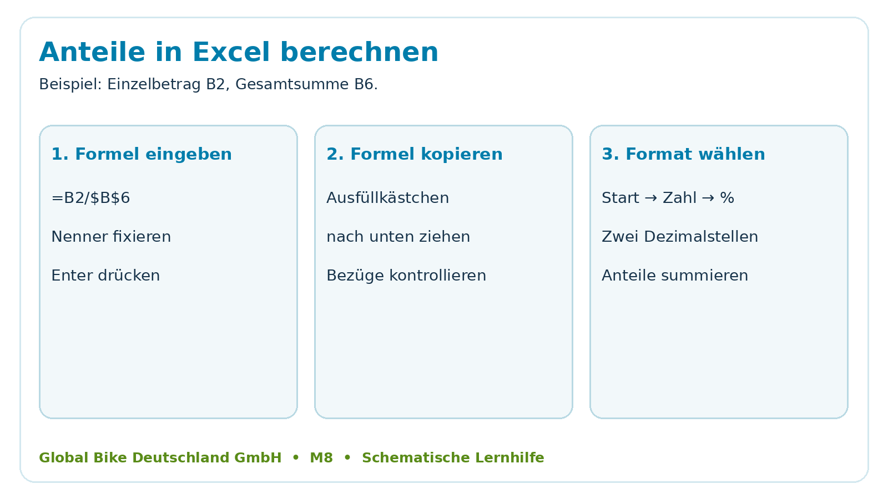
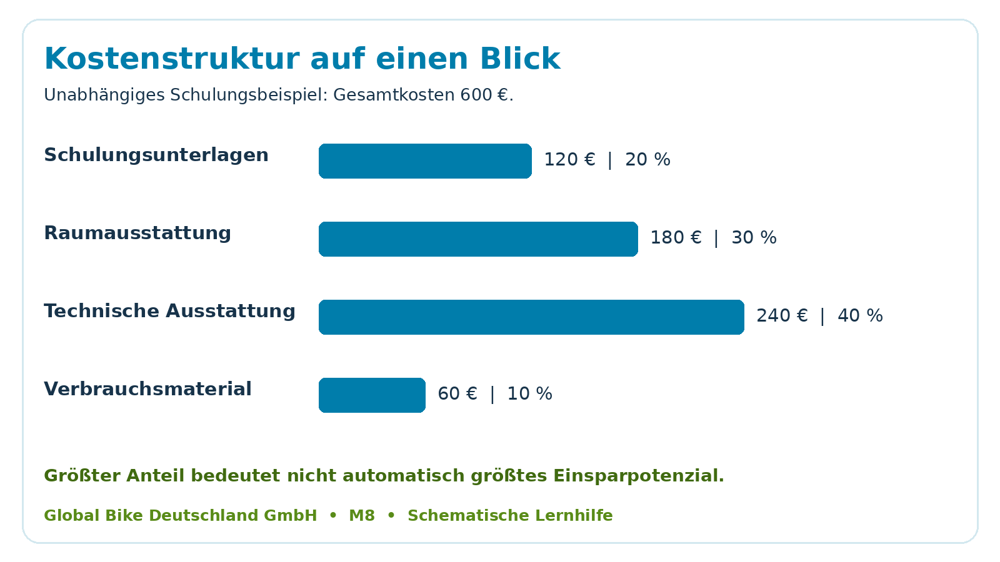
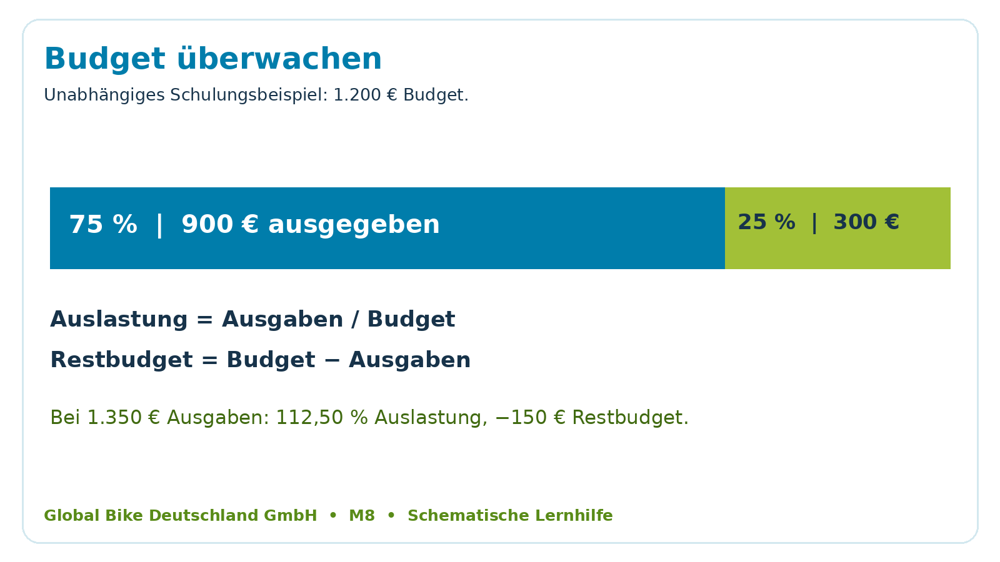
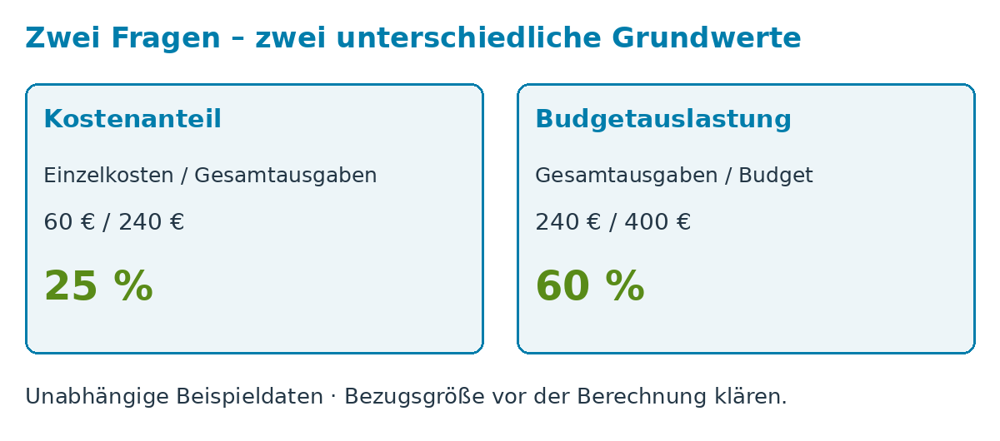

# Ü7 – Ein Bürobudget überwachen

Global Bike Deutschland GmbH · Verwaltung · Löppt · freiwillig · unbenotet · keine KI

## Ausgangssituation

Emma Fuchs benötigt eine Übersicht über die erfassten Nettoausgaben für die Büroorganisation im Marktgebiet Nordwest im ersten Quartal 2027. Für diese eigenständige Übung stehen 1.200 € Nettobudget zur Verfügung. Erfasst sind Papier und Druck (300 €), Versandmaterial (240 €), Ordnungsmaterial (180 €) und Informationsmaterial (180 €). Noch nicht erfasste oder zugesagte Ausgaben sind nicht bekannt. Die Übersicht soll Änderungen automatisch berücksichtigen und Überschreitungen sichtbar machen. Es handelt sich um simulierte Übungsdaten, nicht um M1 oder SAP-Stammdaten.

## Arbeitsaufträge

1.  Öffnen Sie UE7_Arbeitsdatei.xlsx. Speichern Sie eine Arbeitskopie unter GB_UE7_Budget.xlsx. Erkunden Sie die Blätter Budget und Prozentlabor. Unterscheiden Sie blaue Eingaben und grüne Bearbeitungsfelder.
2.  Bearbeiten Sie im Prozentlabor die drei Grundaufgaben: In Zeile 4 fehlt der Prozentwert, in Zeile 5 der Prozentsatz, in Zeile 6 der Grundwert. Bestimmen Sie jeweils die passende Rechenoperation und erstellen Sie eine Formel mit Zellbezügen. Erklären Sie, weshalb ein Prozentsatz von 15 % als 0,15 gespeichert wird. Nutzen Sie bei Bedarf M8.
3.  Ermitteln Sie im Budgetblatt B9 mit SUMME aus B5:B8. Prüfen Sie den Bereich und rechnen Sie die Summe unabhängig nach. Ermitteln Sie in C5 den Anteil der ersten Kostenart an den gesamten Ausgaben. Fixieren Sie den gemeinsamen Nenner und kopieren Sie die Formel bis C8. Addieren Sie die Anteile in C9. Erklären Sie den Unterschied zwischen dem Grundwert der Kostenanteile und dem Grundwert der Budgetauslastung.
4.  Berechnen Sie in B11 die Budgetauslastung, in B12 das Restbudget und in B13 den verbleibenden Budgetanteil. Verwenden Sie Zellbezüge statt Festwerte. Formatieren Sie Geldbeträge mit zwei Nachkommastellen und Quoten als Prozent mit zwei Nachkommastellen. Multiplizieren Sie nicht zusätzlich mit 100.
5.  Tragen Sie in B14 eine kurze Statusaussage ein: Rest vorhanden, ausgeschöpft oder überschritten. Aktualisieren Sie diese Aussage bei jedem Test. Freiwillig: automatisieren Sie den Status mit WENN (kein verbindlicher neuer Prüfungsinhalt). Negative Restbeträge dürfen nicht verborgen werden.
6.  Ermitteln Sie die größte Kostenposition. Formulieren Sie für Emma Fuchs eine kurze interne Einschätzung mit Zeitraum, Budget, erfassten Ausgaben, Auslastung, Restbetrag und einer begründeten Empfehlung. Berücksichtigen Sie, dass unbekannte Verpflichtungen und Freigaben eine Aussage über frei verfügbares Geld begrenzen.
7.  Führen Sie die Änderungstests einzeln durch und stellen Sie jeweils die Ausgangswerte wieder her: a) Budget B2 auf 1.000 €; b) Papier und Druck B5 auf 600 € (Budget exakt ausgeschöpft); c) B5 auf 700 € (Überschreitung). Sagen Sie jeweils vorher voraus, welche Quoten sich ändern. Prüfen Sie Formeln, Status und negative Restwerte. d) Optional: Budget vorübergehend auf null setzen. Erklären Sie \#DIV/0! und stellen Sie 1.200 € wieder her. Keine Nullquote erfinden.
8.  Bearbeiten Sie den Rundungstest im Prozentlabor: Summieren Sie B9:B11 in B12, berechnen Sie die drei Anteile mit absolutem Nenner und summieren Sie diese in C12. Stellen Sie zwei Prozent-Nachkommastellen ein. Vergleichen Sie die Summe der sichtbaren Einzelwerte mit dem Ergebnis der Summenformel. Erhöhen Sie die Anzeige auf vier Nachkommastellen und erklären Sie die Abweichung. Rechnen Sie mit ungerundeten Zellwerten weiter.
9.  Prüfen Sie die Arbeitsmappe anhand der Selbstkontrolle. Stellen Sie alle Ausgangswerte wieder her, speichern und öffnen Sie die Datei erneut. Nutzen Sie erst danach die getrennte Musterlösung. Keine Abgabe erforderlich.

## Lernhilfen

     

## Klick-Anleitungen – Excel Desktop Windows, deutsch

| Ziel                    | Vorgehen                                                                                 |
|-------------------------|------------------------------------------------------------------------------------------|
| Arbeitskopie            | Datei → Speichern unter → XLSX                                                           |
| Prozent eingeben        | Zelle auswählen → 15% eingeben → Enter                                                   |
| Prozentwert             | Ergebniszelle → = → Grundwert anklicken → \* → Prozentsatz anklicken → Enter             |
| Prozentsatz             | Ergebniszelle → = → Prozentwert anklicken → / → Grundwert anklicken → Enter              |
| Grundwert               | Ergebniszelle → = → Prozentwert anklicken → / → Prozentsatz anklicken → Enter            |
| Summe                   | B9 → Start → AutoSumme → B5:B8 prüfen → Enter                                            |
| Anteil                  | C5 → = → B5 anklicken → / → B9 anklicken → F4 bis beide Dollarzeichen erscheinen → Enter |
| Formel kopieren         | Ausfüllkästchen von C5 bis C8 ziehen                                                     |
| Formel prüfen           | Letzte Zelle anklicken → Bearbeitungsleiste                                              |
| Restbudget              | B12 → = → Budget anklicken → - → Gesamtausgaben anklicken → Enter                        |
| Prozentformat           | Zellen markieren → Strg+1 → Prozent → 2 Dezimalstellen                                   |
| Währung                 | Strg+1 → Währung → Euro → 2 Dezimalstellen                                               |
| Dezimalstellen          | Start → Zahl → Dezimalstelle hinzufügen/entfernen                                        |
| Automatische Berechnung | Formeln → Berechnungsoptionen → Automatisch                                              |
| Neuberechnung           | F9                                                                                       |
| Formeln anzeigen        | Formeln → Formeln anzeigen; danach ausschalten                                           |
| Speichern               | Strg+S                                                                                   |

## Fehlerdiagnose

2500 % statt 25 %: Eingabewert prüfen. Hundertfacher Anteil: Multiplikation mit 100 entfernen, wenn Prozentformat verwendet wird. Wandernder Nenner: Dollarzeichen prüfen. Gleiche Anteile trotz verschiedener Kosten: Zähler nicht fixieren. Summe deutlich über 100 %: doppelte Positionen oder falsche Bezugsgröße prüfen. 99,99 %: Anzeige-Rundung untersuchen. \#DIV/0!: Grundwert null oder leer, Quote nicht definiert. \#WERT!: Text statt Zahl prüfen. Negativer Rest: Überschreitung sichtbar lassen. Netto und Brutto nicht mischen. Fehlende Angaben nicht als null interpretieren.

## Selbstkontrolle

- [ ] Arbeitskopie gespeichert; Original unverändert.
- [ ] Drei Grundaufgaben mit Zellbezügen berechnet.
- [ ] Gesamtausgaben vollständig summiert.
- [ ] Kostenanteile mit festem Nenner berechnet.
- [ ] Budgetauslastung und Restanteil beziehen sich auf das Budget.
- [ ] Restbudget und Status stimmen überein.
- [ ] Geld- und Prozentformate stimmen; keine zusätzliche Multiplikation mit 100.
- [ ] Drei Änderungstests durchgeführt und Ausgangswerte wiederhergestellt.
- [ ] Rundungsabweichung erklärt, keine Anteile künstlich angepasst.
- [ ] Kaufmännische Empfehlung berücksichtigt unbekannte Verpflichtungen.
- [ ] Datei gespeichert und erneut geöffnet.

[Excel-Arbeitsdatei herunterladen](UE7_Arbeitsdatei.xlsx)
