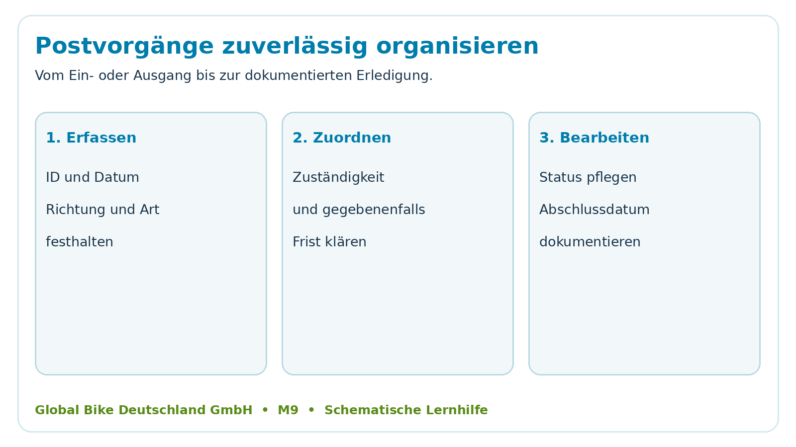
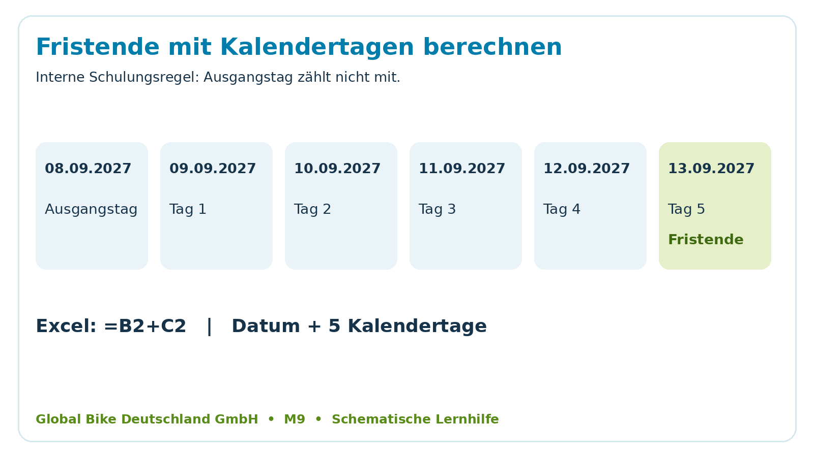
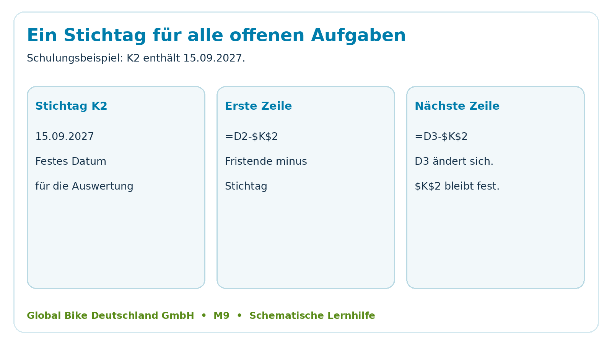
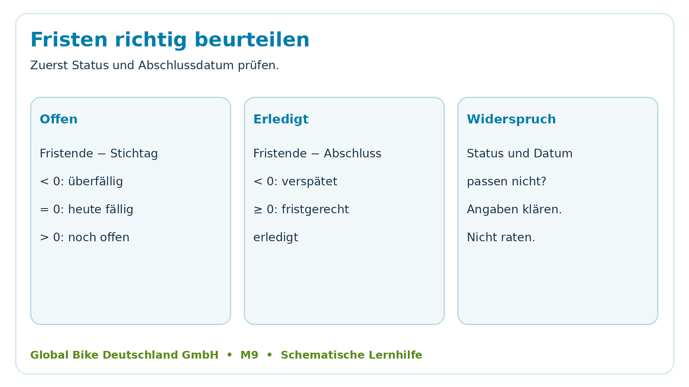
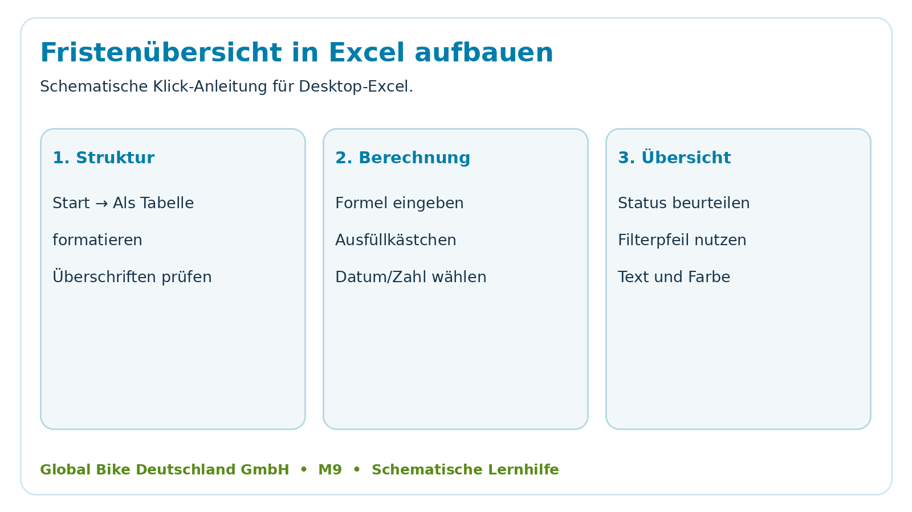
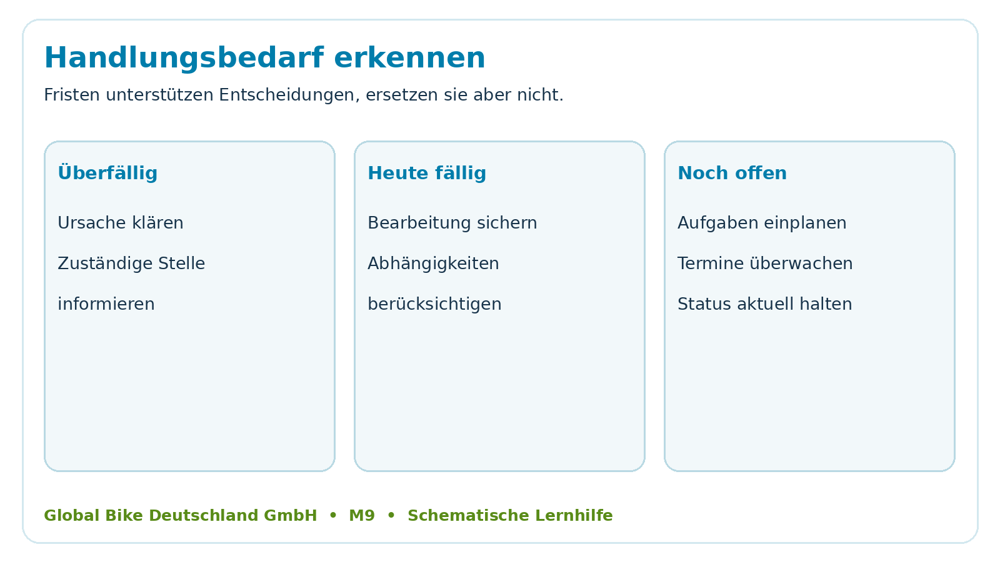
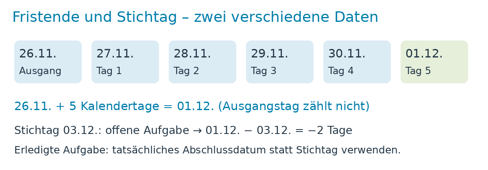

# Ü8 – Posteingänge, Termine und Fristen organisieren

Global Bike Deutschland GmbH · Verwaltung · Löppt · freiwillig · unbenotet · keine KI

## Ausgangssituation

Emma Fuchs benötigt zum 12.10.2027 eine Übersicht über Post und interne Aufgaben im Marktgebiet Nordwest. Kundenrückmeldungen, Unterlagen und Besprechungen müssen abgestimmt werden. Die drei Tabellenblätter enthalten eigenständige simulierte Daten, keine SAP-Daten und keine Lösung zu M1. Eine Postreferenz verbindet eine Aufgabe mit einem Postvorgang; eigenständige Aufgaben haben keine Referenz. Nicht jede versandte Nachricht bedeutet einen abgeschlossenen Geschäftsvorgang.

## Das trainieren Sie

Post erfassen, Termine und Fristen unterscheiden, echte Datumswerte verwenden, Kalendertage addieren, zentrale Stichtage fixieren, Differenzen interpretieren und Prioritäten begründen.

## Arbeitsaufträge

1.  Öffnen Sie UE8_Arbeitsdatei.xlsx und speichern Sie eine Kopie. Prüfen Sie die drei Blätter Postliste, Fristen und Termine. Blau kennzeichnet Eingaben, Grün Ergebnisse. Prüfen Sie IDs, Richtungen, Zuständigkeiten und die tatsächlichen Ein-/Ausgangsdaten. Zählen Sie Eingänge und Ausgänge getrennt. Prüfen Sie die Referenzen; eine Aufgabe ist kein zusätzlicher Postvorgang.
2.  Prüfen Sie Datumsformate und leere Abschlussdaten. Erfassen Sie freiwillig in einer Kopie einen zusätzlichen Posteingang mit eigener ID, tatsächlichem Datum, Zuständigkeit und Status; erweitern Sie den Filterbereich. Entfernen Sie die Testzeile anschließend. IDs sind Text. Offene Aufgaben haben kein Abschlussdatum; erledigte Aufgaben benötigen ein plausibles Datum zwischen Ausgang und Stichtag. Widersprüche zuerst klären.
3.  Vergleichen Sie die Termine T081 und T082 mit den zugehörigen Vorbereitungsaufgaben. Erläutern Sie den Unterschied zwischen einem festen Termin mit Uhrzeit und dem letzten zulässigen Erledigungstag.
4.  Berechnen Sie im Blatt Fristen in I4 das Fristende aus Ausgangsdatum und Fristdauer. Kopieren Sie bis I10. Verwenden Sie Kalendertage: Ausgangstag zählt nicht, Wochenenden und Feiertage verschieben nichts. Formatieren Sie I als Datum und F als ganze Zahl. Prüfen Sie besonders den Monatswechsel in F086. Es handelt sich um interne Regeln, nicht gesetzliche Fristen.
5.  Berechnen Sie in J4:J10 die Tagesdifferenz. Bei offenen Aufgaben ziehen Sie den zentralen Stichtag B1 vom Fristende ab; fixieren Sie B1 mit Dollarzeichen. Bei erledigten Aufgaben ziehen Sie stattdessen das tatsächliche Abschlussdatum ab. Wählen Sie die Formel je Zeile nach Status. Formatieren Sie J als ganze Zahl. Negative Werte bedeuten bei offenen Aufgaben überfällige Tage, bei erledigten Aufgaben verspäteten Abschluss. Null bedeutet heute fällig bzw. am Fristende erledigt.
6.  Tragen Sie in K die Beurteilung ein: Überfällig, Heute fällig, Noch offen, Fristgerecht erledigt oder Verspätet erledigt. Prüfen Sie vorher die Eingaben. Freiwillig können Sie die Differenz und Beurteilung mit WENN automatisieren (M9); die manuelle Beurteilung ist gleichwertig. Bei Änderungen müssen manuelle Angaben und gegebenenfalls die Differenzformel aktualisiert werden.
7.  Formulieren Sie eine kurze interne Empfehlung an Emma Fuchs: Welche offenen Aufgaben benötigen sofortige Abstimmung, welche sind einzuplanen, welche verspätet erledigten Aufgaben erfordern Ursachenklärung? Berücksichtigen Sie Kundenwirkung, Zuständigkeit und Abhängigkeiten. Fristen nicht eigenmächtig ändern. Erklären Sie, warum interne Ablagefristen keine Löschfristen sind.
8.  Führen Sie in einer Kopie drei Tests durch, jeweils mit Wiederherstellung: a) B1 auf 15.10.2027 ändern; vergleichen Sie offene und erledigte Differenzen. b) Fristdauer F4 von 5 auf 8 ändern; prüfen Sie F081. c) F082 als Erledigt mit Abschlussdatum 12.10.2027 erfassen; passen Sie bei manueller Variante die Differenzformel an. Aktualisieren Sie K. Freiwillig: widersprüchlichen Status ohne Abschlussdatum erkennen und vor Berechnung korrigieren. Keine erfundenen Abschlussdaten im Original.
9.  Prüfen Sie die Arbeitsmappe, stellen Sie alle Ausgangswerte wieder her, speichern und öffnen Sie erneut. Vergleichen Sie erst dann mit der getrennten Musterlösung. Keine Abgabe.

## Hilfen bei Bedarf

      

## Klick-Anleitungen (Excel Desktop Windows, deutsch)

| Ziel                   | Vorgehen                                                                |
|------------------------|-------------------------------------------------------------------------|
| Arbeitskopie           | Datei → Speichern unter → XLSX                                          |
| Datum                  | Zelle markieren → Strg+1 → Benutzerdefiniert → TT.MM.JJJJ               |
| Datum eingeben         | z\. B. 12.10.2027 → Enter                                               |
| Textdatum prüfen       | freiwillig ISTZAHL in freier Zelle; plausibles Datum zusätzlich prüfen  |
| Textdatum korrigieren  | Kopie → Daten → Text in Spalten → Datum TMJ → Zielbereich prüfen        |
| Uhrzeit                | Strg+1 → Uhrzeit bzw. hh:mm                                             |
| Tage                   | Strg+1 → Zahl → 0 Dezimalstellen                                        |
| Fristende              | I4 → = → E4 anklicken → + → F4 anklicken → Enter                        |
| Kopieren               | Ausfüllkästchen bis I10 ziehen                                          |
| Stichtag fixieren      | J4 → = → I4 → - → B1 → F4-Taste bis $B$1 → Enter                |
| Erledigte Aufgabe      | Fristende minus Abschlussdatum der jeweiligen Zeile                     |
| Formel kontrollieren   | Zelle anklicken → Bearbeitungsleiste                                    |
| Status sichtbar machen | Start → Bedingte Formatierung → Textinhalt; Textbezeichnung beibehalten |
| Filter                 | Filterpfeil in K → gewünschte Beurteilung → anschließend Filter löschen |
| Berechnung             | Formeln → Berechnungsoptionen → Automatisch; F9                         |
| Speichern              | Strg+S                                                                  |

## Fehlerdiagnose

##### kann auf zu schmale Spalten oder negative Datumswerte hinweisen; Differenzen als Zahl formatieren. Textdatum: Datentyp korrigieren. Frist um einen Tag falsch: Ausgangstag nicht mitzählen. Wochenende übersprungen: Kalendertage verwenden. Wandernder Stichtag: $B$1 prüfen. HEUTE() verändert historische Auswertung. Erledigte Aufgabe als überfällig: Abschlussdatum statt Stichtag verwenden. Leere oder widersprüchliche Angaben zuerst klären. Nur ganze Zeilen sortieren. Farbe allein genügt nicht.

## Selbstkontrolle

- [ ] Postliste, Fristen und Termine getrennt und Referenzen geprüft.
- [ ] IDs eindeutig; echte Datumswerte und richtige Formate.
- [ ] Fristenden mit Kalendertagen berechnet, Monatswechsel geprüft.
- [ ] Stichtag absolut referenziert.
- [ ] Offene und erledigte Differenzen richtig berechnet.
- [ ] Fünf Beurteilungen fachlich unterschieden.
- [ ] Prioritäten mit Zuständigkeit und Kundenwirkung begründet.
- [ ] Drei Änderungstests durchgeführt; Ausgangswerte wiederhergestellt.
- [ ] Interne Ablagefrist nicht als Löschfrist verstanden.
- [ ] Datei gespeichert und erneut geöffnet.

[Excel-Arbeitsdatei herunterladen](UE8_Arbeitsdatei.xlsx)
